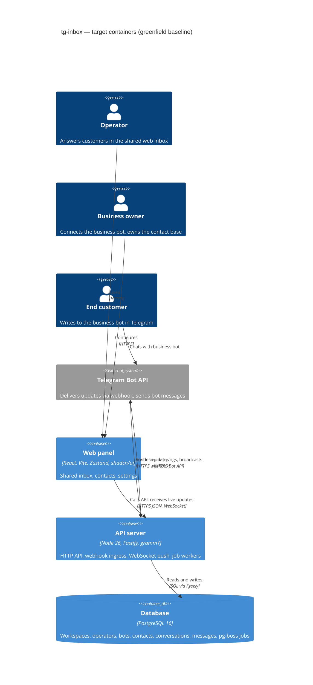

# Architecture map — tg-inbox

> **Greenfield foundation** — the *target baseline* fixed by `survey` on 2026-10-11, before any code
> exists. `scaffold` materializes it from `docs/features/_scaffold/tasks.json`; after that the map
> describes the real skeleton and every feature (`specify → … → implement`) builds into it.
> Foundational decisions and their «why» live in `docs/adr/0001`, `0002`, `0004` (`0003` is superseded by `0004`).

## Stack

- Language / runtime: **TypeScript** (strict) on **Node.js 26** — pinned in `.nvmrc` (`26`), installed via `nvm install && nvm use`. Node 26 is the newest release line (v26.11.1 at decision time) and enters LTS end of October 2026 → [ADR-0001](adr/0001-use-a-typescript-pnpm-monorepo-on-node-26.md)
- Package manager: **pnpm workspaces** monorepo (`apps/*`, `packages/*`)
- Backend: **Fastify 5** (HTTP API + Telegram webhook endpoint + `@fastify/websocket` for live inbox), **zod** schemas via `fastify-type-provider-zod`
- Telegram: **grammY** (Bot API client, webhook mode, one `Bot` instance per connected business bot)
- Frontend: **React 19 + Vite** SPA, **Tailwind CSS + shadcn/ui**, **Zustand** for client state (incl. data fetched from the API and live WebSocket updates)
- Datastore: **PostgreSQL 16**, accessed via **Kysely** (type-safe SQL query builder, `pg` driver); table types generated by **kysely-codegen**; migrations via the **Kysely Migrator** driven by **kysely-ctl** (reversible `up`/`down`) → [ADR-0004](adr/0004-use-postgres-with-kysely-reversible-migrations-and-workspace-scoped-tenancy.md)
- Background jobs: **pg-boss** (Postgres-backed queue — broadcast throttling, scheduled posts, operator pings)
- Build / test / lint: `pnpm -r build` (tsc for api/shared, vite for web) · `pnpm test` (Vitest across workspaces) · `pnpm lint` (ESLint + Prettier check + `tsc --noEmit`)
- Local env: `docker compose up -d` brings up Postgres; integration tests use **Testcontainers** (ephemeral Postgres)
- CI: **GitHub Actions** — one workflow: install → lint → build → test

## C4 — target baseline

One deployable API process serves every workspace (multi-tenant); the web panel is a static SPA
served alongside it. Job workers (pg-boss) run in the same process in v1 and can be split into a
separate process later without code changes to modules.

## Module inventory

Target layout — modular monolith → [ADR-0002](adr/0002-organize-the-backend-as-a-modular-monolith-with-layered-modules.md).
Only `platform` and the baseline `health` module are created by scaffold; feature modules appear as
roadmap steps are specified.

| Module | Path | Layers | Wired at | Responsibility |
|---|---|---|---|---|
| platform | `apps/api/src/platform/` | — (shared infra) | `apps/api/src/app.ts` (`buildApp`) | config, db client, errors, ids, logger, telegram client factory, job queue |
| health | `apps/api/src/modules/health/` | http | `apps/api/src/app.ts` | baseline module: `GET /health` (db ping) — the scaffold precedent |
| shared | `packages/shared/src/` | — | imported by `apps/api` + `apps/web` | zod schemas / DTO types / error codes shared across the wire |
| web | `apps/web/src/` | app / pages / features / shared | `apps/web/src/main.tsx` | operator web panel |
| *(future)* workspaces, auth, bots, conversations, contacts, notifications, broadcasts, posts | `apps/api/src/modules/<m>/` | domain / app / infra / http | `apps/api/src/app.ts` | one module per roadmap step (see `docs/roadmap.md`) |

## Conventions (the rules a new feature must match)

> Greenfield: these are **decided rules**, cited against the files scaffold will create. Every
> feature conforms to them; scaffold creates the first instance of each.

- **Module wiring / registration:** each module exports a Fastify plugin `register<Module>(app, deps)` from `modules/<m>/http/routes.ts`; `buildApp()` in `apps/api/src/app.ts` constructs deps (composition root) and registers every module plugin. No module self-registers or reads globals.
- **Module layers:** `domain/` (pure types + rules, no I/O) → `app/` (use cases; depend on ports declared here) → `infra/` (Kysely repositories, Telegram adapters implementing the ports) → `http/` (routes, zod request/response schemas). Imports flow inward only; `domain` imports nothing outside itself.
- **Error handling:** domain/app throw typed `AppError` subclasses (`NotFoundError`, `ValidationError`, `ForbiddenError`, `ConflictError`) from `apps/api/src/platform/errors.ts`; one Fastify error handler maps them to the envelope `{ "error": { "code": string, "message": string, "details"?: unknown } }` with the matching HTTP status. Error `code`s are declared in `packages/shared/src/errors.ts` so the web panel can switch on them.
- **IDs:** **UUIDv7**, generated in the application via `newId()` in `apps/api/src/platform/ids.ts` (never DB defaults); stored as Postgres `uuid`. Telegram's own ids (chat id, user id, message id) are stored as `bigint` alongside, never used as primary keys.
- **Persistence / DB access:** one shared `Kysely<DB>` instance from `apps/api/src/platform/db.ts`; the `DB` interface is **generated** by kysely-codegen into `apps/api/src/platform/db.types.gen.ts` (committed, never hand-edited — regenerate with `pnpm db:codegen` after migrating). Each table is owned by exactly one module; only that module's `infra/` repositories query its tables (no cross-module table access — call the owning module's app layer instead). Every tenant-owned table carries a non-null `workspace_id`, and every repository method takes `workspaceId` and filters by it. The DB is dumb storage: no triggers, no stored procedures; constraints (FK, unique, not null, check) are welcome.
- **Migrations:** **Kysely Migrator via kysely-ctl**, reversible: `pnpm db:new <name>` creates `apps/api/migrations/<timestamp>_<name>.ts` exporting `up(db)` and `down(db)` (schema builder or raw `sql` template); `pnpm db:migrate` applies all pending (`migrate:latest`), `pnpm db:rollback` reverts the last one (`migrate:down`); config in `apps/api/kysely.config.ts`. Every migration ships a working `down`. The paired `*.up.sql` / `*.down.sql` that `data-model` stages are promoted by `implement` into one TS migration whose `up`/`down` run that SQL via `sql.raw` → [ADR-0004](adr/0004-use-postgres-with-kysely-reversible-migrations-and-workspace-scoped-tenancy.md)
- **Tests:** **Vitest** everywhere. Unit tests sit next to the code (`*.test.ts`) — domain + app with in-memory port fakes. Integration tests (`*.int.test.ts`) hit a real Postgres via **Testcontainers** (migrations applied at suite start) and use Fastify `app.inject()` for HTTP. Web: Vitest + Testing Library (`*.test.tsx`). Smoke test: `apps/api/src/app.int.test.ts` boots `buildApp()` and gets `200` from `GET /health`.
- **Inter-module communication:** in-process direct calls to another module's **app-layer** functions (passed in through the composition root); asynchronous work (broadcast sends, scheduled posts, pings) goes through **pg-boss** jobs with named queues `<module>.<job>`. No HTTP between modules.
- **Validation / contracts:** request + response bodies are zod schemas from `packages/shared`; Fastify validates with `fastify-type-provider-zod`; the web panel parses responses with the same schemas.
- **Telegram:** all Bot API calls go through `apps/api/src/platform/telegram.ts` (grammY `Api` per bot token); webhook requests are authenticated by Telegram's `X-Telegram-Bot-Api-Secret-Token` header. Bot tokens are tenant secrets — never logged, never returned by the API.
- **Config:** env vars parsed once by a zod schema in `apps/api/src/platform/config.ts`; `.env.example` documents every key; no `process.env` reads elsewhere.
- **UI / styling:** Tailwind + shadcn/ui components in `apps/web/src/shared/ui/`; feature UI composes them — detail in §Frontend / UI foundation.

## Datastores

| Store | Engine | Accessed via | Notes |
|---|---|---|---|
| Main DB | PostgreSQL 16 | Kysely + `pg` (`apps/api/src/platform/db.ts`) | all tenant data, every tenant table scoped by `workspace_id` |
| Job queue | PostgreSQL 16 (pg-boss schema `pgboss`) | pg-boss (`apps/api/src/platform/jobs.ts`) | same database, separate schema managed by pg-boss itself (not by our migrations) |

## Frontend / UI foundation

> Target foundation — scaffold creates it; every `ui`-layer task **composes** these, never adds a
> second component kit or styling approach.

- **Component library / design system:** **shadcn/ui** (copied components, owned in-repo) — `apps/web/src/shared/ui/`
- **Design tokens:** shadcn CSS variables (colors, radius) in `apps/web/src/index.css`, mapped in the Tailwind config; light + dark
- **Styling approach:** **Tailwind CSS** only — no CSS modules, no CSS-in-JS
- **Shared primitives:** shadcn `Button`, `Input`, `Card`, `Dialog`, `Badge`, `ScrollArea`, `Avatar`, `Toast` (added on demand via the shadcn CLI) — `apps/web/src/shared/ui/`
- **State / data-fetching:** **Zustand** stores per feature (`apps/web/src/features/<f>/store.ts`); API calls through a typed client in `apps/web/src/shared/api/client.ts` (fetch + shared zod schemas); live inbox events arrive over one WebSocket (`apps/web/src/shared/api/realtime.ts`) and are applied to stores via `set()`
- **Routing:** React Router — routes in `apps/web/src/app/routes.tsx`
- **Closest UI precedent:** none yet — the first feature screen becomes the precedent; scaffold ships only an app shell page (`apps/web/src/pages/HomePage.tsx`)

## Where things live / closest precedents

- A new backend capability → new module `apps/api/src/modules/<m>/{domain,app,infra,http}`, registered in `apps/api/src/app.ts`, modelled on `modules/health` until the first feature module exists (then on that).
- A new table → `pnpm db:new <name>` → write `up`/`down` in `apps/api/migrations/` → `pnpm db:migrate` → `pnpm db:codegen` (commit the regenerated `db.types.gen.ts`) → repository in `modules/<m>/infra/`.
- A new async job → a pg-boss queue `<module>.<job>` with its worker in `modules/<m>/infra/jobs.ts`, registered from the composition root.
- A new wire type → zod schema in `packages/shared/src/<module>.ts`, used by both api routes and the web client.
- A new screen → `apps/web/src/features/<f>/` (components + `store.ts`), a page in `apps/web/src/pages/`, composed from `shared/ui` primitives.

## Constraints & known tech-debt

- **Node 26 is Current, not yet LTS** (LTS from end of October 2026) — acceptable for a pre-pilot product; revisit only if a dependency breaks on 26.
- **Generated DB types depend on a live, migrated database** — `db.types.gen.ts` must be regenerated after every migration; a stale file compiles against the wrong schema. Destructive changes still need expand → migrate → contract across releases even though `down` exists (a `down` that drops data is not a real rollback).
- **Telegram Bot API limits:** ~30 msgs/s per bot for broadcasts; channel posting needs the bot as admin with `can_post_messages`; no native scheduling (ours via pg-boss) — see `docs/roadmap.md` § Decisions so far.
- **Multi-tenancy by convention** (`workspace_id` filter in every repository, no Postgres RLS in v1) — a missed filter is a data leak; every repository needs an integration test that proves cross-workspace isolation.
- **One process** runs HTTP + webhooks + job workers in v1 — fine for 5–10 pilots; split workers out if broadcast load interferes with webhook latency.
- No deployment target decided yet — deferred until the first pilot goes live.

## Reconciliation with the authored architecture doc

No authored architecture doc exists (`docs/` holds only `idea-brief.md` and `roadmap.md`); this map
is the reference. It is consistent with the roadmap's decisions (own bot per business, web-only
operators, contact = Telegram profile + tags + history, Telegram throttling/posting limits).
