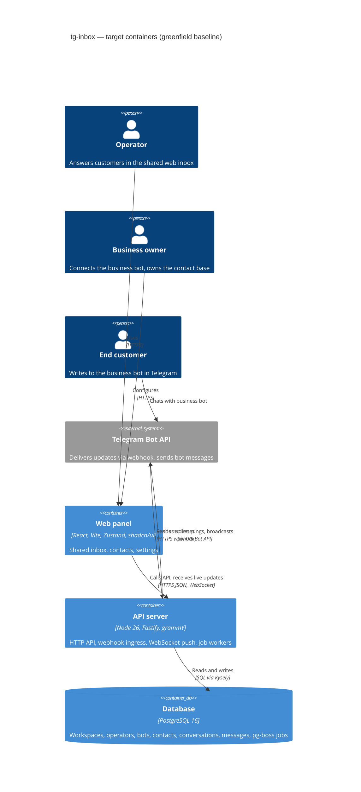

# Architecture map — tg-inbox

> **Foundation baseline** — fixed by `survey` on 2026-10-11 and materialized by `scaffold`; the map now
> describes the real code (reflects the commit above) and every feature (`specify → … → implement`) builds into it.
> Foundational decisions and their «why» live in `docs/adr/0001`, `0002`, `0004` (`0003` is superseded by `0004`).

## Stack

- Language / runtime: **TypeScript** (strict) on **Node.js 26** — pinned in `.nvmrc` (`26`), installed via `nvm install && nvm use`. Node 26 is the newest release line (v26.11.1 at decision time) and enters LTS end of October 2026 → [ADR-0001](adr/0001-use-a-typescript-pnpm-monorepo-on-node-26.md)
- Package manager: **pnpm workspaces** monorepo (`apps/*`, `packages/*`)
- Backend: **Fastify 5** (HTTP API + Telegram webhook endpoint + `@fastify/websocket` for live inbox), **zod** schemas via `fastify-type-provider-zod`
- Telegram: **grammY** (Bot API client, webhook mode, one `Bot` instance per connected business bot)
- Frontend: **React 19 + Vite** SPA, **Tailwind CSS + shadcn/ui**, **Zustand** for client state (incl. data fetched from the API and live WebSocket updates)
- Datastore: **PostgreSQL 16**, accessed via **Kysely** (type-safe SQL query builder, `pg` driver); table types generated by **kysely-codegen**; migrations via the **Kysely Migrator** driven by **kysely-ctl** (reversible `up`/`down`) → [ADR-0004](adr/0004-use-postgres-with-kysely-reversible-migrations-and-workspace-scoped-tenancy.md)
- Background jobs: **pg-boss** (Postgres-backed queue — broadcast throttling, scheduled posts, operator pings)
- Build / test / lint: `pnpm -r build` (tsc for api/shared, vite for web) · `pnpm test` (Vitest across workspaces) · `pnpm lint` (ESLint + Prettier check + `tsc --noEmit`)
- Local env: `docker compose up -d` brings up Postgres; integration tests use **Testcontainers** (ephemeral Postgres)
- CI: **GitHub Actions** — one workflow: install → lint → build → test

## C4 — target baseline

One deployable API process serves every workspace (multi-tenant); the web panel is a static SPA
served alongside it. Job workers (pg-boss) run in the same process in v1 and can be split into a
separate process later without code changes to modules.

## Module inventory

Target layout — modular monolith → [ADR-0002](adr/0002-organize-the-backend-as-a-modular-monolith-with-layered-modules.md).
Scaffold created `platform` and the baseline `health` module; `auth` and `workspaces` arrived with workspace-operators;
`bots`, `conversations` and `contacts` with bot-connection; `inbox` (and `platform/realtime`) with shared-inbox; assignment-statuses added conversation state, activity entries and the deactivation port (no new module); `notifications` arrived with operator-notifications; contacts gave `contacts` its own routes, the tags and the tag history; `broadcasts` arrived with broadcasts (with per-bot reachability `contact_bot_reach` in `contacts`, broadcast items in `conversations`, `my_chat_member` and the broadcast sender in `bots`); other feature modules appear as roadmap steps are specified.
Module dependencies are one-way: `inbox → {conversations, contacts, bots, workspaces, notifications, broadcasts}`, `broadcasts → {contacts, conversations, bots, workspaces}` (nothing calls `broadcasts` back), `notifications → {conversations, workspaces, bots}` (app-layer calls only; the reverse directions are runtime ports filled in `buildDeps()`: the `bots` inbound interceptor and bot-connected hook, `workspaces` `onMembershipDeactivated` and `linkedAccounts`, `contacts.currentBot` from the `bots` core and the `bots` block port into `contacts`), `bots → conversations → contacts`, `bots → contacts` and `contacts → workspaces` (member display names for tag and history actors) (app-layer calls only,
[bot-connection ADR-0005](features/bot-connection/adr/0005-split-the-feature-into-bots-conversations-and-contacts-modules.md),
[shared-inbox ADR-0007](features/shared-inbox/adr/0007-add-an-inbox-module-that-orchestrates-conversations-contacts-bots-and-workspaces.md),
[contacts ADR-0001](features/contacts/adr/0001-own-tags-in-the-contacts-module-with-its-own-routes-and-compose-the-profile-conversation-from-inbox-reads.md),
[broadcasts ADR-0001](features/broadcasts/adr/0001-add-a-broadcasts-module-that-owns-drafts-groups-and-recipients-and-reaches-other-modules-through-their-app-layers.md)).

| Module | Path | Layers | Wired at | Responsibility |
|---|---|---|---|---|
| platform | `apps/api/src/platform/` | — (shared infra) | `apps/api/src/app.ts` (`buildApp`), `apps/api/src/deps.ts` (`buildDeps`) | config, db client, errors, ids, logger, telegram client factory, job queue, realtime (`realtime.ts`: in-transaction `pg_notify` publisher on channel `realtime` + a dedicated-connection `LISTEN` listener with reconnect and gap resync) |
| auth | `apps/api/src/modules/auth/` | domain / app / infra / http | `apps/api/src/app.ts` (routes under `/api/auth` and `/api/password-reset-links`), `apps/api/src/deps.ts` (use cases) | accounts, sessions, login/logout, password change and admin-issued reset links; owns `accounts`, `sessions`, `sign_in_failures`, `password_reset_links` → `docs/features/workspace-operators/data-model.md` |
| workspaces | `apps/api/src/modules/workspaces/` | domain / app / infra / http | `apps/api/src/app.ts` (routes under `/api`), `apps/api/src/deps.ts` (use cases; also the admin CLI) | workspaces, memberships (owner/operator roles) and invitations; `lockActiveMembers` (memberships `FOR SHARE`) and `activeMembers`; declares the `onMembershipDeactivated(tx, {workspaceId, accountId, at})` port that `team.deactivateMembership` calls inside its transaction (filled in `buildDeps()` with `conversations.unassignDeactivatedMember`, built before `team`: a runtime edge, no import); the workspace row lock is `FOR NO KEY UPDATE`; owns `workspaces`, `memberships`, `invitations` tables → `docs/features/workspace-operators/data-model.md` |
| bots | `apps/api/src/modules/bots/` | domain / app / infra / http | `apps/api/src/app.ts` (owner routes under `/api/workspaces/:workspaceId/bot…`, public `POST /api/telegram/webhook/:botId`, the health-check workers), `apps/api/src/deps.ts` (use cases) | the workspace's business bot: encrypted token, per-bot webhook + secret, connection state, scheduled health checks (which also re-register a webhook whose `allowed_updates` lack `my_chat_member`); private `my_chat_member` updates and replies refused as blocked become block changes in `contacts` (before the interceptor and capture); `sendBroadcastMessage` (a per-bot broadcast pacer at 40 ms start slots = 25 per second, refused while `send_paused_until` runs, when the bot is not working or not the launch Telegram bot; plain text, every answer classified) and `launchReadiness`; any `429` stores `send_paused_until`; the only module that talks to Telegram; owns `bots` → `docs/features/bot-connection/data-model.md`, [broadcasts ADR-0003](features/broadcasts/adr/0003-learn-blocks-from-my-chat-member-updates-and-refused-sends-in-bots-and-re-register-outdated-webhooks-in-the-health-check.md), [ADR-0008](features/broadcasts/adr/0008-pace-broadcasts-at-25-per-second-per-bot-in-turns-and-wait-for-the-send-pause.md) |
| conversations | `apps/api/src/modules/conversations/` | domain / app / infra | `apps/api/src/deps.ts` (app layer called by `bots` and `inbox`; no routes of its own — `inbox` serves them) | capture of inbound private messages and edits (idempotent, ordered by Telegram ids); inbox list/thread reads with per-member unread, mark read, replies (idempotent client key, per-member limit, delivery state, attempts), publishes change signals; assignment-statuses: status (open / closed), assignee, `state_version` and `customer_message_seq` on `conversations`, `changeAssignee` / `changeStatus` (version guard, close snapshot, per-member change limit via advisory lock `changes:<ws>:<account>`), reopen on a captured customer message or a reply that ends not delivered / not confirmed, `unassignDeactivatedMember`, status + assignee lens reads; broadcast items (`recordBroadcastItem` inside the recipient's outcome transaction, never touching the conversation's columns, unread or pings; thread kind `broadcast` after `activity` in the keyset order; `conversation.changed` item type `broadcast`, `created` only); owns `conversations`, `messages`, `replies`, `reply_attempts`, `read_marks`, `conversation_activities`, `broadcast_items` → `docs/features/shared-inbox/data-model.md`, `docs/features/assignment-statuses/data-model.md`, `docs/features/broadcasts/data-model.md` |
| inbox | `apps/api/src/modules/inbox/` | domain / app / infra / http | `apps/api/src/app.ts` (routes under `/api/workspaces/:workspaceId/inbox/…` incl. the live socket `GET …/inbox/live`; the hub; the `inbox.deliver-replies` worker + DLQ), `apps/api/src/deps.ts` (use cases) | the operator inbox, an orchestrator that owns no tables: list/search with status + assignee lenses, thread (messages, replies, activity entries), mark read, `assign` / `unassign` / `close` / `reopen` (`POST …/conversations/:conversationId/…`, orchestrated in `app/change-state.ts`: share-lock memberships, then the conversations change use case), `GET …/conversations/:conversationId` and `…/activities/:activityId`, `GET …/inbox/members` (active members), broadcast items in the thread enriched with `broadcasts.itemDetails` (name, text, launching owner) and `GET …/conversations/:conversationId/broadcast-items/:broadcastItemId`, send and resend reply (pre-checks, drain job), delivery of replies through `bots.sendText`, media stream through `bots.openMedia`, bot status for every member, live fan-out to open tabs → `docs/features/shared-inbox/sad.md` |
| notifications | `apps/api/src/modules/notifications/` | domain / app / infra / http | `apps/api/src/app.ts` (routes under `/api/workspaces/:workspaceId/notifications/…`; the `notifications.send-bot-message` + DLQ, `notifications.send-pings` and `notifications.schedule-pings` workers), `apps/api/src/deps.ts` (use cases; `bindNotificationJobs(boss)` late-binds the senders once pg-boss is up) | the member's Telegram link (made only by the member via a single-use 10-minute connect link; removed on deactivation or when the workspace connects another bot), the bot's private answers (`/start` replies, via the inbound interceptor), presence leases (50 s, extended by the live socket's keep-alive; `presence` frames), the due-set decision and the ping ledger (a sweep per workspace every 20 s; ledger rows written before the send), attention count read (`GET …/inbox/attention`, a `conversations` read served by `inbox`); owns `telegram_links`, `connect_links`, `tab_presences`, `pings`, `ping_items` → `docs/features/operator-notifications/data-model.md`. Lock orders: redeem = membership `FOR SHARE` → advisory `connect-links:<ws>` → link row; send = per-member transaction, membership `FOR SHARE` → re-read → ledger insert → commit, then the send, then the outcome; deactivation = `team` transaction → `removeLinkOnDeactivation` inside it. Integrity run-book queries and KPIs: `apps/api/src/e2e/helpers.ts` (`notificationIntegrity.*`). The web side adds the notifications-only service worker `apps/web/public/notifications-sw.js` (served `text/javascript`, never cached) |
| contacts | `apps/api/src/modules/contacts/` | domain / app / infra / http | `apps/api/src/app.ts` (`registerContacts`: routes under `/api/workspaces/:workspaceId/contacts…` and `…/tags…`), `apps/api/src/deps.ts` (app layer called by `conversations`, `bots` and `inbox`; `contactReads`, `tagWrites`, `tagAdmin`) | end customers built from their Telegram profile, with first / last wrote times kept by capture (ADR-0005); the Contacts list (search, tag filter any / all / none, keyset pages, matching + total counts), the profile and its tag history; tags: members add (pick or create) and remove, owners rename, merge (rename into a taken name, `TAG_NAME_TAKEN` → `merge_into_tag_id`) and delete against the confirmed count (`TAG_COUNT_CHANGED`); one name rule in `packages/shared/src/tag-name.ts` (tidied name, case-folded name key unique per workspace, 1–32 graphemes); limits 100 tags per workspace, 20 per contact, 60 member tag changes per 60 s (advisory `tag-changes:<ws>:<account>`; owner actions not counted). Lock order (ADR-0004): advisory `tags:<ws>` → tag rows `FOR UPDATE` in id order (owner) or contact row `FOR NO KEY UPDATE` (member) → `tag-changes:` lock → tag row `FOR KEY SHARE` → writes. Signals `contact.changed` / `tags.changed` (ADR-0007). The profile's conversation is read through `inbox` (`GET …/inbox/contacts/:contactId/conversation` + the thread reads), never marking read (ADR-0006). Owns `contacts` (+ `first_wrote_at`, `last_wrote_at`), `tags`, `contact_tags`, `contact_tag_history` → `docs/features/contacts/data-model.md`. Integrity run-book queries: `apps/api/src/e2e/helpers.ts` (`contactIntegrity.*`: duplicate name keys, workspaces over 100 tags, contacts over 20 tags, links across workspaces, links with no `added` / `merged` history entry). broadcasts added per-bot reachability: `contact_bot_reach` (wrote at, blocked at, changed at — the Telegram time of the newest fact; written by capture's `upsertFromProfile(…, telegramBotId)` and `recordBlockChange` from `bots`, only when newer; `contact.changed { change: 'reach' }` only when a mark changed), `blocked_since` for the current bot (late-bound `currentBot` port) on the list and the profile, and audience evaluation for `broadcasts` with the Contacts filter rules (breakdown, reachable set sorted by id, matching ids, cards, the block check at a recipient's turn) → `docs/features/broadcasts/data-model.md`, [broadcasts ADR-0002](features/broadcasts/adr/0002-keep-per-bot-reachability-of-contacts-in-contacts-keyed-by-the-telegram-bot-id.md), [ADR-0004](features/broadcasts/adr/0004-evaluate-audiences-in-contacts-with-the-contacts-filter-rules-and-return-the-breakdown-and-the-reachable-set.md). No new tenancy exception |
| broadcasts | `apps/api/src/modules/broadcasts/` | domain / app / infra / http | `apps/api/src/app.ts` (`registerBroadcasts`: routes under `/api/workspaces/:workspaceId/broadcasts…`; the `broadcasts.send` + DLQ and `broadcasts.measure-blocked-share` workers), `apps/api/src/deps.ts` (built after `team` and the contacts reads; `deps.broadcasts` = reads, drafts, group, duplicate, preview, launch, stop; `sendLink`, `measureBlockedShare`) | broadcasts: drafts (versioned name + text saves, `BROADCAST_DRAFT_CHANGED`), a tag audience (mode any / all / none + left-out tags, frozen tag names at launch) or a hand-picked group (≤ 10 000, add one / add all matching / remove), the draft count breakdown for the current bot, delete by the author or an owner; the owner-only launch confirmation (trimmed text, breakdown, `fingerprint` = SHA-256 of the sorted reachable ids) and launch (memberships `FOR SHARE` → advisory `broadcast-launches:<ws>` + the 10-per-24-h cap → broadcast row `FOR NO KEY UPDATE` → re-check version, bot and fingerprint → recipients frozen with positions → first link queued → `broadcast.changed status`); the sending chain (`send-link.ts`: one link per workspace ≤ 20 s, stale `sending` → `not_confirmed` with its item, round-robin turns over the sending broadcasts, ≤ 8 in flight, block mark at the turn, claim committed before the send, outcome + broadcast item + coalesced report signal in one transaction, abort on a refused text or a lost bot, finish, successor at the pause end); stop (waiting → stopped) and settling; the report (totals + 50-recipient pages); duplicate (`Copy of …`, same / same tags / all recipients / not reached once ended — `BROADCAST_NOT_ENDED`); `itemDetails` for the inbox thread; the 48 h blocked share. Owns `broadcasts`, `broadcast_audience_tags`, `broadcast_group_contacts`, `broadcast_recipients` → `docs/features/broadcasts/data-model.md`, `docs/features/broadcasts/sad.md`. Integrity run-book queries: `apps/api/src/e2e/helpers.ts` (`broadcastIntegrity.*`: `sending` with no live link, two items per recipient, recipients created after the launch, more than 10 launches in 24 h, `recipient_count` mismatch, recipients or group rows of another workspace's contact, delivered / not confirmed with no item, items with no matching outcome). No new tenancy exception |
| health | `apps/api/src/modules/health/` | http | `apps/api/src/app.ts` | baseline module: `GET /health` (db ping) — the scaffold precedent |
| shared | `packages/shared/src/` | — | imported by `apps/api` + `apps/web` | zod schemas / DTO types / error codes shared across the wire |
| web | `apps/web/src/` | app / pages / features / shared | `apps/web/src/main.tsx` | operator web panel |
| *(future)* posts | `apps/api/src/modules/<m>/` | domain / app / infra / http | `apps/api/src/app.ts` | one module per roadmap step (see `docs/roadmap.md`) |

## Conventions (the rules a new feature must match)

> Greenfield: these are **decided rules**, cited against the files scaffold will create. Every
> feature conforms to them; scaffold creates the first instance of each.

- **Module wiring / registration:** each module exports a Fastify plugin `register<Module>(app, deps)` from `modules/<m>/http/routes.ts`; `buildDeps()` in `apps/api/src/deps.ts` is the shared dependency builder (used by `buildApp()` and the admin CLI; no Fastify import; includes `destroy()`), and `buildApp()` in `apps/api/src/app.ts` (composition root) registers every module plugin. Module HTTP routes live under `/api` (`/health` stays at root); the `auth`, `workspaces`, `bots`, `notifications`, `contacts`, `inbox` and `broadcasts` modules are registered this way. With `WEB_DIST_DIR` set the API serves the built SPA from the same origin, falling back to `index.html` for HTML `GET`s outside `/api`; in development Vite proxies `/api`. No module self-registers or reads globals.
- **Module layers:** `domain/` (pure types + rules, no I/O) → `app/` (use cases; depend on ports declared here) → `infra/` (Kysely repositories, Telegram adapters implementing the ports) → `http/` (routes, zod request/response schemas). Imports flow inward only; `domain` imports nothing outside itself.
- **Error handling:** domain/app throw typed `AppError` subclasses (`NotFoundError`, `ValidationError`, `ForbiddenError`, `ConflictError`, `UnauthenticatedError`, `TooManyRequestsError`, plus specific-code subclasses such as `InvalidCredentialsError`) from `apps/api/src/platform/errors.ts`; one Fastify error handler maps them to the envelope `{ "error": { "code": string, "message": string, "details"?: unknown } }` with the matching HTTP status. Error `code`s are declared in `packages/shared/src/errors.ts` so the web panel can switch on them.
- **IDs:** **UUIDv7**, generated in the application via `newId()` in `apps/api/src/platform/ids.ts` (never DB defaults); stored as Postgres `uuid`. Telegram's own ids (chat id, user id, message id) are stored as `bigint` alongside, never used as primary keys.
- **Persistence / DB access:** one shared `Kysely<DB>` instance from `apps/api/src/platform/db.ts`; the `DB` interface is **generated** by kysely-codegen into `apps/api/src/platform/db.types.gen.ts` (committed, never hand-edited — regenerate with `pnpm db:codegen` after migrating). Each table is owned by exactly one module; only that module's `infra/` repositories query its tables (no cross-module table access — call the owning module's app layer instead). Every tenant-owned table carries a non-null `workspace_id`, and every repository method takes `workspaceId` and filters by it. The DB is dumb storage: no triggers, no stored procedures; constraints (FK, unique, not null, check) are welcome.
- **Migrations:** **Kysely Migrator via kysely-ctl**, reversible: `pnpm db:new <name>` creates `apps/api/migrations/<timestamp>_<name>.ts` exporting `up(db)` and `down(db)` (schema builder or raw `sql` template); `pnpm db:migrate` applies all pending (`migrate:latest`), `pnpm db:rollback` reverts the last one (`migrate:down`); config in `apps/api/kysely.config.ts`. Every migration ships a working `down`. The paired `*.up.sql` / `*.down.sql` that `data-model` stages are promoted by `implement` into one TS migration whose `up`/`down` run that SQL via `sql.raw` → [ADR-0004](adr/0004-use-postgres-with-kysely-reversible-migrations-and-workspace-scoped-tenancy.md)
- **Tests:** **Vitest** everywhere. Unit tests sit next to the code (`*.test.ts`) — domain + app with in-memory port fakes. Integration tests (`*.int.test.ts`) hit a real Postgres via **Testcontainers** (migrations applied at suite start) and use Fastify `app.inject()` for HTTP. Web: Vitest + Testing Library (`*.test.tsx`). Smoke test: `apps/api/src/app.int.test.ts` boots `buildApp()` and gets `200` from `GET /health`.
- **Inter-module communication:** in-process direct calls to another module's **app-layer** functions (passed in through the composition root); asynchronous work (broadcast sends, scheduled posts, pings) goes through **pg-boss** jobs with named queues `<module>.<job>`. No HTTP between modules.
- **Validation / contracts:** request + response bodies are zod schemas from `packages/shared`; Fastify validates with `fastify-type-provider-zod`; the web panel parses responses with the same schemas.
- **Telegram:** all Bot API calls go through `telegramApi(token, { apiRoot })` in `apps/api/src/platform/telegram.ts` (grammY `Api` per bot token; `apiRoot` from `TELEGRAM_API_ROOT`, a fake Bot API in tests), wrapped by the `bots` gateway (`modules/bots/infra/telegram-gateway.ts`) into typed outcomes. Each connected bot posts to its own webhook `POST /api/telegram/webhook/:botId` (opaque bot row id, never the token), authenticated by Telegram's `X-Telegram-Bot-Api-Secret-Token` header — a per-bot secret derived as HMAC(`BOT_TOKEN_ENCRYPTION_KEY`, bot id ‖ capture epoch), only its SHA-256 stored, checked before the body is parsed; the header is redacted from logs. Telegram delivers only to a **public HTTPS** URL (`TELEGRAM_WEBHOOK_BASE_URL`; local testing needs a tunnel). Bot tokens are tenant secrets — encrypted at rest (AES-256-GCM), never logged, never returned by the API.
- **Live updates (shared-inbox):** writers call `publish(trx, signal)` from `apps/api/src/platform/realtime.ts` inside their transaction (`pg_notify` on channel `realtime`; payload = ids only, zod-validated, under 1000 bytes; types `conversation.changed` (item types message / reply / activity; an activity item is `created` only), `bot.changed`, `membership.deactivated`, `telegram_link.changed` (workspace + account ids; reaches only that account's sockets), `contact.changed` (workspace + contact id, `change: 'tags'` or `'reach'`) and `tags.changed` (workspace id), both to every socket of the workspace; broadcasts adds `broadcast.changed` (workspace + broadcast id, `change`: draft / group / status / report / deleted; report changes coalesced to ≤ 1 per second per broadcast, every socket of the workspace) and the `conversation.changed` item type `broadcast` (`created` only)). The tab also sends `{type:'presence', on_screen}` frames on the socket (presence leases; frames over 1024 bytes are ignored). `buildApp()` starts one dedicated listener connection (outside the pool; reconnects with back-off and calls `onGap` → every socket gets `resync`) and the `inbox` hub (`modules/inbox/infra/hub.ts`) dispatches signals to the open sockets of that workspace. Socket: `GET /api/workspaces/:workspaceId/inbox/live` — guarded upgrade (session + membership), `Origin` must equal `new URL(PUBLIC_WEB_URL).origin`; frames carry no content, clients refetch through the read routes; ping every 25 s, session + membership re-validated every 5 s; close codes 4401 (session ended), 4403 (access removed), 1001 (shutdown). Behind a reverse proxy the `Upgrade` header must pass and the idle timeout must exceed 25 s. Web client: `apps/web/src/shared/api/realtime.ts` (`openLiveSocket`, reconnect + resync).
- **Reply delivery (shared-inbox):** creating a reply inserts the reply + attempt rows and enqueues `inbox.deliver-replies` in the same transaction; the worker drains one conversation at a time, at most once per reply (in-flight attempt mark, pre-checks on bot and author membership, pacing), and records the outcome. Telegram back-off is a new delayed job (not a pg-boss retry); exhausted jobs land in `inbox.deliver-replies-dlq`, whose handler resolves leftovers to *not confirmed* / *interrupted*.
- **Conversation state (assignment-statuses):** a change of assignee or status runs in one transaction: memberships `FOR SHARE` (`workspaces.lockActiveMembers`) → conversation row `FOR NO KEY UPDATE` (`lockState`; FK inserts of messages/attempts are not blocked) → no-op / version / close-reason checks → `changes:<ws>:<account>` advisory lock and the 60-per-60-s count → write (`state_version` + 1) → activity entry → signal. Refusals: `CONVERSATION_STATE_CHANGED` (409, current state + latest change), `CLOSE_NEEDS_CONFIRMATION` (409, reasons + close snapshot), `ASSIGNEE_NOT_ACTIVE` (400), `CHANGE_LIMIT_REACHED` (429). Capture raises `customer_message_seq` under the row lock and reopens a closed conversation; a reply that ends not delivered / not confirmed reopens it once per transaction, after all reply / attempt writes (`reopenIfClosed` in `finishAttempt`, `skipReply`, `resolveStaleInFlight`, `resolveDeadLetter`) — never mid-loop. Lock orders: reply writes take the `drain:` advisory lock first, then reply / attempt rows, then the conversation row (the member reply limit after the drain lock); deactivation locks the workspace row `FOR NO KEY UPDATE` (so FK `KEY SHARE` checks of inserts are not blocked), then the membership `UPDATE`, then the member's conversations. Lens indexes: `conversations_workspace_id_status_idx`, `conversations_workspace_id_assignee_status_idx`. Run-book integrity queries: assignees that are not active members of the conversation's workspace; closed conversations whose last customer arrival is later than their latest `closed` activity. No new tenancy exception.
- **Errors from upstreams:** `TelegramUnavailableError` (`503 TELEGRAM_UNAVAILABLE`) is the first 5xx `AppError` — an expected upstream failure, logged with its code only (never Telegram's text or URL).
- **Config:** env vars parsed once by a zod schema in `apps/api/src/platform/config.ts`; `.env.example` documents every key; no `process.env` reads elsewhere. shared-inbox added none (the socket origin reuses `PUBLIC_WEB_URL`). bot-connection added four keys: `BOT_TOKEN_ENCRYPTION_KEY` (required, 32 bytes base64), `TELEGRAM_WEBHOOK_BASE_URL` (default `PUBLIC_WEB_URL`), `TELEGRAM_WEBHOOK_MAX_CONNECTIONS` (default min(10, `DATABASE_POOL_MAX` − 1), must stay below the pool), `TELEGRAM_API_ROOT` (optional; tests only).
- **UI / styling:** Tailwind + shadcn/ui components in `apps/web/src/shared/ui/`; feature UI composes them — detail in §Frontend / UI foundation.

## Datastores

| Store | Engine | Accessed via | Notes |
|---|---|---|---|
| Main DB | PostgreSQL 16 | Kysely + `pg` (`apps/api/src/platform/db.ts`) | all tenant data, every tenant table scoped by `workspace_id` |
| Job queue | PostgreSQL 16 (pg-boss schema `pgboss`) | pg-boss (`apps/api/src/platform/jobs.ts`) | same database, separate schema managed by pg-boss itself (not by our migrations). Queues: `bots.schedule-health-checks` (cron every minute) and `bots.check-health` (one per due bot, `exclusive` per bot id), registered by `buildApp()`; shared-inbox adds `inbox.deliver-replies` (policy `stately`, `singletonKey` = conversation id, retry limit 3, expire 60 s) and its dead-letter queue `inbox.deliver-replies-dlq`, created and registered by `buildApp()`; operator-notifications adds `notifications.send-bot-message` (retry limit 2 with back-off, expire 30 s, dead-letter queue `notifications.send-bot-message-dlq`), `notifications.send-pings` (policy `stately`, `singletonKey` = workspace id, retry limit 0, expire 60 s: `stately` lets the chain enqueue its next link while the current sweep is active, which `exclusive` would refuse) and `notifications.schedule-pings` (cron every minute, the backstop that restarts chains over the sixth tenancy exception); broadcasts adds `broadcasts.send` (policy `stately`, `singletonKey` = workspace id, retry limit 3 with back-off, expire 60 s, 16 links per instance; payload the workspace id), its dead letter `broadcasts.send-dlq` (logs, restarts the chain 60 s later) and `broadcasts.measure-blocked-share` (policy `exclusive`, `singletonKey` = broadcast id, retry limit 2, `startAfter` 48 h) |

## Frontend / UI foundation

> Target foundation — scaffold creates it; every `ui`-layer task **composes** these, never adds a
> second component kit or styling approach.

- **Component library / design system:** **shadcn/ui** (copied components, owned in-repo) — `apps/web/src/shared/ui/`
- **Design tokens:** shadcn CSS variables (colors, radius) in `apps/web/src/index.css`, mapped in the Tailwind config; light + dark
- **Styling approach:** **Tailwind CSS** only — no CSS modules, no CSS-in-JS
- **Shared primitives:** shadcn `Button`, `Input`, `Card`, `Dialog`, `Badge`, `ScrollArea`, `Avatar`, `Toast` (added on demand via the shadcn CLI) — `apps/web/src/shared/ui/`
- **State / data-fetching:** **Zustand** stores per feature (`apps/web/src/features/<f>/store.ts`); API calls through a typed client in `apps/web/src/shared/api/client.ts` (fetch + shared zod schemas); live inbox change signals arrive over one WebSocket per open inbox (`apps/web/src/shared/api/realtime.ts`, built) and the inbox store (`features/inbox/store.ts`) refetches through the API source (`api-source.ts`)
- **Routing:** React Router — routes in `apps/web/src/app/routes.tsx`
- **Closest UI precedent:** `apps/web/src/features/inbox/` (store, API source, list, thread, composer, media) for data-backed screens with live updates; `features/broadcasts/` (list, draft and report stores on `broadcast.changed`, save-as-you-go against a version, confirmation dialogs that send what they show) for editors and multi-step confirmations; `features/auth` for forms

## Where things live / closest precedents

- A new backend capability → new module `apps/api/src/modules/<m>/{domain,app,infra,http}`, registered in `apps/api/src/app.ts`, modelled on `modules/health` until the first feature module exists (then on that).
- A new table → `pnpm db:new <name>` → write `up`/`down` in `apps/api/migrations/` → `pnpm db:migrate` → `pnpm db:codegen` (commit the regenerated `db.types.gen.ts`) → repository in `modules/<m>/infra/`.
- A new async job → a pg-boss queue `<module>.<job>` with its worker in `modules/<m>/infra/jobs.ts`, registered from the composition root.
- A new wire type → zod schema in `packages/shared/src/<module>.ts`, used by both api routes and the web client.
- A new screen → `apps/web/src/features/<f>/` (components + `store.ts`), a page in `apps/web/src/pages/`, composed from `shared/ui` primitives.

## Constraints & known tech-debt

- **Node 26 is Current, not yet LTS** (LTS from end of October 2026) — acceptable for a pre-pilot product; revisit only if a dependency breaks on 26.
- **Generated DB types depend on a live, migrated database** — `db.types.gen.ts` must be regenerated after every migration; a stale file compiles against the wrong schema. Destructive changes still need expand → migrate → contract across releases even though `down` exists (a `down` that drops data is not a real rollback).
- **Telegram Bot API limits:** ~30 msgs/s per bot for broadcasts; channel posting needs the bot as admin with `can_post_messages`; no native scheduling (ours via pg-boss) — see `docs/roadmap.md` § Decisions so far.
- **Multi-tenancy by convention** (`workspace_id` filter in every repository, no Postgres RLS in v1) — a missed filter is a data leak; every repository needs an integration test that proves cross-workspace isolation. Six controlled exceptions (reads that produce the workspace id): the three `workspaces` reads — memberships of an account, invitation by token hash, membership for the guard — and the two `bots` reads — *bot by webhook id* (scoped by possession of the webhook secret: returns the row only when the secret's hash matches) and *bots due for a health check* (used only by the scheduled job) ([bot-connection ADR-0007](features/bot-connection/adr/0007-bind-a-bot-to-one-workspace-with-unique-constraints-and-two-controlled-tenancy-exceptions.md)); the sixth, from operator-notifications, is *workspaces with a live Telegram link* in `notifications` (workspace ids only, used only by the `schedule-pings` backstop; [operator-notifications ADR-0005](features/operator-notifications/adr/0005-decide-pings-in-a-per-workspace-sweep-every-20-s-with-a-per-period-ledger-written-before-the-send.md)); a new exception needs a change to the SAD (assignment-statuses added none; broadcasts added none: the `broadcasts.send` job carries its workspace id and `sendBroadcastMessage` takes the workspace id and the expected Telegram bot id; shared-inbox added none: the delivery job carries its workspace id and the socket re-validation reads memberships by workspace id + account ids).
- **One process** runs HTTP + webhooks + live sockets + job workers in v1 — fine for 5–10 pilots; split workers out if broadcast load interferes with webhook latency (alert: a `broadcasts.send` job waiting more than 20 s — the 17th workspace sending at once on one instance).
- No deployment target decided yet — deferred until the first pilot goes live.
- **TypeScript is pinned to `~6.0`** — TypeScript 7 (the native port) is outside typescript-eslint's supported range (`<6.1`); bump together once typescript-eslint supports it.
- **Kysely 0.29 import paths:** `Migrator` / `FileMigrationProvider` come from `kysely/migration`, not `kysely`; tests migrate with kysely-ctl's `TSFileMigrationProvider` (`apps/api/src/test/postgres.ts`).
- **Vitest 5 has no workspace file** — the root `vitest.config.ts` lists `test.projects`; each workspace has its own `vitest.config.ts`.
- **`@tg/shared` resolution:** its `exports` has a `development` condition pointing at `src/` (used by Vite, Vitest and `tsx --conditions=development`); `tsc` for the api reads the built `dist/` — so `pnpm typecheck` builds shared first.
- **Not yet decided (first UI feature that calls the API must settle it):** the API route prefix, how the SPA is served alongside the API, and CORS for `pnpm dev` (web on Vite's port → api on :3000). The web client reads `VITE_API_URL`.
- The baseline migration only pins the database timezone to UTC — no tables exist until the first feature module.

## Reconciliation with the authored architecture doc

No authored architecture doc exists (`docs/` holds only `idea-brief.md` and `roadmap.md`); this map
is the reference. It is consistent with the roadmap's decisions (own bot per business, web-only
operators, contact = Telegram profile + tags + history, Telegram throttling/posting limits).
