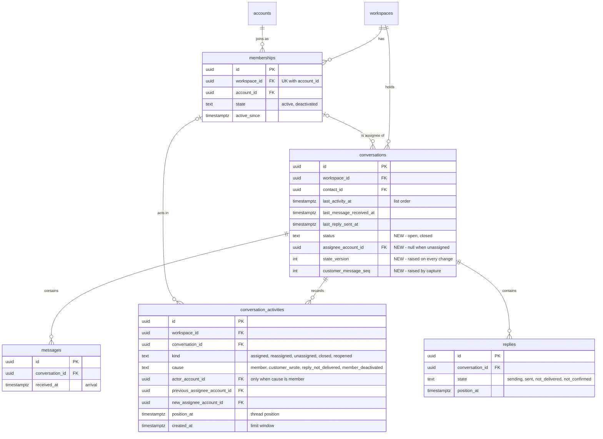

# Data model — assignment-statuses

This is a brownfield delta, all inside the `conversations` module ([ADR-0001](adr/0001-store-assignee-status-and-activity-in-the-conversations-module-and-serve-them-through-inbox-routes.md): `inbox` and `workspaces` own no new tables).

- Four columns on `conversations`: `status`, `assignee_account_id`, `state_version` ([ADR-0002](adr/0002-guard-member-changes-with-a-per-conversation-state-version-the-client-echoes.md)) and `customer_message_seq` ([ADR-0003](adr/0003-recheck-close-reasons-under-the-conversation-row-lock-against-an-acknowledged-close-snapshot.md)). The three NOT NULL ones ship as expand → backfill → contract; `assignee_account_id` stays nullable.
- One new tenant-owned table, `conversation_activities` ([ADR-0006](adr/0006-store-activity-entries-in-their-own-table-and-merge-them-into-the-thread-by-position-time.md)): the thread's third half, the change limit's log (AC-12) and the live signal's item ([ADR-0007](adr/0007-signal-assignment-and-status-changes-as-activity-items-on-conversation-changed.md)).
- Two list-lens indexes on `conversations`.

`memberships` gets no schema change. `lockActiveMembers` and `activeMembers` read it through the existing `memberships_workspace_id_account_id_key` unique, which is also the target of the new composite FKs. `bots`, `contacts`, `messages`, `replies`, `reply_attempts` and `read_marks` are unchanged; the close reasons read them through their existing indexes. Reopen and unassign run inside existing transactions, so no queue and no job table are added.

**Conventions applied.** Same as the shared-inbox and bot-connection precedents ([shared-inbox data-model](../shared-inbox/data-model.md)), repo [ADR-0004](../../adr/0004-use-postgres-with-kysely-reversible-migrations-and-workspace-scoped-tenancy.md), `CLAUDE.md` and SAD §2/§8:

- Tables `snake_case` and plural; constraints named `<table>_<cols>_{pkey,key,fkey,check,idx}`, shortened where the full name would pass Postgres's 63-character limit.
- PK `id uuid`, a UUIDv7 from `newId()`, never a DB default.
- The application supplies every value and timestamp. No `DEFAULT` (not even `DEFAULT 'open'`), no generic `updated_at`.
- Kinds, causes and states are `text` + `CHECK (… IN (…))`, no `ENUM`. Column combinations are tied by `CHECK`s.
- No triggers. `state_version` and `customer_message_seq` are raised by the application in the same `UPDATE` that changes their source.
- A cross-module FK is a constraint only. Here it is a **composite** FK `(workspace_id, <account>) → memberships (workspace_id, account_id)` (SAD §5), so every assignee and actor is a member of the row's own workspace. Names come through the `workspaces` app layer.
- Every FK leads an index.
- Delete strategy: none. Activity entries are kept indefinitely, like messages and replies.

## Assumptions (autonomous run 2026-10-18)

Each can be vetoed at review.

1. **Aggregate root:** the conversation owns its activity entries; they are written only by `conversations` use cases, in the same transaction as the state change they record.
2. **`state_version` and `customer_message_seq` are `integer`**, not `bigint`. Both grow by one per change or per captured message of one conversation, so 2³¹ is out of reach, and Kysely maps `integer` to `number` (no string handling for an `Int8`).
3. **Activity actor and assignees reference memberships, not accounts** (composite FKs). This is stricter than the `replies.author_account_id → accounts(id)` precedent and matches the SAD §5 FK on `conversations`. Memberships are never deleted (deactivation is a state), so history stays valid after a deactivation.
4. **The change limit counts on `created_at`, not `position_at`.** `position_at` can be pushed forward to "never earlier than the latest entry" (SAD §4), while `created_at` is the plain server clock at insert, which is what "the last 60 s" means. Same pattern as `reply_attempts.created_at`.
5. **`closed` / `reopened` entries store no assignee pair.** A status change keeps the assignee (AC-05, AC-07, AC-08), and the line does not name one.
6. **Cause values:** `member`, `customer_wrote`, `reply_not_delivered`, `member_deactivated`. `reply_not_delivered` covers both "not delivered" and "not confirmed" outcomes, as AC-08's single line does.
7. **No `closed_at` column.** The lost-customer integrity query (spec §6) reads the conversation's latest `closed` entry through `conversation_activities_conversation_id_position_at_idx`.
8. **Value `CHECK`s land in the expand step** (a NULL passes them), so the window between expand and contract cannot store an invalid status.

## ER diagram

The `memberships` edges are the composite FKs `(workspace_id, account_id)`. `conversation_activities` has three of them (actor, previous assignee, new assignee), drawn as one edge. `workspaces ||--o{ …` edges for `messages`, `replies` and `conversation_activities` are omitted for readability; each has a non-null `workspace_id → workspaces(id)`.

## Entities

### Aggregate `conversation` (module `conversations`, tenant-owned)

#### `conversations` — changed

| Column | Type | Constraints | Notes |
|---|---|---|---|
| `status` | text | NOT NULL (after contract), `CHECK IN ('open','closed')` | AC-05. Capture inserts a new conversation `open`. Set `closed` only by a member's close (flow 7); set `open` by a member's reopen, a newly captured customer message, or a failed reply outcome in `settle()` (flows 8–10, ADR-0004). Backfilled `open` |
| `assignee_account_id` | uuid | NULL; FK `(workspace_id, assignee_account_id) → memberships (workspace_id, account_id)` | At most one assignee, or none (AC-02). The FK guarantees same workspace (AC-04: a foreign account cannot be stored). "Active" is guaranteed by the lock protocol and the deactivation unassign (ADR-0005), not by the FK. A status change keeps it |
| `state_version` | integer | NOT NULL (after contract), `CHECK >= 0` | ADR-0002. Raised by one in the same `UPDATE` as every assignee or status change, member or automatic. Every list row, summary and refusal returns it; a member change echoes it. Starts at 0 |
| `customer_message_seq` | integer | NOT NULL (after contract), `CHECK >= 0` | ADR-0003. Raised by one in capture's arrival-raise `UPDATE` for every newly captured customer message (not a duplicate, not an edit). That `UPDATE` holds the row lock, so the counter follows commit order. Part of the close snapshot with the latest reply's id and state. Starts at 0 on insert (the raise follows in the same transaction); backfilled with the message count |

**Close snapshot** (ADR-0003) is derived, not stored: `customer_message_seq` + the latest reply's `(id, state)` (backward scan of `replies_conversation_id_position_at_idx`, limit 1).

**Close reasons** are derived under the row lock, all from existing indexes:
- waiting: `last_reply_sent_at IS NULL OR last_message_received_at > last_reply_sent_at` (the row itself);
- unread for this member: a message with `received_at > GREATEST(read_through_at, active_since)` (`read_marks_conversation_id_account_id_key`, `messages_conversation_id_received_at_idx`);
- the counter grew past the snapshot sent (the row itself);
- the latest reply is `not_delivered` or `not_confirmed` (`replies_conversation_id_position_at_idx`).

**Access patterns:**
- Status lens, assignee "all": `(workspace_id, status, last_activity_at DESC, id DESC)` keyset → `conversations_workspace_id_status_idx`.
- Assignee lens "mine" / "unassigned" within a status: `(workspace_id, assignee_account_id = ? | IS NULL, status, …)` → `conversations_workspace_id_assignee_status_idx`.
- Search (status lens set aside, assignee lens kept): existing `conversations_workspace_id_last_activity_at_idx` + `contact_id = ANY(…)`, assignee as a filter.
- Change, reopen, summary, live row: `(workspace_id, id)` → PK, `FOR UPDATE` on the change paths.
- Deactivation unassign: `UPDATE … WHERE workspace_id = ? AND assignee_account_id = ?` → `conversations_workspace_id_assignee_status_idx`.

#### `conversation_activities` — new

| Column | Type | Constraints | Notes |
|---|---|---|---|
| `id` | uuid | PK | UUIDv7. The live signal's item id (ADR-0007) and the thread cursor's tie-breaker |
| `workspace_id` | uuid | NOT NULL, FK → `workspaces(id)` | Tenancy. Scope of the change limit (AC-12: per workspace) |
| `conversation_id` | uuid | NOT NULL, FK → `conversations(id)` | |
| `kind` | text | NOT NULL, `CHECK IN ('assigned','reassigned','unassigned','closed','reopened')` | The line the thread renders (AC-02, AC-05) |
| `cause` | text | NOT NULL, `CHECK IN ('member','customer_wrote','reply_not_delivered','member_deactivated')`; kind ↔ cause `CHECK` | Automatic causes only on `reopened` (customer, failed reply — AC-07, AC-08) and `unassigned` (deactivation — AC-10). `closed`, `assigned` and `reassigned` are always a member's |
| `actor_account_id` | uuid | NULL, FK `(workspace_id, actor_account_id) → memberships`; non-null ⇔ `cause = 'member'` | The member who made the change (AC-09). Automatic entries have none, so they are never counted or refused by the limit (AC-12) |
| `previous_assignee_account_id` | uuid | NULL, FK `(workspace_id, …) → memberships` | Set for `reassigned` and `unassigned` |
| `new_assignee_account_id` | uuid | NULL, FK `(workspace_id, …) → memberships` | Set for `assigned` and `reassigned`; differs from the previous one |
| `position_at` | timestamptz | NOT NULL | Thread position (ADR-0006): the server clock read after the conversation row lock, never earlier than the conversation's latest entry. A customer reopen sits at its capture (AC-07) |
| `created_at` | timestamptz | NOT NULL | Server clock at insert. The change limit's 60 s window and resume time (assumption 4) |

**Assignee pair `CHECK`:** `assigned` → (null, set); `reassigned` → (set, set, different); `unassigned` → (set, null); `closed` / `reopened` → (null, null).

**Rules kept by the application:** one recorded change is exactly one entry (a reassignment is one); entries never count as unread, never move `last_activity_at` and are never sent to Telegram (AC-09). Names are resolved at read time and rendered as plain text (spec §6.1).

**Aggregate root:** `conversations`.

**Access patterns:**
- Thread page before/after a `(position_at, kind, id)` cursor, the activity half (flow 11) → `conversation_activities_conversation_id_position_at_idx`.
- The latest entry of a conversation, for a stale refusal's details and the position rule (flows 6, 7) → same index, backward, limit 1.
- Change-limit count and the oldest counted entry: `workspace_id = ? AND actor_account_id = ? AND created_at > now − 60 s` under the `changes:<ws>:<account>` advisory lock (flows 5–8) → `conversation_activities_workspace_id_actor_created_at_idx`.
- Live item by `(workspace_id, id)` (flow 13) → PK.

## Indexes

| Index | Columns | Query it serves |
|---|---|---|
| `conversations_workspace_id_status_idx` | `conversations (workspace_id, status, last_activity_at DESC, id DESC)` | Status lens with assignee "all", newest activity first, keyset (flow 4, AC-01; spec §6 list p95 ≤ 500 ms per lens) |
| `conversations_workspace_id_assignee_status_idx` | `conversations (workspace_id, assignee_account_id, status, last_activity_at DESC, id DESC)` | Assignee lens "mine" / "unassigned" within a status (flow 4, AC-01); deactivation unassign of one account's conversations, open and closed (flow 12, AC-10). FK index for `(workspace_id, assignee_account_id)` |
| `conversation_activities_conversation_id_position_at_idx` | `conversation_activities (conversation_id, position_at, id)` | Thread page, the activity half (flow 11, ADR-0006); latest entry (flows 6, 7); lost-customer integrity query (spec §6). FK index for `conversation_id` |
| `conversation_activities_workspace_id_actor_created_at_idx` | `conversation_activities (workspace_id, actor_account_id, created_at)` | Per-member change limit over 60 s and its resume time (flows 5–8, AC-12). FK index for `workspace_id` and `(workspace_id, actor_account_id)` |
| `conversation_activities_workspace_id_previous_assignee_idx` (partial, not null) | `conversation_activities (workspace_id, previous_assignee_account_id)` | FK index only |
| `conversation_activities_workspace_id_new_assignee_idx` (partial, not null) | `conversation_activities (workspace_id, new_assignee_account_id)` | FK index only |

Reused, so no new index is needed:
- `conversations_workspace_id_last_activity_at_idx` — search across both statuses (SAD §4).
- `memberships_workspace_id_account_id_key` — `lockActiveMembers … FOR SHARE`, the active-members read (by workspace, filtered on state; at most tens of rows per workspace) and the target of every new composite FK.
- `replies_conversation_id_position_at_idx`, `messages_conversation_id_received_at_idx`, `read_marks_conversation_id_account_id_key` — the close reasons and the snapshot.

## Test fixtures

Additions to the builders in `apps/api/src/test/fixtures/` (not in `migrations/`). Synthetic ids, `Test User` and `@example.test` only.

- `insertConversation(db, { …, status?, assigneeAccountId?, stateVersion?, customerMessageSeq? })` — defaults `'open'` / `null` / `0` / `0`. This must change in the same task that promotes `05`, because the contract makes three columns NOT NULL.
- `insertActivity(db, { workspaceId, conversationId, kind, cause?, actorAccountId?, previousAssigneeAccountId?, newAssigneeAccountId?, positionAt?, createdAt? })` — default cause `member`, both times `T`. An automatic cause leaves the actor null.
- `twoWorkspacesWithInbox(db)` (existing) — extend with an assigned conversation and one activity entry per workspace, sharing one account that is a member of both. It is the base for the cross-workspace isolation test of every new repository method and of the deactivation unassign (AC-10: another workspace keeps its assignee).
