# Software Architecture Document — assignment-statuses

## 1. Introduction and goals

**Intent.** assignment-statuses gives the shared inbox an owner and a done-state for every conversation. Each conversation is **open or closed** and has **at most one assignee** (an active member of its workspace) or none. Members assign, reassign, unassign, close and reopen from the thread. The list gets a status lens (open by default, or closed) and an assignee lens (all, mine, unassigned), and both are part of the page address. Each change is written into the thread as an activity entry at the time it happened, and the whole team sees it live. The design is built around one failure, **a customer silently lost in a closed conversation**. A customer's new message always reopens the conversation, and so does a reply that ends "not delivered" or "not confirmed". A close made over a waiting or unread customer message, or over a failed reply, has to be confirmed, and the server checks that condition again when it records the close. A change made against a state the member no longer sees is never applied silently. A deactivated member is never anyone's assignee, not even for a moment. Notifications to the assignee (roadmap step 6) build on this.

**Top-3 quality goals (1-liners; full scenarios in §10):**

1. **No lost customer, no silent overwrite.** No closed conversation ever has a customer message that arrived after the close. A member's change made over a state they had not seen, or over a waiting, unread or failed-reply condition, waits for their confirmation, and this holds even under concurrent changes.
2. **Ownership integrity under concurrency.** A conversation has at most one assignee, and that assignee is always an active member of its workspace. Deactivation unassigns in the same transaction. A racing assignment to the member being deactivated is refused or, if it committed first, cleared by the deactivation itself, so no assignment to a deactivated member ever exists. A member's changes are capped at the spec's rate.
3. **Live, responsive inbox.** Changes, including automatic reopens and unassigns, reach every open list and thread within the live-update target. Change requests and every list lens stay within the spec's latency targets at pilot scale.

**Stakeholders.**

| Role | Interest | Sign-off owner? |
|---|---|---|
| Operator | Sees who handles each conversation; filters by status and assignee; assigns, closes and reopens; reads each conversation's history of changes | No |
| Business owner | Has every operator right in the inbox; deactivating a member returns that member's conversations to the team | No |
| End customer | Their new message always reaches the team, even after a close; never sees assignment, status or activity | No |
| Tech Lead | SAD approval | Yes |
| Security Lead | Security review of the new member-driven state change and the new attributed personal data, i.e. who handles and who changed what (spec §6.1: review required) | Yes |

**Assumptions (autonomous run 2026-10-18)**, each can be vetoed at review:

- Depth = medium, size M and route `standard` (from `.size` / `.route`). The pipeline made every per-section decision itself, and each one is recorded in the section it belongs to.
- `docs/architecture-map.md` records `reflects_commit: b594915`, but its module rows already describe the shipped shared inbox. A fresh explorer scan of HEAD `ffcf639` confirmed the code facts used in this document (§3 brownfield note).
- Wire shapes in this SAD (request fields, error codes, the members read) show intent only. `api` fixes the names. Table and column names are indicative, and `data-model` fixes them.

**Decision overrides:**

- Decision override: an assignment racing a deactivation is either refused or cleared by the deactivation, not always refused. Rationale: an assignment that took its membership lock first commits before the deactivation. No database order can refuse an already committed change, so the deactivation unassigns it in its own transaction, with an activity entry. Spec AC-10 ("refused") and its §6 measurement are met in substance: no assignment to a deactivated member exists at any committed moment. The §10 test asserts both lock orders. Tracked in §11 for spec wording alignment at review. (Critic finding 4, autonomous run 2026-10-18.)

## 2. Constraints

**Technical.**
- TypeScript ~6.0 (strict) on Node.js 26 in a pnpm workspaces monorepo: repo [ADR-0001](../../adr/0001-use-a-typescript-pnpm-monorepo-on-node-26.md)
- Backend: Fastify 5 with `fastify-type-provider-zod` and zod 4, plus `@fastify/websocket` (the live socket `GET …/inbox/live` exists). pg-boss 12 runs on the main database. This feature adds no Telegram calls.
- Datastore: PostgreSQL 16 via Kysely 0.29, reversible migrations through kysely-ctl, types generated by kysely-codegen into `db.types.gen.ts`: repo [ADR-0004](../../adr/0004-use-postgres-with-kysely-reversible-migrations-and-workspace-scoped-tenancy.md). READ COMMITTED isolation is used throughout. Row locks and transaction-level advisory locks are the existing serialisation tools (`hashtextextended('<ws>:<account>', 0)` for the reply limit, `'drain:<ws>:<conv>'` for the drain).
- Architecture: a modular monolith with layers `domain → app → infra → http`, in one process: repo [ADR-0002](../../adr/0002-organize-the-backend-as-a-modular-monolith-with-layered-modules.md). Module dependencies are one-way: `inbox → {conversations, contacts, bots, workspaces}`, `bots → conversations → contacts`, `bots → contacts`. `workspaces` depends on no feature module. A module can pass a transaction across a boundary in two existing ways: conversations calls `contacts.upsertFromProfile(…, tx)`, and `team` receives `publish(tx, …)` from the composition root.
- Live updates: `platform/realtime` `publish(trx, signal)` sends a `pg_notify` inside the writing transaction (payload ids only, ≤ 1000 bytes, zod-validated). The `inbox` hub dispatches to the workspace's sockets, and the web store refetches through the reads: shared-inbox [ADR-0002](../shared-inbox/adr/0002-push-change-signals-over-a-per-tab-workspace-bound-websocket-and-refetch-through-the-reads.md), [ADR-0003](../shared-inbox/adr/0003-fan-out-live-signals-through-postgres-listen-notify-published-in-the-writing-transaction.md)
- Thread: messages by Telegram `sent_at` and replies by `position_at`, merged in memory with the cursor `(positionAt, kind, id)` (`conversations/domain/thread.ts`): shared-inbox [ADR-0008](../shared-inbox/adr/0008-store-replies-in-their-own-table-and-page-the-thread-by-position-time.md). The list is keyset-paged by `(last_activity_at, id)` newest first, with read state per member through `read_marks` and `memberships.active_since`: shared-inbox [ADR-0005](../shared-inbox/adr/0005-track-read-state-as-a-per-member-arrival-watermark-per-conversation.md)
- Frontend: a React 19 + Vite SPA with Tailwind + shadcn/ui, Zustand and React Router. The inbox route is `/w/:workspaceId/inbox/:conversationId?` and the store `features/inbox/store.ts` is keyed by workspace.

**Organisational.**
- Effort budget: size M, a separate epic of 5–15 PRs over 1–2 sprints (`.size`), route `standard`
- Deadline: none in the spec. Pilots with several operators start on the shipped inbox, and roadmap step 6 (notifications to the assignee) waits on this step.
- Team composition: not stated. The pipeline assumes one backend + frontend implementer working through `tasks.json`.

**Conventions.**
- [`CLAUDE.md`](../../../CLAUDE.md) and [`docs/architecture-map.md`](../../architecture-map.md) §Conventions are binding. Each module exposes `register<Module>(app, deps)`. Only `buildDeps()` constructs dependencies and only `buildApp()` registers modules. Imports flow inward. Other modules are reached only through their app layer, never through their tables.
- IDs are UUIDv7 from `newId()`, never DB defaults.
- Errors are `AppError` subclasses (`ConflictError`, `ValidationError`, `TooManyRequestsError`, …) with codes declared in `packages/shared/src/errors.ts`, returned in the single error envelope.
- Every tenant-owned table has a non-null `workspace_id`, and every repository method takes `workspaceId`. Each repository gets a cross-workspace isolation test. The five controlled tenancy exceptions stay five: this design adds none.
- No triggers or stored procedures. Constraints are welcome. Migrations are reversible: expand, then migrate, then contract.
- UI composes shadcn/ui primitives from `apps/web/src/shared/ui`, Tailwind only, per `docs/design-system.md` (desktop-first, usable at ≥ 360 px).

**Regulatory / external.**
- Data classification is confidential (spec §6.1). This is part of the private conversation record.
- New personal data: which member is assigned to which customer conversation, and who changed assignee or status and when (attributed to the member's account). No new end-customer data.
- Retention: activity entries are kept as long as the conversation, like messages and replies. Removal is by hand on request (§11).
- No compliance regime is named. A security review is required before release (spec §6.1).

## 3. Context and scope

tg-inbox is a shared Telegram inbox for small businesses. With shared-inbox, a workspace's team reads and answers its customers from one web inbox. This feature adds ownership and a done-state to that inbox. It reacts to two existing inbound events: a customer message captured from the business bot's webhook, and a reply's delivery outcome from the drain. It also reacts to one team event, a business owner deactivating a member. The trust boundary is unchanged. Everything reaching the browser is scoped to one active membership. Activity entries and assignee names are rendered as plain text and never sent to Telegram. The feature adds no external system and no new outbound Telegram call.

<!-- brownfield: HEAD ffcf639 (explorer scan, 2026-10-18) — modules auth, workspaces, bots, conversations (capture in one transaction that publishes `conversation.changed`; replies + attempts + read marks; list keyset on (last_activity_at, id); thread merge of messages + replies by (positionAt, kind, id)), capture upserts the conversation with ON CONFLICT DO NOTHING plus a plain read and first locks the row in the raiseReceived UPDATE after the message insert; every failed reply outcome passes settle() in conversations/app/replies.ts; contacts, inbox (routes under /workspaces/:workspaceId/inbox, live hub, drain via createDeliver, reply limit under pg_advisory_xact_lock(hashtextextended('<ws>:<account>'))); workspaces.deactivateMembership runs in a KyselyUnitOfWork transaction that locks the workspace row FOR UPDATE, reads the membership plainly, UPDATEs its state and publishes `membership.deactivated`, with no hook into other modules; conversations has no status/assignee column; the signal schema's item types are message|reply and its change enum is closed -->

**External systems (in / out):**

| Actor or system | Type | Interaction |
|---|---|---|
| Operator | Person | Filters the list by status and assignee; assigns, reassigns, unassigns, closes and reopens from the thread; reads activity entries; receives changes live |
| Business owner | Person | Everything an operator does, plus deactivating a member in Settings — Team (existing), which now also unassigns |
| End customer | Person | Writes to the business bot. A new message reopens a closed conversation. Never sees tg-inbox. |
| Telegram Bot API | System (external) | In: pushes customer messages to the bot's webhook (unchanged), and a captured new message may now reopen. Out: `sendMessage` for replies (unchanged), and a failed outcome may now reopen. |

**C4 Context (L1):**

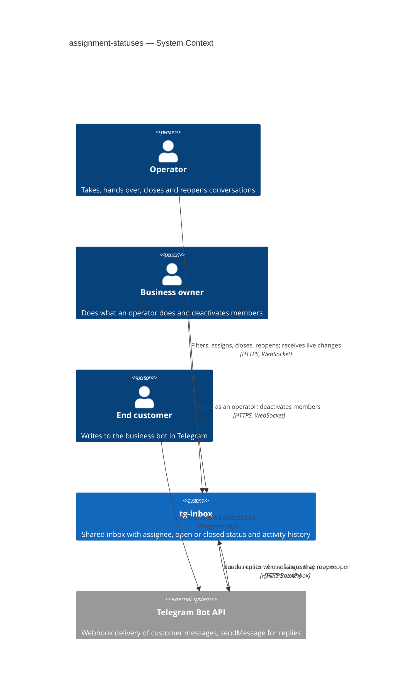

## 4. Solution strategy

**Target surfaces:** `backend-service` and `web-frontend`. The backend gets new change routes and list lenses in the existing `inbox` module, new state and activity entries in `conversations`, and a deactivation hook in `workspaces`. The frontend extends the existing SPA inbox: lenses in the address, the assignee chooser, two confirmations and activity lines. End customers act only in Telegram (US-04 has no screen, per `ux-flows.md`). No worker surface is added, because reopen and unassign run inside existing transactions and no new job is needed. This follows shared-inbox's surface split. It is recorded with the data-placement decision in [ADR-0001](adr/0001-store-assignee-status-and-activity-in-the-conversations-module-and-serve-them-through-inbox-routes.md).

**UI architecture (web-frontend):** client-side SPA, already fixed by repo ADR-0001. The route stays `/w/:workspaceId/inbox/:conversationId?`, so no new UI ADR is needed.
- **Lenses:** the two lenses are URL search parameters (`status=open|closed`, `assignee=all|mine|unassigned`, defaults omitted). Reload, back and saved links therefore reopen the same lenses (AC-01). The workspace switcher navigates to a new path without them, which resets to open · all.
- **Store:** `features/inbox/store.ts` (keyed by workspace) holds the lens. For each list row it keeps the row's status and assignee. For the open conversation it keeps the **state version** it last rendered (§4 choice 2) and the **close snapshot**, i.e. the one it rendered or the one from the last close refusal (§4 choice 3).
- **Live changes:** a live activity signal refetches the row, the conversation summary (header and version) and the activity item. The store then re-evaluates whether the row still belongs to the current lens, so it inserts, keeps or drops the row (AC-02: an open thread stays open).
- **Components:** the assignee chooser (SCR-10) is a shadcn popover/command list over the thread. The two confirmations (SCR-11, SCR-12) are shadcn `Dialog`s, like shared-inbox's SCR-04/05. `screens` picks the primitives.

**Top strategic choices (the seeds for ADRs):**

1. **The conversations module owns assignee, status, state version and activity entries, and the inbox serves them.** These three are added beside the conversation they describe. `conversations` already writes that conversation in both automatic paths, capture and reply outcome, and already serves the list and the thread. Status and assignee filters therefore stay single-module queries, and the reopen happens in the transaction that already exists. `inbox` owns the change routes and orchestrates the membership checks from `workspaces`. No new module and no new dependency edge (goals 1 and 2): [ADR-0001](adr/0001-store-assignee-status-and-activity-in-the-conversations-module-and-serve-them-through-inbox-routes.md).
2. **Optimistic concurrency through a per-conversation state version echoed by the client (AC-03).** Every change of assignee or status, by a member or automatic, raises an integer version on the conversation in the same row update. Every read the screen draws from returns that version. Each member change carries the version the member last saw, and the server compares it under a `FOR UPDATE` lock on the conversation row:
   - If the conversation is already in the requested state, nothing happens and nothing is recorded.
   - If the version differs, the request is refused with `CONVERSATION_STATE_CHANGED`. The refusal carries the current assignee, the status, the latest activity entry (who or what cause, when) and the current version. "Go ahead" repeats the request with that version, so a third change in between asks again.

   Two concurrent changes serialise on the row lock: the second one sees a newer version and is asked (goal 1): [ADR-0002](adr/0002-guard-member-changes-with-a-per-conversation-state-version-the-client-echoes.md).
3. **The close is decided at record time against a close snapshot the client sends back (AC-06, AC-08).**
   - **The counter.** The conversation carries a **customer message counter**. Capture raises it, under the conversation row lock, for every newly captured customer message. Unlike arrival timestamps, which are taken before the transaction, this counter follows commit order.
   - **The snapshot.** The **close snapshot** is that counter plus the id and state of the latest reply. Every read the header draws from returns it, together with the state version. A close always sends the version and the snapshot the screen shows, plus `confirm` after a refusal.
   - **The rule.** Under the row lock, the server evaluates the reasons:
     - the customer is waiting for a reply;
     - this member has an unread customer message, i.e. one that arrived after the later of their arrival watermark and their active-since;
     - a customer message was recorded after the snapshot the screen shows (the counter grew);
     - the latest reply is "not delivered" or "not confirmed".

     The close is recorded if the version matches and either no reason holds, or `confirm` is set and the current snapshot equals the one sent. Otherwise it is refused with `CLOSE_NEEDS_CONFIRMATION`. The refusal carries every reason, the stale change if there is one, and the current snapshot and version; "close anyway" resends those with `confirm`.
   - **The result.** A customer message or a failed reply recorded between the question and the close changes the snapshot, so the close asks again. Capture takes the same row lock before it decides anything, so either the close sees the message, or the message reopens the close (goal 1): [ADR-0003](adr/0003-recheck-close-reasons-under-the-conversation-row-lock-against-an-acknowledged-close-snapshot.md).
4. **Automatic reopen happens inside the transactions that already record the cause.**
   - **Capture.** `conversations.captureInbound` inserts the message and raises the conversation's arrival in one transaction. Today its upsert is `ON CONFLICT DO NOTHING` plus a plain read, which takes no lock. The raise is an `UPDATE`, and it now also raises the customer message counter. That `UPDATE` **returns the status and assignee under its row lock**, and capture decides on that locked result, never on the earlier read. When the message is newly captured (not a duplicate, not an edit) and the status is closed, the same transaction:
     - reopens the conversation and keeps the assignee;
     - raises the version;
     - inserts the activity entry "reopened — the customer wrote";
     - publishes the signal.
   - **Reply outcomes.** Every reply that becomes "not delivered" or "not confirmed" goes through `settle()` in `conversations/app/replies.ts`. That covers `finishAttempt`, `skipReply`, the stale in-flight resolution `resolveStaleInFlight` and the dead-letter resolution. `settle()` is therefore the single reopen point for failed replies: in a closed conversation it reopens the same way, with the activity entry "reopened — a reply was not delivered".
   - **The guarantee.** The NFR "0 closed conversations whose latest customer message arrived after the close" holds by construction, with no job lag (goals 1 and 3): [ADR-0004](adr/0004-reopen-closed-conversations-inside-the-capture-and-reply-outcome-transactions.md).
5. **Deactivation unassigns through a port that `workspaces` calls inside its own transaction, and member changes share-lock the memberships they rely on (AC-10, AC-04).**
   - `workspaces` declares a port `onMembershipDeactivated(tx, { workspaceId, accountId, at })`. `buildDeps()` wires it to `conversations.unassignDeactivatedMember`, which in the same transaction unassigns every conversation of that workspace assigned to the account, raises each version, records "unassigned — <member> was deactivated" and publishes one signal per conversation. `workspaces` imports nothing from `conversations`, so the dependency direction holds.
   - A member change locks the actor's membership, and for an assignment the target's membership, `FOR SHARE` through `workspaces.lockActiveMembers(tx, workspaceId, accountIds)`, before it locks the conversation.
   - A deactivation, as today, locks the workspace row FOR NO KEY UPDATE (`workspaces.lockForUpdate`) and then `UPDATE`s the membership's state. That `UPDATE`'s row lock conflicts with `FOR SHARE`, so the two serialise.
   - A concurrent assignment that serialises after the deactivation is refused. One that took its share lock first commits first and is then unassigned by the deactivation's port in the same transaction. Either way no assignment to a deactivated member ever exists. See the §1 decision override (goal 2): [ADR-0005](adr/0005-unassign-on-deactivation-through-a-workspaces-port-called-inside-the-deactivation-transaction.md).

**Supporting choices:**

- **Activity entries have their own table and become the thread's third branch (AC-09).** An entry records the kind (assigned / reassigned / unassigned / closed / reopened) and the cause (a member, the customer wrote, a reply was not delivered, the member was deactivated). It also records the actor account (null for automatic changes), the previous and new assignee, and the position time. The position time is when the change happened: the server clock read **after** the conversation row lock is taken, and never earlier than the conversation's latest activity entry. A customer reopen therefore sits at the moment its capture is recorded (its arrival, AC-07), and never before the close it undoes. The thread page adds a keyset half over activity entries and merges three halves with the existing cursor, extended with the kind `activity`; at equal positions the order is message < reply < activity. Activity entries never count as unread, never move last activity and are never sent to Telegram. This is an ADR: [ADR-0006](adr/0006-store-activity-entries-in-their-own-table-and-merge-them-into-the-thread-by-position-time.md).
- **The live signal is an activity item on `conversation.changed`.** Every change is exactly one new activity entry, so the existing frame gains item type `activity` (change `created`). There is no new signal type. The client refetches the row, the summary and the item. Automatic changes publish the same item. One signal per conversation, including each conversation a deactivation unassigns, stays under the 1000-byte payload. This is an ADR: [ADR-0007](adr/0007-signal-assignment-and-status-changes-as-activity-items-on-conversation-changed.md).
- **Per-member change limit (AC-12), inline.** The limit is 60 recorded changes per rolling 60 s per member per workspace. It is counted from the activity entries with that actor in that workspace, which is the reply-limit precedent (count the log under an advisory lock). The count runs under `pg_advisory_xact_lock(hashtextextended('changes:<ws>:<account>', 0))`. The `changes:` prefix keeps it apart from the reply limit's `<ws>:<account>` key. The lock is taken and the count run after the conversation row lock and after the no-op, stale and close checks, just before the write, so refused, declined and already-in-place requests never count, and a reassignment is one entry. Automatic entries have no actor, so they are never counted and never refused. The refusal is `TooManyRequestsError` with the code `CHANGE_LIMIT_REACHED` and the time the oldest counted change leaves the window. Below the ADR gate: it reuses a decided pattern inside one module.
- **List lenses, inline.** `conversations.listPage` gains `status` (open / closed, ignored while a search query is present) and `assignee` (all / mine = the caller / unassigned) filters, and each row returns its status, assignee account id and state version. Assignee names come from `workspaces` display names, as reply authors' names already do. New B-tree indexes lead with `(workspace_id, status, last_activity_at DESC, id DESC)` and `(workspace_id, assignee_account_id, status, last_activity_at DESC, id DESC)`. The second index also serves "unassigned" (`IS NULL`) and the deactivation unassign. The existing `(workspace_id, last_activity_at, id)` index stays for search across statuses. `data-model` fixes and verifies the indexes.
- **Assignee choices (AC-04).** A new inbox read returns the active members of the workspace (account id, display name) to any member, for SCR-10. A pick that is not an active member of this workspace is refused with `ASSIGNEE_NOT_ACTIVE`, and that includes an account of another workspace, so the refusal gives no hint about other workspaces. The same refusal covers a member deactivated between the list loading and the pick.
- **Persistence:** the single PostgreSQL 16 store. No cache, no new datastore, no new queue.

Each later tactical decision traces to one of these. Contradictions go to §11.

## 5. Building block view

The backend keeps the modular monolith (`domain → app → infra → http`) and adds no module ([ADR-0001](adr/0001-store-assignee-status-and-activity-in-the-conversations-module-and-serve-them-through-inbox-routes.md)). The pieces divide up as follows:
- **`conversations`** gains the state (status, assignee, state version) and the activity table, the change rules in its domain, and the change, reopen and unassign use cases. Its list and thread queries learn lenses and the third thread branch.
- **`inbox`** owns the new HTTP routes and orchestrates each member change in one transaction: it share-locks memberships through `workspaces`, then calls the `conversations` change use case.
- **`workspaces`** gains `lockActiveMembers` and the `onMembershipDeactivated` port. That port is an interface that `workspaces` declares and `buildDeps()` fills, so no import edge appears.

The graph stays acyclic: `inbox → {conversations, contacts, bots, workspaces}`, `bots → conversations → contacts`, `bots → contacts`. `workspaces` and `conversations` still do not import each other. This changes the construction order in `buildDeps()`: `contacts` and `conversations` are now built before `team`, so `team` can receive the port.

**Table ownership** (names indicative, `data-model` fixes them):

| Module | Tables (new or changed) | Tenancy |
|---|---|---|
| `conversations` | `conversations` **+** `status` (open / closed, not null, existing rows backfilled `open`), `assignee_account_id` (nullable, composite FK `(workspace_id, assignee_account_id)` → `memberships (workspace_id, account_id)`, a cross-module constraint only), `state_version` (integer, not null), `customer_message_seq` (integer, not null, raised by capture under the row lock and backfilled from the message count); **`conversation_activities`**: id, workspace_id, conversation_id, kind, cause, actor account (nullable), previous assignee, new assignee, position time | Tenant-owned, non-null `workspace_id`. Every new repository method takes `workspaceId` |
| `workspaces` | none (reads and locks `memberships` by workspace id + account ids) | unchanged |
| `inbox`, `bots`, `contacts` | none | — |

There is no new controlled tenancy exception. The deactivation unassign is scoped by the deactivated membership's workspace id, and every lock and read takes the workspace id from the URL or from the membership.

**Cross-module app-layer calls (new or changed):**

- `inbox` → `workspaces`:
  - `lockActiveMembers(tx, workspaceId, accountIds)`, which takes `FOR SHARE` and returns the accounts that are active;
  - `activeMembers(workspaceId)`, for the chooser;
  - display names (existing), for assignee and actor names.
- `inbox` → `conversations`:
  - `changeAssignee(tx, …)` and `changeStatus(tx, …)` (version guard, close reasons and snapshot, change limit, write, activity, signal);
  - `listPage` with lenses;
  - the summary with state and version;
  - the thread page with activity items;
  - `activityItem`.
- `workspaces` → (port, wired in `buildDeps()`) `conversations.unassignDeactivatedMember(tx, { workspaceId, accountId, at })`.
- `bots` → `conversations.captureInbound` (existing) now reopens. Every failed reply outcome passes `settle()` in `conversations/app/replies.ts`. That includes the drain's `finishAttempt` / `skipReply`, `resolveStaleInFlight` and the dead-letter handler, and `settle()` now reopens.

**Internal decomposition:**

```
apps/api/src/
├── modules/conversations/
│   ├── domain/       + conversation state (open/closed, assignee, version), change rules (no-op,
│   │                   stale, close reasons, snapshot equality), activity kinds/causes,
│   │                   thread kind order message < reply < activity, change-limit constants (60 / 60 s)
│   ├── app/          + change assignee, change status, reopen on capture / on failed reply,
│   │                   unassign deactivated member; list lenses; thread activity half; activity item
│   └── infra/        + activity repository (insert, latest per conversation, count by actor over 60 s),
│                       conversation state update (lock row, compare version, raise version),
│                       list/thread query changes, signal for activity items
├── modules/inbox/
│   ├── app/          + assign / unassign / close / reopen orchestration in one transaction,
│   │                   active-members read; ports: workspaces.lockActiveMembers, conversations
│   └── http/         + change routes and the members read under /workspaces/:workspaceId/inbox/…,
│                       list lens query parameters, activity item read
├── modules/workspaces/
│   └── app/          + lockActiveMembers, activeMembers; team.deactivateMembership calls the
│                       onMembershipDeactivated port inside its unit of work
├── platform/realtime.ts   conversation.changed item type + 'activity'
└── deps.ts               conversations built before team; port wiring
apps/web/src/features/inbox/
│   store.ts (lens, state version, close snapshot, lens membership on live change), api-source.ts,
│   list lens controls, row assignee / closed mark, thread header state + actions,
│   assignee chooser (SCR-10), change-confirm (SCR-11) and close-confirm (SCR-12) dialogs, activity line
packages/shared/src/  inbox.ts — lens query, row/summary state + version, change requests,
                      activity item, close snapshot, LiveFrame item 'activity';
                      errors.ts — CONVERSATION_STATE_CHANGED, CLOSE_NEEDS_CONFIRMATION,
                      ASSIGNEE_NOT_ACTIVE, CHANGE_LIMIT_REACHED (names fixed by `api`)
```

**C4 Container (L2):**

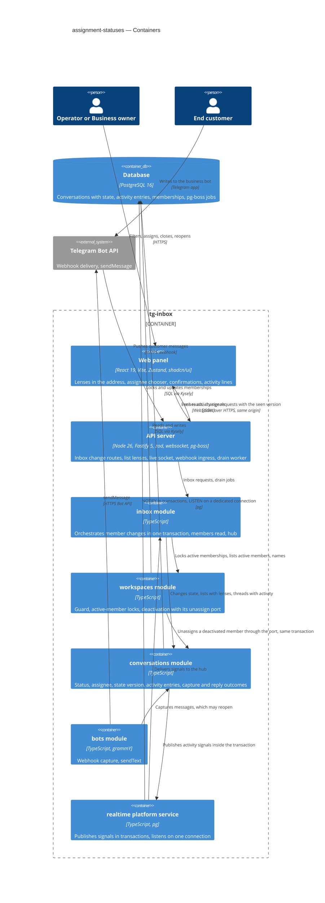

The module boxes are logical containers inside the one API process. The precedent is shared-inbox §5: the deployable surfaces are only the web panel and the API server. The `ws → conv` relation is a runtime call through a port that `workspaces` declares and the composition root fills. It is not an import, so the static dependency graph keeps `workspaces` independent of `conversations`.

## 6. Runtime view

These are the seeded critical flows. The `sequences` stage extends this section until every spec §5 AC maps to a flow or a branch. Participants are the §5 containers.

**Critical flow 1: A member changes assignee or status against the state they saw (US-02, US-03 — AC-02, AC-03, AC-04, AC-05, AC-06, AC-11, AC-12)**

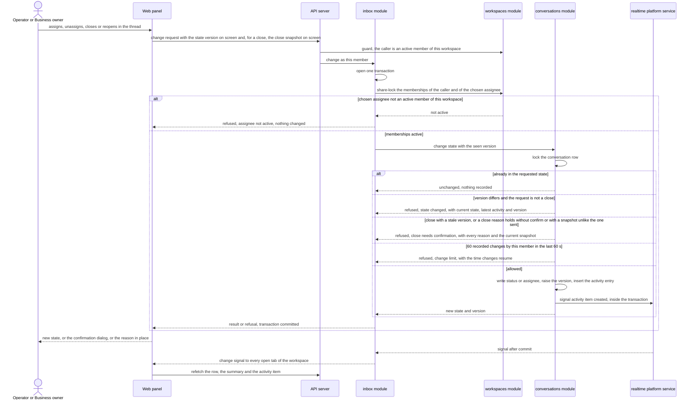

**Critical flow 2: A customer message or a failed reply reopens a closed conversation (US-04 — AC-07, AC-08, AC-06)**

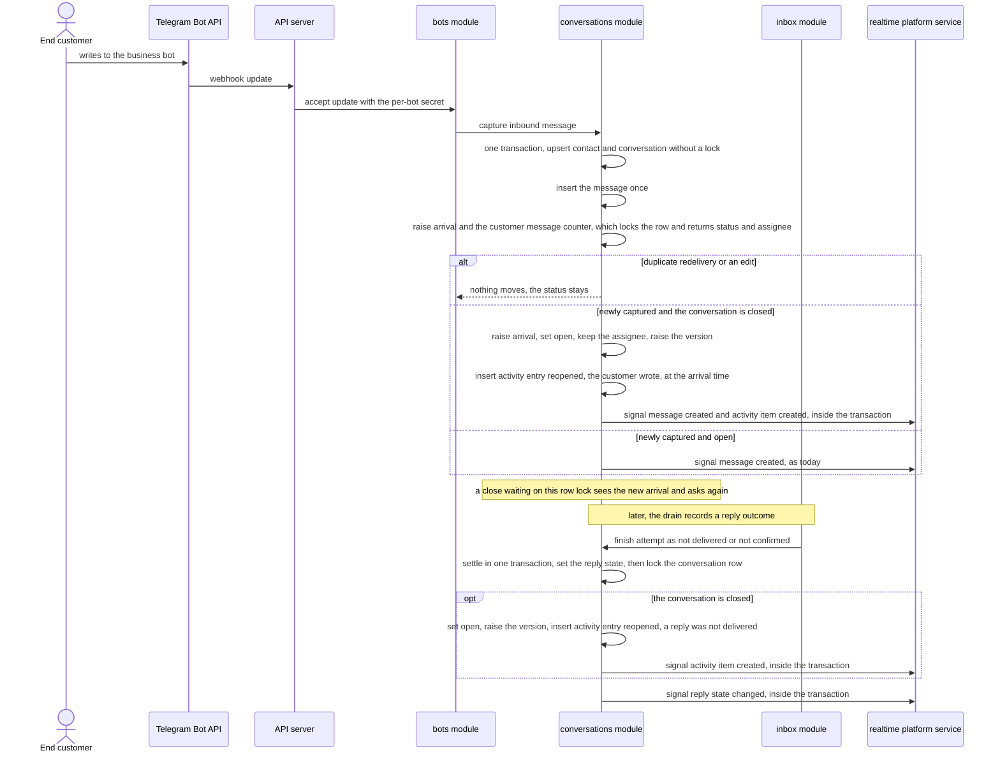

**Critical flow 3: Deactivation unassigns in the same transaction, and a racing assignment loses (US-06 — AC-10, AC-04)**

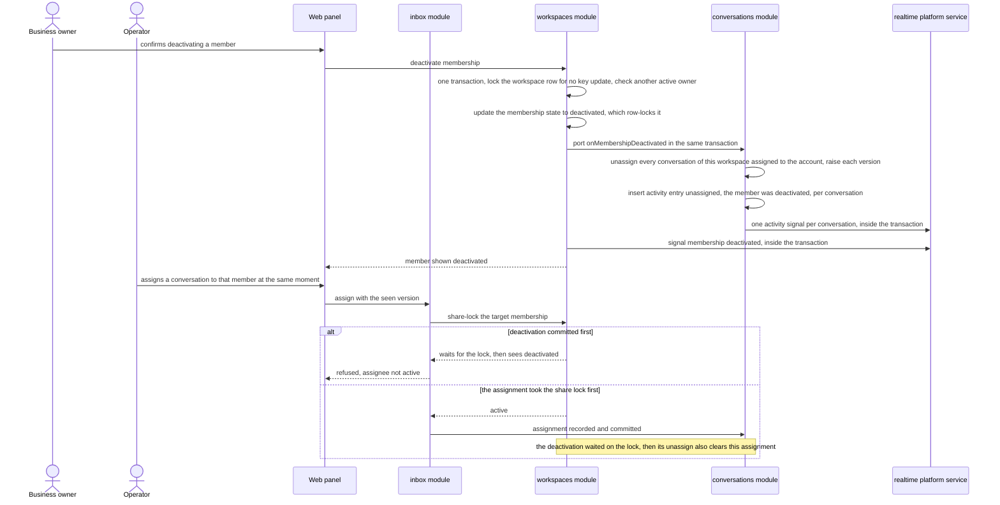

Flows 4–13 below were added by the `sequences` stage. They use the generic runtime vocabulary: `<user>` (an operator or business owner), `<ui>` (the web panel), `<service>` (tg-inbox's backend), `<data-store>`, `<message-bus>` (the live-signal fan-out and the drain job queue) and `<external-system>` (the Telegram Bot API). `SCR-NN` ids refer to [`ux-flows.md`](ux-flows.md). Every persist or read note is a hint for `data-model`. Version V / W is the state version (ADR-0002); snapshot P / Q is the close snapshot (ADR-0003).

**Assumptions (autonomous run 2026-10-18, `sequences`)**, each can be vetoed at review:

- Depth = medium, size M (`.size`), route `standard` (`.route`). The pipeline confirmed every flow itself against spec §5, `ux-flows.md` and ADR-0001…0007. Each flow's prose account is the paragraph under it.
- The same session guard (signed out, another workspace, deactivated) fronts every flow that starts in the panel. It is drawn in full in flows 4, 5 and 11 and referred to elsewhere.
- A close always goes through one confirmation (SCR-12), also when only the version is stale (ux-flows assumption). Assign, reassign, unassign and reopen use SCR-11 (flow 6).
- The "already in the requested state" check runs before the version check, so a request that matches the current state is a no-op even when the version moved (AC-03).
- The change-limit check runs last, just before the write (§4), so refused, declined and no-op requests never count.

### Flow 4: Open the list through its lenses and search it (US-01 — AC-01, AC-11)

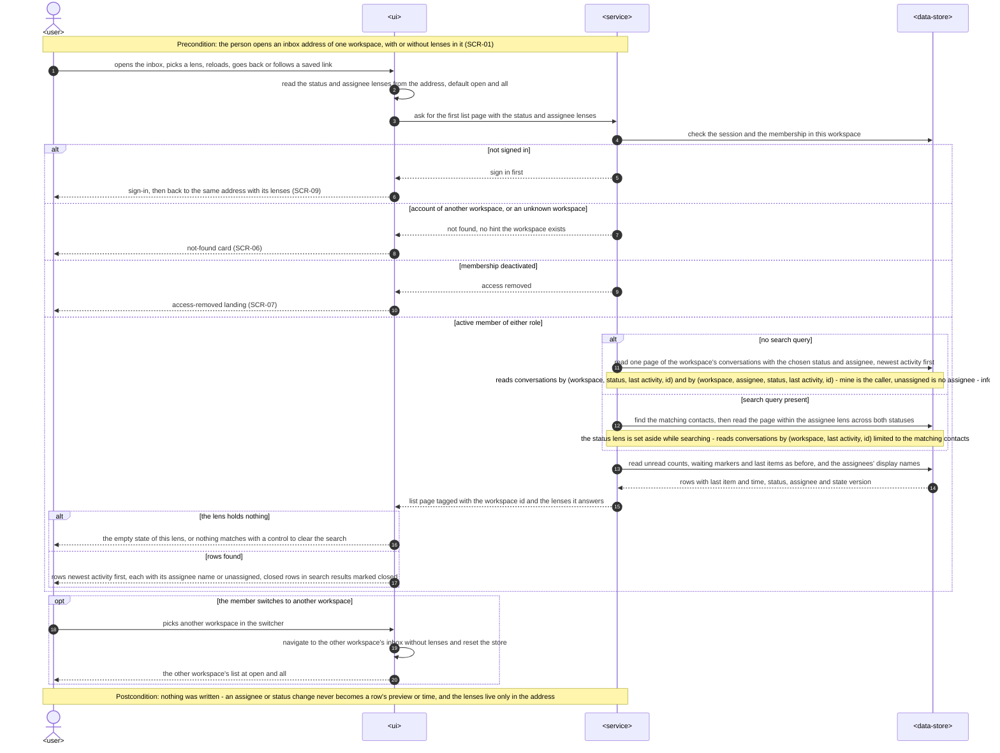

The panel reads the lenses from the address (open · all when none are given) and asks for the first page. The guard sends a signed-out visitor to sign in and back to the same address, gives another workspace's account the not-found card, and gives a deactivated member the access-removed landing (AC-11). For an active member of either role, the page comes from the status and assignee lens indexes, newest activity first. While a search query is present, the status lens is set aside and matches of both statuses within the assignee lens are returned, with closed rows marked. Each row keeps its last message and time and shows its assignee's name or "unassigned". An empty lens says so (AC-01). Switching workspace drops the lenses and starts at open · all.

### Flow 5: Take or hand over a conversation (US-02 — AC-02, AC-04, AC-11, AC-12)

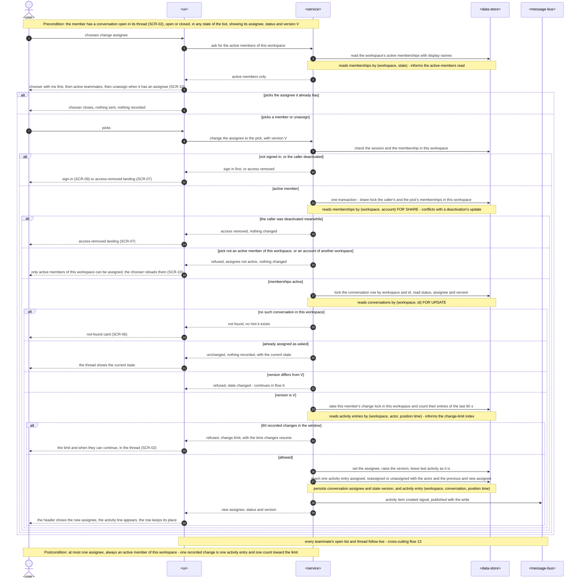

The member opens the chooser over the thread. It lists only the active members of this workspace: "me" first, then teammates, then "unassign" when the conversation has an assignee (SCR-10). Picking the current assignee closes the chooser and sends nothing (AC-02). Otherwise the change carries the version on screen. Inside one transaction the service share-locks the caller's and the pick's memberships. A caller deactivated meanwhile gets the access-removed landing (AC-11). A pick that is not an active member of this workspace, which includes a foreign account, is refused with the same "active members only" answer, and the chooser reloads (AC-04). Under the conversation row lock, a request that matches the current state is a no-op and a version mismatch goes to flow 6. A member with 60 recorded changes in this workspace in the last 60 s is refused with the resume time (AC-12). Otherwise the assignee is written, the version raised and one activity entry inserted, without moving last activity. The thread shows the new assignee and its line, and teammates follow live (AC-02, flow 13). This works on a closed conversation too, and it stays closed.

### Flow 6: Confirm over a recent change (US-02, US-03 — AC-03)

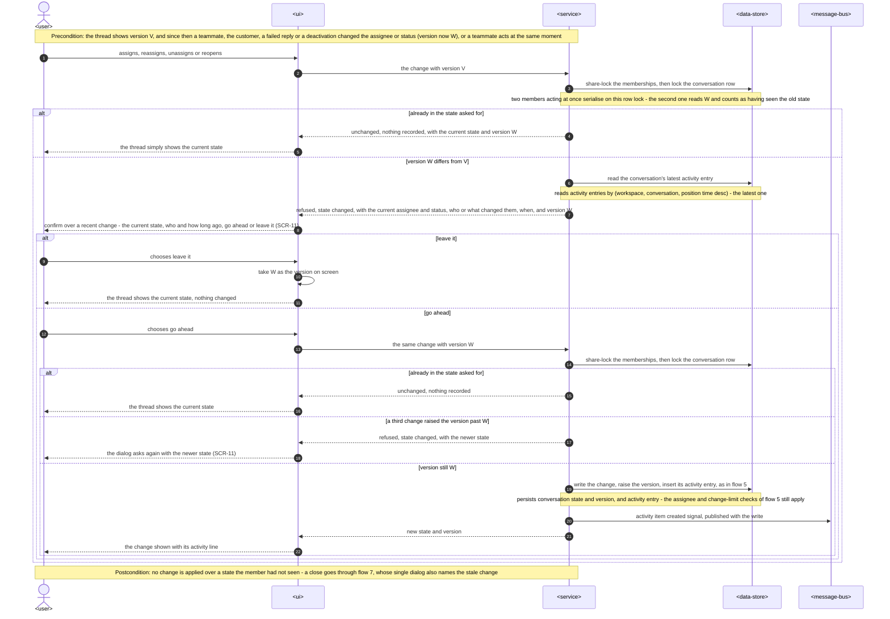

The member acts on a conversation whose assignee or status changed since the screen showed it, by a teammate, the customer, a failed reply or a deactivation, or a teammate acts at the same moment. Both requests serialise on the conversation row lock, so the second one sees the newer version (AC-03). If the conversation is already in the state asked for, nothing is recorded and the thread shows it. Otherwise the refusal carries the current assignee and status, who or what changed them and when, and the current version. The dialog (SCR-11) offers "go ahead" or "leave it". "Leave it" keeps the current state on screen. "Go ahead" resends with the version from the refusal. It is recorded only if nothing changed again, and a third change asks again.

### Flow 7: Close a conversation, asking first when it may be early (US-03 — AC-05, AC-06, AC-08, AC-12)

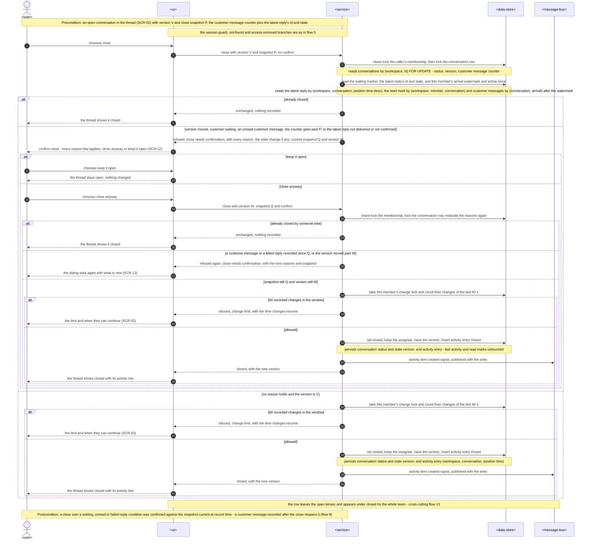

The close carries the version and the close snapshot on screen. Under the conversation row lock the service evaluates the reasons. These are: the customer is waiting for a reply; this member has a customer message they have not read (after the later of their watermark and active-since); the counter grew past the snapshot; the latest reply is "not delivered" or "not confirmed" (AC-06, AC-08); and the version moved (AC-03). With no reason, the close is recorded at once (AC-05). With any reason, the single confirmation (SCR-12) names all of them. "Keep it open" changes nothing. "Close anyway" resends with the refusal's snapshot and version and `confirm`. The reasons are evaluated again at record time, so a customer message or failed reply recorded in between asks again. The change limit applies just before the write (AC-12). A recorded close keeps the assignee, does not move last activity or anyone's unread count, inserts "closed", and moves the row to the closed lens for the team (flow 13).

### Flow 8: A member reopens a closed conversation (US-03 — AC-05, AC-03, AC-12)

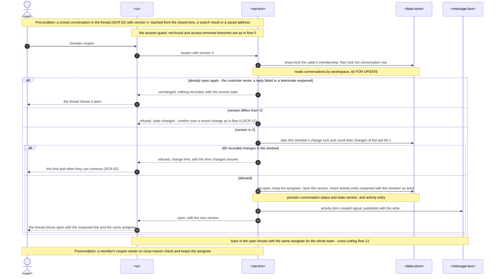

Any member can reopen a closed conversation from its thread. If it is already open again, nothing is recorded and the thread shows it. If its state changed since the screen showed it, the flow 6 confirmation applies (AC-03). Past the change limit it is refused (AC-12). Otherwise it opens with the same assignee, records "<member> reopened this", and returns to the open lenses for the team (AC-05).

### Flow 9: A customer's new message reopens a closed conversation (US-04 — AC-07, AC-06, AC-09)

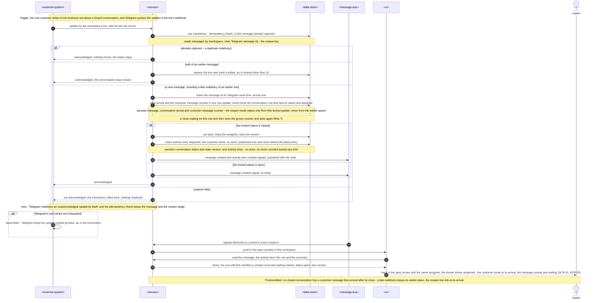

A customer message reaches the webhook of a closed conversation. Capture's first step is the idempotency check on the message's unique key, so a duplicate redelivery moves nothing. An edit of an earlier message does not reopen (AC-07). A new message, including a late redelivery that keeps its earlier place in the history, raises arrival and the customer message counter in one row update. That update locks the conversation row and returns its status. If the status is closed, the same transaction reopens it with the same assignee, raises the version and inserts "reopened — the customer wrote" at the moment of capture, never before the close it undoes (AC-07, AC-09, ADR-0004, ADR-0006). A close waiting on the same lock sees the grown counter and asks again (AC-06). A failed capture rolls back and is not acknowledged, and Telegram redelivers it. Once Telegram gives up, the update is dropped outside tg-inbox. After commit, every open tab sees the conversation back in the open lenses, its message unread and waiting as for an open conversation (flow 13).

### Flow 10: A failed reply reopens a closed conversation (US-04 — AC-08, AC-09)

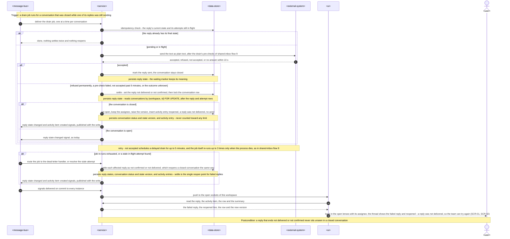

A conversation was closed while one of its replies was still sending. The drain's idempotency step reads the reply's current state, so a reply that already ended never settles twice. A reply that is accepted leaves the conversation closed. Every failed outcome passes `settle()`: a permanent refusal, a failed pre-check, "not accepted" past 5 minutes, an unknown outcome, a stale in-flight attempt or a dead-lettered job. `settle()` sets the reply state and then locks the conversation row. In a closed conversation it reopens with the same assignee, raises the version and inserts "reopened — a reply was not delivered" (AC-08, AC-09, ADR-0004). The team then sees the conversation back in the open lenses with the failed reply, ready to try again (flow 13).

### Flow 11: Read a conversation's history of changes (US-05 — AC-09, AC-11)

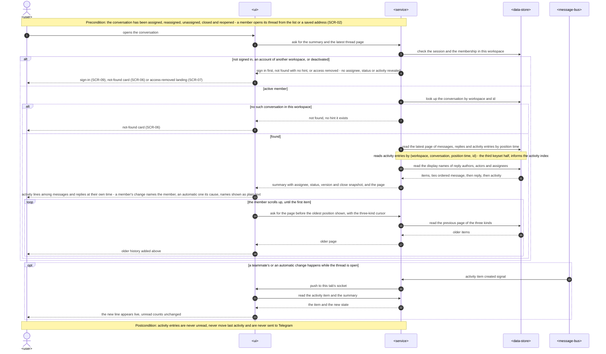

Opening a thread passes the same guard as the list, so someone without an active membership sees no assignee, status or activity (AC-11). For a member, the thread page merges three keyset halves (messages, replies, activity entries) by position time, with ties ordered message, reply, activity (ADR-0006). Each activity line names the member who made the change, or the automatic cause: the customer wrote, a reply was not delivered, the assignee was deactivated. Names are rendered as plain text. Older pages load with the three-kind cursor. A change made while the thread is open in another tab arrives live as one new line, and unread counts do not change (AC-09, ADR-0007).

### Flow 12: Deactivating a member returns their conversations to the team (US-06 — AC-10, AC-04, AC-11)

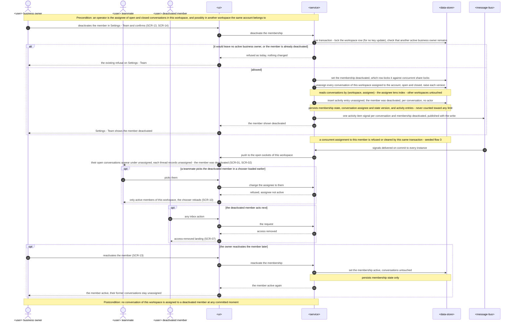

A business owner deactivates a member from Settings — Team and confirms (SCR-13, SCR-14). The existing refusals (last active owner, already deactivated) are unchanged. In the same transaction that updates the membership, the `onMembershipDeactivated` port unassigns every conversation of this workspace assigned to that account, open and closed. It raises each version, inserts "unassigned — the member was deactivated" per conversation and publishes one signal per conversation (AC-10, ADR-0005). Another workspace's assignments of the same account are untouched. The team sees the open ones under "unassigned" live. A racing assignment is refused or cleared by the same transaction (flow 3). A later pick from an old chooser is refused (AC-04). The deactivated member's next action lands on access removed (AC-11). Reactivation changes only the membership, and the conversations stay unassigned.

### Cross-cutting: Flow 13 — a change signal moves a row between lenses (US-01, US-02, US-03, US-06 — AC-02, AC-05, AC-07, AC-08, AC-10)

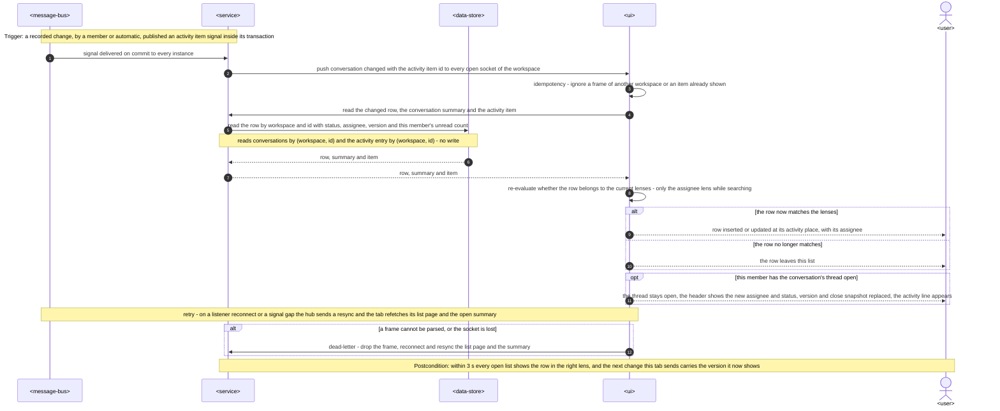

Every recorded change publishes one activity item signal inside its transaction. That covers a member's assign, close or reopen, a customer or failed-reply reopen, and each conversation a deactivation unassigns (ADR-0007). After commit, the hub pushes it to every open socket of the workspace. The tab ignores frames of another workspace and items it already shows, then refetches the row, the summary and the item. It then decides whether the row still belongs to the current lenses (only the assignee lens while searching). The row is inserted, updated or dropped accordingly. A thread open on that conversation stays open with the new header, version and close snapshot (AC-02). A gap or reconnect triggers a resync. A frame the tab cannot parse, for example in an old bundle (§11), is dropped and resynced rather than breaking the socket.

**Coverage — every spec §4 user story and §5 acceptance criterion → where §6 shows it:**

| Spec item | Shown by |
|---|---|
| US-01 | Flow 4, plus flow 13 (rows move between lenses live) |
| US-02 | Flow 5, flow 6, seeded flow 1 |
| US-03 | Flow 7, flow 8, seeded flow 1 |
| US-04 | Flow 9, flow 10, seeded flow 2 (no web screen for the end customer: these are the panel effects, as in `ux-flows.md`) |
| US-05 | Flow 11, plus the activity-entry inserts in flows 5–10 and 12 |
| US-06 | Flow 12, seeded flow 3 |
| AC-01 | Flow 4: lenses from the address, defaults, lens reads, search across statuses with the closed mark, empty lens, workspace switch reset. "Newest activity first" plus the postcondition that a change never becomes a row's preview or time |
| AC-02 | Flow 5: same-assignee no-op, recorded assign / reassign / unassign, last activity untouched, closed stays closed, any bot state (precondition). Flow 13: lens moves and the thread that stays open |
| AC-03 | Flow 6: stale refusal, go ahead or leave it, third change asks again, concurrent members serialise on the row lock, already-in-state no-op. Flow 7: stale version folded into the close dialog. Flow 8: reopen over a stale state. Seeded flow 1 |
| AC-04 | Flow 5: assignee-not-active branch for a deactivated or foreign account, chooser lists active members only. Flow 12 and seeded flow 3: the racing and the later pick |
| AC-05 | Flow 7: close with no reason. Flow 8: member reopen with the same assignee. Flow 13: leaves and re-enters the open lenses |
| AC-06 | Flow 7: every reason, confirm with the snapshot, re-check at record time, asks again. Flow 9: the capture that serialises on the same row lock |
| AC-07 | Flow 9: reopen on a new message with the same assignee, at its arrival, late redelivery keeps its place, duplicate and edit do not reopen, unread and waiting as for an open conversation. Seeded flow 2 |
| AC-08 | Flow 10: every failed outcome through `settle()`, including dead-letter and stale in-flight. Flow 7: closing over a failed latest reply asks first. Seeded flow 2 |
| AC-09 | Flow 11: three-way thread merge, member or cause named, live line, never unread. Flows 9, 10 and 12: automatic causes. "Never sent to the end customer" is a structural rule (§8 *Events*, no Telegram call on any change path), not a runtime step |
| AC-10 | Flow 12: unassign in the deactivation transaction, open and closed, other workspaces untouched, live under unassigned, reactivation does not give back. Seeded flow 3: the race in both lock orders |
| AC-11 | Flows 4, 5 and 11: guard branches (sign in, not found with no hint, access removed). Flow 5: the caller deactivated mid-request under the share lock. Flow 12: the deactivated member's next action. The same guard fronts every inbox route and the socket (§8 *Authorization*) |
| AC-12 | Flows 5, 7 and 8: limit branch just before the write, counted per workspace and actor. Flows 9, 10 and 12: automatic entries have no actor and are never counted or refused |

**Flagged by `sequences` (for `design` / `data-model` to reconcile, no ADR written):**

- **No new participants.** Every flow stays within §5's containers: `<message-bus>` is `platform/realtime` (signals) and the pg-boss queue (drain jobs), and `<external-system>` is the Telegram Bot API.
- **The no-op check runs before the version check (flows 5, 6, 8).** AC-03 asks that a request matching the current state change nothing even if the state moved meanwhile. §4 choice 2 lists the no-op first, and the flows keep that order. `api` should make "unchanged" a success that returns the current state and version, so the screen updates its version.
- **A member reopen does not evaluate close reasons (flow 8)**, and a member close that is already closed is a no-op even with `confirm` (flow 7). Both follow from AC-03 and AC-05, and no ADR is needed.
- **Activity-entry indexes for `data-model`.** The flows read activity entries three ways: by (workspace, conversation, position time, id) for the thread half and the latest entry, by (workspace, actor, position time) for the change limit, and by (workspace, id) for the live item. The list and deactivation paths read conversations by (workspace, status, …) and (workspace, assignee, status, …), as §4 already names.
- **The active-members read (flow 5)** reads memberships by (workspace, state). It is a new `workspaces` app-layer read (§5 `activeMembers`), not a tenancy exception.
- **Unparseable frames (flow 13)** are dropped and resynced. This is the mitigation §11 already asks `tasks` to verify, drawn here as the flow's dead-letter branch.

## 7. Deployment view

Nothing changes in the topology. The feature runs in the one Node 26 process (Fastify API, the built web panel, webhook ingress, the live socket and pg-boss workers) against one PostgreSQL 16 database. No queue, no configuration key and no external dependency is added. The change routes, reopen and unassign run inside existing request or job transactions. A second replica needs no change: the version guard and the limit are enforced in the database (row locks, advisory locks), and signals still fan out through `LISTEN/NOTIFY`.

**Configuration added:** none. The constants 60 changes per 60 s, the activity kinds and causes, and the thread kind order live in `conversations/domain`.

**Monitoring:**
- Metrics (from structured logs):
  - request duration on the change path (assign / unassign / close / reopen), split by outcome: recorded, unchanged, state changed, close needs confirmation, assignee not active, limit;
  - change-to-push latency per activity signal (commit to socket write);
  - capture-to-push latency for customer reopens;
  - list duration per lens;
  - limit refusals per member;
  - the number of conversations unassigned per deactivation.
- Alerts:
  - the existing `/health` uptime check;
  - the integrity checks below returning any row;
  - the spec §7 reopen KPI: more than 30 % of a workspace's closes followed by a customer reopen within 24 h over a rolling 7 days.
- Integrity checks: periodic reconciliation queries in the run book, also asserted in the integration suite.
  - Assignees that are not active members of the conversation's workspace. The query joins `memberships`. It is an ops query, not a repository read.
  - Closed conversations whose last customer arrival is later than their latest close entry.
- KPIs (spec §7) are computed by run-book queries over the stored columns and the activity table:
  - share of open conversations with an assignee, as a snapshot at 18:00 server time;
  - duplicate first answers: "share of customer messages followed, before the customer's next message and within 10 minutes, by "sent" replies from two or more different members; per workspace, rolling 7 days", computed from `replies` and `messages`;
  - closes followed by a customer reopen within 24 h;
  - customer messages still waiting 24 h after the last one.
- Tracing: the Fastify request id is in every log line. Change logs carry the workspace, conversation, activity id, kind, cause and outcome code, and never display names or message text.

**Scaling thresholds:**
- At pilot scale (5–10 workspaces, ≤ 1 000 conversations each, spec §6) the lens indexes in §4 keep every list page an index range scan. Past ~50 000 conversations per workspace, revisit partial indexes for `status = 'open'`.
- A deactivation writes one activity entry and one NOTIFY per conversation assigned to the member, inside one transaction. This is fine up to a few thousand assigned conversations. Above that, batch the inserts and publish a single workspace-level resync signal instead.
- Activity entries grow by a handful per conversation. Comfortable in one table for years at pilot scale.

## 8. Crosscutting concepts

| Concept | Convention | Where defined |
|---|---|---|
| Logging | pino via `platform/logger.ts`. Change logs carry ids, kinds, causes and outcome codes. Display names, message text and NOTIFY payloads are never logged. | `CLAUDE.md` + here |
| Authentication | Session cookie resolved by `auth` on every route and the socket, unchanged. | workspace-operators ADR-0002 |
| Authorization | Every change route and read sits under `/api/workspaces/:workspaceId/…` behind the `workspaces` guard. Another workspace's account gets not found with no hint, a deactivated member gets `ACCESS_REMOVED`, and a signed-out visitor is sent to sign in (AC-11). Both roles have identical rights (spec §1). Inside the change transaction, the caller's membership is share-locked again, so a member deactivated mid-request cannot record a change. | workspace-operators ADR-0003, [ADR-0005](adr/0005-unassign-on-deactivation-through-a-workspaces-port-called-inside-the-deactivation-transaction.md) |
| Tenancy | Conversation ids from the URL are always looked up with the workspace id, and assignee ids are validated as active members of that same workspace. The deactivation unassign filters by the membership's workspace, so another workspace's assignments of the same account stay. No new controlled exception. | `CLAUDE.md`, §5 |
| Concurrency | Lock order per path:<br>• **Member change:** (1) memberships `FOR SHARE`; (2) the conversation row `FOR UPDATE`; (3) the `changes:<ws>:<account>` advisory lock, after the no-op, version and close checks; (4) the activity insert.<br>• **Deactivation:** (1) the workspace row `FOR NO KEY UPDATE` (not `FOR UPDATE`: the foreign-key check of any insert that names the workspace, such as an activity entry or a message, takes `FOR KEY SHARE`, which `FOR UPDATE` would block, and a member change holding its membership `FOR SHARE` would then deadlock with the deactivation); (2) the membership `UPDATE`, whose row lock conflicts with `FOR SHARE`; (3) the conversation rows assigned to the member (`UPDATE`); (4) activity inserts.<br>• **Capture:** contact upsert and message insert (unique key), then the conversation row (the raise `UPDATE`, returning status).<br>• **Reply outcome** (`settle()`): the `drain:` advisory lock and the reply / attempt rows, then the conversation row.<br>• **Reply writes** (create, resend, settle, the drain): the `drain:<ws>:<conversation>` advisory lock first, then the reply / attempt rows, then the conversation row; the per-member reply-limit lock comes after the drain lock. The request side takes the drain lock before it writes anything, because a reply or attempt insert takes `FOR KEY SHARE` on the conversation row, which a `FOR UPDATE` holder blocks.<br>• **Combined order:** memberships (`FOR SHARE`) → conversation row (`FOR UPDATE`); the drain lock precedes both whenever a reply is written.<br>**Why this is deadlock-free:** no path locks a conversation row and then a reply, attempt, message or membership row. The close only reads the latest reply and the member's read mark. Member changes take memberships before conversation rows, and so does deactivation. Nothing takes a `changes:` lock before a row lock that another path holds while waiting for that `changes:` lock. | [ADR-0002](adr/0002-guard-member-changes-with-a-per-conversation-state-version-the-client-echoes.md), [ADR-0003](adr/0003-recheck-close-reasons-under-the-conversation-row-lock-against-an-acknowledged-close-snapshot.md), [ADR-0005](adr/0005-unassign-on-deactivation-through-a-workspaces-port-called-inside-the-deactivation-transaction.md) |
| Error handling | `AppError` subclasses with codes in `packages/shared/src/errors.ts`:<br>• state changed since seen: `ConflictError`, details = current assignee, status, latest activity (actor or cause, time), version;<br>• close needs confirmation: `ConflictError`, details = reasons, stale change if any, snapshot, version;<br>• assignee not active: `ValidationError`, the same answer for a deactivated or foreign account;<br>• change limit: `TooManyRequestsError` with the resume time.<br>"Already in the requested state" is a success with nothing recorded, not an error. | `CLAUDE.md` + here |
| ID strategy | UUIDv7 from `newId()` for activity entries. The state version is a per-conversation integer counter, not an id. | `CLAUDE.md` |
| Time and order | Server clock (UTC) for activity position time. A customer reopen sits at the message's arrival time, while the message keeps its Telegram send time (AC-07). Thread ties: message < reply < activity. | [ADR-0006](adr/0006-store-activity-entries-in-their-own-table-and-merge-them-into-the-thread-by-position-time.md), shared-inbox ADR-0008 |
| Events | `conversation.changed` with item `{ type: 'activity', id }`, change `created`, one per recorded change, published inside the writing transaction. `membership.deactivated` is unchanged. | [ADR-0007](adr/0007-signal-assignment-and-status-changes-as-activity-items-on-conversation-changed.md), shared-inbox ADR-0003 |
| Rate limiting | 60 recorded member changes per rolling 60 s per member per workspace, counted from activity entries under `hashtextextended('changes:<ws>:<account>', 0)`. Automatic changes are excluded. | §4 |
| Untrusted content | Display names in assignee labels and activity lines are rendered as plain text (React escaping, spec §6.1 abuse case). Activity entries store account ids and resolve names at read time. | spec §6.1 |
| Internationalisation | UI stays in English. Activity lines are composed by the web panel from kind + cause + names, not stored as text. | — |
| Observability | See §7. The activity table doubles as the audit trail of who changed what (spec §6.1 abuse case: mass close attributed). | §7 |

## 9. Architecture decisions

| # | Title | Status | Section |
|---|---|---|---|
| [0001](adr/0001-store-assignee-status-and-activity-in-the-conversations-module-and-serve-them-through-inbox-routes.md) | Store assignee, status and activity in the conversations module and serve them through inbox routes | Accepted | §4, §5 |
| [0002](adr/0002-guard-member-changes-with-a-per-conversation-state-version-the-client-echoes.md) | Guard member changes with a per-conversation state version the client echoes | Accepted | §4 |
| [0003](adr/0003-recheck-close-reasons-under-the-conversation-row-lock-against-an-acknowledged-close-snapshot.md) | Re-check close reasons under the conversation row lock against an acknowledged close snapshot | Accepted | §4 |
| [0004](adr/0004-reopen-closed-conversations-inside-the-capture-and-reply-outcome-transactions.md) | Reopen closed conversations inside the capture and reply-outcome transactions | Accepted | §4 |
| [0005](adr/0005-unassign-on-deactivation-through-a-workspaces-port-called-inside-the-deactivation-transaction.md) | Unassign on deactivation through a workspaces port called inside the deactivation transaction | Accepted | §4, §8 |
| [0006](adr/0006-store-activity-entries-in-their-own-table-and-merge-them-into-the-thread-by-position-time.md) | Store activity entries in their own table and merge them into the thread by position time | Accepted | §4, §5 |
| [0007](adr/0007-signal-assignment-and-status-changes-as-activity-items-on-conversation-changed.md) | Signal assignment and status changes as activity items on conversation.changed | Accepted | §4, §8 |

ADR files live under `docs/features/assignment-statuses/adr/NNNN-<title>.md`. Decisions this design builds on:
- repo [`docs/adr/`](../../adr/) 0001, 0002, 0004;
- workspace-operators ADR-0002, 0003, 0005;
- bot-connection ADR-0003, 0005;
- shared-inbox ADR-0002, 0003, 0004, 0005, 0007, 0008.

## 10. Quality requirements

Each top-3 goal from §1 is expanded into a scenario below. Every number is quoted from spec §6.

**QG-1. No lost customer, no silent overwrite**
- **When:**
  - a member closes a conversation whose customer is waiting, or that has an unread customer message, or whose latest reply failed;
  - a customer message is captured between the close question and "close anyway";
  - two members change the same conversation at once;
  - a customer writes to a closed conversation, or a reply in a closed conversation ends "not delivered" or "not confirmed".
- **Then:**
  - the close happens only after the member confirms against the current snapshot;
  - the second of two concurrent changes is asked, never applied silently;
  - lost customers: "0 closed conversations whose latest customer message arrived after the close";
  - reopen on customer message p95, message captured to conversation shown open to the team: "≤ 3 s".
- **How verify:**
  - integration tests against a real Postgres (Testcontainers):
    - (a) close with each reason, then close-anyway with the returned snapshot: closes;
    - (b) capture a message between the refusal and close-anyway, including one whose arrival timestamp is not later than the current one (concurrent webhook connections): refused again, because the counter grew;
    - (b2) a first close (no refusal yet) after a customer message the screen has not shown: refused with the new-message reason;
    - (c) a close and a capture racing on one conversation, run concurrently many times, then the integrity query returns no row;
    - (d) two concurrent assigns with the same version: one recorded, the other `CONVERSATION_STATE_CHANGED`;
    - (e) a capture into a closed conversation, and a drain outcome "not confirmed" in a closed conversation: each reopens with the right activity entry;
    - (f) a duplicate redelivery and an edit: no reopen;
  - the integrity query runs in the run book;
  - timing from capture to push is logged, and an integration test asserts the push reaches a connected test socket.

**QG-2. Ownership integrity under concurrency**
- **When:**
  - a business owner deactivates an operator who is the assignee of open and closed conversations, while a teammate assigns another conversation to that operator;
  - an operator assigns to a deactivated member or to an account of another workspace;
  - an operator makes a 61st change within a minute.
- **Then:**
  - single assignee: "0 conversations with more than one assignee or with an assignee who is not an active member";
  - deactivation unassign: "0 conversations assigned to a deactivated member at any moment — unassigning is part of the deactivation itself (AC-10)";
  - change rate per member: "≤ 60 assignment/status changes per rolling 60 s per member per workspace (AC-12)";
  - other workspaces' assignments of the same account stay.
- **How verify:**
  - integration test "deactivate during a concurrent assign → the assign is refused, no assignment remains", run in both lock orders. When the assign takes its lock first, it commits and the deactivation then clears it with an activity entry (§1 decision override);
  - integrity check in the integration suite after every concurrency test;
  - integration test "the 61st change within a minute is refused", including 61 concurrent requests, and automatic changes not counted;
  - a cross-workspace isolation test per new repository method, plus a route test with a foreign account id as assignee.

**QG-3. Live, responsive inbox**
- **When:** a member's change, a customer reopen or a deactivation unassign happens while teammates have the list or the thread open, or a member opens any lens of a workspace with 1 000 conversations.
- **Then:**
  - assign / close / reopen p95, member action to recorded: "≤ 300 ms server time";
  - live update p95: "≤ 3 s (as shared-inbox §6)";
  - inbox list p95, first page of any lens: "≤ 500 ms server time (as shared-inbox §6)";
  - availability: "99.5 % monthly (as shared-inbox §6)".
- **How verify:**
  - request timing log on the change path;
  - server-side timing from commit to socket write, logged per signal, and a CI integration test that asserts the activity signal reaches a connected socket of a teammate and that the row moves lens in the web store test;
  - a seeded integration test with 1 000 conversations per lens (open · all, open · mine, open · unassigned, closed · each, search) asserting server time;
  - the uptime check on the health endpoint.

## 11. Risks and technical debt

| Risk / debt | Severity | Mitigation | Owner |
|---|---|---|---|
| Teams close too early, then customers reopen with a "thanks" or a sticker, and the list churns. This is a product risk behind the spec §7 reopen KPI. | Medium | The KPI alert in §7. Spec §8 OQ-2 decides on short acknowledgements after 30 days of pilot data. The reopen point is one place in `conversations` (ADR-0004), so a rule can be added there. | Dmytro Hopko |
| A tab that misses a live signal (listener reconnect) keeps an old version, and its next change is asked as stale even though nothing visible changed. | Low | This is the safe direction: the member sees the current state in the dialog. Resync on gap refetches summaries (shared-inbox ADR-0003). | Tech Lead |
| A tab opened before the deploy runs the old bundle and receives frames with item type `activity`, which its schema does not know. | Low | Check at `tasks` that the web store drops unparseable frames without breaking the socket, and that it resyncs. The SPA is served from the same origin, so a reload picks up the new bundle. | Tech Lead |
| Capture now also takes part in the close race. A capture that waits on a close holding the row lock adds up to that close's duration to webhook latency. | Low | Close transactions are short (one row, a few indexed reads, ≤ 300 ms target). Watch capture duration in §7 metrics. | Tech Lead |
| Deactivating a member with very many assignments writes one activity entry and one NOTIFY per conversation in one transaction. | Low | Fine at pilot scale. The threshold and the fallback (a workspace-level resync signal) are in §7. | Tech Lead |
| `buildDeps()` must build `conversations` before `team` to fill the deactivation port, and a test fake must exist for `workspaces` unit tests. | Low | Covered in `tasks`. The admin CLI builds through `buildDeps()` too, so it gets the same wiring. | Tech Lead |
| The composite FK `conversations (workspace_id, assignee_account_id) → memberships` is a cross-module constraint. It guarantees same-workspace assignees, but not active ones. | Low | The active guarantee comes from the lock protocol (ADR-0005) plus the integrity query. The FK is a constraint only, and no cross-module query reads through it. | Tech Lead |
| `CLAUDE.md` and the architecture map do not yet mention the deactivation port, the new conversation columns, the activity table or the extended signal. | Low | Update both in this feature's tasks (the map's `reflects_commit` is stale too). | Tech Lead |
| Activity entries (who handled and who changed what) are kept indefinitely. Removal is by hand. | Low | Same as messages and replies (shared-inbox §11). Belongs to a later privacy and retention step. | Dmytro Hopko |
| Spec AC-10 and §6 say a racing assignment is "refused". The design refuses it or clears it in the deactivation transaction (§1 decision override). | Low | Align the spec wording at review. The integrity outcome (no assignment to a deactivated member at any committed moment) is unchanged. | Dmytro Hopko |
| Capture's upsert takes no lock today, and the reopen decision must read status only from the locked raise `UPDATE`. Reading it from the upsert would reintroduce the lost-customer race. | Medium | Specified in ADR-0004. Covered by the concurrent close-versus-capture test in §10 QG-1 (c). | Tech Lead |
| Spec §8: should a member's first reply to an unassigned conversation assign it to them? Default now: no. | Open question | Resolve after 30 days of pilot use. It would be one more automatic cause in `conversations.createReply`'s transaction, with no schema change. | Dmytro Hopko |
| Spec §8: should a thank-you or sticker after a close leave the conversation closed? Default now: every new customer message reopens. | Open question | Resolve after 30 days of pilot use (watch the §7 reopen KPI). It would be a rule at the single reopen point (ADR-0004). | Dmytro Hopko |

**Accepted debt (acceptable in v1, plan to fix later):**
- There are no counts on the lenses (spec §3).
- Integrity is guaranteed by the lock protocol and checked by run-book queries, not by a database-level "assignee is active" constraint.
- KPIs are computed by run-book queries rather than a scheduled job.

## 12. Glossary

Terms marked † are not yet in [CONTEXT.md](../../../CONTEXT.md) and are candidates for `/sdd:glossary`.

| Term | Meaning |
|---|---|
| Assignee | The one active member of a workspace a conversation is assigned to. A conversation has at most one, or is unassigned. NOT a lock: teammates still read and reply. |
| Conversation status | Open or closed. A closed conversation leaves the default working list and opens again when its customer writes or one of its replies ends not delivered or not confirmed. |
| Activity entry | A thread line recording a change to assignee or status: who made it and when, or the automatic cause (the customer wrote, a reply was not delivered, the assignee was deactivated; spec AC-09 words the last one "the member was deactivated"). Never sent to the customer, never unread. |
| Position time | Where an item sits in the thread: a message by its Telegram send time, a reply by when it was (re)sent, an activity entry by when the change happened (the server clock after the conversation row lock, never before the conversation's previous activity entry). |
| Arrival watermark | The per-member, per-conversation arrival point up to which the member has read. Used for the close reason "a customer message you have not read". |
| Waiting for a reply | The customer wrote after the last reply marked sent. Still a derived marker, and one of the close reasons. |
| Change signal | A small live notice carrying ids only. Here it is a `conversation.changed` with an activity item. |
| State version † | The per-conversation counter raised by every assignee or status change. The client sends the version it showed, so a change made against an older state is asked first. |
| Customer message counter † | A per-conversation count raised by capture, under the row lock, for every newly captured customer message. Ordered by commit, unlike arrival timestamps. |
| Close snapshot † | The customer message counter plus the latest reply's id and state. The screen sends it with every close, and "close anyway" sends back the one from the refusal. A close over a reason is recorded only if the snapshot is still the same. |
| Lens † | A filter of the inbox list that is part of the page address: status (open / closed) and assignee (all / mine / unassigned). |
| Operator / Business owner | Workspace members with identical rights in the inbox, including assignment and status. Only business owners deactivate members. |
| End customer | Writes to the business bot. Their new message always reopens. |
