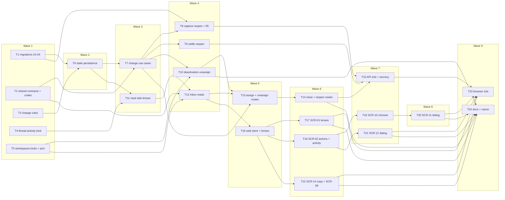

# Epic — assignment-statuses

> **Spec:** [spec.md](../spec.md) · **Design:** [sad.md](../sad.md) · **Data model:** [data-model.md](../data-model.md) · **API:** [openapi.yaml](../contracts/openapi.yaml) · [events.md](../contracts/events.md) · [api-sync-report.md](../contracts/api-sync-report.md) · **Screens:** [screens.md](../screens.md) · **UX flows:** [ux-flows.md](../ux-flows.md) · **ADRs:** [adr/](../adr/)

## Goal

This epic gives every conversation of the shared inbox an owner and a done-state: each one is open or closed and has at most one assignee, an active member of its workspace (spec §2 Goals). The list gets a status lens and an assignee lens that live in the page address, the thread gets assign / unassign / close / reopen and a history of changes, and every change reaches the team live. Finished conversations leave the working list without ever hiding a customer: a customer's new message or a failed reply reopens, a close over a waiting or unread customer is confirmed against what the server sees at record time, and two members never take or close one conversation by accident.

## Scope

- **In:** both declared surfaces (`sad.md` `target_surfaces: [backend-service, web-frontend]`). Backend: five staged migrations (expand `01`, backfill `02`, the activity table `03`, lens indexes `04`, contract `05` promoted with capture's writer); the four new error codes and the shared schemas; the `conversations` change rules, persistence, change use cases, reopen in capture and in `settle()`, the deactivation unassign; the read side with lenses, the summary's close snapshot and the thread's activity half; `workspaces` share-locks, the active-members read and the `onMembershipDeactivated` port; the `inbox` reads and the four change routes; API e2e stories, integrity checks and the secrecy / log assertions. Web: the store and API source (lenses in the address, version and snapshot, activity frames); SCR-01 lenses; SCR-02 actions bar and activity lines; SCR-10, SCR-11, SCR-12; the SCR-14 sentence and the SCR-09 return address; five browser flows. Docs: `CLAUDE.md`, the architecture map, the design-system canon, `CONTEXT.md`.
- **Out (spec §3):** more statuses (snoozed, pending); automatic assignment (spec §8 OQ-1); notifying an assignee (roadmap step 6); counters on the lenses; unassigning merely absent members; muting a flooding sender (OQ-2); bulk actions.

**Size note:** 24 tasks, above the usual 8–20 for an M feature (as the shared-inbox precedent's 29 and bot-connection's 27). The feature declares two surfaces (the `ui` layer adds seven tasks plus a browser-flow task) and changes three backend modules; the change path (rules, persistence, use cases, routes) and the three automatic paths (capture, `settle()`, deactivation) are split so each task stays within one day and one reviewable PR.

## Task map

Waves (what can run in parallel once its upstream is done):

- **Wave 1:** T1, T2, T3, T4, T5
- **Wave 2:** T6
- **Wave 3:** T7, T11
- **Wave 4:** T8, T9, T10, T12
- **Wave 5:** T13, T16
- **Wave 6:** T14, T17, T18, T22
- **Wave 7:** T15, T19, T21
- **Wave 8:** T20
- **Wave 9:** T23, T24

## Tasks

See [tracker.md](./tracker.md) for status. Machine contract: [tasks.json](../tasks.json).

| # | Task | Layer | Blocked by | DoD (short) |
|---|---|---|---|---|
| T1 | Promote the expand, backfill, activity-table and lens-index migrations 01–04, regenerate DB types and extend the test fixtures | migration | — | Migrations 01–04 are promoted to live apps/api/migrations/, apply and revert cleanly on a fresh Postgres 16, the regenerated db.types.gen.ts is committed, the migrations integration test rejects every listed constraint violation |
| T2 | Add the assignment zod contracts, the four error codes and the activity item type on the live frame and the realtime signal | ports | — | packages/shared and platform unit tests pass for every new schema (incl. the ThreadActivity refines and the contract examples), the four codes map to their AppError subclasses and statuses with Retry-After on the limit |
| T3 | Add the conversations domain change rules: no-op, stale and close-reason decision, snapshot equality, activity kinds and causes, position rule and the change-limit window | domain | — | Domain unit tests cover every branch of the change decision (no-op before version, stale, close reasons with and without confirm and snapshot equality, member reopen without reasons, already-closed close with confirm), the activity kind / cause / assignee-pair rules, the position rule and the 60/60 s limit with its retry_at. |
| T4 | Extend the thread domain with the activity kind: merge order message < reply < activity and a three-kind cursor that still decodes old cursors | domain | — | Thread domain unit tests prove the three-way merge with ties message < reply < activity, cursor round-trips for the activity kind |
| T5 | Give workspaces lockActiveMembers, activeMembers and the onMembershipDeactivated port called inside the deactivation transaction | app | — | Unit and integration tests prove lockActiveMembers takes FOR SHARE and returns only active accounts of that workspace, activeMembers lists active members ordered by display name then account id, both isolated by workspace |
| T6 | Build the conversations persistence for state and activity: locked row read, versioned state update, activity repository and the close-reason reads | infra | T1, T3 | Integration tests prove the FOR UPDATE row read with status / assignee / version / counter, the versioned update raising state_version by one, activity insert / latest / by id / count-by-actor over 60 s with the oldest created_at |
| T7 | Add the changeAssignee and changeStatus use cases in conversations: version guard, close reasons against the snapshot, the per-member change limit, the write, the activity entry and its signal | app | T2, T6 | Unit tests cover every outcome of both use cases in check order |
| T8 | Reopen a closed conversation on a newly captured customer message, raise the customer message counter under the row lock, and promote contract migration 05 | app | T1, T7 | Integration tests prove a new message into a closed conversation reopens it with the same assignee, one reopened/customer_wrote entry at its arrival and its signal |
| T9 | Reopen a closed conversation in settle() when a reply ends not delivered or not confirmed | app | T7 | Unit and integration tests prove that finishAttempt, skipReply, resolveStaleInFlight and the dead-letter resolution each reopen a closed conversation once with a reopened/reply_not_delivered entry and its signal, that an accepted reply leaves it closed |
| T10 | Unassign a deactivated member's conversations through the port inside the deactivation transaction, and build conversations before team in buildDeps | app | T5, T7 | Integration tests prove that deactivating a member unassigns every conversation of that workspace assigned to them (open and closed) with one unassigned/member_deactivated entry and one signal each, in the deactivation's transaction |
| T11 | Teach the conversations read side lenses, per-row state and version, the summary's close snapshot, the thread's activity half and the single activity item | infra | T4, T6 | Integration tests prove every lens (open/closed × all/mine/unassigned) and search across both statuses within the assignee lens, rows with status / assignee id / version and unchanged last item and time, the summary's close snapshot, the three-way thread page with activity items and old cursors, the activity item by id, workspace isolation |
| T12 | Serve lenses, state and activity through the inbox reads: change the list, summary and thread schemas, add getThreadActivity and listActiveMembers | ports | T2, T5, T11 | Route integration tests pass for the changed listConversations (status / assignee / q and the lens echo), getConversation as ConversationSummary, listThreadItems with activity items, getThreadActivity and listActiveMembers (any active member, active only), with the guard trio and foreign ids |
| T13 | Add the assign and unassign routes: one transaction that share-locks the memberships, then changes the conversation, with every refusal of the contract | ports | T7, T10, T12 | Unit tests prove the check order (caller share-lock → pick active → conversation) |
| T14 | Add the close and reopen routes with the close snapshot and confirm, and prove the change limit across all four change routes | ports | T13 | Route tests prove close recorded with no reason, 409 CLOSE_NEEDS_CONFIRMATION with every reason, close anyway with the refusal's snapshot, asks again after a capture or failed reply in between, reopen recorded / unchanged / stale |
| T15 | Add the API end-to-end assignment stories, the integrity checks, and the secrecy and log assertions for the new responses and frames | tests | T8, T9, T14 | The e2e stories pass against Postgres and the fake Bot API (webhook reopen, failed-reply reopen, deactivation unassign, cross-workspace refusals, live activity frame on a teammate's socket), the integrity queries return no row after them |
| T16 | Teach the web inbox store and API source lenses in the address, the state version and close snapshot, the change actions and activity frames | ui | T12 | Store tests prove lenses read from and written to the address (unknown values rewritten to the default), late answers for a left lens dropped, the open conversation's version and close snapshot kept and replaced from every answer and refusal, coalesced activity-frame refetches with lens re-evaluation, dropped unparseable frames with resync in the current lenses |
| T17 | Build the SCR-01 lenses: status tabs and assignee select, the assignee line and closed mark on rows, per-lens empty states and live join and leave | ui | T16 | Testing Library tests cover every SCR-01 state this feature adds in screens.md (lenses, lens from the address, unknown lens rewritten, lens loading, per-lens empty texts, searching with disabled tabs and Closed badges, live join / leave, selected row left the lens, phone layout). |
| T18 | Build the SCR-02 actions bar (ConversationActions) and the activity line in the thread: status badge, assignee button, close and reopen, pending lock, limit countdown and live changes | ui | T16 | Testing Library tests cover every SCR-02 state this feature adds in screens.md (open / closed header, activity lines for every kind and cause, actions loading, pending lock, recorded / unchanged, change-limit countdown, change failed, live teammate / automatic changes, phone header row), with names as plain text. |
| T19 | Build SCR-10, the assignee chooser: me first, active teammates, unassign, current check, per-row pending and the in-place not-active refusal | ui | T18 | Testing Library tests cover every SCR-10 state in screens.md (loading, default with Me first and the current check, only me, pick the current assignee sends nothing, pending, success, refused not active with re-read, changed since I looked hands off to SCR-11, limit / failed close the chooser, members load error with Retry, keyboard, phone width). |
| T20 | Build SCR-11, the confirm-over-a-recent-change dialog: current state, who or what changed it and when, go ahead or leave it, asks again | ui | T19 | Testing Library tests cover every SCR-11 state in screens.md (default for assign / unassign / reopen with member and automatic changes, left it, pending, success recorded / unchanged, asks again, refused not active reopening SCR-10, change limit, error), with the go-ahead resending the refusal's version. |
| T21 | Build SCR-12, the close confirmation: every close reason, close anyway with the refusal's version and snapshot, asks again | ui | T18 | Testing Library tests cover every SCR-12 state in screens.md (one line per reason with the merged unread / new line, kept open, pending with confirm_close_reasons and the refusal's version and snapshot, success recorded / unchanged, asks again, change limit, error) |
| T22 | Add the unassign sentence to the deactivate confirmation (SCR-14) and keep the lenses in the sign-in return address (SCR-09) | ui | T16 | Testing Library tests prove the deactivate confirmation shows the unassign sentence with the member's name as plain text |
| T23 | Add browser end-to-end assignment flows against the real API and the fake Bot API | tests | T15, T17, T20, T21, T22 | The five browser flows pass locally and in CI with pnpm test:e2e. |
| T24 | Update CLAUDE.md, the architecture map, the design-system canon and CONTEXT.md for the conversation state, the activity table, the deactivation port and the new components | docs | T10, T14, T17, T20, T21, T22 | CLAUDE.md and the architecture map name the conversation state and activity table, the deactivation port, the buildDeps order and the change routes exactly as built |

## Risks / Hard rules

- **Tenancy (CLAUDE.md):** every new repository method takes `workspaceId` and has a cross-workspace isolation test; no new controlled exception (sad.md §5). Conversation, activity and assignee ids are always checked within the URL's workspace — a foreign conversation is 404, a foreign assignee is `ASSIGNEE_NOT_ACTIVE`.
- **Module direction (ADR-0001, ADR-0005):** `inbox → {conversations, contacts, bots, workspaces}`, `bots → conversations → contacts`; `workspaces` imports nothing from `conversations` — it declares `onMembershipDeactivated` and `buildDeps()` fills it (T5, T10), building `conversations` before `team`.
- **Lock order (sad.md §8):** member change = memberships `FOR SHARE` → conversation row `FOR UPDATE` → `changes:<ws>:<account>` advisory lock → activity insert; deactivation = workspace row → membership `UPDATE` → conversation rows; capture and `settle()` lock the conversation row last. No path locks a conversation row before a membership, reply or message row.
- **No lost customer (ADR-0003, ADR-0004):** capture decides the reopen only on the status returned by its locked raise `UPDATE`, never on the unlocked upsert read (sad.md §11, Medium); the close is decided at record time against the echoed snapshot. QG-1 (c) and the lost-customer integrity query guard it (T8, T15).
- **Contract split (step-5 rule):** T2 is additive only; the changes to the existing `Conversation`, `ConversationPage`, `ThreadItem` and the `getConversation` answer break the shipped read routes' types, so they land in T12 with the routes and the web fixtures that fill them.
- **Expand → contract:** `05` (NOT NULL on `status`, `state_version`, `customer_message_seq`) is promoted only in T8, with capture's insert that writes the columns, never in T1 (data-model audit).
- **Signals (ADR-0007):** exactly one `conversation.changed` `activity` per recorded change, published inside the writing transaction; payloads carry ids only. An old bundle drops the unknown frame and resyncs (T2, T16).
- **Secrets and logs (spec §6.1, sad.md §7):** no bot token in any new response, frame or log; change logs carry ids, kinds, causes and outcome codes, never display names or message text (T13, T15). Names render as plain text everywhere (T17–T22).
- **Spec wording carried in:** AC-10 says a racing assignment is "refused"; the design refuses it or clears it in the deactivation transaction (sad.md §1 decision override, §11). T13 tests both lock orders; align the spec wording at review.
- **Latency targets (spec §6):** change ≤ 300 ms server time (T13, T14), list per lens ≤ 500 ms at 1 000 conversations (T11), live push and customer reopen ≤ 3 s (T15, T23).

## Assumptions (autonomous run 2026-10-18)

- Depth = medium, size M, route `standard` (`.size` / `.route`); owner Dmytro Hopko on every task; estimates S = ½ day, M = 1 day.
- The shared conversation write (`recordChange`: versioned update + activity entry + signal) is built once in T7 and reused by the three automatic paths (T8, T9, T10) rather than duplicated.
- T5 passes a no-op deactivation port from `buildDeps()` so it can be committed green on its own; T10 replaces it with the real unassign.
- No task writes a run book: the two integrity queries live in the integration suite (T15) and are recorded in the architecture map (T24); the repo has no run-book file yet.
- Tracker export: no issue-tracker MCP is connected; the task files are the copy-paste-ready bodies.
