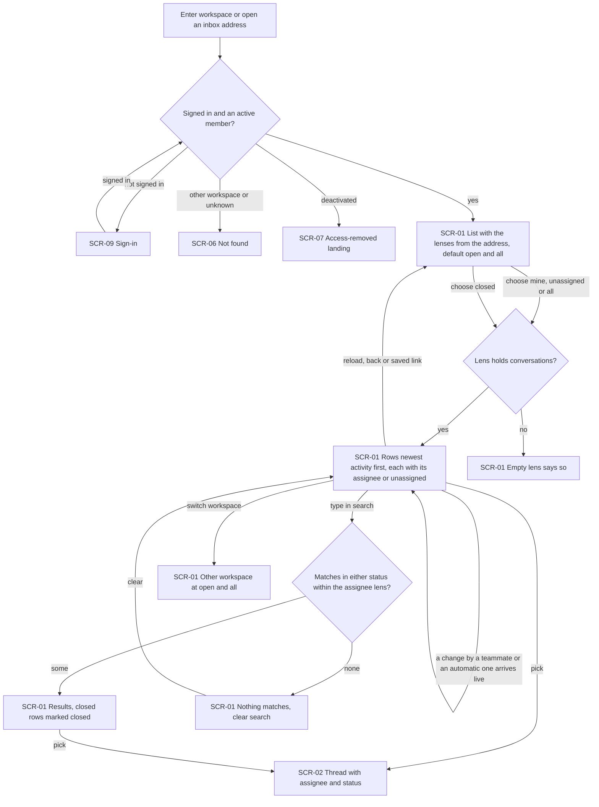
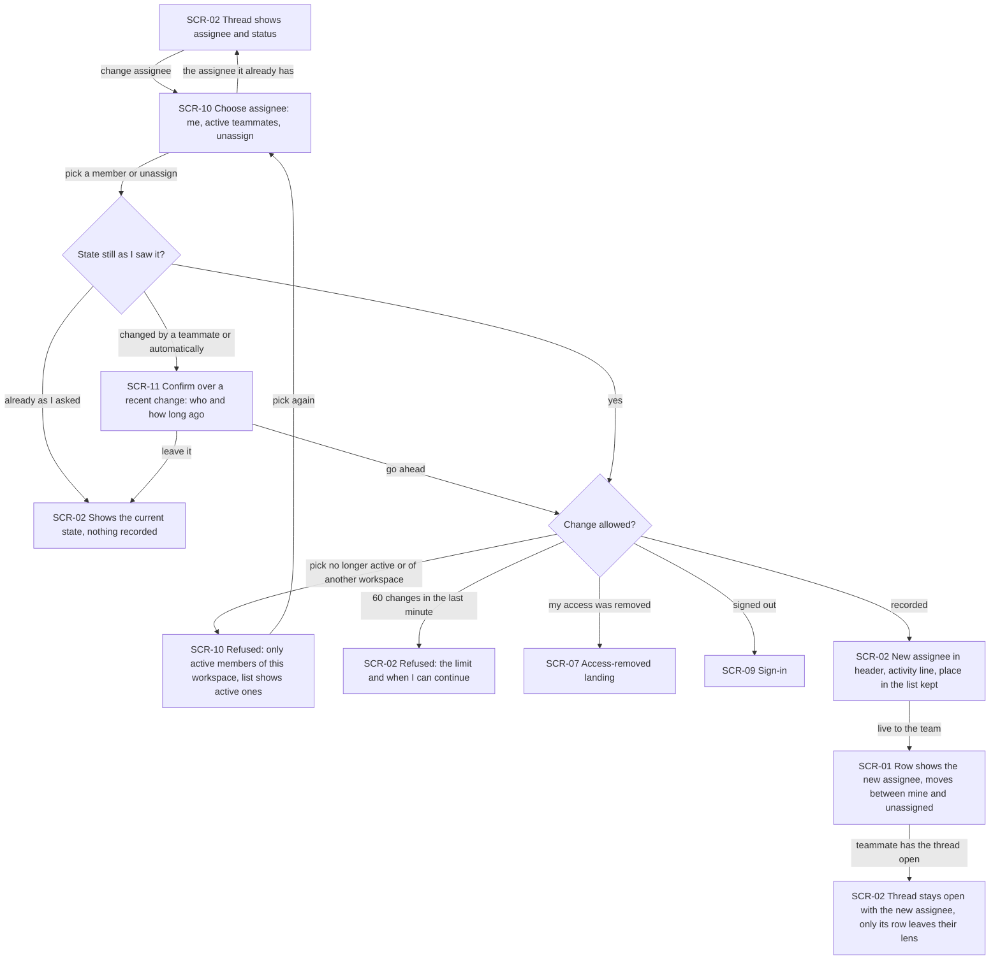
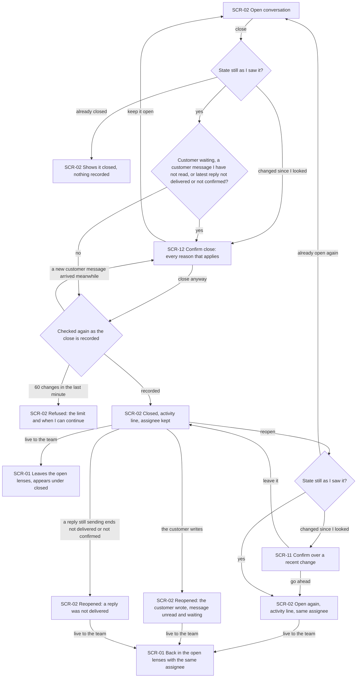
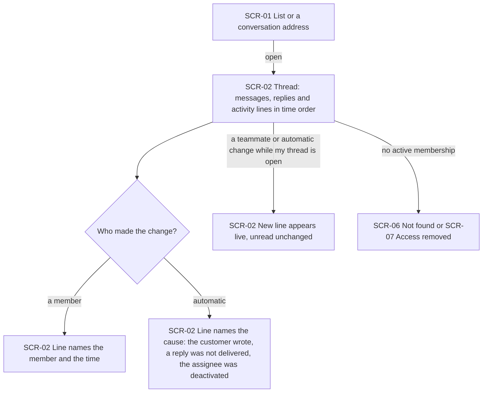
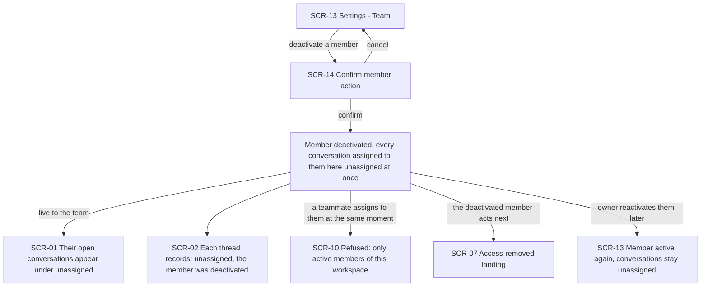

# UX flows — assignment-statuses

> User flows for every UI-touching §4 user story, produced by `ux-flows` (after `clarify`, before
> `design`) and read by `design` (evidence for the target-surface + UI-architecture decisions),
> `sequences` (UI-driven flows align on SCR ids), `screens` (details every inventory row) and
> `plan-tests` (the e2e-through-UI paths). **Always markdown + mermaid `flowchart`**, whatever the
> design tool — this artifact is flow-altitude, not visual design.

## Platform decisions

- **Posture:** desktop-first — per `docs/design-system.md` §Platform posture; every flow must also work at phone width (≥360px), where the inbox stays list → thread → back as in shared-inbox.
- **Builds on the shipped inbox:** SCR-01, SCR-02, SCR-06, SCR-07 and SCR-09 keep their shared-inbox ids and meaning; this feature adds states and entry points to them. Settings — Team and its member-action confirmation (ui-redesign SCR-12 / SCR-17) are reused under local ids SCR-13 / SCR-14. New screens start at SCR-10. Shared-inbox SCR-03, SCR-04, SCR-05 and SCR-08 are unchanged and not visited here.
- **Two lenses on the list, part of the address:** a status lens (open — the default — or closed) and an assignee lens (all — the default — mine, unassigned). Reload, back and a saved link reopen the same lenses; switching workspace starts again at open · all. While searching, the status lens is set aside and matches of both statuses show within the assignee lens (AC-01).
- **Changes happen in the thread only:** assigning, reassigning, unassigning, closing and reopening are actions of the open conversation (SCR-02); list rows only show the assignee and, in search results, the closed mark (AC-02).
- **Modality:** choosing an assignee happens over the thread, not on a separate page (SCR-10). Two new confirmations are dialogs over the thread: "this changed since you looked — go ahead?" (SCR-11, AC-03) and "close anyway?" (SCR-12, AC-06). Refusals — a member no longer active (AC-04), the change limit (AC-12) — are shown in place, on the screen where the member acted.
- **Live, not refreshed:** a teammate's change and an automatic one (customer reopen, failed-reply reopen, deactivation unassign) arrive into whatever list or thread is open, as in shared-inbox (AC-02, AC-05, AC-07, AC-08, AC-10). How is a `design` decision.
- **History in the thread:** every change appears as an activity line among the messages and replies at its own time; activity lines are never unread and never reach the customer (AC-09).
- **Out of scope as a flow:** US-04 (End customer — a returning customer is never lost) has no web screen of its own: the customer only writes to the bot in Telegram. Its effects in the panel — the conversation reopening for the team (AC-07, AC-08) — are drawn as the automatic branches of Flow US-03 and as activity lines in Flow US-05.
- **Design input, not decided here:** knowing "what the member last saw" for the stale-state confirmation (AC-03), and re-checking the close condition at the moment the close is recorded (AC-06), both need a server-side check against the state the member's screen showed — flagged for `design`.

### Assumptions (autonomous run 2026-10-18)

- Depth = medium, posture = desktop-first per the design canon (no deviation); per-flow confirmations were made by the pipeline itself, each flow below is its prose account and can be vetoed at review.
- When a close attempt is both stale (AC-03) and over a waiting / unread customer or a failed reply (AC-06), the member gets **one** confirmation — SCR-12 — naming every reason, not two dialogs in a row. A close is therefore always asked through SCR-12 — also when only the stale condition applies — and SCR-11 serves the other actions (assign, reassign, unassign, reopen).
- The list of members to choose from (SCR-10) offers "me" first, then the other active members, then "unassign" when the conversation has an assignee; the current assignee is shown as chosen, and choosing it again simply closes the chooser (AC-02: changes nothing, records nothing).
- A member whose own access is removed while acting lands on the existing access-removed landing (SCR-07); a signed-out action lands on sign-in (SCR-09) and returns to the same address — both reuse shared-inbox behaviour.
- The owner deactivating a member does so from the existing Settings — Team screen and its confirmation; this feature adds no new step there, only the consequences in the inbox.

## Screen inventory

| ID | Screen | Purpose | Entry | Exit |
|---|---|---|---|---|
| SCR-01 | Inbox — conversation list | (reused, shared-inbox SCR-01) The workspace's conversations, newest activity first — now through the status lens (open / closed) and assignee lens (all / mine / unassigned), each row showing its assignee or "unassigned", closed rows marked in search results, an empty state per lens | entering a workspace; Inbox in the navigation; an address with lenses; back from SCR-02 at phone width | SCR-02 (pick a conversation); another workspace's SCR-01 (switcher, lenses reset) |
| SCR-02 | Inbox — conversation thread | (reused, shared-inbox SCR-02) One conversation's history — now with its assignee and status, the assign / unassign / close / reopen actions, activity lines among messages and replies, and in-place refusals | a conversation in SCR-01; a conversation's address | SCR-01; SCR-10, SCR-11, SCR-12; SCR-06 (unknown or foreign address); SCR-07 (access removed); SCR-09 (signed out) |
| SCR-06 | Not found (in frame) | (reused) The not-found card for a conversation address of another workspace or an unknown one — no hint it exists | a foreign or unknown conversation / lens address | SCR-01 |
| SCR-07 | Access-removed landing | (reused) Workspace picker / no-access screen with the access-removed notice | an action or visit after the member was deactivated | another workspace's SCR-01; sign out |
| SCR-09 | Sign-in | (reused) Sign-in; a signed-out visit to an inbox address lands here and returns afterwards | an inbox or conversation address while signed out | SCR-01 / SCR-02 of the requested address |
| SCR-10 | Choose assignee | New — pick who handles the conversation: me, an active teammate, or unassign; offers active members of this workspace only and shows a refusal when the pick is no longer active | "change assignee" in SCR-02 | SCR-02 (assigned / unchanged); SCR-11 (changed since I looked) |
| SCR-11 | Confirm over a recent change | New — the assignee or status changed since the member looked: shows the current assignee and status, who changed them (or the automatic cause) and how long ago; go ahead or leave it | an assign, reassign, unassign or reopen in SCR-02 / SCR-10 against a state that changed since it was shown | SCR-02 (changed, or left as it now is) |
| SCR-12 | Confirm close | New — before closing, shows why it may be early: the customer is waiting for a reply, the newest customer message the member has not read, the latest reply "not delivered" / "not confirmed", or a change since the member looked; close anyway or keep open | "close" in SCR-02 when any reason applies; asked again when a customer message is recorded before the close | SCR-02 (closed, or kept open) |
| SCR-13 | Settings — Team | (reused, ui-redesign SCR-12) Members and invitations; the business owner deactivates a member here | Settings in the navigation (business owner) | SCR-14; SCR-01 via the navigation |
| SCR-14 | Confirm member action | (reused, ui-redesign SCR-17) The existing confirmation before deactivating a member | "deactivate" on a member row in SCR-13 | SCR-13 |

## Flows

### Flow: US-01 — See who handles what

A member enters the workspace or opens an inbox address. Someone signed out signs in first and returns to the same address; an account of another workspace (or an unknown address) gets the not-found card with no hint the workspace exists, and a deactivated member gets the access-removed landing (AC-11). An active member — operator or business owner alike — lands on the list with the lenses the address names, open · all by default (AC-01). Choosing mine, unassigned, all, or closed narrows the list; each row keeps its last message and time and shows its assignee's name or "unassigned", newest activity first, and an empty lens says so. Typing a search sets the status lens aside: matches of both statuses appear within the chosen assignee lens, closed ones marked "closed"; with no matches the list says so and offers to clear the search. Teammates' and automatic changes re-sort the lenses live without becoming any row's preview or time. Reload, back or a saved link reopens the same lenses; switching workspace starts the other workspace at open · all. Picking a row opens the thread.

### Flow: US-02 — Take or hand over a conversation

In an open thread — open or closed, in any state of the bot — the member chooses to change the assignee and picks themselves, an active teammate, or unassign (AC-02). Picking the assignee it already has changes nothing and records nothing. If the assignee or status changed since the member last saw it — a teammate acted, the customer reopened it, a deactivation unassigned it, or two members acted at the same moment — nothing changes yet: a confirmation shows the current assignee and status, who changed them and how long ago, and the member goes ahead or leaves it; if it is already in the state they asked for, the thread just shows it (AC-03). A pick who is no longer an active member, or belongs to another workspace, is refused with the reason, and the choice offers only active members (AC-04). A member who has already made 60 changes in this workspace in the last minute is told the limit and when they can continue (AC-12); a member whose access was removed lands on the access-removed landing, and a signed-out one on sign-in (AC-11). Otherwise the header shows the new assignee, the thread records "assigned", "reassigned … from … to …" or "unassigned" with the time, and the conversation keeps its place in the activity order. The whole team sees it live: the row shows the new assignee and moves between "mine" and "unassigned"; a teammate reading that thread keeps it open with the new assignee, and only its row leaves their lens (AC-02).

### Flow: US-03 — Close a finished conversation

From an open thread the member closes the conversation. If it is already closed, the thread just shows it; if it changed since they looked, the close is asked first (AC-03). Before closing, if the customer is waiting for a reply, a customer message arrived that the member has not read (a thread in a background tab marks nothing read), or the latest reply is "not delivered" / "not confirmed", a confirmation names every reason and the member closes anyway or keeps it open (AC-06, AC-08). The condition is checked again at the moment the close is recorded, so a customer message that arrived meanwhile asks again (AC-06); the change limit applies as for assignment (AC-12). Once closed, the thread records "closed" with the time, the assignee stays, and the conversation leaves the open lenses and appears under "closed" for the whole team — without counting as activity or changing anyone's unread count (AC-05). Any member can reopen it from the thread — with the same stale-state confirmation if it changed meanwhile, or nothing at all if it is already open (AC-03) — which records "reopened" and returns it to the open lenses with the same assignee (AC-05). It also reopens on its own, with nobody in the panel acting: when the customer writes again ("reopened — the customer wrote", the message unread and waiting, including a late-redelivered message that keeps its earlier place, but not an edit — AC-07), and when a reply still sending at the close ends "not delivered" or "not confirmed" ("reopened — a reply was not delivered" — AC-08). Each reopen reaches the team's lists live with the same assignee.

### Flow: US-05 — Know what happened to a conversation

Any member opening a conversation — from the list or a saved address — sees each assign, reassign, unassign, close and reopen as a short activity line at the time it happened, among the messages and replies (AC-09). A member's change names that member; an automatic one names its cause — "the customer wrote", "a reply was not delivered", "the assignee was deactivated". When a change happens while the thread is open in another member's tab, the new line appears there live. Activity lines never count as unread and are never sent to the end customer. Someone without an active membership never sees the conversation's assignee, status or activity: an account of another workspace gets the not-found card, a deactivated member the access-removed landing (AC-11).

### Flow: US-06 — Ownership follows the team

A business owner deactivates a member from Settings — Team and confirms in the existing confirmation. As part of the deactivation itself, every conversation of this workspace assigned to that member — open and closed — becomes unassigned; there is never a moment when a deactivated member is anyone's assignee (AC-10). The team sees the open ones appear under "unassigned" without reloading, and each thread records "unassigned — <member> was deactivated". A teammate who tries to assign a conversation to that member at the same moment is refused with the active-members-only reason (AC-04). The deactivated member's next action takes them to the access-removed landing (AC-11). Conversations of another workspace the same account belongs to keep that assignee, and reactivating the member later does not give the conversations back (AC-10).

## AC coverage

| AC | Shown by | Notes |
|---|---|---|
| AC-01 | Flow US-01 → `L`, `H` → `R` / `E`, `S` → `SR` / `SN`, `W` | reload / back / saved link on `R` → `L`; business owner = operator |
| AC-02 | Flow US-02 → `P`, `OK` → `LV` → `KP`; same-assignee edge `P` → `T` | closed conversations assignable (prose); any bot state |
| AC-03 | Flow US-02 → `C` → `K` / `T0`; Flow US-03 → `C` → `K`, `RX` → `K2` | concurrent actions: the second member counts as having seen the old state |
| AC-04 | Flow US-02 → `G` → `X`; Flow US-06 → `X` | |
| AC-05 | Flow US-03 → `CL` → `LC`, `RX` → `RO` → `LO` | |
| AC-06 | Flow US-03 → `W` → `K`, `RC` → `K` | re-check at the moment the close is recorded |
| AC-07 | Flow US-03 → `AU` → `LO`; Flow US-05 → `AU` | US-04's actor has no web screen; this is the panel effect. Late redelivery and edits — prose |
| AC-08 | Flow US-03 → `AF` → `LO`; `W` (latest reply not delivered asks first); Flow US-05 → `AU` | panel effect of US-04 |
| AC-09 | Flow US-05 → `T`, `M`, `AU`, `LV` | never sent to the customer, never unread (prose) |
| AC-10 | Flow US-06 → `U` → `L`, `TL`, `RA` | other workspaces keep the assignee (prose) |
| AC-11 | Flow US-01 → `V` → `SI` / `NF` / `AR`; Flow US-02 → `G` → `AR` / `SI`; Flow US-05 → `NA`; Flow US-06 → `AR` | |
| AC-12 | Flow US-02 → `G` → `RL`; Flow US-03 → `RC` → `RL` | automatic changes never count (no UI step) |
