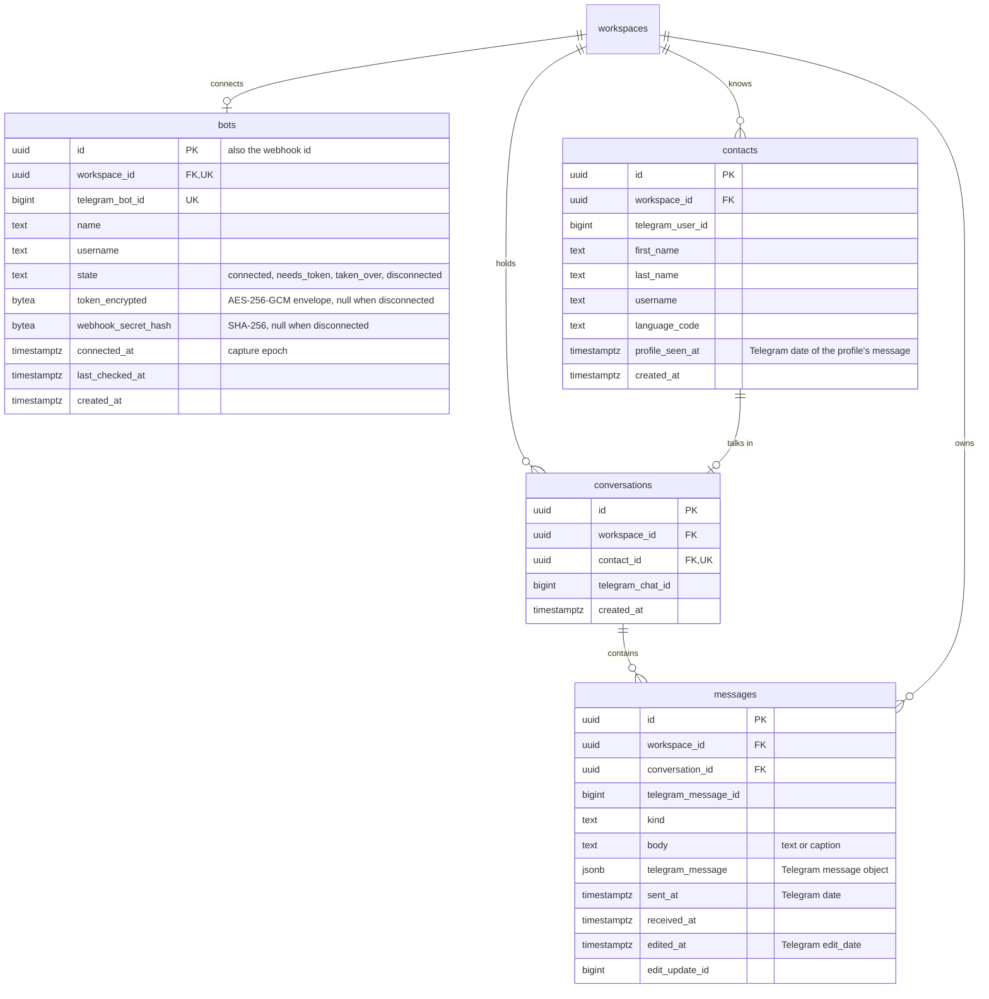

# Data model — bot-connection

Four new tables in three modules ([ADR-0005](adr/0005-split-the-feature-into-bots-conversations-and-contacts-modules.md)): `bots` owns `bots`, `contacts` owns `contacts`, `conversations` owns `conversations` and `messages`. All four are tenant-owned (non-null `workspace_id → workspaces(id)`). This is a brownfield delta that only adds tables: no existing table changes, so there is no expand → migrate → contract sequence and no drift (the three modules have no code yet).

**Conventions applied.** They are taken from the workspace-operators precedent ([data-model](../workspace-operators/data-model.md)), repo [ADR-0004](../../adr/0004-use-postgres-with-kysely-reversible-migrations-and-workspace-scoped-tenancy.md), `CLAUDE.md` and SAD §2/§8:

- `snake_case`, plural table names; constraint names follow `<table>_<cols>_{pkey,key,fkey,check,idx}`.
- PK `id uuid`, UUIDv7 from `newId()`, never a DB default. Telegram ids (`telegram_bot_id`, `telegram_user_id`, `telegram_chat_id`, `telegram_message_id`, `edit_update_id`) are `bigint`, never PKs.
- The application supplies every timestamp: domain times come from the clock port, and Telegram's `date` / `edit_date` are stored exactly as Telegram sends them. There is no `DEFAULT now()` and no generic `updated_at`.
- States are `text` + `CHECK (… IN (…))`, with no Postgres `ENUM`. There are no triggers. State-dependent columns are tied together by `CHECK ((state = …) = (col IS NULL))`, as in `memberships`.
- **Strings that come from Telegram get no length `CHECK`s.** These are names, usernames, language codes, message text and captions. Capture runs inside the webhook request ([ADR-0003](adr/0003-capture-each-update-inside-the-webhook-request-with-idempotent-writes.md)). If a constraint rejected Telegram's data, the request would answer `5xx`, and Telegram would redeliver the same update until its 24 h window ran out. That update would then be lost. Telegram already enforces its own limits on these strings.
- Cross-module FK `conversations.contact_id → contacts(id)` is a constraint only, following the `memberships.account_id` precedent: `conversations` never queries `contacts` (contacts are upserted through the `contacts` app layer inside the capture transaction).
- Secrets: the bot token is stored only as an AES-256-GCM envelope ([ADR-0006](adr/0006-encrypt-bot-tokens-at-rest-with-an-application-key.md)), and the webhook secret only as its SHA-256 hash ([ADR-0002](adr/0002-receive-updates-through-one-webhook-per-bot-authenticated-by-a-per-bot-secret.md)).
- Delete strategy: there is one hard delete. On disconnect, a `bots` row with no captured conversations is deleted ([ADR-0007](adr/0007-bind-a-bot-to-one-workspace-with-unique-constraints-and-two-controlled-tenancy-exceptions.md), flow 7). Every other row only changes state. No purge exists in v1 (spec §3: removing captured data on request is a manual operation).

## ER diagram

## Entities

### Aggregate `bot` (module `bots`, tenant-owned)

#### `bots`

| Column | Type | Constraints | Notes |
|---|---|---|---|
| `id` | uuid | PK | UUIDv7. Also the webhook id in `/api/telegram/webhook/<id>` (ADR-0002), so the URL carries no Telegram id and no token |
| `workspace_id` | uuid | NOT NULL, FK → `workspaces(id)`, UNIQUE | a workspace has at most one business bot (AC-05) |
| `telegram_bot_id` | bigint | NOT NULL, UNIQUE | the part of the token before the colon, which is public. The unique violation is the AC-04 refusal: it is raised without ever reading the other workspace's row |
| `name` | text | NOT NULL | `getMe` `first_name`; refreshed by every successful exchange (flows 1, 3, 5, 6) |
| `username` | text | NOT NULL | `getMe` `username`, stored without `@` |
| `state` | text | NOT NULL, CHECK IN (`connected`, `needs_token`, `taken_over`, `disconnected`) | "connected" / "not working — needs a new token" / "not receiving messages — another service took them over" / "not connected" (spec AC-15, AC-16, AC-16b, AC-18). "No row" also reads as "not connected" |
| `token_encrypted` | bytea | NULL, CHECK > 28 bytes, CHECK `(state = 'disconnected') = (token_encrypted IS NULL)` | `key id ‖ nonce(12) ‖ ciphertext ‖ tag(16)` (ADR-0006). The key-id prefix allows re-encryption later without a schema change. Never selected into a response type. Cleared on disconnect (AC-18) |
| `webhook_secret_hash` | bytea | NULL, CHECK 32 bytes, CHECK `(state = 'disconnected') = (webhook_secret_hash IS NULL)` | SHA-256 of the per-bot secret. Kept across rotation and reconnect (flow 5). Cleared on disconnect, so late deliveries fail the check (flow 7). A new connect generates a new secret |
| `connected_at` | timestamptz | NULL, CHECK `(state = 'disconnected') = (connected_at IS NULL)` | the capture epoch: messages with `sent_at` before it are ignored (SAD §4). Set when a bot with no live connection connects. Kept by rotation and reconnect. Cleared on disconnect |
| `last_checked_at` | timestamptz | NULL, CHECK `state = 'disconnected' OR last_checked_at IS NOT NULL` | written by every Bot API exchange that has an outcome (ADR-0008). Transient failures leave it unchanged. Shown on the page during a Telegram outage (SAD §1 override) |
| `created_at` | timestamptz | NOT NULL | |

**Aggregate root:** root (its only parent is `workspaces`).
**Lifecycle:** first connect inserts the row. Rotate and reconnect update it. Disconnect either deletes the row (no conversations in the workspace) or sets `state = 'disconnected'` and nulls the token, secret hash and epoch (conversations exist, so the bot stays bound: AC-05, AC-19).
**Access patterns:**
- Read this workspace's bot (flows 1, 4–7): `bots_workspace_id_key`.
- Insert or update with a unique violation → AC-04 (flow 1): `bots_telegram_bot_id_key`.
- *Bot by webhook id*, then a constant-time comparison of the secret hash in the app (flows 2, 8; controlled tenancy exception): PK.
- *Bots due for a health check*, `WHERE state IN ('connected','taken_over') AND last_checked_at <= $now - 3 min` (flow 3; controlled tenancy exception): `bots_due_for_check_idx`.
- Health check of one bot, by `(id, workspace_id)`: PK.

**Constraints:** both UNIQUEs are the bot ↔ workspace binding of [ADR-0007](adr/0007-bind-a-bot-to-one-workspace-with-unique-constraints-and-two-controlled-tenancy-exceptions.md).

### Aggregate `contact` (module `contacts`, tenant-owned)

#### `contacts`

| Column | Type | Constraints | Notes |
|---|---|---|---|
| `id` | uuid | PK | |
| `workspace_id` | uuid | NOT NULL, FK → `workspaces(id)` | the same person writing to two workspaces' bots is two rows (AC-13) |
| `telegram_user_id` | bigint | NOT NULL | `from.id` |
| `first_name` | text | NOT NULL | Telegram always sends it |
| `last_name` | text | NULL | |
| `username` | text | NULL | without `@` |
| `language_code` | text | NULL | Telegram's IETF tag, stored as data (SAD §8) |
| `profile_seen_at` | timestamptz | NOT NULL | Telegram `date` of the message whose profile is stored. The upsert refreshes name, username and language only when the incoming message's `date` is later (`ON CONFLICT … DO UPDATE … WHERE contacts.profile_seen_at < excluded.profile_seen_at`), so a late redelivery never restores an old profile (AC-08) |
| `created_at` | timestamptz | NOT NULL | when the first message created it (AC-07) |

**Aggregate root:** root.
**Access patterns:**
- Upsert from the profile inside the capture transaction, where concurrent first messages resolve on the unique key (flow 2; ADR-0003): `contacts_workspace_id_telegram_user_id_key`.
- Count the contacts of a workspace (flow 4): the same index, index-only, by its leading `workspace_id`.

**Constraints:** UNIQUE (`workspace_id`, `telegram_user_id`) is the CONTEXT invariant "at most one contact per end customer per workspace".

### Aggregate `conversation` (module `conversations`, tenant-owned)

#### `conversations`

| Column | Type | Constraints | Notes |
|---|---|---|---|
| `id` | uuid | PK | |
| `workspace_id` | uuid | NOT NULL, FK → `workspaces(id)` | |
| `contact_id` | uuid | NOT NULL, FK → `contacts(id)`, UNIQUE | cross-module FK, used as a constraint only. Because a contact belongs to exactly one workspace, UNIQUE (`contact_id`) is the SAD's "unique (workspace, contact)" |
| `telegram_chat_id` | bigint | NOT NULL | the private chat (equal to the contact's Telegram user id for private chats). Kept here so `conversations` can find a conversation from an update without querying `contacts` (flow 8), and so replies (roadmap step 4) can be sent |
| `created_at` | timestamptz | NOT NULL | |

**Aggregate root:** root. `messages` belong to it.
**Access patterns:**
- Upsert the contact's conversation in the capture transaction (flow 2) and find it by chat for an edit (flow 8): `conversations_workspace_id_telegram_chat_id_key`.
- "Has conversations" for a workspace (flow 7 disconnect; AC-05 refusal variant): the same index, by its leading `workspace_id`.
- One conversation per contact, upheld under concurrent first messages: `conversations_contact_id_key`.

**Constraints:** both UNIQUEs together are the invariant "at most one conversation per end customer per workspace".

#### `messages`

| Column | Type | Constraints | Notes |
|---|---|---|---|
| `id` | uuid | PK | |
| `workspace_id` | uuid | NOT NULL, FK → `workspaces(id)` | denormalised tenancy key: every repository read filters by it, and it drives the "last message received" read |
| `conversation_id` | uuid | NOT NULL, FK → `conversations(id)` | |
| `telegram_message_id` | bigint | NOT NULL | the order key inside a conversation (ADR-0004). Each album item is its own message (AC-09) |
| `kind` | text | NOT NULL, CHECK IN (`text`, `photo`, `video`, `animation`, `voice`, `audio`, `video_note`, `document`, `sticker`, `location`, `venue`, `contact`, `poll`, `dice`, `other`) | SAD §8 message kinds. An unrecognised kind is `other` |
| `body` | text | NULL, CHECK `kind <> 'text' OR body IS NOT NULL` | the text of a `text` message, or the caption of any other kind (null when there is no caption) |
| `telegram_message` | jsonb | NOT NULL, CHECK `jsonb_typeof = 'object'` | Telegram's `Message` object, kept for its media references (`file_id`s are usable only while the same bot is connected; spec §3). On an applied edit it is replaced by the edited object. Contains personal data: never logged |
| `sent_at` | timestamptz | NOT NULL | Telegram `date`. Compared with the bot's `connected_at` by the capture-epoch filter |
| `received_at` | timestamptz | NOT NULL | clock time of capture. Doubles as the row's creation time. Shown as "last message received" (AC-07, AC-15) |
| `edited_at` | timestamptz | NULL, CHECK `(edited_at IS NULL) = (edit_update_id IS NULL)` | Telegram `edit_date` of the applied edit. Not null = "edited" (AC-10) |
| `edit_update_id` | bigint | NULL | `update_id` of the applied edit, used as the tie-break when edit times are equal |

**Aggregate root:** `conversations`.
**Access patterns:**
- Insert `ON CONFLICT (conversation_id, telegram_message_id) DO NOTHING`, where a redelivery is the "already present" outcome (flow 2; AC-11): `messages_conversation_id_telegram_message_id_key`.
- Conditional edit `UPDATE … WHERE conversation_id = $c AND telegram_message_id = $m AND workspace_id = $w AND (edited_at IS NULL OR (edited_at, edit_update_id) < ($edit_date, $update_id))` (flow 8; AC-10): the same index.
- A conversation's messages in Telegram order (step 4 inbox; ADR-0004): the same index.
- Newest `received_at` of a workspace (flow 4, "last message received"): `messages_workspace_id_received_at_idx` (backward index-only scan, verified with `EXPLAIN`).

**Constraints:** the UNIQUE on (`conversation_id`, `telegram_message_id`) is the "exactly once" guarantee of spec §6 capture completeness.

## Indexes

| Index | Columns | Query it serves |
|---|---|---|
| `bots_workspace_id_key` (UNIQUE) | `bots(workspace_id)` | flows 1, 4–7 read this workspace's bot; enforces one bot per workspace (AC-05); FK index |
| `bots_telegram_bot_id_key` (UNIQUE) | `bots(telegram_bot_id)` | flow 1 insert or update: the violation is the AC-04 refusal (no read of another workspace) |
| `bots_due_for_check_idx` (partial `WHERE state IN ('connected','taken_over')`) | `bots(last_checked_at)` | flow 3 "bots due for a health check" every minute (ADR-0008) |
| `contacts_workspace_id_telegram_user_id_key` (UNIQUE) | `contacts(workspace_id, telegram_user_id)` | flow 2 contact upsert; flow 4 contacts count per workspace; FK index |
| `conversations_contact_id_key` (UNIQUE) | `conversations(contact_id)` | flow 2: one conversation per contact under concurrent first messages; FK index |
| `conversations_workspace_id_telegram_chat_id_key` (UNIQUE) | `conversations(workspace_id, telegram_chat_id)` | flow 2 conversation upsert; flow 8 edit lookup by chat; flow 7 "has conversations" per workspace; FK index |
| `messages_conversation_id_telegram_message_id_key` (UNIQUE) | `messages(conversation_id, telegram_message_id)` | flow 2 idempotent insert (AC-11); flow 8 conditional edit; ordering by Telegram message id (ADR-0004); FK index |
| `messages_workspace_id_received_at_idx` | `messages(workspace_id, received_at)` | flow 4 "last message received" of a workspace (SAD flow 4 note); FK index |

No other indexes. `bots` by webhook id uses the PK. No query filters `contacts.username`, `messages.kind` or `messages.sent_at` on their own. The "pilot workspaces with a message in the last 7 days" KPI (spec §7) uses `messages_workspace_id_received_at_idx` per workspace.

## Migrations (staged)

Staged under [`migrations/`](migrations/), **not** in `apps/api/migrations/` yet. `implement` promotes them in ordinal order, since the FK dependencies follow that order and every table needs the workspace-operators `workspaces` table.

| Ordinal | Files | Creates |
|---|---|---|
| 01 | `01_create_bots.{up,down}.sql` | `bots` + `bots_due_for_check_idx` |
| 02 | `02_create_contacts.{up,down}.sql` | `contacts` |
| 03 | `03_create_conversations.{up,down}.sql` | `conversations` (needs 02) |
| 04 | `04_create_messages.{up,down}.sql` | `messages` + `messages_workspace_id_received_at_idx` (needs 03) |

**Seeds:** none. No bootstrap row is needed, and there are no lookup tables (states and kinds are `CHECK` values).

## Test fixtures

None of these go in migrations. They follow the per-module fixture files in `apps/api/src/test/fixtures/` (`auth.ts`, `workspaces.ts`) and add `bots.ts`, `contacts.ts` and `conversations.ts`, each holding plain builders that insert through Kysely using `newId()` and an explicit `now`:

- `insertBot(db, { workspaceId, telegramBotId?, state?, name?, username?, connectedAt?, lastCheckedAt? })` encrypts a fake token with the test key and returns `{ bot, token, webhookSecret }`, so a test can post a webhook with the right header. The fake token is `<telegramBotId>:TEST-<random>`, which is never a real token. `state: 'disconnected'` builds the kept-after-disconnect row (no token, secret or epoch).
- `insertContact(db, { workspaceId, telegramUserId?, firstName?, username?, languageCode?, profileSeenAt? })` defaults to `firstName: 'Test User'`, `username: null` and `languageCode: 'en'`.
- `insertConversation(db, { workspaceId, contactId, telegramChatId? })` defaults `telegramChatId` to the contact's Telegram user id.
- `insertMessage(db, { workspaceId, conversationId, telegramMessageId, kind?, body?, sentAt?, receivedAt?, editedAt?, editUpdateId? })`.
- `telegramUpdate({ updateId, chatId, fromId, messageId, date, text?, kind?, editDate? })` is a pure builder of webhook payloads (private chat, human sender) that the capture integration tests post through `app.inject()`. Variants cover group, bot sender and business connection, for AC-12.
- `twoWorkspacesWithBots(db)` extends `twoWorkspaces` with one connected bot each. It is the base of the cross-workspace isolation tests (AC-13, spec §6) for the three repositories.

PII guard: names are `Test User` / `Test Bot <n>`, usernames are `test_bot_<n>` / `test_user_<n>`, Telegram ids are small synthetic integers, and tokens are visibly fake.
