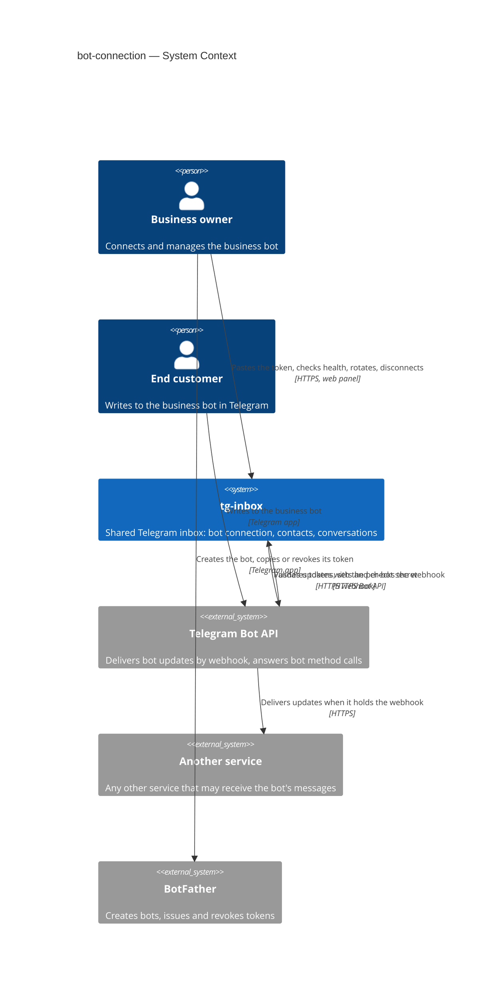
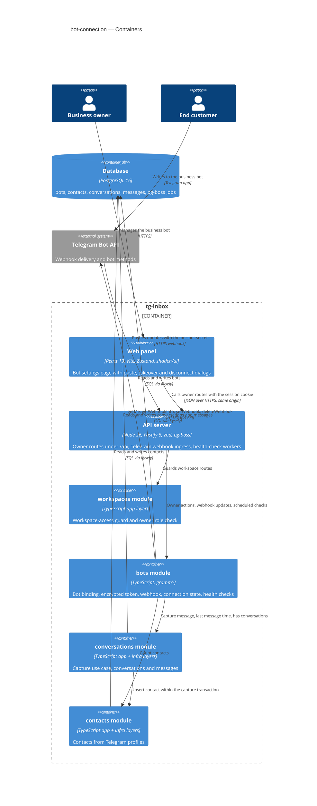
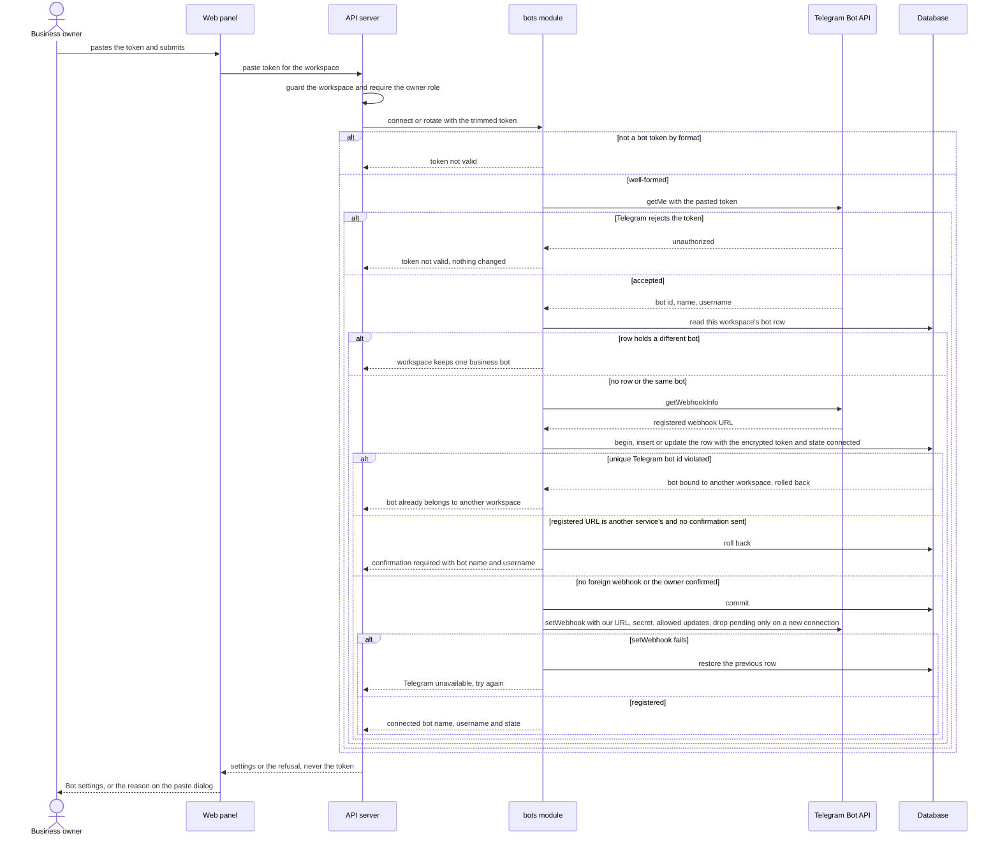
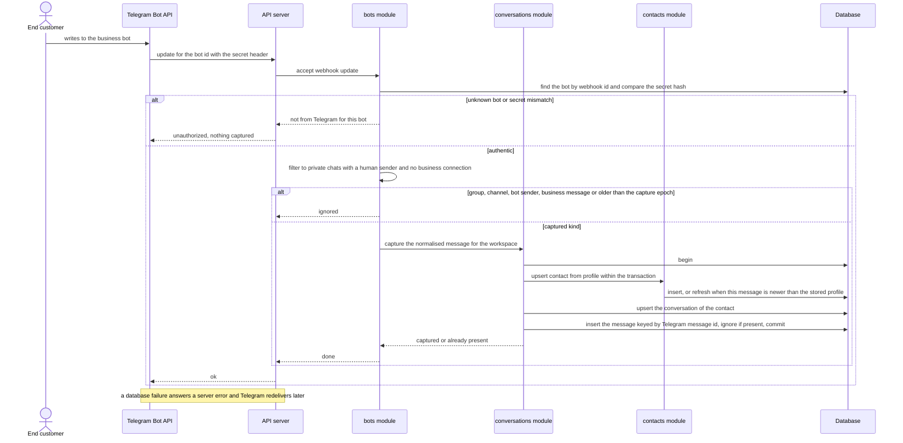
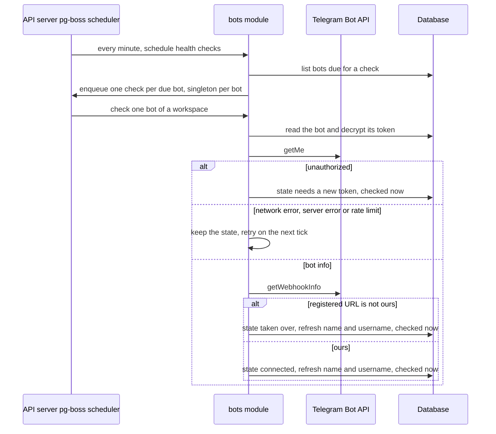
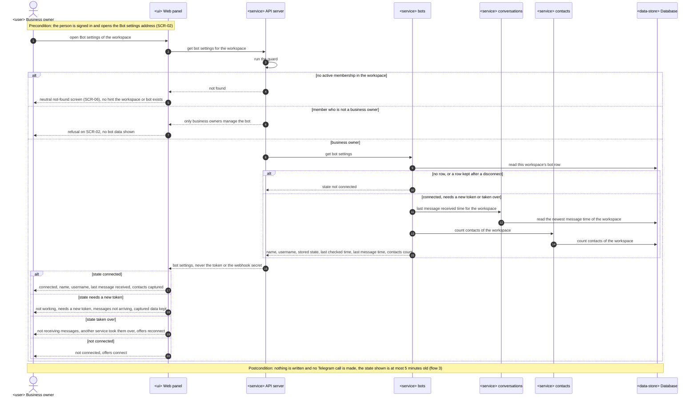
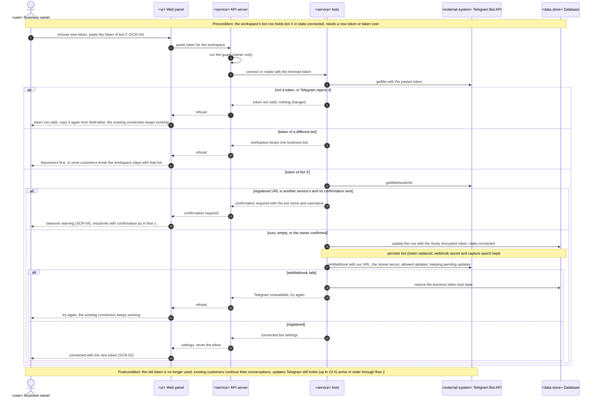
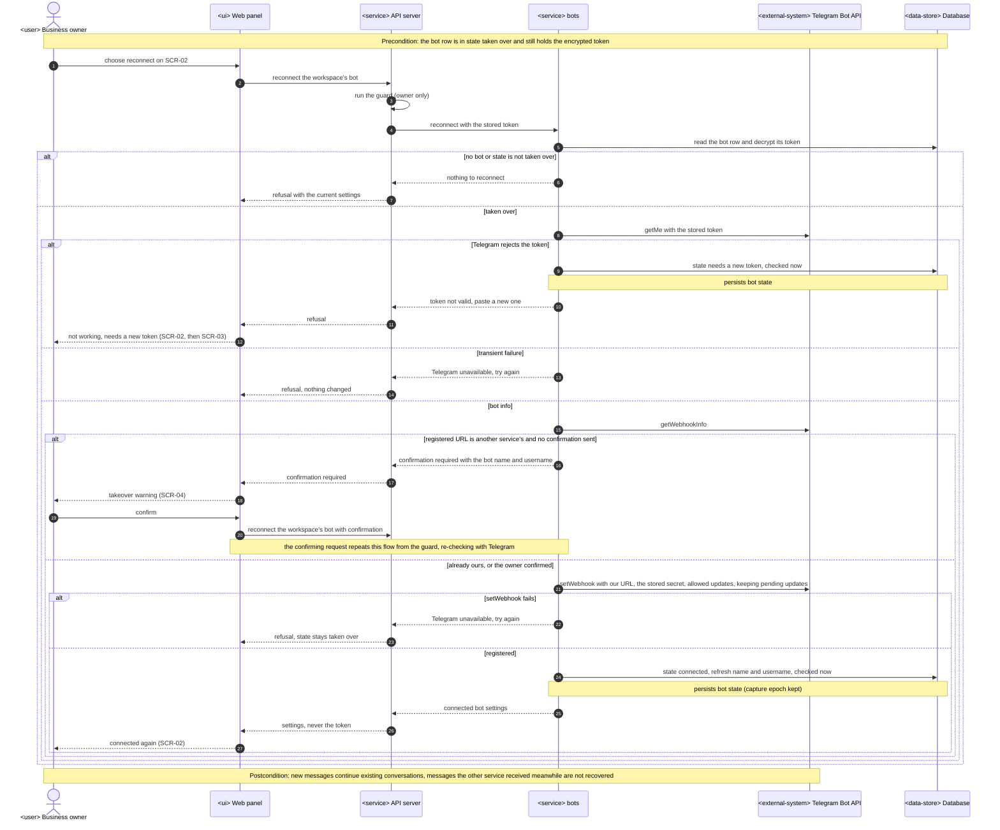
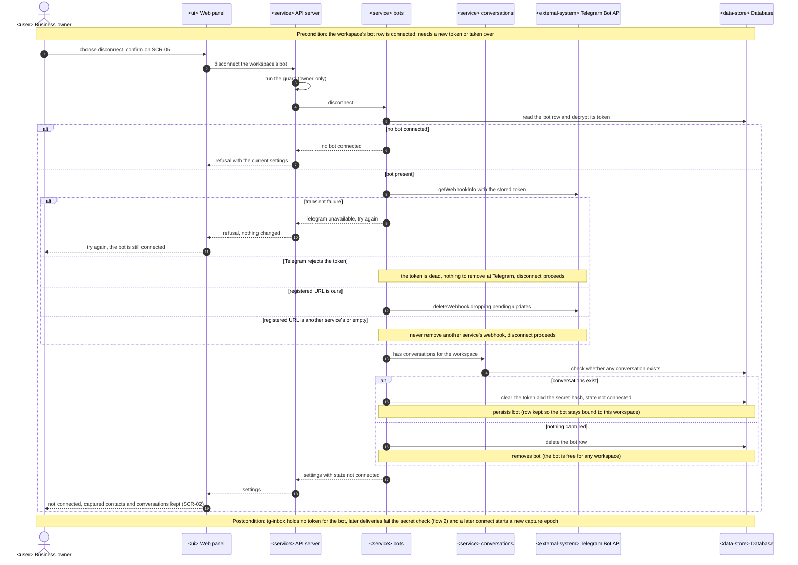
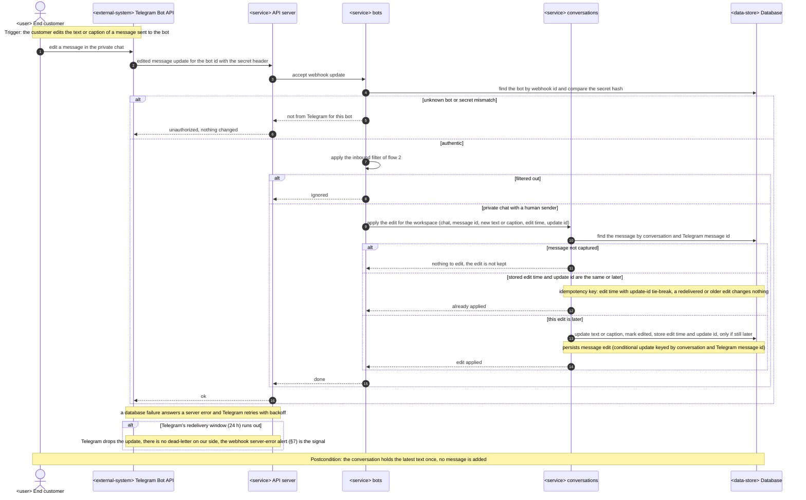

# Software Architecture Document — bot-connection

## 1. Introduction and goals

**Intent.** bot-connection attaches each workspace to its own business bot and turns everything end customers write to that bot into workspace data. A business owner pastes the bot's token in the web panel; tg-inbox checks it with Telegram, shows which bot it is, warns before taking the bot's messages away from another service, and starts capturing. From then on every private message an end customer sends — text or any other kind — lands exactly once, in Telegram's order, in one continuous conversation per end customer, and the first message creates a contact from the person's Telegram profile, refreshed on later messages. The owner sees whether the bot is healthy (connected, needs a new token, taken over by another service), can rotate its token and can disconnect it without losing what was captured. Replying, the inbox screens and contact editing are later roadmap steps; this step builds the only path into the data they use.

**Top-3 quality goals (1-liners; full scenarios in §10):**

1. **Capture completeness and order** — no message Telegram delivered is lost or doubled, messages keep Telegram's order per chat, and capture stays fast under a flood on another workspace's bot.
2. **Tenant and secret isolation** — zero reads or writes across workspaces, forged deliveries are ignored, and a bot token never appears in logs, errors or anything the panel receives.
3. **Trustworthy, responsive connection management** — connecting takes one paste within the spec's latency targets, and the panel's bot state is never more than 5 minutes behind Telegram.

**Stakeholders.**

| Role | Interest | Sign-off owner? |
|---|---|---|
| Business owner | Connects the business bot, checks its health, rotates the token, disconnects | No |
| End customer | Writes to the business bot in Telegram; expects the business's team to receive it | No |
| Operator | Will read captured conversations from roadmap step 4 on; has no access to bot settings (AC-03) | No |
| Platform admin | Handles bot-recovery requests by hand for pilots (spec §3) | No |
| Tech Lead | SAD approval | Yes |
| Security Lead | Security review of the new tenant secret, the unauthenticated inbound entry point and end-customer personal data (spec §6.1: review required) | Yes |

- Decision override: AC-15's "a failed exchange with Telegram changes the state at once" is read as Telegram *answering* with a failure about the bot — the stored token rejected (→ "needs a new token") or the webhook registered elsewhere (→ "taken over"); when Telegram cannot be reached (network, 5xx, rate limit) the state is kept and the page shows when it was last checked — rationale: an outage of Telegram or of our network is not a fault of the bot, and flipping every bot to "not working" on a blip would send owners to BotFather for nothing; see §11 (state may age past 5 minutes during a Telegram outage) and ADR-0008.

## 2. Constraints

**Technical.**
- TypeScript ~6.0 (strict) on Node.js 26 (`.nvmrc`), pnpm workspaces monorepo — repo [ADR-0001](../../adr/0001-use-a-typescript-pnpm-monorepo-on-node-26.md)
- Backend: Fastify 5.12 with `fastify-type-provider-zod` and zod 4; grammY 1.46 for Bot API calls, always through `telegramApi(token)` in `apps/api/src/platform/telegram.ts`; `@fastify/websocket` registered but not used by this feature
- Background jobs: pg-boss 12, started in `buildApp()` (`apps/api/src/platform/jobs.ts`), queues named `<module>.<job>`
- Frontend: React 19 + Vite SPA, Tailwind CSS + shadcn/ui, Zustand, React Router; the app shell (`apps/web/src/shared/ui/app-shell.tsx`) already carries the owner-only Team entry
- Datastore: PostgreSQL 16 via Kysely 0.29, reversible migrations through kysely-ctl, table types generated by kysely-codegen — repo [ADR-0004](../../adr/0004-use-postgres-with-kysely-reversible-migrations-and-workspace-scoped-tenancy.md)
- Architecture: modular monolith, `domain → app → infra → http` layers, one process serving every workspace — repo [ADR-0002](../../adr/0002-organize-the-backend-as-a-modular-monolith-with-layered-modules.md)
- Workspace access: routes under `/api/workspaces/:workspaceId/…` behind the `workspaces` guard; owner-only routes answer `OwnerOnlyError` — workspace-operators [ADR-0003](../workspace-operators/adr/0003-carry-the-active-workspace-in-the-url-and-check-membership-on-every-request.md)
- Telegram Bot API behaviour this design relies on: one delivery mode per bot (webhook or `getUpdates`); webhooks carry the registered `secret_token` in `X-Telegram-Bot-Api-Secret-Token`; undelivered updates are kept and redelivered for up to 24 h; `getWebhookInfo` reports the registered URL; message ids increase within a private chat

**Organisational.**
- Effort budget: size M — a separate epic of 5–15 PRs over 1–2 sprints (`.size`)
- Deadline: none set in the spec; this step gates roadmap steps 4, 7 and 10 and the onboarding of the first pilot
- Team composition: not stated; the pipeline assumes one backend + frontend implementer working through `tasks.json`

**Conventions.**
- [`CLAUDE.md`](../../../CLAUDE.md) and [`docs/architecture-map.md`](../../architecture-map.md) §Conventions are binding: `register<Module>(app, deps)` from `modules/<m>/http/routes.ts`, dependencies built only in `buildDeps()`, modules registered only in `buildApp()`, inward-only imports, cross-module calls only through the other module's app layer
- IDs are UUIDv7 from `newId()`; Telegram ids (bot id, user id, chat id, message id, update id) are `bigint` columns, never primary keys
- Errors are `AppError` subclasses from `apps/api/src/platform/errors.ts` with codes in `packages/shared/src/errors.ts`
- Request/response bodies are zod schemas in `packages/shared`, parsed by the web client too
- Env vars only in `apps/api/src/platform/config.ts`, documented in `.env.example`
- Every tenant-owned table carries a non-null `workspace_id`; every repository method takes `workspaceId`; every repository gets a cross-workspace isolation test
- UI composes shadcn/ui primitives from `apps/web/src/shared/ui`, Tailwind only
- **Override — deliberate extension:** two new reads without a `workspaceId` (bot by webhook id, bots due for a health check) join the controlled-exception list ([ADR-0007](adr/0007-bind-a-bot-to-one-workspace-with-unique-constraints-and-two-controlled-tenancy-exceptions.md), §5); `CLAUDE.md` and the architecture map are updated with this feature (§11)

**Regulatory / external.**
- Data classification: confidential (spec §6.1) — bot tokens give full control of a business's bot; captured messages are private customer correspondence
- Personal data: end customer Telegram user id, first and last name, username, language; message text and captions; Telegram references to media (content not stored); bot token (secret)
- Telegram's Bot API terms apply to every bot; each business keeps ownership of its bot in BotFather
- No compliance regime is named by the spec; removal of captured data is a manual operation on request (spec §3); security review is required before release

## 3. Context and scope

tg-inbox is a shared Telegram inbox for small businesses. This feature connects the system to Telegram for the first time: a business owner hands tg-inbox the token of the business's own bot, and tg-inbox registers itself as that bot's webhook so Telegram pushes every update to it. End customers never see tg-inbox — they talk to the business bot inside Telegram, and Telegram forwards what they write. The trust boundary is the public webhook endpoint: anything arriving there is untrusted until it proves, with the per-bot secret, that Telegram sent it for that bot.

<!-- brownfield: workspace-operators shipped (HEAD a10c61a) — modules auth, workspaces, health; app shell with an owner-only Team entry; pg-boss started in buildApp() with no queues; telegramApi() factory exists unused; architecture-map.md describes the target baseline plus the workspace-operators modules (reflects_commit f172cee, verified against the code for this design) -->

**External systems (in / out):**

| Actor or system | Type | Interaction |
|---|---|---|
| Business owner | Person | Connects, checks, rotates and disconnects the business bot in the web panel |
| End customer | Person | Writes to the business bot in a private Telegram chat; never uses tg-inbox directly |
| Operator | Person | No interaction in this step (bot settings are owner-only; captured conversations are read from step 4) |
| Telegram Bot API | System (external) | In: pushes updates for each connected bot to its webhook. Out: tg-inbox validates tokens (`getMe`), reads where a bot delivers (`getWebhookInfo`), registers or removes its webhook (`setWebhook`, `deleteWebhook`) |
| Another service using the same bot | System (external, unknown) | May hold the bot's webhook before connection (AC-06) or take it over later (AC-16b); visible only through `getWebhookInfo` |
| BotFather | System (external, Telegram) | Where the business creates its bot and copies, revokes or regenerates its token; not called by tg-inbox |

**C4 Context (L1):**



## 4. Solution strategy

**Target surfaces:** `backend-service` (the API, including the Telegram webhook ingress and in-process pg-boss workers) and `web-frontend` (one new owner-only Bot settings page in the existing SPA) — [ADR-0001](adr/0001-build-bot-connection-as-an-api-with-a-telegram-webhook-ingress-and-an-owner-only-panel-page.md). End customers act only in Telegram, so capture has no UI surface; health checks run as pg-boss jobs inside the API process, not as a separate worker container.

**UI architecture (web-frontend):** client-side SPA, already fixed by repo [ADR-0001](../../adr/0001-use-a-typescript-pnpm-monorepo-on-node-26.md) — no new ADR. The Bot settings page lives at `/w/<workspaceId>/bot`; its entry ("Bot") sits in the app shell next to Team, shown only to business owners, in both the desktop nav and the phone menu (closes the ux-flows design input). Paste token, confirm takeover and confirm disconnect are dialogs over that page (shadcn `Dialog`), so every action returns to it. State lives in a `features/bot/store.ts` Zustand store, loaded on page open and replaced by the response of every action.

**Top strategic choices (the seeds for ADRs):**

1. **One authenticated webhook per bot** — each connected bot posts to `/api/telegram/webhook/<bot id>` with a random per-bot secret Telegram echoes back in a header; the token never appears in a URL, forged requests are refused before parsing, and comparing Telegram's registered URL with ours detects a takeover. Serves goal 2 and AC-06/AC-14/AC-16b — [ADR-0002](adr/0002-receive-updates-through-one-webhook-per-bot-authenticated-by-a-per-bot-secret.md).
2. **Capture inside the webhook request, idempotently, ordered by Telegram's ids** — one short transaction upserts the contact and conversation and inserts the message keyed by its Telegram message id; `200` means captured, a failure answers `5xx` and Telegram redelivers. Order and edits follow Telegram's message id and edit time, never arrival order. Serves goal 1 — [ADR-0003](adr/0003-capture-each-update-inside-the-webhook-request-with-idempotent-writes.md), [ADR-0004](adr/0004-order-messages-by-telegram-message-id-and-apply-edits-by-telegram-edit-time.md).
3. **Database constraints own the bot ↔ workspace binding** — unique workspace and unique Telegram bot id on the bots table; a bot row with captures outlives its disconnect, so a bot that captured anything stays bound to its workspace; ownership refusals never read another workspace's data. Tokens are encrypted at rest with an application key. Serves goal 2 and AC-04/AC-05/AC-19 — [ADR-0007](adr/0007-bind-a-bot-to-one-workspace-with-unique-constraints-and-two-controlled-tenancy-exceptions.md), [ADR-0006](adr/0006-encrypt-bot-tokens-at-rest-with-an-application-key.md).
4. **Health is checked on a schedule and read from the database** — a pg-boss cron checks every connected bot at least every 5 minutes; every Bot API exchange writes its outcome at once; the settings page reads stored state and refreshes on load and after each action (no push). Reconnect with the stored token re-checks it with Telegram first. Serves goal 3 and AC-15/AC-16/AC-16b — [ADR-0008](adr/0008-check-bot-health-with-a-scheduled-job-and-show-the-stored-state.md).

**Supporting choices (inline, below the ADR gate):**

- **Module split:** `bots`, `conversations` and `contacts`, matching the roadmap's capabilities — [ADR-0005](adr/0005-split-the-feature-into-bots-conversations-and-contacts-modules.md) (§5).
- **Takeover confirmation is stateless:** when the check finds a foreign webhook, the API answers with a "confirmation required" refusal carrying the bot's name and username; the panel keeps the pasted token in memory and resubmits it with an explicit confirmation flag (or, for reconnect, resubmits the reconnect with the flag). The server re-checks with Telegram on the confirming request; nothing is stored between the two requests.
- **One paste endpoint decides connect vs rotate:** the API compares the pasted token's bot id with the workspace's bot row — none → connect, same bot → rotate (or reconnect after takeover), different bot → AC-05 refusal — mirroring the single SCR-03 step of `ux-flows.md`.
- **Capture epoch:** connecting a bot that has no live connection (first connect, or after a disconnect) registers the webhook with `drop_pending_updates` and records the connection time; capture ignores messages dated before it. Rotation and reconnect after takeover keep pending updates, so messages Telegram still holds (up to 24 h) are captured in order (AC-16, AC-17, AC-18).
- **Persistence:** the single PostgreSQL 16 store; no cache; no media download (spec §3).

Each tactical decision in later sections traces to one of these choices; contradictions are surfaced in §11.

## 5. Building block view

The backend keeps the repo's modular-monolith layering unchanged and adds three modules with an acyclic, one-way dependency graph — `bots → conversations → contacts` and `bots → contacts` — wired in `buildDeps()` and registered in `buildApp()` ([ADR-0005](adr/0005-split-the-feature-into-bots-conversations-and-contacts-modules.md)). `bots` owns everything about the bot itself (token, webhook, connection state, health) and is the only module that talks to Telegram; it translates each accepted Telegram update into a normalised inbound message and hands it to `conversations`, which owns the capture use case and calls `contacts` inside the same transaction. The `workspaces` module's guard protects the owner routes, as for Team.

**Table ownership** (names indicative; `data-model` fixes them):

| Module | Tables | Tenancy |
|---|---|---|
| `bots` | bots — one row per workspace's bot: workspace id, Telegram bot id, name, username, connection state, encrypted token, webhook secret hash, connected-at (capture epoch), last-checked-at | Tenant-owned; unique `workspace_id` and unique `telegram_bot_id`; a row is deleted on disconnect when nothing was captured, kept without token and secret otherwise ([ADR-0007](adr/0007-bind-a-bot-to-one-workspace-with-unique-constraints-and-two-controlled-tenancy-exceptions.md)) |
| `contacts` | contacts — Telegram user id, first and last name, username, language, profile-seen-at | Tenant-owned; unique (`workspace_id`, Telegram user id) |
| `conversations` | conversations — one per (workspace, contact), with the private chat's Telegram chat id; messages — Telegram message id, kind, text or caption, Telegram's message object (media references), sent-at, received-at, edited-at with the edit's update id | Tenant-owned; conversations unique on `contact_id` (a contact belongs to exactly one workspace, so this is "one per (workspace, contact)") and unique on (`workspace_id`, `telegram_chat_id`); messages unique on (conversation, Telegram message id) — per [data-model.md](data-model.md) |

**Controlled exceptions to the tenancy rule** (added to the list in workspace-operators SAD §5 and `CLAUDE.md`, each with its own isolation test):

- *bot by webhook id* (`bots`) — scoped by possession of the matching webhook secret: the lookup returns the row only when the secret's hash matches, and produces the workspace id for the capture;
- *bots due for a health check* (`bots`) — used only by the scheduled job; returns bot ids and workspace ids of connected or taken-over bots whose last check is at least 3 minutes old (§8 freshness budget); each check then runs scoped by that workspace id.

Every other method of the three modules takes `workspaceId`. The AC-04 "belongs to another workspace" refusal comes from the unique constraint on `telegram_bot_id`, not from a read.

**Cross-module app-layer calls:**

- `bots` → `conversations`: *capture inbound message* (workspace id, normalised message — `bots` has already applied the inbound filter and the capture epoch), *last message received time*, *has conversations* (decides whether a disconnect deletes the bot row and whether AC-05 applies).
- `conversations` → `contacts`: *upsert contact from profile* within the capture transaction (refreshes name, username and language only when the message is newer than the stored profile).
- `bots` → `contacts`: *count contacts* for the settings page.

**Internal decomposition:**

```
apps/api/src/
├── modules/bots/
│   ├── domain/       connection states + transitions, token format check, update filter
│   │                 (private chat, human sender, no business connection, not before the capture
│   │                 epoch), update → normalised message
│   ├── app/          connect-or-rotate (paste), reconnect with stored token, disconnect,
│   │                 get bot settings, accept webhook update, run health check; ports: bot repo,
│   │                 Telegram gateway, token cipher, capture (conversations), contact count (contacts)
│   ├── infra/        bot repository, Telegram gateway over telegramApi(token), AES-GCM token cipher,
│   │                 jobs.ts — bots.schedule-health-checks (cron) + bots.check-health workers
│   └── http/         routes.ts → registerBots(app, deps): owner routes under
│                     /api/workspaces/:workspaceId/bot…, public POST /api/telegram/webhook/:botId
├── modules/conversations/
│   ├── domain/       message kinds (incl. "other"), edit rule (later edit time wins, update id tie-break)
│   ├── app/          capture inbound message (one transaction), apply edit, last message time,
│   │                 has conversations
│   └── infra/        conversation + message repositories
├── modules/contacts/
│   ├── domain/       profile refresh rule (newer message wins)
│   ├── app/          upsert from profile (optional transaction), count
│   └── infra/        contact repository
├── platform/config.ts  + Telegram webhook base URL, token encryption key, webhook max connections,
│                         optional Bot API root (tests)
└── deps.ts / app.ts    wiring of the three modules and the bots job workers
apps/web/src/
├── features/bot/       store.ts, Bot settings page body, paste-token / confirm-takeover /
│                       confirm-disconnect dialogs, api.ts
├── pages/BotSettingsPage.tsx + app/routes.tsx  /w/:workspaceId/bot
└── shared/ui/app-shell.tsx  owner-only "Bot" entry next to Team
packages/shared/src/  bots.ts — request/response zod schemas; new error codes in errors.ts
```

No HTTP routes are added to `conversations` or `contacts` in this step (their screens arrive with roadmap steps 4 and 7).

**C4 Container (L2):**



## 6. Runtime view

Seeded critical flows; the `sequences` stage extends this section until every spec §5 acceptance criterion maps to a flow or a branch. Participants are the §5 containers.

**Critical flow 1: Paste a token — connect, rotate or refuse (US-01, US-06 — AC-01, AC-02, AC-04, AC-05, AC-06, AC-17, AC-19)**



The ownership refusal (AC-04) is decided before the takeover warning, as in `ux-flows.md`: the row write is attempted in a transaction that is rolled back when confirmation is still needed, so an owner is never asked to confirm a takeover of a bot that belongs to another workspace; no Telegram call runs inside that transaction. The confirming request after a takeover warning repeats the whole flow with the confirmation flag, so a webhook change between the two requests is re-checked. Reconnect after a takeover with the stored token (AC-16b) runs the same steps from `getMe`, with the decrypted stored token instead of a pasted one; a rejection there moves the bot to "needs a new token" (ADR-0008).

**Critical flow 2: Capture an inbound message (US-02, US-03, US-04 — AC-07, AC-08, AC-09, AC-11, AC-12, AC-14)**



An edited message follows the same path to `conversations`, which updates the stored text only when the edit is later than the stored one and does nothing for an uncaptured message (AC-10, [ADR-0004](adr/0004-order-messages-by-telegram-message-id-and-apply-edits-by-telegram-edit-time.md)).

**Critical flow 3: Scheduled health check (US-05 — AC-15, AC-16, AC-16b)**



The Bot settings page reads the stored state, name, username and last-checked time, plus the last message time from `conversations` and the contacts count from `contacts` — no Telegram call on load.

The flows below were added by the `sequences` stage. They use the generic participant vocabulary (`<user>`, `<ui>`, `<client>`, `<service>`, `<data-store>`, `<external-system>`), each labelled with the §5 container it stands for. "The guard" always means the `workspaces` access guard of workspace-operators critical flow 3 (non-member → not found) followed by the owner-role check. SCR ids refer to `ux-flows.md`.

### Flow 4: Open the bot settings (US-05, US-01 — AC-03, AC-15, AC-16, AC-16b)



Loading the page is a pure database read (ADR-0008): the stored state is kept fresh by flow 3 and by every owner action, so the page meets the 300 ms load target. The last-message time is read per workspace — `data-model` needs an index that answers "newest message of a workspace" without scanning. Every later flow that ends on SCR-02 returns the same settings payload as this flow.

### Flow 5: Rotate the token or re-paste after a revoke (US-06, US-05 — AC-17, AC-16, AC-02)



Rotation is the "same bot" branch of flow 1, drawn here for its own guarantees: the capture epoch (connected-at) is not reset and `setWebhook` keeps pending updates, so messages customers sent while the token was revoked (AC-16) are captured once the new token is registered. The webhook secret is kept across rotation ([ADR-0002](adr/0002-receive-updates-through-one-webhook-per-bot-authenticated-by-a-per-bot-secret.md)), so deliveries in flight during the rotation keep passing the secret check. A transient failure of `getMe` or `getWebhookInfo` refuses with "Telegram unavailable, try again" and changes nothing.

### Flow 6: Reconnect with the stored token after a takeover (US-05 — AC-16b, AC-06)



Pasting the same token again on SCR-03 takes flow 5 instead and ends in the same state. If the cancel button on SCR-04 is chosen, no request is sent and the state stays "taken over". Unlike flow 5, the row is written only after `setWebhook` succeeds, because the token and secret do not change — there is nothing to restore.

### Flow 7: Disconnect the bot (US-06 — AC-18)



Messages sent after the disconnect are never captured: Telegram's pending updates are dropped here, deliveries to the old webhook fail the secret check because the hash is cleared, and a later connect (flow 1, "no row or the same bot") sets a new capture epoch and registers the webhook with `drop_pending_updates` — so even a late redelivery dated before that connect is ignored by the flow 2 filter.

### Flow 8: Capture an edited message (US-04 — AC-10, AC-11)



The conditional update (`edited_at` older than the incoming edit, or equal with a lower update id) makes concurrent and redelivered edits converge on the one the customer made last, whatever order they arrive in. A redelivered original message (AC-11) is the "already present" outcome of flow 2: the insert keyed by (conversation, Telegram message id) does nothing, and the conversation is ordered by Telegram message id, so a late redelivery takes its original place.

### Coverage: user stories and acceptance criteria

| User story | Flows |
|---|---|
| US-01 Connect the business bot | 1 (+ 4 for the owner-only guard) |
| US-02 Reach the business through its bot | 2 |
| US-03 Grow the contact base automatically | 2 (contact upsert) |
| US-04 Keep each customer's messages in one conversation | 2, 8 |
| US-05 Check the bot's health | 3, 4, 6 |
| US-06 Rotate the token or disconnect the bot | 5, 7 (+ 1 for connecting again) |

| AC | Shown in |
|---|---|
| AC-01 | Flow 1, "no foreign webhook" → "registered" branch |
| AC-02 | Flow 1, "not a bot token by format" and "Telegram rejects the token" branches; flow 5, same branch for rotation (existing connection untouched) |
| AC-03 | Flow 4, "not a business owner" and "no active membership" branches; flows 1, 5, 6, 7 run the same guard |
| AC-04 | Flow 1, "unique Telegram bot id violated" branch |
| AC-05 | Flow 1, "row holds a different bot" branch; flow 5, "token of a different bot" branch; flow 7 keeps the row when conversations exist |
| AC-06 | Flow 1, "registered URL is another service's" branch; flow 6, same branch on reconnect |
| AC-07 | Flow 2, "captured kind" path (contact and conversation created, last message time read in flow 4) |
| AC-08 | Flow 2, contact upsert "refresh when this message is newer" |
| AC-09 | Flow 2, normalised message (kinds and captions per §8 Message kinds) |
| AC-10 | Flow 8 |
| AC-11 | Flow 2, "insert keyed by Telegram message id, ignore if present"; flow 8, prose on ordering |
| AC-12 | Flow 2, "group, channel, bot sender, business message" branch |
| AC-13 | Flow 2 — the webhook secret resolves exactly one workspace and every capture write is keyed by that workspace id (contacts unique per workspace and Telegram user id); the "neither workspace can see the other" half is structural — tenancy-scoped repositories plus the isolation tests of §8 |
| AC-14 | Flow 2 and flow 8, "unknown bot or secret mismatch" branch |
| AC-15 | Flow 3 (freshness) + flow 4 (what the page shows) |
| AC-16 | Flow 3, "unauthorized" branch; flow 4, "needs a new token"; flow 5 (recovery and pending updates captured) |
| AC-16b | Flow 3, "registered URL is not ours"; flow 4, "taken over"; flow 6 |
| AC-17 | Flow 5 |
| AC-18 | Flow 7 |
| AC-19 | Flow 1, "no row or the same bot" path after a disconnect (row kept by flow 7) + flow 2 contact and conversation upserts |

Every user story maps to at least one flow and every acceptance criterion to a flow or branch; only the read-isolation half of AC-13 is structural rather than a runtime step.

**Flagged for later stages (not decided here):**

- *Flow 6, a separate reconnect action* — the spec allows reconnect without a paste; `api` names this endpoint next to the paste endpoint. **Resolved by `api`:** `POST /api/workspaces/{workspaceId}/bot/reconnect` (`reconnectBot`), next to `POST …/bot/token` (`pasteBotToken`) — [contracts/openapi.yaml](contracts/openapi.yaml).
- *Flow 7, disconnect order* — `deleteWebhook` runs before the row is changed, so a crash between them leaves the bot connected with no webhook; the next health check (flow 3) reports it as "taken over" (empty URL ≠ ours) and the owner can disconnect again. Accepted for pilots; revisit if seen.
- *Flow 8, no dead-letter* — Telegram owns delivery retries (up to 24 h); tg-inbox has no queue for inbound updates (ADR-0003), so the alert on webhook server errors is the only dead-letter signal.
- *Persist hints for `data-model`:* bots unique by workspace and by Telegram bot id, lookup by id with secret hash, due-for-check by state and last-checked-at; contacts unique by (workspace, Telegram user id) and counted per workspace; conversations unique by (workspace, contact); messages unique by (conversation, Telegram message id), ordered by Telegram message id within a conversation, newest by workspace for the "last message received" read, conditional edit by (edited-at, edit update id); "has conversations" per workspace.
- No new participants beyond the §5 containers. The async flows (2, 8 inbound, 3 health check) rely on Telegram redelivery and pg-boss singleton jobs respectively; their idempotency keys are the unique constraints above and the per-bot singleton key.

## 7. Deployment view

No production target is chosen yet (architecture map: deferred until the first pilot goes live). This feature keeps one Node 26 process — Fastify API, built web panel, Telegram webhook ingress and pg-boss workers — talking to one PostgreSQL 16 database ([ADR-0001](adr/0001-build-bot-connection-as-an-api-with-a-telegram-webhook-ingress-and-an-owner-only-panel-page.md)). New is the requirement that `/api/telegram/webhook/*` be reachable from Telegram over public HTTPS on a port Telegram accepts (443, 80, 88 or 8443); in development this means a tunnel to the local API. A second replica needs no code change: capture is idempotent, and pg-boss singleton keys keep one health check per bot at a time.

**Configuration added** (parsed in `apps/api/src/platform/config.ts`, documented in `.env.example`):
- `TELEGRAM_WEBHOOK_BASE_URL` — public HTTPS base for webhook URLs; defaults to `PUBLIC_WEB_URL` (same origin)
- `BOT_TOKEN_ENCRYPTION_KEY` — 32-byte key (base64) for token encryption, with its key id ([ADR-0006](adr/0006-encrypt-bot-tokens-at-rest-with-an-application-key.md))
- `TELEGRAM_WEBHOOK_MAX_CONNECTIONS` — `max_connections` given to `setWebhook`; default 10, kept below the database pool size (`DATABASE_POOL_MAX`) so one bot cannot hold every connection
- `TELEGRAM_API_ROOT` — optional Bot API base URL, used by tests to point grammY at a fake Bot API

**Monitoring:**
- Metrics (from structured logs): webhook request duration (acknowledgement p95), ingest duration from receipt to commit (capture p95), owner action duration for connect / rotate / disconnect, settings load duration, webhook `401` count per bot id, ignored-update count by reason, health-check outcomes by state
- Alerts: uptime check on `GET /health` (availability); webhook `5xx` on any bot (capture at risk); a rise in webhook `401`s (forged traffic or a stale secret); a health-check tick that did not run for 5 minutes
- Tracing: Fastify per-request id in every log line; capture logs carry workspace id, bot id and Telegram update id — never the token, the secret or message text

**Scaling thresholds:**
- One instance must sustain ≥ 50 inbound messages/s across all bots (spec §6); each capture is one short transaction, so the database pool is the limit — raise `DATABASE_POOL_MAX` before adding replicas
- Health checks cost two Bot API calls per bot every ~5 minutes; the 5-minute bound is fixed by AC-15, so above ~500 connected bots raise the `bots.check-health` worker concurrency rather than lengthen the interval
- Messages grow without purge; at pilot scale (5–10 workspaces) one table is comfortable into the tens of millions of rows; revisit partitioning by workspace if a single installation passes that

## 8. Crosscutting concepts

| Concept | Convention | Where defined |
|---|---|---|
| Logging | pino via `platform/logger.ts`; request logs redact `X-Telegram-Bot-Api-Secret-Token` alongside the cookie headers; the webhook URL carries only the bot row id; bot tokens, webhook secrets and message text/captions are never logged; the Telegram gateway maps grammY errors to its own typed outcomes (unauthorized / transient / other) without copying their messages or URLs into errors or logs | `CLAUDE.md` + here |
| Authentication | Owner routes: the session cookie resolved by `auth`. Webhook: no session; authenticated only by the per-bot secret (hash compared in constant time) | workspace-operators ADR-0002, [ADR-0002](adr/0002-receive-updates-through-one-webhook-per-bot-authenticated-by-a-per-bot-secret.md) |
| Authorization | Bot routes live under `/api/workspaces/:workspaceId/bot…` behind the `workspaces` guard (non-member → not found) and require the owner role (`OwnerOnlyError` for operators, AC-03); the webhook route is outside the workspace prefix and resolves the workspace only through the secret | workspace-operators ADR-0003 |
| Tenancy | Every repository method takes `workspaceId`, except the two reads of §5; isolation tests per repository and per route; the bot ↔ workspace binding is enforced by unique constraints | [ADR-0007](adr/0007-bind-a-bot-to-one-workspace-with-unique-constraints-and-two-controlled-tenancy-exceptions.md) |
| Secrets | Bot tokens: AES-256-GCM with a key id, decrypted only in the `bots` infra layer right before a Bot API call, dropped on disconnect, never in any response schema. Webhook secrets: 32 random bytes in Telegram's allowed alphabet, only a SHA-256 hash stored | [ADR-0006](adr/0006-encrypt-bot-tokens-at-rest-with-an-application-key.md) |
| Telegram calls | Every call through `telegramApi(token)` (with `TELEGRAM_API_ROOT` when set), behind a `bots` gateway port; per-call timeout of 1 s on owner actions (so connect / rotate / disconnect stay within 3 s) and 10 s in health checks; outcomes classified as unauthorized (state change), transient (no state change, retry) or other | `CLAUDE.md` + [ADR-0008](adr/0008-check-bot-health-with-a-scheduled-job-and-show-the-stored-state.md) |
| Side-effect ordering | Owner actions: validate with Telegram outside any transaction, write the row, then call `setWebhook`; on failure restore the previous row. Disconnect: call `deleteWebhook` (dropping pending updates) only when `getWebhookInfo` shows our URL — never remove another service's webhook; an unauthorized answer means the token is dead and the disconnect proceeds; a transient failure refuses with "try again" and changes nothing | here |
| Idempotency and order | Messages unique per (conversation, Telegram message id); contacts per (workspace, Telegram user id); conversations per contact and per (workspace, Telegram chat id); order by Telegram message id; edits by edit time with update-id tie-break; profile refresh by message time | [ADR-0003](adr/0003-capture-each-update-inside-the-webhook-request-with-idempotent-writes.md), [ADR-0004](adr/0004-order-messages-by-telegram-message-id-and-apply-edits-by-telegram-edit-time.md) |
| Inbound filter | `allowed_updates` = message, edited_message; only `chat.type = private`, a non-bot sender and no `business_connection_id` are captured; anything else is acknowledged and dropped (AC-12) | here |
| Message kinds | Text, photo, video, animation, voice, audio, video note, document, sticker, location, venue, contact, poll, dice; anything else is "other"; the caption is kept; Telegram's message object is stored for its media references (usable only while the same bot is connected); live-location updates change nothing | spec AC-09 + here |
| Time | Domain times (connected-at, last-checked-at, received-at) come from the clock port; Telegram's `date` / `edit_date` are stored as given | workspace-operators §8 |
| Error handling | The existing envelope; new specific codes fixed by the `api` stage: `BOT_TOKEN_INVALID` 400, `BOT_BELONGS_TO_ANOTHER_WORKSPACE` 409, `WORKSPACE_KEEPS_ONE_BOT` 409 (`details.reason` connected / history), `TAKEOVER_CONFIRMATION_REQUIRED` 409, `NOTHING_TO_RECONNECT` 409, `BOT_NEEDS_NEW_TOKEN` 409, `NO_BOT_CONNECTED` 409, `TELEGRAM_UNAVAILABLE` 503; the webhook answers `401` with an empty body (ADR-0002) | `CLAUDE.md` + [contracts/openapi.yaml](contracts/openapi.yaml) |
| ID strategy | UUIDv7 from `newId()` for bots, contacts, conversations, messages; Telegram ids as `bigint` | `CLAUDE.md` |
| Events / jobs | pg-boss queues `bots.schedule-health-checks` (cron, every minute) and `bots.check-health` (one singleton job per bot); capture emits nothing in this step |
| Freshness budget | AC-15's 5 minutes = a check becomes due 3 minutes after the last one + up to 1 minute until the next cron tick + two Bot API calls of at most 10 s each + queue pickup, leaving ~40 s of slack; the due threshold lives in the `bots` domain, not in config | [ADR-0008](adr/0008-check-bot-health-with-a-scheduled-job-and-show-the-stored-state.md) |
| Live updates | None — the Bot settings page loads on open and after each action; no WebSocket push | [ADR-0008](adr/0008-check-bot-health-with-a-scheduled-job-and-show-the-stored-state.md) |
| Internationalisation | N/A — one UI language; the contact's Telegram language code is stored as data | — |
| Rate limiting | None on the webhook (Telegram's `max_connections` bounds per-bot concurrency); per-sender limits deferred (spec §6.1) | here |

## 9. Architecture decisions

| # | Title | Status | Section |
|---|---|---|---|
| [0001](adr/0001-build-bot-connection-as-an-api-with-a-telegram-webhook-ingress-and-an-owner-only-panel-page.md) | Build bot connection as an API with a Telegram webhook ingress and an owner-only panel page | Accepted | §4 |
| [0002](adr/0002-receive-updates-through-one-webhook-per-bot-authenticated-by-a-per-bot-secret.md) | Receive updates through one webhook per bot, authenticated by a per-bot secret | Accepted | §4 |
| [0003](adr/0003-capture-each-update-inside-the-webhook-request-with-idempotent-writes.md) | Capture each update inside the webhook request with idempotent writes | Accepted | §4 |
| [0004](adr/0004-order-messages-by-telegram-message-id-and-apply-edits-by-telegram-edit-time.md) | Order messages by Telegram message id and apply edits by Telegram edit time | Accepted | §4 |
| [0005](adr/0005-split-the-feature-into-bots-conversations-and-contacts-modules.md) | Split the feature into bots, conversations and contacts modules | Accepted | §5 |
| [0006](adr/0006-encrypt-bot-tokens-at-rest-with-an-application-key.md) | Encrypt bot tokens at rest with an application key | Accepted | §4, §8 |
| [0007](adr/0007-bind-a-bot-to-one-workspace-with-unique-constraints-and-two-controlled-tenancy-exceptions.md) | Bind a bot to one workspace with unique constraints and two controlled tenancy exceptions | Accepted | §4, §5 |
| [0008](adr/0008-check-bot-health-with-a-scheduled-job-and-show-the-stored-state.md) | Check bot health with a scheduled job and show the stored state | Accepted | §4 |

ADR files live under `docs/features/bot-connection/adr/NNNN-<title>.md`. Repo-wide foundations are repo ADRs [0001](../../adr/0001-use-a-typescript-pnpm-monorepo-on-node-26.md), [0002](../../adr/0002-organize-the-backend-as-a-modular-monolith-with-layered-modules.md) and [0004](../../adr/0004-use-postgres-with-kysely-reversible-migrations-and-workspace-scoped-tenancy.md); the workspace guard and same-origin `/api` come from workspace-operators [ADR-0003](../workspace-operators/adr/0003-carry-the-active-workspace-in-the-url-and-check-membership-on-every-request.md) and [ADR-0004](../workspace-operators/adr/0004-serve-the-spa-and-the-api-from-one-origin-under-api.md).

## 10. Quality requirements

Each §1 quality goal expanded into testable scenarios; targets are quoted from spec §6, except QG-3b whose target is quoted from spec AC-15.

**QG-1a. Capture completeness and order**
- **When:** Telegram delivers updates for a connected bot, including the same update twice, concurrent deliveries, a late redelivery of an older message, out-of-order edits, and deliveries during a database outage that Telegram retries.
- **Then:** "0 messages lost and 0 duplicated among messages Telegram delivered; messages sent during an outage shorter than Telegram's redelivery window (24 h) are captured after recovery"; the conversation is ordered by Telegram's message id and the latest edit wins (AC-10, AC-11).
- **How verify:** "integration test (redelivery + duplicate) + monthly spot-check against the bot chat of one pilot" — `app.inject()` tests post the same update twice, post two updates concurrently, post an older message after a newer one, post edits in reverse order, and make the capture transaction fail once to assert a `5xx` followed by a successful redelivery.

**QG-1b. Capture latency, acknowledgement and flood isolation**
- **When:** end customers write to connected bots under pilot load, and one bot receives a flood.
- **Then:** "Capture latency p95 ≤ 2 s from Telegram delivering a message until it is in its conversation"; "Inbound acknowledgement p95 ≤ 300 ms to acknowledge a delivery to Telegram"; "Throughput ≥ 50 inbound messages/s per instance across all bots"; "while one bot receives 20 messages/s for 5 minutes, capture latency of other workspaces' bots stays ≤ 2 s p95".
- **How verify:** "server ingest-duration logs, weekly p95" and "server request-duration logs, weekly p95"; "load test before the first pilot" — a load script posts signed updates for several bots against one instance at 50 messages/s, then 20 messages/s on one bot for 5 minutes while measuring the other bots' capture p95, with `TELEGRAM_WEBHOOK_MAX_CONNECTIONS` and `DATABASE_POOL_MAX` at their production values.

**QG-2a. Cross-workspace isolation**
- **When:** any data-access path of `bots`, `contacts` or `conversations` runs for one workspace, two workspaces' bots receive messages from the same person (AC-13), or a business owner pastes a token bound to another workspace (AC-04).
- **Then:** "0 reads or writes of contacts, conversations or bots across workspaces"; each workspace gets its own contact and conversation; the AC-04 refusal names no workspace.
- **How verify:** "an isolation test for every data-access path, run in CI" — a Testcontainers test per repository method with two workspaces, including the two controlled exceptions of §5; an `app.inject()` test per bot route with a session of the other workspace; a two-workspace capture test for AC-13.

**QG-2b. Forged deliveries and token secrecy**
- **When:** a request reaches the webhook path without the right secret (AC-14), or any flow handles a bot token — connect, rotate, reconnect, health check, an error from Telegram.
- **Then:** nothing is captured from a forged request; "0 occurrences of a bot token in logs, error messages or anything the web panel receives".
- **How verify:** "automated test over logs and responses + security review" — integration tests capture all log output and every response body while running every bot flow (including Telegram failures) and assert neither the token nor the webhook secret appears; forged-request tests assert `401` and unchanged tables; the security review covers the webhook route and the token cipher.

**QG-3a. Connection management responsiveness**
- **When:** a business owner opens Bot settings or connects, rotates or disconnects the bot.
- **Then:** "Latency p95 connect / rotate / disconnect ≤ 3 s (includes the round-trips to Telegram)"; "Bot settings load p95 ≤ 300 ms".
- **How verify:** "server request-duration logs, weekly p95" per route; the settings route is asserted in review to make no Bot API call.

**QG-3b. State freshness** (target from spec AC-15 — spec §6 has no freshness row)
- **When:** a bot's token is revoked, the bot is deleted, or another service takes over its webhook.
- **Then:** the state, name and username are "never more than 5 minutes old, and a failed exchange with Telegram changes the state at once" (AC-15, read per the §1 ¶4 override); the owner sees "not working — needs a new token" (AC-16) or "not receiving messages — another service took them over" (AC-16b).
- **How verify:** integration tests with a controllable clock and a fake Bot API: a bot last checked 3 minutes ago is checked on the next tick and no bot's last check is ever older than 5 minutes across a simulated hour, an unauthorized `getMe` moves it to "needs a new token", a foreign webhook URL moves it to "taken over", and a transient failure leaves the state unchanged.

**QG-4. Availability**
- **When:** the service runs through a calendar month.
- **Then:** "99.5% monthly".
- **How verify:** "uptime check on the health endpoint, monthly window".

## 11. Risks and technical debt

| Risk / debt | Severity | Mitigation | Owner |
|---|---|---|---|
| A real bot can only connect where Telegram reaches the API over public HTTPS; no deployment target exists yet and local development needs a tunnel | High | Choose a target with HTTPS on 443 before onboarding pilot #1; document a tunnel for development; automated tests use the fake Bot API (`TELEGRAM_API_ROOT`) and never need Telegram | Dmytro Hopko |
| Losing `BOT_TOKEN_ENCRYPTION_KEY` makes every stored token unusable | Medium | Back the key up with the database credentials; recovery is owners re-pasting tokens (each bot shows "needs a new token"); a re-encryption command when keys rotate (ADR-0006) | Tech Lead |
| Synchronous capture ties acknowledgement time to database latency; a slow database or exhausted pool delays every bot | Medium | `TELEGRAM_WEBHOOK_MAX_CONNECTIONS` below `DATABASE_POOL_MAX`; flood load test before the first pilot; switching to a raw-update inbox stays possible without changing the capture use case (ADR-0003) | Tech Lead |
| During a Telegram outage health checks fail transiently and the shown state can grow older than 5 minutes | Low | The page shows when the bot was last checked; alert when the check tick stops (§7) | Tech Lead |
| A webhook registered but a row restore failing after a failed `setWebhook` (or a crash between the two) leaves the database and Telegram out of step | Low | The next health check reconciles: a foreign or missing URL shows "taken over" and the owner reconnects; a row with no live webhook shows the same | Tech Lead |
| Telegram behaviour assumptions (message ids increase per private chat, a revoked token keeps or drops the webhook, 24 h retention) may differ in edge cases | Low | Integration tests encode the assumptions against the fake Bot API; the monthly completeness spot-check against one pilot's bot chat (spec §6) catches drift | Tech Lead |
| A former employee or agency connects the business's bot to their own workspace first (spec §6.1); the real owner is refused and cannot see where | Medium | Accepted for pilots: manual recovery by the tg-inbox team on a verified request (spec §3) | Dmytro Hopko |
| Captured messages and Telegram message objects are kept indefinitely; removal only by hand on request | Low | Accepted for pilots (spec §3); a retention and deletion capability belongs with the contacts or a privacy step | Dmytro Hopko |
| `CLAUDE.md` and the architecture map do not list the new modules, config keys and the two new tenancy exceptions | Low | Update both in this feature's tasks (also the workspace-operators SAD §5 exception list) | Tech Lead |
| Spec §8: should owners be alerted proactively when the bot stops working? Default now: only in Bot settings | Open question | Resolve before roadmap step 6 (notifications) is specified; the health-check state transitions are the hook | Dmytro Hopko |
| Spec §8: should operators see the bot's state read-only? Default now: owner-only | Open question | Resolve before roadmap step 4 (inbox) is specified; a read-only projection of the settings would be a new route, no model change | Dmytro Hopko |

**Accepted debt (acceptable in v1, plan to fix later):**
- No push of state changes to an open Bot settings page — refreshed on load and after each action (ADR-0008).
- No per-sender rate limiting on inbound floods (spec §6.1); every message is captured.
- No media download; Telegram's media references stop working once the bot is disconnected or replaced (spec §3).
- Freeing a bot bound to another workspace and re-encrypting tokens under a new key are manual operations.

## 12. Glossary

Terms marked † are not yet in [CONTEXT.md](../../../CONTEXT.md) — candidates for `/sdd:glossary`.

| Term | Meaning |
|---|---|
| Business bot | The workspace's own Telegram bot, created in BotFather and connected by a business owner pasting its token; belongs to at most one workspace. NOT a platform-wide bot. |
| Business owner | A workspace member with the owner role; the only role that manages the business bot. NOT Platform admin. |
| End customer | A person who writes to a workspace's bot in Telegram and never uses the web panel. NOT Operator. |
| Contact | An end customer as known to one workspace, created from their Telegram profile on their first message and refreshed later. NOT Account. |
| Conversation | The one continuous thread between a workspace and one contact. NOT a support ticket. |
| Message | One thing an end customer sent to the business bot in a private chat, captured into their conversation; an edit replaces its captured text. NOT Conversation. |
| Workspace | One business on the platform and the boundary of all its data. NOT Account. |
| Bot token † | The secret BotFather issues for a bot; whoever holds it controls the bot. Stored encrypted, never shown back. NOT the webhook secret. |
| Connection state † | What Bot settings shows: not connected, connected, not working — needs a new token, or not receiving messages — another service took them over. |
| Capture † | Turning a Telegram update for a connected bot into a stored message in the right conversation, creating or refreshing the contact — exactly once. |
| Capture epoch † | The moment a bot was last connected from a disconnected or never-connected state; messages dated before it are not captured. Rotation and reconnect after takeover keep it. |
| Webhook secret † | A random per-bot value Telegram sends with every delivery to prove origin; only its hash is stored. NOT the bot token. |
| Takeover † | Another service registering itself as the bot's webhook, so Telegram delivers the bot's messages there instead of to tg-inbox. |
| Health check † | The scheduled comparison of a connected bot with Telegram (identity and webhook URL) that keeps the connection state at most 5 minutes old. |
