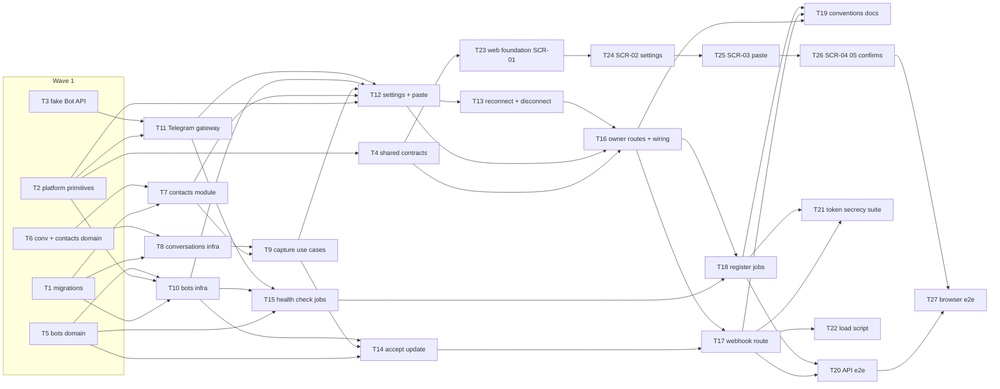

# Epic — bot-connection

> **Spec:** [spec.md](../spec.md) · **Design:** [sad.md](../sad.md) · **Data model:** [data-model.md](../data-model.md) · **API:** [openapi.yaml](../contracts/openapi.yaml) · [events.md](../contracts/events.md) · **Screens:** [screens.md](../screens.md) · **Test plan:** [test-plan.md](../test-plan.md) · **ADRs:** [adr/](../adr/)

## Goal

This epic connects tg-inbox to Telegram for the first time. A business owner connects the business's own bot alone, in minutes, by pasting its token, and sees at a glance whether it works. Every private message an end customer sends to that bot is then captured exactly once, in Telegram's order, into one conversation per contact, and the workspace's contact base grows by itself (spec §2 Goals). Roadmap steps 4 (inbox), 7 (contacts) and 10 (group posts) build on the data captured here.

## Scope

- **In:** both declared surfaces (`sad.md` `target_surfaces: [backend-service, web-frontend]`). Backend: four migrations; platform primitives (eight error codes including the first 5xx, `TELEGRAM_UNAVAILABLE`; a parameterised owner-guard message; four config keys; `TELEGRAM_API_ROOT`; secret-header redaction); a scriptable fake Bot API for tests; shared zod contracts; three new modules (`bots`, `conversations`, `contacts`) through every layer; the public webhook route; the pg-boss health check; API e2e stories, a token-secrecy suite and a load-test script. Web: the owner-only **Bot** entry in AppShell (SCR-01), Bot settings (SCR-02) and the paste / takeover / disconnect dialogs (SCR-03–SCR-05), plus seven browser flows. Docs: `CLAUDE.md`, `docs/architecture-map.md`, the workspace-operators SAD §5 exception list and `docs/design-system.md`.
- **Out:** replying and the inbox screens (step 4); viewing or downloading media; groups and channels (step 10); blocked/unblocked tracking (step 8); several bots per workspace; editing, tagging or merging contacts (step 7); moving a workspace to a different bot; tooling to recover a bot bound to another workspace; capturing messages sent while not connected (spec §3). Also out: push updates to an open settings page, per-sender rate limits, token re-encryption tooling (sad §11 accepted debt).

**Size note:** there are 27 tasks, above the usual 8–20 for an M feature. The feature declares two surfaces (the `ui` layer adds six tasks), introduces three modules at once, and carries test-infrastructure work the precedent did not need (the fake Bot API, the token-secrecy suite, the load script). Splitting further keeps every task within one day and one reviewable PR (`_shared/size-matrix.md` §Surface count).

## Task map

**Waves** (topological phases; tasks in one wave can run in parallel unless they share a lane). Max parallelism: 5 (waves 1 and 2).

| Wave | Tasks |
|---|---|
| 1 | T1, T2, T3, T5, T6 |
| 2 | T4, T7, T8, T10, T11 |
| 3 | T9, T15, T23 |
| 4 | T12, T14, T24 |
| 5 | T13, T25 |
| 6 | T16, T26 |
| 7 | T17, T18 |
| 8 | T19, T20, T21, T22 |
| 9 | T27 |

**Serialized lanes** (overlapping `files_hint`): `modules/bots/app/ports.ts` T10, T11, T12, T13, T14, T15 · `modules/conversations/app/ports.ts` T8 → T9 · `modules/bots/http/routes.ts` T16 → T17 · `apps/api/src/app.ts` / `deps.ts` T16 → T18 · `apps/web/src/pages/BotSettingsPage.tsx` T23 → T24 → T25 → T26 · `layer: migration` T1 is always serialized. T23 writes the route and a stub page, so only the page chain touches it; per-module fixture files (`fixtures/bots.ts`, `contacts.ts`, `conversations.ts`, `telegram.ts`) keep the infra tasks parallel.

**Load test (T22):** the script is built and smoke-run locally as part of the epic. The full flood-isolation and throughput run needs a production-like host that does not exist yet (sad §11, High), so it is a pre-pilot activity, not part of any task's Definition of Done.

## Tasks

See [tracker.md](./tracker.md) for status. Machine contract: [tasks.json](../tasks.json).

| # | Task | Layer | Blocked by | DoD (short) |
|---|---|---|---|---|
| T1 | [Promote the four staged migrations and regenerate DB types](./t01-promote-migrations.md) | migration | — | The four bot-connection migrations apply and revert cleanly on a fresh Postgres 16, the regenerated db.types.gen.ts compiles, and the migrations integration test rejects every constraint violation listed in the task. |
| T2 | [Add platform primitives: bot error codes incl. the first 5xx, owner-guard message, config keys, Bot API root, secret-header redaction](./t02-platform-primitives.md) | infra | — | Unit tests prove the eight new error classes map to their codes, statuses and details (503 TELEGRAM_UNAVAILABLE not reported as INTERNAL_ERROR), config parses and validates the four new keys, the secret header is redacted, and the owner guard takes its message as a parameter with the team routes unchanged. |
| T3 | [Build the scriptable fake Telegram Bot API and the webhook update builder for tests](./t03-fake-telegram.md) | tests | — | fake-telegram.test.ts shows grammY pointed at the fake through apiRoot receiving every scripted outcome (ok, unauthorized, transient, hang) with recorded call parameters, and the update builders validate against recorded Bot API examples. |
| T4 | [Define the bots zod contracts in packages/shared](./t04-shared-contracts.md) | ports | T2 | Unit tests show every openapi.yaml example for the four owner operations parses with the shared bots schemas and that no schema accepts a token or webhook-secret field. |
| T5 | [Implement the bots domain: token check, connection states, inbound filter, update normalisation, due rule](./t05-bots-domain.md) | domain | — | Unit tests cover token trimming and format, the paste decision (connect, connect again, rotate, refuse with reason), every inbound-filter reason, every message kind incl. other, and the 3-minute due rule, with no I/O. |
| T6 | [Implement the conversations and contacts domain rules: message kinds, edit rule, profile refresh](./t06-conversation-contact-domain.md) | domain | — | Unit tests cover the edit rule with both tie-breaks and the redelivery case, the profile-refresh rule, and the 15-value message kind list, with no I/O. |
| T7 | [Build the contacts module: repository with isolation tests, upsert-from-profile and count use cases](./t07-contacts-module.md) | infra | T1, T6 | Testcontainers tests prove every contacts repository method is isolated across two workspaces, a late older message never restores an old profile, and concurrent first upserts create one contact. |
| T8 | [Build the conversation and message repositories with cross-workspace isolation tests](./t08-conversations-infra.md) | infra | T1, T6 | Testcontainers tests prove every conversation and message repository method is isolated across two workspaces, duplicate inserts report already_present, and the conditional edit converges on the latest edit and ignores uncaptured messages. |
| T9 | [Implement the conversations app layer: capture inbound message, apply edit, last message time, has conversations](./t09-capture-use-cases.md) | app | T7, T8 | Unit and Postgres tests show capture creates contact, conversation and message in one transaction, stores a redelivery once, handles concurrent first messages and duplicates without doubles, applies only later edits, and leaves nothing half-written on a forced failure. |
| T10 | [Build the bot repository, the AES-GCM token cipher and webhook secrets, with isolation tests incl. the two controlled exceptions](./t10-bots-infra.md) | infra | T1, T2, T5 | Testcontainers tests prove every bot repository method and both controlled exceptions are isolated across two workspaces, the telegram_bot_id violation is reported without reading the other row, and the AES-GCM cipher round-trips without the token appearing in stored bytes. |
| T11 | [Build the Telegram gateway: getMe, getWebhookInfo, setWebhook, deleteWebhook with typed outcomes and timeouts](./t11-telegram-gateway.md) | infra | T2, T3 | Integration tests against the fake Bot API show each gateway method returning its typed outcome (incl. a 1 s timeout as transient), setWebhook sending allowed_updates message/edited_message and max_connections, and no token or Bot API URL in errors or logs. |
| T12 | [Implement the bots use cases get-settings and paste-token (connect, rotate, connect again, refusals, takeover confirmation)](./t12-settings-and-paste.md) | app | T2, T7, T9, T10, T11 | Unit tests with fakes cover every paste branch in the contract refusal order and the restore-on-setWebhook-failure path, getSettings makes no Telegram call, and a Postgres test shows two workspaces pasting the same bot concurrently yield one connection and one BOT_BELONGS_TO_ANOTHER_WORKSPACE. |
| T13 | [Implement the bots use cases reconnect-with-stored-token and disconnect](./t13-reconnect-and-disconnect.md) | app | T12 | Unit and integration tests cover every branch of reconnect (flow 6) and disconnect (flow 7), including needs_token on a rejected stored token, the row kept when conversations exist and deleted otherwise, and no deleteWebhook for a foreign URL. |
| T14 | [Implement the bots use case accept-webhook-update: secret check, inbound filter, capture epoch, hand-off to conversations](./t14-accept-update.md) | app | T5, T9, T10 | Unit tests cover unauthorized, captured, already-present, edited and every ignore reason, and a Postgres test shows one person writing to two workspaces' bots gets a separate contact and conversation in each. |
| T15 | [Implement the scheduled health check: run-health-check use case and the bots.schedule-health-checks / bots.check-health jobs](./t15-health-check.md) | app | T5, T10, T11 | Unit tests cover each row of the events.md outcome table, and pg-boss integration tests show one check per bot at a time and a no-op for a disconnected bot or a mismatched workspace id. |
| T16 | [Expose the owner-only bot routes and wire the bots, conversations and contacts modules into buildDeps / buildApp](./t16-owner-routes.md) | ports | T4, T12, T13 | app.inject() tests show the four owner routes returning every contract status and code, 403 "Only business owners manage the bot" for an operator, 404 for a non-member or another workspace's owner, no Telegram call on GET, and no token in any response. |
| T17 | [Expose the Telegram webhook route with secret-before-parse, empty-body 401/200 and fail-closed 500](./t17-webhook-route.md) | ports | T14, T16 | app.inject() tests show the webhook capturing every kind, edit, redelivery and ordering case, ignoring filtered updates with 200, refusing every forgery with an identical empty 401, and answering 500 on a forced DB failure followed by a single capture on redelivery. |
| T18 | [Register the health-check workers in buildApp and prove five-minute freshness over a simulated hour](./t18-register-health-jobs.md) | wiring | T15, T16 | buildApp() registers the health-check workers and a simulated-hour integration test shows no live bot ever more than 5 minutes stale, with revoke and takeover detected on the first due tick. |
| T19 | [Update CLAUDE.md, the architecture map, the workspace-operators SAD and the design system for the new modules, exceptions and config](./t19-conventions-docs.md) | docs | T16, T17, T18 | CLAUDE.md, docs/architecture-map.md, the workspace-operators SAD and docs/design-system.md list the same five tenancy exceptions, three new modules, four config keys and the owner-only Bot link, and Prettier passes. |
| T20 | [Add the three API-level end-to-end stories: capture lifecycle, edits and redeliveries, health and recovery](./t20-api-e2e.md) | tests | T17, T18 | The three API-level e2e stories (capture lifecycle, edits and redeliveries, health and recovery) pass against an ephemeral database and the fake Bot API, each step using only what earlier steps returned. |
| T21 | [Add the token-secrecy suite: no token, secret or message text in any log line or response across every bot flow](./t21-token-secrecy-suite.md) | tests | T17, T18 | An integration suite running every bot flow and Telegram failure branch finds no token, webhook secret, message text or Bot API URL in any log line, response or error body. |
| T22 | [Write the load-test script for throughput, flood isolation, owner actions and settings load (runnable locally, run pre-pilot)](./t22-load-test-script.md) | tests | T17 | The load script runs every scenario with --profile smoke against a local instance and reports capture/acknowledgement p95 and 0 lost / 0 duplicated; the full pre-pilot run on a production-like host is out of this task. |
| T23 | [Lay the web bot foundation: bot API client, store, /w/:workspaceId/bot route and the owner-only Bot entry in AppShell (SCR-01)](./t23-web-bot-foundation.md) | ui | T4 | Testing Library tests show the owner-only Bot link after Team in the desktop nav and phone menu (absent for operators), the /w/:workspaceId/bot route mounting, and the bot store replacing and clearing settings with no token field. |
| T24 | [Build SCR-02 Bot settings with every declared state](./t24-bot-settings-page.md) | ui | T23 | Testing Library tests render every declared SCR-02 state against a stubbed API, including owners-only, stale notice and reconnect outcomes, and never render a token. |
| T25 | [Build SCR-03 Paste token dialog with every declared state](./t25-paste-token-dialog.md) | ui | T24 | Testing Library tests render every declared SCR-03 state against mocked pasteBotToken responses and prove the token is cleared on success, cancel and close and never reaches the store. |
| T26 | [Build SCR-04 Confirm takeover and SCR-05 Confirm disconnect](./t26-confirm-dialogs.md) | ui | T25 | Testing Library tests render every declared SCR-04 and SCR-05 state, show cancel sends no request, and show paste-path refusals on re-check reopening SCR-03. |
| T27 | [Add the seven browser end-to-end flows for bot settings against the fake Bot API](./t27-ui-e2e.md) | ui | T20, T26 | The seven browser flows of the test plan pass against the built SPA, an ephemeral database and the fake Bot API, locally and in the browser e2e CI step. |

## Risks / Hard rules

- **Tenancy (spec §6, sad §5, ADR-0007):** every tenant-owned table has a non-null `workspace_id`, and every repository method takes `workspaceId`. The only new exceptions are *bot by webhook id* (scoped by the matching secret hash) and *bots due for a health check* (used only by the scheduled job; each check then runs scoped by workspace). Each has its own isolation test. The AC-04 refusal comes from the unique constraint on `telegram_bot_id` and never reads another workspace's row. Every owner route gets an `app.inject()` test with another workspace's session.
- **Module boundary (ADR-0005):** `bots → conversations → contacts` and `bots → contacts`, only through app layers; none calls back into `bots`. `conversations.contact_id → contacts(id)` is a constraint only.
- **Token secrecy (spec §6, ADR-0006):** tokens are AES-256-GCM encrypted, decrypted only in `bots` infra right before a Bot API call, never logged, never in a response or an error. Webhook secrets are stored only as SHA-256 hashes, and the secret header is redacted from request logs. Message text and captions are never logged. T21 enforces this.
- **Capture semantics (ADR-0003/0004):** `200` means captured. A failure answers `5xx` so Telegram redelivers. An authentic but unrecognisable body is `200`, never `400`. There are no length CHECKs on Telegram strings. Order is by Telegram message id; edits by edit time with an update-id tie-break.
- **Telegram calls (sad §8):** every call goes through `telegramApi(token, { apiRoot })` behind the gateway port, with a 1 s timeout on owner actions and 10 s in health checks. Outcomes are unauthorized (state change), transient (no change) or other. Tests never call real Telegram (fake Bot API via `TELEGRAM_API_ROOT`).
- **First 5xx error class:** `TELEGRAM_UNAVAILABLE` (503) is the first `AppError` with a 5xx status. The error handler must send its envelope and must not log it as an unhandled error (T2).
- **IDs / config / UI (CLAUDE.md §Rules):** IDs are UUIDv7 from `newId()`, with Telegram ids as `bigint`. Env vars are read only in `platform/config.ts` and documented in `.env.example`. The UI uses shadcn/ui primitives with Tailwind only, and no new component.
- **Open, not built:** proactive alerts when the bot stops working, and operator read-only bot state (spec §8, owner Dmytro Hopko). Choosing a production host with public HTTPS before pilot #1 (sad §11, High) also gates the full T22 load run.
