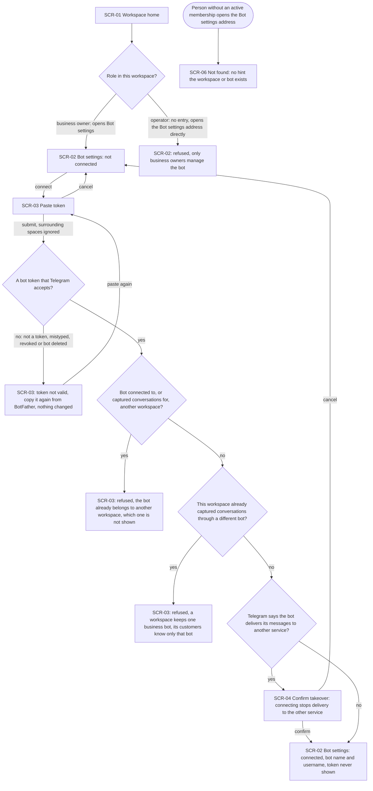
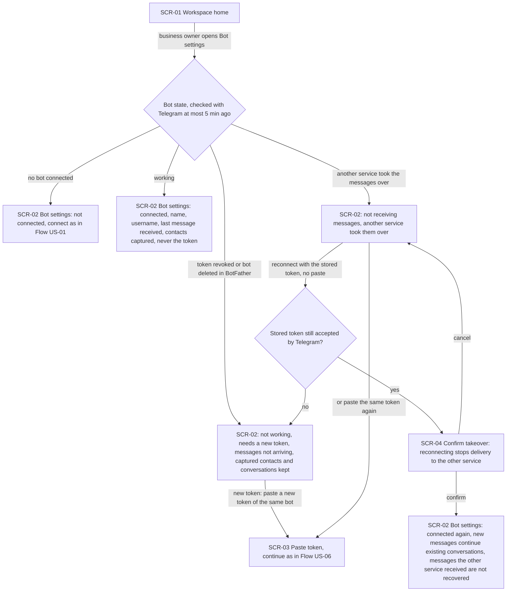
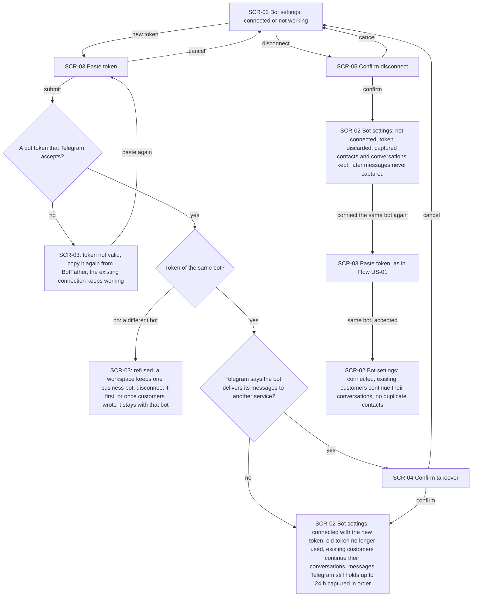

# UX flows — bot-connection

> User flows for every UI-touching §4 user story of [spec.md](spec.md), produced by `ux-flows` and
> read by `design`, `sequences`, `screens` and `plan-tests`. Flow altitude only — no layout, no
> components. Roles follow the [glossary](../../../CONTEXT.md).

## Platform decisions

- **Posture:** responsive-both — `docs/design-system.md` records no posture, so this follows the
  precedent set in `workspace-operators` (business owners switch between a desk and a phone; the
  token is copied out of BotFather, often on a phone). Every screen in the inventory must be fully
  usable at both phone and desktop width.
- **Only one human-facing surface is the web panel's workspace area.** End customers act only
  inside Telegram — tg-inbox shows them nothing of its own, so US-02/03/04 have no panel flow.
- **Bot settings is owner-only, like Team:** business owners see a way to SCR-02 from the workspace
  area; operators do not. An operator who opens its address gets the owners-only refusal; a person
  with no active membership gets the neutral not-found reused from `workspace-operators`.
- **One page, four states:** SCR-02 is a single page whose state is «not connected», «connected»,
  «not working — needs a new token» or «not receiving messages — another service took them over»;
  every action starts from it and returns to it.
- **One paste step for connect, rotate and re-paste:** SCR-03 is a step layered over SCR-02. What a
  submitted token does depends on the bot it belongs to: no bot yet → connect; the same bot →
  rotate (or reconnect after a takeover); a different bot → refused (AC-05). Errors and refusals
  keep the owner on SCR-03 and change nothing.
- **Confirmation before anything that cuts something off:** taking the bot's messages away from
  another service (SCR-04) and disconnecting (SCR-05) each ask for confirmation; cancelling returns
  to SCR-02 with nothing changed. Connecting a clean bot and rotating to a new token do not ask.
- **The token is never shown back:** after it is submitted no screen displays it, in any state.
- **Design inputs (flagged, not decided here):**
  - how the bot's state reaches an already-open SCR-02 — these flows assume it is current on load
    and refreshed by the next load or action (no push), in line with the precedent's «noticed on
    the next action»; AC-15 bounds staleness at 5 minutes on the server side;
  - whether reconnecting after a takeover with the stored token (AC-16b) re-validates the token with
    Telegram first — the flows assume it does, and a rejected token moves the bot to «not working»;
  - where the owner-only Bot settings entry sits next to Team in the workspace area — `screens`.

## Screen inventory

| ID | Screen | Purpose | Entry | Exit |
|---|---|---|---|---|
| SCR-01 | Workspace home | Existing landing screen of the workspace area (`workspace-operators` SCR-06); business owners get an entry to Bot settings from here | After sign-in or switching workspace | SCR-02 (business owners) |
| SCR-02 | Bot settings | The workspace's one business bot: state, name and username, last message received, number of contacts captured — never the token; actions connect, new token, reconnect, disconnect | Business owner from the workspace area | SCR-03 (connect / new token), SCR-04 (reconnect after takeover), SCR-05 (disconnect), SCR-01 |
| SCR-03 | Paste token | Paste a bot token copied from BotFather to connect the bot or give it a new token; shows the invalid-token error and the other-workspace / one-bot refusals | Connect or new-token action on SCR-02 | SCR-02 (connected or rotated, or cancel), SCR-04 (bot delivers to another service) |
| SCR-04 | Confirm takeover | Warn that connecting stops the bot delivering its messages to another service, and connect only on confirm | A valid token whose bot delivers elsewhere (SCR-03); reconnect after a takeover (SCR-02) | SCR-02 connected (confirm) or unchanged (cancel) |
| SCR-05 | Confirm disconnect | Confirm disconnecting: messages stop arriving, the token is discarded, captured contacts and conversations stay | Disconnect action on SCR-02 | SCR-02 not connected (confirm) or unchanged (cancel) |
| SCR-06 | Not found | Existing neutral not-found (`workspace-operators` SCR-10) — no hint that the workspace or its bot exists | Opening the Bot settings address of a workspace without an active membership in it | The person's own workspace home |

## Flows

Out of scope (no web-panel UI): **US-02** reach the business through its bot, **US-03** grow the
contact base automatically and **US-04** keep each customer's messages in one conversation. The end
customer acts only in Telegram and the capture runs without anyone in the panel; operators see
conversations and contacts from roadmap step 4 (inbox) and step 7 (contacts). The only panel-visible
effects of capture in this step — the last-message time and the number of contacts captured — are
shown on SCR-02 in Flow US-05.

### Flow: US-01 — Connect the business bot

A business owner goes from the workspace home to SCR-02, which says no bot is connected, and
chooses to connect; SCR-03 asks for the token copied from BotFather. Spaces around the pasted text
are ignored. If the text is not a bot token, or Telegram rejects it (mistyped, revoked, deleted
bot), SCR-03 says the token is not valid and to copy it again from BotFather, and nothing changes.
If the bot is connected to another workspace, or another workspace already captured conversations
through it, the paste is refused with «already belongs to another workspace» without naming it. If
this workspace already captured conversations through a different bot it later disconnected, the
paste is refused because a workspace keeps one business bot. If Telegram reports that the bot
currently delivers its messages to another service, SCR-04 warns that connecting will stop that,
and the bot connects only on confirm — cancel returns to SCR-02 unchanged. Otherwise the bot
connects straight away and SCR-02 shows its name, username and «connected»; the token is never
shown again, and from now on its private messages are captured. Operators have no entry to Bot
settings and get the owners-only refusal if they open its address; a person with no active
membership in the workspace gets SCR-06.

### Flow: US-05 — Check the bot's health

The business owner opens SCR-02 and sees the bot's current state, never more than 5 minutes old.
With no bot it shows «not connected» and the connect path of Flow US-01. A working bot shows its
name, username, «connected», the time the last message was received and how many contacts have
been captured — never the token. If the token was revoked or the bot deleted in BotFather, SCR-02
shows «not working — needs a new token», explains that messages are not arriving and that
everything captured is kept, and offers pasting a new token of the same bot (Flow US-06). If
another service took over the bot's messages, SCR-02 shows «not receiving messages — another
service took them over» and offers to reconnect using the token already stored; pasting the same
token again does the same. If Telegram no longer accepts the stored token, the bot moves to «not
working». Otherwise SCR-04 gives the takeover warning; on confirm the bot is connected again and
new messages continue the existing conversations, while messages the other service received in
the meantime are not recovered; cancel leaves SCR-02 as it was.

### Flow: US-06 — Rotate the token or disconnect the bot

From SCR-02, with the bot connected or «not working», the business owner chooses to give it a new
token and pastes it on SCR-03. An invalid or rejected token gives the «not valid» error and the
existing connection keeps working. A valid token of a different bot is refused: a workspace keeps
one business bot — disconnect it first while it is connected, and once customers have written to
it the workspace stays with that bot. A valid token of the same bot replaces the old one (after
the SCR-04 takeover warning if Telegram reports another service is receiving its messages): SCR-02
shows «connected», the old token is no longer used, existing customers continue their
conversations, and messages sent while the bot was not working that Telegram still holds (up to
24 h) are captured in order. To disconnect, the owner confirms on SCR-05; SCR-02 then shows «not
connected», tg-inbox no longer keeps the token, messages sent to the bot from now on are never
captured, and every contact and conversation captured so far stays. Connecting the same bot again
later goes through the paste step of Flow US-01; new messages from existing customers continue
their existing conversations with no duplicate contacts.

## AC coverage

| AC | Shown by | Notes |
|---|---|---|
| AC-01 | Flow US-01 → SCR-03 submit → all checks pass → SCR-02 connected | Spaces ignored; token never shown again |
| AC-02 | Flow US-01 → «not a token, mistyped, revoked or bot deleted» → SCR-03 error; Flow US-06 → same branch, existing connection keeps working | Covers both connect and rotate |
| AC-03 | Flow US-01 → «operator» → SCR-02 owners-only refusal; «person without an active membership» → SCR-06 | Applies to every Bot settings action, not only connect |
| AC-04 | Flow US-01 → «another workspace» → SCR-03 refusal | Which workspace is never shown |
| AC-05 | Flow US-01 → «already captured through a different bot» → SCR-03 refusal; Flow US-06 → «different bot» → SCR-03 refusal | Connected case: disconnect first; history case: stays with that bot |
| AC-06 | Flow US-01 → «delivers to another service» → SCR-04 → confirm / cancel | A service that fetches messages itself is invisible — no warning, plain connect |
| AC-07 | Flow US-05 → SCR-02 connected → last message received | Capture itself (contact + conversation) has no panel UI in this step; N/A for the rest |
| AC-08 | N/A: capture without panel UI | Contact refresh is visible from roadmap step 7 |
| AC-09 | N/A: capture without panel UI | Messages are visible from roadmap step 4 |
| AC-10 | N/A: capture without panel UI | Edits are visible from roadmap step 4 |
| AC-11 | N/A: capture without panel UI | Exactly-once + order are backend guarantees |
| AC-12 | N/A: capture without panel UI | Group, channel, bot and Business-account traffic is ignored silently |
| AC-13 | N/A: capture without panel UI | Per-workspace contacts; SCR-02's contacts count is per workspace |
| AC-14 | N/A: capture without panel UI | Forged deliveries are ignored silently |
| AC-15 | Flow US-05 → «working» → SCR-02 connected with name, username, last message, contacts captured | Staleness ≤ 5 min; how an open page refreshes is a design input |
| AC-16 | Flow US-05 → «token revoked or bot deleted» → SCR-02 not working → new token (Flow US-06) | Missed messages Telegram still holds are captured after rotation |
| AC-16b | Flow US-05 → «another service took the messages over» → reconnect / paste same token → SCR-04 → connected again | Messages the other service received are not recovered |
| AC-17 | Flow US-06 → «same bot» → SCR-02 connected with the new token | Also from «not working» |
| AC-18 | Flow US-06 → disconnect → SCR-05 confirm → SCR-02 not connected | Captured data kept; later messages never captured |
| AC-19 | Flow US-06 → «connect the same bot again» → SCR-03 → SCR-02 connected | Conversation continuity is a backend guarantee shown in prose |
