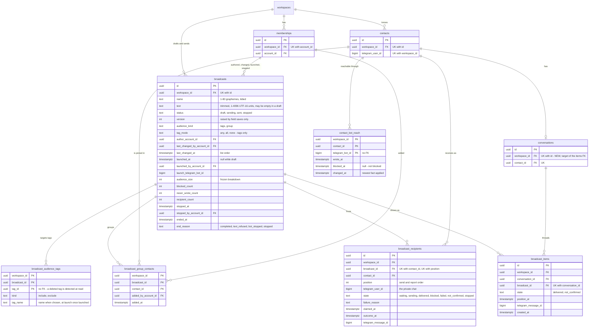

# Data model — broadcasts

This is a brownfield delta across three modules. The new `broadcasts` module owns its four tables ([ADR-0001](adr/0001-add-a-broadcasts-module-that-owns-drafts-groups-and-recipients-and-reaches-other-modules-through-their-app-layers.md)). `contacts` gains per-bot reachability ([ADR-0002](adr/0002-keep-per-bot-reachability-of-contacts-in-contacts-keyed-by-the-telegram-bot-id.md)). `conversations` gains the broadcast thread entry ([ADR-0010](adr/0010-store-broadcast-items-as-a-conversations-thread-entry-that-never-touches-conversation-state.md)).

- **Four new tenant-owned tables in `broadcasts`:**
  - `broadcasts`: one broadcast from draft to its end, with the draft version ([ADR-0005](adr/0005-version-draft-fields-and-keep-the-group-as-per-contact-rows-outside-the-version.md)), what the launch froze ([ADR-0006](adr/0006-launch-against-the-shown-version-and-an-audience-fingerprint-under-a-per-workspace-launch-lock.md)) and how it ended ([ADR-0009](adr/0009-end-stop-or-abort-a-broadcast-by-settling-every-waiting-recipient-in-one-transaction.md));
  - `broadcast_audience_tags`: the chosen and left-out tags of a tag audience, by tag id with the name when chosen, with no FK to `tags` ([ADR-0004](adr/0004-evaluate-audiences-in-contacts-with-the-contacts-filter-rules-and-return-the-breakdown-and-the-reachable-set.md));
  - `broadcast_group_contacts`: a draft's hand-picked contacts, outside the version (ADR-0005);
  - `broadcast_recipients`: the frozen recipient list, each recipient's claim and outcome ([ADR-0007](adr/0007-send-through-a-per-workspace-pg-boss-chain-that-claims-each-recipient-before-its-send.md), ADR-0009).
- **One new table in `contacts`:** `contact_bot_reach`, one row per contact and Telegram bot id (ADR-0002), plus a backfill for the current bot.
- **One new table in `conversations`:** `broadcast_items` (ADR-0010).
- **One unique index on `conversations`:** `(workspace_id, id)`, the target of the new composite FK from `broadcast_items`.

`bots`, `workspaces`, `notifications` and `inbox` get no schema change. `my_chat_member` in the webhook's allowed updates and the health check's re-registration are code ([ADR-0003](adr/0003-learn-blocks-from-my-chat-member-updates-and-refused-sends-in-bots-and-re-register-outdated-webhooks-in-the-health-check.md)). The send pause is the existing `bots.send_paused_until`. The live signals `broadcast.changed`, `contact.changed` `reach` and `conversation.changed` `broadcast` ([ADR-0011](adr/0011-push-broadcast-changes-as-id-only-signals-coalesced-to-once-per-second-and-page-the-report.md)) are `pg_notify` payloads and need no table. The pg-boss queues `broadcasts.send`, `broadcasts.send-dlq` and `broadcasts.measure-blocked-share` live in the pg-boss schema.

**Conventions applied.** These are the same as the contacts, operator-notifications and assignment-statuses precedents ([contacts data-model](../contacts/data-model.md)), repo [ADR-0004](../../adr/0004-use-postgres-with-kysely-reversible-migrations-and-workspace-scoped-tenancy.md), `CLAUDE.md` and SAD §2/§8:

- **Naming:** tables are `snake_case` and plural. Constraints and indexes are named `<table>_<cols>_{pkey,key,fkey,check,idx}`. A composite FK to `memberships` is `<table>_<role>_membership_fkey`. A composite FK to `contacts` / `broadcasts` / `conversations` is `<table>_contact_fkey` / `<table>_broadcast_fkey` / `<table>_conversation_fkey`.
- **PK:** `id uuid`, a UUIDv7 from `newId()`, never a DB default, for `broadcasts`, `broadcast_recipients` and `broadcast_items`. Pure link and fact tables are keyed by their natural key and have no `id`: `broadcast_audience_tags`, `broadcast_group_contacts` and `contact_bot_reach` (the `contact_tags` precedent).
- **Values:** the application supplies every value and timestamp. There is no `DEFAULT` and no generic `updated_at`. Telegram ids (user, bot, message) are `bigint` and never keys of their own.
- **Kinds and states:** `text` + `CHECK (… IN (…))`, no `ENUM`. `CHECK`s tie column combinations to states.
- **Triggers:** none. The domain constants (10 000 per audience, 10 launches per 24 h, 1–80 graphemes, 1–4096 UTF-16 code units, 25 per second, 8 in flight, 20 s links) are enforced in `broadcasts/domain` and `packages/shared` under the SAD §8 locks. The database checks only what it can count exactly (the frozen breakdown ≤ 10 000, ≤ 4096 code points).
- **Tenancy:** every new table has a non-null `workspace_id → workspaces(id)`. Every cross-entity reference is a **composite** FK that includes `workspace_id`, so the database refuses a group row, recipient, item or reach row that names a contact, broadcast or conversation of another workspace (AC-05, AC-08). No new controlled tenancy exception (SAD §8: the six stay six).
- **Cross-module FKs** (`broadcast_items → broadcasts`, every member column → `memberships`, `contact_bot_reach`/`broadcast_*` → `contacts`) are constraints only. Each module reads the others through their app layers.
- **Indexes:** every FK leads an index. Every other index serves a query named in SAD §6.
- **Delete strategy:** a draft is hard-deleted with its tag and group rows by the delete use case (flow 9). Launched broadcasts, recipients, items and reach rows are never deleted by the application. Group adds and removes are inserts and deletes by key. No `ON DELETE CASCADE` anywhere: a hand erasure of a contact (spec OQ-4) deletes its reach rows, group rows, recipients and items first (SAD §11 run book).

## Assumptions (autonomous run 2026-10-23)

Each can be vetoed at review.

1. **Aggregate roots.**
   - `broadcasts` is the root of `broadcast_audience_tags`, `broadcast_group_contacts` and `broadcast_recipients`. Every write to them takes the broadcast row `FOR NO KEY UPDATE` first, except the claim and the outcome, which touch one recipient row (SAD §8).
   - `contacts` is the root of `contact_bot_reach`. A reach write locks only its own row (upsert), after the contact upsert in capture.
   - `conversations` is the root of `broadcast_items`. An item insert takes only a `KEY SHARE` on the conversation and broadcast rows through the FKs, compatible with `NO KEY UPDATE`.
2. **No `id` on the reach, group and audience-tag rows.** SAD §8's ID row lists group rows and reach rows among the UUIDv7 ids. Their natural keys `(workspace, broadcast, contact)`, `(workspace, contact, Telegram bot)` and `(workspace, broadcast, tag)` are the PKs instead, as `contact_tags` is keyed. Upserts and removes go by key, and the backfill can insert reach rows in SQL without inventing ids. Recipients and items keep an `id` (the claim's target and the thread keyset's tiebreak).
3. **A draft's text may be empty.** The draft exists from its first valid name (ux-flows), before any text is typed. `CHECK (status = 'draft' OR text <> '')` and the launch refuses an empty text with `BROADCAST_TEXT_INVALID` (for `api`).
4. **Name and text checks are bounds, not the rule.** The database cannot count graphemes or UTF-16 units, so `broadcasts` checks `name <> ''`, `name = btrim(name)`, `text = btrim(text)` (implied by the shared JavaScript trim) and `char_length(text) <= 4096` (code points never exceed UTF-16 units, so this never refuses a valid text: 2 048 emoji = 4 096 units = 2 048 code points was accepted).
5. **The launch freezes the confirmed breakdown on the row** (`audience_size`, `blocked_count`, `never_wrote_count`, `recipient_count`, sequences flag). A `CHECK` makes the four add up, keeps the audience ≤ 10 000 and needs at least one recipient. The breakdown partitions the audience in this order: blocked, then never wrote, then reachable. A contact whose reach row is blocked but who never wrote through that bot counts as blocked.
6. **Recipients have a `position`** (1…n, unique per broadcast) in the fingerprint's order (by contact id). It is the send order and the report's keyset (sequences flag). Turns between broadcasts are the sender's in-memory round-robin, not a column.
7. **`claimed_at` is the current attempt's claim time.** A rate limit puts a recipient back to `waiting` with `claimed_at` NULL. A not confirmed recipient keeps it, and its item sits there (AC-16).
8. **The launch rewrites the tag rows to the names at launch** and removes rows of tags that no longer exist, so the report shows the audience "as it was defined" at launch (SAD §1 assumption). The group rows stay, read-only, after the launch. The recipient list is the source of truth for a launched group.
9. **`end_reason`** (`completed`, `text_refused`, `bot_stopped`, `stopped`) is stored, so the report and the run book tell a finished broadcast from an aborted one. `ended_at` is set for `sent` and for `stopped`. A stopped broadcast's in-flight sends still record their outcomes after `ended_at`.
10. **`last_changed_at` / `last_changed_by_account_id`** replace the SAD's "last changed by / at". Draft, group, launch and stop writes set both. Finish and abort set only the time, so the list still names the last member.
11. **Reach rows of a refused send use our clock** for `changed_at` and `blocked_at`, kept to the whole second as Telegram's times are. Telegram updates and messages use Telegram's time. Both are compared with `changed_at`, so an older fact is ignored and a fact of the same second applies in arrival order: a customer who unblocks and writes in the second of a refused send is unblocked (a wrong unblock costs one refused send, which marks the block again). The ≤ 1 s skew between the two clocks is accepted. <!-- review 2026-10-24: K4 -->
12. **The backfill covers every bot row, whatever its state.** A workspace has at most one bot row, and a `needs_token`, `taken_over` or `disconnected` row keeps its Telegram bot id. Reconnecting that same Telegram bot keeps the rows (AC-10). A workspace with no bot row gets none, and its contacts count as never wrote once a bot is connected. That is the honest reading for a workspace that never had one.

## ER diagram

Every edge from a new table is a composite FK `(workspace_id, …)`: to `broadcasts (workspace_id, id)`, `contacts (workspace_id, id)`, `conversations (workspace_id, id)` or `memberships (workspace_id, account_id)`. The `workspaces ||--o{ …` edges of the child tables are left out for readability. `broadcast_audience_tags.tag_id` and `contact_bot_reach.telegram_bot_id` are deliberately not FKs. `tags` and `bots` are not drawn: nothing new references them.

## Entities

### Aggregate `broadcast` (module `broadcasts`, tenant-owned)

#### `broadcasts` (new)

| Column | Type | Constraints | Notes |
|---|---|---|---|
| `id` | uuid | PK; UNIQUE `(workspace_id, id)` | UUIDv7. The broadcast's address (one address, two views, ux-flows) |
| `workspace_id` | uuid | NOT NULL, FK → `workspaces(id)` | Tenancy. Part of every composite FK pointing here |
| `name` | text | NOT NULL, `<> ''`, `= btrim(name)` | Internal, never sent. 1–80 graphemes by the shared rule (ADR-0012, AC-02) |
| `text` | text | NOT NULL, `= btrim(text)`, `char_length <= 4096`, non-empty unless `draft` | Trimmed. 1–4096 UTF-16 code units by the shared rule (AC-02, AC-17). Frozen at launch (status ≠ draft refuses every save) |
| `status` | text | NOT NULL, `CHECK IN ('draft','sending','sent','stopped')` | Flows 6–15 |
| `version` | integer | NOT NULL, `>= 1` | Raised by name, text, kind and tag saves only (ADR-0005, AC-03) |
| `audience_kind` | text | NOT NULL, `CHECK IN ('tags','group')` | |
| `tag_mode` | text | `any` / `all` / `none` ⇔ `audience_kind = 'tags'`, NULL for a group | The Contacts filter's modes. A new draft starts `tags` + `any` with no tag (every contact) |
| `author_account_id` | uuid | NOT NULL, FK `(workspace_id, …) → memberships` | The draft author (creating or duplicating). Besides owners, the only deleter (AC-07) |
| `last_changed_by_account_id` | uuid | NOT NULL, FK → `memberships` | "Who last changed or launched it" (AC-01, assumption 10) |
| `last_changed_at` | timestamptz | NOT NULL | The list's order |
| `created_at` | timestamptz | NOT NULL | |
| `launched_at` | timestamptz | NULL ⇔ `status = 'draft'` | Counts toward the cap even when stopped or aborted (AC-09) |
| `launched_by_account_id` | uuid | NULL ⇔ draft, FK → `memberships` | The launching owner, named in the report and the thread item even after deactivation (AC-16) |
| `launch_telegram_bot_id` | bigint | NULL ⇔ draft | The Telegram bot it sends with; `bots.sendBroadcastMessage` refuses another (AC-10, AC-12) |
| `audience_size`, `blocked_count`, `never_wrote_count`, `recipient_count` | integer | NULL ⇔ draft; `audience = blocked + never_wrote + recipients`, `audience <= 10000`, `recipients >= 1` | The breakdown the confirmation showed (assumption 5, AC-05, AC-06, AC-09) |
| `stopped_at`, `stopped_by_account_id` | timestamptz, uuid | non-null ⇔ `status = 'stopped'`, FK → `memberships` | Who stopped it and when (AC-18) |
| `ended_at` | timestamptz | non-null ⇔ `status IN ('sent','stopped')` | Finish time (AC-11, AC-12) or the stop time |
| `end_reason` | text | `CHECK IN ('completed','text_refused','bot_stopped','stopped')`, non-null ⇔ ended, `'stopped'` ⇔ status stopped | Assumption 9 |

**Aggregate root:** `broadcasts`.

**Access patterns:**
- Read and lock `FOR NO KEY UPDATE` by `(workspace, id)` in every draft, group, delete, launch, stop, abort and finish transaction (flows 6–15, seeded flows 1, 4); `inbox`'s `itemDetails` by ids (flow 18) → `broadcasts_workspace_id_id_key`.
- The Broadcasts list, most recently changed first (flow 5) → `broadcasts_workspace_id_last_changed_at_idx`.
- The launch cap and `next_launch_at` = the 10th newest `launched_at` + 24 h (flow 10, seeded flow 1) → `broadcasts_workspace_id_launched_at_idx`.
- The send link's sending broadcasts, oldest launch first (flow 14) → `broadcasts_sending_idx`.

#### `broadcast_audience_tags` (new)

| Column | Type | Constraints | Notes |
|---|---|---|---|
| `workspace_id` | uuid | NOT NULL, FK → `workspaces(id)`; PK part | |
| `broadcast_id` | uuid | NOT NULL, FK `(workspace_id, broadcast_id) → broadcasts`; PK part | |
| `tag_id` | uuid | NOT NULL, **no FK**; PK part | Resolved among the workspace's tags when saved (flow 7). A tag deleted or merged later is detected by `contacts.existingTags` at read time (ADR-0004) |
| `kind` | text | NOT NULL, `CHECK IN ('include','exclude')` | Chosen (with `tag_mode`) or left out. The PK makes a tag one or the other |
| `tag_name` | text | NOT NULL, `<> ''` | Name when chosen; rewritten at launch (assumption 8). Used by the dropped-tag notice (AC-01) |

**Aggregate root:** `broadcasts`.

**Access patterns:** the audience of a broadcast for every draft read, the launch and the report (flows 7, 10, 11); replace on save (flow 7); copy on duplicate (flow 15); delete with the draft (flow 9) → `broadcast_audience_tags_pkey`.

#### `broadcast_group_contacts` (new)

| Column | Type | Constraints | Notes |
|---|---|---|---|
| `workspace_id` | uuid | NOT NULL, FK → `workspaces(id)`; PK part | |
| `broadcast_id` | uuid | NOT NULL, FK → `broadcasts`; PK part | |
| `contact_id` | uuid | NOT NULL, FK `(workspace_id, contact_id) → contacts (workspace_id, id)`; PK part | The composite FK makes a foreign contact unstorable (AC-05, AC-08) |
| `added_by_account_id` | uuid | NOT NULL, FK → `memberships` | Who added it |
| `added_at` | timestamptz | NOT NULL | The group page's order |

**PK:** `(workspace_id, broadcast_id, contact_id)`: a contact is in a group at most once (AC-05).

**Aggregate root:** `broadcasts`.

**Access patterns:**
- Add (`ON CONFLICT DO NOTHING`), remove by key, "which of these 50 ids are in the group", the size count under the row lock, the group's ids for the breakdown, the launch and the duplicate (flows 7, 8, 10, 15) → `broadcast_group_contacts_pkey`.
- The group page, 50 newest added first (flow 8) → `broadcast_group_contacts_added_at_idx`.
- Contact FK and hand erasure → `broadcast_group_contacts_workspace_id_contact_id_idx`. Adder FK → `broadcast_group_contacts_workspace_id_added_by_account_id_idx`.

#### `broadcast_recipients` (new)

| Column | Type | Constraints | Notes |
|---|---|---|---|
| `id` | uuid | PK | UUIDv7, generated by the launch. The claim's and the outcome's target |
| `workspace_id` | uuid | NOT NULL, FK → `workspaces(id)` | |
| `broadcast_id` | uuid | NOT NULL, FK → `broadcasts` | |
| `contact_id` | uuid | NOT NULL, FK → `contacts`; UNIQUE with broadcast | One message per recipient (AC-06) |
| `position` | integer | NOT NULL, `>= 1`; UNIQUE `(workspace_id, broadcast_id, position)` | Assumption 6 |
| `telegram_user_id` | bigint | NOT NULL | The private chat, copied at launch |
| `state` | text | NOT NULL, `CHECK IN ('waiting','sending','delivered','blocked','failed','not_confirmed','stopped')` | The claim is `UPDATE … SET state = 'sending' WHERE id = $1 AND state = 'waiting'` (ADR-0007, the at-most-once key) |
| `failure_reason` | text | `CHECK IN ('account_gone','chat_not_found','telegram_error','text_refused','bot_stopped')`; non-null ⇔ `failed` | ADR-0009. "Did not reach" copies `bot_stopped`, `text_refused`, `telegram_error` (AC-13) |
| `claimed_at` | timestamptz | non-null for `sending` / `delivered` / `not_confirmed`; NULL for `waiting` / `stopped` | Assumption 7 |
| `outcome_at` | timestamptz | NULL ⇔ `waiting` / `sending` | The report's time (AC-11) |
| `telegram_message_id` | bigint | non-null ⇔ `delivered` | |

**Aggregate root:** `broadcasts`. Inserted only by the launch; never inserted or deleted afterwards (spec §6 frozen recipients).

**Access patterns:**
- Claim and outcome by `id` (flow 12) → `broadcast_recipients_pkey`.
- The report in position order after a cursor (flow 11) → `broadcast_recipients_broadcast_position_key`.
- Totals by state, the next waiting recipient, stale in-flight resolution, the report narrowed to one outcome, the settling update of a stop or an abort, "nothing waiting or in flight", the duplicate's "did not reach" set and the blocked-share measure (flows 11–15, seeded flow 4) → `broadcast_recipients_state_position_idx`.
- The duplicate's "all recipients" and one recipient per contact → `broadcast_recipients_broadcast_contact_key`.
- Contact FK and hand erasure → `broadcast_recipients_workspace_id_contact_id_idx`.

### Aggregate `contact` (module `contacts`, tenant-owned)

#### `contact_bot_reach` (new)

| Column | Type | Constraints | Notes |
|---|---|---|---|
| `workspace_id` | uuid | NOT NULL, FK → `workspaces(id)`; PK part | |
| `contact_id` | uuid | NOT NULL, FK `(workspace_id, contact_id) → contacts`; PK part | |
| `telegram_bot_id` | bigint | NOT NULL, **no FK**; PK part | The Telegram bot, not the connection: same bot reconnected keeps the row, a different one starts clean (AC-10) |
| `wrote_at` | timestamptz | NULL, `<= changed_at` | First message through that bot. NULL = never wrote through it ("never wrote to the current bot") |
| `blocked_at` | timestamptz | NULL, `<= changed_at` | Since when blocked; NULL = not blocked (AC-14). Shown as "blocked the bot since …" |
| `changed_at` | timestamptz | NOT NULL | The newest fact applied; an older one is ignored (ADR-0002, assumption 11) |

**Aggregate root:** `contacts`.

**Access patterns:** capture's upsert (wrote, clear an older block), `recordBlockChange` from `bots`, the breakdown and reachable set for the current bot, the sender's check at the turn, the Contacts list and profile marker (flows 7, 8, 10, 12, 16, seeded flow 3) → `contact_bot_reach_pkey`. `recordBlockChange` finds the contact by the existing `contacts_workspace_id_telegram_user_id_key`.

### Aggregate `conversation` (module `conversations`, tenant-owned)

#### `conversations` (changed)

New unique index `conversations_workspace_id_id_key (workspace_id, id)`: the target of `broadcast_items_conversation_fkey`. No column changes. `recordBroadcastItem` finds the recipient's conversation by the existing `conversations_contact_id_key` (one per contact).

#### `broadcast_items` (new)

| Column | Type | Constraints | Notes |
|---|---|---|---|
| `id` | uuid | PK | UUIDv7. The thread keyset's tiebreak |
| `workspace_id` | uuid | NOT NULL, FK → `workspaces(id)` | |
| `conversation_id` | uuid | NOT NULL, FK `(workspace_id, conversation_id) → conversations (workspace_id, id)` | |
| `broadcast_id` | uuid | NOT NULL, FK `(workspace_id, broadcast_id) → broadcasts`; UNIQUE with conversation | One item per broadcast and conversation |
| `state` | text | NOT NULL, `CHECK IN ('delivered','not_confirmed')` | Only these two outcomes get an item (AC-16) |
| `position_at` | timestamptz | NOT NULL | Delivered: when the answer was recorded. Not confirmed: the claim time |
| `telegram_message_id` | bigint | non-null ⇔ `delivered` | |
| `created_at` | timestamptz | NOT NULL | |

**Aggregate root:** `conversations`. Written only in the recipient's outcome transaction; touches no column of `conversations`.

**Access patterns:** the thread page before / after a `(position_at, kind, id)` cursor, merged with messages, replies and activity entries (flow 18) → `broadcast_items_conversation_position_at_idx`. The integrity "more than one item per recipient" is enforced by `broadcast_items_broadcast_conversation_key`.

## Indexes

| Index | Columns | Query it serves |
|---|---|---|
| `broadcasts_workspace_id_id_key` (unique) | `broadcasts (workspace_id, id)` | Target of the four composite FKs to `broadcasts` (AC-08). Every read and the row lock by workspace and id (flows 6–15, seeded flows 1, 4). `itemDetails` (flow 18) |
| `broadcasts_workspace_id_last_changed_at_idx` | `broadcasts (workspace_id, last_changed_at DESC, id DESC)` | The Broadcasts list (flow 5, AC-01). FK index for `workspace_id` |
| `broadcasts_workspace_id_launched_at_idx` | `broadcasts (workspace_id, launched_at) WHERE launched_at IS NOT NULL` | Launches in the last 24 h and the 10th newest (flow 10, seeded flow 1, AC-09) |
| `broadcasts_sending_idx` | `broadcasts (workspace_id, launched_at) WHERE status = 'sending'` | The link's sending broadcasts, oldest first, and "does anything still send" (flow 14, AC-15) |
| `broadcasts_workspace_id_author_account_id_idx` | `broadcasts (workspace_id, author_account_id)` | FK index only |
| `broadcasts_workspace_id_last_changed_by_account_id_idx` | `broadcasts (workspace_id, last_changed_by_account_id)` | FK index only |
| `broadcasts_workspace_id_launched_by_account_id_idx` | `… (workspace_id, launched_by_account_id) WHERE NOT NULL` | FK index only |
| `broadcasts_workspace_id_stopped_by_account_id_idx` | `… (workspace_id, stopped_by_account_id) WHERE NOT NULL` | FK index only |
| `broadcast_audience_tags_pkey` | `(workspace_id, broadcast_id, tag_id)` | A broadcast's tags (flows 7, 10, 11, 15, 9). FK index for `workspace_id` and the broadcast FK |
| `broadcast_group_contacts_pkey` | `(workspace_id, broadcast_id, contact_id)` | Add, remove, membership of a page, count, the group's ids (flows 7, 8, 10, 15). FK index for `workspace_id` and the broadcast FK |
| `broadcast_group_contacts_added_at_idx` | `(workspace_id, broadcast_id, added_at DESC, contact_id DESC)` | The group page (flow 8) |
| `broadcast_group_contacts_workspace_id_contact_id_idx` | `(workspace_id, contact_id)` | FK index for the contact FK; hand erasure (OQ-4) |
| `broadcast_group_contacts_workspace_id_added_by_account_id_idx` | `(workspace_id, added_by_account_id)` | FK index only |
| `broadcast_recipients_pkey` | `(id)` | Claim and outcome (flow 12) |
| `broadcast_recipients_broadcast_contact_key` (unique) | `(workspace_id, broadcast_id, contact_id)` | One recipient per contact (AC-06). "All recipients" copy (flow 15). FK index for `workspace_id` and the broadcast FK |
| `broadcast_recipients_broadcast_position_key` (unique) | `(workspace_id, broadcast_id, position)` | The report's keyset (flow 11) |
| `broadcast_recipients_state_position_idx` | `(workspace_id, broadcast_id, state, position)` | Totals, next waiting, stale in-flight, narrowed report, settle, finish check, "did not reach", blocked share (flows 11–15, seeded flow 4) |
| `broadcast_recipients_workspace_id_contact_id_idx` | `(workspace_id, contact_id)` | FK index for the contact FK; hand erasure (OQ-4) |
| `contact_bot_reach_pkey` | `(workspace_id, contact_id, telegram_bot_id)` | Every reach read and write (flows 7, 8, 10, 12, 16, seeded flow 3). FK index for `workspace_id` and the contact FK |
| `conversations_workspace_id_id_key` (unique) | `conversations (workspace_id, id)` | Target of the composite FK from `broadcast_items` |
| `broadcast_items_broadcast_conversation_key` (unique) | `(workspace_id, broadcast_id, conversation_id)` | One item per broadcast and conversation (SAD §8 integrity). FK index for the broadcast FK |
| `broadcast_items_conversation_position_at_idx` | `(workspace_id, conversation_id, position_at, id)` | The thread's broadcast-item part (flow 18, AC-16). FK index for `workspace_id` and the conversation FK |

Reused, so no new index is needed:
- `contacts_workspace_id_id_key`: target of every new composite FK to `contacts`.
- `contacts_workspace_id_telegram_user_id_key`: `recordBlockChange` by Telegram user id; capture's upsert.
- `contact_tags_workspace_id_tag_id_contact_id_idx` and `contact_tags_pkey`: the tag audience's match and leave-out (flows 7, 10), as the Contacts filter.
- `conversations_contact_id_key`: `recordBroadcastItem` finds the recipient's conversation.
- `memberships_workspace_id_account_id_key`: target of every new composite FK to `memberships`.

## Test fixtures

These are additions to the builders in `apps/api/src/test/fixtures/`, not to `migrations/`. They use synthetic ids, `Test User` and `@example.test` only. Telegram ids are synthetic numbers such as `5001n` and `9001n`.

- `fixtures/broadcasts.ts` (new):
  - `insertBroadcast(db, { workspaceId, authorAccountId, name?, text?, audience?: { kind: 'tags', mode, tags? } | { kind: 'group' }, version?, lastChangedAt? })`: a draft. `name` defaults to `Test broadcast N`, text to `Hello`.
  - `launchBroadcastFixture(db, { broadcast, launchedByAccountId, telegramBotId, recipients: Array<{ contactId, telegramUserId, state?, failureReason?, claimedAt?, outcomeAt?, telegramMessageId? }>, breakdown?, launchedAt? })`: turns a draft into `sending` with the frozen breakdown (defaults: no blocked, no never wrote) and inserts the recipients with positions 1…n in contact-id order, so the `CHECK`s hold.
  - `endBroadcastFixture(db, { broadcast, status: 'sent' | 'stopped', endReason, stoppedByAccountId?, endedAt? })`.
  - `insertAudienceTag(db, { workspaceId, broadcastId, tagId, kind?, tagName? })` and `insertGroupContact(db, { workspaceId, broadcastId, contactId, addedByAccountId, addedAt? })`.
  - `twoWorkspacesWithBroadcasts(db)`: from `twoWorkspacesWithTags`, each workspace with a bot, a draft (tag audience) and a launched broadcast with two recipients. The base for the cross-workspace isolation test of every new repository method (`CLAUDE.md`) and for AC-08: a group row, recipient or item naming the other workspace's contact, broadcast or conversation is refused by the composite FKs.
- `fixtures/contacts.ts`: `insertReach(db, { workspaceId, contactId, telegramBotId, wroteAt?, blockedAt?, changedAt? })`. `changedAt` defaults to the latest of the other two (or now). `insertContact` gains an opt-in `reachForBot?: bigint` that also writes a "wrote" row, so the breakdown tests read naturally.
- `fixtures/conversations.ts`: `insertBroadcastItem(db, { workspaceId, conversationId, broadcastId, state?, positionAt?, telegramMessageId? })` for thread keyset tests.
