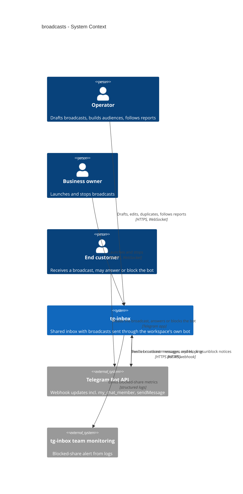
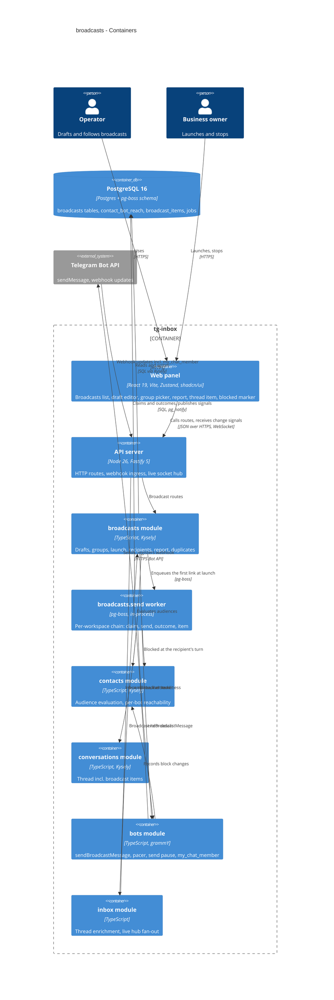
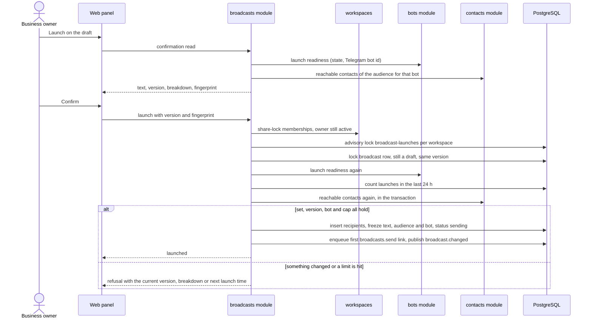
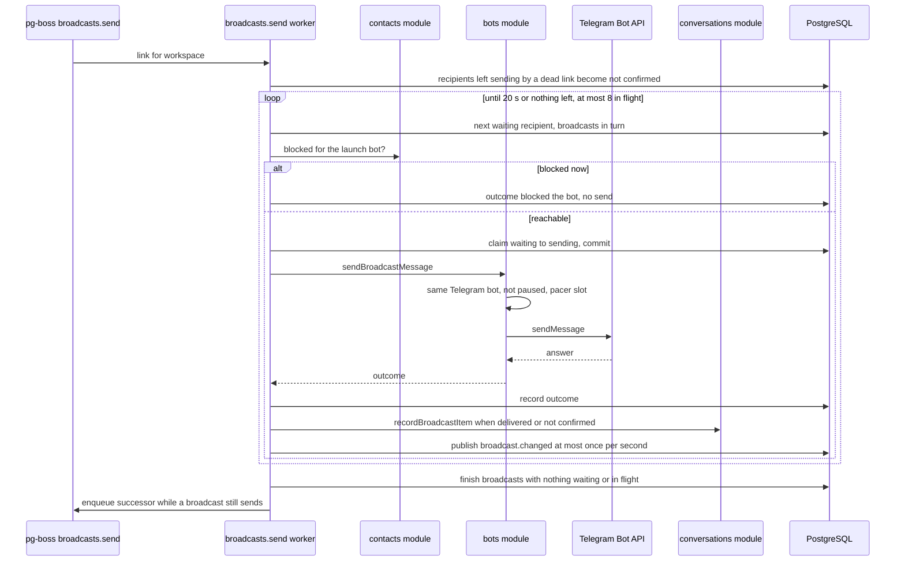
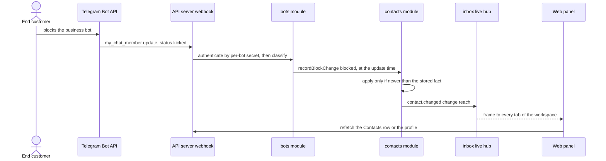
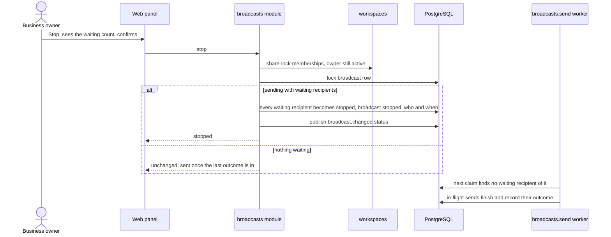

# Software Architecture Document — broadcasts

## 1. Introduction and goals

**Intent.** broadcasts lets a workspace send one plain-text message from its own business bot to a chosen part of its contact base, from the panel. Any member drafts a **broadcast**: an internal name, the text, and one **audience**. The audience is either a **tag audience** (the Contacts tag filter's rules plus tags to leave out) or a **broadcast group** of hand-picked contacts. A draft always shows its breakdown: the audience size, the **unreachable contacts** (blocked the bot, or never wrote to the **current bot**) and how many it would reach. Only a **business owner launches**, from a confirmation that shows the exact text and number. The **launch** freezes the **recipient list** to exactly the contacts the confirmation counted. Sending then runs in the background, below the bot's Telegram limit, giving way to replies and waiting for the bot's **send pause**. Each recipient is sent the broadcast at most once and gets an outcome in the **delivery report**, which updates live. A business owner can **stop** a sending broadcast. Every delivered (or not confirmed) broadcast shows as a **broadcast item** in the recipient's conversation thread and changes nothing else there. Underneath, tg-inbox learns from Telegram which contacts **blocked the bot**, per Telegram bot, and shows it on Contacts. The design is built around the spec's sharpest failure. Broadcasts and support share **one bot**, so a broadcast must never take replies down with it, never send twice and never send what the owner did not confirm.

**Top-3 quality goals (1-liners; full scenarios in §10):**

1. **Support first.** Replies keep their latency while a 10 000-recipient broadcast sends. A bot's broadcasts stay at or below 25 messages per second together, pause on any rate-limit answer, and never slow another workspace.
2. **Exactly what was confirmed, at most once.** A launch freezes exactly the confirmed set, at most once per broadcast. Each recipient is sent at most once, including across restarts, double launches and unanswered sends. A launched broadcast's text and recipient list never change, and a stop takes effect within 2 s.
3. **An honest, live report inside a tenant boundary.** Every recipient ends with a truthful outcome (delivered, blocked the bot, failed with a reason, not confirmed, or not sent because stopped), shown live within 3 s. Blocked marks follow Telegram within 5 s. Nothing crosses a workspace: no contact of another workspace in a group or recipient list, and no send through another workspace's bot.

**Stakeholders.**

| Role | Interest | Sign-off owner? |
|---|---|---|
| Operator | Drafts, edits, duplicates and deletes own drafts. Builds tag audiences and broadcast groups. Sees every broadcast and report. Keeps answering customers while broadcasts send. Sees "blocked the bot" on contacts | No |
| Business owner | Everything an operator does. Also launches and stops broadcasts, deletes any draft, and carries the risk of the shared bot being restricted | No |
| End customer | Receives one broadcast once, as plain text, in their private chat with the business bot. Can answer it into the inbox, or block the bot | No |
| Tech Lead | SAD approval | Yes |
| Security Lead | Security review: a new owner-only capability that messages customers in bulk, new personal data (blocked state, recipient outcomes), a new cross-entity link (groups of contacts) that must stay inside one workspace (spec §6.1: review required) | Yes |

**Assumptions (autonomous run 2026-10-23)**, each can be vetoed at review:

- Depth = medium (from `.claude/sdd.local.md`), size L and route `full` (from `.size` / `.route`). The pipeline made every per-section decision itself, choosing the option most consistent with the existing architecture (modular monolith, pg-boss queues, realtime change signals, no new tenancy exception). Each decision is recorded in the section it belongs to. Blast-radius decisions are ADRs.
- `docs/architecture-map.md` reflects `0c2d56f` (contacts shipped). Only documentation commits came after it, so the map is fresh. Targeted reads of the code at HEAD `1125d9e` confirmed the facts used here (§3 brownfield note).
- Wire shapes in this SAD (routes, frame fields, error codes) show intent only, and `api` fixes the names. Table and column names are indicative, and `data-model` fixes them.
- "A working bot" for a **launch** means the bot row's state is `connected`. `needs_token` (not working), `disconnected` / no row (no bot) and `taken_over` (the webhook points elsewhere, so answers and block notices would not reach tg-inbox) refuse a launch with the way to the bot settings. **While sending**, the broadcast keeps the reply rule: it sends while the bot is `connected` or `taken_over` and ends at once on `needs_token`, a disconnect or a different Telegram bot (AC-12).
- Existing contacts are treated as having written to the workspace's current Telegram bot when this feature is migrated. Messages store no bot id today, and pilots have not changed bots, so the backfill is exact for them. A contact who in fact never wrote to that bot fails with "chat not found" (§11).
- A failure "chat not found" (Telegram does not know a private chat between the bot and that user) is a recipient-level failure that a new attempt cannot fix. It is not copied by "only recipients it did not reach" (AC-13 lists the fixable reasons, and this is not one).
- The launched broadcast keeps its audience **as it was defined**: the match mode and the tags with their names at launch. The report shows those names even after a later rename.
- Design constants that are not spec numbers live in `broadcasts/domain` and are chosen so that the spec §6 targets hold (§10): a sending link of at most 20 s, at most 8 sends in flight per workspace, report signals coalesced to at most one per broadcast per second, and a report page of 50 recipients (ux-flows).

**Decision overrides:** none.

**Critic pass (autonomous run 2026-10-23):** seven findings, all resolved as amendments (Accept amendment):
- one failure-reason vocabulary: a lost bot (`bot_unavailable` / `bot_changed`) fails waiting recipients with reason `bot_stopped`, which duplicates copy (§6 flow 2, ADR-0009);
- the report is not pushed as totals: an id-only signal makes the page refetch (§4);
- flow 3 no longer refetches draft counts live (§6, ux-flows);
- the broadcast row lock is `FOR NO KEY UPDATE` everywhere (ADR-0005, ADR-0006, ADR-0009 aligned with §8);
- the sender runs 16 links per instance and §11 names the bound past which one workspace's broadcast could wait for another's (AC-15);
- a recipient left in flight by a dead link gets its "not confirmed" broadcast item at the claim time, with an integrity query (AC-11, AC-16);
- strawman options replaced in ADR-0005 and ADR-0006 and dropped from ADR-0012.

## 2. Constraints

**Technical.**
- TypeScript ~6.0 (strict) on Node.js 26 in a pnpm workspaces monorepo: repo [ADR-0001](../../adr/0001-use-a-typescript-pnpm-monorepo-on-node-26.md).
- Backend: Fastify 5 with `fastify-type-provider-zod` and zod 4, `@fastify/websocket` for the live socket `GET /api/workspaces/:workspaceId/inbox/live`, opened by the workspace frame (operator-notifications ADR-0002). grammY's `Api` through `telegramApi()` and the `bots` gateway is the only Telegram client. pg-boss 12 runs on the main database (policies `exclusive` / `stately`, `singletonKey`, `startAfter`, retries with a dead-letter queue, cron by the minute, `jobDb(tx)` to enqueue inside a Kysely transaction).
- Datastore: PostgreSQL 16 via Kysely 0.29, reversible migrations through kysely-ctl, types generated into `db.types.gen.ts`: repo [ADR-0004](../../adr/0004-use-postgres-with-kysely-reversible-migrations-and-workspace-scoped-tenancy.md). READ COMMITTED throughout. Row locks and transaction-level advisory locks (`hashtextextended('<key>', 0)`) are the serialisation tools. Composite foreign keys `(workspace_id, id)` keep links inside one workspace (the contacts precedent).
- Architecture: a modular monolith with layers `domain → app → infra → http`, in one process: repo [ADR-0002](../../adr/0002-organize-the-backend-as-a-modular-monolith-with-layered-modules.md). Module dependencies are one-way: `inbox → {conversations, contacts, bots, workspaces, notifications}`, `notifications → {conversations, workspaces, bots}`, `bots → conversations → contacts`, `bots → contacts`, `contacts → workspaces`. A module reaches a module that depends on it only through a port that it declares and `buildDeps()` fills.
- Live updates: `platform/realtime` `publish(trx, signal)` sends `pg_notify` inside the writing transaction (ids only, at most 1000 bytes, zod-validated). Every API instance LISTENs on one dedicated connection, and the `inbox` hub dispatches to the sockets of the workspace. Clients refetch through the read routes.
- Telegram: a bot sends to a private chat whose id is the user's Telegram id. Telegram allows roughly 30 messages per second per bot and answers `429` with `retry_after` above that. A user who blocked the bot gets `403` ("bot was blocked by the user"); a deleted account gets `403` ("user is deactivated"). Telegram tells a bot that a private user blocked or unblocked it through a `my_chat_member` update (new status `kicked` / `member`), delivered only when the webhook's `allowed_updates` names it. Today `bots` registers `message` and `edited_message` only. A text message is at most 4096 characters, which Telegram counts in UTF-16 code units. Paid broadcasts above 30 per second are out of scope (spec §3).
- Frontend: React 19 + Vite SPA with Tailwind + shadcn/ui, Zustand stores per feature and React Router (`/w/:workspaceId/…`). The workspace frame (SCR-15) owns the one live socket per tab and hands frames to feature stores. The Contacts list, its search and tag filter and the contact profile exist (`features/contacts`, `features/tags`).

**Organisational.**
- Effort budget: size L, a new capability area (`.size`), route `full`.
- Deadline: none in the spec. The platform MCP server (roadmap step 11) waits for broadcasts.
- Team composition: not stated. The pipeline assumes one backend + frontend implementer working through `tasks.json`.

**Conventions.**
- [`CLAUDE.md`](../../../CLAUDE.md) and [`docs/architecture-map.md`](../../architecture-map.md) §Conventions are binding. Each module exposes `register<Module>(app, deps)`. Only `buildDeps()` constructs dependencies, and only `buildApp()` registers modules and workers. Imports flow inward. Other modules are reached only through their app layer, never through their tables.
- IDs are UUIDv7 from `newId()`. Telegram ids (user id, bot id, message id) are `bigint` columns, never primary keys.
- Errors are `AppError` subclasses, with codes declared in `packages/shared/src/errors.ts` and returned in the single envelope.
- Every tenant-owned table has a non-null `workspace_id`, and every repository method takes `workspaceId`. Each repository gets a cross-workspace isolation test. **This design adds no tenancy exception** (§8, [ADR-0007](adr/0007-send-through-a-per-workspace-pg-boss-chain-that-claims-each-recipient-before-its-send.md)).
- Async work goes through pg-boss queues named `<module>.<job>`, with workers in `modules/<m>/infra/jobs.ts`, registered by `buildApp()`. A job that follows a write is enqueued in the writing transaction.
- Bot tokens stay inside `bots`. Broadcasts go out only through a `bots` app-layer call.
- No triggers or stored procedures. Migrations are reversible: expand, then migrate, then contract.
- UI composes shadcn/ui primitives from `apps/web/src/shared/ui`, Tailwind only, per `docs/design-system.md` (desktop-first, usable at ≥ 360 px).

**Regulatory / external.**
- Data classification is confidential (spec §6.1).
- New personal data: per contact and Telegram bot, whether the contact wrote through it and whether (and since when) they blocked it. Per broadcast: its recipients, each one's outcome, reason and time, and which member created, last changed, launched and stopped it. The broadcast text is business-written. No new data is collected from end customers.
- Retention: broadcasts, recipients and broadcast items are kept like messages. Removal is by hand on request (spec OQ-4, §11).
- No compliance regime is named. A security review is required before release (spec §6.1). Telegram's own rules on unsolicited messages are the external constraint behind the launch cap, the owner-only launch and OQ-1.

## 3. Context and scope

tg-inbox is a shared Telegram inbox for small businesses. Each workspace has its own business bot, its team answers customers in a shared web inbox, and its contacts carry tags (roadmap step 7). broadcasts turns the tagged base into an audience. It adds one new outbound path: bulk `sendMessage` from the workspace's own bot to many private chats. It also adds one new inbound path: Telegram's `my_chat_member` notices that a customer blocked or unblocked the bot. Both share the bot with the existing paths: customer messages in, replies out, member pings and bot answers out.

The trust boundary moves in two places. **First, one member's decision now reaches thousands of customers.** That is why the launch is owner-only and re-checked at the moment of the action, why it confirms against the exact set it showed, and why it is capped per workspace per day. Everything a launch freezes is a copy inside the broadcast and is never re-derived. **Second, a contact's reachability is now learned from Telegram.** A `my_chat_member` update is trusted the way a message is: it comes through the bot's authenticated webhook (the per-bot secret checked before the body is parsed), and it is scoped by the bot that received it. It creates no message, conversation, unread or ping.

<!-- brownfield: map fresh (reflects 0c2d56f; only doc commits to HEAD 1125d9e). Code facts read at HEAD: bots — gateway ALLOWED_UPDATES = message, edited_message (telegram-gateway.ts:69), setWebhook at connect/rotate/reconnect only, the health check (every 3 min per bot) reads getWebhookInfo and never re-registers; classifyUpdate handles message / edited_message and ignores everything else as unsupported_update; sendText (replies) does not wait for the send pause but stores it on 429; sendMemberMessage refuses while paused and paces 10/s per bot through an in-process keyed pacer (pacer.ts); SendOutcome refused reasons blocked / account_gone (403 by description) / chat_not_found (any 400); BotRecord carries telegramBotId; a different Telegram bot can be connected only after the old row is deleted; the bot-connected hook runs inside the connect transaction. conversations — thread positions are message / reply / activity (domain/thread.ts) in one keyset-paged query; capture calls contacts.upsertFromProfile inside its transaction with no bot id; conversation.changed item types message / reply / activity. contacts — the list filter (q, tag mode any/all/none, matching count) is ContactListQuery in infra/contact-list-query.ts; contact_tags uses composite FKs (workspace_id, contact_id) / (workspace_id, tag_id); contact.changed change = tags only. web — the inbox store refetches only the open thread for a created reply item, but the attention store refetches the count on every conversation.changed that is not an edit (features/attention/store.ts:32-36). -->

**External systems (in / out):**

| Actor or system | Type | Interaction |
|---|---|---|
| Operator | Person | Opens Broadcasts. Drafts, edits, duplicates and deletes own drafts. Builds audiences. Follows reports. Answers customers as before |
| Business owner | Person | Everything an operator does. Launches from the confirmation, stops a sending broadcast, deletes any draft |
| End customer | Person | Receives the broadcast in their private chat with the business bot. May answer it (captured as a customer message) or block the bot |
| Telegram Bot API | System (external) | In: webhook updates, now also `my_chat_member` for private chats (blocked / unblocked). Out: `sendMessage` of broadcast texts, sharing the bot's ~30 per second with replies, pings and bot answers. Answers `429` with `retry_after`, `403` for blocked or deleted users, `400` for an unknown chat or a refused text |
| tg-inbox team monitoring | System (internal ops) | Receives the blocked-share alert (spec §7) from structured logs. No panel surface |

**C4 Context (L1):**



The context: operators and business owners work in the panel over HTTPS and the workspace live socket. The business owner alone launches and stops. End customers never touch tg-inbox: they receive the broadcast in Telegram and answer or block the bot there. Telegram pushes their answers and their block or unblock notices back through the bot's webhook. tg-inbox sends broadcast messages through the same Bot API as replies and pings. The blocked-share alert leaves only as structured logs for the team's monitoring.

## 4. Solution strategy

**Target surfaces:** `backend-service` and `web-frontend`. The backend gets a new `broadcasts` module with its own tables, routes and sending job. It also gets per-bot reachability in `contacts`, a new inbound update and a broadcast send call in `bots`, and a new thread entry kind in `conversations`. The frontend gets a new Broadcasts area (SCR-24…SCR-32) and small changes to the inbox thread (SCR-02), the Contacts list (SCR-18) and the profile (SCR-19). The sender is a pg-boss job inside the same API process, like the reply drain and the ping sweep, so no separate `worker` surface is declared (the shared-inbox and operator-notifications precedent). The end customer's Telegram chat is the bot's output, not a surface tg-inbox draws (ux-flows, US-08). The surface split is recorded with the module decision in [ADR-0001](adr/0001-add-a-broadcasts-module-that-owns-drafts-groups-and-recipients-and-reaches-other-modules-through-their-app-layers.md).

**UI architecture (web-frontend):** client-side SPA, already fixed by repo ADR-0001. No new UI ADR is needed for the delivery model. The structure follows the existing features:
- **Routes:** `/w/:workspaceId/broadcasts` (SCR-24), `/w/:workspaceId/broadcasts/:broadcastId` (one address, two views: SCR-25 while the broadcast is a draft, SCR-28 once it is launched, chosen from the status the read returns), and `/w/:workspaceId/broadcasts/:broadcastId/launch` (SCR-27 opened over SCR-25 for a business owner; an operator is redirected to the draft with the owners-only note). The Broadcasts item joins the workspace frame's navigation (SCR-15) for every member.
- **Stores:** `features/broadcasts/` with a list store (SCR-24), a draft store (SCR-25/26/27/31/32: fields saved as they change against the shown version, the member's own unsaved edit kept beside a teammate's version on a stale answer, group adds and removes sent one by one) and a report store (SCR-28/29/30: totals plus one 50-recipient page with an outcome filter). They subscribe to the frame's live socket and refetch on `broadcast.changed` frames ([ADR-0011](adr/0011-push-broadcast-changes-as-id-only-signals-coalesced-to-once-per-second-and-page-the-report.md)).
- **Reuse:** the group picker (SCR-26) composes the Contacts list's search box, tag filter and row components from `features/contacts` and `features/tags`, against the same `GET …/contacts` read, so matching and counts are the Contacts list's by construction (AC-04). The text editor shows the remaining length from the shared length rule ([ADR-0012](adr/0012-count-broadcast-text-in-utf-16-code-units-after-trimming-with-one-shared-rule.md)). Dialogs are shadcn `Dialog` / `AlertDialog`. `screens` picks the primitives.
- **Thread and Contacts:** the inbox thread renders a new item kind `broadcast` (SCR-02). The attention store ignores `conversation.changed` frames whose item is a broadcast (§5, [ADR-0010](adr/0010-store-broadcast-items-as-a-conversations-thread-entry-that-never-touches-conversation-state.md)). The Contacts list and the profile show a "blocked the bot" marker from the contacts reads and refetch on `contact.changed` with `change: 'reach'`.

**Top strategic choices (the seeds for ADRs):**

1. **A new `broadcasts` module owns drafts, groups, recipients and the sending loop. It reaches `contacts`, `conversations`, `bots` and `workspaces` only through their app layers, and `inbox` reads broadcast details from it for the thread.** Static edges added: `broadcasts → {contacts, conversations, bots, workspaces}` and `inbox → broadcasts`. No module calls `broadcasts` back, so it needs no port, and the graph stays acyclic. `bots` stays the only module that talks to Telegram. `inbox` keeps owning no tables. `broadcasts` registers its own routes under `/api/workspaces/:workspaceId/broadcasts…`, like `contacts` (goals 1 and 3): [ADR-0001](adr/0001-add-a-broadcasts-module-that-owns-drafts-groups-and-recipients-and-reaches-other-modules-through-their-app-layers.md).
2. **Reachability belongs to the contact and is kept per Telegram bot in `contacts`.** A new `contacts` table holds one row per contact and Telegram bot id: when the contact first wrote through that bot, whether it is blocked and since when, and the Telegram time of the newest fact applied. Capture writes "wrote" (and clears a block) through the existing `upsertFromProfile`, which now takes the bot's Telegram id. `bots` writes block and unblock. Every read asks about the **current** Telegram bot, so reconnecting the same Telegram bot keeps the marks and connecting a different one starts clean, with no reset job (AC-10, AC-14): [ADR-0002](adr/0002-keep-per-bot-reachability-of-contacts-in-contacts-keyed-by-the-telegram-bot-id.md).
3. **`bots` learns blocks from `my_chat_member` updates and from refused sends, and brings every webhook's allowed updates up to date in the health check.** `allowed_updates` gains `my_chat_member`. The inbound classifier turns a private `my_chat_member` (`kicked` / `member`) into a block change, never a message. Any send to a customer chat refused as blocked (a reply or a broadcast) records a block too. The 3-minute health check re-registers a webhook whose allowed updates are outdated, so bots connected before this feature start receiving block notices within minutes of the deploy (AC-14, §6 blocked freshness ≤ 5 s): [ADR-0003](adr/0003-learn-blocks-from-my-chat-member-updates-and-refused-sends-in-bots-and-re-register-outdated-webhooks-in-the-health-check.md).
4. **Audiences are evaluated by `contacts`, with the Contacts filter's own matching, and return the breakdown and the reachable set.** A tag audience (mode, tags, tags to leave out) and a group (a list of contact ids) both go to `contacts` with the current Telegram bot id. `contacts` answers the audience size, blocked, never wrote to the current bot and reachable, or the reachable contacts themselves (id and Telegram user id). Tags are kept on the draft by id with the name at the moment they were chosen. A tag that no longer exists is left out of the evaluation and reported by that name, so a rename keeps working and a delete or merge drops it with a notice, without any hook from tag admin into `broadcasts` (AC-01, AC-04, AC-05): [ADR-0004](adr/0004-evaluate-audiences-in-contacts-with-the-contacts-filter-rules-and-return-the-breakdown-and-the-reachable-set.md).
5. **Draft fields are versioned. The group is a set of per-contact rows outside the version.** The name, the text, the audience kind and a tag audience's tags are saved with the version the member saw, and a stale save is refused with the current draft. A group add or remove is its own row write under the broadcast row lock, which also enforces the 10 000 limit and "still a draft". It never raises the version. Switching away from a non-empty group carries the group size the member confirmed (AC-03, AC-04, AC-05): [ADR-0005](adr/0005-version-draft-fields-and-keep-the-group-as-per-contact-rows-outside-the-version.md).
6. **A launch confirms the shown version and an audience fingerprint, under a per-workspace launch lock, and freezes the recipients in the same transaction.** The confirmation read returns the version, the breakdown and a fingerprint, the SHA-256 of the sorted reachable contact ids. The launch re-checks, in one transaction: the owner's active membership (share-locked), the per-workspace launch lock and the 10-per-24-h cap, the broadcast row (still a draft, same version), the bot (connected, its Telegram id), the audience (at most 10 000, at least one reachable, same fingerprint). It then inserts the recipients, freezes the text, the audience definition and the bot, and enqueues sending. A second launch of the same broadcast finds it launched and returns it, so a double click or two owners launch once (AC-05, AC-06, AC-09, AC-10): [ADR-0006](adr/0006-launch-against-the-shown-version-and-an-audience-fingerprint-under-a-per-workspace-launch-lock.md).
7. **Sending runs as a per-workspace pg-boss chain that claims each recipient in its own committed transaction before its send.** `broadcasts.send` (policy `stately`, `singletonKey` = workspace id) runs one link of at most 20 s at a time per workspace, across instances. Each link first resolves any recipient left in flight by a dead predecessor as **not confirmed** (with its broadcast item at the claim time, AC-16), then sends, then enqueues its successor in its last transaction while a broadcast of the workspace is still sending. Launch enqueues the first link in its own transaction. Retries and a dead-letter handler that re-enqueues keep the chain alive without any cross-workspace read, so **no new tenancy exception** is needed. A recipient is claimed (`waiting → sending`) and committed before the Telegram call, so nothing is sent twice. A send with no answer ends **not confirmed** and is never repeated (AC-11, §6 at most once): [ADR-0007](adr/0007-send-through-a-per-workspace-pg-boss-chain-that-claims-each-recipient-before-its-send.md).
8. **Broadcasts are paced at 25 per second per bot in turns, wait for the bot's send pause, and go out through a dedicated `bots.sendBroadcastMessage`.** The sender keeps at most 8 sends in flight. Each send takes the next start slot of a per-bot pacer in `bots` (40 ms apart, so any 1 s window holds at most 25). The sending broadcasts of a workspace are served round-robin, one recipient each in turn. `sendBroadcastMessage` refuses without calling Telegram while the bot's send pause runs, when the bot is not `connected` / `taken_over`, or when the workspace's bot is no longer the Telegram bot the broadcast was launched with. Replies keep `sendText`, which neither waits for the pacer nor for the pause (AC-15, §6 pace, reply latency): [ADR-0008](adr/0008-pace-broadcasts-at-25-per-second-per-bot-in-turns-and-wait-for-the-send-pause.md).
9. **A broadcast ends, stops or aborts by settling every waiting recipient in one transaction under the broadcast row lock.** A stop marks the waiting ones "not sent — stopped". A refused text or a lost bot marks them failed with that reason. Claims are single-row conditional updates (`waiting → sending`), so after the settling transaction commits no new send can start, and sends already in flight finish and record their outcome. Every other Telegram refusal fails only its recipient, without a retry (AC-11, AC-12, AC-18, §6 stop takes effect): [ADR-0009](adr/0009-end-stop-or-abort-a-broadcast-by-settling-every-waiting-recipient-in-one-transaction.md).
10. **A broadcast item is a new thread entry kind owned by `conversations`, written in the send's outcome transaction, and enriched by `inbox` from `broadcasts`.** `conversations` stores, per recipient conversation, the broadcast id, the state (delivered / not confirmed) and the position time. It never touches the conversation's status, assignee, state version, waiting period, last activity or anyone's unread. The thread read returns it in the same keyset order as messages, replies and activity entries. `inbox` adds the broadcast's name, text and launching owner from `broadcasts` (AC-16): [ADR-0010](adr/0010-store-broadcast-items-as-a-conversations-thread-entry-that-never-touches-conversation-state.md).
11. **Broadcast changes reach open tabs as id-only `broadcast.changed` signals, report changes coalesced to at most one per broadcast per second, and the report is read as totals plus 50-recipient pages.** `contact.changed` gains `change: 'reach'` and `conversation.changed` gains the item type `broadcast` (AC-11, AC-14, AC-16, §6 report live update ≤ 3 s): [ADR-0011](adr/0011-push-broadcast-changes-as-id-only-signals-coalesced-to-once-per-second-and-page-the-report.md).
12. **The text is trimmed and counted in UTF-16 code units by one shared rule.** `packages/shared/src/broadcast-text.ts` holds the tidy (trim both ends) and the measure (1–4096 UTF-16 code units, Telegram's count), and the name rule (1–80 characters as a person sees them, measured like tag names). The web editor and the API use the same functions (AC-02, AC-17): [ADR-0012](adr/0012-count-broadcast-text-in-utf-16-code-units-after-trimming-with-one-shared-rule.md).

**Supporting choices (inline, below the ADR gate):**

- **Launch cap counting.** The cap counts broadcasts of the workspace whose `launched_at` is within the last 24 h, under the advisory lock `broadcast-launches:<ws>`. A stopped or aborted broadcast keeps its `launched_at`, so it counts. A refused launch writes nothing, so it does not count. The refusal carries `next_launch_at` = the 10th newest `launched_at` + 24 h (AC-09).
- **Duplicates** are one transaction in `broadcasts`: a new draft row (author = the member, name "Copy of …" cut to 80 characters by the shared name rule, same text) plus a copy of the source's audience: the tag rows; the group rows; for a launched broadcast "all recipients" (every recipient row) or "only recipients it did not reach" (outcomes `failed` with reason `bot_stopped`, `text_refused` or `telegram_error`, plus `stopped`, plus `not_confirmed` only when the request carries `include_not_confirmed`), offered only when the broadcast has ended. Copied contacts are re-checked against the workspace by the composite foreign key (AC-13).
- **Deleting a draft** locks the broadcast row and requires status `draft` and that the member is its author or a business owner. Its tag and group rows go with it (AC-07).
- **The draft's count** is computed on every draft read and after every change (ux-flows: not pushed live). The list shows only the audience size, which a tag audience gets from the same count query.
- **Blocked-share alert** (spec §7): once a broadcast ends, a delayed `broadcasts.measure-blocked-share` job (48 h later, payload workspace id + broadcast id) counts delivered recipients whose contact is now blocked for that bot and logs a structured metric. Monitoring alerts above 5 %. No panel surface.

**ux-flows "flagged for design" — where each is decided:**

- The launch confirmation sends back what it showed (version + exact reachable set) → the version and the audience fingerprint, ADR-0006.
- The stop confirmation's waiting count may be stale, needs no second confirmation, and a stop after the last outcome is a no-op → ADR-0009.
- A 10 000-recipient report is not pushed as a list: an id-only `broadcast.changed` signal makes the page refetch its totals and its current 50-recipient page → ADR-0011.
- The blocked mark comes from Telegram updates through `bots` and never becomes a customer message → ADR-0003 (classified before the inbound interceptor and capture, never handed to either).
- The broadcast item is a new thread item kind that never touches read state or conversation state → ADR-0010.
- How live updates arrive (the existing change signal) → ADR-0011.

## 5. Building block view

The repo's layered modular monolith is kept: one new module with `domain → app → infra → http`, and small app-layer additions to four existing modules. `broadcasts` holds every broadcast rule (versions, limits, launch checks, the send loop's decisions, outcome mapping, duplicates) in its pure `domain`, its use cases in `app` behind ports, Kysely repositories and the pg-boss workers in `infra`, and routes in `http`. Other modules are reached only through their app layer, passed in by `buildDeps()` (ADR-0001). Build order in `buildDeps()`: … `contacts` → `conversations` → `bots` core (now with `sendBroadcastMessage`) → `notifications` → `team` → **`broadcasts`** (needs contacts, conversations, bots, workspaces) → `inbox` (now given `broadcasts.itemDetails` for the thread). `contacts` gets its `currentBot` port from the `bots` core, late-bound like the existing ports (a runtime edge, no import).

**Internal decomposition:**

```
apps/api/src/modules/broadcasts/
├── domain/   broadcast.ts (status machine draft → sending → sent | stopped, version rule, who may delete / launch / stop)
│             audience.ts (tag audience shape, missing-tag notice, 10 000 limit, fingerprint over sorted ids)
│             recipient.ts (outcomes + reasons, Telegram answer → outcome map, "fixable" set for duplicates)
│             sending.ts (25 per second, 8 in flight, 20 s link, round-robin turn, 1 s report coalescing)
│             duplicate.ts ("Copy of …" within 80 by the shared name rule, audience copy choices)
├── app/      drafts.ts (create, save fields against a version, switch kind, delete)
│             group.ts (add one, add all matching, remove)
│             preview.ts (draft breakdown, launch confirmation read with fingerprint)
│             launch.ts (ADR-0006) · stop.ts (ADR-0009) · duplicate.ts
│             send-link.ts (one link of the chain: stale in-flight → turns → claim → send → outcome → successor, ADR-0007/0008)
│             reads.ts (list, one broadcast, report totals + page, itemDetails for inbox)
│             blocked-share.ts (the 48 h KPI measurement)
│             ports.ts (repos, ContactsApi, ConversationsApi, BotsApi, WorkspacesApi, signals, clock, jobs)
├── infra/    broadcast-repo.ts · audience-tag-repo.ts · group-repo.ts · recipient-repo.ts
│             signals.ts (broadcast.changed, coalescing) · jobs.ts (broadcasts.send + DLQ, broadcasts.measure-blocked-share)
└── http/     routes.ts (registerBroadcasts: /api/workspaces/:workspaceId/broadcasts…)
```

**Tables at a glance** (indicative; `data-model` fixes names, types and indexes). Every table has a non-null `workspace_id` and composite foreign keys `(workspace_id, …)`:

| Table | Owner | Holds |
|---|---|---|
| `broadcasts` | broadcasts | name, text, status (`draft` / `sending` / `sent` / `stopped`), `version`, audience kind, tag mode, author, last changed by / at; after launch: launched by / at, the launch Telegram bot id, the frozen audience definition (tag names at launch), stopped by / at, finished at, end reason |
| `broadcast_audience_tags` | broadcasts | per draft (and frozen per launched broadcast): tag id, include / exclude, tag name when chosen (no foreign key to `tags`: a delete is detected at read, ADR-0004) |
| `broadcast_group_contacts` | broadcasts | per draft: contact id (composite FK to `contacts`), added by, added at; primary key (workspace, broadcast, contact) |
| `broadcast_recipients` | broadcasts | per launched broadcast: contact id (composite FK), Telegram user id (the chat), turn order, state (`waiting` / `sending` / `delivered` / `blocked` / `failed` / `not_confirmed` / `stopped`), reason, claimed at, outcome at, Telegram message id; unique (workspace, broadcast, contact) |
| `contact_bot_reach` | contacts | per contact and Telegram bot id: wrote at, blocked at (null = not blocked), changed at (Telegram time of the newest fact) — ADR-0002 |
| `broadcast_items` | conversations | per broadcast and recipient conversation: state `delivered` / `not_confirmed`, position time, Telegram message id — ADR-0010 |

**App-layer additions to existing modules** (the only cross-module calls; names indicative):

| Module | New / changed call | Called by | For |
|---|---|---|---|
| contacts | `upsertFromProfile(…, telegramBotId)` writes the reach row (wrote, clears a block when newer) | conversations (capture) | AC-10, AC-14 |
| contacts | `recordBlockChange(workspaceId, telegramBotId, telegramUserId, blocked, at)` | bots | AC-14 |
| contacts | `audienceBreakdown`, `reachableContacts`, `existingTags`, `matchingContactIds`, `contactCards(ids)`, `isBlocked(contactId, botId)` | broadcasts | ADR-0004, AC-04, AC-11 |
| contacts | list / profile rows gain `blocked_since` for the current bot (via the `currentBot` port) | web (SCR-18, SCR-19) | AC-14 |
| bots | `sendBroadcastMessage({ workspaceId, telegramBotId, chatId, text })`, `launchReadiness(workspaceId)` (state + Telegram bot id) | broadcasts | ADR-0008, AC-10 |
| bots | `classifyUpdate` → `reach` decision for `my_chat_member`; `sendText` records a refused-as-blocked; health check re-registers outdated allowed updates | (internal) | ADR-0003 |
| conversations | `recordBroadcastItem(tx, { workspaceId, contactId, broadcastId, state, positionAt, telegramMessageId })`; thread read gains kind `broadcast` | broadcasts; inbox | ADR-0010 |
| workspaces | `lockActiveMembers` (existing) for launch / stop; display names incl. deactivated (existing) | broadcasts, inbox | AC-08, AC-16 |
| inbox | thread entries of kind `broadcast` enriched with `broadcasts.itemDetails` | web (SCR-02) | AC-16 |

**Web additions:** `apps/web/src/features/broadcasts/` (list, draft editor, group picker, launch / stop / duplicate / delete / switch dialogs, report, stores), pages under `apps/web/src/pages/`, routes in `app/routes.tsx`, the Broadcasts navigation item in the frame; `features/inbox` renders `ThreadItemView` kind `broadcast`; `features/attention/store.ts` ignores broadcast items; `features/contacts` shows the blocked marker; `packages/shared/src/broadcasts.ts` (zod DTOs) and `broadcast-text.ts` (ADR-0012).

**C4 Container (L2):**



The containers: the web panel calls the API's routes and listens to change signals on the workspace live socket. The `broadcasts` module serves the broadcast routes, evaluates audiences through `contacts`, checks the bot through `bots`, and at launch enqueues the first link of the `broadcasts.send` worker. The worker runs in the same process: it checks each recipient's block mark in `contacts`, sends through `bots.sendBroadcastMessage` (the only path to Telegram), and records the outcome together with the thread's broadcast item in `conversations`. `bots` also turns Telegram's `my_chat_member` updates into block changes in `contacts`. `inbox` enriches broadcast items in the thread from `broadcasts` and fans every change signal out to the open tabs. All state, including the job queue, is in the one Postgres database.

## 6. Runtime view

design seeds the four critical flows below. The `sequences` stage completes coverage of every AC. Participants are the §5 containers.

**Critical flow 1: A business owner launches a draft against what the confirmation showed (US-03 — AC-05, AC-06, AC-07, AC-09, AC-10)**



Already-launched (a double click, a second owner) returns the launched broadcast from the row lock step. An operator, a deactivated owner or a foreign workspace is refused before any lock beyond the membership check (AC-07, AC-08).

**Critical flow 2: One link of the sending chain (US-04, US-07, US-08 — AC-11, AC-14, AC-15, AC-16, AC-17)**



A `429` puts the recipient back to waiting and ends the link with its successor delayed to the pause end. The `bots` answers `text_refused`, `bot_unavailable` and `bot_changed` abort the broadcast (flow 4's settling transaction, ADR-0009): waiting recipients fail with reason `text_refused` ("Telegram refused the text") or `bot_stopped` ("the bot stopped working", for both bot answers). A recipient left `sending` by a dead link becomes not confirmed **and** gets its broadcast item at its claim time in the same transaction (AC-16). Replies never pass through this loop.

**Critical flow 3: A customer blocks the bot (US-06 — AC-14)**



No message, conversation, unread or ping results. An unblock (`member`), or a new customer message through capture, clears the mark the same way. A send refused as blocked records the same change from `bots` (ADR-0003).

**Critical flow 4: A business owner stops a sending broadcast (US-04 — AC-18)**



The claim is a conditional single-row update (`waiting → sending`), so the stop's commit is the moment after which no send of that broadcast can start (spec §6: 0 sends started more than 2 s after the stop).

## 7. Deployment view

No new deployable. The one API process keeps serving HTTP, webhooks, the live sockets and every pg-boss worker (architecture map, "One process"). broadcasts adds three queues, created and registered by `buildApp()`:

| Queue | Policy | Payload | Notes |
|---|---|---|---|
| `broadcasts.send` | `stately`, `singletonKey` = workspace id, retry limit 3 with back-off, expire 60 s | workspace id | one link ≤ 20 s; enqueued by launch and by each link while a broadcast of the workspace sends (ADR-0007); worker concurrency per instance: 16 links |
| `broadcasts.send-dlq` | dead letter of `broadcasts.send` | workspace id | logs an error, enqueues a fresh `broadcasts.send` link 60 s later |
| `broadcasts.measure-blocked-share` | `singletonKey` = broadcast id, retry limit 2 | workspace id, broadcast id | enqueued when a broadcast ends, `startAfter` 48 h; logs the blocked share (spec §7) |

No new environment variable: pace, window, link length and coalescing are constants in `broadcasts/domain` (§1 assumptions). Rollout: the migration (reach table + backfill, broadcasts tables, broadcast items) runs before the new code; after the deploy, each bot's next health check (≤ 3 min) re-registers its webhook with `my_chat_member` (ADR-0003).

**Monitoring:**
- Metrics (structured logs, no text, no names, no chat ids): per broadcast — launch (recipients, unreachable split), outcome counts by state and reason at finish, launch-to-finish duration; per link — sends, sends per second, in-flight peak, time paused, stale in-flight resolved; per bot — `429` answers by sender (reply / ping / broadcast); blocked share 48 h after a broadcast (spec §7).
- Alerts: any `broadcasts.send-dlq` job; a broadcast `sending` with no outcome recorded for 5 minutes outside a send pause; a stale in-flight resolution (a link died mid-send); blocked share > 5 % (spec §7, team monitoring only); reply p95 in the hour after a launch more than 1 s above the 30-day baseline (spec §7 "Support unaffected").
- Tracing: none in the repo; the launch and each link log one line with workspace id, broadcast id(s) and counts.

**Scaling thresholds:**
- Recipient rows grow by at most 10 launches × 10 000 = 100 000 per workspace per day. One table with an index by (workspace, broadcast, state) is comfortable to tens of millions of rows; above ~50 M, partition `broadcast_recipients` by launch month.
- Sixteen links per instance means up to sixteen workspaces send at full pace at once per instance (≤ 400 Telegram calls per second, mostly waiting on the network), more than every pilot workspace broadcasting at the same moment. A seventeenth sending workspace would wait for a free slot at a link boundary (≤ 20 s), which AC-15 forbids; the alert on a `broadcasts.send` job waiting more than 20 s marks the point to raise the concurrency or move the worker to its own process (the map's planned split), with no module change (§11).
- Database connections: each claim and outcome transaction is short and holds no connection across the Telegram call; sixteen links hold a connection only inside those short transactions.

## 8. Crosscutting concepts

Repo defaults are kept (CLAUDE.md, architecture map §Conventions). Feature-specific rows below.

| Concept | Convention | Where defined |
|---|---|---|
| Logging | pino structured logs. Never the broadcast text, contact names, usernames, chat ids or the token; ids, counts, states and reasons only. The group picker's search text is masked in request logs, like the Contacts search | CLAUDE.md, contacts SAD §8, here |
| Authentication / authorization | session + workspace membership guard on every route. Roles: any active member lists, reads, creates, edits, duplicates, adds to / removes from groups; the draft author or a business owner deletes a draft; only a business owner launches and stops, re-checked under `workspaces.lockActiveMembers` (`FOR SHARE`) inside the action's transaction. Foreign ids answer 404 (`NotFoundError`) with no hint | workspaces guard; ADR-0006, ADR-0009 |
| Tenancy | every new table has a non-null `workspace_id` and composite foreign keys `(workspace_id, …)` to `contacts`, `memberships`, `broadcasts` and `conversations`; every repository method takes `workspaceId`; each repository has a cross-workspace isolation test. The sender job carries its workspace id; `sendBroadcastMessage` takes the workspace id and the expected Telegram bot id. **No new tenancy exception** (the six stay six) | CLAUDE.md; ADR-0007 |
| Error handling | `AppError` subclasses, codes in `packages/shared/src/errors.ts`: `BROADCAST_DRAFT_CHANGED` (409, current draft), `BROADCAST_GROUP_CHANGED` (409, current group size, on a kind switch), `BROADCAST_NOT_A_DRAFT` (409, launched: read-only), `BROADCAST_AUDIENCE_CHANGED` (409, current breakdown + fingerprint), `BROADCAST_AUDIENCE_TOO_LARGE` (409, limit + how many can still be added), `BROADCAST_NO_REACHABLE_CONTACT` (409), `BROADCAST_NEEDS_WORKING_BOT` (409, bot state), `BROADCAST_LAUNCH_LIMIT_REACHED` (429, `next_launch_at`), `BROADCAST_NAME_INVALID` / `BROADCAST_TEXT_INVALID` (400). Operator launch / stop / foreign delete → `ForbiddenError` | here; `api` fixes names |
| ID strategy | UUIDv7 from `newId()` for broadcasts, recipients, group rows, broadcast items, reach rows; Telegram user, bot and message ids as `bigint` | CLAUDE.md |
| Lock order | **Launch:** memberships `FOR SHARE` → advisory `broadcast-launches:<ws>` → broadcast row `FOR NO KEY UPDATE` → (contacts reads, no locks) → recipient inserts → job insert. **Stop / delete by an owner:** memberships `FOR SHARE` → broadcast row. **Draft and group writes, abort, finish:** broadcast row `FOR NO KEY UPDATE` → its tag / group / recipient rows. **Claim:** one recipient row (conditional update). **Outcome:** recipient row → broadcast item insert (foreign-key `KEY SHARE` on the conversation and broadcast rows, compatible with `NO KEY UPDATE`) → signal. Reach writes lock only their reach row (capture: after the contact upsert, as today). No path takes a broadcast row after a recipient row with an incompatible mode, and none takes a membership after a broadcast row, so these cannot deadlock with each other, with deactivation (workspace row → membership → conversations) or with the tag locks (contacts ADR-0004) | ADR-0005, ADR-0006, ADR-0009, here |
| Events / live signals | `broadcast.changed { workspace_id, broadcast_id, change }` (new, every socket of the workspace; report changes coalesced to ≤ 1 per second per broadcast); `contact.changed` gains `change: 'reach'`; `conversation.changed` gains item type `broadcast` (`created` only). All published inside the writing transaction, ids only | ADR-0011 |
| Async jobs | `broadcasts.send` (+ DLQ) and `broadcasts.measure-blocked-share`, payloads ids only; workers in `modules/broadcasts/infra/jobs.ts` | §7, ADR-0007 |
| Rate limiting | Launch cap 10 per workspace per rolling 24 h (advisory lock + count). Pace 25 per second per bot for broadcasts (pacer in `bots`), the bot's send pause respected. Group size 10 000. No per-member limit on draft edits (versioned saves are cheap; the limit the spec asks for is on launches) | ADR-0006, ADR-0008 |
| Text and names | one shared rule in `packages/shared/src/broadcast-text.ts`: text trimmed at both ends, 1–4096 UTF-16 code units; name 1–80 characters as a person sees them. Sent with no `parse_mode` (plain text, AC-17), link previews at Telegram's default. Shown as plain text everywhere | ADR-0012 |
| Integrity run book | `apps/api/src/e2e/helpers.ts` gains `broadcastIntegrity.*`: recipients with more than one broadcast item; recipients still `sending` with no active link; launched broadcasts whose recipients were created after `launched_at`; recipients or group rows whose contact belongs to another workspace; more than 10 launches in any 24 h per workspace; delivered or not confirmed recipients without a broadcast item | here |
| Internationalisation | none: the panel is English, the broadcast text is the business's own | — |
| Configuration | no new env var | §7 |

## 9. Architecture decisions

| # | Title | Status | Section |
|---|---|---|---|
| 0001 | Add a broadcasts module that owns drafts, groups and recipients and reaches other modules through their app layers | Accepted | §4, §5 |
| 0002 | Keep per-bot reachability of contacts in contacts, keyed by the Telegram bot id | Accepted | §4 |
| 0003 | Learn blocks from my_chat_member updates and refused sends in bots, and re-register outdated webhooks in the health check | Accepted | §4 |
| 0004 | Evaluate audiences in contacts with the Contacts filter rules and return the breakdown and the reachable set | Accepted | §4 |
| 0005 | Version draft fields and keep the group as per-contact rows outside the version | Accepted | §4 |
| 0006 | Launch against the shown version and an audience fingerprint under a per-workspace launch lock | Accepted | §4 |
| 0007 | Send through a per-workspace pg-boss chain that claims each recipient before its send | Accepted | §4, §7 |
| 0008 | Pace broadcasts at 25 per second per bot in turns and wait for the send pause | Accepted | §4 |
| 0009 | End, stop or abort a broadcast by settling every waiting recipient in one transaction | Accepted | §4 |
| 0010 | Store broadcast items as a conversations thread entry that never touches conversation state | Accepted | §4 |
| 0011 | Push broadcast changes as id-only signals coalesced to once per second, and page the report | Accepted | §4, §8 |
| 0012 | Count broadcast text in UTF-16 code units after trimming, with one shared rule | Accepted | §4, §8 |

ADR files live under `docs/features/broadcasts/adr/NNNN-<title>.md`.

## 10. Quality requirements

**QG-1. Support first — pace, reply latency, isolation**
- **When:** a workspace launches a 10 000-recipient broadcast while its operators send replies, and another workspace keeps answering its own customers.
- **Then:** broadcast pace per bot "≤ 25 messages per second for all of a bot's broadcasts together, over any 1 s window"; reply latency during a broadcast "p95 reply send → Telegram accepted ≤ 2 s while a 10 000-recipient broadcast is sending"; cross-workspace isolation "p95 reply and ping latency of other workspaces unchanged (± 1 s) while one workspace sends 10 000"; on a `429` to any send of the bot, broadcasts send nothing until the pause ends (AC-15).
- **How verify:** integration test against the fake Telegram counting `sendMessage` per bot per sliding 1 s window with two broadcasts sending together (AC-15 turns); an interleaved test sending replies during a seeded 10 000-recipient broadcast and asserting reply accept time p95; a scripted `429` from a reply, then asserting no broadcast send before `retry_after`; reply and ping timing logs compared per workspace in staging.

**QG-2. Completion**
- **When:** a broadcast sends alone with no rate-limit answers.
- **Then:** "1 000 recipients, no rate-limit answers → every recipient has an outcome within 90 s of launch; 10 000 within 10 minutes".
- **How verify:** seeded integration test with 1 000 recipients against the fake Telegram with a realistic answer delay (150 ms), asserting launch-to-finish ≤ 90 s; the launch-to-finish timing log in staging for 10 000.

**QG-3. Exactly what was confirmed, at most once**
- **When:** a launch is confirmed twice at once, the process is killed mid-send, a send gets no answer, or members try every edit path on a launched broadcast.
- **Then:** at most once per recipient "0 recipients sent the same broadcast twice, including after a restart mid-send or a double launch"; frozen recipients "0 changes to a launched broadcast's text or recipient list"; the recipient list equals the set the confirmation fingerprinted (AC-06).
- **How verify:** integration tests: two concurrent launches (one launched, one returned); kill a link between claim and outcome, then run the next link (the recipient ends not confirmed, the fake records one send); a fake send that never answers (not confirmed, never resent); each edit route on a launched broadcast → `BROADCAST_NOT_A_DRAFT`; a retag between confirmation and launch → `BROADCAST_AUDIENCE_CHANGED`; the `broadcastIntegrity` run-book queries.

**QG-4. Stop and launch cap**
- **When:** an owner stops a broadcast mid-send; an owner launches an 11th broadcast within 24 h.
- **Then:** stop takes effect "0 sends of a broadcast started more than 2 s after its stop was confirmed"; launch cap "≤ 10 launches per workspace per rolling 24 h".
- **How verify:** integration test stopping mid-send against the fake Telegram and comparing every send's start time with the stop's commit time; integration test where the 11th launch is refused with `next_launch_at`, including a stopped broadcast among the 10.

**QG-5. Responsive drafts and launch**
- **When:** a draft is opened or changed, or launched, in a workspace with 10 000 contacts.
- **Then:** draft audience count "≤ 500 ms server time (as the Contacts list, contacts §6)" p95 for a tag audience or a group; launch "≤ 2 s server time from confirm to "sending"" p95 when freezing 10 000 recipients.
- **How verify:** seeded integration tests timing the draft read (tag audience and a 10 000-contact group) and the launch; the request timing log.

**QG-6. Honest, live report and fresh reachability**
- **When:** outcomes are recorded while a report is open; a customer blocks or unblocks the bot.
- **Then:** report live update "≤ 3 s (as shared-inbox §6)" p95 from outcome recorded to shown; blocked state freshness "≤ 5 s" p95 from Telegram's notice to the contact marked or unmarked; availability "99.5 % monthly (as shared-inbox §6)".
- **How verify:** server-side timing from the outcome transaction to the `broadcast.changed` push (coalescing ≤ 1 s + refetch); integration test posting a `my_chat_member` update to the webhook with the fake Telegram and timing the reach row and the `contact.changed` signal; the uptime check on `/health`.

## 11. Risks and technical debt

| Risk / debt | Severity | Mitigation | Owner |
|---|---|---|---|
| A broadcast to a cold or broad audience draws spam reports and Telegram restricts the shared bot, stopping support (spec §1, §6.1) | High | owner-only launch with the warning (AC-06), 10 launches per 24 h, 25 per second with pause on `429`, stop (AC-18), blocked-share alert; spec OQ-1 (limit audiences to recent or opted-in contacts) | Dmytro Hopko — OQ-1 due after the first 30 days of pilot broadcasts, or earlier if the §7 alert fires |
| Broadcasts (25 per second) plus pings (up to 10) plus replies can exceed Telegram's ~30 per second in a busy second; replies then meet a `429` | Medium | pings are rare in practice; the first `429` pauses broadcasts and pings, replies back off as today; the §7 "Support unaffected" KPI and the per-sender `429` metric show it | Backend |
| Telegram's length count is assumed to be UTF-16 code units (ADR-0012); a mismatch would let the editor accept a text Telegram refuses | Medium | verify against the real Bot API during `implement` (4096 emoji-heavy text); a refused text aborts the broadcast cleanly (ADR-0009) and the owner fixes it through a duplicate | Backend |
| Telling a refused text from a refused chat relies on Telegram's `400` description; an unknown `400` aborts the whole broadcast | Medium | classify "chat not found" / "user not found" / "PEER_ID_INVALID" as recipient-level; log the code and a description class (never the text); review the class list with pilot data | Backend |
| Reach backfill treats every existing contact as having written to the current Telegram bot; a workspace that changed bots before this feature has contacts who in fact never wrote to the new one | Low | they fail with "chat not found" (not copied by "did not reach"); pilots have not changed bots; the backfill is logged per workspace | Backend |
| Until a bot's next health check after the deploy (≤ 3 min), its webhook does not deliver `my_chat_member` | Low | refused sends still mark blocks; the window is minutes, once | Backend |
| A link that stalls longer than the 60 s expire (event loop blocked) could overlap its successor | Low | claims still prevent any double send; the overlap only risks the pace for a moment; link ≤ 20 s + send timeout 10 s; alert on stale in-flight resolutions | Backend |
| More sending workspaces than the per-instance link concurrency (16) would make one workspace's broadcast wait for another's link to end (≤ 20 s), against AC-15's "never slows another workspace" | Low | 16 exceeds the pilot count; alert on a `broadcasts.send` job waiting more than 20 s; raise the concurrency or split the worker (§7) | Backend |
| One `conversation.changed` frame per recipient (25 per second per sending workspace) reaches every tab of the workspace | Low | frames are tiny; inbox and attention stores ignore broadcast items unless the thread is open | Frontend |
| Spec OQ-3: answers to a broadcast count for pings and reopen conversations like any message, which may flood the inbox after a large broadcast | Medium | measured with pilot data; capture is unchanged, so grouping later is a `conversations` / `notifications` change | Dmytro Hopko — due after the first 30 days of pilot broadcasts |
| Spec OQ-4: no in-product contact removal; recipients, group rows and broadcast items now reference contacts by foreign key, so a hand erasure must delete them first | Medium | the run book's erasure procedure lists the new tables in order; an in-product deletion is designed with OQ-4 | Dmytro Hopko — due before roadmap step 8 ships |

**Accepted debt (acceptable in v1, plan to fix later):**
- No retry of a recipient after a non-rate-limit failure, and no automatic resend of not confirmed sends: a duplicate is the retry (spec).
- Reach rows of a previous Telegram bot are kept and never pruned.
- The report coalescing clock and the pacer are in memory, correct because one link per workspace is active (ADR-0007, ADR-0008).
- The draft breakdown is recomputed on every read, not cached.
- Scheduling, media, formatting and placeholders are out of scope (spec §3).

## 12. Glossary

| Term | Meaning |
|---|---|
| Audience | (CONTEXT) who a draft is meant for: a tag audience or a broadcast group |
| Tag audience | (CONTEXT) chosen tags with the Tag filter's match mode plus tags to leave out, evaluated whenever the draft is shown and again at launch |
| Broadcast group | (CONTEXT) the hand-picked contacts of one draft, stored as rows outside the draft's version |
| Broadcast | (CONTEXT) one plain-text message the business bot sends on a business owner's launch to every recipient: draft → sending → sent, or stopped |
| Launch | (CONTEXT) the owner's confirmed decision that freezes the recipient list and starts sending; at most once per broadcast, at most 10 per workspace per 24 h |
| Recipient list | (CONTEXT) the contacts fixed at launch from the audience minus unreachable contacts; never changed afterwards |
| Unreachable contact | (CONTEXT) an audience contact that blocked the current bot or never wrote to it |
| Blocked the bot | (CONTEXT) a contact's state for one Telegram bot, learned from `my_chat_member` or a refused send |
| Current bot | (CONTEXT) the Telegram bot connected now, identified by its Telegram bot id |
| Delivery report | (CONTEXT) each recipient's outcome and the totals, live while sending |
| Broadcast item | (CONTEXT) the broadcast as shown in one recipient's thread; never changes conversation state |
| Draft author | (CONTEXT) the member who created a draft, by creating or duplicating; besides owners, the only one who may delete it |
| Duplicate | (CONTEXT) a new draft from any broadcast, with the same text and a copied audience |
| Not confirmed | (CONTEXT) a send that got no answer; never sent again |
| Send pause | (CONTEXT) the bot's stored time until which Telegram asked to stop; broadcasts wait for it, replies never do |
| Audience fingerprint | the SHA-256 over the sorted ids of the reachable contacts the confirmation showed; the launch compares it with the set it would freeze (ADR-0006). *Not in CONTEXT — glossary follow-up* |
| Sending link | one run (≤ 20 s) of the per-workspace `broadcasts.send` chain; exactly one is active per workspace (ADR-0007). *Not in CONTEXT — glossary follow-up* |
| Claim | the committed `waiting → sending` update of one recipient right before its send; what makes a send at most once (ADR-0007). *Not in CONTEXT — glossary follow-up* |
| Reach row | per contact and Telegram bot: wrote through it, blocked since, newest fact time (ADR-0002). *Not in CONTEXT — glossary follow-up* |
