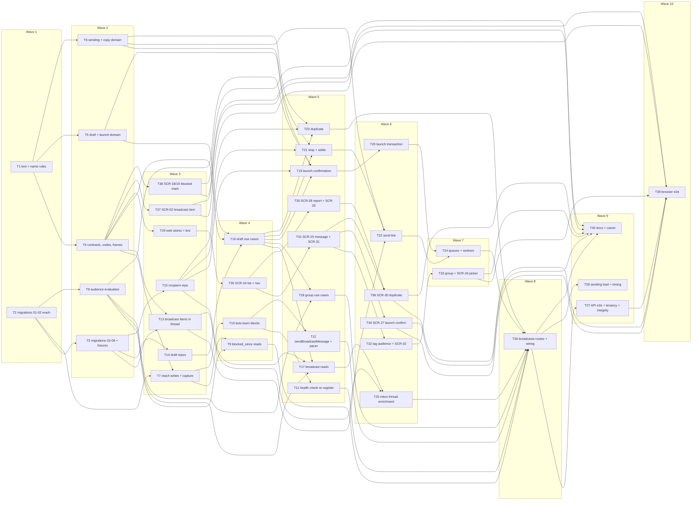

# Epic — broadcasts

> **Spec:** [spec.md](../spec.md) · **Design:** [sad.md](../sad.md) · **Data model:** [data-model.md](../data-model.md) · [audit](../_audit/data-model-2026-10-23.md) · **API:** [openapi.yaml](../contracts/openapi.yaml) · [events.md](../contracts/events.md) · [api-sync-report.md](../contracts/api-sync-report.md) · **Screens:** [screens.md](../screens.md) · **UX flows:** [ux-flows.md](../ux-flows.md) · **ADRs:** [adr/](../adr/)

## Goal

This epic lets a business owner reach a chosen part of the workspace's contact base — by tags or by a hand-picked group — with one plain-text message from the workspace's own bot, without leaving the panel, while support keeps working: replies never wait behind a broadcast, and an answer to a broadcast lands in the inbox like any message (spec §2 Goals). Any member drafts and duplicates; only a business owner launches (against exactly what the confirmation showed, at most 10 per 24 hours) and stops. The recipient list is frozen at launch, each recipient is sent at most once, the delivery report is live and honest, and tg-inbox learns from Telegram who blocked the bot.

## Scope

- **In:** both declared surfaces (`sad.md` `target_surfaces: [backend-service, web-frontend]`). Backend: eight staged migrations (`01`–`02` reach in T2, `03`–`08` broadcasts tables and items in T3); the shared text and name rule, the contracts, eleven error codes and three frames / signals; the new `broadcasts` module (domain, four repositories with isolation tests, drafts, group, reads, launch confirmation and transaction, stop and settle, the sending link, duplicate, the `broadcasts.send` chain with its dead letter and the blocked-share measure, `registerBroadcasts`); per-bot reachability and audience evaluation in `contacts`; `my_chat_member`, the health-check re-registration, `sendBroadcastMessage`, the broadcast pacer and `launchReadiness` in `bots`; broadcast items in `conversations` and their enrichment in `inbox`; API e2e, tenancy, integrity, load and timing tests. Web: the broadcasts stores with live re-reads, SCR-24 (list, navigation, routes), SCR-25 (editor: message, tag audience, group), SCR-26 (group picker), SCR-27 (launch confirmation), SCR-28 (report) with SCR-29 (stop), SCR-30 (duplicate), SCR-31 (delete), SCR-32 (switch audience), the broadcast item on SCR-02, the blocked marker on SCR-18 / SCR-19, browser flows. Docs: `CLAUDE.md`, the architecture map, the design-system canon, `CONTEXT.md`, the one-line `sad.md` §8 addition of `BROADCAST_NOT_ENDED` (api flag F-2).
- **Out (spec §3):** photos, files, buttons, formatting and placeholders; scheduling; saved groups or segments of their own; paid high-throughput broadcasts; editing or deleting a sent broadcast message; statistics beyond delivery. Open questions stay open: audience recency or opt-in (OQ-1), grouping answers to a broadcast (OQ-3), in-product contact removal (OQ-4).

**Size note:** 40 tasks, above the usual 8–20 for an L feature, as the precedents (operator-notifications 30, shared-inbox 29, contacts 26 at size M). The feature adds a whole module with a concurrency-heavy launch and a background sending chain, changes four existing modules (`contacts`, `bots`, `conversations`, `inbox`) and declares two surfaces (the `ui` layer adds ten tasks plus a browser-flow task). The launch is split into its confirmation read and its transaction, and the sender into the link, the settling transaction and the queues, so each task stays within one day and one reviewable PR.

## Task map

Waves (what can run in parallel once its upstream is done):

- **Wave 1:** T1, T2
- **Wave 2:** T3, T4, T5, T6, T8
- **Wave 3:** T7, T13, T14, T15, T29, T37, T38
- **Wave 4:** T9, T10, T16, T30
- **Wave 5:** T11, T12, T17, T18, T19, T21, T23, T31, T35
- **Wave 6:** T20, T22, T25, T32, T34, T36
- **Wave 7:** T24, T33
- **Wave 8:** T26
- **Wave 9:** T27, T28, T40
- **Wave 10:** T39

## Tasks

See [tracker.md](./tracker.md) for status. Machine contract: [tasks.json](../tasks.json).

| # | Task | Layer | Blocked by | DoD (short) |
|---|---|---|---|---|
| T1 | Add the shared broadcast text and name rules: trim both ends, 1–4096 UTF-16 code units for the text, 1–80 graphemes for the name, and the "Copy of …" cut | domain | — | Unit tests prove the text is trimmed at both ends (spaces and line breaks) before it is measured |
| T2 | Promote migrations 01–02 (contact_bot_reach and its backfill for the workspace's current Telegram bot), regenerate DB types and add the reach fixtures | migration | — | Migrations 01–02 are promoted as TypeScript migrations |
| T3 | Promote migrations 03–08 (the conversations (workspace_id, id) key, broadcasts, broadcast_audience_tags, broadcast_group_contacts, broadcast_recipients, broadcast_items), regenerate DB types and add the broadcast fixtures | migration | T2 | Migrations 03–08 are promoted in order |
| T4 | Add the broadcasts zod contracts, the eleven BROADCAST_* error codes, the broadcast.changed frame and signal, the widened contact.changed (reach) and conversation.changed (broadcast) frames with their hub mapping, and keep the web stores ignoring what they do not handle yet | ports | T1 | packages/shared and platform unit tests parse every contract example of openapi.yaml and events.md … |
| T5 | Add the broadcasts domain for drafts and launches: the status machine, the version rule, who may delete, launch and stop, the tag audience shape with the dropped-tag notice, the 10 000 limit and the audience fingerprint | domain | T1 | Domain unit tests prove the status machine (draft → sending → sent | stopped |
| T6 | Add the broadcasts domain for sending and copies: recipient states and failure reasons, the bots answer → outcome map with its abort kinds, the fixable set, the pace constants and the round-robin turn picker, and the duplicate audience choices | domain | T1 | Domain unit tests prove every sendBroadcastMessage answer maps to its outcome (delivered |
| T7 | Record reachability in contacts: capture's upsertFromProfile takes the receiving bot's Telegram id and writes "wrote" (clearing an older block), recordBlockChange applies a block or unblock only when newer, and contact.changed reach fires only when a mark changed | app | T2, T4 | Integration tests prove capture writes a reach row for the receiving Telegram bot (wrote_at = the earliest … |
| T8 | Evaluate audiences in contacts with the Contacts filter rules: the breakdown for a tag audience or a list of ids against a Telegram bot, the reachable set sorted by id, existing tags, contacts matching a search and filter, contact cards and the blocked check at a recipient's turn | infra | T2 | Integration tests on the AC-01 seed prove the breakdown of "any of VIP |
| T9 | Show "blocked the bot" on Contacts reads: list rows and the profile gain blocked_since for the current Telegram bot through a late-bound currentBot port | app | T7, T8 | Unit and integration tests prove a list row and a profile carry blocked_since when the contact is blocked … |
| T10 | Learn blocks in bots: allowed_updates gains my_chat_member, the classifier turns a private kicked / member update into a reach decision handled before the interceptor and capture, and a reply refused as blocked records the block | app | T7 | Unit and webhook integration tests prove a private my_chat_member kicked update calls … |
| T11 | Re-register outdated webhooks in the bots health check: a webhook that is ours but lacks my_chat_member is set again with the same URL and secret, keeping pending updates | app | T10 | Health-check tests against the fake Bot API prove an ours-but-outdated webhook is re-registered once with … |
| T12 | Add bots.sendBroadcastMessage and launchReadiness: a per-bot broadcast pacer at 40 ms start slots, refusal while the send pause runs, when the bot is not working or is not the launch Telegram bot, plain-text sendMessage, and every Telegram answer classified (blocked recorded in contacts) | app | T10 | Unit and fake-Bot-API integration tests prove launchReadiness answers the bot state and Telegram bot id |
| T13 | Add broadcast items to conversations: recordBroadcastItem in the outcome transaction without touching any conversation column, the thread kind broadcast in the keyset order, one-item reads and conversation.changed with item type broadcast | app | T3, T4 | Integration tests prove recordBroadcastItem writes one item per broadcast and conversation at the given … |
| T14 | Build the broadcasts draft-side repositories: the broadcast row (insert, lock FOR NO KEY UPDATE, versioned field save, list order, launch-cap count and 10th newest launch, sending broadcasts, delete), the audience tag rows and the group rows (add, remove, membership, count, page), with isolation tests | infra | T3 | Integration tests prove each repository method filters by workspace (isolation over … |
| T15 | Build the broadcasts recipient repository: the launch insert by unnest with positions, the conditional claim, outcome writes, back to waiting, stale in-flight resolution, settling waiting recipients, totals, the report page, the next waiting recipient and the duplicate sets, with isolation tests | infra | T3 | Integration tests prove 10 000 recipients insert in one unnest statement with positions 1…n |
| T16 | Add the broadcasts draft use cases: ports, the broadcast.changed publisher, create, save name and text against the version, save the tag audience or switch the kind against the confirmed group size, and delete by the author or a business owner | app | T4, T5, T14 | Unit and integration tests prove create starts a draft at version 1 with the member as author and last … |
| T17 | Add the broadcasts reads: the list with each draft's audience size, one broadcast as a draft with its breakdown for the current bot or as a launched broadcast with its frozen audience and totals, the recipients page, and itemDetails for the inbox thread | app | T8, T15, T16 | Unit and integration tests prove the list returns drafts and launched broadcasts together by last change … |
| T18 | Add the broadcast group use cases: add one contact, count the matching contacts not yet in the group, add all matching as a whole or not at all, remove one, the group page with cards and breakdown, and the membership of a picker page | app | T8, T16 | Unit and integration tests on the AC-04 / AC-05 seeds prove adding a contact already there answers unchanged |
| T19 | Add the launch confirmation read, which is also the pre-check: owner only, a working bot, a non-empty text, at most 10 000, at least one reachable contact and the 10-per-24-hours cap, answering the trimmed text, version, breakdown and fingerprint | app | T5, T8, T15, T16 | Unit and integration tests prove an operator gets OWNER_ONLY |
| T20 | Add the launch transaction: memberships FOR SHARE, the per-workspace launch lock and cap, the broadcast row, the bot and the audience re-checked against the confirmed version and fingerprint, then recipients frozen, the first broadcasts.send link queued and broadcast.changed status published | app | T19 | Integration tests prove a launch at the confirmed version and fingerprint inserts exactly the confirmed … |
| T21 | Add stop and the settling transaction: a business owner stops a sending broadcast (waiting → stopped), an abort fails the waiting recipients with text_refused or bot_stopped, a finish marks sent, and every ending queues the 48-hour blocked-share measure | app | T6, T15, T16 | Unit and integration tests prove a stop by an operator is OWNER_ONLY |
| T22 | Add one link of the sending chain: resolve stale in-flight recipients as not confirmed with their items, serve the sending broadcasts in turns with at most 8 sends in flight for at most 20 s, check the block at each turn, claim before the send, record each outcome with its broadcast item and a coalesced report signal, abort or finish, and decide the successor | app | T6, T13, T21 | Unit tests with fakes and integration tests against the fake Bot API prove a link sends each waiting … |
| T23 | Add duplicate: any member copies any broadcast into a new draft named "Copy of …" within 80, a draft with its audience, a launched one as the same tags, all recipients or only the recipients it did not reach once ended | app | T6, T15, T16 | Unit and integration tests on the AC-13 seed prove a draft copy keeps the text and the 14-contact group |
| T24 | Add the broadcasts queues and workers: broadcasts.send (stately per workspace, retry 3, expire 60 s, 16 links per instance) with its dead letter that restarts the chain 60 s later, and broadcasts.measure-blocked-share logging the 48-hour blocked share | wiring | T20, T22 | Integration tests prove a launch's queued link runs and its successors carry the chain to the end |
| T25 | Enrich the inbox thread with broadcast items: listThreadItems returns broadcast entries with the broadcast name, text and launching owner from broadcasts.itemDetails, and getThreadBroadcastItem reads one | ports | T13, T17 | Route integration tests prove listThreadItems returns a broadcast item between the messages and replies at … |
| T26 | Register the broadcasts routes (registerBroadcasts): the seventeen operations with their zod schemas, the owner-only launch confirmation, launch and stop, the masked picker search, and the wiring in buildDeps (contacts ⇄ bots late-bound ports, broadcasts after team, inbox given itemDetails) and buildApp | ports | T9, T11, T12, T18, T23, T24, T25 | Route integration tests prove every broadcasts operation answers its contract shape and every listed error … |
| T27 | Add the API end-to-end broadcasts stories, the cross-workspace and secrecy suite, the broadcastIntegrity run-book queries and the live-push assertions | tests | T26 | The API e2e stories pass against Postgres and the fake Bot API: draft → launch → report → sent with one … |
| T28 | Add the seeded sending and timing checks: pace per 1 s window with two broadcasts, 1 000 recipients within 90 s, replies during a broadcast, a reply's 429 pausing broadcasts, the stop within 2 s, the 10 000-contact draft count and launch, and blocked freshness | tests | T26 | Seeded integration tests against the fake Bot API prove no 1 s window holds more than 25 broadcast sends … |
| T29 | Add the web broadcasts API source and stores: the list store, the draft store (save as you go, one save in flight against the shown version, the stale-save merge, group adds and removes one by one) and the report store (totals plus one 50-recipient page, one fetch at a time), with the broadcast.changed subscriptions | ui | T4 | Store unit tests prove each broadcast.changed frame triggers exactly the re-reads screens.md lists (list … |
| T30 | Build SCR-24, the Broadcasts list: BroadcastsTable with statuses, audience sizes and last change, the empty state with New broadcast, the Broadcasts navigation item, the broadcast routes and BroadcastCrumb | ui | T29 | Testing Library tests cover every SCR-24 state in screens.md (loading |
| T31 | Build SCR-25, the draft editor's Message card and frame: name and text saved as you go with the remaining length by the shared rule, the status line and the stale-save merge, AudienceBreakdown, the role-aware title actions with the launch pre-check refusals in place, and SCR-31 DeleteDraftDialog | ui | T30 | Testing Library tests cover every SCR-25 Message-card |
| T32 | Build the tag audience on SCR-25: TagFilter's controlled mode for Send to, the Leave out popover, the chosen and left-out badges, the dropped-tag notice and the over-10 000 warning, and SCR-32 SwitchAudienceDialog | ui | T31 | Testing Library tests cover every tag-audience state of SCR-25 and every SCR-32 state in screens.md: … |
| T33 | Build the broadcast group on SCR-25 and SCR-26: BroadcastGroupList with tags, blocked markers and Remove, and GroupPicker over the Contacts read with membership marks, Add, and the two-step Add all matching | ui | T32 | Testing Library tests cover every group state of SCR-25 and every SCR-26 state in screens.md: the group … |
| T34 | Build SCR-27, the LaunchConfirmDialog on the /launch address: the exact text, the count, who is left out and why, the risk warning, launch with the version and fingerprint, the re-ask on a changed draft or audience, and the operator redirect | ui | T31 | Testing Library tests cover every SCR-27 state in screens.md: the text as plain text with line breaks |
| T35 | Build SCR-28, the read-only broadcast page with BroadcastReport (live totals, outcome filter, 50-recipient pages with plain reasons) and SCR-29 StopBroadcastDialog for business owners | ui | T30 | Testing Library tests cover every SCR-28 and SCR-29 state in screens.md: the message |
| T36 | Build SCR-30, the DuplicateBroadcastDialog from the list, the draft and the broadcast page: the audience choice with per-option counts, "did not reach" disabled until the broadcast ends, and the not-confirmed warning | ui | T31, T35 | Testing Library tests cover every SCR-30 state in screens.md: a draft duplicated at once |
| T37 | Render the broadcast item in the inbox thread (SCR-02): BroadcastItem as a new ThreadItemView kind with the name linking to the broadcast, the launching owner, the text and the delivered or not-confirmed time, inserted live without touching read state or attention | ui | T4 | Testing Library and store tests cover every SCR-02 broadcast-item state in screens.md: delivered and not … |
| T38 | Show the blocked mark on Contacts (SCR-18) and the profile (SCR-19), re-read live on contact.changed reach | ui | T4 | Testing Library and store tests cover the SCR-18 and SCR-19 states screens.md adds: the Blocked the bot … |
| T39 | Add browser end-to-end broadcasts flows against the real API: draft a tag audience, build a group, launch and follow the live report, stop, duplicate "did not reach", the broadcast item in the thread, the blocked marker, and the operator's missing launch | tests | T27, T33, T34, T36, T37, T38 | The browser flows pass locally and in CI with pnpm test:e2e: an operator drafts a tag audience and builds … |
| T40 | Update CLAUDE.md, the architecture map, the design-system canon and CONTEXT.md for the broadcasts module, its routes, tables, queues and signals, the new edges, contact_bot_reach and broadcast_items, and the new components | docs | T26, T33, T34, T36, T37, T38 | CLAUDE.md and the architecture map name the broadcasts module with its routes |

## Risks / Hard rules

- **Support first (spec §1, §6; ADR-0008):** replies keep `sendText`, which never takes the broadcast pacer and never waits for the send pause; all of a bot's broadcasts together stay at or below 25 per second (40 ms start slots); any `429` from any sender stores the send pause and every broadcast send refuses until it ends (T12, T22, T28).
- **At most once (ADR-0007, ADR-0009):** a recipient is claimed with a committed conditional update (`waiting → sending`) before the Telegram call; a send with no answer ends `not_confirmed` and is never resent; a recipient left `sending` by a dead link becomes `not_confirmed` with its broadcast item at the claim time; only a rate limit or pause puts a recipient back to `waiting` (T15, T22, T24).
- **Exactly what was confirmed (ADR-0006):** the launch re-checks the version, the bot, the cap, ≤ 10 000, ≥ 1 reachable and the audience fingerprint (SHA-256 of the sorted reachable ids) in one transaction; recipients are inserted from that same ordered read; a launched broadcast refuses every edit with `BROADCAST_NOT_A_DRAFT` (T19, T20).
- **Lock order (sad.md §8):** launch — memberships `FOR SHARE` → advisory `broadcast-launches:<ws>` → broadcast row `FOR NO KEY UPDATE` → contacts reads → recipient inserts → job insert; stop / delete by an owner — memberships `FOR SHARE` → broadcast row; draft and group writes, abort, finish — broadcast row → its rows; claim — one recipient row; outcome — recipient row → broadcast item → signal. No path takes a membership after a broadcast row (T16, T18, T20, T21, T22).
- **Tenancy (CLAUDE.md, sad.md §8):** every new table has a non-null `workspace_id` and composite FKs; every repository method takes `workspaceId` and has an isolation test over `twoWorkspacesWithBroadcasts` (T7, T8, T13, T14, T15); the sender job carries only the workspace id and `sendBroadcastMessage` takes the workspace id and the expected Telegram bot id. **No new controlled tenancy exception** — the six stay six (T24, T40 state it).
- **Module direction (ADR-0001):** `broadcasts → {contacts, conversations, bots, workspaces}` and `inbox → broadcasts` through app layers only; nothing calls `broadcasts` back; `bots` stays the only module that talks to Telegram; `contacts` gets its current Telegram bot from a late-bound `currentBot` port, and `bots` records blocks through a `contacts` port filled in `buildDeps()` (T9, T10, T26).
- **Conversation state untouched (ADR-0010):** a broadcast item never changes status, assignee, `state_version`, waiting, last activity, unread or attention; the inbox list and the attention store ignore `conversation.changed` with item type `broadcast` (T4, T13, T37). A block notice never becomes a message, conversation, unread or ping (T10).
- **Secrecy (spec §6.1, sad.md §8):** no frame, signal, job payload or log line carries the broadcast text, a contact name, a username or a chat id; the text is sent with no `parse_mode` and shown as plain text; the picker's search text is masked in request logs (T12, T26, T27).
- **Code findings carried from the data-model audit:** `upsertFromProfile` gains `telegramBotId` and upserts the reach row in capture's transaction (T7); `recordBlockChange` applies a fact only when `at >= changed_at` (T7); the thread's `KIND_ORDER` gains `broadcast` after `activity` with a fourth keyset half (T13); the launch inserts recipients with one `INSERT … SELECT … FROM unnest(…)` (T15, T20); recipient position = rank in the fingerprint's sorted order (T19, T20).
- **Expand → backfill, no contract:** `01`–`02` (reach + backfill) go with capture writing reach rows (T2 → T7); `02` is re-runnable; `03` and `08` go with broadcast items (T3 → T13); `04`–`07` with the module (T3). All eight can ship in one release.
- **Latency targets (spec §6):** pace ≤ 25/s, 1 000 recipients ≤ 90 s, reply p95 ≤ 2 s during a broadcast, draft count ≤ 500 ms and launch ≤ 2 s at 10 000, report live ≤ 3 s, blocked freshness ≤ 5 s, stop ≤ 2 s — seeded checks in T28.
- **Contract flags carried in:** F-1 (action POSTs) is T26's route table; F-2 (`BROADCAST_NOT_ENDED`) lands in T4 / T23 / T36 and the `sad.md` §8 line in T40; F-3 (a group write after a concurrent kind switch → `BROADCAST_DRAFT_CHANGED`, a remove → `unchanged`) is T18; F-4 (the Contacts list re-reads on `contact.changed reach`) is T38.

## Assumptions (autonomous run 2026-10-23)

- Size L, route `full` (`.size` / `.route`); owner Dmytro Hopko on every task; estimates S = ½ day, M = 1 day.
- **Migrations split in two lanes by ordinal group:** T2 promotes `01`–`02` (the `contacts` reach table and its backfill) so the reach work (T7, T8) can start early; T3 promotes `03`–`08` (the conversations key, the four broadcasts tables and broadcast items) with the broadcast fixtures. Both are `layer: migration` and touch `db.types.gen.ts`, so they run serialized (T3 depends on T2).
- **The app layer of `broadcasts` declares its ports (`ContactsApi`, `ConversationsApi`, `BotsApi`, `WorkspacesApi`, jobs, signals, clock) in `broadcasts/app/ports.ts` (T16) and tests against fakes;** the real modules are bound in `buildDeps()` by T26, so the broadcasts use cases do not wait for the `bots` tasks (T10–T12).
- **The hub mapping of the three signals and the web stores' "ignore what is not handled yet" are in the contracts task** (T4), as the contacts and operator-notifications precedents did; the attention store's rule to ignore broadcast items is AC-16 behaviour and is tested there.
- **The settling transaction lives in `broadcasts/app/settle.ts`** (T21) and is reused by the send link (T22) for abort and finish, so stop, abort and finish share one implementation of ADR-0009.
- **The page component is `features/broadcasts/BroadcastPage.tsx`** (SCR-28, screens.md's name) and the route page `pages/BroadcastDetailPage.tsx` chooses between the editor (SCR-25) and it from `getBroadcast`'s status (screens.md Decision 1).
- **API e2e and timing live in `apps/api/src/e2e/`** (as `contacts-flows.int.test.ts` / `contacts-load.int.test.ts`); the §6 timing checks are seeded integration tests against the fake Bot API, not a separate load tool (spec §6 measurement column). The `broadcastIntegrity.*` queries live in `apps/api/src/e2e/helpers.ts` (sad.md §8).
- **The UTF-16 count is verified against the real Bot API during `implement`** (sad.md §11): T1's DoD is the unit rule; a manual check of a 4096-unit emoji-heavy text is noted in T12's checklist and does not gate CI.
- Tracker export: no issue-tracker MCP is connected; the task files are the copy-paste-ready bodies.
