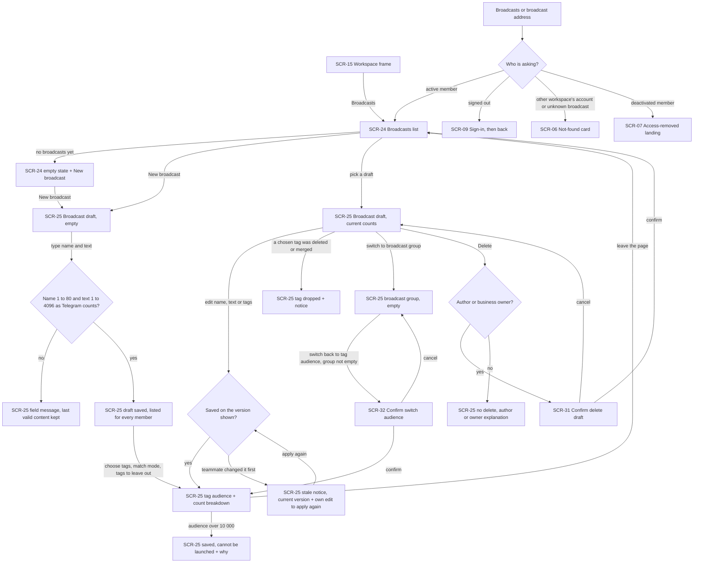
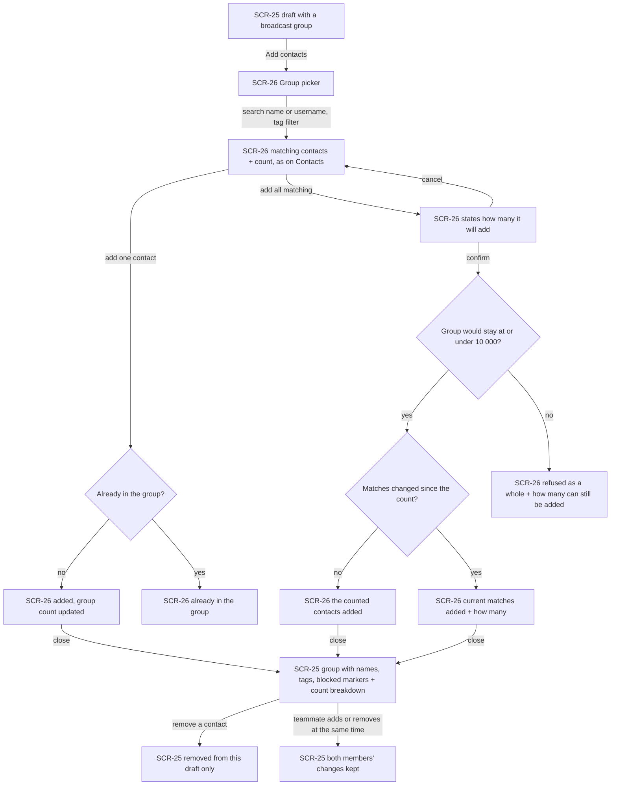
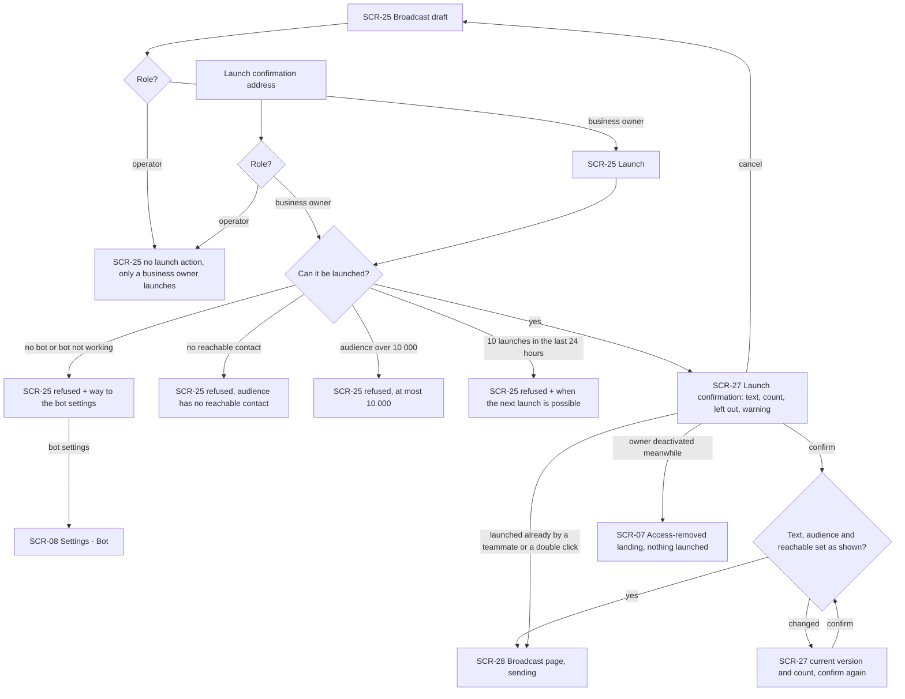
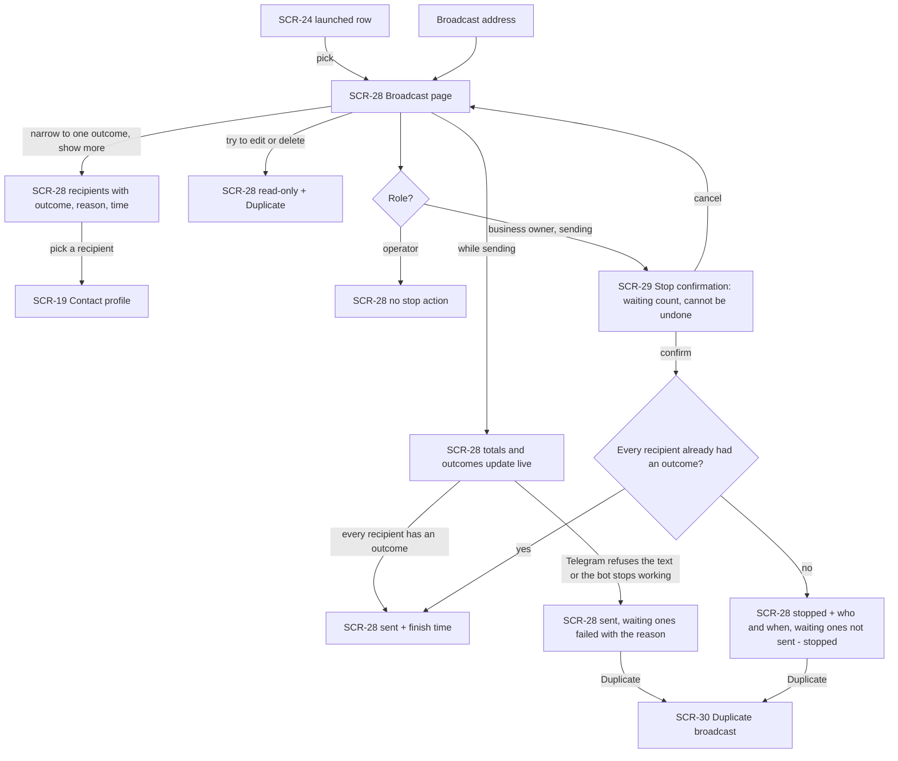
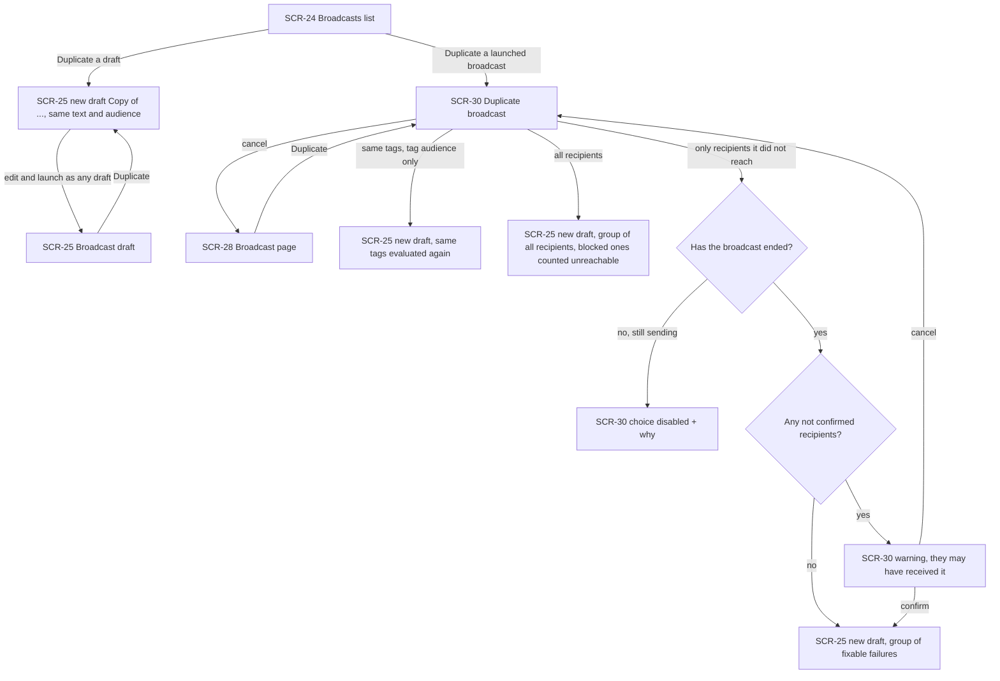
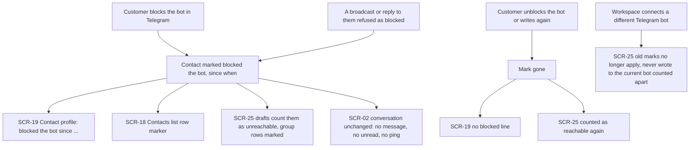
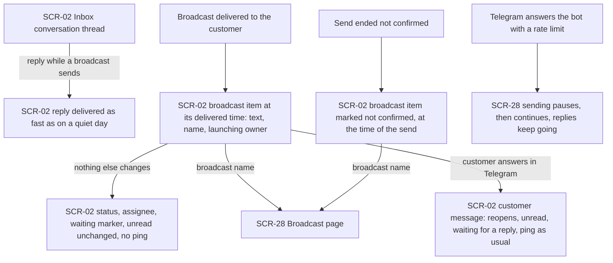

# UX flows — broadcasts

> User flows for every UI-touching §4 user story, produced by `ux-flows` (after `clarify`, before
> `design`) and read by `design` (evidence for the target-surface + UI-architecture decisions),
> `sequences` (UI-driven flows align on SCR ids), `screens` (details every inventory row) and
> `plan-tests` (the e2e-through-UI paths). **Always markdown + mermaid `flowchart`**, whatever the
> design tool — this artifact is flow-altitude, not visual design.

## Platform decisions

- **Posture:** desktop-first, per `docs/design-system.md` §Platform posture. Every flow must also work at phone width (≥360px). At phone width the Broadcasts list and the report's recipients stack their rows, and the group picker and the dialogs open full-width over the page they came from.
- **Builds on the shipped panel lineage:** SCR-02, SCR-06, SCR-07, SCR-08, SCR-09, SCR-15, SCR-18 and SCR-19 keep their ids and meanings from earlier features. New ids start at SCR-24, after the SCR-01…SCR-23 used so far. The other earlier screens are unchanged and not visited here.
- **Broadcasts is a page of its own:** a new Broadcasts item in the workspace navigation (SCR-15), next to Inbox and Contacts, shown to every member. Owners and operators see the same list and the same broadcast pages. What differs by role is only which actions a page offers (launch, stop, delete someone else's draft).
- **One address per broadcast, two views:** a broadcast has one address. While it is a draft, that address shows the draft editor (SCR-25). Once it is launched, the same address shows the read-only broadcast page with its delivery report (SCR-28). A saved link to a draft that a teammate launched in the meantime therefore opens the report.
- **Editing saves as you go:** a draft has no separate "save" step. Name, text and audience changes are saved as the member makes them, each against the version they were shown (AC-03). A change refused as stale keeps the member's own edit on screen next to the teammate's current version, so they can apply it again. Group additions and removals are saved one by one and never conflict.
- **The group is filled without leaving the draft:** "Add contacts" opens the group picker (SCR-26) over the editor. It has the Contacts list's search and tag filter, with the same matching and counts, so the member never goes to the Contacts page and back. "Add all matching" is a second step inside the picker that states how many contacts it will add.
- **Launch, stop, duplicate and delete are dialogs** over the page they start from (SCR-27, SCR-29, SCR-30, SCR-31). The launch confirmation also has its own address under the draft, because AC-07 treats a saved link to it as a way in. That address opens the dialog only for a business owner. An operator lands on the draft with the owners-only note.
- **Live, not refreshed:** the Broadcasts list's statuses, a launched broadcast's status, totals and recipient outcomes, and a broadcast item in an open conversation update without reloading. A draft's counts are computed again when it is opened and after each change to it, and they are not pushed live. How the updates arrive is a `design` decision (the existing change signal is the obvious candidate).
- **Out of scope as a separate drawing:** US-08 (End customer) has no panel screen. The customer reads the broadcast in their own Telegram chat with the business bot, which tg-inbox does not draw. Its AC-17 is covered by the sending rules and by integration tests against the fake Telegram.
- **Design input, not decided here:**
  - The launch confirmation must send back what it showed (the draft version and the exact set of contacts it would reach) so that the server can refuse a launch whose set changed, as the inbox's close snapshot does (AC-06).
  - The stop confirmation states how many recipients are still waiting. Like the delete-tag count, that number can be stale by the time the owner confirms, but a stop needs no second confirmation. A stop that arrives after the last outcome is a no-op and the page shows "sent" (AC-18).
  - Live updates of a report with up to 10 000 recipients need totals to be pushed, not the whole list. The recipients list is paged and refreshed on a change signal.
  - The blocked mark comes from Telegram updates about the bot's chat with a customer. That is a new kind of update for the `bots` interceptor path, and it must never become a customer message (AC-14).
  - The broadcast item is a new kind of item in the inbox thread, next to messages, replies and activity entries, and it never touches read state or the conversation's state (AC-16).

### Assumptions (autonomous run 2026-10-23)

- Depth = medium (from `.claude/sdd.local.md`), posture = desktop-first per the design canon (no deviation). The pipeline confirmed each flow itself; the prose after each flow is that confirmation and can be vetoed at review.
- "New broadcast" opens an empty editor. The draft is created on the first save with a valid name (1–80 characters). Leaving an editor that never had a valid name creates nothing.
- The Broadcasts list is not paged: drafts and launched broadcasts are listed together, the most recently changed first. Its empty state explains what a broadcast is and offers "New broadcast" to every member.
- Each draft shows its count breakdown (audience, blocked the bot, never wrote to the current bot, would reach) in the editor. The list shows only the audience size, as clarify decided.
- A draft can be duplicated at once, with no dialog: the copy has the same text and the same audience. A launched broadcast always opens the duplicate dialog (SCR-30), because there is a choice of audience to make.
- In SCR-30, "only recipients it did not reach" is shown but disabled with its reason while the broadcast is still sending. When the choice includes "not confirmed" recipients, the dialog says how many and that they may already have received the message. Confirming includes them.
- The report's recipients are listed 50 at a time with "show more", and they can be narrowed to one outcome (for example only failed). Picking a recipient opens their contact profile (SCR-19).
- A broadcast item in a conversation (SCR-02) links to its broadcast page (SCR-28), so a member who sees what the customer is answering can open the whole broadcast.
- Launch refusals that can be known before the confirmation opens (no bot or a bot not working, no reachable contact, an audience over 10 000, the 24-hour cap) are shown on the draft when "Launch" is chosen, and the confirmation does not open. The same checks run again at confirm time, and a refusal there is shown in the confirmation.
- A deactivated member's or signed-out person's way out (SCR-07, SCR-09) is the existing panel behaviour. Broadcasts adds no new screen for it.

## Screen inventory

| ID | Screen | Purpose | Entry | Exit |
|---|---|---|---|---|
| SCR-02 | Inbox — conversation thread | (reused, shared-inbox SCR-02) One conversation. It now shows a broadcast item (text, broadcast name, launching owner, delivered time or "not confirmed") among messages, replies and activity entries | a conversation in the inbox list; a conversation address | SCR-28 (the broadcast item's name); SCR-19 (contact name) |
| SCR-06 | Not found (in frame) | (reused) Not-found card for a broadcast address the account may not see or that does not exist; no hint that it exists | an unknown, deleted or foreign broadcast address | SCR-24 of the account's own workspace |
| SCR-07 | Access-removed landing | (reused) Workspace picker / no-access screen with the access-removed notice | any broadcasts visit or action after the member was deactivated, including on the launch confirmation | another workspace; sign out |
| SCR-08 | Settings — Bot | (reused) Owner-only bot settings | the way to the bot settings on a launch refused for no bot or a bot not working | SCR-25 (back) |
| SCR-09 | Sign-in | (reused) Sign-in. A signed-out visit to a Broadcasts or broadcast address lands here and returns afterwards | a broadcasts address while signed out | the requested SCR-24 / SCR-25 / SCR-28 |
| SCR-15 | Workspace frame | (reused) Side navigation and breadcrumb around every workspace page. Gains a Broadcasts item for every member | entering any workspace page | SCR-24 via the navigation |
| SCR-18 | Contacts list | (reused, contacts SCR-18) The workspace's contacts. A row of a contact who blocked the bot now carries a "blocked the bot" marker | Contacts in the navigation | SCR-19 |
| SCR-19 | Contact profile | (reused, contacts SCR-19) The contact's facts, now including "blocked the bot since …" while the mark holds | a row of SCR-18; a recipient on SCR-28 | SCR-18; SCR-02 |
| SCR-24 | Broadcasts list | New: every broadcast of the workspace, drafts and launched together, the most recently changed first, each with name, status (draft, sending, sent, stopped), audience size and who last changed or launched it. Statuses update live. Empty state explains broadcasts and offers "New broadcast" | Broadcasts in the navigation; a Broadcasts address; back from SCR-25 / SCR-28; after a delete | SCR-25 (a draft or "New broadcast"); SCR-28 (a launched broadcast); SCR-25 of a copy (duplicate a draft); SCR-30 (duplicate a launched one); SCR-31 (delete a draft) |
| SCR-25 | Broadcast draft | New: the draft editor. Name (1–80), plain text with the remaining length as Telegram counts it, and one audience: a tag audience (chosen tags, match mode, tags to leave out) or a broadcast group (its contacts with name, username, tags and a blocked marker, each removable). Always shows the count breakdown: audience, left out because they blocked the bot, left out because they never wrote to the current bot, would reach. Shows notices in place: a stale save, a tag dropped because it was deleted or merged, an audience over 10 000. Actions: Launch (business owner) or the owners-only note (operator), Duplicate, Delete (author or business owner) | "New broadcast" or a draft row on SCR-24; a draft address; a duplicate just made | SCR-26 (add contacts); SCR-27 (launch); SCR-31 (delete); SCR-32 (switch audience kind); SCR-08 (launch refused for the bot); SCR-24 (back) |
| SCR-26 | Group picker | New, opens over SCR-25: the Contacts search and tag filter with the same matching and counts, each matching contact with "add" (contacts already in the group are marked), and "add all matching" with a second step that states how many it will add. Refusals in place: a contact already in the group, a bulk add over 10 000 with how many can still be added | "Add contacts" on a group audience in SCR-25 | SCR-25 (closed), with the group and its counts updated |
| SCR-27 | Launch confirmation | New, dialog over SCR-25 for a business owner, with its own address: the text exactly as the customer will see it, the number it will be sent to, how many are left out and why, and the warning that customers who did not expect it can block or report the bot, which can limit the bot for support too. Shows a changed version for a second confirmation, and refusals at confirm time | "Launch" on SCR-25 (business owner); a launch-confirmation address | SCR-28 (launched); SCR-25 (cancel, or an operator's visit to its address) |
| SCR-28 | Broadcast page | New, read-only: name, text, the audience as it was defined, who launched it and when, the status (sending, sent, stopped, with finish or stop time and who stopped it), the delivery report totals (waiting, delivered, blocked the bot, failed, not sent — stopped) and the recipients with outcome, reason and time, 50 at a time, narrowable to one outcome. Totals and outcomes update live. Says it is read-only and offers Duplicate; a business owner also gets Stop while it sends | a launched row on SCR-24; a broadcast address; after a launch; the broadcast item on SCR-02 | SCR-29 (stop); SCR-30 (duplicate); SCR-19 (a recipient); SCR-24 (back) |
| SCR-29 | Stop confirmation | New, dialog over SCR-28 for a business owner: how many recipients are still waiting and that a stop cannot be undone | "Stop" on a sending SCR-28 | SCR-28 (stopped, already sent, or cancelled) |
| SCR-30 | Duplicate broadcast | New, dialog for a launched broadcast: the audience of the copy — the same tags (tag audience only), all recipients, or only recipients it did not reach (enabled once the broadcast has ended, with the warning about "not confirmed" recipients when there are any) | "Duplicate" on SCR-28 or on a launched row of SCR-24 | SCR-25 of the new draft; back where it came from (cancel) |
| SCR-31 | Confirm delete draft | New, dialog: names the draft and its audience size and that the delete cannot be undone. Offered only to the draft's author and business owners | "Delete" on SCR-25 or on a draft row of SCR-24 | SCR-24 (deleted); back where it came from (cancel) |
| SCR-32 | Confirm switch audience | New, dialog over SCR-25: switching from a broadcast group that holds contacts to a tag audience drops the group, and the dialog says how many contacts it holds | choosing the tag audience on a draft whose group is not empty | SCR-25 (switched or cancelled) |

## Flows

### Flow: US-01 — Draft a broadcast for a tag audience

Broadcasts in the navigation opens the list of the workspace's broadcasts, drafts and launched ones together, the most recently changed first. Each row has its name, status, audience size and who last changed or launched it. An empty list explains what a broadcast is and offers "New broadcast". "New broadcast" opens an empty draft. The draft is saved as soon as it has a valid name, and every later change is saved as it is made. A name outside 1–80 characters, an empty text, or a text longer than 4096 characters as Telegram counts them gets a message next to the field, and the draft keeps its last valid content. The remaining length is shown while typing. Choosing a tag audience means picking tags with "any of", "all of" or "no tags" (no tag chosen means every contact) and, optionally, tags to leave out. The draft then shows how many contacts match, how many of them blocked the bot, how many never wrote to the current bot, and how many it would reach. A tag renamed since keeps working under its new name. A tag deleted or merged away is dropped from the audience with a notice. An audience over 10 000 contacts is saved but says it cannot be launched. When a teammate saved a change first, the member's change is not saved: they see the teammate's current version next to their own edit and can apply it again. Switching from a group that holds contacts to a tag audience asks first and says how many contacts the group holds. The draft's author or a business owner can delete it after a confirmation naming its audience size. Anyone else sees why they cannot. Drafts work whether or not the bot is connected or working. Nothing is sent to any customer while drafting. A Broadcasts address reached while signed out goes through sign-in and back. From another workspace's account, or for a broadcast that does not exist, it is a not-found card. For a deactivated member it is the access-removed landing (AC-01, AC-02, AC-03, AC-05, AC-07, AC-08, AC-10).

### Flow: US-02 — Hand-pick a broadcast group

On a draft whose audience is a broadcast group, "Add contacts" opens the group picker over the draft. It has the same search and tag filter as the Contacts list, with the same matching and the same counts. Contacts already in the group are marked. Adding one contact puts it in the group at once. Adding a contact who is already there changes nothing and says so. "Add all matching" first says how many contacts it will add (the matching ones not yet in the group), and adds them on confirmation. If the matches changed after the count was shown, it adds the current ones and says how many. A bulk add that would take the group over 10 000 contacts, reachable or not, is refused as a whole and says how many can still be added. Contacts who match the filter later are not added. Closing the picker returns to the draft. The draft shows the group's contacts with name, username and tags, marks the ones who blocked the bot, and shows the group's size and how many it would reach. Removing a contact takes it out of this draft only and changes nothing on the contact. Two members adding and removing at the same time each keep their changes, and those changes never make a teammate's name or text save count as stale. The group exists only inside this draft (AC-03, AC-04, AC-05, AC-08).

### Flow: US-03 — Launch a broadcast

The draft offers Launch only to a business owner. An operator sees no launch action and a note that only a business owner launches broadcasts. A saved link to the launch confirmation brings an operator to the draft with the same note, and nothing changes. When an owner chooses Launch, the draft first checks whether it can be launched. A workspace with no bot, or with a bot that is not working, gets a refusal and the way to the bot settings. A draft that would reach nobody, an audience over 10 000 contacts, or a workspace that already launched 10 broadcasts in the last 24 hours gets a refusal that says why, and for the cap, when the next launch is possible. The draft stays a draft. Otherwise the confirmation opens. It shows the text exactly as the customer will see it, how many contacts it will be sent to, how many are left out because they blocked the bot or never wrote to the current bot, and the warning that customers who did not expect it can block or report the bot, which can limit the bot for support too. Confirming launches the broadcast to exactly the contacts counted there, and the owner lands on the broadcast page, now "sending", which every member sees on the list. If the text, the audience or the set of contacts it would reach changed since the confirmation opened, nothing is launched and the confirmation shows the current version and number to confirm again. The same checks run again at confirm time. A double click, or two owners confirming the same draft, launches it once. An owner deactivated while the confirmation is open launches nothing and reaches the access-removed landing (AC-05, AC-06, AC-07, AC-08, AC-09, AC-10).

### Flow: US-04 — Follow the delivery report

A launched broadcast opens from its row on the list or from its address. Its page shows the name, the text, the audience as it was defined, who launched it and when, and the delivery report: totals of waiting, delivered, blocked the bot and failed, and each recipient with outcome, reason and time. Totals and outcomes change live while it sends. Recipients come 50 at a time, can be narrowed to one outcome, and open their contact profile when picked. Reasons read plainly, such as "account no longer exists" or "not confirmed — Telegram did not answer, not sent again". When every recipient has an outcome the broadcast shows "sent" with its finish time. If Telegram refuses the text, or the bot stops working, is disconnected or is replaced, sending ends at once: the recipients still waiting are marked failed with that reason, the broadcast shows "sent", and nothing of it is sent later. A restart while sending is invisible here, apart from any "not confirmed" outcome. The page is read-only and says so: there is nothing to edit or delete, and it offers Duplicate. A business owner sees Stop while it sends. The stop confirmation says how many recipients are still waiting and that a stop cannot be undone. Confirming marks those still waiting "not sent — stopped" and the broadcast "stopped", with who stopped it and when, keeping every outcome recorded before. A stop that arrives after the last outcome changes nothing, and the page shows "sent". An operator sees no stop action (AC-08, AC-09, AC-11, AC-12, AC-18).

### Flow: US-05 — Reuse an audience

Any member can duplicate any broadcast. A draft is copied at once, from its row or from the editor, into a new draft named "Copy of …" (shortened to fit 80 characters) with the same text and the same audience. The member who duplicates it is the new draft's author, and the original does not change. Duplicating a launched broadcast, from its page or its row, asks what the copy's audience should be. A tag audience can be copied as the same tags, which are evaluated again at the copy's launch. "All recipients" makes a broadcast group of every recipient, and those who blocked the bot stay in it, counted as unreachable. "Only recipients it did not reach" is available once the broadcast has ended. It makes a group of the recipients who failed for a reason a new attempt can fix (the bot stopped working, Telegram refused the text, a Telegram error, stopped before their turn). When some recipients are "not confirmed", the dialog warns that they may have received it and how many there are before including them. Delivered recipients, those who blocked the bot and those whose account no longer exists are never copied. Every copy opens as a draft and is edited and launched like any other (AC-08, AC-13, AC-18).

### Flow: US-06 — Know who blocked the bot

When a customer blocks the business bot in Telegram, or a broadcast or a reply to them is refused because they blocked it, the contact is marked as having blocked the bot. Their profile says so and since when, their row on the Contacts list carries a marker, and every draft that includes them counts them as unreachable (a group's row is marked too). A launch leaves them out. A block never creates a customer message, never opens the conversation, never changes an unread count and triggers no ping. When the customer unblocks the bot or writes to it again, the mark is gone and drafts count them as reachable again. The recipient list of a broadcast already launched never changes, and a waiting recipient's mark at their turn decides whether they are sent it (shown in their outcome on SCR-28). Marks belong to the current bot: reconnecting the same Telegram bot keeps them, while connecting a different Telegram bot leaves the old marks behind, and contacts who never wrote to the new bot are counted apart in drafts. A member's own Telegram account linked for pings is never a contact, so it never appears here (AC-10, AC-14).

### Flow: US-07 — Keep answering while a broadcast sends

While a broadcast sends, members answer customers as on any other day: a reply goes out without waiting for the broadcast, and a rate-limit answer from Telegram pauses only the broadcasts, which then continue where they stopped, without skipping or doubling anyone. In the conversation of each recipient who got it, the broadcast shows as a broadcast item at the time it was delivered, with its text, its name and the business owner who launched it (still named if that owner was deactivated since). It is shown apart from the team's replies. A recipient whose send ended "not confirmed" gets the item too, marked "not confirmed" and placed at the time of the send. A recipient who failed for any other reason, was stopped before their turn, or was left out gets no item. The item changes nothing: the conversation keeps its status, assignee and "waiting for a reply" marker, no unread or attention count moves, and no ping goes out. The broadcast name in the item opens the broadcast page. When the customer answers, the answer is an ordinary customer message: it reopens the conversation and counts for unread, "waiting for a reply" and pings like any message (AC-15, AC-16).

## AC coverage

| AC | Shown by | Notes |
|---|---|---|
| AC-01 | Flow US-01 → `L` → `D` → `NV` → `SV` → `TA`, `D2`, `TD0` | count breakdown = the confirmation's (prose); renamed tag keeps working (prose); nothing sent |
| AC-02 | Flow US-01 → `NV` → `NE` | remaining length shown as Telegram counts it (prose); trimming at the ends is a save rule, no branch |
| AC-03 | Flow US-01 → `ST` → `CF`; Flow US-02 → `D4` | group changes never make a name or text save stale (prose) |
| AC-04 | Flow US-02 → `P` → `M` → `A1` / `CNT` → `OK2` / `OK3`, `D2`, `D3` | same matching and counts as the Contacts list; the group belongs to its draft only |
| AC-05 | Flow US-02 → `DUP`, `LIM` → `REF`; Flow US-01 → `BIG`; Flow US-03 → `OV` | a group holds only its own workspace's contacts (no UI path; integration test) |
| AC-06 | Flow US-03 → `C` → `CH` → `S` / `C2`, `C` → `S` (double launch) | the confirmation's warning text (prose); exactly-once launch is an integration test |
| AC-07 | Flow US-03 → `R` / `R2` → `OP`; Flow US-01 → `DA` → `DR` | the operator still edits, duplicates and deletes their own drafts (Flows US-01, US-05) |
| AC-08 | Flow US-01 → `AU` → `SI` / `NF` / `AR`; Flow US-03 → `C` → `AR` | cross-workspace contact or broadcast ids have no UI path; refused server-side (integration test) |
| AC-09 | Flow US-04 → `RO`; Flow US-03 → `NR`, `CAP` | frozen recipient list after retagging or new contacts is server-side (integration test); drafts still editable at the cap (prose) |
| AC-10 | Flow US-03 → `PRE` → `NB` → `BOT`; Flow US-06 → `NB` → `RS` | drafts work without a working bot (Flow US-01 prose); same Telegram bot reconnected keeps marks (prose) |
| AC-11 | Flow US-04 → `P` → `LIVE` → `SENT`, `RL` | blocked at their turn / unblocked before it (prose); restart resumes and "not confirmed" (prose; integration test) |
| AC-12 | Flow US-04 → `LIVE` → `EARLY` → `DUPL` | nothing sent later by a working or new bot (server-side; integration test) |
| AC-13 | Flow US-05 → `NEW`, `DD` → `NEW2` / `NEW3` / `ENDED` → `NC` → `W` / `NEW4` | author of the copy is the duplicating member; original unchanged (prose) |
| AC-14 | Flow US-06 → `MK` → `PR` / `CL` / `DR` / `CO`, `UM` | a member's linked Telegram account is never a contact (prose; integration test) |
| AC-15 | Flow US-07 → `RP`, `RL` → `PA` | pace, turn-taking of two broadcasts and cross-workspace isolation have no UI branch (integration tests, §6) |
| AC-16 | Flow US-07 → `IT`, `IT2`, `SAME`, `ANS` | no item for other failures or left-out contacts (prose); launching owner still named after deactivation (prose) |
| AC-17 | N/A: the end customer reads the broadcast in their own Telegram chat, which tg-inbox does not draw (US-08 out of scope as a drawing) | covered by sending rules and fake-Telegram integration tests |
| AC-18 | Flow US-04 → `R` → `NS` / `ST` → `FIN` → `STP` / `SENT`; Flow US-05 → `ENDED` (stopped recipients copied) | a send in flight at the stop finishes and is recorded (prose; integration test) |
