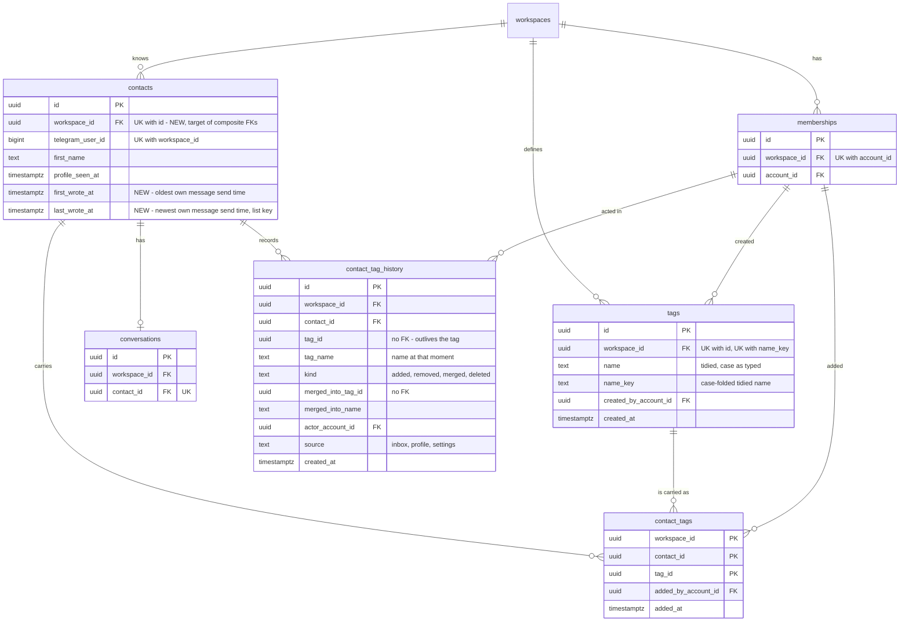

# Data model — contacts

This is a brownfield delta inside the `contacts` module ([ADR-0001](adr/0001-own-tags-in-the-contacts-module-with-its-own-routes-and-compose-the-profile-conversation-from-inbox-reads.md)). No other module's tables change.

- **Three new tenant-owned tables in `contacts`:**
  - `tags`: the workspace's tags, identified by a stable id and unique by a normalised name key ([ADR-0002](adr/0002-identify-tags-by-a-stable-id-and-keep-them-unique-by-a-normalised-name-key-computed-in-the-domain.md));
  - `contact_tags`: the tags a contact carries now, with who added each and when. Both references are composite FKs that carry the workspace, so a cross-workspace link cannot be stored ([ADR-0004](adr/0004-serialise-tag-writes-under-a-per-workspace-tag-lock-and-recheck-a-delete-against-the-confirmed-count.md));
  - `contact_tag_history`: the append-only record of every change of a contact's tags, with the tag's name at that moment ([ADR-0003](adr/0003-record-every-contact-tag-change-as-an-append-only-history-entry-with-the-tag-name-at-that-moment.md)).
- **Two columns on `contacts`:** `first_wrote_at` and `last_wrote_at` ([ADR-0005](adr/0005-keep-first-and-last-customer-send-times-on-the-contact-written-by-capture.md)). They ship as expand → backfill, plus the list's keyset index. They stay nullable (a contact whose messages are all gone has neither), so there is no contract step.
- **One unique index on `contacts`:** `(workspace_id, id)`, the target of the new composite FKs.

`conversations`, `inbox`, `workspaces`, `bots` and `notifications` get no schema change. The profile's conversation part reads the existing thread and summary ([ADR-0006](adr/0006-read-the-profile-conversation-through-the-existing-inbox-reads-that-never-mark-read.md)); `conversations.findByContact` is served by the existing `conversations_contact_id_key`. The live signals `contact.changed` and `tags.changed` ([ADR-0007](adr/0007-signal-tag-changes-as-contact-changed-per-contact-and-tags-changed-per-workspace.md)) are `pg_notify` payloads and need no table.

**Conventions applied.** These are the same as the bot-connection, assignment-statuses and operator-notifications precedents ([operator-notifications data-model](../operator-notifications/data-model.md)), repo [ADR-0004](../../adr/0004-use-postgres-with-kysely-reversible-migrations-and-workspace-scoped-tenancy.md), `CLAUDE.md` and SAD §2/§8:

- **Naming:** tables are `snake_case` and plural. Constraints and indexes are named `<table>_<cols>_{pkey,key,fkey,check,idx}`. A composite FK to `memberships` is named `<table>_<role>_membership_fkey`; a composite FK to `contacts` / `tags` is `<table>_contact_fkey` / `<table>_tag_fkey`.
- **PK:** `id uuid`, a UUIDv7 from `newId()`, never a DB default. `contact_tags` is a pure link and is keyed by `(workspace_id, contact_id, tag_id)`.
- **Values:** the application supplies every value and timestamp. There is no `DEFAULT` and no generic `updated_at`.
- **Kinds and sources:** `text` + `CHECK (… IN (…))`, no `ENUM`. `CHECK`s tie column combinations together.
- **Triggers:** none. The domain constants (32 graphemes, 100 tags per workspace, 20 per contact, 60 changes per 60 s) are enforced in `contacts/domain` under the SAD §8 locks, not by constraints.
- **Tenancy:** every new table has a non-null `workspace_id → workspaces(id)`. Every cross-entity reference is a **composite** FK that includes `workspace_id`, so the database refuses a link between a contact and a tag, or an entry and a contact, of different workspaces (spec §6 tenant isolation, AC-12). No new controlled tenancy exception.
- **Cross-module FKs** to `memberships (workspace_id, account_id)` are constraints only, as in assignment-statuses and operator-notifications. `contacts` resolves display names through the `workspaces` app layer, never by reading `memberships`.
- **Indexes:** every FK leads an index. Every other index serves a query named in SAD §6.
- **Delete strategy:** `contact_tags` rows are hard-deleted by a member's removal and by an owner's merge or delete, always together with a history entry. Tags are hard-deleted by an owner's merge or delete. History entries are never updated or deleted. No `ON DELETE CASCADE` anywhere: the owner's delete removes the links itself with `RETURNING` to compare the confirmed count (ADR-0004), and contact deletion is out of scope (spec OQ-2).

## Assumptions (autonomous run 2026-10-19)

Each can be vetoed at review.

1. **Aggregate roots.**
   - `contacts` is the root of `contact_tags` and `contact_tag_history`: both are written under the contact row lock (member paths) or set-based by an owner path, always in one transaction.
   - `tags` is its own root. Its rows are locked `FOR KEY SHARE` by a member add and `FOR UPDATE` by owner paths (SAD §8).
2. **`contact_tags` PK is `(workspace_id, contact_id, tag_id)`**, not the SAD's indicative `(contact_id, tag_id)`. Leading with `workspace_id` makes the PK the FK index of the contact composite FK and serves every per-contact read with the workspace as an index condition. Uniqueness is the same, because a contact id fixes its workspace.
3. **`contacts (workspace_id, id)` is a unique index, not a constraint.** A foreign key may reference a unique index. `CREATE UNIQUE INDEX IF NOT EXISTS` keeps 03 re-runnable after FKs depend on it, where `DROP CONSTRAINT IF EXISTS` / `ADD CONSTRAINT` would fail.
4. **No DB check ties `name_key` to `name`.** The key is folded in the shared package (`toUpperCase().toLowerCase()`), and Postgres `lower` / `upper` fold some letters differently (ß). The DB only enforces that both are non-empty and that `name` has no surrounding space.
5. **No DB check on the 32-grapheme limit.** The database counts code points, not graphemes. A generous byte bound would add nothing the domain does not already enforce.
6. **`tags.created_by_account_id` is kept** as the SAD lists it (audit of who invented a tag), with its FK index. Nothing reads it in v1.
7. **First and last wrote stay nullable for good.** The backfill fills every contact that has a message. A contact with none keeps NULL and sorts last (`NULLS LAST`). Capture always writes both on insert, so new contacts are never NULL.
8. **The backfill is gap-safe.** It takes `LEAST` / `GREATEST` with the stored value, so running it after the capture code is deployed never narrows a range that capture widened in the gap.
9. **The rate-limit index has `kind` in its key**, `(workspace_id, actor_account_id, kind, created_at)`. An owner who has just merged a tag on 10 000 contacts has 10 000 `merged` entries inside the 60 s window. With `kind` in the key, the member-kind count skips them instead of filtering them row by row (verified, audit report).
10. **All-of uses a grouped semi-join.** The `all of` predicate is written as `c.id IN (SELECT contact_id FROM contact_tags WHERE workspace_id = $w AND tag_id = ANY($ids) GROUP BY contact_id HAVING count(*) = cardinality($ids))`. A correlated count per contact took 466 ms at 10 000 contacts, and the grouped form took 4 ms (audit report). `tasks` should carry this into the list query.

## ER diagram

The `memberships` edges are the composite FKs `(workspace_id, <role>_account_id) → memberships (workspace_id, account_id)`. The `contacts` and `tags` edges from `contact_tags` and `contact_tag_history` are the composite FKs `(workspace_id, contact_id) → contacts (workspace_id, id)` and `(workspace_id, tag_id) → tags (workspace_id, id)`. The `workspaces ||--o{ …` edges of `contact_tags` and `contact_tag_history` are left out for readability. `contact_tag_history.tag_id` and `merged_into_tag_id` are deliberately not FKs. `conversations` is shown only because the profile finds its conversation through `conversations_contact_id_key` and the backfill reads it (with `messages`); this feature changes neither.

## Entities

### Aggregate `contact` (module `contacts`, tenant-owned)

#### `contacts` (changed)

| Column | Type | Constraints | Notes |
|---|---|---|---|
| `first_wrote_at` | timestamptz | NULL; NULL ⇔ `last_wrote_at` NULL; `<= last_wrote_at` | The Telegram send time of the contact's oldest own message (AC-01, AC-04). Set on insert and kept with `LEAST` by capture's `upsertFromProfile(…, sentAt, tx)` (flow 14). Edits and replies never touch it. Backfilled (02) |
| `last_wrote_at` | timestamptz | NULL, as above | The newest own message's send time: the list's sort key, newest first (AC-01). Kept with `GREATEST`. A redelivered duplicate has the same send time and changes nothing |

Existing columns are unchanged. New unique index `contacts_workspace_id_id_key (workspace_id, id)`.

**Access patterns:**
- Contacts list first page and next page after a `(last_wrote_at, id)` cursor, with or without search and tag filter, and the matching and total counts (flows 4, 5) → `contacts_workspace_id_last_wrote_at_id_idx`. The cursor predicate is `(last_wrote_at < $t OR (last_wrote_at = $t AND id < $id) OR last_wrote_at IS NULL)` for a cursor in the dated part, and `(last_wrote_at IS NULL AND id < $id)` in the NULL tail.
- Profile read by `(workspace, id)` (flow 6); the member add / remove "lock the contact row of K in W" `FOR NO KEY UPDATE` (flows 8, 10) → `contacts_workspace_id_id_key`.
- Capture upsert by `(workspace_id, telegram_user_id)` (flow 14) → the existing `contacts_workspace_id_telegram_user_id_key`.
- The search over name and username stays a scan of one workspace's range (SAD §7, no name index; `pg_trgm` is the scaling step).

#### `contact_tags` (new)

| Column | Type | Constraints | Notes |
|---|---|---|---|
| `workspace_id` | uuid | NOT NULL, FK → `workspaces(id)`; PK part | Tenancy. Part of both composite FKs, so contact and tag are of the same workspace (AC-12) |
| `contact_id` | uuid | NOT NULL, FK `(workspace_id, contact_id) → contacts (workspace_id, id)`; PK part | |
| `tag_id` | uuid | NOT NULL, FK `(workspace_id, tag_id) → tags (workspace_id, id)`; PK part | A tag deleted or merged away under a member's add: the explicit `FOR KEY SHARE` finds no row and the add is refused as `TAG_NOT_FOUND` (AC-14). The FK refuses to delete a tag that still has links |
| `added_by_account_id` | uuid | NOT NULL, FK `(workspace_id, added_by_account_id) → memberships` | Who added it (AC-04, AC-06). A deactivated member stays a membership row and is still shown (AC-13). A merge keeps the original adder, or the earlier one on a contact that carried both (AC-09) |
| `added_at` | timestamptz | NOT NULL | When it was added. Kept across a merge, as above |

**PK:** `(workspace_id, contact_id, tag_id)`: one link per contact and tag (already carried = no-op, AC-06; a merge leaves one link, AC-09).

**Aggregate root:** `contacts`.

**Access patterns:**
- The profile's tags of a contact, the "already carried, how many" check under the contact lock, the list's tags of a page of contacts, and the `any` / `none` existence checks per contact (flows 4, 5, 6, 8, 10) → `contact_tags_pkey`.
- The count per tag (flow 12, AC-10), the `any of` / `all of` contacts of chosen tags with the matching count (flow 5, AC-02), and the owner's set-based merge re-point and delete with `RETURNING` (flow 13, seeded flow 2) → `contact_tags_workspace_id_tag_id_contact_id_idx`.

#### `contact_tag_history` (new)

| Column | Type | Constraints | Notes |
|---|---|---|---|
| `id` | uuid | PK | UUIDv7. The tiebreak of the profile's keyset |
| `workspace_id` | uuid | NOT NULL, FK → `workspaces(id)` | |
| `contact_id` | uuid | NOT NULL, FK `(workspace_id, contact_id) → contacts (workspace_id, id)` | |
| `tag_id` | uuid | NOT NULL, **no FK** | The tag the entry is about. Kept after the tag is deleted or merged away (AC-04). The §7 integrity query matches links to entries on it |
| `tag_name` | text | NOT NULL, `<> ''` | The tag's name at that moment, so entries read correctly after renames (AC-04) |
| `kind` | text | NOT NULL, `CHECK IN ('added','removed','merged','deleted')` | `added` / `removed` by a member, `merged` by an owner's merge (one per contact that carried the merged tag), `deleted` by an owner's delete (one per contact that lost it). A rename writes none (AC-09) |
| `merged_into_tag_id` | uuid | NULL, **no FK**; non-null ⇔ `kind = 'merged'` | The merge target. Matched by the §7 integrity query for re-pointed links |
| `merged_into_name` | text | NULL, `<> ''`; non-null ⇔ `merged_into_tag_id` non-null | "«Loyal» merged into «VIP»" |
| `actor_account_id` | uuid | NOT NULL, FK `(workspace_id, actor_account_id) → memberships` | The member, or the owner for owner kinds. Resolved to a display name at read time, deactivated members included (AC-13) |
| `source` | text | NOT NULL, `CHECK IN ('inbox','profile','settings')`; `inbox` / `profile` ⇔ member kinds, `settings` ⇔ owner kinds | Member routes accept only `inbox` / `profile` (SAD §4). Feeds the "tags added from the inbox" KPI only |
| `created_at` | timestamptz | NOT NULL | Server clock |

**Aggregate root:** `contacts`. Append-only: never updated or deleted by the application.

**Access patterns:**
- The profile's tag history of a contact, newest first, keyset by `(created_at, id)` (flow 6) → `contact_tag_history_workspace_id_contact_id_created_at_idx`. Also the §7 integrity query "a link with no `added` or `merged` entry for its tag".
- The member rate limit: this member's `added` / `removed` entries of the last 60 s and the oldest of them for the retry time, under the `tag-changes:<ws>:<account>` advisory lock (flows 8, 9, 10, AC-15) → `contact_tag_history_workspace_id_actor_kind_created_at_idx`.
- The §7 KPI "share of `added` entries with source `inbox`" is a run-book scan; no index.

### Aggregate `tag` (module `contacts`, tenant-owned)

#### `tags` (new)

| Column | Type | Constraints | Notes |
|---|---|---|---|
| `id` | uuid | PK; UNIQUE `(workspace_id, id)` | UUIDv7. The tag's identity: filters in addresses, contact tags and history refer to it, so a rename moves nothing (ADR-0002) |
| `workspace_id` | uuid | NOT NULL, FK → `workspaces(id)` | |
| `name` | text | NOT NULL, `<> ''`, `= btrim(name)` | The tidied name, case as typed, shown everywhere and sorted in ICU dictionary order (`COLLATE "und-x-icu"`). 1–32 graphemes, enforced in the domain (AC-07) |
| `name_key` | text | NOT NULL, `<> ''`; UNIQUE `(workspace_id, name_key)` | The tidied name without the joiners U+200C / U+200D, case-folded. "vip", " VIP " and "VIP  " are one tag; two members creating "Kyiv" at once end with one tag (AC-08). A rename into another tag's key is refused as `TAG_NAME_TAKEN` and offered as a merge (AC-09) |
| `created_by_account_id` | uuid | NOT NULL, FK `(workspace_id, created_by_account_id) → memberships` | Who created it (assumption 6) |
| `created_at` | timestamptz | NOT NULL | |

**Aggregate root:** `tags`.

**Access patterns:**
- Find-or-create by name key under the `tags:<ws>` advisory lock (flow 9), the "name taken by V" check on rename (flow 13) → `tags_workspace_id_name_key_key`.
- The 100-per-workspace count under the same lock (flow 9), the tag list in tag-list order with counts (flow 12, the picker, the filter) → the workspace prefix of `tags_workspace_id_name_key_key`; at most 100 rows, sorted in the query by `name COLLATE "und-x-icu", name_key`.
- Resolve filter ids within the workspace (flow 5), the member add's `FOR KEY SHARE` and the owner paths' `FOR UPDATE` in id order (flows 8, 13, seeded flow 2) → `tags_workspace_id_id_key`.

## Indexes

| Index | Columns | Query it serves |
|---|---|---|
| `contacts_workspace_id_last_wrote_at_id_idx` | `contacts (workspace_id, last_wrote_at DESC NULLS LAST, id DESC)` | The Contacts list's first and next pages, newest last wrote first, with search and filter, and its counts (flows 4, 5, AC-01, AC-02; SAD §10 QG-3 "the list uses the keyset index") |
| `contacts_workspace_id_id_key` (unique) | `contacts (workspace_id, id)` | Target of the composite FKs from `contact_tags` and `contact_tag_history` (AC-12). The profile read and the contact row lock by workspace and id (flows 6, 8, 10) |
| `tags_workspace_id_name_key_key` (unique) | `tags (workspace_id, name_key)` | One tag per normalised name per workspace (AC-08). Find-or-create and the "name taken" check (flows 9, 13). The tag list and the 100 count (flow 12, flow 9). FK index for `workspace_id` |
| `tags_workspace_id_id_key` (unique) | `tags (workspace_id, id)` | Target of the composite FK from `contact_tags`. Resolve filter ids, `FOR KEY SHARE` and `FOR UPDATE` by workspace and id (flows 5, 8, 13) |
| `tags_workspace_id_created_by_account_id_idx` | `tags (workspace_id, created_by_account_id)` | FK index only |
| `contact_tags_pkey` | `contact_tags (workspace_id, contact_id, tag_id)` | One link per contact and tag (AC-06, AC-09). The contact's tags, the carried / count check, the `any` / `none` existence checks (flows 4, 5, 6, 8, 10). FK index for `workspace_id` and the contact composite FK |
| `contact_tags_workspace_id_tag_id_contact_id_idx` | `contact_tags (workspace_id, tag_id, contact_id)` | Count per tag (flow 12, AC-10). `any of` / `all of` with the matching count (flow 5, AC-02). Owner merge and delete (flow 13, seeded flow 2). FK index for the tag composite FK |
| `contact_tags_workspace_id_added_by_account_id_idx` | `contact_tags (workspace_id, added_by_account_id)` | FK index only |
| `contact_tag_history_workspace_id_contact_id_created_at_idx` | `contact_tag_history (workspace_id, contact_id, created_at DESC, id DESC)` | The profile's tag history keyset (flow 6, AC-04). The §7 integrity query. FK index for `workspace_id` and the contact composite FK |
| `contact_tag_history_workspace_id_actor_kind_created_at_idx` | `contact_tag_history (workspace_id, actor_account_id, kind, created_at)` | The member rate limit and its retry time (flows 8, 9, 10, AC-15; assumption 9). FK index for the actor composite FK |

Reused, so no new index is needed:
- `contacts_workspace_id_telegram_user_id_key`: the capture upsert (flow 14).
- `conversations_contact_id_key`: `conversations.findByContact` for the profile (seeded flow 3).
- `memberships_workspace_id_account_id_key`: the target of every new composite FK to `memberships`.
- The existing thread indexes for the profile's history pages (flow 7).

## Test fixtures

These are additions to the builders in `apps/api/src/test/fixtures/`, not to `migrations/`. They use synthetic ids, `Test User` and `@example.test` only. Telegram ids are synthetic numbers such as `5001n`.

- `insertContact(db, { …, firstWroteAt?, lastWroteAt? })` in `fixtures/contacts.ts`: both default to `null`, or to `profileSeenAt` when either is given, so the pair check holds. Existing tests need no change.
- `insertTag(db, { workspaceId, createdByAccountId, name?, createdAt? })`: tidies `name` (default `Test tag N`) and computes `name_key` with the same shared function the domain uses, so tests never hand-write a key.
- `insertContactTag(db, { workspaceId, contactId, tagId, addedByAccountId, addedAt?, history?: boolean })`: inserts the link and, by default, its `added` history entry (source `profile`), so the §7 integrity query holds in every test.
- `insertTagHistory(db, { workspaceId, contactId, tagId, tagName, kind, actorAccountId, source?, mergedInto?, createdAt? })`: for the rate-limit and keyset tests; `source` defaults per kind (`profile` for member kinds, `settings` for owner kinds).
- `twoWorkspacesWithTags(db)`: two workspaces (from `twoWorkspacesWithInbox`), each with an owner and an operator, two contacts, a tag named `VIP` in both (same key, different ids), and one link with its entry. It is the base for the cross-workspace isolation test of every new repository method (`CLAUDE.md`), and for AC-12: a link naming the other workspace's tag or contact is refused by the composite FKs, and no count or filter crosses over.
