# Software Architecture Document — contacts

## 1. Introduction and goals

**Intent.** contacts turns the two preview screens (Contacts list and contact profile, ui-redesign) into real data and gives contacts **workspace tags**. The Contacts list shows the workspace's contacts, newest "last wrote" first, 50 at a time. It has search, a **tag filter** (any of, all of, or no tags) and the number of contacts that match, which is the size of a future broadcast segment. A contact's profile shows the Telegram facts, the tags with who added each one, the contact's **tag history**, the state of its one conversation and that conversation's history. The history is read-only and never counts as read. Any member adds, removes and creates tags on a contact, from the profile or from the inbox conversation header. Only a business owner renames, merges (by renaming into an existing name) and deletes tags, in a new Settings → Tags section with a contact count per tag. The design is built around the failure the spec names first: **a broadcast segment that silently shrinks, splits or leaks**. Tags are unique per workspace after tidying spaces and letter case. A tag keeps its identity across renames. Every addition and removal, including those caused by an owner's merge or delete, is kept in the contact's tag history. A delete is re-checked against the count the owner saw. A tag or contact of another workspace can never be linked or counted. The second failure is **a profile read that silently counts as reading the conversation**, which would stop pings for customers nobody saw.

**Top-3 quality goals (1-liners; full scenarios in §10):**

1. **A tag is a trustworthy segment.** No workspace ever holds two tags with the same normalised name. No contact carries a tag of another workspace. The limits (100 tags per workspace, 20 per contact, 60 member changes per minute) hold under concurrency, and every addition or removal has a history entry. An owner's delete removes exactly the number of contacts the owner confirmed.
2. **Reading never changes read state.** Opening a profile and reading its history changes no member's read marks, unread counts, attention count or pings.
3. **Responsive, live screens at pilot scale.** The list (with search, filter and count, 10 000 contacts) and the profile stay within the spec's server-time targets. Tag changes reach other members' open profiles and conversation headers within the live-update target. Owner rename, merge and delete of a tag on 10 000 contacts stay within their target.

**Stakeholders.**

| Role | Interest | Sign-off owner? |
|---|---|---|
| Operator | Finds customers, reads a contact's profile and history without marking anything read, tags contacts while answering | No |
| Business owner | Everything an operator does, plus renaming, merging and deleting tags and seeing each tag's contact count (the segment size) | No |
| End customer | Is grouped by tags they never see. Nothing about tags is ever sent to Telegram | No |
| Tech Lead | SAD approval | Yes |
| Security Lead | Security review of new personal data about end customers (tags, tag history), the new owner-only capability and the new cross-entity link that must stay inside one workspace (spec §6.1: review required) | Yes |

**Assumptions (autonomous run 2026-10-19)**, each can be vetoed at review:

- Depth = medium, size M and route `standard` (from `.size` / `.route`). The pipeline made every per-section decision itself and records it in the section it belongs to. Recommended options were taken where a question would have been asked.
- `docs/architecture-map.md` records `reflects_commit: 42add37`, but its module rows were updated by the operator-notifications docs commit and match HEAD. A fresh explorer scan of HEAD `68e6efe` confirmed the code facts used here (§3 brownfield note).
- Wire shapes (routes, fields, error codes) in this SAD show intent only; `api` fixes the names. Table, column and index names are indicative; `data-model` fixes them.
- The profile's history is read through the existing inbox thread read, which already does not mark read (marking is a separate route). The guarantee therefore comes from the profile never calling that route, and from an integration test, not from a new read path.

- Critic pass (2026-10-19), all five findings resolved as amendments: the history integrity query matches on tag ids (`merged_into_tag_id` added); the rate limit counts member kinds and member routes accept only `inbox` / `profile` as source; a member add takes the tag row `FOR KEY SHARE` explicitly before its insert (closes a merge-versus-add deadlock); the merge KPI counts `tag.merged` log events; the AC-08 "V  I P" reading is recorded as a decision override.

**Decision overrides:**

- Decision override: the backfill migration for `contacts.first_wrote_at` / `last_wrote_at` reads `conversations` and `messages`, which the `conversations` module owns. Rationale: it is a one-time data migration in SQL, not a repository read. Every runtime write goes through the capture call that already passes the message's send time to `contacts`, so no module code reads another module's tables. Tracked in §11. (Pipeline decision, 2026-10-19.)
- Decision override: spec AC-08 lists "V  I P" among the spelling variants of "VIP", but the clarification (spec §1) collapses inner white-space runs to one space rather than removing them, so "V  I P" tidies to "V I P", a different tag from "VIP". The design follows the clarification (ADR-0002); "vip", " VIP " and "VIP" followed by extra spaces are the same tag. Rationale: removing inner spaces would merge genuinely different names ("New York" / "Newyork"). The chosen reading is pinned by a domain test; the spec example is aligned at review (§11). (Critic finding 5, autonomous run 2026-10-19.) **Resolved 2026-10-19:** spec AC-08 now lists "vip", " VIP " and "VIP  " (commit a288197), so the spec and the design agree.

## 2. Constraints

**Technical.**
- TypeScript ~6.0 (strict) on Node.js 26 in a pnpm workspaces monorepo: repo [ADR-0001](../../adr/0001-use-a-typescript-pnpm-monorepo-on-node-26.md).
- Backend: Fastify 5 with `fastify-type-provider-zod` and zod 4, `@fastify/websocket` (the live socket `GET …/inbox/live` exists and the app shell opens one per workspace on every page, `apps/web/src/shared/ui/app-shell.tsx`). pg-boss 12 on the main database. This feature adds no Telegram call and no job.
- Datastore: PostgreSQL 16 via Kysely 0.29, reversible migrations through kysely-ctl, types generated into `db.types.gen.ts`: repo [ADR-0004](../../adr/0004-use-postgres-with-kysely-reversible-migrations-and-workspace-scoped-tenancy.md). READ COMMITTED throughout. Row locks and transaction-level advisory locks (`pg_advisory_xact_lock(hashtextextended(key, 0))`) are the existing serialisation tools.
- Architecture: modular monolith, layers `domain → app → infra → http`, one process: repo [ADR-0002](../../adr/0002-organize-the-backend-as-a-modular-monolith-with-layered-modules.md). Dependencies one-way: `inbox → {conversations, contacts, bots, workspaces, notifications}`, `notifications → {conversations, workspaces, bots}`, `bots → conversations → contacts`, `bots → contacts`. `workspaces` depends on no feature module. `contacts` has no routes today and no dependency.
- Existing contacts surface: table `contacts` (id, workspace_id, telegram_user_id, first_name, last_name, username, language_code, profile_seen_at, created_at; unique `(workspace_id, telegram_user_id)`, no name index). App layer: `upsertFromProfile(workspaceId, profile, seenAt, tx)` (called once per capture, inside the capture transaction, with the message's send time as `seenAt`), `countContacts`, `searchContactIds` (lower-case `LIKE` over full name or username, `%`/`_` escaped, leading `@` dropped), `contactsByIds`.
- Thread and read marks: `conversations.threadPage` merges messages, replies and activity entries by `(positionAt, kind, id)` and **does not mark read**; `markRead` is a separate use case behind `POST …/inbox/read`, which writes `read_marks` and publishes `conversation.changed` with change `read` (explorer: `conversations/app/inbox-reads.ts:156`, `:190`). The attention count and pings read `read_marks`.
- Live updates: `platform/realtime` `publish(trx, signal)` sends `pg_notify` inside the writing transaction (ids only, ≤ 1000 bytes, zod-validated union of `conversation.changed`, `bot.changed`, `membership.deactivated`, `telegram_link.changed`). The `inbox` hub dispatches to the workspace's sockets and the web refetches: shared-inbox [ADR-0002](../shared-inbox/adr/0002-push-change-signals-over-a-per-tab-workspace-bound-websocket-and-refetch-through-the-reads.md), [ADR-0003](../shared-inbox/adr/0003-fan-out-live-signals-through-postgres-listen-notify-published-in-the-writing-transaction.md).
- Owner-only routes: the `workspaces` guard (`workspaces/http/guard.ts`) resolves the membership on every `/api/workspaces/:workspaceId/…` request, and `ownerOnly(message)` refuses with `OWNER_ONLY`.
- Frontend: React 19 + Vite SPA, Tailwind + shadcn/ui, Zustand, React Router. Routes `/w/:workspaceId/contacts` and `/w/:workspaceId/contacts/:contactId` exist and render the sample-data previews through a swappable per-feature source (ui-redesign [ADR-0002](../ui-redesign/adr/0002-serve-preview-screens-from-a-swappable-per-feature-sample-data-source.md)). Settings sections are declared in `features/settings/SettingsLayout.tsx` with an `ownerOnly` flag.

**Organisational.**
- Effort budget: size M, an epic of 5–15 PRs over 1–2 sprints (`.size`), route `standard`.
- Deadline: none in the spec. Broadcasts (roadmap step 8) select recipients by tag and wait on this step.
- Team composition: not stated. The pipeline assumes one backend + frontend implementer working through `tasks.json`.

**Conventions.**
- [`CLAUDE.md`](../../../CLAUDE.md) and [`docs/architecture-map.md`](../../architecture-map.md) §Conventions are binding: `register<Module>(app, deps)`, only `buildDeps()` constructs dependencies and only `buildApp()` registers modules, imports flow inward, other modules are reached only through their app layer.
- IDs are UUIDv7 from `newId()`, never DB defaults.
- Errors are `AppError` subclasses with codes in `packages/shared/src/errors.ts`, returned in the single envelope.
- Every tenant-owned table has a non-null `workspace_id`; every repository method takes `workspaceId`; each repository gets a cross-workspace isolation test. The six controlled tenancy exceptions stay six: this design adds none.
- No triggers or stored procedures; constraints are welcome. Migrations are reversible (expand → migrate → contract).
- UI composes shadcn/ui primitives from `apps/web/src/shared/ui`, Tailwind only, per `docs/design-system.md` (desktop-first, usable at ≥ 360 px).

**Regulatory / external.**
- Data classification: confidential (spec §6.1). The contact base and how a business groups its customers describe identifiable people.
- New personal data: tags on end customers (member-typed labels) and the tag history (which member added or removed which tag, when, from where). No new data is collected from end customers.
- Retention: tags and tag history are kept as long as the contact. Erasure is handled by hand by the tg-inbox team during the pilot (spec §3, OQ-2; §11).
- No compliance regime is named. A security review is required before release (spec §6.1).

## 3. Context and scope

tg-inbox is a shared Telegram inbox for small businesses. Every customer who writes to a workspace's business bot already becomes a contact (bot-connection), and the team answers them in the inbox (shared-inbox, assignment-statuses, operator-notifications). This feature makes contacts a place of their own: a list, a profile and the workspace's tags. It is entirely internal to the panel. Nothing about contacts or tags goes to Telegram, and the feature adds no external system and no outbound call. The trust boundary is unchanged: everything reaching the browser is scoped to one active membership, and tag names, contact names and usernames (the latter customer-controlled) are rendered as plain text.

<!-- brownfield: HEAD 68e6efe (explorer scan, 2026-10-19) — contacts module has domain/app/infra and no http; contacts table has no name index and no first/last-wrote columns; capture calls contacts.upsertFromProfile(ws, sender, m.sentAt, tx) before the message insert (conversations/app/conversations.ts:83) and edits do not call it; conversations.last_message_received_at is the arrival time, not the send time; conversations.threadPage does not mark read, markRead is separate (POST …/inbox/read); the per-member change limit counts conversation_activities under hashtextextended('changes:<ws>:<account>'); the inbox conversation summary already carries the contact (ContactSummary); the workspace guard + ownerOnly(OWNER_ONLY) exist; the web opens one live connection per workspace in the app shell and pages subscribe to it; contacts web routes render sample data; SettingsLayout declares sections with ownerOnly flags -->

**External systems (in / out):**

| Actor or system | Type | Interaction |
|---|---|---|
| Operator | Person | Lists, searches and filters contacts; opens profiles and reads history without marking it read; adds, removes and creates tags from the profile or the conversation header; sees teammates' tag changes live |
| Business owner | Person | Everything an operator does, plus Settings → Tags: contact count per tag, rename (merge into an existing name), delete with a confirmed count |
| End customer | Person | Writes to the business bot (unchanged). Capture now also keeps the contact's first and last send time. Never sees tags |
| Telegram Bot API | System (external) | In: pushes customer messages to the webhook (unchanged). Out: nothing new; tags never leave tg-inbox |

**C4 Context (L1):**

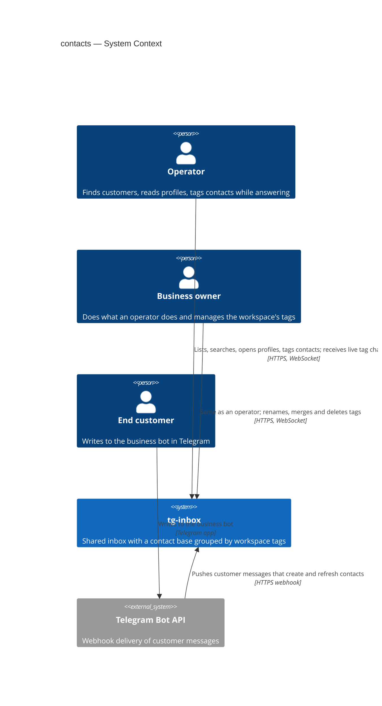

## 4. Solution strategy

**Target surfaces:** `backend-service` and `web-frontend`. The backend gives the `contacts` module its first routes (contacts list and profile, tags, tag history, owner tag management), new tables and the tag rules. `inbox` gains one read (the conversation of a contact). The frontend replaces the two previews with real screens (SCR-18, SCR-19), adds the tag control (SCR-20) to the profile and the inbox conversation header, and adds Settings → Tags (SCR-21…SCR-23) per `ux-flows.md`. No worker surface: every write runs inside a request transaction and no job is needed. Recorded with the module-placement decision in [ADR-0001](adr/0001-own-tags-in-the-contacts-module-with-its-own-routes-and-compose-the-profile-conversation-from-inbox-reads.md).

**UI architecture (web-frontend):** client-side SPA, fixed by repo ADR-0001; the existing routes stay, so no UI ADR.
- **Address state:** the Contacts list's search, filter mode (`any` / `all` / `none`) and chosen **tag ids** are URL search parameters (AC-02). Tag ids, not names, so a saved link survives a rename. The workspace switcher navigates without them. Settings → Tags is a nested settings route `settings/tags`, declared `ownerOnly` in `SettingsLayout`; a direct visit by an operator shows the in-place owners-only refusal like `settings/bot`.
- **Stores:** `features/contacts/store.ts` (keyed by workspace) holds the list page, the open profile (facts, tags, tag history pages) and the profile's conversation (summary + thread pages). `features/tags/store.ts` holds the workspace tag list (with counts) used by the picker, the filter and Settings → Tags. The ui-redesign sample source is replaced by an API source and the sample data and "Sample data" label are removed.
- **One tag control:** a single component (SCR-20, a shadcn popover + command list) opened from the profile and from the inbox conversation header (`ConversationCrumb` area). It reads the contact's tags and the workspace tag list and calls the contacts routes. Picker matching (tidy, case-insensitive, prefix-before-contains, tag-list order) runs in the browser over the list it holds, using the same normalisation functions as the server (shared package), and the server decides again on write.
- **Profile history without reading:** the profile's conversation part uses the inbox reads only (summary + thread pages) and **never calls the mark-read route**; it has no composer (ADR-0006).
- **Live:** the profile and the conversation header subscribe to the workspace's existing live connection. `contact.changed` for their contact and `tags.changed` refetch the contact's tags (and the tag history on the profile); `conversation.changed` for the profile's conversation refetches its summary and items exactly as the inbox does, minus the mark-read (ADR-0007).

**Top strategic choices (the seeds for ADRs):**

1. **The `contacts` module owns tags, contact tags and tag history and serves them through its own routes; the profile's conversation part is composed in the browser from `inbox` reads.**
   - `contacts` gets `http/routes.ts` (`registerContacts`) under `/api/workspaces/:workspaceId/…` for the list, the profile, the tag history, contact tag writes and the tag list / owner management. It stays the leaf it is: it reads no conversation data.
   - The profile's conversation (status, assignee, waiting marker, thread) comes from `inbox`, which already depends on `contacts` and `conversations`: a new read "conversation of a contact" (`conversations.findByContact`), then the existing summary and thread routes.
   - The inbox conversation header already receives the contact in the summary; its tag control talks to the `contacts` routes directly. So the only new backend edge is `contacts → workspaces` for display names of adders and actors (`workspaces` depends on no feature module, so the graph stays acyclic).
   - [ADR-0001](adr/0001-own-tags-in-the-contacts-module-with-its-own-routes-and-compose-the-profile-conversation-from-inbox-reads.md).
2. **A tag is identified by a stable id and kept unique by a normalised name key computed in the domain (AC-07, AC-08, AC-14, AC-02).**
   - `contacts/domain/tag-name.ts` (shared with the web through `packages/shared`) produces the **tidied name**: NFC, zero-width characters removed, every run of Unicode white space collapsed to one space, ends trimmed. Length is counted in grapheme clusters (`Intl.Segmenter`), 1–32.
   - The **name key** is the tidied name case-folded (`toUpperCase()` then `toLowerCase()`, so ß/SS and final sigma fold together). The table holds `name` (tidied, case as typed) and `name_key`, with a unique `(workspace_id, name_key)`.
   - Every reference to a tag (contact tags, filters in the address, Settings, the picker) uses its UUIDv7 id. A rename changes `name` and `name_key` and nothing else; a tag created later with a deleted tag's name is a new id.
   - [ADR-0002](adr/0002-identify-tags-by-a-stable-id-and-keep-them-unique-by-a-normalised-name-key-computed-in-the-domain.md).
3. **Every change of a contact's tags writes an append-only tag-history entry with the tag's name at that moment (AC-04, AC-06, AC-09, §6 history completeness, §7 KPI).**
   - Entry kinds: `added`, `removed` (member), `merged` (owner merge: "«Loyal» merged into «VIP»"), `deleted` (owner delete). Each carries the actor account, the source (`inbox`, `profile`, `settings`), the time and the tag name snapshot (and the target name for `merged`). `tag_id` is kept for traceability without a foreign key, so entries outlive the tag. A rename writes nothing.
   - Merge keeps the original adder and time on a contact that carried only the merged tag (the `contact_tags` row is re-pointed), and the earlier of the two additions on a contact that carried both. One `merged` entry is written on every contact that carried the merged tag; contacts that carried only the target get none.
   - The same table is the source of the per-member rate limit and the "tags added from the inbox" KPI.
   - [ADR-0003](adr/0003-record-every-contact-tag-change-as-an-append-only-history-entry-with-the-tag-name-at-that-moment.md).
4. **Tag writes are serialised by a per-workspace tag lock, the tag row and the contact row in one fixed order, and an owner's delete is re-checked against the count the owner confirmed (AC-08, AC-09, AC-14, AC-15).**
   - `contact_tags` carries composite foreign keys `(workspace_id, contact_id) → contacts` and `(workspace_id, tag_id) → tags`, so a cross-workspace link is impossible by constraint, and a tag deleted or merged away under a member's add makes the insert fail (`TAG_NOT_FOUND`), never resurrect it.
   - Creating a tag, renaming, merging and deleting take `tags:<ws>` (advisory) first: creation counts the tags (≤ 100) and inserts or reuses by `name_key` under it, so two members creating "Kyiv" at once end with one tag.
   - Adding to a contact locks the contact row (`FOR NO KEY UPDATE`), checks no-op and the 20-per-contact limit under it, then takes the tag row `FOR KEY SHARE` explicitly **before** inserting the link (a missing row = the tag was deleted or merged away → `TAG_NOT_FOUND`). Owner ops lock the affected tag rows `FOR UPDATE` (in id order), so a member add waits at that explicit tag lock before it has written any `contact_tags` index entry the owner's re-point could wait on.
   - Delete sends the count the owner saw; the server deletes the links with `RETURNING`, and if the returned number differs, rolls back and answers `TAG_COUNT_CHANGED` with the current count (precedent: assignment-statuses close snapshot).
   - [ADR-0004](adr/0004-serialise-tag-writes-under-a-per-workspace-tag-lock-and-recheck-a-delete-against-the-confirmed-count.md).
5. **The contact keeps its first and last customer send time, written by capture, and the list is keyset-paged on it inside the `contacts` tables (AC-01, AC-02, §6 list target).**
   - New columns `contacts.first_wrote_at` / `last_wrote_at`. `upsertFromProfile` already runs once per captured customer message inside the capture transaction and already receives the message's send time; it now also sets `LEAST`/`GREATEST` of the two. Edits never call it, so an edited message never moves them; a redelivered duplicate carries the same send time, so the update is idempotent.
   - The list, the search, the tag filter and both counts are then one-module queries over `contacts`, `contact_tags` and `tags`, keyset-paged by `(last_wrote_at DESC, id DESC)`; no join into `conversations`.
   - Backfill: min/max `messages.sent_at` per contact through its conversation (one-time SQL, §1 override).
   - [ADR-0005](adr/0005-keep-first-and-last-customer-send-times-on-the-contact-written-by-capture.md).
6. **The profile reads its conversation through inbox reads that never touch read marks (AC-05, §6 read state untouched).**
   - `threadPage` and the conversation summary already have no write side effect. The profile uses them plus the new "conversation of a contact" read, and the web profile store has no call to the mark-read route and no composer.
   - No `markRead` flag or separate history route is added, so there is one thread read for both screens. The guarantee is pinned by an integration test that reads the profile history with unread messages and asserts `read_marks`, unread counts and the attention count are unchanged, and by a web test that the profile never issues the mark-read call.
   - [ADR-0006](adr/0006-read-the-profile-conversation-through-the-existing-inbox-reads-that-never-mark-read.md).
7. **Tag changes are signalled as `contact.changed` per contact for member edits and one `tags.changed` per workspace for owner tag-list changes (AC-06, AC-09, §6 live target).**
   - A member's add or remove publishes `contact.changed { workspace_id, contact_id, change: 'tags' }` in its transaction. Open profiles and conversation headers of that contact refetch its tags (and history).
   - An owner's rename, merge or delete can touch up to 10 000 contacts, so it publishes one `tags.changed { workspace_id }`. Every open profile and header refetches its contact's tags, and the tag store refetches the tag list. A member's creation of a new tag also publishes `tags.changed`, so open pickers and filters learn it.
   - Both are new members of the `realtimeSignalSchema` union and of `LiveFrame` in `packages/shared`; the hub forwards them like `bot.changed`.
   - [ADR-0007](adr/0007-signal-tag-changes-as-contact-changed-per-contact-and-tags-changed-per-workspace.md).

**Supporting choices (inline, below the ADR gate):**

- **Per-member tag change limit (AC-15).** 60 recorded member changes per rolling 60 s per member per workspace, counted from tag-history entries with that actor and a member kind (`added` / `removed`); owner `merged` / `deleted` entries never count. The member routes accept `source` only as `inbox` or `profile` (`settings` is written by the server on owner paths only), so `source` never decides whether a change is limited. The count runs under `pg_advisory_xact_lock(hashtextextended('tag-changes:<ws>:<account>', 0))`, taken after the contact row lock and the no-op and per-contact-limit checks, just before the write, so no-ops and refusals never count; create + apply writes one `added` entry, so it counts one. The prefix keeps it apart from the conversation `changes:` limit (a separate budget). Refusal: `TooManyRequestsError`, code `TAG_CHANGE_LIMIT_REACHED`, with the time the oldest counted entry leaves the window. Reuses the decided assignment-statuses pattern inside one module.
- **Owner-only management (AC-11).** Rename/merge and delete routes carry the existing `ownerOnly` preHandler (`OWNER_ONLY`). Tag list with counts and contact tag writes need only the membership guard. The web hides the Settings → Tags entry for operators and shows the owners-only refusal on a direct visit.
- **Rename and merge (AC-09).** A rename with the same tidied text is a no-op success. A new name whose key equals the tag's own key changes only how it is shown. A key held by another tag is refused with `TAG_NAME_TAKEN` (details: that tag's id, name and count); the dialog offers the merge, and confirming resends with `mergeInto: <that id>`. The merge runs set-based in one transaction (§6 flow 2).
- **Contacts list query (AC-01, AC-02, AC-03).** Predicates: the search reuses `normalizeSearchQuery` and the `searchContactIds` matching rule (inlined in the list query, not a separate id list); `any` = `EXISTS (contact_tags … tag_id = ANY($ids))`; `all` = number of matching `contact_tags` rows = `cardinality($ids)`; `none` = `NOT EXISTS`. Requested tag ids are first resolved against the workspace's tags; ids that do not resolve are dropped and returned as `missing_tag_ids` so the page can say one of the chosen tags no longer exists. A page returns 50 rows, the cursor `(last_wrote_at, id)`, each row's tags in tag-list order, the matching count and the workspace total. Indexes (indicative, `data-model` verifies): `contacts (workspace_id, last_wrote_at DESC, id DESC)`; `contact_tags` primary key `(contact_id, tag_id)` + `(workspace_id, tag_id, contact_id)`; `tags` unique `(workspace_id, name_key)`. At 10 000 contacts per workspace the search and count are bounded scans of one workspace's range; a trigram index is the scaling step (§7).
- **Tag-list order.** Dictionary order ignoring case, per alphabet: `ORDER BY name COLLATE "und-x-icu"` with `name_key` as tiebreak, the same order in the picker, on contacts and in Settings. The web sorts with `Intl.Collator(undefined, { sensitivity: 'base' })` for lists it holds.
- **Display names.** Adders and actors are stored as account ids and resolved at read time through `workspaces` display names (including deactivated members, AC-13).
- **Persistence:** the single PostgreSQL 16 store. No cache, no new datastore, no queue.

Each later tactical decision traces to one of these. Contradictions go to §11.

## 5. Building block view

The backend keeps the modular monolith (`domain → app → infra → http`) and adds no module ([ADR-0001](adr/0001-own-tags-in-the-contacts-module-with-its-own-routes-and-compose-the-profile-conversation-from-inbox-reads.md)).
- **`contacts`** gains the tag domain (name tidying and key, limits, merge rules, history entry kinds), the use cases (list page, profile, tag history page, add, remove, create-and-add, tag list with counts, rename/merge, delete), the repositories for the new tables, and its first `http/routes.ts`. `upsertFromProfile` now also maintains first/last wrote.
- **`inbox`** gains one read: the conversation of a contact (summary shape), through `conversations.findByContact(workspaceId, contactId)`.
- **`conversations`** gains `findByContact`. Nothing else changes; the capture call already passes the send time.
- **`workspaces`** gains no code; `contacts` calls its existing display-name read.

Dependency graph after the change: `inbox → {conversations, contacts, bots, workspaces, notifications}`, `notifications → {conversations, workspaces, bots}`, `bots → conversations → contacts`, `bots → contacts`, **`contacts → workspaces`** (new, app layer, display names). Acyclic: `workspaces` imports no feature module.

**Table ownership** (names indicative, `data-model` fixes them):

| Module | Tables (new or changed) | Tenancy |
|---|---|---|
| `contacts` | `contacts` **+** `first_wrote_at`, `last_wrote_at` (timestamptz, backfilled); **`tags`**: id, workspace_id, name, name_key, created_by_account_id, created_at, unique `(workspace_id, name_key)`, unique `(workspace_id, id)` for the composite FK; **`contact_tags`**: workspace_id, contact_id, tag_id, added_by_account_id, added_at, primary key `(contact_id, tag_id)`, FKs `(workspace_id, contact_id) → contacts`, `(workspace_id, tag_id) → tags`; **`contact_tag_history`**: id, workspace_id, contact_id (FK), tag_id (no FK), tag_name, kind (added / removed / merged / deleted), merged_into_tag_id (no FK), merged_into_name, actor_account_id, source (inbox / profile / settings), created_at | Tenant-owned, non-null `workspace_id`; every repository method takes `workspaceId` |
| `conversations` | none (a read by `contact_id`) | unchanged |
| `inbox`, `workspaces`, `bots`, `notifications` | none | — |

No new controlled tenancy exception: every read and write takes the workspace id from the URL, and the composite foreign keys make a cross-workspace link unrepresentable.

**Cross-module app-layer calls (new or changed):**

- `contacts` → `workspaces`: display names by account ids (existing read), for adders and history actors.
- `inbox` → `conversations`: `findByContact(workspaceId, contactId)` → the conversation summary (status, assignee, waiting, state version), for the profile.
- `conversations` → `contacts.upsertFromProfile(…, sentAt, tx)` (existing call) now also maintains first/last wrote.

**HTTP surface (intent; `api` fixes it)** — all under `/api/workspaces/:workspaceId`:

| Route (indicative) | Guard | Purpose |
|---|---|---|
| `GET /contacts?q&mode&tag&cursor` | member | list page, total and matching counts, `missing_tag_ids` |
| `GET /contacts/:contactId` | member | facts, first/last wrote, tags with adder and time |
| `GET /contacts/:contactId/tag-history?cursor` | member | tag history, newest first |
| `POST /contacts/:contactId/tags` (`{ tagId }` or `{ name }`, `source`) | member | add or create-and-add |
| `DELETE /contacts/:contactId/tags/:tagId?source` | member | remove |
| `GET /tags` | member | the tag list in tag-list order with counts |
| `PATCH /tags/:tagId` (`{ name, mergeInto? }`) | owner | rename or merge |
| `DELETE /tags/:tagId?expectedCount` | owner | delete with the confirmed count |
| `GET /inbox/contacts/:contactId/conversation` | member | the profile's conversation summary (served by `inbox`) |

**Internal decomposition:**

```
apps/api/src/modules/contacts/
├── domain/   profile.ts (existing), tag-name.ts (tidy, key, grapheme length), tags.ts (limits, merge rules, history kinds)
├── app/      contacts.ts (+ list page, profile), tags.ts (add / remove / create / rename-merge / delete), ports.ts, fakes.ts
├── infra/    contact-repo.ts (+ first/last wrote, list query), tag-repo.ts, contact-tag-repo.ts, tag-history-repo.ts, tag-signals.ts
└── http/     routes.ts (registerContacts), schemas from packages/shared/src/contacts.ts
packages/shared/src/contacts.ts   wire schemas + tag-name tidy/key (used by the picker)
apps/web/src/features/contacts/   list, profile, profile conversation (read-only), api-source, store
apps/web/src/features/tags/       tag control (SCR-20), Settings → Tags (SCR-21…23), store
```

**C4 Container (L2):**

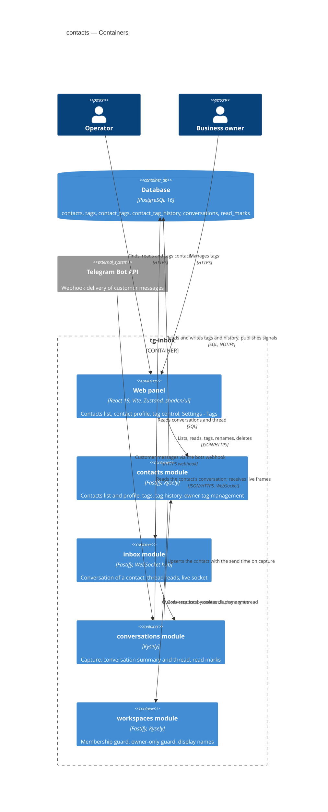

## 6. Runtime view

Seeded here: the three critical flows. The `sequences` stage completes coverage of every AC.

**Critical flow 1: A member creates and adds a tag from the inbox conversation header, and a teammate sees it live (US-03 — AC-06, AC-07, AC-08, AC-14, AC-15)**

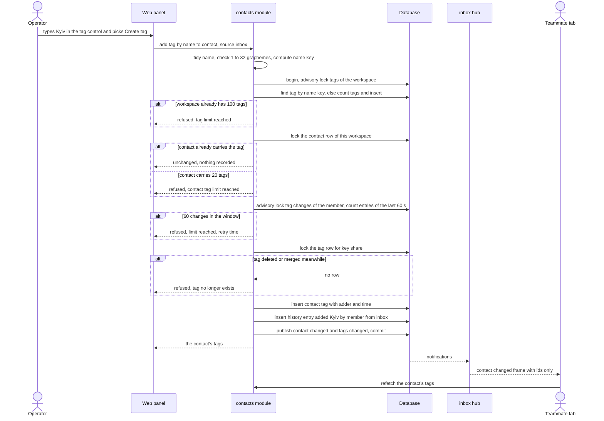

**Critical flow 2: An owner merges by renaming, then deletes a tag against the count they saw (US-04 — AC-09, AC-11, AC-14)**

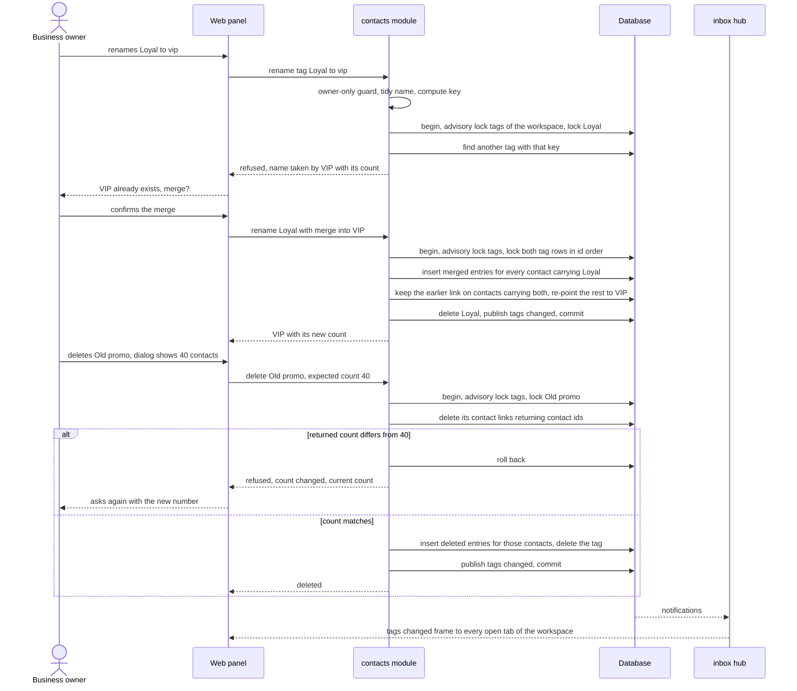

**Critical flow 3: A member reads a contact's profile and history, and nothing counts as read (US-02 — AC-04, AC-05, AC-12)**

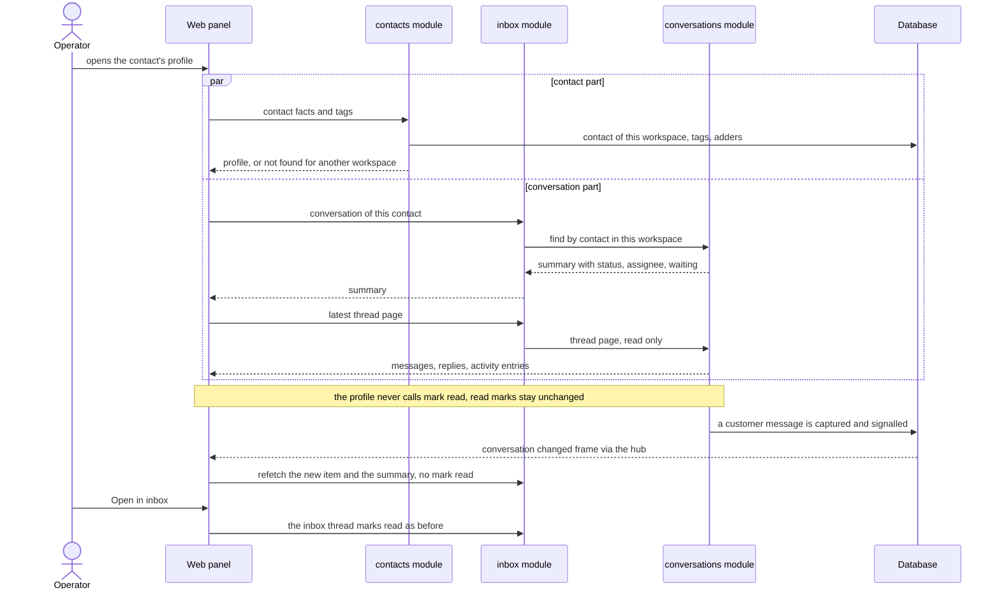

Flows 4–14 below were added by the `sequences` stage. They use the generic runtime vocabulary: `<user>` (an operator or business owner, or the end customer in Telegram where a flow says so), `<ui>` (a tab of the web panel), `<service>` (tg-inbox's backend), `<data-store>`, `<message-bus>` (the live-signal fan-out) and `<external-system>` (the Telegram Bot API). `SCR-NN` ids refer to [`ux-flows.md`](ux-flows.md). Every persist or read note is a hint for `data-model`. The seeded flows 1–3 above are unchanged.

**Assumptions (autonomous run 2026-10-19, `sequences`)**, each can be vetoed at review:

- Depth = medium, size M (`.size`), route `standard` (`.route`). The pipeline confirmed every flow itself against spec §5, `ux-flows.md` and ADR-0001…0007. Each flow's prose account is the paragraph under it.
- The same session guard (signed out, another workspace, deactivated) fronts every contacts and tags route. It is drawn in full in flow 4 and referred to elsewhere.
- The web knows whether the workspace's bot is connected from the existing bot read it already uses for the inbox's empty state. The Contacts list adds no bot read of its own.
- "No tags" sent together with chosen tag ids is refused as invalid. The web never sends it, because choosing "no tags" clears the chosen tags.
- The tag control re-checks the name rules in the browser with the shared functions, and the server decides again. A request that breaks them is refused the same way.
- A merge request whose target tag was deleted, merged away or renamed to another name meanwhile is refused and the rename dialog asks again with the current tag list.
- The open profile refreshes the contact's Telegram facts when its conversation's change signal arrives (a captured message may carry a new name). No new signal is added for that (ADR-0007 scope).

### Flow 4: Open the Contacts list and page through it (US-01, US-05 — AC-01, AC-03, AC-12)

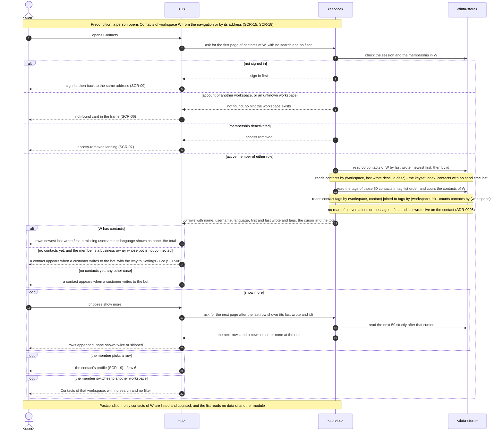

Contacts, from the navigation or by its address, asks for the first page. The usual guard sends a signed-out visitor to sign in and back, gives another workspace's account the not-found card with no hint, and gives a deactivated member the access-removed landing (AC-12). For an active member of either role, the server reads 50 contacts of the workspace by last wrote, newest first, with the id as a tiebreak. It uses the keyset index on the contact, so it never joins conversations (ADR-0005). It adds each row's tags in tag-list order and the total. A missing username or language shows as none (AC-01). An empty workspace explains how contacts appear, and a business owner whose bot is not connected also gets the way to Settings — Bot (AC-03). "Show more" continues strictly after the last row's cursor, so no row is shown twice or skipped. Picking a row opens the profile. Switching workspace starts clean.

### Flow 5: Search and filter the list, kept in the address (US-01, US-05 — AC-02, AC-03, AC-12)

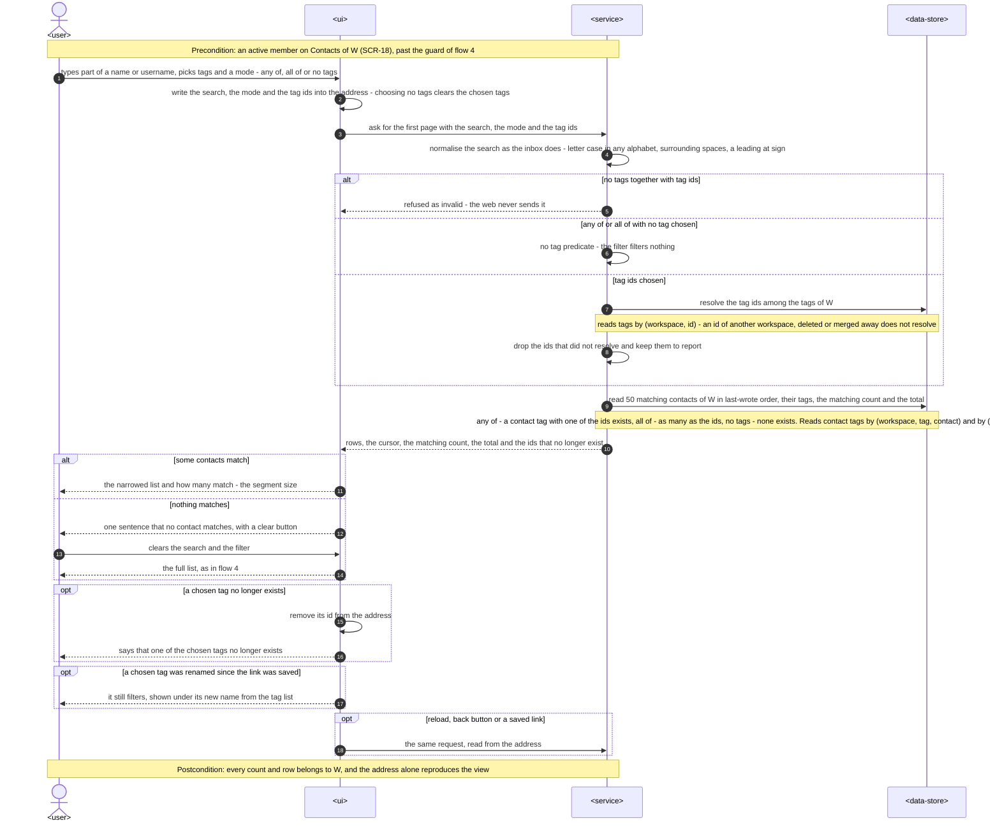

The member's search, mode and chosen tag ids go into the page's address, so reload, back and a saved link reopen the same view. Ids, not names, are stored, so a renamed tag keeps filtering under its new name. The server normalises the search with the inbox's rules. It resolves the tag ids among the workspace's own tags, so an id of another workspace, or of a tag deleted or merged away, simply drops out and is reported (AC-02, AC-12). "Any of" and "all of" with no tag filter nothing, and "no tags" with ids is refused as invalid. The page returns the matching rows in last-wrote order, the matching count (the segment size) and the total. If nothing matches, the list is replaced by one sentence and a clear button (AC-03). A dropped tag is removed from the address with a notice.

### Flow 6: Open a contact's profile and page its tag history (US-02 — AC-04, AC-12, AC-13)

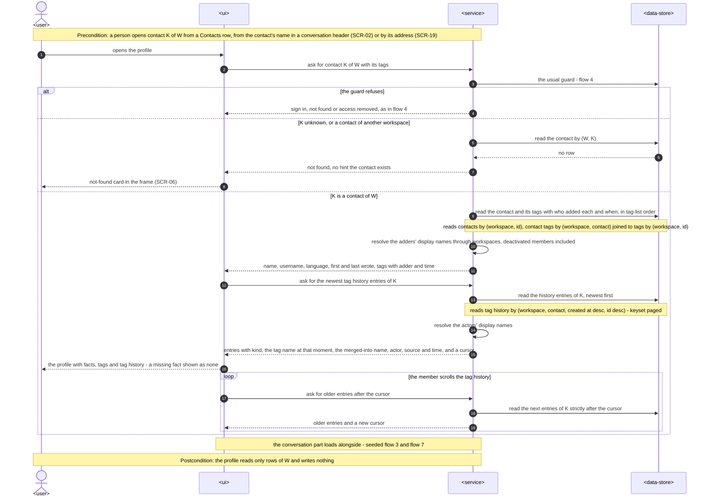

A profile is reached from a Contacts row, the conversation header's contact name, or its own address. After the usual guard, the server reads the contact with the workspace id. An unknown id, or an id of another workspace's contact, gives the not-found card in the frame with no hint (AC-04, AC-12). For a contact of the workspace, the server returns the Telegram facts, first and last wrote, and the tags with who added each and when. Adders are resolved to display names through `workspaces`, deactivated members included (AC-13). The tag history comes newest first and is keyset-paged as the member scrolls. Each entry carries the kind, the tag's name at that moment, the merge target's name, the actor, the source and the time. The conversation part loads alongside (seeded flow 3, flow 7). Nothing is written.

### Flow 7: The profile's conversation history stays live and unread (US-02 — AC-04, AC-05)

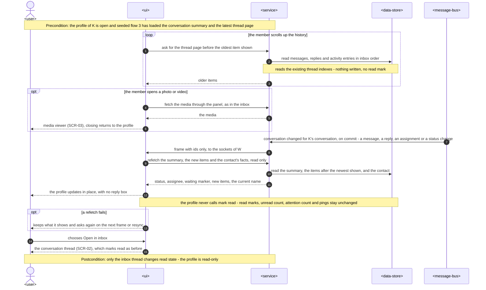

On the profile, scrolling up loads older thread pages through the same inbox read the thread uses, which writes nothing (ADR-0006). Media opens through the panel in the media viewer, as in the inbox. When the conversation's change signal arrives (a new message, a reply, an assignment, a status change), the profile refetches the summary, the new items and the contact's facts. The status, assignee, "waiting for a reply" marker and history update in place, and a captured new name shows. The profile has no reply box and never calls mark read, so the read marks, the unread count, the attention count and the pings are as if it had not been opened (AC-05). A failed refetch keeps what is shown until the next frame. "Open in inbox" goes to the conversation thread, where reading counts as before.

### Flow 8: Add an existing tag from the tag control (US-03 — AC-06, AC-08, AC-12, AC-13, AC-14, AC-15)

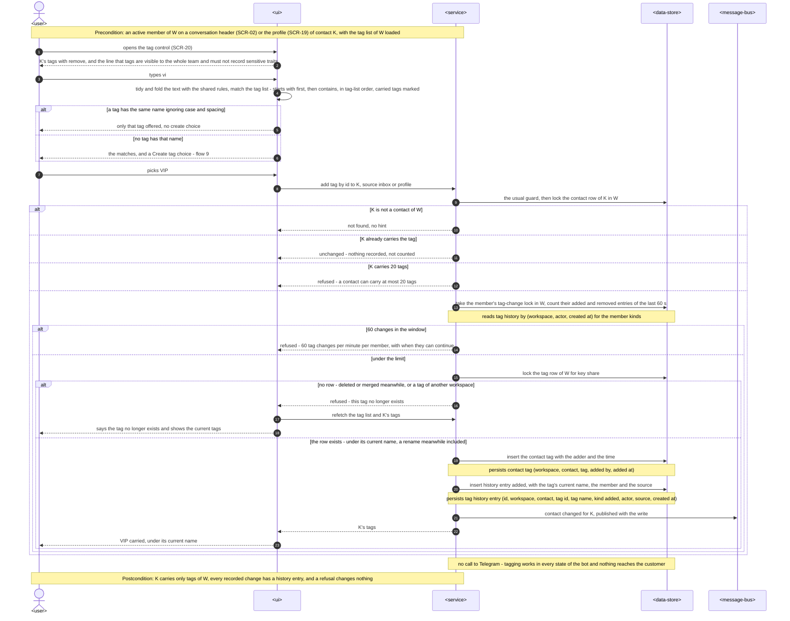

The tag control opens over the header or the profile and always shows the guidance line. Matching runs in the browser over the tag list it holds, with the shared tidy and fold rules: tags that start with the text come first, then tags that contain it, in tag-list order. Carried tags are marked, and an exact match ignoring case and spacing hides the create choice (AC-06, AC-08). Picking a tag sends its id. The server locks the contact row inside the workspace, so another workspace's contact is not found (AC-12). It then checks the no-op (already carried: nothing recorded and not counted) and the 20-per-contact limit. Next it counts the member's recorded changes of the last 60 s under their lock and refuses the 61st with the retry time (AC-15). Last it takes the tag row of the workspace for key share. A tag deleted or merged meanwhile, or a tag id of another workspace, is refused as "no longer exists", and the control refetches and shows the current tags. A tag renamed meanwhile is added under its new name (AC-14). The link and an "added" history entry with the current name are written, and `contact.changed` goes out with the write. Telegram is never called, so the bot's state does not matter (AC-13).

### Flow 9: Create a new tag and add it (US-03 — AC-07, AC-08, AC-15)

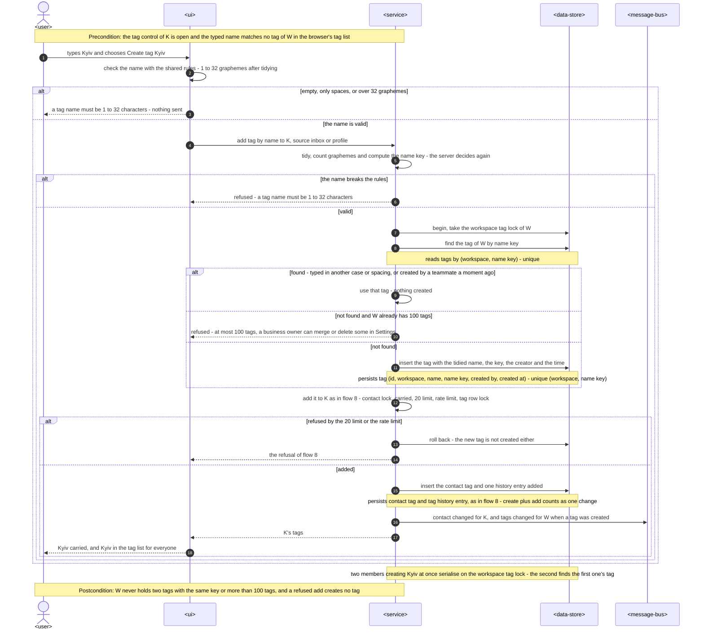

"Create tag …" checks the name rules in the browser first, so an empty, spaces-only or over-32 name is refused in place and nothing is sent (AC-07). The server tidies and checks again. Under the workspace tag lock it looks the name key up. A name that differs only in case or spacing, or one a teammate created a moment earlier, reuses that tag. That is how two members creating "Kyiv" at once end with one tag (AC-08). A new name is refused at the 100-tag limit, and otherwise inserted. The add then runs exactly as in flow 8. If the 20-per-contact limit or the rate limit refuses it, the whole transaction rolls back, so the new tag is not created either (AC-08). Creating and adding writes one "added" entry and counts as one change (AC-15). A created tag also publishes `tags.changed`, so open pickers and filters learn it. Seeded flow 1 shows the same path in the original design's participants.

### Flow 10: Remove a tag from a contact (US-03 — AC-06, AC-12, AC-15)

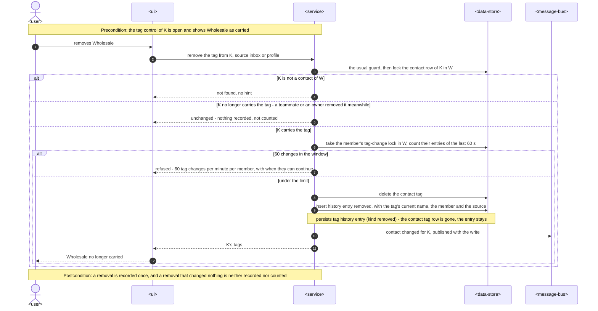

Removing locks the contact row inside the workspace (another workspace's contact is not found, AC-12). A tag the contact no longer carries, for example because a teammate removed it at the same moment, is a success that records and counts nothing (AC-06). Otherwise the member's rate limit is checked, as for an add (AC-15). Then the link is deleted, a "removed" entry with the tag's current name is written, and `contact.changed` goes out with the write. A removal touches no tag row, so it never waits on an owner's operation (§8).

### Cross-cutting: Flow 11 — tag changes reach open headers, profiles and pickers live (US-03, US-04 — AC-06, AC-09, AC-14)

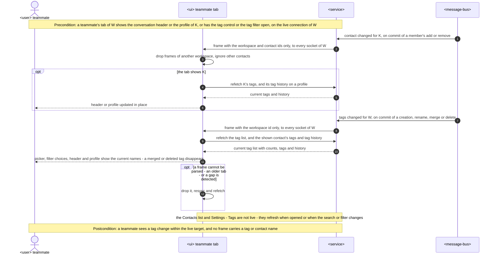

Every member add or remove publishes `contact.changed` for that contact, and every tag creation, rename, merge or delete publishes one `tags.changed` for the workspace (ADR-0007). Frames carry ids only. A tab that shows the contact (header or profile) refetches its tags, and on a profile its tag history (AC-06). `tags.changed` makes every open tab refetch the tag list and the shown contact's tags, so an open picker learns a new tag, and a renamed tag shows its new name, and a merged or deleted tag disappears (AC-09, AC-14). A frame an older tab cannot parse, or a gap, leads to a resync. The Contacts list and Settings — Tags are not live by design.

### Flow 12: Settings — Tags with counts, and a count opens the filtered list (US-05, US-04 — AC-10, AC-11, AC-12)

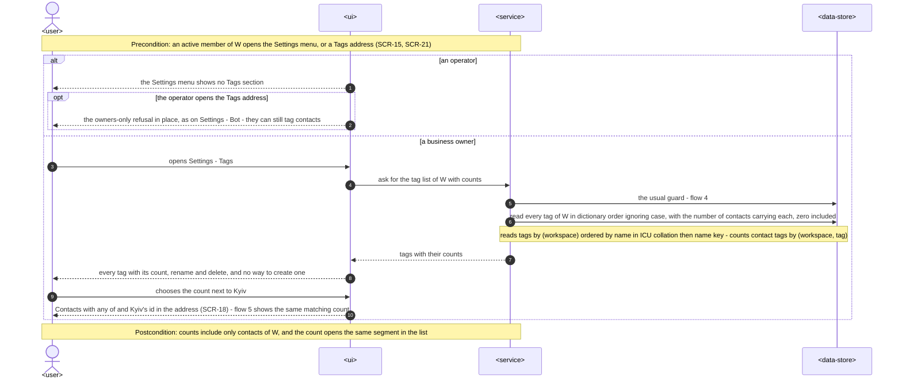

Settings — Tags is hidden from operators. Its address shows them the in-place owners-only refusal, while they can still tag contacts (AC-11). The tag list with counts is the same member read the picker uses. The owner-only part is the section and its actions, not the read. The list includes every tag of the workspace in dictionary order ignoring case, tags no contact carries included, each with its contact count, and it offers rename and delete but no create (AC-10). Choosing a count opens the Contacts list with "any of" and that tag's id in the address. Flow 5 then shows the same matching count, because both count the same workspace's contact tags (AC-02, AC-12).

### Flow 13: Rename a tag, or merge by renaming (US-04 — AC-07, AC-09, AC-11, AC-14)

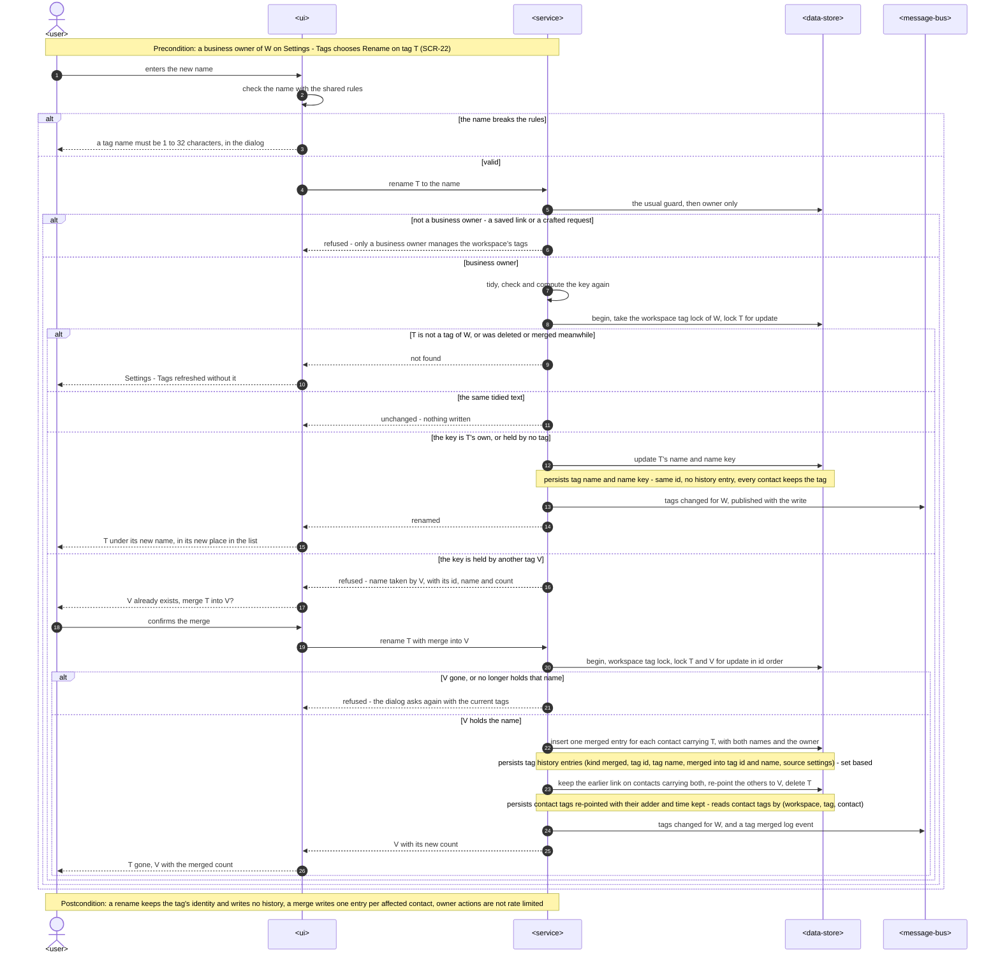

The rename dialog checks the name rules in place (AC-07). The server requires a business owner, so a crafted request from an operator is refused and changes nothing (AC-11). Under the workspace tag lock and the tag's row lock: a tag of another workspace, or one deleted or merged meanwhile, is not found. The exact same text changes nothing. A new name, or the same name in another case or spacing, updates the name and key only. It keeps the id and writes no history, so a member who adds it a moment later gets it under the new name (AC-09, AC-14). A key held by another tag is refused with that tag and its count, and the dialog offers the merge. On confirmation the server locks both rows in id order. It writes one "merged" entry on every contact that carried the merged tag, keeps the earlier link where a contact carried both, re-points the rest with their adder and time, and deletes the merged tag (AC-09). A merge target that changed meanwhile is refused and asked again. `tags.changed` and the `tag.merged` log event go out with the write. The delete with the confirmed count is seeded flow 2. Neither path counts toward the member rate limit (AC-15).

### Flow 14: Capture keeps a contact's first and last wrote (US-01, US-02 — AC-01, AC-13)

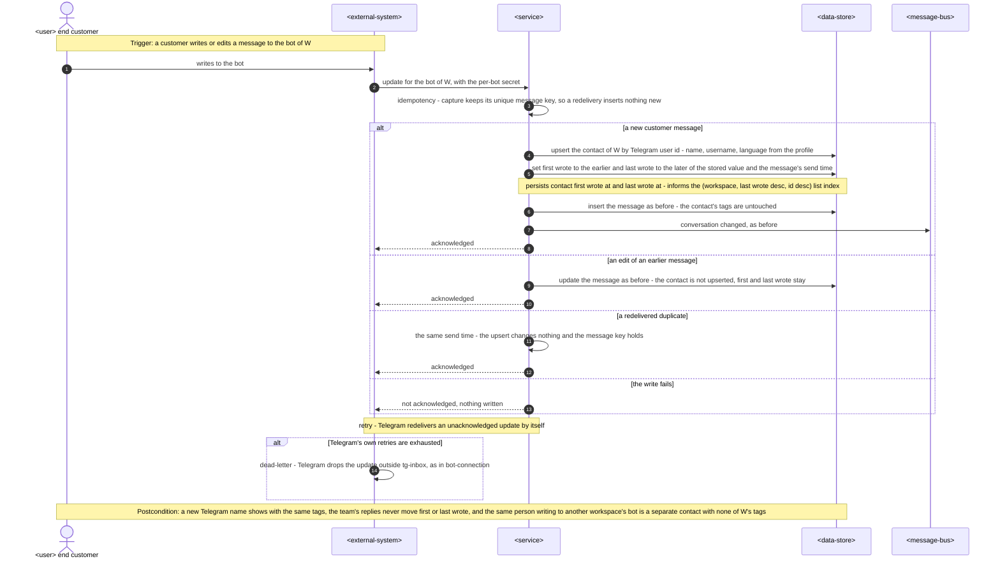

Capture already upserts the contact once per new customer message, inside its transaction, with the message's Telegram send time (bot-connection). It now also keeps the earlier and later of the stored first and last wrote and that send time (ADR-0005). The name, username and language are refreshed from the profile, and the tags are untouched, so a renamed customer keeps their tags (AC-13). Edits do not call the upsert, so an edited message never moves first or last wrote. A redelivered duplicate carries the same send time and changes nothing. The team's replies never pass through it (AC-01). A failure is not acknowledged, and Telegram redelivers it. The contact is keyed by workspace and Telegram user id, so the same person writing to another workspace's bot is a separate contact with none of this workspace's tags (AC-13).

**Coverage — every spec §4 user story and §5 acceptance criterion → where §6 shows it:**

| Spec item | Shown by |
|---|---|
| US-01 | Flow 4, flow 5, flow 14 (first and last wrote) |
| US-02 | Flow 6, flow 7, seeded flow 3, flow 14 (a new name on the profile) |
| US-03 | Flow 8, flow 9, flow 10, flow 11, seeded flow 1 |
| US-04 | Flow 12, flow 13, seeded flow 2, flow 11 |
| US-05 | Flow 12 (count per tag and count to filtered list), flow 5 (matching count) |
| AC-01 | Flow 4: workspace rows only, no sample data, name, username, tags in tag-list order, language, first and last wrote, newest last wrote first, 50 at a time with a strict keyset cursor, total, missing values shown as none, either role. Flow 14: first and last wrote by the customer's send time, replies and edits never count |
| AC-02 | Flow 5: inbox search rules, any of / all of / no tags, no tags not combinable, empty any/all filters nothing, matching count, address state with tag ids, renamed tag keeps filtering, a tag that no longer exists dropped with a notice. Flow 4: workspace switch resets |
| AC-03 | Flow 5: nothing matches with the clear button. Flow 4: no contacts yet, with the owner's way to the bot settings when no bot is connected |
| AC-04 | Flow 6: facts, first and last wrote, tags with adder and time, tag history newest first and paged, not-found card, reachable from list, header and address. Flow 7: history paging in inbox order, media through the panel, Open in inbox. Seeded flow 3: status, assignee, waiting marker and the latest thread page |
| AC-05 | Seeded flow 3 and flow 7: no mark-read call, read marks, unread, attention and pings unchanged, no reply box, live new items and state, only the inbox marks read |
| AC-06 | Flow 8: suggestions (starts with first, carried marked, exact match hides create), guidance line, adder and time, history entry, nothing sent to the customer, already-carried no-op. Flow 9: create as a separate named choice, the new tag in the tag list for everyone. Flow 10: removal and the already-removed no-op. Flow 11: live in other members' headers and profiles. Flow 5: the filter finds the contact by the new tags. Seeded flow 1 |
| AC-07 | Flow 9: empty, spaces-only or over 32 graphemes refused in the browser and again on the server, nothing created. Flow 13: the same rules on rename |
| AC-08 | Flow 9: a name differing only in case or spacing is the existing tag, two members creating at once end with one tag, 101st tag refused with the owner hint, a 21st tag refused and its new name not created (rollback). Flow 8: the 20-per-contact limit and the exact-match suggestion. Seeded flow 1: both limits under the locks |
| AC-09 | Flow 13: rename keeps identity, case-only rename changes display, same text changes nothing, name taken offers merge, merge keeps the original or earlier adder, one merged entry per contact that carried the merged tag, none for target-only contacts. Seeded flow 2: merge and delete with the count re-check, deleted entries per contact, asked again with the current number. Flow 11: changes reach open headers and profiles |
| AC-10 | Flow 12: every tag in dictionary order with counts including zero, rename and delete, no create, the count opens the filtered list with the same number (flow 5) |
| AC-11 | Flow 12: Tags hidden from operators, owners-only refusal on the address, operators still tag. Flow 13: rename or merge by an operator refused server-side. Seeded flow 2: the owner-only guard on delete |
| AC-12 | Flow 4: the guard (sign in, not found with no hint, access removed). Flow 5: tag ids of another workspace never resolve, counts only within the workspace. Flow 6: a contact of another workspace is not found. Flows 8 and 10: a contact or tag of another workspace is refused with no hint, and the composite keys make the link impossible (§8). Flow 12 and flow 13: the tag list and owner actions inside the workspace only |
| AC-13 | Flow 14: a new Telegram name with the same tags, and the same person in another workspace as a separate contact without these tags. Flow 6: a deactivated adder or actor still shown by name. Flow 8: no Telegram call, so tagging, the list and profiles work in every bot state |
| AC-14 | Flow 8: a tag deleted or merged before the pick is refused as no longer existing and the control shows the current tags, a renamed tag is added under its new name. Flow 13: rename keeps the id. Seeded flow 1: the key-share lock that finds no row |
| AC-15 | Flow 8 and flow 10: 60 recorded changes per rolling 60 s per member per workspace with the retry time, no-ops not counted. Flow 9: create plus add counts as one, a refused add rolls back. Flow 13 and seeded flow 2: owner rename, merge and delete are not counted or limited |

**Flagged by `sequences` (for `design` / `data-model` / `api` to reconcile, no ADR written):**

- **No new participants.** Every flow stays within §5's containers. `<message-bus>` is `platform/realtime` (signals through `LISTEN/NOTIFY` and the inbox hub). `<external-system>` is the Telegram Bot API, used only by capture in flow 14. The seeded flows 1–3 keep their concrete participant names from `design`, and flows 4–14 use the generic vocabulary.
- **The backfill of first and last wrote is not a runtime flow.** It is the one-time data migration of §1's decision override, drawn nowhere in §6. `data-model` stages it (expand, backfill from `messages.sent_at` through the conversation, no contract step needed if the columns stay nullable).
- **Keyset paging over a moving key (flow 4).** A contact that writes again between two "show more" requests moves above the cursor. It is not shown twice, but it does not appear on later pages until the list is reopened. This fits the "list is not live" debt of §11. No change is proposed.
- **"No tags" with tag ids (flow 5)** is refused as invalid. `api` fixes the error code (a plain `VALIDATION_FAILED` is enough).
- **The profile refetches the contact's facts on `conversation.changed` (flow 7)** to show a new Telegram name. This needs no new signal, but `screens` / `tasks` should include it in the profile store.
- **Indexes for `data-model`** (from the persist and read notes):
  - `contacts` by `(workspace_id, last_wrote_at DESC NULLS LAST, id DESC)` for the list's keyset (flows 4, 5);
  - `tags` unique `(workspace_id, name_key)` (flow 9, flow 13) and unique `(workspace_id, id)` as the composite FK target. The tag list reads all of one workspace's tags and orders them by `name` in ICU collation (≤ 100 rows, no index needed for the sort);
  - `contact_tags` keyed by contact and tag within the workspace (flows 6, 8, 10), plus `(workspace_id, tag_id, contact_id)` for the counts, the any / all / none filter and the owner's set-based merge and delete (flows 5, 12, 13, seeded flow 2);
  - `contact_tag_history` by `(workspace_id, contact_id, created_at DESC, id DESC)` for the profile's keyset (flow 6) and by `(workspace_id, actor_account_id, created_at)` for the member rate limit (flows 8, 9, 10).

## 7. Deployment view

Nothing changes in the topology: one Node 26 process (Fastify API, built web panel, webhook ingress, live socket, pg-boss workers) against one PostgreSQL 16 database. No queue, no configuration key, no external dependency. A second replica needs no change: uniqueness, limits and the delete check are enforced in the database (constraints, row locks, advisory locks), and signals fan out through `LISTEN/NOTIFY`.

**Configuration added:** none. The constants (32 graphemes, 100 tags per workspace, 20 per contact, 60 changes per 60 s, 50 contacts per page) live in `contacts/domain`.

**Monitoring:**
- Metrics (structured logs): request duration for the contacts list (by filter mode and with/without search), the profile, the tag-change path (by outcome: added, removed, unchanged, name invalid, workspace limit, contact limit, tag gone, rate limited), owner rename / merge / delete (with the number of contacts affected); change-to-push latency for `contact.changed` and `tags.changed`.
- Alerts: the existing `/health` uptime check; any integrity query below returning a row; the spec §7 look-alike KPI (a workspace's owner merges more than 5 tags in 7 days), counted from a structured log event `tag.merged` (workspace, merged tag id, target tag id, actor) emitted on every merge, including merges of tags no contact carried (those write no history entry).
- Integrity queries (run book, also asserted in the integration suite):
  - two tags of a workspace with the same `name_key` (should be impossible by the unique index);
  - workspaces over 100 tags, contacts over 20 tags;
  - `contact_tags` whose tag or contact belongs to another workspace (impossible by the composite FKs);
  - contact tags with no history entry for that contact that is either `added` with the link's `tag_id` or `merged` with `merged_into_tag_id` = the link's `tag_id` (matched on ids, so renames and re-pointed merges never trip it).
- KPIs (spec §7) by run-book queries over `contact_tags`, `contact_tag_history` and `contacts.last_wrote_at`: share of contacts that wrote in the last 30 days carrying a tag; workspaces with ≥ 3 tags on ≥ 5 contacts; share of `added` entries with source `inbox`; owner merges per workspace per 7 days from the `tag.merged` log events.
- Tracing: the Fastify request id in every log line. Tag logs carry workspace, contact and tag ids and outcome codes, never tag names, contact names or usernames.

**Scaling thresholds:**
- Pilot scale per spec §6: 10 000 contacts and 100 tags per workspace. The list's search is a bounded scan of one workspace's contacts. Past ~50 000 contacts per workspace, add a `pg_trgm` index on the searched text and revisit the count (an estimate above a threshold).
- An owner's merge or delete writes one history row per affected contact in one set-based statement. Fine to 10 000 contacts within the 2 s target; above ~100 000, batch it.
- Tag history grows by a few rows per tagging action. Comfortable in one table for years at pilot scale.

## 8. Crosscutting concepts

| Concept | Convention | Where defined |
|---|---|---|
| Logging | pino via `platform/logger.ts`. Ids, kinds and outcome codes only; never tag names, contact names, usernames or NOTIFY payloads. | `CLAUDE.md` + here |
| Authentication | Session cookie resolved by `auth` on every route and the socket, unchanged. | workspace-operators ADR-0002 |
| Authorization | Every route sits under `/api/workspaces/:workspaceId/…` behind the `workspaces` guard: another workspace's account gets not found with no hint, a deactivated member `ACCESS_REMOVED`, a signed-out visitor is sent to sign in (AC-12). Rename/merge/delete add `ownerOnly` (`OWNER_ONLY`, AC-11). Both roles have identical rights over contacts and contact tags (spec §1). | workspace-operators ADR-0003, §4 |
| Tenancy | Contact and tag ids from the URL or body are always looked up with the workspace id; a foreign id is not found. `contact_tags` has composite FKs on `(workspace_id, contact_id)` and `(workspace_id, tag_id)`, so a contact can only carry its own workspace's tags (§6 tenant isolation). Counts and filters join only within the workspace. No new controlled exception. | `CLAUDE.md`, [ADR-0004](adr/0004-serialise-tag-writes-under-a-per-workspace-tag-lock-and-recheck-a-delete-against-the-confirmed-count.md) |
| Concurrency | Lock order per path:<br>• **Member add / create-and-add:** (1) `tags:<ws>` advisory, only when a name is sent (find-or-create under the 100 limit); (2) contact row `FOR NO KEY UPDATE`; (3) no-op and 20-per-contact checks; (4) `tag-changes:<ws>:<account>` advisory + count; (5) the tag row `FOR KEY SHARE` (explicit; missing = `TAG_NOT_FOUND`); (6) `contact_tags` insert; (7) history insert; (8) publish.<br>• **Member remove:** (2) contact row; (3) no-op; (4) limit; (5) delete the link; (6) history; (7) publish.<br>• **Owner rename / merge / delete:** (1) `tags:<ws>`; (2) the tag rows `FOR UPDATE` in id order; (3) set-based `contact_tags` updates/deletes; (4) history inserts (FK `FOR KEY SHARE` on contacts, which does not conflict with a member's `FOR NO KEY UPDATE`); (5) publish.<br>**Why deadlock-free:** owner paths never wait for a contact row; a member add waits for a tag row only at its explicit `FOR KEY SHARE`, before it has written any `contact_tags` row or index entry, so an owner holding the tag never waits on that member (an implicit FK check would come after the insert's unique-index entry and could deadlock with a merge re-pointing onto the same `(contact, tag)` key); a member remove touches no tag row; `tags:<ws>` is always first. Uniqueness under a race is the unique index plus find-or-create under `tags:<ws>`. | [ADR-0004](adr/0004-serialise-tag-writes-under-a-per-workspace-tag-lock-and-recheck-a-delete-against-the-confirmed-count.md) |
| Error handling | `AppError` subclasses, codes in `packages/shared/src/errors.ts` (indicative): `TAG_NAME_INVALID` (`ValidationError`), `TAG_LIMIT_REACHED` and `CONTACT_TAG_LIMIT_REACHED` (`ConflictError`), `TAG_NOT_FOUND` (`NotFoundError`, also for a tag deleted or merged meanwhile), `TAG_NAME_TAKEN` (`ConflictError`, details = the existing tag and its count), `TAG_COUNT_CHANGED` (`ConflictError`, details = current count), `TAG_CHANGE_LIMIT_REACHED` (`TooManyRequestsError`, retry time), `OWNER_ONLY` (existing). Already carried / already removed / same-text rename are successes with nothing recorded. | `CLAUDE.md` + here |
| ID strategy | UUIDv7 from `newId()` for tags and history entries; `contact_tags` keyed by `(contact_id, tag_id)`. Tag identity is the id, never the name. | `CLAUDE.md`, [ADR-0002](adr/0002-identify-tags-by-a-stable-id-and-keep-them-unique-by-a-normalised-name-key-computed-in-the-domain.md) |
| Text normalisation | Tag name tidy + key in one pure function in `packages/shared` (used by the server domain and the picker): NFC, zero-width removed, Unicode white-space runs → one space, trim, grapheme length 1–32, key = case-folded tidied name. | [ADR-0002](adr/0002-identify-tags-by-a-stable-id-and-keep-them-unique-by-a-normalised-name-key-computed-in-the-domain.md) |
| Time and order | Server clock (UTC) for `added_at` and history times. "First/last wrote" = Telegram send time of customer messages (second precision). List ties ordered by id. Tag-list order = ICU dictionary order ignoring case. | [ADR-0005](adr/0005-keep-first-and-last-customer-send-times-on-the-contact-written-by-capture.md), §4 |
| Events | `contact.changed { v:1, workspace_id, contact_id, change: 'tags' }` per member change; `tags.changed { v:1, workspace_id }` per tag creation, rename, merge or delete; both published inside the writing transaction, ids only. `conversation.changed` unchanged. | [ADR-0007](adr/0007-signal-tag-changes-as-contact-changed-per-contact-and-tags-changed-per-workspace.md) |
| Read state | Only the inbox mark-read route writes `read_marks`. The profile uses read-only routes. | [ADR-0006](adr/0006-read-the-profile-conversation-through-the-existing-inbox-reads-that-never-mark-read.md) |
| Rate limiting | 60 recorded member tag changes per rolling 60 s per member per workspace, counted from history entries under `tag-changes:<ws>:<account>`. Owner actions excluded. | §4 |
| Untrusted content | Tag names, contact names and usernames rendered as plain text (React escaping); no markup interpreted (spec §6.1). | spec §6.1 |
| Internationalisation | UI stays in English. History lines are composed by the web panel from kind + name snapshots + actor names, not stored as text. | — |
| Observability | See §7. The tag history doubles as the audit trail of who changed which segment (spec §6.1 segment sabotage). | §7 |

## 9. Architecture decisions

| # | Title | Status | Section |
|---|---|---|---|
| [0001](adr/0001-own-tags-in-the-contacts-module-with-its-own-routes-and-compose-the-profile-conversation-from-inbox-reads.md) | Own tags in the contacts module with its own routes and compose the profile's conversation from inbox reads | Accepted | §4, §5 |
| [0002](adr/0002-identify-tags-by-a-stable-id-and-keep-them-unique-by-a-normalised-name-key-computed-in-the-domain.md) | Identify tags by a stable id and keep them unique by a normalised name key computed in the domain | Accepted | §4, §8 |
| [0003](adr/0003-record-every-contact-tag-change-as-an-append-only-history-entry-with-the-tag-name-at-that-moment.md) | Record every contact tag change as an append-only history entry with the tag name at that moment | Accepted | §4, §5 |
| [0004](adr/0004-serialise-tag-writes-under-a-per-workspace-tag-lock-and-recheck-a-delete-against-the-confirmed-count.md) | Serialise tag writes under a per-workspace tag lock and re-check a delete against the confirmed count | Accepted | §4, §8 |
| [0005](adr/0005-keep-first-and-last-customer-send-times-on-the-contact-written-by-capture.md) | Keep first and last customer send times on the contact, written by capture | Accepted | §4, §5 |
| [0006](adr/0006-read-the-profile-conversation-through-the-existing-inbox-reads-that-never-mark-read.md) | Read the profile's conversation through the existing inbox reads that never mark read | Accepted | §4 |
| [0007](adr/0007-signal-tag-changes-as-contact-changed-per-contact-and-tags-changed-per-workspace.md) | Signal tag changes as contact.changed per contact and tags.changed per workspace | Accepted | §4, §8 |

ADR files live under `docs/features/contacts/adr/NNNN-<title>.md`. Decisions this design builds on: repo [`docs/adr/`](../../adr/) 0001, 0002, 0004; workspace-operators ADR-0002, 0003; bot-connection ADR-0003, 0005; shared-inbox ADR-0002, 0003, 0005, 0007, 0008; assignment-statuses ADR-0003 (snapshot re-check precedent) and its change-limit pattern; ui-redesign ADR-0002 (the swappable source being replaced).

## 10. Quality requirements

**QG-1. A tag is a trustworthy segment**
- **When:** (a) two members create "Kyiv" (and "kyiv", " KYIV ") for different contacts at the same moment; (b) members add tags concurrently to a workspace at 100 tags and to a contact at 20; (c) a member adds "Old promo" while an owner deletes or merges it; (d) an owner deletes a tag whose count changed after the dialog opened; (e) any contact or tag write names an id of another workspace; (f) every member, merge and delete path changes a contact's tags.
- **Then:** (a) "0 workspaces holding two tags whose names are equal after normalising letter case and spacing" — one tag, applied to both contacts; (b) "0 workspaces over 100 tags and 0 contacts over 20 tags"; (c) the add is refused as "no longer exists" or lands before and is then removed with a history entry — a contact never carries a tag outside the tag list; (d) nothing is deleted and the current count is returned; (e) "0 contacts carrying a tag of another workspace", refused with no hint; (f) "0 tag additions or removals on a contact (by a member, a merge or a delete) without a tag history entry". A 61st member change within 60 s is refused ("≤ 60 per rolling 60 s per member per workspace").
- **How verify:** integration tests (Testcontainers) with parallel transactions for (a)–(d), the cross-workspace suite for every contacts and tags read and write (e), one test per change path asserting the history row (f), the rate-limit test (61st change refused); the §7 integrity queries in the run book.

**QG-2. Reading never changes read state**
- **When:** a member opens a profile and pages its history on a conversation with unread customer messages, including while new messages arrive.
- **Then:** "0 changes to any member's read state caused by opening or reading a profile": `read_marks` rows, the conversation's unread count and the member's attention count are unchanged, and the ping sweep's decision is unchanged.
- **How verify:** integration test: seed unread messages, call the profile, the conversation-of-contact and thread routes, capture a new message, assert `read_marks`, the unread count and the attention read are identical before and after; web test: the profile screen never issues the mark-read request and renders no composer.

**QG-3. Responsive, live screens at pilot scale**
- **When:** a workspace with 10 000 contacts and 100 tags is listed with search and each filter mode; a profile is opened; a member adds, removes or creates a tag; an owner renames, merges or deletes a tag on 10 000 contacts; another member has the profile or conversation header open.
- **Then:** "Contacts list p95 — first page with search and any tag filter, including the matching count … ≤ 500 ms server time"; "Contact profile p95 … ≤ 500 ms server time"; "Tag change p95 … ≤ 300 ms server time"; "Owner rename / merge / delete p95, tag on 10 000 contacts ≤ 2 s server time"; "Tag live update p95 … ≤ 3 s"; availability "99.5 % monthly".
- **How verify:** request timing logs (§7 metrics); seeded integration tests per filter mode and for owner ops on 10 000 contacts with `EXPLAIN` checks that the list uses the keyset index; an integration test asserting the `contact.changed` / `tags.changed` push to a connected socket; the existing uptime check.

## 11. Risks and technical debt

| Risk / debt | Severity | Mitigation | Owner |
|---|---|---|---|
| Teams invent look-alike tags faster than owners merge them, so segments still split (product risk behind the spec §7 merge KPI). | Medium | Normalised uniqueness and suggestions first (ADR-0002); the §7 merge alert; tag-list order puts look-alikes next to each other. | Dmytro Hopko |
| Members record sensitive traits in tags despite the guidance line. | Medium | Always-on guidance (AC-06); tags never leave tg-inbox; erasure by hand (spec OQ-2); security review. | Dmytro Hopko |
| The backfill migration reads `conversations` / `messages` tables owned by another module (§1 override). | Low | One-time SQL in the migration only; runtime writes go through capture. The `down` drops the columns. | Tech Lead |
| A contact created before this feature whose messages were all lost has no first/last wrote after the backfill. | Low | Columns nullable; such rows sort last (`NULLS LAST`) and show "never" until the customer writes again. `data-model` confirms whether any exist. | Tech Lead |
| Old browser tabs receive the new `contact.changed` / `tags.changed` frame types their schema does not know. | Low | Check at `tasks` that the web drops unparseable frames without breaking the socket (existing `onInvalidFrame`), and resyncs. | Tech Lead |
| `tags.changed` from an owner op makes every open profile and header of the workspace refetch at once. | Low | Pilot teams are small (≤ 10 members); refetch is one indexed read. Revisit with a debounce if a workspace has many open tabs. | Tech Lead |
| ICU collation `und-x-icu` must exist in the database (Postgres built with ICU). | Low | Verified in `data-model`; the Testcontainers image is the same major version. Fallback: sort by `name_key` in the database and by `Intl.Collator` in the web. | Tech Lead |
| The list search is a scan of a workspace's contacts (no name index today). | Low | Fine at 10 000 (§10); `pg_trgm` is the scaling step (§7). | Tech Lead |
| `CLAUDE.md` and the architecture map do not yet mention the contacts routes, the new tables, the `contacts → workspaces` edge or the new signal types. | Low | Update both in this feature's tasks. | Tech Lead |
| Tags and tag history are kept indefinitely; removal is by hand. | Low | Same as messages and activity entries; spec OQ-2 decides the product path. | Dmytro Hopko |
| ~~Spec AC-08 lists "V  I P" as a spelling of "VIP"; the design (per the spec §1 clarification) treats it as "V I P" (§1 decision override).~~ **Resolved 2026-10-19.** | — | The AC-08 example was aligned with the tidy rule (commit a288197); a domain test still pins the reading. | Dmytro Hopko |
| Spec §8 OQ-1: should segments also exclude tags ("VIP but not Staff")? Default now: any of / all of / no tags only. | Open question | Resolve at `specify` of roadmap step 8 (broadcasts). An exclusion mode is one more predicate in the list query, no schema change. | Dmytro Hopko |
| Spec §8 OQ-2: how does a workspace remove a contact (test message, spam, erasure)? Default now: no in-product deletion. | Open question | Resolve before roadmap step 8 ships. Contact deletion must cascade `contact_tags` and history; the composite FKs make that explicit. | Dmytro Hopko |

**Accepted debt (acceptable in v1, plan to fix later):**
- The Contacts list and Settings → Tags are not live; they refresh on open or on a search/filter change (spec §1).
- The tag history's `source` (inbox / profile) is sent by the client and trusted for the KPI only; member routes reject any other value and the rate limit counts by kind, not by source.
- KPIs and integrity checks are run-book queries, not scheduled jobs.

## 12. Glossary

Terms marked † are not yet in [CONTEXT.md](../../../CONTEXT.md) and are candidates for `/sdd:glossary`.

| Term | Meaning |
|---|---|
| Contact | An end customer as known to one workspace, created from their Telegram profile and grouped with the workspace's tags. |
| Tag | A short name (1–32 graphemes, tidied) that members put on contacts; unique in the workspace ignoring case and spacing, the same tag across renames (stable id). |
| Tag filter | The Contacts list's choice of tags with a mode (any of / all of / no tags) and the matching count; the size of a future segment. |
| Tag history † | The per-contact, append-only record of every tag added, removed, merged or removed by a delete, with the member, the time, the source and the tag's name at that moment. |
| Name key † | A tag's tidied name case-folded; the value that is unique per workspace. |
| Tidied name † | A tag name with zero-width characters removed, white-space runs collapsed to one space and ends trimmed; what is stored and shown. |
| Tag-list order | Dictionary order ignoring letter case, each alphabet in its own order. |
| First wrote / last wrote † | The Telegram send times of a contact's oldest and newest customer messages; replies and edits never count. |
| Change signal | A small live notice carrying ids only; here `contact.changed` (one contact's tags) and `tags.changed` (the workspace's tag list). |
| Arrival watermark | The per-member read position in a conversation; never moved by the profile. |
| Attention count | Open conversations that are the member's or unassigned with unread customer messages; unaffected by the profile. |
| Business owner / Operator | Members with identical rights over contacts and contact tags; only a business owner renames, merges and deletes tags. |
| Active pilot workspace | The denominator of the §7 KPIs: a customer wrote and a member replied in the last 30 days. |
