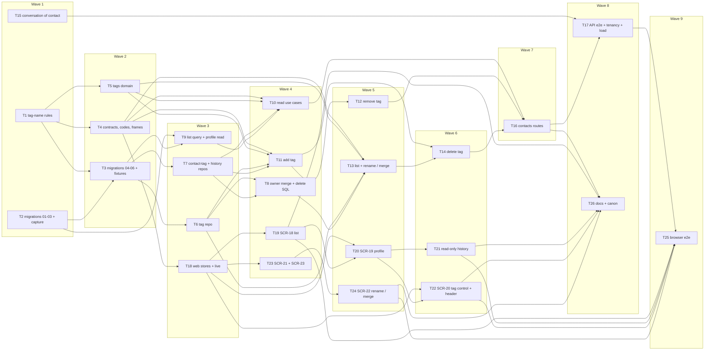

# Epic — contacts

> **Spec:** [spec.md](../spec.md) · **Design:** [sad.md](../sad.md) · **Data model:** [data-model.md](../data-model.md) · [audit](../_audit/data-model-2026-10-19.md) · **API:** [openapi.yaml](../contracts/openapi.yaml) · [events.md](../contracts/events.md) · [api-sync-report.md](../contracts/api-sync-report.md) · **Screens:** [screens.md](../screens.md) · **UX flows:** [ux-flows.md](../ux-flows.md) · **ADRs:** [adr/](../adr/)

## Goal

This epic lets the team find any customer of the workspace and see who they are and where their conversation stands without the inbox list, makes tagging part of answering, and lets a business owner trust a tag as a segment: its size is visible, it does not split into look-alikes and it never includes another workspace's customers (spec §2 Goals). The Contacts list and the contact profile replace the ui-redesign previews with real data; a member tags a contact from the conversation header or the profile; an owner renames, merges and deletes tags in Settings → Tags; every change is kept in the contact's tag history, and reading a profile never counts as reading the conversation.

## Scope

- **In:** both declared surfaces (`sad.md` `target_surfaces: [backend-service, web-frontend]`). Backend: six staged migrations (`01`–`03` with the capture change in T2, `04`–`06` with the fixtures in T3); the shared tag-name rules and contracts, eight error codes and two live frames / signals; the `contacts` module's tag domain, repositories with isolation tests, use cases (list, profile, history, add, remove, list tags, rename / merge, delete) and its first `http/routes.ts`; `conversations.findByContact` and the inbox read of a contact's conversation; API e2e, tenancy, secrecy and load tests. Web: the contacts and tags stores with live re-reads, SCR-18 (list), SCR-19 (profile with the read-only history), SCR-20 (tag control, also on the SCR-02 header), SCR-21…SCR-23 (Settings → Tags with rename / merge and delete), browser flows; the ui-redesign contacts sample source, previews and `SampleDataBadge` are removed. Docs: `CLAUDE.md`, the architecture map, the design-system canon, `CONTEXT.md`.
- **Out (spec §3):** notes on a contact; deleting, hiding or merging contacts and self-serve erasure (OQ-2); phone, email or custom fields; Telegram profile photos; broadcasts, saved segments and export; a tag lens in the inbox list and bulk tagging; blocked-bot tracking; excluding tags in the filter (OQ-1).

**Size note:** 26 tasks, above the usual 8–20 for an M feature (as the precedents: operator-notifications 30, shared-inbox 29, assignment-statuses 24). The feature gives `contacts` its first routes, three new tables and a concurrency-heavy write path, touches `conversations` and `inbox`, and declares two surfaces (the `ui` layer adds seven tasks plus a browser-flow task). The add path, the owner merge and the owner delete are split so each task stays within one day and one reviewable PR.

## Task map

Waves (what can run in parallel once its upstream is done):

- **Wave 1:** T1, T2, T15
- **Wave 2:** T3, T4, T5
- **Wave 3:** T6, T7, T9, T18
- **Wave 4:** T8, T10, T11, T19, T23
- **Wave 5:** T12, T13, T20, T24
- **Wave 6:** T14, T21, T22
- **Wave 7:** T16
- **Wave 8:** T17, T26
- **Wave 9:** T25

## Tasks

See [tracker.md](./tracker.md) for status. Machine contract: [tasks.json](../tasks.json).

| # | Task | Layer | Blocked by | DoD (short) |
|---|---|---|---|---|
| T1 | Add the shared tag-name rules: tidy, name key, 1–32 grapheme length and tag-list order | domain | — | Unit tests prove the tidy rule (NFC |
| T2 | Promote migrations 01–03 (first and last wrote, their backfill, the list indexes) and make capture widen first and last wrote unconditionally | migration | — | Migrations 01–03 are promoted |
| T3 | Promote migrations 04–06 (tags, contact_tags, contact_tag_history), regenerate DB types and add the tag fixtures | migration | T1, T2 | Migrations 04–06 are promoted and apply and revert cleanly |
| T4 | Add the contacts zod contracts, the eight tag error codes, and the contact.changed / tags.changed frames and signals with their hub mapping | ports | T1 | packages/shared and platform unit tests pass for every new schema and every contract example |
| T5 | Add the tags domain: the limits (100 per workspace, 20 per contact, 60 per 60 s, 50 per page), the history kinds and sources, the merge link rule and the rate-limit retry time | domain | T1 | Domain unit tests prove both tag limits at their boundary |
| T6 | Build the tag repository: the workspace tag lock, find by name key, insert, the workspace count, the tag list with counts in tag-list order, id resolution, the row locks and the rename, with cross-workspace isolation tests | infra | T3 | Integration tests prove find by key |
| T7 | Build the contact-tag and tag-history repositories for member changes: the contact row lock, a contact's tags in tag-list order, link insert and delete, history entries, the history keyset page and the member-kind rate count, with isolation tests | infra | T3 | Integration tests prove the contact row lock |
| T8 | Add the owner set-based statements: merge (merged entries, keep the earlier link, re-point the rest) and delete (links with RETURNING, deleted entries) | infra | T6, T7 | Integration tests on the AC-09 seed prove the merge leaves 14 contacts on "VIP" |
| T9 | Build the contacts list query (search, any / all / none with the all-of grouped semi-join, keyset with the NULL tail, tags per row, matching and total counts) and the profile read | infra | T2, T3 | Integration tests prove ordering by last wrote with id ties and the NULL tail |
| T10 | Add the contacts read use cases: the list page (normalised search, resolved and missing tag ids, the none-with-tags refusal), the profile with adders' names and the tag-history page with actors' names, through a contacts → workspaces display-name port | app | T4, T5, T7, T9 | Unit tests prove the list use case normalises the search |
| T11 | Add addContactTag: by id or by name with find-or-create under the workspace tag lock, the contact lock, the no-op, the 20 and 100 limits, the member rate limit, the tag row key-share, the link, one added entry and the signals | app | T4, T5, T6, T7 | Unit and integration tests prove every branch of the add path in the ADR-0004 lock order |
| T12 | Add removeContactTag: the contact lock, the no-op for a tag no longer carried (foreign ids included), the member rate limit, the link delete, one removed entry and contact.changed | app | T11 | Unit and integration tests prove a recorded remove deletes the link |
| T13 | Add the owner tag use cases listTags and renameTag: rename, case-only rename, same-text no-op, TAG_NAME_TAKEN with the holder's count, and the confirmed merge with TAG_MERGE_TARGET_CHANGED, tags.changed and the tag.merged log event | app | T4, T5, T6, T8 | Unit and integration tests prove listTags in tag-list order with zero counts |
| T14 | Add deleteTag against the confirmed count: TAG_COUNT_CHANGED with the current count, deleted entries on every contact that lost the tag, tags.changed | app | T11, T13 | Unit and integration tests prove a delete against the matching count removes the tag from the workspace and every contact with one deleted entry each and one tags.changed |
| T15 | Add conversations.findByContact and the inbox read getContactConversation, and pin with integration tests that the profile's reads never change read state | app | — | Integration tests prove getContactConversation returns the contact's ConversationSummary for either role and 404 for a foreign contact |
| T16 | Register the contacts routes (registerContacts): the eight operations with their zod schemas, the ownerOnly guard on rename and delete, and the wiring in buildDeps and buildApp | ports | T10, T12, T14 | Route integration tests prove every contacts operation answers its contract shape and every listed error code |
| T17 | Add the API end-to-end contacts stories, the integrity queries, the cross-workspace and secrecy suite, the live-push assertions and the seeded 10 000-contact timing checks | tests | T15, T16 | The API e2e stories pass against Postgres and the fake Bot API |
| T18 | Add the web contacts and tags API sources and stores, with the live subscriptions to contact.changed, tags.changed, conversation.changed (never mark read) and resync | ui | T4 | Store unit tests prove each live frame triggers exactly the re-reads screens.md lists (contact.changed for the shown contact |
| T19 | Build SCR-18, the Contacts list: ContactsTable and TagFilter with the address state, Show more, the counts, the missing-tag notice and the empty and error states, replacing ContactsPreview | ui | T18 | Testing Library tests cover every SCR-18 state in screens.md (loading |
| T20 | Build SCR-19, the contact profile: the header card with facts and tags, the conversation card, the Conversation / Tag history tabs with TagHistoryList and ContactCrumb, and remove the contacts sample source and SampleDataBadge | ui | T18, T19 | Testing Library tests cover every SCR-19 state in screens.md except the Conversation-tab history (T21): loading |
| T21 | Build ContactConversationHistory, the profile's read-only thread: inbox-order items, older pages, media, live items, no read marking and no composer, with ReplyDeliveryState readOnly | ui | T20 | Testing Library tests cover every Conversation-tab state of SCR-19 in screens.md (history in inbox order |
| T22 | Build SCR-20, the TagControl, and mount it on the profile and on the inbox conversation header (SCR-02) with the contact's tags and the name linking to the profile | ui | T18, T20 | Testing Library and unit tests cover every SCR-20 state in screens.md (suggestion order |
| T23 | Build Settings — Tags (SCR-21) with the counts as links and the DeleteTagDialog (SCR-23), the owner-only Tags section in SettingsLayout and its route | ui | T18 | Testing Library tests cover every SCR-21 and SCR-23 state in screens.md (loading |
| T24 | Build SCR-22, the RenameTagDialog with its merge step: name rules in place, TAG_NAME_TAKEN turned into the merge offer, TAG_MERGE_TARGET_CHANGED re-ask | ui | T23 | Testing Library tests cover every SCR-22 state in screens.md (default |
| T25 | Add browser end-to-end contacts flows against the real API: list and filter, profile reading without marking read, tagging live between two members, owner rename / merge / delete, the operator refusal | tests | T17, T19, T21, T22, T24 | The browser flows pass locally and in CI with pnpm test:e2e: the list with search |
| T26 | Update CLAUDE.md, the architecture map, the design-system canon and CONTEXT.md for the contacts routes and tables, the contacts → workspaces edge, the new signals and the new components | docs | T16, T19, T21, T22, T24 | CLAUDE.md and the architecture map name the contacts routes |

## Risks / Hard rules

- **Tenancy (CLAUDE.md, sad.md §8):** every new repository method takes `workspaceId` and has a cross-workspace isolation test over `twoWorkspacesWithTags` (T6, T7, T8, T9); `contact_tags` and `contact_tag_history` carry composite FKs so a cross-workspace link is unrepresentable (T3). **No new controlled tenancy exception** — the five stay five (T26 states it).
- **Module direction (ADR-0001):** `contacts` stays a leaf that reads no conversation data; its one new edge is `contacts → workspaces` (display names, app layer, T10). The profile's conversation part comes from `inbox` (`getContactConversation`, T15) and the unchanged thread reads.
- **Lock order (sad.md §8, ADR-0004):** member add — `tags:<ws>` (by name only) → contact `FOR NO KEY UPDATE` → no-op / 20 → `tag-changes:<ws>:<account>` + count → tag `FOR KEY SHARE` → link → history → publish; member remove — contact → no-op → limit → delete → history → publish; owner — `tags:<ws>` → tag rows `FOR UPDATE` in id order → set-based links → history → publish (T11–T14). A deadlock test races a member add against a merge (T13).
- **History completeness (ADR-0003):** every addition and removal — by a member, a merge or a delete — writes its entry in the same transaction; a rename writes none; the §7 integrity query is asserted after every e2e story (T17).
- **Read state (ADR-0006):** no contacts or tags code path calls `markConversationRead`; pinned by an API integration test (T15, T17) and web tests (T18, T21).
- **Code findings carried from the data-model audit:** capture must widen first / last wrote **unconditionally** with `LEAST` / `GREATEST`, keeping the newer-profile gate only for the profile fields (T2); the "all of" filter must use the **grouped semi-join** form (`… GROUP BY contact_id HAVING count(*) = cardinality($ids)`), not a correlated count (466 ms vs 4 ms at 10 000 contacts, T9).
- **Expand → backfill, no contract:** `01`–`03` go with the capture change (T2); `02` is gap-safe; the columns stay nullable by design. `04`–`06` are neutral and follow (T3).
- **Untrusted text and secrecy (spec §6.1, sad.md §8):** tag names, contact names and usernames render as plain text; no frame, signal or log line carries a name (T11, T17, T20).
- **Latency targets (spec §6):** list and profile ≤ 500 ms, tag change ≤ 300 ms, owner ops on 10 000 contacts ≤ 2 s, live update ≤ 3 s — seeded checks in T17.
- **Contract flags carried in:** F-1 (action POSTs instead of PATCH / DELETE) is the route table of T16; F-2 (`TAG_MERGE_TARGET_CHANGED`) lands in T4 / T13 / T24; F-3 (a contact with no conversation → `404`) is rendered as «No conversation to show» in T20.

## Assumptions (autonomous run 2026-10-19)

- Depth = medium, size M, route `standard` (`.size` / `.route`); owner Dmytro Hopko on every task; estimates S = ½ day, M = 1 day.
- **Migrations split in two lanes by ordinal group:** T2 promotes `01`–`03` together with the capture upsert change (the audit's «promote with the capture change»); T3 promotes `04`–`06` with the tag fixtures. Both are `layer: migration` and touch `db.types.gen.ts`, so they run serialized.
- **The tag-name rules live in `packages/shared`** (T1) and are re-exported by `contacts/domain`, so the picker, the rename dialog, the fixtures and the server use one function (ADR-0002).
- **Owner use cases live in `contacts/app/tag-admin.ts`** (T13, T14), apart from the member `contacts/app/tags.ts` (T11, T12), so the two lanes do not serialize on one file.
- **The hub mapping of the two new signals is in the contracts task** (T4), as the operator-notifications precedent did with its frame; T4 also makes the inbox store ignore the new frames so the web keeps type-checking before T18 subscribes.
- **API e2e lives in `apps/api/src/e2e/`** (as `notification-flows.int.test.ts` / `notification-load.int.test.ts`); the 10 000-contact timing checks are integration tests, not a separate load tool (spec §6 measurement column).
- **ui-redesign sample data is removed where replaced:** `ContactsPreview` in T19; `ContactProfilePreview`, `sample-data.ts`, `sample-source.ts` (+ tests), `SampleDataBadge` (+ test) and the route's sample crumb in T20; the canon row in T26. Nothing else in the repo uses them (checked 2026-10-19).
- No task writes a run book: the integrity queries live in the integration suite (T17) and are recorded in the architecture map (T26), as in the precedent.
- Tracker export: no issue-tracker MCP is connected; the task files are the copy-paste-ready bodies.
