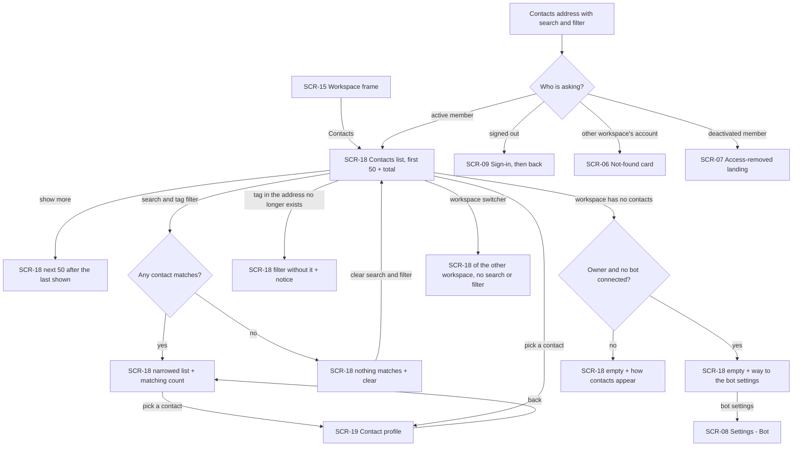
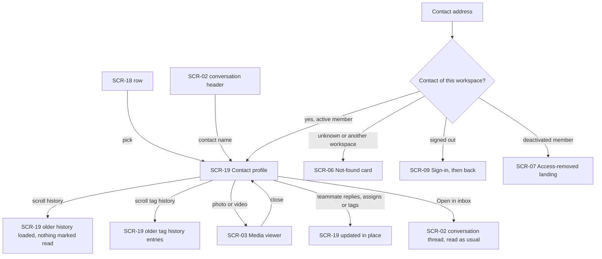
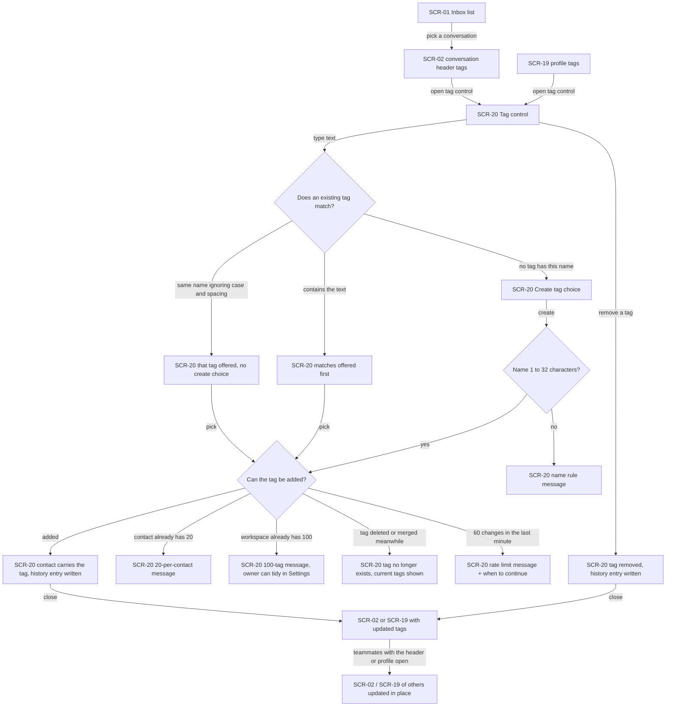
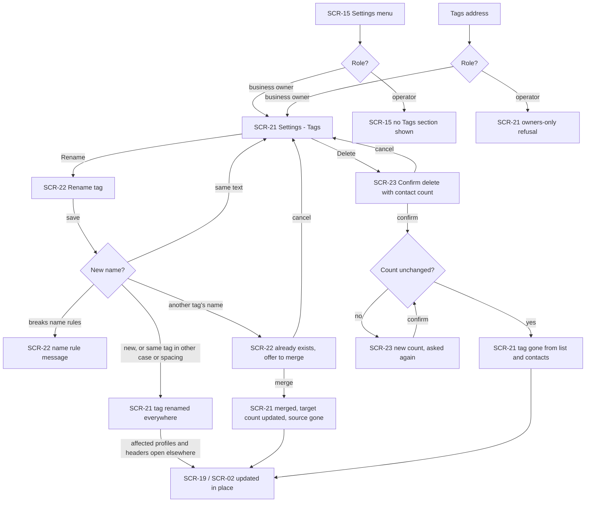
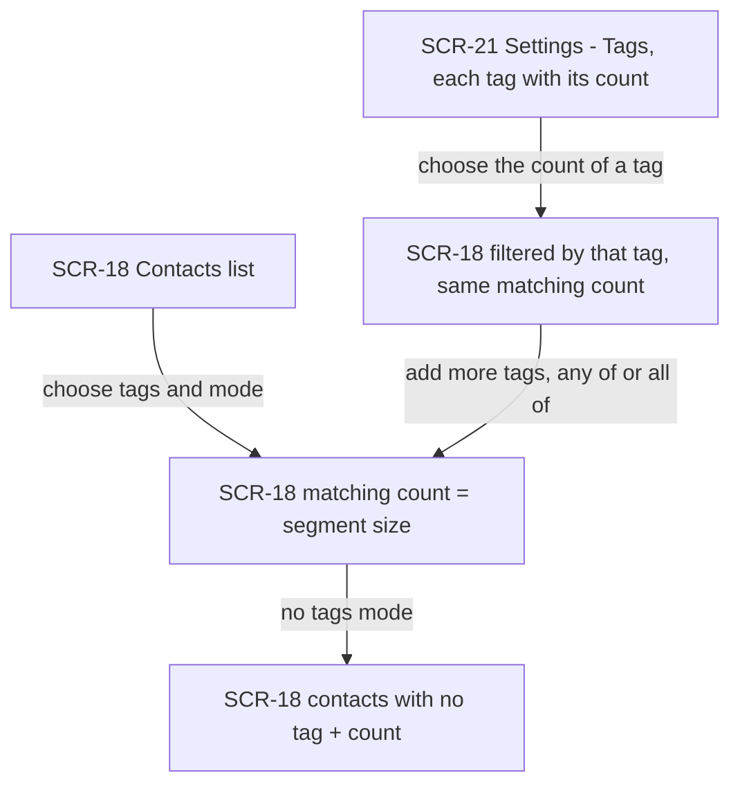

# UX flows — contacts

> User flows for every UI-touching §4 user story, produced by `ux-flows` (after `clarify`, before
> `design`) and read by `design` (evidence for the target-surface + UI-architecture decisions),
> `sequences` (UI-driven flows align on SCR ids), `screens` (details every inventory row) and
> `plan-tests` (the e2e-through-UI paths). **Always markdown + mermaid `flowchart`**, whatever the
> design tool — this artifact is flow-altitude, not visual design.

## Platform decisions

- **Posture:** desktop-first, per `docs/design-system.md` §Platform posture. Every flow must also work at phone width (≥360px). At phone width the Contacts list stacks its rows, and the tag control opens over the profile or the conversation header in the same way.
- **Builds on the shipped panel lineage:** SCR-01, SCR-02, SCR-03, SCR-06, SCR-07, SCR-08 and SCR-09 keep their shared-inbox ids and meanings. SCR-15 keeps its operator-notifications id (the workspace frame). New ids start at SCR-18, after the SCR-01…SCR-17 used so far. The two ui-redesign previews are **replaced, not reused under their old ids**: ui-redesign's SCR-09 (Contacts preview) and SCR-10 (Contact profile preview) clash with the lineage's SCR-09 (Sign-in) and SCR-10 (Choose assignee). They become SCR-18 (Contacts list) and SCR-19 (Contact profile), keeping the same addresses and the same place in the navigation, with real data and no "Sample data" label. SCR-04, SCR-05 and SCR-10…SCR-14, SCR-16 and SCR-17 are unchanged and not visited here.
- **One tag control, two places:** the same tag control (SCR-20) opens from the contact's tags in the inbox conversation header (SCR-02) and on the contact profile (SCR-19). It opens over the screen it was opened from, so the member never leaves the conversation they are answering. Adding, removing and creating happen inside it with no confirmation step. Its guidance line is always shown.
- **Tags are managed in Settings, by owners only:** a new Settings section, Settings — Tags (SCR-21), sits next to Bot and Team. It is hidden from operators. An operator who opens its address gets the same in-place owners-only refusal as on the other owner-only sections. Rename (SCR-22) and delete (SCR-23) are dialogs over SCR-21. A merge is not a separate action: it is the second step of the rename dialog when the new name already exists.
- **The profile is read-only for the conversation:** it shows the conversation's state and history but has no reply box and marks nothing read. "Open in inbox" goes to that conversation's address (SCR-02), where reading counts as before. The contact's name in the inbox conversation header goes the other way, to the profile.
- **Addresses carry state:** the Contacts list's search, filter mode and chosen tags are part of its address (AC-02), and a profile has its own address (AC-04). A count in Settings — Tags links to a filtered Contacts address (AC-10).
- **Live, not refreshed:** tags and tag history on an open profile, the tags in an open conversation header, and the profile's conversation state and history update from teammates' changes without reloading. The Contacts list and Settings — Tags refresh only when opened or when their search or filter changes. How the updates arrive is a `design` decision (the existing change signal is the obvious candidate).
- **Out of scope as a separate drawing:** none. All five stories have screens. US-05 shares its screens with US-01 and US-04.
- **Design input, not decided here:**
  - Live tag changes in other members' open profiles and conversation headers need a tags-changed signal on the existing live channel (the glossary's change signal already names "contact's tags").
  - The profile's history reuses the inbox thread's way of loading and showing items, but it must never move the member's read position. That is a separate read path, or a flag on the existing one.
  - Delete re-checks the number of contacts shown in its confirmation (SCR-23). Like the inbox's close snapshot, this needs the count the owner was shown to be sent back with the delete.

### Assumptions (autonomous run 2026-10-19)

- Depth = medium, posture = desktop-first per the design canon (no deviation). The pipeline confirmed each flow itself; the prose after each flow is that confirmation and can be vetoed at review.
- The tag control is a small panel over the current screen rather than a page, because AC-06 has the member tagging "while answering".
- Settings — Tags lists tags only. Choosing a tag's count leaves Settings for the filtered Contacts list (SCR-18), which is the only place that lists contacts.
- The empty Contacts list offers the business owner of a workspace with no connected bot the way to Settings — Bot (SCR-08), as the inbox does. An operator gets the explanation only.
- After a merge or delete, SCR-21 shows the updated list in place. After a rename, the tag keeps its place in the list order by its new name.
- A deactivated member's or signed-out person's way out (SCR-07, SCR-09) is the existing panel behaviour; contacts adds no new screen for it.

## Screen inventory

| ID | Screen | Purpose | Entry | Exit |
|---|---|---|---|---|
| SCR-01 | Inbox — conversation list | (reused, shared-inbox SCR-01) The workspace's conversations; unchanged here, and its rows show no tags | Inbox in the navigation | SCR-02 |
| SCR-02 | Inbox — conversation thread | (reused, shared-inbox SCR-02) One conversation. Its header now shows the contact's tags with the tag control, and the contact's name links to the profile | a conversation in SCR-01; "Open in inbox" on SCR-19; a conversation address | SCR-19 (contact name); SCR-20 (tag control); SCR-01 |
| SCR-03 | Media viewer | (reused, shared-inbox SCR-03) A photo or video opened full-size, now also from the profile's history | a photo or video in SCR-19's history | SCR-19 (close) |
| SCR-06 | Not found (in frame) | (reused) Not-found card for a contact, Contacts or Settings address the account may not see or that does not exist; no hint that it exists | an unknown or foreign contact address; a Tags or Contacts address of another workspace | SCR-18 of the account's own workspace |
| SCR-07 | Access-removed landing | (reused) Workspace picker / no-access screen with the access-removed notice | any contacts or tags visit or action after the member was deactivated | another workspace's SCR-01; sign out |
| SCR-08 | Settings — Bot | (reused, shared-inbox SCR-08 = ui-redesign SCR-11) Owner-only bot settings | the owner's link on the empty SCR-18 when no bot is connected | SCR-21 / SCR-18 via the Settings menu or navigation |
| SCR-09 | Sign-in | (reused) Sign-in. A signed-out visit to a contacts, profile or Tags address lands here and returns afterwards | a panel address while signed out | the requested SCR-18 / SCR-19 / SCR-21 |
| SCR-15 | Workspace frame | (reused, operator-notifications SCR-15 = ui-redesign SCR-07) Side navigation and breadcrumb around every workspace page. Contacts in the navigation, Tags in the Settings menu for owners only | entering any workspace page | SCR-18, SCR-21, SCR-01 via the navigation |
| SCR-18 | Contacts list | New, replaces the ui-redesign Contacts preview: the workspace's real contacts, newest "last wrote" first, 50 at a time with "show more". Has search, the tag filter (any of / all of / no tags) and the total or matching count. Empty states: nothing matches (with clear) and no contacts yet (with the owner's way to the bot). Says when a tag in the address no longer exists | Contacts in the navigation; a Contacts address (with search / filter); a count on SCR-21; back from SCR-19 | SCR-19 (pick a contact); SCR-08 (owner, no bot); another workspace's SCR-18 (switcher, filters reset) |
| SCR-19 | Contact profile | New, replaces the ui-redesign Contact profile preview: the contact's Telegram facts, tags with who added each and when, tag history, the conversation's status, assignee and waiting marker, "Open in inbox", and the read-only history (messages, replies, activity, media). No reply box | a row of SCR-18; the contact's name on SCR-02; a contact address | SCR-02 ("Open in inbox"); SCR-20 (tag control); SCR-03 (media); SCR-18 (back / navigation) |
| SCR-20 | Tag control | New, opens over SCR-02 or SCR-19: the contact's tags with remove. Typing suggests existing tags, with carried ones marked; "Create tag …" appears only for a new name. Shows the always-on guidance line and refusals in place: name rules, the 100-tag and 20-per-contact limits, the per-member rate limit, a tag that no longer exists | the tags in the SCR-02 header; the tags on SCR-19 | back to SCR-02 / SCR-19 (closed), with the contact's tags updated |
| SCR-21 | Settings — Tags | New, owners only: every tag in dictionary order with its contact count, plus rename and delete on each. For an operator the section is hidden, and its address shows the owners-only refusal | Settings menu (business owner); a Tags address | SCR-22; SCR-23; SCR-18 filtered by a tag (a count) |
| SCR-22 | Rename tag | New, dialog over SCR-21: enter a new name. A name that is already another tag turns the dialog into a merge offer that states both tags; confirming merges them | "Rename" on a tag in SCR-21 | SCR-21 (renamed, merged, or cancelled) |
| SCR-23 | Confirm delete tag | New, dialog over SCR-21: states how many contacts lose the tag and that this cannot be undone. When the number has changed by the time the owner confirms, it shows the new number and asks again | "Delete" on a tag in SCR-21 | SCR-21 (deleted or cancelled) |

## Flows

### Flow: US-01 — Find a customer

Contacts in the navigation opens the list of the workspace's real contacts. Each row shows the name, username, tags, language, and when the contact first and last wrote. The newest "last wrote" comes first, with the total count. "Show more" adds the next 50 after the last one shown. Searching or choosing tags in any of / all of / no tags mode narrows the list and shows how many match. If nothing matches, one sentence and a clear button bring the full list back. The search and filter live in the address, so reload, back and saved links reopen the same view. A saved link whose tag has since been deleted or merged drops that tag and says so. A renamed tag still filters under its new name. A workspace with no contacts explains that contacts appear when customers write to the bot. A business owner whose workspace has no bot is also offered the way to the bot settings. Picking a contact opens the profile, and back returns to the same list. Switching workspace starts the other workspace's list clean. A Contacts address reached while signed out goes through sign-in and back. From another workspace's account it is a not-found card, and for a deactivated member it is the access-removed landing (AC-12).

### Flow: US-02 — Know who a customer is

A profile is reached from a Contacts row, from the contact's name in an inbox conversation header, or by its own address. It shows the Telegram facts, and missing ones are marked as absent. It also shows the tags with who added each and when, the tag history (newest first, more on scrolling), and the conversation's status, assignee and "waiting for a reply" marker. Below that is the conversation history in inbox order, with older parts loaded on scrolling and media opening in the viewer. Reading here never counts as reading the conversation: unread and attention counts and pings stay as they were, and there is no reply box. New messages, replies, activity lines, the conversation state and teammates' tag changes appear in place. "Open in inbox" goes to the conversation, where reading counts as before. A contact address that does not exist or belongs to another workspace shows the not-found card in the frame. Signed-out and deactivated visits take the usual paths (AC-04, AC-05, AC-12, AC-13).

### Flow: US-03 — Tag customers while I work

While answering a conversation picked from the inbox list, from the tags in its header, or on the profile, the member opens the tag control over the screen they are on. It always shows one line that tags are visible to the whole team and must not record sensitive traits. Typing offers existing tags that contain the text, those starting with it first. Tags the contact already carries are shown as carried. "Create tag …" appears only when no tag has that name, ignoring letter case and spacing. Typing "vip" next to "VIP" offers only "VIP". Picking or creating adds the tag at once and writes a tag history entry with the member, the time and where it was made. Removing works the same way. A refusal stays in the control and changes nothing: a name outside 1–32 characters, the 20-per-contact or 100-per-workspace limit, a tag an owner deleted or merged meanwhile (the control then shows the current tags), or the per-member limit of 60 changes a minute. A tag the owner only renamed is added under its new name. Closing the control leaves the member where they were with the updated tags. Teammates who have that header or profile open see the change without reloading. Nothing reaches the customer, and tagging works whatever the bot's state (AC-06, AC-07, AC-08, AC-13, AC-14, AC-15).

### Flow: US-04 — Keep the tag list tidy

A business owner opens Settings — Tags from the Settings menu. An operator does not see the section, and its address shows them the owners-only refusal; they can still tag contacts. Rename opens a dialog. A name outside the rules is refused in place. The exact same text changes nothing. A new name, or the same name in another letter case or spacing, renames the tag on every contact without writing history. A name that is already another tag asks first: it states that this tag exists and offers a merge. Confirming moves every contact to the target tag (once each, keeping who added it first), writes "merged into" in the history of each contact that carried the merged tag, and the merged tag leaves the list. Delete opens a confirmation that states how many contacts lose the tag and that this cannot be undone. If the number has changed when the owner confirms, nothing is deleted and the new number is shown for a second confirmation. After a delete, each affected contact's history records the removal. Profiles and conversation headers open elsewhere update without reloading (AC-09, AC-11, AC-12).

### Flow: US-05 — See how big a segment is

Every tag in Settings — Tags shows how many contacts carry it, including tags on no contact. Choosing that count opens the Contacts list filtered by the tag, and the list shows the same number of matching contacts. On the Contacts list, any member can combine tags with "any of" or "all of", or pick "no tags", and the page says how many contacts match. That number is the size of a future broadcast segment. Counts only ever include this workspace's contacts (AC-02, AC-10, AC-12).

## AC coverage

| AC | Shown by | Notes |
|---|---|---|
| AC-01 | Flow US-01 → `N` → `L`, `L` → `L2`, `L` / `LF` → `P` | business owner = operator (prose); missing username or language shown as absent (prose) |
| AC-02 | Flow US-01 → `F` → `LF`, `GONE`, `L0`; Flow US-05 → `F`, `NT` | search rules and address state in prose; renamed tag keeps filtering |
| AC-03 | Flow US-01 → `NM`, `E` → `EB` → `BOT` / `EX` | |
| AC-04 | Flow US-02 → `P`, `H`, `TH`, `M`, `T`; `C` → `X` → `NF` | profile reachable from list, header and address |
| AC-05 | Flow US-02 → `H`, `LIVE`, `T` | no reply box, nothing marked read (prose); read-state proof is an integration test |
| AC-06 | Flow US-03 → `TC` → `SUG` → `LIST` / `CR` / `ONLY`, `OK`, `RM`, `SEEN` | guidance line always shown; nothing sent to the customer (prose) |
| AC-07 | Flow US-03 → `NAME` → `NE`; Flow US-04 → `V` → `RNE` | |
| AC-08 | Flow US-03 → `ONLY`, `L20`, `L100` | two members creating the same name at once end with one tag (no UI branch; integration test) |
| AC-09 | Flow US-04 → `RN` → `T1`, `MG` → `T2`, `D` → `DC` → `T3` / `D2`, `SEEN` | history entries per merge / delete (prose) |
| AC-10 | Flow US-05 → `T` → `L` | dictionary order, tags with 0 contacts listed |
| AC-11 | Flow US-04 → `HID`, `REF` | operator still tags contacts (Flow US-03) |
| AC-12 | Flow US-01 → `AU` → `SI` / `NF` / `AR`; Flow US-02 → `X` → `NF` / `SI` / `AR` | cross-workspace tag on a contact has no UI path; refused server-side (integration test) |
| AC-13 | Flow US-02 → `P` (prose); Flow US-03 (prose) | renamed customer, deactivated adder and bot state change no flow; the same person in another workspace is a different SCR-19 |
| AC-14 | Flow US-03 → `ADD` → `GONE` | renamed meanwhile → added under the new name (prose) |
| AC-15 | Flow US-03 → `ADD` → `RL` | owner actions are not limited (prose) |
