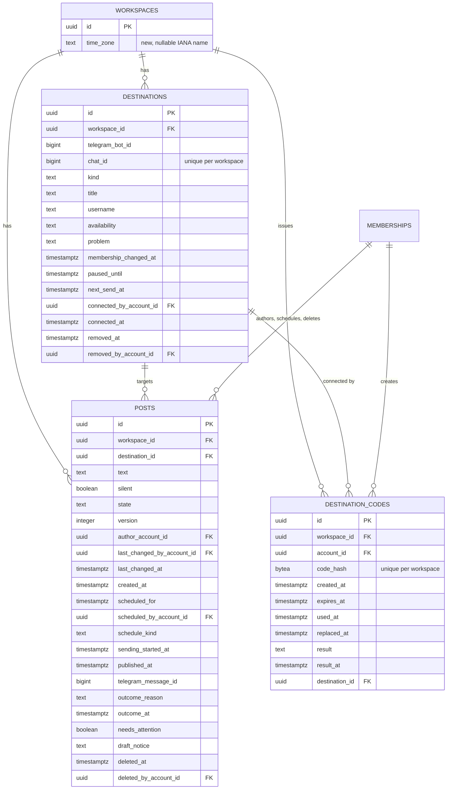

# Data model — group-posts

## Assumptions (autonomous run 2026-11-03)

Decided by the skill without questions (the owner asked for none); each can be vetoed at review:

- **Conventions followed, not chosen:** the repo's own (architecture map, broadcasts and notifications migrations): UUIDv7 ids from `newId()` with no DB default, `timestamptz` audit columns written by the app, `CHECK` constraints for implied rules, `text` columns, composite `(workspace_id, …)` foreign keys including to `memberships`, a `UNIQUE (workspace_id, id)` target on every parent, hard deletes only for drafts.
- **Aggregates:** `posts` (root, owned by posts) and `destinations` (root, owned by posts) with `destination_codes` hanging off a destination once used; `workspaces.time_zone` is a column of the workspaces aggregate (ADR-0006).
- **Telegram ids** (`telegram_bot_id`, `chat_id`, `telegram_message_id`) are `bigint`, never keys.
- **What is not stored:** the post text and chat titles are never copied elsewhere (logs, jobs); the connect code is stored only as its SHA-256; nothing written by people in a destination chat is stored.

## ER diagram

## Entities

### `workspaces` (existing, owned by workspaces) — new column

| Column | Type | Constraints | Notes |
|---|---|---|---|
| `time_zone` | text | NULL, CHECK 1–64 chars, trimmed | IANA name, validated in `packages/shared/src/time-zone.ts`; NULL until the first owner who schedules confirms it (ADR-0006) |

### `destinations` (owned by posts)

| Column | Type | Constraints | Notes |
|---|---|---|---|
| `id` | uuid | PK, app UUIDv7 | |
| `workspace_id` | uuid | NOT NULL, FK → `workspaces(id)`; UNIQUE `(workspace_id, id)`, UNIQUE `(workspace_id, chat_id)` | one row per chat per workspace, revived by a later code |
| `telegram_bot_id` | bigint | NOT NULL | the bot it was connected with; a different current bot → unavailable at read time (AC-14) |
| `chat_id` | bigint | NOT NULL, CHECK < 0 | moved on a supergroup upgrade (flow 7) |
| `kind` | text | NOT NULL, CHECK `channel` / `group` | |
| `title` | text | NOT NULL, non-empty | as Telegram shows it; refreshed on rename |
| `username` | text | NULL, non-empty | public username when the chat has one |
| `availability` | text | NOT NULL, CHECK `available` / `unavailable` | |
| `problem` | text | NULL iff available; `no_post_right` / `not_member` / `chat_gone` | AC-13 |
| `membership_changed_at` | timestamptz | NOT NULL | Telegram time of the newest membership fact; older facts are ignored |
| `paused_until` | timestamptz | NULL | per-chat limit after a post `429` (ADR-0007) |
| `next_send_at` | timestamptz | NULL | last post sent + 3 s (ADR-0007) |
| `connected_by_account_id` | uuid | NOT NULL, FK → `memberships(workspace_id, account_id)` | the owner whose code connected or revived it |
| `connected_at` | timestamptz | NOT NULL | |
| `removed_at`, `removed_by_account_id` | timestamptz, uuid | NULL together, FK → memberships | an owner's removal; a later code clears both |

### `destination_codes` (owned by posts)

| Column | Type | Constraints | Notes |
|---|---|---|---|
| `id` | uuid | PK | |
| `workspace_id` | uuid | NOT NULL, FK; UNIQUE `(workspace_id, code_hash)` | redeem by hash inside the receiving bot's workspace |
| `account_id` | uuid | NOT NULL, FK → memberships | the business owner who created it |
| `code_hash` | bytea | NOT NULL, 32 bytes | SHA-256 of the code; the code is shown once |
| `created_at`, `expires_at` | timestamptz | NOT NULL, `expires_at > created_at` | 10 minutes |
| `used_at` | timestamptz | NULL; set iff `destination_id` set | single use |
| `replaced_at` | timestamptz | NULL; never with `used_at` | a newer code of the same owner |
| `result`, `result_at` | text, timestamptz | NULL together; `connected` / `no_post_right` (channel, no right to post) / `no_send_right` (group, may not send messages) / `destination_limit` (20 destinations reached); `connected` iff used | what the live dialog shows; expiry is derived from `expires_at` |
| `destination_id` | uuid | NULL, FK → `destinations(workspace_id, id)` | the destination it connected or revived |

### `posts` (owned by posts)

| Column | Type | Constraints | Notes |
|---|---|---|---|
| `id` | uuid | PK; UNIQUE `(workspace_id, id)` | |
| `workspace_id` | uuid | NOT NULL, FK | |
| `destination_id` | uuid | NULL only in a draft, FK → `destinations(workspace_id, id)` | AC-04 |
| `text` | text | NOT NULL, ≤ 4096 code points, trimmed, non-empty past draft | full rule in `broadcast-text.ts` |
| `silent` | boolean | NOT NULL | "send without sound" |
| `state` | text | NOT NULL, CHECK 8 states | `draft`, `scheduled`, `sending`, `published`, `failed`, `missed`, `not_confirmed`, `deleted` |
| `version` | integer | NOT NULL, ≥ 1 | draft saves and returns to draft (ADR-0005) |
| `author_account_id` | uuid | NOT NULL, FK → memberships | creator or duplicator |
| `last_changed_by_account_id`, `last_changed_at` | uuid, timestamptz | NOT NULL | list order and "who last changed it" |
| `created_at` | timestamptz | NOT NULL | |
| `scheduled_for`, `scheduled_by_account_id`, `schedule_kind` | timestamptz, uuid, text | NULL together iff draft; kind `now` / `time` | the owner's confirmed instant (ADR-0006) and who confirmed it |
| `sending_started_at` | timestamptz | set for `sending` / `published` / `not_confirmed` / `deleted`, NULL for `draft` / `scheduled` / `missed` | the claim (ADR-0004); daily limit and 15-minute rule |
| `published_at`, `telegram_message_id` | timestamptz, bigint | set together iff `published` / `deleted` | open in Telegram, delete within 48 h |
| `outcome_reason` | text | set iff `failed` / `missed` | reason list in the migration comment |
| `outcome_at` | timestamptz | set iff the post reached an outcome | |
| `needs_attention` | boolean | NOT NULL; true only for `failed` / `missed` / `not_confirmed` | shared mark (flow 9) |
| `draft_notice` | text | NULL or, in a draft, `owner_deactivated` / `owner_role_changed` / `destination_removed` | AC-11, flow 10 |
| `deleted_at`, `deleted_by_account_id` | timestamptz, uuid | set together iff `deleted` | AC-15 |

## Indexes

| Index | Columns | Query it serves |
|---|---|---|
| `destinations_workspace_id_chat_id_key` | UNIQUE `(workspace_id, chat_id)` | inbound lookup of a chat in the receiving bot's workspace (flows 1, 7); one destination per chat |
| `destinations_workspace_id_live_idx` | `(workspace_id, connected_at)` WHERE not removed | Settings list and the 20-destination count (flow 10) |
| `destinations_*_account_id_idx` | member FKs | FK indexes |
| `destination_codes_workspace_id_code_hash_key` | UNIQUE `(workspace_id, code_hash)` | redeem a code (flow 1) |
| `destination_codes_workspace_id_account_id_created_at_idx` | `(workspace_id, account_id, created_at DESC)` | the owner's live code to replace; FK index for the member FK |
| `destination_codes_workspace_id_destination_id_idx` | `(workspace_id, destination_id)` partial | FK index |
| `posts_workspace_id_last_changed_at_idx` | `(workspace_id, last_changed_at DESC, id DESC)` | Posts list, all states (SCR-36) |
| `posts_workspace_id_state_last_changed_at_idx` | `(workspace_id, state, last_changed_at DESC, id DESC)` | Posts list filtered by state |
| `posts_scheduled_idx` | `(workspace_id, destination_id, scheduled_for)` WHERE scheduled | 100-scheduled count, per-chat order check in the send job, destination removal (flows 2, 5, 10) |
| `posts_sent_idx` | `(workspace_id, sending_started_at)` WHERE sent states | daily limit of 30 in 24 h (flows 2, 4) |
| `posts_attention_idx` | `(workspace_id)` WHERE needs_attention | navigation count (flow 9) |
| `posts_workspace_id_scheduled_by_account_id_idx` | partial | FK index + the deactivation return (flow 6) |
| `posts_workspace_id_{destination_id,author,last_changed_by,deleted_by}_idx` | member / destination FKs | FK indexes |

## Test fixtures

Not in migrations. Integration tests build rows through the posts app layer (as broadcasts' tests do) and the fake Telegram (`apps/api/src/test/fake-telegram.ts`, which gains `deleteMessage`, non-private `sendMessage` answers and group / channel update fixtures in `src/test/fixtures/telegram.ts`). Names and emails follow the repo's existing fixtures (`@example.test`, "Test User").
