# Software Architecture Document — group-posts

## 1. Introduction and goals

**Intent.** group-posts lets a workspace publish plain-text **posts** from its own business bot to the business's Telegram channels and groups, now or at a scheduled time, from the panel (spec §2). A chat becomes a **destination** only when a business owner's single-use **destination connect code** is posted in it, so the bot never posts into a chat it was merely added to. Any member drafts a post for one destination; only a business owner publishes it now or schedules it in the **workspace time zone**, from a confirmation that shows the chat and the exact text. A scheduled post is locked and goes out at most once, at its time or within 15 minutes of it; otherwise it is a **missed post**, never published late. Every post shows its outcome live, a business owner can delete a published post within 48 hours, and failed, missed and not confirmed posts are counted for the team's attention. Underneath, the bot now reads four kinds of fact from group and channel chats (the connect code, its own membership and rights, a group's upgrade, a chat's rename) and drops everything else written there before it costs anything, so support capture stays as fast as before.

**Top-3 quality goals (1-liners; full scenarios in §10):**

1. **Right chat, exact text, at most once** — a post goes only to a destination of its own workspace, exactly as an owner confirmed it, never twice.
2. **On time or honestly missed** — a scheduled post goes out within a minute of its time, or is marked missed after 15 minutes and never sent late.
3. **Support first** — group traffic and posting never slow customer capture, replies, pings or broadcasts.

**Stakeholders.**

| Role | Interest | Sign-off owner? |
|---|---|---|
| Business owner | connects destinations, sets the time zone, publishes, schedules, deletes published posts | No |
| Operator | drafts posts, moves a scheduled post back to a draft, watches outcomes | No |
| End customer | reads posts in the business's chats; writes in its groups without being captured | No |
| Tech Lead | SAD approval | Yes |
| Security Lead | the new inbound path from group and channel chats; owner-only timed action | Yes |

**Assumptions (autonomous run 2026-11-03)**, each can be vetoed at review:

- Every strategic choice below was decided by the skill without questions (the owner asked for a run without them). The ADR gate was applied to each; 8 ADRs resulted.
- The architecture map's `reflects_commit` (b410e14) predates the broadcasts merge, but the map and `CLAUDE.md` were updated with broadcasts; a fresh code scan (explorer, 2026-11-03) confirmed the parts this design touches, so `survey` was not re-run.

**Decision overrides:** none.

**Critic pass (autonomous run 2026-11-03):** seven findings, all resolved as amendments: `posts.send` has no singleton key and relies on the post claim (ADR-0004); the send job takes the `posts:<ws>` lock for the daily count (§6, §8); four chat facts incl. renames everywhere (ADR-0003 renamed); deactivation returns posts to drafts without attention (ADR-0005); a 1-per-second post pacer and `next_send_at` per destination (§5, ADR-0007); the time-zone route lives in `posts` (§4, §5); spec-compatible alternatives replace strawman options in ADR-0002, 0005, 0006, 0007, 0008, and §11 carries OQ-2 and OQ-3.

## 2. Constraints

**Technical.**
- TypeScript (strict) on Node.js 26; pnpm monorepo (`apps/api`, `apps/web`, `packages/shared`) — repo ADR-0001.
- Fastify 5 + grammY + Kysely on PostgreSQL 16, pg-boss for jobs, all in one API process — repo ADR-0002, ADR-0004.
- React 19 + Vite SPA, Tailwind + shadcn/ui, Zustand per feature.
- Modular monolith: `domain → app → infra → http`, cross-module calls only through app layers wired in `buildDeps()`; the only module that talks to Telegram is `bots` (`telegramApi` via the bots gateway).
- Telegram Bot API facts: a bot learns of its own membership and rights in any chat through `my_chat_member` (already in the webhook's `allowed_updates`); channel posts arrive as `channel_post`, which must be added to `allowed_updates`; in a group a bot with privacy mode on receives commands addressed to it, and an admin bot receives every message; a group upgraded to a supergroup sends a message with `migrate_to_chat_id`; `sendMessage` into one group is limited to about 20 per minute, answered `429` with `retry_after`; a bot can delete its own message in a group or channel for 48 hours (`deleteMessage`); group and channel chat ids are negative 64-bit integers (supergroups `-100…`).

**Organisational.**
- One developer with the SDD pipeline; size M (spec, `.size`).
- No deadline; ships after broadcasts as roadmap wave 7.

**Conventions.**
- `CLAUDE.md` rules: UUIDv7 ids from `newId()`, Telegram ids as `bigint` columns never primary keys, non-null `workspace_id` on every tenant table with composite foreign keys, every repository method filtered by workspace, reversible migrations + `pnpm db:codegen`, zod contracts in `packages/shared`, error classes from `platform/errors.ts` with codes in `packages/shared/src/errors.ts`, signals published inside the writing transaction (ids only), queues named `<module>.<job>`.
- No new tenancy exception (spec §6.1; CLAUDE.md "a new exception needs a change to the SAD").

**Regulatory / external.**
- Text and chat names are business content: never in logs, live frames or job payloads (as broadcasts).
- No personal data from people writing in destination chats is stored; the connect-code message is matched and removed.

## 3. Context and scope

tg-inbox is a shared Telegram inbox for small businesses: each workspace has its own business bot, a team answering customers on the web, tagged contacts and broadcasts. group-posts turns the same bot into the business's author in its own channels and groups. It adds one outbound path (posts into group and channel chats, plus deleting them) and one inbound path (three kinds of update from those chats), both through the bot's existing authenticated webhook and gateway.

<!-- brownfield: explorer scan 2026-11-03 — bots classifies updates in a pure classifier and drops non-private chats (`not_private`) before any write; my_chat_member is registered but only private chats are handled; no channel_post, migrate_to_chat_id, deleteMessage or getChat yet; workspaces has no settings columns; the realtime signal union lives in platform/realtime.ts, the client frame union in packages/shared/src/inbox.ts. -->

The trust boundary moves in one place: **group and channel chats are untrusted input**. Anyone who knows the bot's username can add it to a group and write there. Nothing from those chats is captured. Only four facts are taken from them — a code that must match an owner's live code, the bot's own membership and rights in a chat the workspace already connected (or is connecting), a group's new id after an upgrade, and a connected chat's new name — and each is scoped by the bot that received it.

**External systems (in / out):**

| Actor or system | Type | Interaction |
|---|---|---|
| Business owner | Person | Connects destinations with a code, sets the workspace time zone, publishes, schedules, changes times, deletes published posts |
| Operator | Person | Drafts and duplicates posts, moves scheduled posts back to drafts, watches outcomes |
| End customer | Person | Reads posts in the business's channel or group; writes in a group without being captured; writes privately to the bot as before |
| Telegram Bot API | System (external) | In: webhook updates, now also `channel_post` and non-private `message` / `my_chat_member`. Out: `sendMessage` to group and channel chats, `deleteMessage`. Answers `429` with `retry_after` (per chat), `400`/`403` when the bot may not post or the chat is gone |

**C4 Context (L1):**

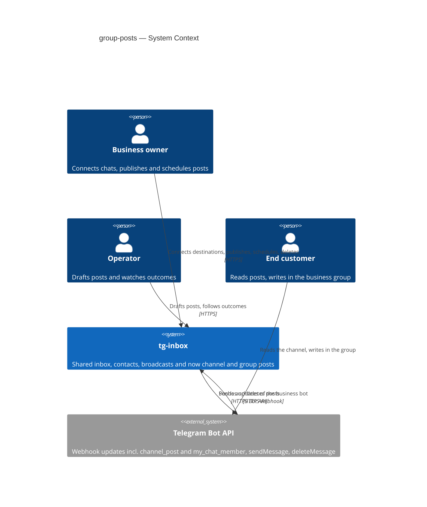

Two owners and an operator use the panel; the end customer only ever touches Telegram. tg-inbox depends on one external system, the Telegram Bot API, through the workspace's own bot: it receives the bot's updates by webhook and sends and deletes posts through the API. No other external system is added.

## 4. Solution strategy

**Target surfaces:** `backend-service` and `web-frontend`. The backend gets a new `posts` module (destinations, connect codes, posts, the send job) and small additions to `bots` (classifying group and channel updates, a chat-events port, sending and deleting posts) and `workspaces` (the time zone). The frontend gets a Posts area and a Settings section (SCR-33…SCR-44, ux-flows). The send job runs in the API process on pg-boss like every other job, so no separate `worker` surface is declared (the broadcasts precedent). Recorded with the module decision in [ADR-0001](adr/0001-add-a-posts-module-that-owns-destinations-codes-and-posts-and-reaches-bots-and-workspaces-through-their-app-layers.md).

**UI architecture (web-frontend):** client-side SPA, fixed by repo ADR-0001; no new UI ADR. `apps/web/src/features/posts/` (list, editor, dialogs, post page, stores), `features/settings` gains a "Channels & groups" section, pages in `apps/web/src/pages/`, routes under `/w/:workspaceId/posts` (index, `new`, `:postId`, `:postId/publish`, `:postId/schedule`) and `/w/:workspaceId/settings/channels`, the Posts navigation item with the shared attention count in `app-shell.tsx`.

**Top strategic choices (the seeds for ADRs):**

1. **A `posts` module that owns destinations, codes and posts** — it reaches `bots` and `workspaces` only through their app layers; `bots` reaches it back only through a late-bound port. Same shape as broadcasts. → [ADR-0001](adr/0001-add-a-posts-module-that-owns-destinations-codes-and-posts-and-reaches-bots-and-workspaces-through-their-app-layers.md)
2. **Connect a chat by a hashed single-use code received as a bot command or channel post** — proof that someone who can post in the chat holds the owner's code; no reliance on the "bot added" event. → [ADR-0002](adr/0002-connect-a-destination-by-a-hashed-single-use-code-received-as-a-bot-command-or-channel-post.md)
3. **Classify group and channel updates in `bots` and hand only four facts to `posts`** — code, membership/rights, upgrade, rename; everything else from those chats is dropped in the pure classifier before any write. → [ADR-0003](adr/0003-classify-group-and-channel-updates-in-bots-and-hand-only-codes-membership-upgrades-and-renames-to-posts.md)
4. **One pg-boss job per post at its time, which claims the post before the send** — at most once, measured window, per-chat order. → [ADR-0004](adr/0004-send-each-post-through-its-own-pg-boss-job-that-claims-the-post-before-the-send.md)
5. **Publish and schedule against the shown version; re-check the owner at the send** — a scheduled post is locked, any change returns it to a draft. → [ADR-0005](adr/0005-publish-and-schedule-against-the-shown-version-and-re-check-the-scheduling-owner-at-the-send.md)
6. **Store the schedule as an instant and the workspace time zone in `workspaces`** — one IANA zone per workspace, validated with daylight-saving rules in one shared function. → [ADR-0006](adr/0006-store-the-schedule-as-an-instant-and-one-iana-time-zone-on-the-workspace.md)
7. **Keep per-chat limits on the destination and honour the bot's send pause** — a `429` to a post pauses that destination only; posts never set the bot-wide pause. → [ADR-0007](adr/0007-keep-a-per-destination-pause-for-post-rate-limits-and-never-set-the-bot-send-pause-from-a-post.md)
8. **Delete within 48 hours through the bot and keep the post as a record** → [ADR-0008](adr/0008-delete-a-published-post-through-the-bot-within-48-hours-and-keep-the-post-as-a-deleted-record.md)

**Supporting choices (inline, below the ADR gate):**

- Text rule: the shipped `packages/shared/src/broadcast-text.ts` (UTF-16 units after trimming, 1–4096) is reused as is, not copied (broadcasts ADR-0012).
- Limits (30 sent per 24 h, 100 scheduled waiting, 20 destinations, connect codes) are counted under an advisory lock `posts:<ws>`, the same way broadcasts count launches — at publish, schedule and connect, and again by the send job before its claim.
- Live updates: two new id-only signals, `post.changed {workspace_id, post_id}` and `destinations.changed {workspace_id}` (destinations and the time zone, both published by `posts`), to every socket of the workspace.
- Time zone: the Channels & groups route that sets it lives in `posts`; it counts the workspace's scheduled posts for the confirmation, calls `workspaces.setTimeZone(tx, …)` inside its transaction and publishes `destinations.changed`, so `workspaces` never reads `posts`. No coalescing is needed (a post changes a handful of times).
- Attention: a shared `needs_attention` flag on the post, set by failed / missed / not confirmed outcomes and cleared by the first member who opens the post; the navigation count is one indexed count per workspace.
- Deactivation: `workspaces.onMembershipDeactivated` gains a third call, `posts.returnScheduledOfDeactivated`, inside the deactivation transaction; the send job re-checks too (ADR-0005).

## 5. Building block view

Layered modular monolith, as the rest of the API. `posts` is a new module with all four layers; `bots` and `workspaces` gain small app-layer additions. Dependencies stay one-way: `posts → {bots, workspaces}`; `bots → posts` exists only as a runtime port filled in `buildDeps()`; `inbox` is not involved.

**Internal decomposition:**

```
apps/api/src/modules/posts/
├── domain/       post states + transitions, schedule window (2 min / 90 days, 15-min miss),
│                 limits, connect-code format + hashing, outcome reasons
├── app/          destinations (create code, redeem, availability, upgrade, remove),
│                 drafts (create, save vs version, duplicate, delete, back to draft),
│                 publish / schedule / change time (owner, version + limits),
│                 send-post (the job body: claim, re-check, send, outcome),
│                 delete-published, attention, returnScheduledOfDeactivated, reads
├── infra/        destination / code / post repositories (Kysely), jobs.ts (posts.send + DLQ)
└── http/         routes.ts (registerPosts) + zod schemas from packages/shared
apps/api/src/modules/bots/        + classifier kinds for group/channel chats, ChatEventsPort,
                                  sendPost, deletePost, postReadiness, channel_post in allowed_updates
apps/api/src/modules/workspaces/  + time_zone column, setTimeZone (owner), timeZone read
packages/shared/src/posts.ts      DTOs, states, reasons;  time-zone.ts (zone + local-time rule)
apps/web/src/features/posts/      list, editor, dialogs, post page, stores, attention count
```

**Tables at a glance** (indicative; `data-model` fixes names, types and indexes). Every table has a non-null `workspace_id` and composite foreign keys `(workspace_id, …)`:

- `destinations` — one row per chat per workspace (unique `(workspace_id, chat_id)`): Telegram bot id it was connected with, chat id, kind, title, username, availability + problem, `paused_until` (Telegram's per-chat limit), `next_send_at` (last send + 3 s, the per-chat pace), connected by / at, removed at.
- `destination_codes` — code hash, issuing owner, created / expires / used at, and the last result shown in the dialog (connected / missing right / expired).
- `posts` — destination, author, text, silent, `version`, state (`draft`, `scheduled`, `sending`, `published`, `failed`, `missed`, `not_confirmed`, `deleted`), scheduled at + by, published at + by, Telegram message id, outcome reason, sending started at, deleted at + by, `needs_attention`, last changed by / at.
- `workspaces.time_zone` — nullable IANA zone (owned by `workspaces`).

**App-layer additions to existing modules** (names indicative):

- `bots`: `classifyUpdate` returns `destination_code`, `chat_membership`, `chat_migrated`, `chat_renamed` for non-private chats (and `ignored` for the rest); `ChatEventsPort` (filled by `posts`); `sendPost(workspaceId, {telegramBotId, chatId, text, silent})` → `{messageId} | classified failure`; `deletePost(…)`; `postReadiness(workspaceId)` → `{state, telegramBotId, sendPausedUntil}`; a third keyed pacer `POST_MESSAGES_PER_SECOND = 1` beside the member and broadcast pacers in `bots/app/pacer.ts`.
- `workspaces`: `timeZone(workspaceId)`, `setTimeZone(tx, workspaceId, zone)` (an app-layer call, no route of its own — the owner-only route is in `posts`), `onMembershipDeactivated` gains the posts call.

**C4 Container (L2):**

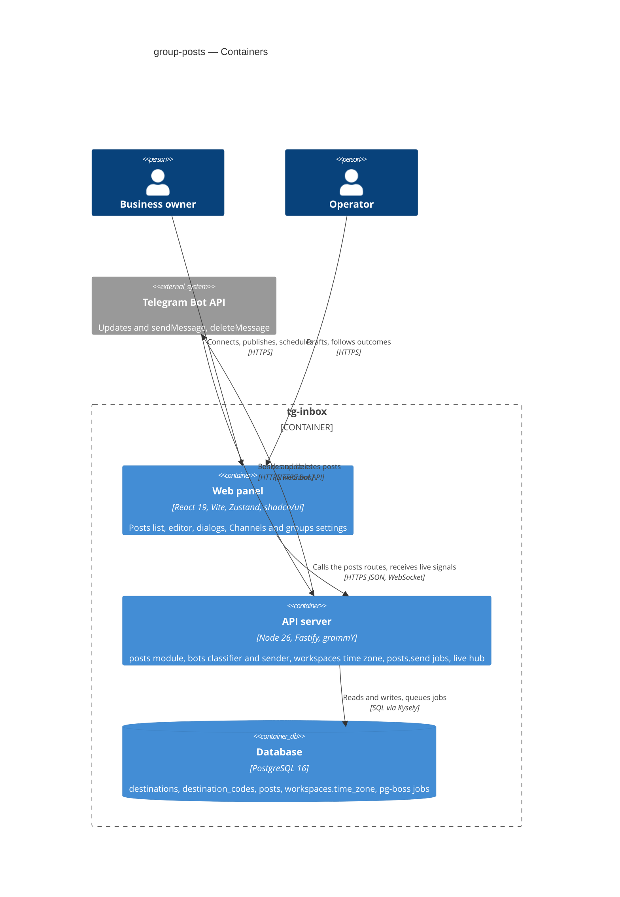

Inside tg-inbox nothing new is deployed: the web panel gains the Posts area and the Channels & groups settings, the API server gains the posts module, the classifier and sender changes in bots and the `posts.send` jobs, and the database gains three tables and one column. Both people use only the web panel; the API is the only container that talks to Telegram, in both directions.

## 6. Runtime view

**Critical flow 1: An owner connects a channel with a code (US-01 — AC-01, AC-02)**

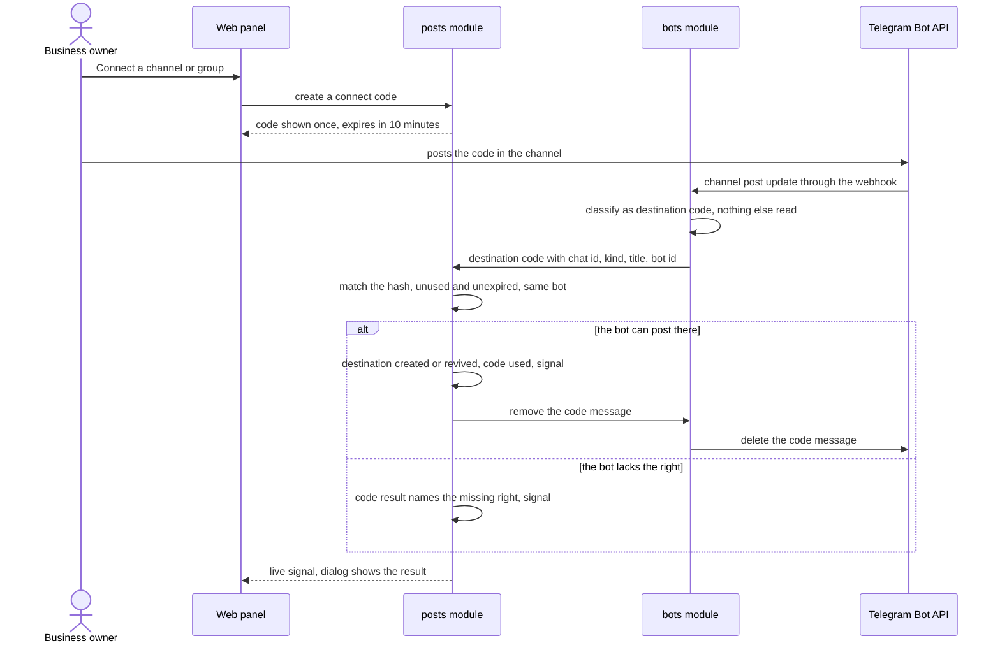

**Critical flow 2: A scheduled post goes out (US-04 — AC-09, AC-11, AC-12, AC-13, AC-14, AC-16)**

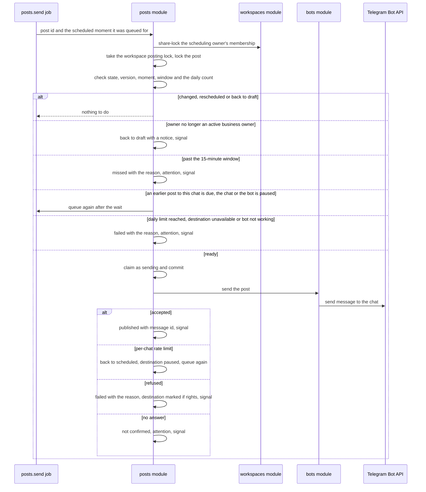

The flows below were added by `sequences` (autonomous run 2026-11-03). They use the generic runtime vocabulary — `User` (a member in the panel), `UI` (the web panel), `Service` (the API with the posts, bots and workspaces modules), `Store` (the database), `Queue` (the job queue), `Telegram` (the external Bot API) — and mark every write with a persist note for `data-model`. The two flows above stay as `design` drew them.

**Assumptions (autonomous run 2026-11-03, `sequences`)**, each can be vetoed at review: every flow was accepted as drafted; the job and webhook flows carry the idempotency, retry and dead-letter steps the async rule asks for; a read of an unavailable destination is computed (its Telegram bot id against the current bot's), so a newly connected different bot needs no hook into `posts`.

### Flow 3: Draft a post — save, stale save, duplicate, delete (US-02 — AC-05, AC-06, AC-18)

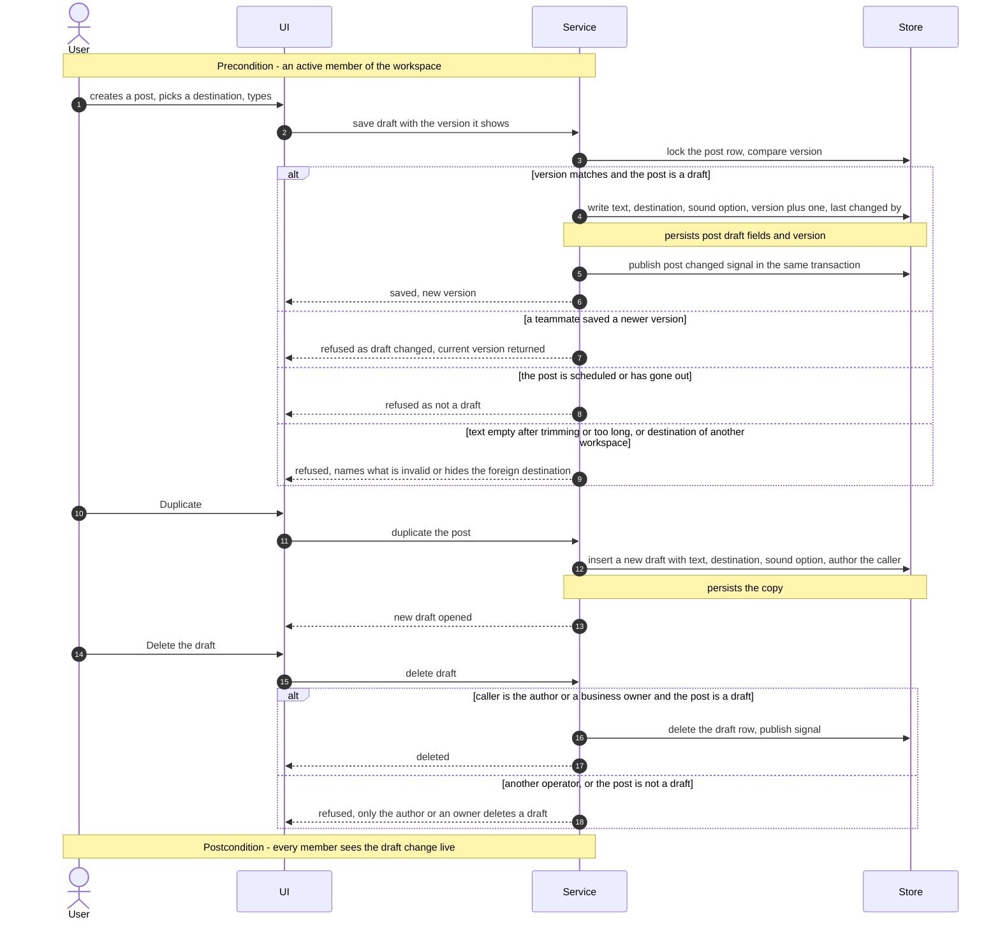

Any member saves a draft against the version they see; a newer teammate save, a non-draft post or an invalid text is refused with the reason, and a destination of another workspace is treated as unknown. Duplicate always creates a new draft owned by the caller. Only the author or a business owner deletes a draft, and only while it is a draft.

### Flow 4: Publish now (US-03 — AC-03, AC-07, AC-08, AC-14, AC-16)

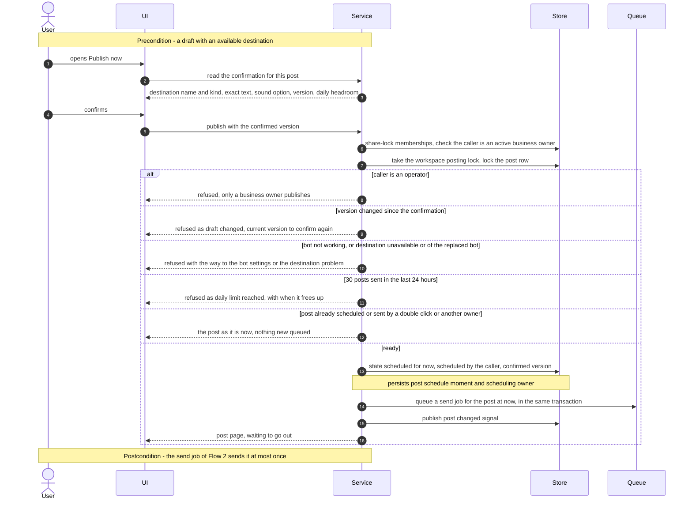

The owner confirms what the dialog showed. The publish is the same as scheduling for the current moment: under the membership share lock and the workspace posting lock the post is checked for version, bot, destination and the daily limit, and one send job is queued in the same transaction; a second confirm finds the post no longer a draft and queues nothing. The job (Flow 2) then sends it, waiting at most 15 minutes for a pause.

### Flow 5: Schedule, change the time, move back to draft (US-04 — AC-09, AC-10, AC-11, AC-16)

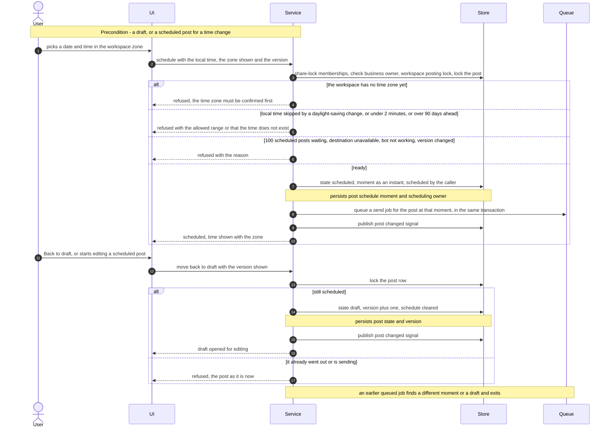

An owner schedules in the workspace zone; the local time is converted to one instant with the daylight-saving rules, and the range is checked at the confirmation. A time change is the same call on a scheduled post and queues a new job; the old job exits because the moment no longer matches. Any member moves a scheduled post back to a draft, which bumps its version, so nothing goes out until an owner schedules or publishes again.

### Flow 6: A scheduling owner is deactivated (US-04 — AC-11)

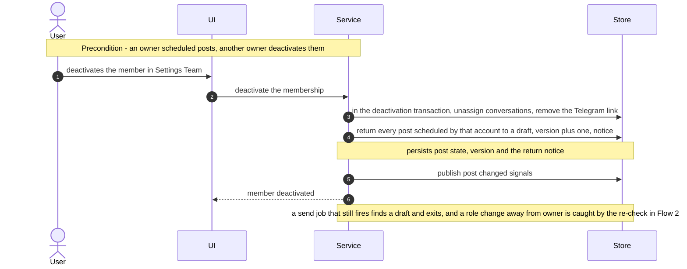

The deactivation transaction returns the departing owner's scheduled posts to drafts with a notice, next to the existing unassign and link removal. A role change from owner to operator has no hook, so the send job's re-check (Flow 2) returns such a post to a draft at its time.

### Flow 7: Telegram tells the bot about a destination chat (US-01, US-05, US-07, US-08 — AC-02, AC-13, AC-14, AC-17)

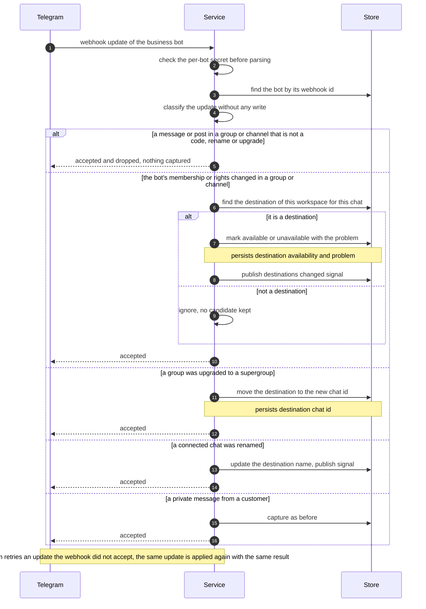

Every update is authenticated by the bot's secret and classified before any write. Messages and posts written in group and channel chats are dropped with one bot lookup and nothing captured, so customer capture keeps its speed. The bot's membership and rights mark a destination of the workspace available or unavailable, live; a supergroup upgrade moves the destination to its new chat id; a rename updates the name. Each change is a plain overwrite, so Telegram re-delivering the same update changes nothing.

### Flow 8: Delete a published post (US-06 — AC-15)

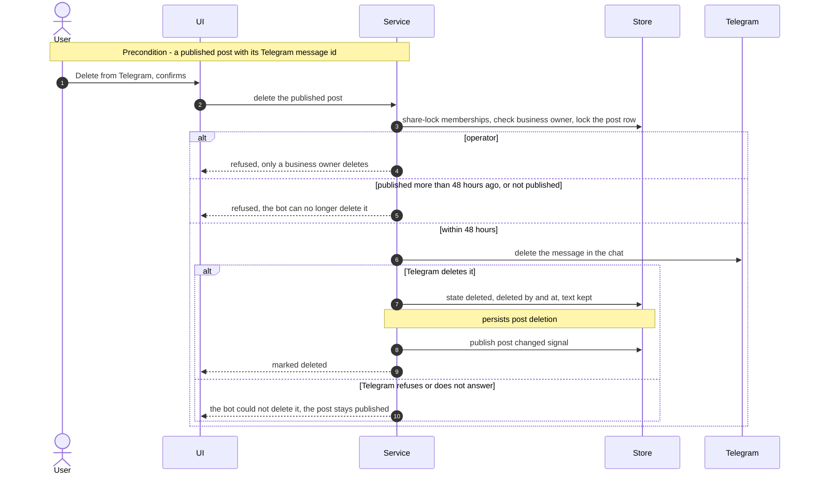

Only a business owner deletes, and only a post published less than 48 hours ago. The bot asks Telegram to delete the message; on success the post is kept as deleted with who and when, otherwise it stays published and the dialog says the bot could not delete it.

### Flow 9: Open a post and clear its attention mark (US-05 — AC-04, AC-13)

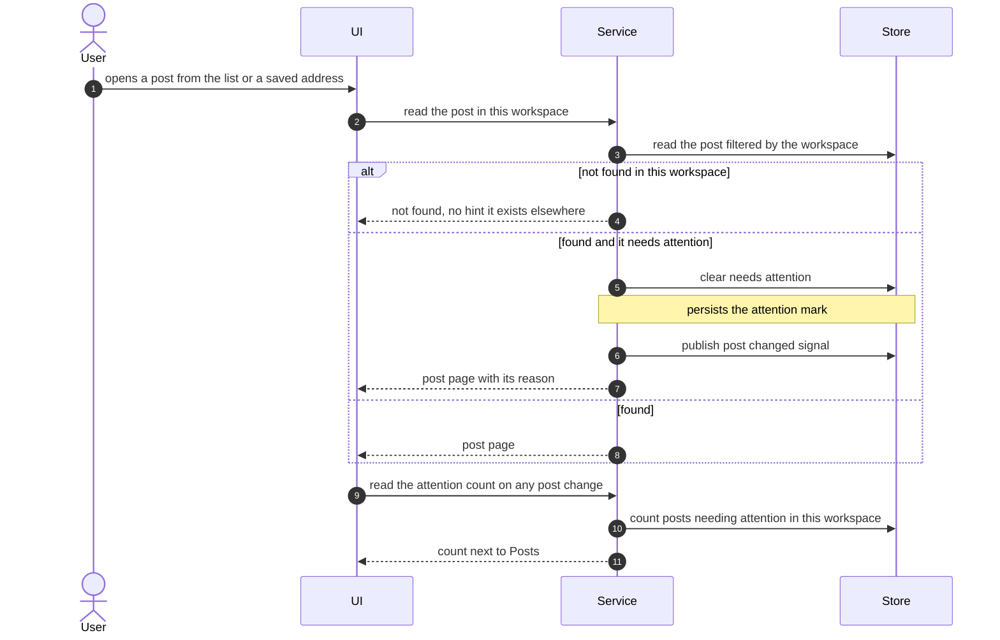

A post is always read through the caller's workspace, so another workspace's post looks like an unknown address. Opening a failed, missed or not confirmed post clears its shared mark for everyone, and every open panel refreshes the navigation count on the change signal.

### Flow 10: Remove a destination and change the workspace time zone (US-01 — AC-03, Clarifications)

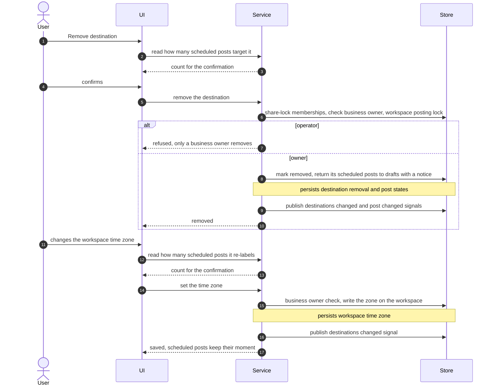

Removing a destination returns its scheduled posts to drafts in the same transaction, after a confirmation that names how many. Changing the zone writes the workspace's zone only; scheduled posts keep their instant and every panel shows them in the new zone.

### Flow 11: The send job's retries and dead letter (US-03, US-04 — AC-08, AC-12)

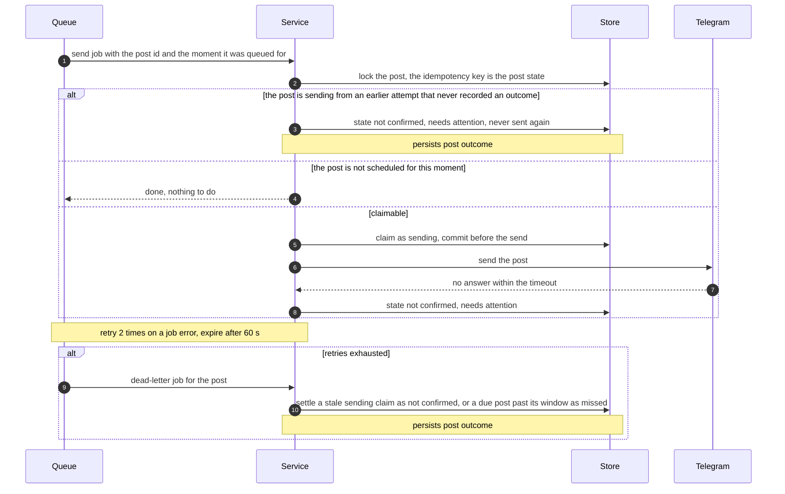

The post's own state is the idempotency key: a job runs the send only after committing the claim, and any later attempt that finds a claim without an outcome settles it as not confirmed instead of sending again. Job errors retry twice; the dead letter only settles what is left, so a post is never sent twice and never sits in sending.

**Coverage — every spec §4 user story and §5 acceptance criterion → where §6 shows it:**

| Item | Shown by |
|---|---|
| US-01 | Flow 1, Flow 7, Flow 10 |
| US-02 | Flow 3 |
| US-03 | Flow 4, Flow 2, Flow 11 |
| US-04 | Flow 5, Flow 2, Flow 6, Flow 11 |
| US-05 | Flow 9, Flow 2 (outcomes), Flow 7 |
| US-06 | Flow 8 |
| US-07 | Flow 7 (dropped group traffic), Flow 2 (per-chat pause, send pause) |
| US-08 | Flow 7 (nothing captured from a group, private capture as before) |
| AC-01 | Flow 1 happy path |
| AC-02 | Flow 1 "lacks the right" branch, Flow 7 "not a destination" (a chat added without a code) |
| AC-03 | Flow 4, Flow 5, Flow 8, Flow 10 operator branches |
| AC-04 | Flow 9 "not found", Flow 3 foreign destination |
| AC-05 | Flow 3 happy path |
| AC-06 | Flow 3 stale-save and invalid branches |
| AC-07 | Flow 4, then Flow 2 "accepted" |
| AC-08 | Flow 4 double-confirm and version branches, Flow 11 claim and not confirmed |
| AC-09 | Flow 5 happy path, Flow 2 |
| AC-10 | Flow 5 range and skipped-time branch |
| AC-11 | Flow 5 back to draft, Flow 6, Flow 2 owner re-check |
| AC-12 | Flow 2 "past the 15-minute window", Flow 11 dead letter |
| AC-13 | Flow 2 "refused", Flow 7 availability, Flow 9 attention |
| AC-14 | Flow 4 and Flow 5 bot branches, Flow 2 "bot not working", Flow 7 upgrade |
| AC-15 | Flow 8 |
| AC-16 | Flow 4 daily limit, Flow 5 100 waiting, Flow 2 daily count at the send |
| AC-17 | Flow 7 dropped branch, Flow 2 per-chat rate limit |
| AC-18 | Flow 3 delete branches |

**Flagged by `sequences` (for `data-model` / `api` to reconcile, no ADR written):**

- Indexes implied: posts by `(workspace_id, state)` for the list filters and the 100-waiting count; posts sent in the last 24 hours per workspace for the daily count; posts `needs_attention` per workspace for the navigation count; scheduled posts per destination ordered by moment for the per-chat order check; destinations by `(workspace_id, chat_id)` and by chat id for inbound lookups; codes by hash.
- Flow 4 treats "publish now" as a schedule for the current moment; `api` keeps them as two routes (spec AC-03 needs two owner-only addresses).
- Flow 9 writes on a read (clearing attention); `api` may expose it as an explicit "mark seen" call fired by the post page instead.

## 7. Deployment view

No new deployable unit. The posts module, its job worker and the classifier changes run in the existing API process; the web changes ship in the existing SPA bundle. On deploy: the new reversible migrations (data-model fixes how many) run before the API starts; the first health check after the deploy (≤ 3 minutes) re-registers each bot's webhook with `channel_post` added to `allowed_updates` (the broadcasts mechanism) — until then a channel's code is not received, a group's code is.

**Monitoring:**
- Post timing log per post: scheduled moment, send started, Telegram accepted (§10 QG-2); a daily missed / failed share with an alert above 10 % (spec §7) to the tg-inbox team's monitoring.
- Inbound counts per bot by classification (`destination_code`, `chat_membership`, `chat_migrated`, `chat_renamed`, `ignored`), and capture latency of private messages (QG-3).
- Integrity run-book queries `postIntegrity.*` in `apps/api/src/e2e/helpers.ts`: posts whose send started more than 15 minutes late, two sends of one post, `sending` older than the job expiry, posts to a destination of another workspace, more than 30 sent in 24 h.

**Scaling thresholds:**
- One row per post and per destination: a pilot workspace writes tens of posts a month; no partitioning is foreseen below millions of rows.
- Group traffic: the classifier drops ignored updates with one bot lookup and no write; at ~200 updates per second across all bots the webhook lookup becomes the hot spot and should be cached in memory (not needed for pilots).

## 8. Crosscutting concepts

| Concept | Convention | Where defined |
|---|---|---|
| Logging | Structured; post text, chat titles, usernames, codes and chat ids never logged — post id, destination id, outcome reason and timings only | CLAUDE.md; here |
| Authentication | Session cookie + active membership guard; owner-only routes check the role, and publish / schedule / delete re-check it under the membership share lock | workspace-operators; ADR-0005 |
| Error handling | `AppError` subclasses; new codes: `POST_TEXT_INVALID`, `POST_DRAFT_CHANGED`, `POST_NOT_A_DRAFT`, `POST_NOT_SCHEDULED`, `POST_SCHEDULE_OUT_OF_RANGE`, `POST_TIME_DOES_NOT_EXIST`, `POST_DAILY_LIMIT_REACHED`, `POST_SCHEDULED_LIMIT_REACHED`, `POST_DELETE_WINDOW_PASSED`, `DESTINATION_UNAVAILABLE`, `DESTINATION_LIMIT_REACHED`, `POSTS_NEED_WORKING_BOT`, `TIME_ZONE_REQUIRED`, `TIME_ZONE_INVALID` (final list in `api`) | `packages/shared/src/errors.ts` |
| ID strategy | UUIDv7 from `newId()`; Telegram chat and message ids as `bigint` columns, never keys | CLAUDE.md |
| Tenancy | Every posts table carries `workspace_id`; composite FKs `(workspace_id, destination_id)`; inbound chat facts are scoped by the receiving bot's workspace; no new controlled exception | CLAUDE.md; ADR-0003 |
| Time | Instants in UTC (`timestamptz`); the workspace's IANA zone converts on input and display; local-time validity in one shared function | ADR-0006 |
| Concurrency | Lock order: memberships `FOR SHARE` → advisory `posts:<ws>` (limits, codes) → destination row → post row `FOR NO KEY UPDATE`; send job: scheduling owner's membership `FOR SHARE` → advisory `posts:<ws>` (daily count) → destination row → post row → claim commit → send → outcome transaction | ADR-0004, ADR-0005 |
| Events | `post.changed`, `destinations.changed` published in the writing transaction, ids only, to every socket of the workspace | platform/realtime.ts; packages/shared/src/inbox.ts |
| Text | One rule shared with broadcasts (`broadcast-text.ts`): trimmed, 1–4096 UTF-16 units, sent with no `parse_mode` | broadcasts ADR-0012 |
| Internationalisation | Panel copy in English (as today); dates and times in the workspace zone with the zone named | ADR-0006 |

## 9. Architecture decisions

| # | Title | Status | Section |
|---|---|---|---|
| 0001 | Add a posts module that owns destinations, codes and posts and reaches bots and workspaces through their app layers | Accepted | §4, §5 |
| 0002 | Connect a destination by a hashed single-use code received as a bot command or channel post | Accepted | §4 |
| 0003 | Classify group and channel updates in bots and hand only codes, membership, upgrades and renames to posts | Accepted | §4, §3 |
| 0004 | Send each post through its own pg-boss job that claims the post before the send | Accepted | §4, §7 |
| 0005 | Publish and schedule against the shown version and re-check the scheduling owner at the send | Accepted | §4, §8 |
| 0006 | Store the schedule as an instant and one IANA time zone on the workspace | Accepted | §4, §8 |
| 0007 | Keep a per-destination pause for post rate limits and never set the bot send pause from a post | Accepted | §4 |
| 0008 | Delete a published post through the bot within 48 hours and keep the post as a deleted record | Accepted | §4 |

ADR files live under `docs/features/group-posts/adr/NNNN-<title>.md`.

## 10. Quality requirements

**QG-1. Right chat, exact text, at most once**
- **When:** an owner double-confirms, two owners confirm, the draft changed after the confirmation opened, the service restarts while a post is sending, or a scheduled post is edited before its time.
- **Then:** "0 posts sent twice, including after a restart at the moment of sending, a double confirm or two owners"; "0 posts whose sent text or destination differs from the version an owner confirmed"; a post goes only to a destination of its own workspace (spec §6).
- **How verify:** integration tests (concurrent publish, restart mid-send against the fake Telegram's hanging answer, unanswered send, edit of a scheduled post, cross-workspace ids); integrity queries `postIntegrity.*`.

**QG-2. On time or honestly missed**
- **When:** a post is scheduled; posts become due together in one chat; the service is down past a post's time.
- **Then:** "p95 ≤ 30 s and max ≤ 60 s from the scheduled time to Telegram accepting it, while the service and bot are up, for the first post due in a chat at that time (each further post due together in the same chat adds ≤ 3 s)"; "0 posts whose send to Telegram started more than 15 min after their scheduled time (or their "publish now" confirmation)"; publish now "p95 ≤ 5 s from confirm to "published" shown"; "≤ 1 post per 3 s into one chat" (spec §6).
- **How verify:** integration tests with a fake clock and the fake Telegram (due run of three posts to one chat; an outage longer than the window); post timing log.

**QG-3. Support first**
- **When:** a destination group receives 10 messages per second while posts, a broadcast and replies are sent.
- **Then:** "p95 capture time of private customer messages unchanged (± 1 s)"; "p95 reply send → Telegram accepted ≤ 2 s while posts go out"; a post's rate limit never sets the bot's send pause (spec §6, AC-17).
- **How verify:** load test interleaving group updates with private messages; integration test: a `429` to a post leaves `send_paused_until` untouched and delays only that destination.

**QG-4. Fast connect and live state**
- **When:** an owner posts the code; a post changes state.
- **Then:** "p95 ≤ 5 s from the code posted in the chat to the destination shown in an open panel"; "p95 ≤ 3 s from a post's change to it shown in an open panel" (spec §6).
- **How verify:** integration tests with the fake Telegram; server-side timing from change to push.

**QG-5. Limits and availability**
- **When:** a workspace reaches 30 sent in 24 h or 100 scheduled waiting.
- **Then:** "≤ 30 published per workspace per rolling 24 h; ≤ 100 scheduled waiting"; availability "99.5 % monthly" (spec §6).
- **How verify:** integration test: the 31st and 101st are refused; uptime check on the health endpoint.

## 11. Risks and technical debt

| Risk / debt | Severity | Mitigation | Owner |
|---|---|---|---|
| A busy community group made the bot an admin and floods the webhook | Medium | Pure classification before any write, one bot lookup per update; per-bot inbound counts in monitoring; in-memory bot cache above ~200 updates/s (§7) | Backend |
| A channel's code is not received until the health check re-registers `allowed_updates` after the deploy | Low | The health check runs every minute and re-registers outdated webhooks within ≤ 3 minutes; the connect dialog's expiry tells the owner to retry | Backend |
| A per-chat `429` and a bot-wide flood limit look the same to the bot; treating every post `429` as per-chat could let posts keep hitting a bot-wide limit | Low | Posts are few and spaced (≤ 1 per 3 s per chat via `next_send_at`, ≤ 1 per second per bot via the post pacer); posts still wait for any send pause set by replies, pings or broadcasts (ADR-0007) | Backend |
| Telegram chat ids pass through `Number()` in the gateway | Low | Supergroup ids (`-100` + 10 digits) stay below 2^53; the posts path passes ids as strings to the API | Backend |
| A post sent to a chat where Telegram silently drops it (closed General topic of a forum group) shows as published | Low | Forum topics are a spec non-goal; the failure, when Telegram answers with an error, is shown with its reason | Backend |
| Open architectural decision: photos in posts (spec OQ-1) | Open question | Resolve after the first 30 days of pilot posting; the post row and send path are text-only by design, a media post would be a new column set and send method | Dmytro Hopko |
| Open architectural decision: edit a published post in place (spec OQ-2) | Open question | Resolve after the first 30 days of pilot posting; would add `editMessageText` in `bots` and a post history | Dmytro Hopko |
| Open architectural decision: a failed or missed post also reaching the scheduling owner through their Telegram link (spec OQ-3) | Open question | Resolve after the first 30 days of pilot posting, or earlier if the §7 failed-share alert fires; would add a `posts → notifications` edge (sendMemberMessage) to §5 | Dmytro Hopko |

**Accepted debt (acceptable in v1, plan to fix later):**
- The attention flag is shared, not per member — matches the spec; a per-member read model would follow the inbox's read marks if pilots ask.

## 12. Glossary

| Term | Meaning |
|---|---|
| Post | One plain-text message the business bot publishes to one destination, now or at a scheduled time, at most once (CONTEXT.md) |
| Destination | A channel or group connected to the workspace with a connect code, belonging to the Telegram bot connected then (CONTEXT.md) |
| Destination connect code | A single-use, 10-minute code that turns the chat it is posted in into a destination (CONTEXT.md) |
| Missed post | A post whose send could not start within 15 minutes of its time; never published later (CONTEXT.md) |
| Workspace time zone | The one IANA zone in which posts are scheduled and shown (CONTEXT.md) |
| Claim | Committing a post as `sending` before its send, so a crash or retry can never send it again |
| Destination pause | The time until which posts to one chat wait after Telegram's rate-limit answer to a post; never the bot's send pause |
