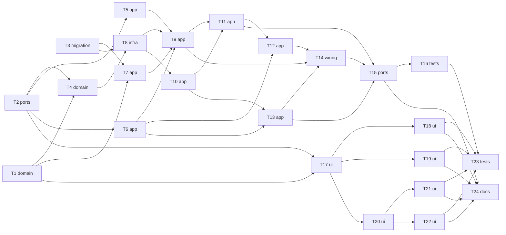

# Epic — group-posts

> **Spec:** [spec.md](../spec.md) · **Design:** [sad.md](../sad.md) · **Data model:** [data-model.md](../data-model.md) · **API:** [openapi.yaml](../contracts/openapi.yaml) · **ADRs:** [adr/](../adr/)

## Goal

A business posts to its own Telegram channels and groups from the panel through its own bot, now or on a schedule, and the team trusts the schedule — a post goes out at its time, once, exactly as an owner confirmed it, or is clearly missed or failed — while support keeps its speed (spec §2).

## Scope

- **In:** new `posts` module (domain / app / infra / http), `bots` (group and channel facts, send / delete post, post pacer), `workspaces` (time zone), wiring, the web Posts area and Settings → Channels & groups, tests and docs.
- **Out:** photos and media, editing a published post, recurring posts, reading chats or statistics, forum topics and multi-destination posts (spec §3).

## Task map

## Tasks

See [tracker.md](./tracker.md) for status. Machine contract: [tasks.json](../tasks.json).

| # | Task | Layer | Blocked by | DoD (short) |
|---|---|---|---|---|
| T1 | Add the shared workspace time-zone rule: IANA validity, local wall time to instant with skipped and repeated hours, display formatting | domain | — | unit tests for valid / skipped / repeated / invalid pass |
| T2 | Add the posts zod contracts, the 17 new error codes, and the post.changed / destinations.changed frames and signals | ports | — | contract examples parse with the new schemas |
| T3 | Promote staged migrations 01–04 (workspaces.time_zone, destinations, destination_codes, posts) and regenerate DB types | migration | — | migrations apply and revert cleanly (integration harness `src/test/postgres.ts` applies them) |
| T4 | Add the posts domain: states and transitions, the schedule window, the 15-minute miss rule, limits, connect-code format and hashing, outcome reasons, Telegram link | domain | T1, T2 | unit tests for every transition, window edge, limit and parser pass |
| T5 | Classify group and channel updates in bots into four facts, add channel_post to allowed_updates, and hand them to a late-bound ChatEventsPort | app | T2 | classifier unit tests per chat type and update kind pass |
| T6 | Add bots.sendPost, bots.deletePost and postReadiness with a 1-per-second post pacer, and teach the fake Telegram group chats, deleteMessage and getChatMember | app | T2 | unit + integration tests against the fake Telegram for each classification pass |
| T7 | Add workspaces.timeZone and setTimeZone in the workspaces app layer | app | T3, T1 | integration tests pass (isolation included) |
| T8 | Build the posts repositories for destinations, destination codes and posts, with cross-workspace isolation tests | infra | T3, T4 | integration tests (Testcontainers) pass, isolation proven per repo |
| T9 | Add the destination use cases: create and read a connect code, redeem it from ChatEventsPort, membership / upgrade / rename updates, remove, list, set the time zone | app | T5, T6, T7, T8 | unit + integration tests for AC-01, AC-02, AC-13, AC-14 branches pass |
| T10 | Add the post draft use cases and reads: create, save against version, duplicate, delete draft, back to draft, list, get, attention count, mark seen | app | T8 | unit + integration tests for each AC branch pass |
| T11 | Add the publish confirmation, publish now and schedule / change time against the shown version, queuing one posts.send job in the transaction | app | T9, T10 | integration tests per branch pass (incl. concurrent publish) |
| T12 | Add the posts.send job body: re-check owner and limits, per-chat order and pauses, claim before the send, outcomes, missed after 15 minutes, and the dead-letter settler | app | T6, T11 | integration tests per branch pass with the fake Telegram and fake clock |
| T13 | Add delete from Telegram within 48 hours and the deactivation return of scheduled posts | app | T6, T10 | unit + integration tests pass |
| T14 | Wire posts in buildDeps and buildApp: ChatEventsPort, onMembershipDeactivated, the posts.send queue + DLQ workers, the hub forwarding the two new frames | wiring | T9, T12, T13 | `app.int.test.ts` boots; a posts.send job runs end to end in an integration test |
| T15 | Register the posts routes (registerPosts): the 18 operations with zod schemas, guards and error mapping | ports | T11, T13, T14 | `app.inject()` tests per operation pass |
| T16 | Add the API end-to-end posts stories, the tenancy and secrecy suite, postIntegrity queries and the timing checks | tests | T15 | e2e suite green; integrity queries return 0 rows |
| T17 | Add the web posts API source, stores (posts, destinations, attention), time helpers, routes and the Posts nav item with its count | ui | T2, T1 | store tests pass; nav shows the badge in a Testing Library test |
| T18 | Build SCR-33 Channels & groups with SCR-34 connect-code, SCR-35 remove and SCR-43 time-zone dialogs | ui | T17 | component tests for every listed state pass |
| T19 | Build SCR-36 the Posts list with state filters, workspace-zone times and the attention rows | ui | T17 | component tests per state pass |
| T20 | Build SCR-37 the post editor with autosave, destination picker, sound option and preview, plus SCR-42 delete and SCR-44 back-to-draft dialogs | ui | T17 | component tests per state pass |
| T21 | Build SCR-38 publish-now and SCR-39 schedule dialogs on their owner-only addresses, with the first-time time-zone step | ui | T20 | component tests per state pass |
| T22 | Build SCR-40 the post page for every non-draft state, with SCR-41 delete-from-Telegram and mark-seen | ui | T20 | component tests per state pass |
| T23 | Add browser end-to-end posts flows against the real API: connect, draft, publish, schedule, outcome, delete | tests | T16, T18, T19, T21, T22 | browser e2e green |
| T24 | Update CLAUDE.md, the architecture map and the design-system canon for the posts module | docs | T15, T18, T19, T21, T22 | docs updated; links resolve |

## Risks / Hard rules

- At most once per post; never sent more than 15 minutes after its time; exactly the confirmed text and destination (spec §6, ADR-0004, ADR-0005).
- Nothing written in a destination chat is captured; private capture speed unchanged (spec AC-17, ADR-0003).
- A post's rate limit never sets the bot's send pause (ADR-0007).
- No post text, chat title, username, code or chat id in logs, frames or job payloads (sad.md §8).
- Only `bots` talks to Telegram; no new tenancy exception (CLAUDE.md).
