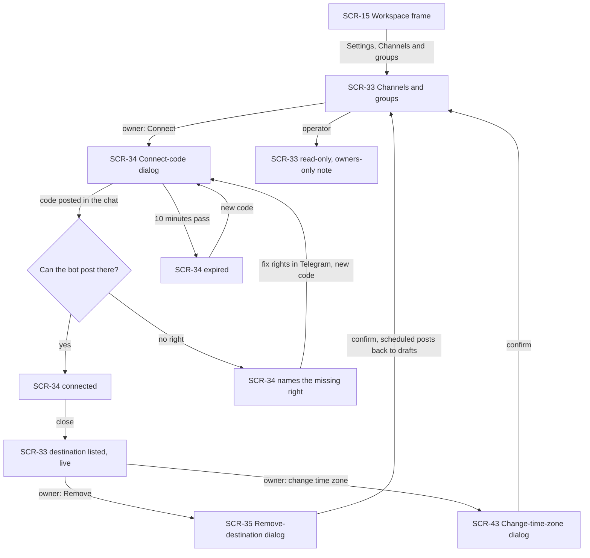
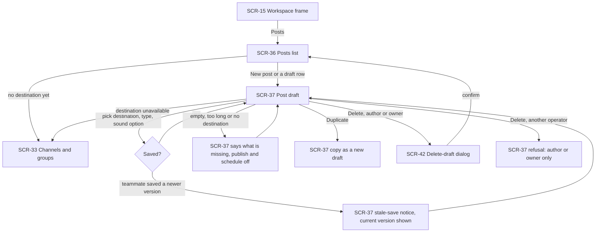
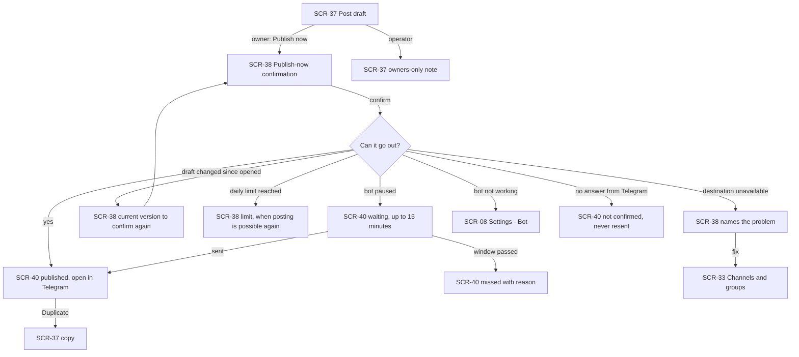
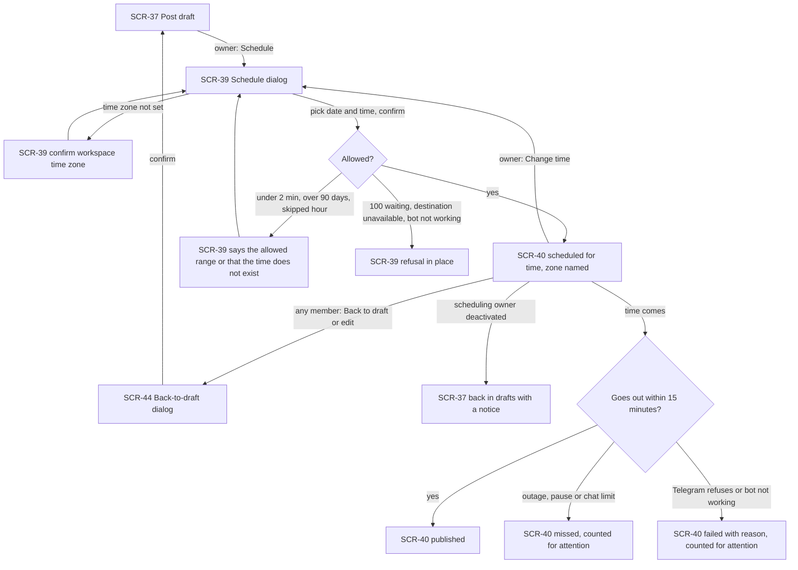
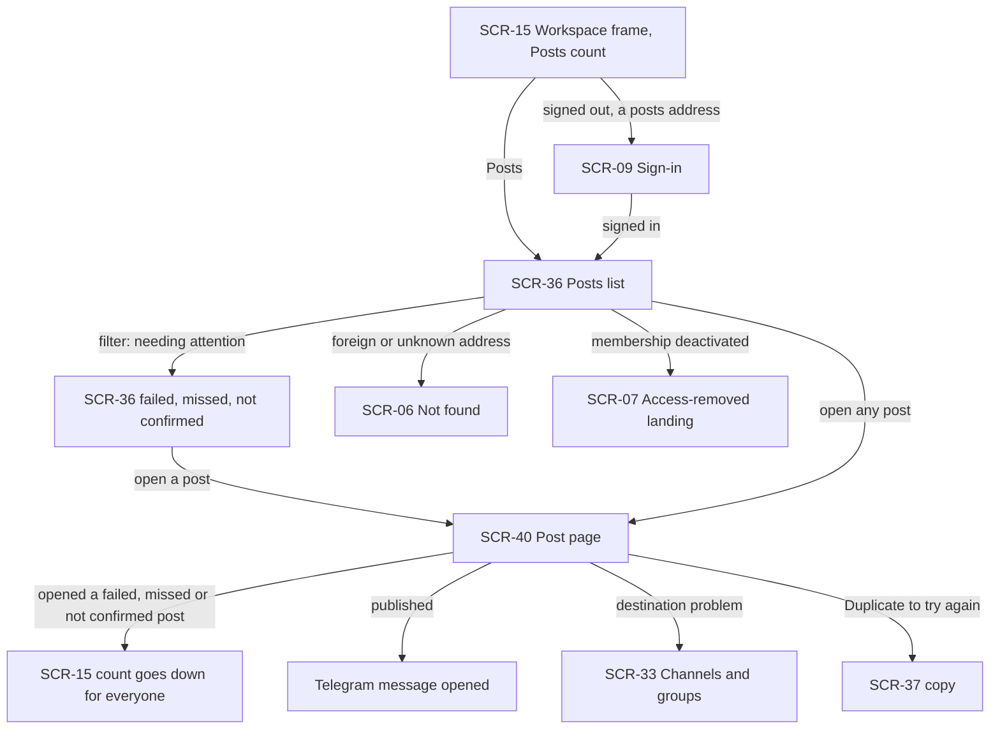
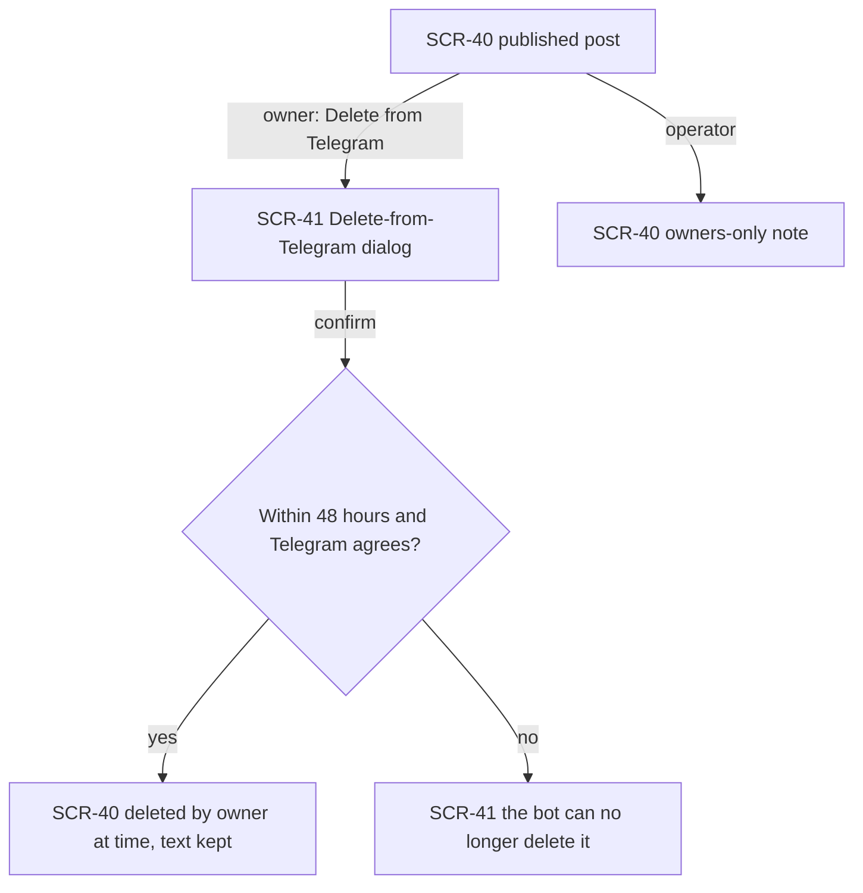

# UX flows — group-posts

> User flows for every UI-touching §4 user story, produced by `ux-flows` (after `clarify`, before
> `design`) and read by `design` (evidence for the target-surface + UI-architecture decisions),
> `sequences` (UI-driven flows align on SCR ids), `screens` (details every inventory row) and
> `plan-tests` (the e2e-through-UI paths). **Always markdown + mermaid `flowchart`**, whatever the
> design tool — this artifact is flow-altitude, not visual design.

## Platform decisions

- **Posture:** desktop-first, usable at phone width — per `docs/design-system.md` § Platform posture. Posts are prepared at a desk; checking a post's state from a phone must still work.
- **Builds on the shipped panel lineage:** SCR-06, SCR-07, SCR-08, SCR-09 and SCR-15 keep their ids and meanings from earlier features. New ids start at SCR-33, after the SCR-01…SCR-32 used so far. Other earlier screens are not visited here.
- **Posts is a page of its own:** a new Posts item in the workspace navigation (SCR-15), next to Inbox, Contacts and Broadcasts, shown to every member. It carries the shared count of posts needing attention (failed, missed, not confirmed) until any member opens each of them.
- **Destinations and the workspace time zone live in Settings:** a new "Channels & groups" section (SCR-33), visible to every member, where only business owners connect, remove and set the time zone. Operators see the list and the time zone, with the owners-only note instead of the actions.
- **One address per post, two views:** while a post is a draft, its address shows the editor (SCR-37). Once it is scheduled or has gone out (published, failed, missed, not confirmed, deleted), the same address shows the read-only post page (SCR-40). A saved link to a draft that an owner scheduled meanwhile therefore opens the post page.
- **Publish, schedule, change time, delete and the rest are dialogs** over the page they start from (SCR-34, SCR-35, SCR-38, SCR-39, SCR-41, SCR-42, SCR-43, SCR-44). The owner-only steps (publish, schedule) also have their own address under the post, since AC-03 treats a saved link to them as a way in; that address opens the dialog only for a business owner, and an operator lands on the post with the owners-only note.
- **Connecting is done in Telegram, followed live in the panel:** the connect-code dialog (SCR-34) shows the code, how to post it (in a channel as a post, in a group as a command to the bot), a 10-minute countdown, and turns into the result — connected, the right the bot is missing, or expired — without a reload.
- **Times are always in the workspace time zone, with the zone named.** The schedule dialog asks the first owner who schedules to confirm the workspace time zone (prefilled from the browser) before the time.
- A deactivated member's or signed-out person's way out (SCR-07, SCR-09) is the existing panel behaviour. Posts add no new screen for it.

## Screen inventory

| ID | Screen | Purpose | Entry | Exit |
|---|---|---|---|---|
| SCR-06 | Not found (in frame) | (reused) Not-found card for a post or destination address the account may not see or that does not exist; no hint that it exists | an unknown, deleted-draft or foreign post address | SCR-36 of the account's own workspace |
| SCR-07 | Access-removed landing | (reused) Workspace picker / no-access screen with the access-removed notice | any posts visit or action after the member was deactivated | another workspace; sign out |
| SCR-08 | Settings — Bot | (reused) Owner-only bot settings | the way to the bot settings on a publish or schedule refused because the bot is not working | SCR-37 / SCR-40 (back) |
| SCR-09 | Sign-in | (reused) Sign-in. A signed-out visit to a Posts, post or Channels & groups address lands here and returns afterwards | a posts address while signed out | the requested page |
| SCR-15 | Workspace frame | (reused) Side navigation and breadcrumb around every workspace page. Gains a Posts item, for every member, with the shared needing-attention count; Settings gains "Channels & groups" | entering any workspace page | SCR-36 via the navigation; SCR-33 via Settings |
| SCR-33 | Settings — Channels & groups | New: the workspace's destinations, each with its Telegram name, kind (channel / group), public username when it has one and state (available, or unavailable with what is wrong — right missing, bot removed, belongs to the replaced bot); the workspace time zone. Business owners: Connect a channel or group, Remove, change the time zone. Operators: read-only with the owners-only note. Empty state explains how to add the bot to a chat and connect it | Settings → Channels & groups; the "connect a destination" link from an empty SCR-37 picker; an unavailable destination's link on SCR-37 / SCR-40 | SCR-34 (connect); SCR-35 (remove); SCR-43 (change time zone); SCR-36 via the navigation |
| SCR-34 | Connect-code dialog | New, owners only: the single-use code, how to post it in a channel or a group, the 10-minute countdown; turns live into the result — "connected" (the destination appears on SCR-33), "the bot needs the right to post / to send messages in <chat>", or "expired — create a new code" | Connect on SCR-33 | SCR-33 (close, live list updated); SCR-34 again (new code) |
| SCR-35 | Remove-destination dialog | New, owners only: names the destination and how many scheduled posts target it, which go back to drafts | Remove on a destination of SCR-33 | SCR-33 |
| SCR-36 | Posts list | New: every post of the workspace, the most recently changed first, filters by state (all, drafts, scheduled, published, needing attention); each row: start of the text, destination, state with its time (scheduled for / published at / failed / missed / not confirmed / deleted), who last changed it. Live. Empty state explains posts and offers "New post" (and, with no destination yet, the way to SCR-33) | Posts in the navigation; a Posts address; back from SCR-37 / SCR-40; after a draft is deleted | SCR-37 (a draft or "New post"); SCR-40 (any other post); SCR-33 (no destination yet) |
| SCR-37 | Post draft | New: the editor. Destination picker (available destinations; an unavailable one stays selected with its problem shown), plain text with the remaining length as Telegram counts it, "send without sound", a plain-text preview with line breaks. Saves as you type against the version seen; a stale save shows the teammate's version. Actions: Publish now and Schedule (business owner) or the owners-only note (operator), Duplicate, Delete (author or business owner) | "New post" or a draft row on SCR-36; a draft address; a duplicate just made; a scheduled post moved back to draft | SCR-38 (publish); SCR-39 (schedule); SCR-42 (delete); SCR-37 of a copy (duplicate); SCR-33 (destination problem); SCR-08 (bot not working); SCR-36 (back) |
| SCR-38 | Publish-now confirmation | New, owners only (also its own address): the destination's Telegram name and kind, the exact text, the sound option, the daily-limit headroom. Confirm publishes once; a changed draft shows the current version to confirm again; refusals in place (daily limit with when it frees up, destination unavailable, bot not working with the way to SCR-08) | Publish now on SCR-37; the publish address (owners) | SCR-40 (published or waiting for the pause); SCR-37 (cancel / changed); SCR-08 |
| SCR-39 | Schedule dialog | New, owners only (also its own address): first-time workspace time-zone confirmation if none is set; date and time to the minute in the workspace zone (named); the destination, the exact text and the sound option. Refusals in place: under 2 minutes or over 90 days ahead, a time skipped by a daylight-saving change, destination unavailable, 100 scheduled waiting, bot not working. Also used to change a scheduled post's time | Schedule on SCR-37; Change time on SCR-40; the schedule address (owners) | SCR-40 (scheduled); SCR-37 / SCR-40 (cancel); SCR-08 |
| SCR-40 | Post page | New: a post that is no longer a draft, read-only: text, destination, sound option, state and its history line (scheduled for … by …, published at … by …, failed — reason, missed — reason, not confirmed, deleted at … by …). Live. Actions by state: scheduled → Back to draft (any member), Change time (owner); published → Open in Telegram, Delete from Telegram within 48 hours (owner); any → Duplicate. Opening a failed, missed or not confirmed post clears it from the shared attention count | a non-draft row on SCR-36; a post address; after publish or schedule | SCR-44 (back to draft); SCR-39 (change time); SCR-41 (delete from Telegram); SCR-37 of a copy (duplicate); Telegram (open the message); SCR-33 (destination problem); SCR-36 (back) |
| SCR-41 | Delete-from-Telegram dialog | New, owners only: names the chat and says the message disappears for everyone there and the post stays in the panel as deleted; past 48 hours or on Telegram's refusal it says the bot can no longer delete it | Delete from Telegram on SCR-40 | SCR-40 |
| SCR-42 | Delete-draft dialog | New: author or business owner; confirms deleting the draft | Delete on SCR-37 | SCR-36 |
| SCR-43 | Change-time-zone dialog | New, owners only: the new zone and how many scheduled posts keep their moment but show a new local time | change the time zone on SCR-33 | SCR-33 |
| SCR-44 | Back-to-draft dialog | New: says the post will not go out unless a business owner schedules or publishes it again; also shown when a member starts editing a scheduled post | Back to draft on SCR-40 | SCR-37 (the draft); SCR-40 (cancel) |

## Flows

### Flow: US-01 — Connect a channel or group

A business owner opens Settings → Channels & groups and chooses Connect. The dialog shows a single-use code and how to post it: as a post in a channel, as a command to the bot in a group. When the code is posted in a chat where the bot can post, the dialog turns into "connected" and the chat appears in the list with its Telegram name and kind, with no reload. If the bot lacks the right, the dialog names the missing right; the owner fixes it in Telegram and creates a new code. After 10 minutes an unused code shows as expired and a new one can be made. From the list an owner removes a destination (the dialog says how many scheduled posts go back to drafts) or changes the workspace time zone (the dialog says how many scheduled posts get a new local time). An operator sees the same list and time zone, read-only, with the owners-only note.

### Flow: US-02 — Draft a post

A member opens Posts and starts a new post or an existing draft. If the workspace has no destination yet, the empty list leads to Channels & groups. In the editor they pick a destination, type the text, choose "send without sound" if wanted, and see a plain-text preview with the remaining length; the draft saves as they type. If a teammate saved a newer version meanwhile, the save is refused and the current version is shown. An empty or too long text, or no destination, keeps Publish and Schedule off and says what is missing. Duplicate makes a new draft with the same text, destination and sound option. The author or a business owner deletes a draft after a confirmation; another operator is told only they can. A destination that became unavailable shows its problem and links to Channels & groups.

### Flow: US-03 — Publish a post now

A business owner chooses Publish now and sees the destination's Telegram name and kind, the exact text and the sound option. Confirming publishes once: the post page shows it published, with the time, the owner and a way to open it in Telegram. If the bot is paused by Telegram the post waits, at most 15 minutes, and is otherwise marked missed. A draft changed since the dialog opened shows the current version to confirm again. The daily limit, an unavailable destination or a bot that is not working refuse in place, with when posting frees up, the way to Channels & groups or the way to the bot settings. A send that got no answer is marked not confirmed and is never sent again. A published post can be duplicated. An operator sees the owners-only note instead of the action, and a saved publish address opens the post for them.

### Flow: US-04 — Schedule a post

A business owner chooses Schedule. If the workspace has no time zone yet, they first confirm it (prefilled from the browser). They pick a date and time in the workspace zone and confirm the destination, text and sound option. A time under 2 minutes or over 90 days ahead, or one skipped by a daylight-saving change, is refused with the reason; 100 waiting posts, an unavailable destination or a bot that is not working are refused in place. Once scheduled, every member sees the time with the zone named. An owner can change the time through the same dialog. Any member can move it back to a draft, and starting to edit it asks the same; it then goes out only if an owner schedules or publishes it again. If the scheduling owner is deactivated it returns to drafts with a notice. At its time it is published; if it cannot go out within 15 minutes it is missed, and if Telegram refuses it or the bot is not working it fails — both are counted for the team's attention.

### Flow: US-05 — Know what happened to a post

Every member sees the Posts item with the shared count of posts needing attention. The list shows every post and its state live, and can be narrowed to those needing attention. Opening a failed, missed or not confirmed post shows its reason and takes it off the count for the whole team. A published post opens in Telegram. A destination problem links to Channels & groups, and Duplicate prepares a new draft to try again. An address of another workspace's post, or an unknown one, shows the not-found card with no hint that it exists. A signed-out visit goes through sign-in and back; a member deactivated meanwhile lands on the access-removed screen.

### Flow: US-06 — Take back a wrong post

On a published post a business owner chooses Delete from Telegram; the dialog names the chat and says the message disappears for everyone there. Within 48 hours and with Telegram's agreement the post is marked deleted with the owner and time, and its text stays readable in the panel. Past 48 hours, or if Telegram refuses, the dialog says the bot can no longer delete it. An operator sees the owners-only note.

### Out of scope (no UI)

- **US-07 — Keep support working while posts go out** — backend behaviour only (capture speed, reply speed, per-chat limits); the inbox screens are unchanged.
- **US-08 — Write to the business without being captured from its group** — the end customer never uses the panel; nothing they write in a destination appears anywhere in it.

## AC coverage

| AC | Shown by | Notes |
|---|---|---|
| AC-01 | Flow US-01 → SCR-34 connected → SCR-33 listed live | the code message removal happens in Telegram, not on a screen |
| AC-02 | Flow US-01 → "no right" and "expired" branches | a chat the bot was added to without a code never appears on SCR-33 |
| AC-03 | Flows US-01, US-03, US-04, US-06 → operator branches; owner-only dialog addresses | |
| AC-04 | Flow US-05 → SCR-06 Not found | |
| AC-05 | Flow US-02 → SCR-37 saved; SCR-36 row | |
| AC-06 | Flow US-02 → "what is missing" and stale-save branches | |
| AC-07 | Flow US-03 → SCR-40 published, open in Telegram, Duplicate | the pause wait branch too |
| AC-08 | Flow US-03 → "changed since opened" and "not confirmed" branches | double confirm shows one result on SCR-40 |
| AC-09 | Flow US-04 → SCR-40 scheduled; Change time; Back to draft | first-time time-zone confirmation in SCR-39 |
| AC-10 | Flow US-04 → "allowed range / skipped hour" branch | |
| AC-11 | Flow US-04 → SCR-44 and the deactivated-owner branch | |
| AC-12 | Flow US-04 → "missed" branch; Flow US-05 attention | |
| AC-13 | Flow US-04 → "failed" branch; Flow US-05; SCR-33 unavailable state | |
| AC-14 | Flow US-03 → bot not working branch → SCR-08; SCR-33 unavailable (replaced bot) | |
| AC-15 | Flow US-06 | |
| AC-16 | Flow US-03 → daily limit branch; Flow US-04 → 100 waiting refusal | |
| AC-17 | N/A: no screen — backend behaviour (US-07, US-08) | proved in sequences and tests |
| AC-18 | Flow US-02 → "another operator" branch; SCR-40 offers no delete | |
