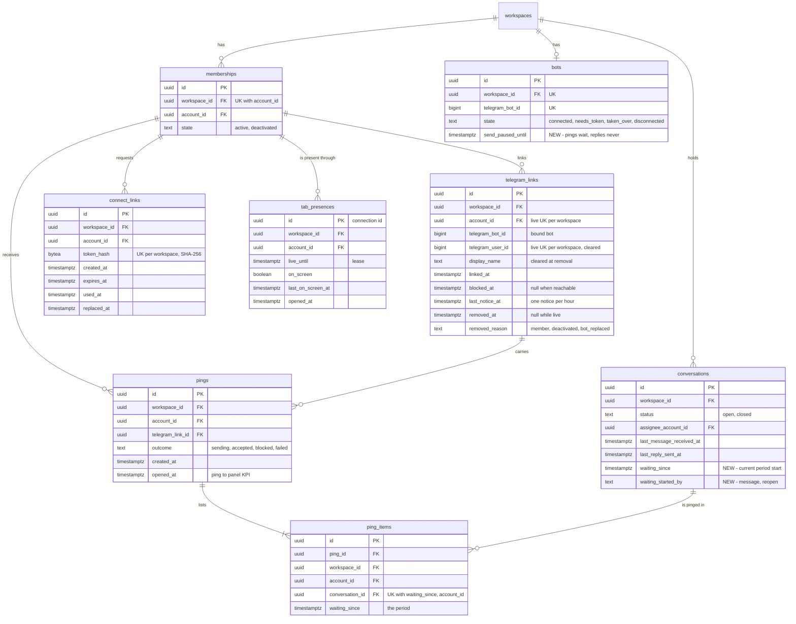

# Data model — operator-notifications

This is a brownfield delta. Most of it is the new `notifications` module ([ADR-0001](adr/0001-add-a-notifications-module-that-owns-telegram-links-presence-and-pings-and-is-reached-through-ports.md)). `conversations` and `bots` each get small changes:

- **Five new tenant-owned tables in `notifications`:**
  - `telegram_links`: the member's opt-in link ([ADR-0004](adr/0004-issue-connect-links-as-random-single-use-tokens-stored-as-hashes-and-redeemed-through-the-start-payload.md));
  - `connect_links`: single-use start tokens, stored only as hashes (ADR-0004);
  - `tab_presences`: per-tab presence leases ([ADR-0002](adr/0002-track-presence-as-per-tab-leases-in-postgres-refreshed-by-the-workspace-live-socket.md));
  - `pings` + `ping_items`: the ping ledger ([ADR-0005](adr/0005-decide-pings-in-a-per-workspace-sweep-every-20-s-with-a-per-period-ledger-written-before-the-send.md), [ADR-0006](adr/0006-pace-pings-below-a-per-bot-share-of-the-telegram-limit-and-pause-them-on-any-rate-limit-answer.md)).
- **Two columns on `conversations`:** `waiting_since` and `waiting_started_by` ([ADR-0007](adr/0007-record-the-waiting-period-start-on-the-conversation-in-the-writing-transactions.md)). They ship as expand → backfill, plus one partial index for the sweep. Both stay nullable (NULL = not waiting), so there is no contract step.
- **One column on `bots`:** `send_paused_until` (ADR-0006). Nullable, with no backfill.

`inbox`, `workspaces` and `contacts` get no schema change. The attention count ([ADR-0008](adr/0008-serve-the-attention-count-from-a-conversations-query-refetched-on-change-signals.md)) reuses the list's unread predicate and the assignment-statuses lens indexes. `memberships_workspace_id_account_id_key` is the target of every new composite FK and serves `lockActiveMembers` at redeem and at send. The live signal `telegram_link.changed` ([ADR-0010](adr/0010-signal-telegram-link-changes-on-an-account-scoped-frame-delivered-only-to-that-members-sockets.md)) is a `pg_notify` and needs no table. The three new pg-boss queues live in pg-boss's own schema, not in our migrations.

**Conventions applied.** These are the same as the shared-inbox, bot-connection and assignment-statuses precedents ([assignment-statuses data-model](../assignment-statuses/data-model.md)), repo [ADR-0004](../../adr/0004-use-postgres-with-kysely-reversible-migrations-and-workspace-scoped-tenancy.md), `CLAUDE.md` and SAD §2/§8:

- **Naming:** tables are `snake_case` and plural. Constraints are named `<table>_<cols>_{pkey,key,fkey,check,idx}`. A composite FK to `memberships` is named `<table>_membership_fkey`, and a partial unique index on live rows is `<table>_live_<cols>_key`.
- **PK:** `id uuid`, a UUIDv7 from `newId()`, never a DB default. A presence row's id is the connection id that the hub generates per socket (SAD §8).
- **Values:** the application supplies every value and timestamp. There is no `DEFAULT` and no generic `updated_at`.
- **Telegram ids:** `bigint` columns, never keys.
- **Kinds, reasons and outcomes:** `text` + `CHECK (… IN (…))`, no `ENUM`. `CHECK`s tie column combinations together.
- **Secrets:** stored as a 32-byte SHA-256 `bytea` with an `octet_length` check, as in `sessions` and `invitations`.
- **Triggers:** none.
- **Cross-module FKs** are constraints only. Every account column is a **composite** FK `(workspace_id, account_id) → memberships (workspace_id, account_id)`, as in assignment-statuses, so every link, connect link, lease and ping belongs to a member of its own workspace. `notifications` never reads `memberships`. It goes through the `workspaces` app layer.
- **Indexes:** every FK leads an index. Every other index serves a query named in SAD §6.
- **Delete strategy:**
  - links, connect links, pings and ledger items are kept, as messages and replies are;
  - presence rows are hard-deleted on a clean close or on expiry;
  - a ping that Telegram did not accept (`429`, `bot_unavailable`) is hard-deleted together with its items (`ON DELETE CASCADE`, as in `sessions`).

## Assumptions (autonomous run 2026-10-19)

Each can be vetoed at review.

1. **Aggregate roots.**
   - `telegram_links`, `connect_links` and `tab_presences` are each their own root.
   - `pings` owns `ping_items`: they are inserted in one transaction and deleted together on rollout.
   - `conversations` stays the root of its waiting period, which only `conversations` use cases write.
2. **Reachability is `telegram_links.blocked_at`** (NULL = reachable), not a `reachable ok / blocked` text column (SAD §5 names are indicative). It is set when a ping is answered `403` and cleared when a ping is accepted. It gives SCR-16 "Not reachable" and its time in one column. The "blocks within 30 days" KPI reads the first `blocked` ping per link (`pings_telegram_link_id_idx`), so the history survives an unblock.
3. **The bot-answer job carries the link id whenever the sender holds, or just held, a link. It carries the Telegram user id only when there is no link** (the "Flagged by sequences" item on flow 9, decided toward the link id):
   - "connected", "already connected", "notifications off" and "this chat only sends notifications" carry `telegram_link_id`;
   - "link expired" and "cannot connect" go to a sender with no link of their own, so they must carry the Telegram user id. That id stays in pg-boss's job table until pg-boss deletes the completed job (its retention setting), which the security review must accept;
   - so that "notifications off" can find its recipient, a link **the member removed** keeps `telegram_user_id` after `removed_at` until that job has finished (sent, blocked, bot not working or given up). The job then clears it. `telegram_links_telegram_user_id_check` allows this only for `removed_reason = 'member'`;
   - deactivation and a different bot send no answer, so they clear the id in the removing transaction;
   - the display name is always cleared at removal;
   - a run-book integrity query catches a member-removed link that still holds an id an hour later (a dead-lettered job).
4. **Backfill of the waiting period** (02) applies ADR-0007's rules to the history that exists:
   - the last end of a period is the later of `last_reply_sent_at` and the last `closed` entry;
   - a member reopen or a failed-reply reopen after that end starts a `reopen` period at its `position_at`, if a customer message was waiting at that moment;
   - otherwise the first customer arrival after the end starts a `message` period;
   - closed conversations, and open conversations that have been answered, stay NULL.

   The run on Postgres covered ten history shapes (audit report).
5. **No waiting-period history table.** `waiting_since` is cleared when a period ends. So the spec §7 KPI "waiting periods ended by a sent reply within 15 min" is a run-book query that derives each ended period with the same rule as the backfill (from `messages`, `replies` and `conversation_activities`), not a read of stored history. SAD §7 says the KPI "needs the period start that ADR-0007 now stores". That is true only for open periods, so the audit flags it.
6. **`ping_items` has its own UUIDv7 `id`** (repo convention). It repeats the ping's `workspace_id` and `account_id`, because the ledger key needs the account, and a composite FK to `pings (id, workspace_id, account_id)` keeps them equal.
7. **No `pings.text`, no counts, no kind per item.** The text is rebuilt from counts and never stored or logged (SAD §8). Ping timeliness comes from the job logs (SAD §7), so no `sent_at` / `settled_at` either.
8. **`sending` is a lasting outcome when the process dies mid-call.** It counts like `failed` (at most once, SAD §11), so a sweep never re-pings that period.
9. **Two flagged indexes are folded into wider ones:**
   - `telegram_links (workspace_id, telegram_bot_id)` is not created. The bot-connected hook asks for live links whose bot id **differs**, which a btree on the bot id cannot narrow. It scans the workspace prefix of the live-link index instead, at most tens of rows;
   - `tab_presences (workspace_id, live_until)` is not created either. The sweep's expiry delete uses the workspace prefix of `(workspace_id, account_id, live_until)`.

   Both choices were confirmed with `EXPLAIN` (audit report).
10. **Expired presence rows outside a sweep.** The sweep runs only for workspaces with a live link. So the hub's `opened` call also deletes the same member's expired rows in that workspace (same index). Rows a crash left behind therefore never outlive the member's next open. `tasks` should carry this into the presence use case.
11. **No `CHECK` encodes the domain constants** (10-minute expiry, 50 s lease, 5 per 10 min). They live in `notifications/domain` (SAD §7). The `CHECK`s only enforce ordering (`expires_at > created_at`, `live_until > opened_at`, …).
12. **`display_name` has no length `CHECK`.** Telegram bounds it, and `contacts.first_name` has none either.

## ER diagram

The `memberships` edges are the composite FKs `(workspace_id, account_id)`. The `ping_items → pings` edge is the composite FK `(ping_id, workspace_id, account_id)`. The `workspaces ||--o{ …` edges of the five new tables are left out for readability. Each new table has a non-null `workspace_id → workspaces(id)`. `ping_items.waiting_since` is a copy of `conversations.waiting_since` taken at send time. It is not an FK.

## Entities

### Aggregate `telegram_link` (module `notifications`, tenant-owned)

#### `telegram_links` (new)

| Column | Type | Constraints | Notes |
|---|---|---|---|
| `id` | uuid | PK | UUIDv7. Referenced by `pings`. The bot-answer job's recipient (assumption 3) |
| `workspace_id` | uuid | NOT NULL, FK → `workspaces(id)` | Tenancy. Comes from the authenticated webhook's bot at redeem and at interception |
| `account_id` | uuid | NOT NULL, FK `(workspace_id, account_id) → memberships` | The membership the link belongs to. A member reads and removes only their own (AC-12) |
| `telegram_bot_id` | bigint | NOT NULL | The bot the link was made with (ADR-0004). A rotation keeps it. The bot-connected hook removes links whose bot id differs (AC-10). No FK to `bots`, because a disconnected bot row with no conversations is deleted |
| `telegram_user_id` | bigint | NULL; non-null while live; after removal only for `removed_reason = 'member'` until the answer job clears it | The member's private chat id = Telegram user id. Read by the interceptor (AC-11). Never returned to an owner (AC-12) |
| `display_name` | text | NULL; non-null ⇔ live | Shown only to that member on SCR-16, as plain text. Cleared at removal (SAD §2) |
| `linked_at` | timestamptz | NOT NULL | "Connected since" (SCR-16). Start of the 30-day KPI window |
| `blocked_at` | timestamptz | NULL, `>= linked_at` | "Not reachable" since then (AC-09, AC-10). Set by a `blocked` ping outcome, cleared by an `accepted` one. Either change publishes `telegram_link.changed` |
| `last_notice_at` | timestamptz | NULL | The "this chat only sends notifications" answer goes out at most once per hour per link (AC-11). It is set by a conditional `UPDATE … WHERE last_notice_at IS NULL OR last_notice_at < now − 1 h`, so two updates at once give one notice |
| `removed_at` | timestamptz | NULL, `>= linked_at` | NULL = live. Set by Disconnect, deactivation or a different bot |
| `removed_reason` | text | NULL, `CHECK IN ('member','deactivated','bot_replaced')`; non-null ⇔ `removed_at` | For the KPIs (unlinks by the member) and the run book |

**Aggregate root:** `telegram_links`.

**Access patterns:**
- Interceptor, one read per private update: `(workspace_id, telegram_user_id)` among live rows, then a compare of `telegram_bot_id` (flow 11, ADR-0003) → `telegram_links_live_workspace_id_telegram_user_id_key`.
- Redeem uniqueness checks and their backstop. One live link per membership → `telegram_links_live_workspace_id_account_id_key`. One per Telegram user per workspace → the index above (flow 2, AC-06).
- My notification state, Disconnect `FOR UPDATE`, and send-time "link still live" (flows 8, 9, 18, 1): `(workspace_id, account_id)` live → the live-link index on `(workspace_id, account_id)`, or the full index.
- The sweep's live links of W and Team's on/off per member (flows 13, 15): the workspace prefix of the live-link index on `(workspace_id, account_id)`.
- Bot-connected hook: live links of W whose bot id differs (flow 16) → the same workspace prefix (assumption 9).
- Cron backstop, *workspaces with a live Telegram link*: the sixth controlled tenancy exception (SAD §8, ADR-0005). `SELECT DISTINCT workspace_id … WHERE removed_at IS NULL` → index-only scan of a live partial index.
- Notice spacing, outcome write, answer-job lookup and clear: by PK, with `workspace_id` as a filter.

### Aggregate `connect_link` (module `notifications`, tenant-owned)

#### `connect_links` (new)

| Column | Type | Constraints | Notes |
|---|---|---|---|
| `id` | uuid | PK | UUIDv7 |
| `workspace_id` | uuid | NOT NULL, FK → `workspaces(id)` | Tenancy. The redeem's scope comes from the webhook's bot |
| `account_id` | uuid | NOT NULL, FK `(workspace_id, account_id) → memberships` | The one membership the link redeems for (AC-12) |
| `token_hash` | bytea | NOT NULL, `octet_length = 32`, UNIQUE `(workspace_id, token_hash)` | SHA-256 of the 32 random bytes behind `tgi_<base64url>`. The token is shown once and never stored or logged (ADR-0004) |
| `created_at` | timestamptz | NOT NULL | The 5-per-10-minutes count and its retry time (AC-13) |
| `expires_at` | timestamptz | NOT NULL, `> created_at` | `created_at + 10 min` (domain constant) (AC-05) |
| `used_at` | timestamptz | NULL, `>= created_at` | Set by every redeem, a refusal included (AC-05, AC-06) |
| `replaced_at` | timestamptz | NULL, `>= created_at`; never together with `used_at` | Set on the member's previous unused link when a new one is made (flow 8), and on their unused links at deactivation (flow 15) |

**Usable** = `used_at IS NULL AND replaced_at IS NULL AND expires_at > now`. It is re-checked under `FOR UPDATE`, after the membership share lock (SAD §8 lock order).

**Aggregate root:** `connect_links`.

**Access patterns:**
- Redeem, a plain read by hash and then `FOR UPDATE` by PK (flow 2) → `connect_links_workspace_id_token_hash_key`.
- Issue under the `connect-links:<ws>:<account>` advisory lock (flow 8): count this member's links with `created_at > now − 10 min`, take the oldest for the retry time, mark the unused one replaced. Deactivation marks the unused ones replaced (flow 15) → `connect_links_workspace_id_account_id_created_at_idx`.

### Aggregate `tab_presence` (module `notifications`, tenant-owned)

#### `tab_presences` (new)

| Column | Type | Constraints | Notes |
|---|---|---|---|
| `id` | uuid | PK | The connection id, a UUIDv7 the hub generates per socket |
| `workspace_id` | uuid | NOT NULL, FK → `workspaces(id)` | The socket's workspace. Every lifecycle write is scoped by it, so no tenancy exception is needed |
| `account_id` | uuid | NOT NULL, FK `(workspace_id, account_id) → memberships` | |
| `live_until` | timestamptz | NOT NULL, `> opened_at` | `now + 50 s` on open and on every pong (every 25 s). The row counts while it is in the future (spec §6: away ≤ 60 s after a lost tab) |
| `on_screen` | boolean | NOT NULL | The last reported Page Visibility state (`presence { onScreen }` frame) |
| `last_on_screen_at` | timestamptz | NULL, `>= opened_at − 650 s` | Stamped when the tab leaves the screen. NULL for a tab that opened hidden and was never on screen, which counts away. A hidden tab that reconnects sends `hidden_since`, stored here bounded by the server clock (not after now, not before now − 10 min − one 50 s lease), so it may precede `opened_at` by up to 650 s (spec §6: away ≤ 10 min + 60 s after leaving) |
| `opened_at` | timestamptz | NOT NULL | When the connection opened |

**Away for W** = no row of the member with `live_until > now AND (on_screen OR last_on_screen_at > now − 10 min)`.

**Lifetime:** a clean close deletes the row. An expired row is deleted by the workspace's sweep and by the member's next `opened` (assumption 10).

**Aggregate root:** `tab_presences`.

**Access patterns:**
- The away predicate for one member at send time (flow 1), and the presence rows of W in the sweep (flow 13) → `tab_presences_workspace_id_account_id_live_until_idx` (full key, or the workspace prefix).
- Expired-lease delete of W (sweep) and of one member (on open) → same index.
- `alive` / `screen` / `closed`: by PK, with `workspace_id` as a filter (flow 7).

### Aggregate `ping` (module `notifications`, tenant-owned)

#### `pings` (new)

| Column | Type | Constraints | Notes |
|---|---|---|---|
| `id` | uuid | PK; UNIQUE `(id, workspace_id, account_id)` | UUIDv7. The unique key is the target of `ping_items`' composite FK. Logged with the outcome (SAD §7) |
| `workspace_id` | uuid | NOT NULL, FK → `workspaces(id)` | |
| `account_id` | uuid | NOT NULL, FK `(workspace_id, account_id) → memberships` | The recipient. A member of W when the row was written, under the membership share lock (spec §6: 0 pings to non-members) |
| `telegram_link_id` | uuid | NOT NULL, FK → `telegram_links(id)` | The link it went through. The blocked outcome marks this link (AC-09, AC-10) |
| `outcome` | text | NOT NULL, `CHECK IN ('sending','accepted','blocked','failed')` | Inserted as `sending` and committed before the Telegram call. Set in the outcome transaction. A `429` or `bot_unavailable` answer deletes the row instead (ADR-0006) |
| `created_at` | timestamptz | NOT NULL | The 10-minute spacing per member and workspace (AC-08) |
| `opened_at` | timestamptz | NULL, `>= created_at` | Set when a tab of W opens on screen, or comes back on screen, within 15 min (flows 7, 14). The spec §7 "ping → panel" KPI |

**Aggregate root:** `pings`.

**Access patterns:**
- This member's last ping in W (flows 1, 13: spacing) and the latest within 15 min (flows 7, 14: `opened_at`) → `pings_workspace_id_account_id_created_at_idx`, backward, limit 1.
- Outcome write and rollout delete: by PK.
- The KPI "first blocked ping per link" and the integrity queries → `pings_telegram_link_id_idx`, plus the spacing index.

#### `ping_items` (new)

| Column | Type | Constraints | Notes |
|---|---|---|---|
| `id` | uuid | PK | UUIDv7 |
| `workspace_id` | uuid | NOT NULL, FK → `workspaces(id)`; equal to the ping's (composite FK) | |
| `ping_id` | uuid | NOT NULL, FK `(ping_id, workspace_id, account_id) → pings (id, workspace_id, account_id) ON DELETE CASCADE` | A rollout deletes the ping and its items in one statement |
| `account_id` | uuid | NOT NULL; equal to the ping's (composite FK) | Part of the ledger key |
| `conversation_id` | uuid | NOT NULL, FK → `conversations(id)` | A conversation of the same workspace (application-kept, like `messages.conversation_id`) |
| `waiting_since` | timestamptz | NOT NULL | The period the item is for: `conversations.waiting_since` read in the send transaction |

**Ledger key:** UNIQUE `(conversation_id, waiting_since, account_id)`, "≤ 1 ping per conversation per waiting period" per member (spec §6, AC-08). It holds across instances and restarts. `conversation_id` fixes the workspace, so `workspace_id` is not part of the key.

**Aggregate root:** `pings`.

**Access patterns:**
- The sweep's "already in this member's ledger for this period", for the waiting conversations of W and every member (flow 13): `(conversation_id, waiting_since) IN (…)` → `ping_items_conversation_id_waiting_since_account_id_key` (index-only).
- The send transaction's insert. A conflict means another worker won (QG-1 test f) → same key.
- Rollout cascade from `pings` → `ping_items_ping_id_idx`.

### Aggregate `conversation` (module `conversations`): changed

#### `conversations` (changed)

| Column | Type | Constraints | Notes |
|---|---|---|---|
| `waiting_since` | timestamptz | NULL; NULL ⇔ `waiting_started_by` NULL; NULL when `status = 'closed'` | The current waiting period's start (ADR-0007). It is the arrival of the message that made the conversation waiting, or the reopen time. Set by capture when the conversation is not already waiting, including a customer's reopening message. Cleared by a reply marked sent and by a close. Set by a member reopen, or a failed-reply reopen, while the customer still waits. Untouched by assignee changes (AC-07, AC-08). Backfilled (assumption 4) |
| `waiting_started_by` | text | NULL, `CHECK IN ('message','reopen')` | Read holds a ping back only for a `message` period (AC-07) |

**Access patterns:**
- `conversations.waitingForPings(workspaceId, { conversationIds?, accountIds })`: the open waiting conversations of W with their start, start kind and assignee (flow 13, every 20 s), and the re-read of the due ones in the send transaction (flow 1) → `conversations_workspace_id_waiting_since_idx` (partial). The per-member "read the waiting message" uses the existing `read_marks_conversation_id_account_id_key`.
- `attentionCount(workspaceId, accountId, activeSince)` (flow 4) → the existing `conversations_workspace_id_assignee_status_idx` and `conversations_workspace_id_status_idx`, with the list's unread predicate (ADR-0008). No new index.
- Writers (capture, settle, close, reopen) already hold the row lock by PK.

### Aggregate `bot` (module `bots`): changed

#### `bots` (changed)

| Column | Type | Constraints | Notes |
|---|---|---|---|
| `send_paused_until` | timestamptz | NULL | Set by any Telegram `429` on this bot, to `now + retry_after`, keeping the later value. `sendMemberMessage` refuses while it is in the future, and the reply drain never reads it (ADR-0006, flow 17). Returned by `pingReadiness` |

**Access patterns:** `pingReadiness(workspaceId)` and the `429` write → the existing `bots_workspace_id_key`.

## Indexes

| Index | Columns | Query it serves |
|---|---|---|
| `conversations_workspace_id_waiting_since_idx` (partial, `waiting_since IS NOT NULL`) | `conversations (workspace_id, waiting_since)` | The sweep's open waiting conversations of W, oldest period first (flow 13, ADR-0005; SAD §7 "indexed by waiting_since"). The send-time re-read (flow 1) |
| `telegram_links_live_workspace_id_account_id_key` (unique, partial, `removed_at IS NULL`) | `telegram_links (workspace_id, account_id)` | One live link per membership (AC-06, redeem backstop). My link (flows 8, 9, 18). The sweep's and Team's live links of W (flows 13, 15). The bot-connected hook (flow 16). The cron backstop's workspaces with a live link |
| `telegram_links_live_workspace_id_telegram_user_id_key` (unique, partial, `removed_at IS NULL`) | `telegram_links (workspace_id, telegram_user_id)` | One live link per Telegram user per workspace (AC-06, redeem backstop). The interceptor's one indexed read per private update (flow 11, ADR-0003) |
| `telegram_links_workspace_id_account_id_idx` | `telegram_links (workspace_id, account_id, linked_at)` | FK index for `workspace_id` and `(workspace_id, account_id)` over live and removed rows. The per-member unlink KPI (spec §7) |
| `connect_links_workspace_id_token_hash_key` (unique) | `connect_links (workspace_id, token_hash)` | Redeem by hash in the webhook's workspace (flow 2, ADR-0004) |
| `connect_links_workspace_id_account_id_created_at_idx` | `connect_links (workspace_id, account_id, created_at)` | 5 per 10 min and the retry time (AC-13). Mark the previous unused link replaced (flow 8). Deactivation's replacement (flow 15). FK index for `workspace_id` and `(workspace_id, account_id)` |
| `tab_presences_workspace_id_account_id_live_until_idx` | `tab_presences (workspace_id, account_id, live_until)` | The away predicate per member (flow 1). The sweep's presence of W (flow 13). The expired-lease delete per workspace and per member (flow 7, assumption 10). FK index for `workspace_id` and `(workspace_id, account_id)` |
| `pings_id_workspace_id_account_id_key` (unique) | `pings (id, workspace_id, account_id)` | Target of the `ping_items` composite FK (ledger rows always belong to their ping's member) |
| `pings_workspace_id_account_id_created_at_idx` | `pings (workspace_id, account_id, created_at)` | 10-min spacing (flows 1, 13, AC-08). `opened_at` on the latest ping within 15 min (flows 7, 14). The "two pings < 10 min apart" integrity query. FK index for `workspace_id` and `(workspace_id, account_id)` |
| `pings_telegram_link_id_idx` | `pings (telegram_link_id)` | FK index. The "blocks within 30 days" KPI (assumption 2) |
| `ping_items_conversation_id_waiting_since_account_id_key` (unique) | `ping_items (conversation_id, waiting_since, account_id)` | The ledger: at most once per member, conversation and period (spec §6, AC-08). The sweep's ledger read (flow 13). FK index for `conversation_id` |
| `ping_items_ping_id_idx` | `ping_items (ping_id, workspace_id, account_id)` | FK index for the composite FK to `pings`. The rollout cascade (ADR-0006) |
| `ping_items_workspace_id_idx` | `ping_items (workspace_id)` | FK index only (precedent `read_marks_workspace_id_idx`) |

Reused, so no new index is needed:
- `conversations_workspace_id_status_idx` and `conversations_workspace_id_assignee_status_idx`: the attention count (ADR-0008).
- `read_marks_conversation_id_account_id_key`: "read the waiting message" per member, in `waitingForPings`.
- `memberships_workspace_id_account_id_key`: `lockActiveMembers … FOR SHARE` at redeem and at send, and the target of every new composite FK.
- `bots_workspace_id_key`: `pingReadiness` and the send-pause write.

## Test fixtures

These are additions to the builders in `apps/api/src/test/fixtures/`, not to `migrations/`. They use synthetic ids, `Test User` and `@example.test` only. Telegram ids are small synthetic numbers such as `5001n`.

- `insertConversation(db, { …, waitingSince?, waitingStartedBy? })`: both default `null`. Nothing becomes NOT NULL, so existing tests need no change.
- `insertBot(db, { …, sendPausedUntil? })`: defaults to `null`.
- `insertTelegramLink(db, { workspaceId, accountId, telegramBotId, telegramUserId?, displayName?, linkedAt?, blockedAt?, removedAt?, removedReason? })`:
  - defaults: a live link, `Test User`, linked at `T0`;
  - a removed link clears the display name and, unless the reason is `member`, the Telegram id.
- `insertConnectLink(db, { workspaceId, accountId, token?, createdAt?, usedAt?, replacedAt? })`: hashes `token`, or a fixed 32-byte test token, with SHA-256, and returns the token so a test can build `/start tgi_<token>`. `expiresAt` is `createdAt + 10 min`.
- `insertPresence(db, { workspaceId, accountId, id?, liveUntil?, onScreen?, lastOnScreenAt?, openedAt? })`: defaults to a live, on-screen lease.
- `insertPing(db, { workspaceId, accountId, telegramLinkId, outcome?, createdAt?, openedAt?, items: [{ conversationId, waitingSince }] })`: inserts the ping and its items in one transaction.
- `twoWorkspacesWithLinks(db)`: two workspaces, each with a bot, an inbox (from `twoWorkspacesWithInbox`), one live link, one connect link, one presence lease and one ping with an item. Both workspaces share one account and one Telegram user id. It is the base for the cross-workspace isolation test of every new repository method (`CLAUDE.md`). It also covers AC-10 and AC-12: deactivation in one workspace keeps the other workspace's link, and the same Telegram user can be linked in both.
