# Software Architecture Document — operator-notifications

## 1. Introduction and goals

**Intent.** operator-notifications tells a workspace's members about customers who need them, in two tiers. **On the web**, every workspace page shows the member's **attention count** in the tab title and next to Inbox. A browser where the member turned it on shows a **desktop notification** for a new customer message in a conversation that is theirs or unassigned, while no tab of that workspace in that browser is in focus. **Away from the web**, the workspace's own business bot sends a **ping** to the member's personal Telegram. The member creates that **Telegram link** once, from the panel, through a single-use **connect link**. Pings follow the waiting-period rules of the spec: due 5 minutes after the wait began, to the assignee, or to every away linked member for an unassigned conversation. The rest of the team is reached at 30 minutes, or at 5 minutes when the assignee cannot be pinged. Pings are combined to at most one per member per workspace per 10 minutes and at most one per conversation per waiting period. Every condition is checked again at send time, and a ping never carries customer text or a contact name. The design is built around three failures named by the spec: **a forgotten customer**, **a flooded or leaked notification channel**, and **"present" that is not true**. Two smaller changes come with it. Capture now skips linked members and connect-link starts. Each member's presence on the web becomes a server-side fact that every API instance can read.

**Top-3 quality goals (1-liners; full scenarios in §10):**

1. **Timely, never flooding.** A due ping is accepted by Telegram within the spec's timeliness target. Pings respect the per-member and per-period caps exactly, even across restarts, several API instances and a bot that recovers.
2. **No leak, no capture.** No ping reaches anyone who is not an active member at send time. No ping carries customer text or a contact name. A connect link works once, for 10 minutes, for one membership. Nothing a linked member or a connect-link start sends becomes a contact or a conversation.
3. **Truthful presence and a live panel.** "Away from the web" turns true within the spec's freshness targets, and only then. The attention count and the desktop notification follow captured messages within the live-update target. Customer replies keep their latency target while pings are being sent.

**Stakeholders.**

| Role | Interest | Sign-off owner? |
|---|---|---|
| Operator | Sees the attention count, turns on desktop notifications, connects and disconnects Telegram, gets pinged when away | No |
| Business owner | Same as an operator. Also sees on Settings — Team which members have Telegram pings on or off, and fixes the bot when it blocks connecting | No |
| End customer | Is noticed within minutes. Their conversation list (the team's inbox) never fills with the team's own notification chats | No |
| Tech Lead | SAD approval | Yes |
| Security Lead | Security review of the new external channel, the account-linking flow and the new personal data (spec §6.1: review required) | Yes |

**Assumptions (autonomous run 2026-10-19)**, each can be vetoed at review:

- Depth = medium, size M and route `standard` (from `.size` / `.route`). The pipeline made every per-section decision itself, choosing the recommended option each time. Each decision is recorded in the section it belongs to.
- `docs/architecture-map.md` records `reflects_commit: 0cbaa35` and says "greenfield-bootstrap", but its module rows already describe the shipped inbox and assignment-statuses. A fresh explorer scan of HEAD `d2ec727` confirmed the code facts used here (§3 brownfield note).
- Wire shapes in this SAD (routes, frame fields, error codes) show intent only, and `api` fixes the names. Table and column names are indicative, and `data-model` fixes them.
- "The bot is not working" (spec AC-10, AC-13) means the bot row's state is `needs_token`. "Not connected" means no row or `disconnected`. "Taken over" means `taken_over`, which can still send (shared-inbox AC-14) but receives no Start, so it offers no connect link.
- The 20 s sweep period, the 50 s presence lease, the 10 pings per second budget and the one-hour notice spacing are design constants, not spec numbers. They sit in `notifications/domain` and are chosen so that the spec §6 targets hold (§10).

**Decision overrides:** none.

**Critic pass (autonomous run 2026-10-19):** six findings, all resolved as amendments (Accept amendment):
- the redeem now share-locks the membership before the connect-link row, the deactivation order, and §8 states why the lock orders are deadlock-free;
- the 5-minute team reach requires the assignee to be away, to have not read the waiting message and to be unpingable (AC-09);
- `bot_unavailable` is rolled out of the ledger like `429`, and `transient` counts;
- the post-send outcome transaction publishes `telegram_link.changed` in both directions;
- `opened_at` is also set when a tab comes back on screen;
- every presence call carries the workspace id.

## 2. Constraints

**Technical.**
- TypeScript ~6.0 (strict) on Node.js 26 in a pnpm workspaces monorepo: repo [ADR-0001](../../adr/0001-use-a-typescript-pnpm-monorepo-on-node-26.md)
- Backend: Fastify 5 with `fastify-type-provider-zod` and zod 4, `@fastify/websocket` for the live socket `GET /api/workspaces/:workspaceId/inbox/live` (ping every 25 s, membership re-validated every 5 s, inbound frames limited to 1024 bytes and **never read today**). grammY's `Api` through `telegramApi()` and the `bots` gateway is the only Telegram client. pg-boss 12 runs on the main database (policies `exclusive` / `stately`, `singletonKey`, `startAfter`, cron by the minute, `jobDb(tx)` to enqueue inside a Kysely transaction).
- Datastore: PostgreSQL 16 via Kysely 0.29, reversible migrations through kysely-ctl, types generated into `db.types.gen.ts`: repo [ADR-0004](../../adr/0004-use-postgres-with-kysely-reversible-migrations-and-workspace-scoped-tenancy.md). READ COMMITTED throughout. Row locks and transaction-level advisory locks (`hashtextextended('<key>', 0)`) are the existing serialisation tools.
- Architecture: a modular monolith with layers `domain → app → infra → http`, in one process: repo [ADR-0002](../../adr/0002-organize-the-backend-as-a-modular-monolith-with-layered-modules.md). Module dependencies are one-way: `inbox → {conversations, contacts, bots, workspaces}`, `bots → conversations → contacts`, `bots → contacts`. A module reaches a module that depends on it only through a port that it declares and `buildDeps()` fills. The precedent is `workspaces.onMembershipDeactivated`, filled with `conversations.unassignDeactivatedMember`.
- Live updates: `platform/realtime` `publish(trx, signal)` sends `pg_notify` inside the writing transaction. The payload holds ids only, is at most 1000 bytes and is zod-validated. Every API instance LISTENs on one dedicated connection, and the `inbox` hub (in memory, per instance) dispatches to the sockets of the workspace. `read` frames already go only to the same account's sockets: shared-inbox [ADR-0002](../shared-inbox/adr/0002-push-change-signals-over-a-per-tab-workspace-bound-websocket-and-refetch-through-the-reads.md), [ADR-0003](../shared-inbox/adr/0003-fan-out-live-signals-through-postgres-listen-notify-published-in-the-writing-transaction.md).
- Telegram: the business bot is an ordinary bot that customers write to in a private chat. Replies are `sendMessage` to the customer's chat. A member's private chat with the same bot has chat id = the member's Telegram user id. A deep link `https://t.me/<bot username>?start=<payload>` delivers `/start <payload>` as a private message. The payload is at most 64 characters from `A–Z a–z 0–9 _ -`. Telegram allows roughly 30 messages per second per bot and 1 per second per chat, and answers `429` with `retry_after` above that. A user who blocked the bot gets `403`.
- Frontend: React 19 + Vite SPA with Tailwind + shadcn/ui, Zustand stores per feature and React Router (`/w/:workspaceId/…`). Today the live socket is opened by the inbox store only. The web code has no `document.title`, `Notification`, focus or `BroadcastChannel` code and no service worker.

**Organisational.**
- Effort budget: size M, a separate epic of 5–15 PRs over 1–2 sprints (`.size`), route `standard`.
- Deadline: none in the spec. Pilots of 3+ operators are about to rely on the inbox for whole working days (spec §1).
- Team composition: not stated. The pipeline assumes one backend + frontend implementer working through `tasks.json`.

**Conventions.**
- [`CLAUDE.md`](../../../CLAUDE.md) and [`docs/architecture-map.md`](../../architecture-map.md) §Conventions are binding. Each module exposes `register<Module>(app, deps)`. Only `buildDeps()` constructs dependencies and only `buildApp()` registers modules and workers. Imports flow inward. Other modules are reached only through their app layer, never through their tables.
- IDs are UUIDv7 from `newId()`. Telegram ids (user id, bot id) are `bigint` columns, never primary keys.
- Errors are `AppError` subclasses (`NotFoundError`, `ConflictError`, `TooManyRequestsError`, …), with codes declared in `packages/shared/src/errors.ts` and returned in the single envelope.
- Every tenant-owned table has a non-null `workspace_id`, and every repository method takes `workspaceId`. Each repository gets a cross-workspace isolation test. This design adds **one** controlled tenancy exception to the five that exist (§8, [ADR-0005](adr/0005-decide-pings-in-a-per-workspace-sweep-every-20-s-with-a-per-period-ledger-written-before-the-send.md)). That is the "change to the SAD" CLAUDE.md asks for.
- Async work goes through pg-boss queues named `<module>.<job>`, with workers in `modules/<m>/infra/jobs.ts`, registered by `buildApp()`. A job is enqueued in the writing transaction when it follows a write.
- Bot tokens stay inside `bots`. Nothing in this feature sees, logs or returns a token.
- No triggers or stored procedures. Migrations are reversible: expand, then migrate, then contract.
- UI composes shadcn/ui primitives from `apps/web/src/shared/ui`, Tailwind only, per `docs/design-system.md` (desktop-first, usable at ≥ 360 px).

**Regulatory / external.**
- Data classification is confidential (spec §6.1).
- New personal data: each member's linked Telegram account (Telegram user id and display name, shown only to that member), the record of pings (to whom, for which conversations, when, with what outcome) and per-tab presence (which member has which workspace open and whether it is on screen). No new end-customer data.
- Retention: presence rows live only as long as their tab's connection, plus at most one lease. A removed Telegram link keeps its row with the reason and the times for the §7 KPIs, but its Telegram id and display name are cleared at removal. Pings are kept like messages. Removal is by hand on request (§11).
- The web panel's service worker is used only for notifications. It caches nothing and intercepts no request (ADR-0009).
- No compliance regime is named. A security review is required before release (spec §6.1).

## 3. Context and scope

tg-inbox is a shared Telegram inbox for small businesses. With shared-inbox and assignment-statuses, a workspace's team reads, owns, answers and closes its customers' conversations in one web inbox. This feature reaches members who are not looking at the inbox. In the browser it uses the tab title, the navigation and the operating system's notifications. Outside the browser it uses the member's personal Telegram, through the workspace's own business bot. It reacts to the inbound events that already exist: a customer message captured from the bot's webhook, a reply marked sent, an assignment or status change, a deactivation and a bot connected or replaced. It adds two new inbound events. A member presses Start on a connect link in Telegram. A linked member writes to the bot.

The trust boundary moves in two places. **First, the business bot's private chats now carry two kinds of people.** End customers are captured as before. Linked members and anyone who opens a connect link are never captured. Their messages are handled by the notifications rules before capture and never reach `conversations`. **Second, workspace activity now leaves the panel's sign-in boundary.** A ping lands in a personal messenger and on a lock screen, so it carries only the workspace name, counts, the longest wait and a panel link. That link goes back through the panel's sign-in and membership checks. Presence comes from the browser and is therefore untrusted. A tab that lies about being on screen can only make its own member look present, so that member misses pings but nobody else is affected (§11).

<!-- brownfield: HEAD d2ec727 (explorer scan, 2026-10-19) — modules auth, workspaces (guard, activeMembersAmong, lockActiveMembers, team.deactivateMembership calling the single onMembershipDeactivated port filled with conversations.unassignDeactivatedMember in deps.ts:137-144), bots (webhook POST /api/telegram/webhook/:botId, accept-update.ts classifies message / edited_message from private human senders and calls conversations.captureInbound / applyEdit; no /start special case, so a /start <payload> is captured today as a customer message; sendText = plain sendMessage by the bot to a chat id, states connected | taken_over allowed; no per-bot send budget; a different bot can be connected only after the old row is deleted, decidePaste in bots/domain/connection.ts), conversations (capture tx: contact upsert → conversation upsert → message insertOnce → raiseReceived under the row lock with reopen; read marks raise a per-member arrival watermark and publish conversation.changed change=read with account_id; unread per row computed in list-queries.ts as received_at > GREATEST(read_through_at, active_since); waiting derived, no waiting-since column), inbox (hub in memory per instance: Map<socket, {workspaceId, accountId, sessionId}>, read frames only to the same account, membership.deactivated closes with 4403, ping 25 s, revalidate 5 s; LIVE_MAX_INBOUND_BYTES 1024, client frames never read; queues inbox.deliver-replies stately + DLQ); platform/realtime pg_notify in tx, one LISTEN client per instance with onGap resync; pg-boss 12 queues bots.schedule-health-checks (cron) and bots.check-health (exclusive per bot); web: openLiveSocket in shared/api/realtime.ts used by features/inbox/store.ts only, visibilityState used only for read marks, no title / Notification / focus / BroadcastChannel / service worker; fake-telegram.ts scripts sendMessage answers, no inbound-update injection helper -->

**External systems (in / out):**

| Actor or system | Type | Interaction |
|---|---|---|
| Operator | Person | Sees the attention count and desktop notifications. Connects and disconnects Telegram in Settings — Notifications. Opens a connect link in Telegram. Receives pings and follows their panel link |
| Business owner | Person | Everything an operator does. Sees "Telegram pings on / off" per member in Settings — Team. Deactivating a member (existing) now also removes their link |
| End customer | Person | Writes to the business bot (unchanged). Is never told about pings |
| Telegram Bot API | System (external) | In: webhook updates (unchanged), now including connect-link starts and linked members' messages, which are not captured. Out: `sendMessage` to members' private chats for pings and bot answers, in addition to replies. Its rate limit is shared with replies |
| Browser and operating system | System (external) | Page Visibility and focus state of each tab, the notification permission prompt, desktop notifications shown through the panel's service worker |

**C4 Context (L1):**

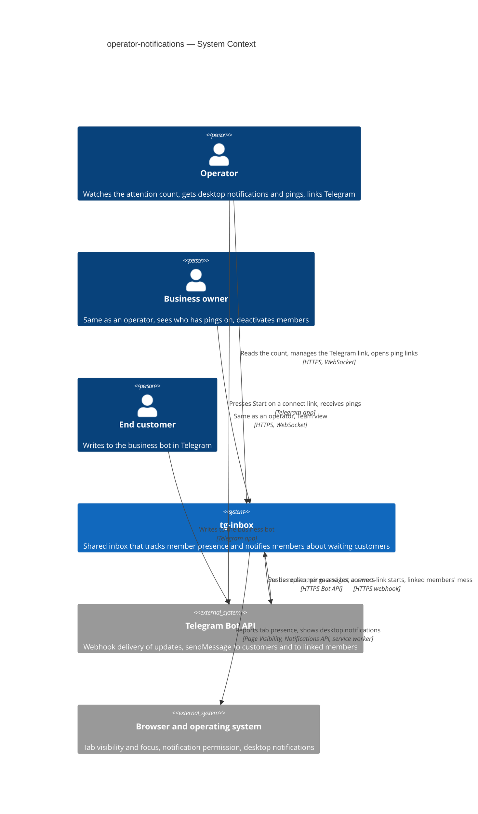

## 4. Solution strategy

**Target surfaces:** `backend-service` and `web-frontend`. The backend gets a new `notifications` module with its own tables, routes, jobs and ports. It also gets a capture interception in `bots`, a waiting-period start and an attention-count query in `conversations`, a second deactivation handler, and presence frames on the existing live socket in `inbox`. The frontend extends the existing SPA in four places: the workspace frame's count, Settings — Notifications with the connect dialog, the Team mark, and desktop notifications through a service worker. The ping scheduler is a set of pg-boss jobs inside the same API process, like the reply drain and the bot health checks. So no separate `worker` surface is declared, which follows the shared-inbox and bot-connection precedent. The member's Telegram chat (TG-01…TG-03) is the bot's output, not a surface we build a UI for. This surface split is recorded with the module decision in [ADR-0001](adr/0001-add-a-notifications-module-that-owns-telegram-links-presence-and-pings-and-is-reached-through-ports.md).

**UI architecture (web-frontend):** client-side SPA, already fixed by repo ADR-0001. No new UI ADR is needed for the delivery model. Three structural changes follow from the backend decisions:
- **The live socket moves from the inbox store to the workspace frame.** The attention count must follow the member onto Contacts and Settings (AC-01), and presence counts any workspace page (spec §1 D1). So the frame (SCR-15) opens one live connection per tab per workspace, through `openLiveSocket`. It hands frames to subscribers: the inbox store, the attention store, the notifications settings store and the desktop notifier. The inbox store stops opening its own socket. This is part of [ADR-0002](adr/0002-track-presence-as-per-tab-leases-in-postgres-refreshed-by-the-workspace-live-socket.md).
- **Stores:** a small attention store per workspace (count, refetched on frames, ADR-0008) and `features/notifications/store.ts` for SCR-16 / SCR-17 (link state, bot readiness, connect link, desktop opt-in). The desktop opt-in is a per-browser flag in `localStorage`, keyed by account and workspace. It is a per-viewer convenience, read in try/catch, and is off when storage is unavailable.
- **Routes:** Settings — Notifications is a new settings page under `/w/:workspaceId/settings/notifications`, open to both roles. The connect dialog (SCR-17) is a shadcn `Dialog` over it. Ping links land on existing inbox addresses (`/w/:workspaceId/inbox/:conversationId` or the inbox with the `mine` / `unassigned` / open lens parameters). `screens` picks the primitives. The dialog shows the link with Copy and Open in Telegram buttons; no scannable code in v1 (deferred — it would need a new dependency), so no image is served.

**Top strategic choices (the seeds for ADRs):**

1. **A new `notifications` module owns Telegram links, connect links, presence and pings. It calls `conversations`, `workspaces` and `bots`, and they reach it only through ports.** Static edges: `notifications → {conversations, workspaces, bots}` and `inbox → notifications` (the hub reports presence). There are two runtime edges through ports that `buildDeps()` fills. `bots` declares an **inbound interceptor** (choice 3) and a **bot-connected hook**. `workspaces` keeps one `onMembershipDeactivated` port, which `buildDeps()` now fills with a composition of `conversations.unassignDeactivatedMember` and `notifications.removeLinkOnDeactivation`. The graph stays acyclic. `bots` stays the only module that talks to Telegram, and `inbox` keeps owning no tables (goals 1 and 2): [ADR-0001](adr/0001-add-a-notifications-module-that-owns-telegram-links-presence-and-pings-and-is-reached-through-ports.md).
2. **Presence is a per-tab lease row in Postgres, refreshed by the workspace live socket.**
   - When a tab's socket opens, the hub registers it with `notifications.presence`. The row holds the workspace, the account, a tab connection id, `live_until`, `on_screen` and `last_on_screen_at`.
   - Every pong the server receives (every 25 s) moves `live_until` to now + 50 s. A dead connection therefore stops counting at most 50 s after its last pong, which is within the spec's 60 s.
   - The client sends one small frame `{ type: 'presence', onScreen }` when the socket opens and on every `visibilitychange`. This is the first client frame the socket reads, within the existing 1024-byte limit. `document.visibilityState === 'visible'` is exactly "the selected tab of a window that is not minimised". A covered window may still report visible, which is the spec's safe direction. When a tab leaves the screen (a real on → off transition), the server stamps `last_on_screen_at = now`; a tab that opened hidden keeps it NULL and counts away at once. A tab that reconnects while hidden sends `hidden_since` (when it left the screen) on its off frame; on a lease with no on-screen history the server stores it as `last_on_screen_at`, bounded by its own clock (never in the future, never older than 10 min + one lease), so a reconnect does not cut the 10 minutes short (D1). The first frame of a socket is written at once, later ones at most once per second.
   - A clean close deletes the row. A crash, and a server-initiated `1001` (deploy or restart), leave it to expire: the tab reconnects to another instance, so a restart never makes an on-screen member look away.
   - A member is **away** for a workspace when no row of theirs has `live_until > now` and (`on_screen` or `last_on_screen_at > now − 10 min`).
   - Every API instance and every job reads the same rows, so the answer is correct with any number of instances and survives restarts (goal 3): [ADR-0002](adr/0002-track-presence-as-per-tab-leases-in-postgres-refreshed-by-the-workspace-live-socket.md).
3. **Capture is intercepted in `bots`, before `conversations`, through a port `notifications` fills.** `bots/app/accept-update.ts` classifies an update as today. Then, for every private message or edit from a human sender, it asks `inboundInterceptor.intercept({ workspaceId, telegramBotId, from, kind, text })` before it calls `captureInbound` or `applyEdit`. The answer is `pass` (capture as before) or `consumed`. `notifications` answers `consumed` in two cases:
   - the text is `/start tgi_<token>`, a connect-link start (choice 4), whether or not the sender is linked;
   - the sender's Telegram user id has a live link in this workspace, made with this bot (any message, edit or start, campaign links included, AC-11).

   A consumed update creates no contact and no conversation, and changes no unread count, waiting marker or status. The lookup is one indexed read per private update, scoped by the workspace id that the webhook's bot already gives. A sender without a link, and a start through a business's own campaign link, pass through unchanged (bot-connection AC-07) (goal 2): [ADR-0003](adr/0003-intercept-connect-link-starts-and-linked-members-messages-in-bots-before-capture-through-a-port.md).
4. **Connect links are random single-use tokens. Only their SHA-256 hash is stored, and they are redeemed through the bot's start payload.**
   - **Issue.** "Connect Telegram" creates 32 random bytes and shows `https://t.me/<bot username>?start=tgi_<base64url token>` (47 characters of payload, within Telegram's 64). The server stores the hash, the membership, the creation time and the expiry (+10 min). Creating a link marks the member's previous unused link replaced.
   - **Limit.** At most 5 links per 10 minutes per member, counted from the stored rows under `connect-links:<ws>:<account>` (AC-13).
   - **Redeem.** Redemption runs in one transaction:
     - the link row is found by `(workspace_id, token_hash)` with a plain read, which gives its membership;
     - the membership is share-locked (`workspaces.lockActiveMembers`) and must be active. It is locked **before** the connect-link row, the same order as deactivation (§8), so the two cannot deadlock;
     - the connect-link row is then locked `FOR UPDATE` and re-checked: it must be unused, unexpired and not replaced;
     - the two uniqueness rules are checked: one live link per membership, one live link per Telegram user per workspace. Partial unique indexes back them up;
     - the link row is written and the connect link is marked used;
     - an account-scoped signal is published (choice 7), and the bot's answer is enqueued.

     Every refusal still uses the link up and answers in the chat (AC-05, AC-06). Because any Telegram user can trigger one, the refusal answer is throttled: one per kind and reason (`refusal:<ws>:<telegram user>:<kind>[:<reason>]`) per one-minute pg-boss singleton slot, so a repeated identical refusal within a minute is answered once, while a different explanation still goes out.
   - **Binding.** A link records the bot's **Telegram bot id**. A token rotation keeps it. When a different bot is connected, the `bots` hook removes it in the connect transaction (AC-10, "connecting a different bot removes every link made with the old one").

   (goal 2): [ADR-0004](adr/0004-issue-connect-links-as-random-single-use-tokens-stored-as-hashes-and-redeemed-through-the-start-payload.md).
5. **Pings are decided by a sweep per workspace every 20 s, against a per-period ledger written before the send.**
   - **The jobs.** `notifications.send-pings` (policy `stately`, `singletonKey` = workspace id: `stately` keeps one sweep active and one next link waiting per workspace across instances; `exclusive` would refuse the chain's own next link while the current sweep is still active, so the chain would break) re-enqueues itself 20 s later while the workspace has a live link. A cron `notifications.schedule-pings` runs every minute. It is a backstop that starts a chain for every workspace with a live link, and the singleton key drops duplicates.
   - **One run, step by step:**
     - reads the bot's readiness from `bots` and skips while the bot is not working, so nothing is queued (AC-10);
     - deletes the workspace's expired presence rows;
     - reads the live links, the away members and the open waiting conversations with their read state from `conversations` (choice 6);
     - computes each member's **due set** in `notifications/domain`: 5 min for the assignee or for everyone on an unassigned conversation, 30 min for the team, or 5 min for the team when the assignee is away, has not read the waiting message and cannot be pinged (no link, or a link that is "Not reachable"). An assignee who is present or has read the message can be reached, so the team waits for 30 min (AC-09). The assignee's presence and read state are therefore read whether or not they have a link; never a conversation already in the member's ledger for its current waiting period; never one the member has read, unless the period began with a reopen.
   - **The send, per member** whose last ping is at least 10 minutes old:
     - a transaction share-locks the membership, takes the member's advisory lock `pings:<ws>:<account>` (so two overlapping sweeps prepare one member one at a time and the second sees the first's ping), share-locks the link and recomputes that member's due set from fresh reads on its own connection: still open, still waiting, still unread, member still away, link still live, last ping at least 10 minutes old;
     - it writes one `pings` row and one `ping_items` row per conversation (unique per member, conversation and waiting-period start), then commits;
     - only then does it call `bots`.

     The send-time re-check of the spec therefore runs at most milliseconds before the Telegram call, and the ledger makes "at most once per conversation per waiting period" hold across instances and restarts. Due conversations that wait for the member's next allowed moment are combined into that ping.
   - **The trigger is a sweep, not a timer per conversation.** Six events can make a conversation due: the 5- and 30-minute marks, a member becoming away, a reassignment or unassignment, a link becoming unreachable and a bot recovering. A sweep catches all of them without a hook in each module that causes them.
   - **Tenancy.** One new controlled exception: *workspaces with a live Telegram link*, read only by the cron backstop.

   (goals 1 and 2): [ADR-0005](adr/0005-decide-pings-in-a-per-workspace-sweep-every-20-s-with-a-per-period-ledger-written-before-the-send.md).

**Supporting choices:**

- **Pings stay below a share of the bot's Telegram budget and pause on any rate-limit answer, so replies always go first (AC-10, §6 reply delivery).** Pings and bot answers go out through a new `bots.sendMemberMessage`, never through `sendText`. A workspace's sends are serialised by its singleton job and paced at 10 per second at most, a third of Telegram's roughly 30 per second per bot. Any `429` on this bot, from a reply or from a ping, stores `send_paused_until` on the bot row. `sendMemberMessage` refuses while that time is in the future, and the reply path never consults it. A ping refused or answered with `429` is rolled out of the ledger, because Telegram did not accept it. Its conversations stay due and are combined into the next run after the pause. `bot_unavailable` (the bot stopped working, or its token is gone, between readiness and send) is rolled out the same way, so its conversations become due again once the bot works (AC-10). `403` (the member blocked the bot) maps to `blocked`: the attempt counts for its conversations (AC-10) and the link turns "Not reachable". `transient` (Telegram definitely did not take it) and `unknown` (a timeout or a connection lost after the request was written, so it may have reached the member) are recorded as `failed` and count, which is the at-most-once rule (§11); a bot answer is retried only after `transient`, never after `unknown`. The outcome transaction updates only the link the ping went to, and only while it is still live. A sweep starts no member send after 30 s, so it always ends inside its 60 s job expiry. A `429` still pauses the whole bot (Telegram does not say whether the chat's or the bot's limit was hit, and its `retry_after` must be honoured), and the refusal answers that anyone can trigger are throttled to one of each kind and reason per Telegram user per minute so no single chat can produce that burst. Each outcome is written in a short transaction after the send. When it changes the link's reachability, in either direction, that transaction publishes `telegram_link.changed`. This is an ADR: [ADR-0006](adr/0006-pace-pings-below-a-per-bot-share-of-the-telegram-limit-and-pause-them-on-any-rate-limit-answer.md).
- **`conversations` records when the current waiting period began, in the transactions that start and end it (AC-07, AC-08).**
  - New columns on `conversations`: `waiting_since` and `waiting_started_by` (`message` / `reopen`).
  - Capture sets them when a customer message arrives in a conversation that is not waiting (`message`, at its arrival time).
  - A reply marked sent and a close clear them.
  - A reopen while the customer is still waiting sets them to the reopen time (`reopen`): a member reopen over an unanswered message, or a reply that ends not delivered or not confirmed.
  - A reassignment does not touch them, so the clock does not restart.
  - `notifications` reads them through `conversations.waitingForPings(workspaceId, …)`. That read returns, per open waiting conversation, the assignee, the period start, the start kind, the arrival of the message that began the wait, and whether each given member's watermark has passed it.

  This is an ADR: [ADR-0007](adr/0007-record-the-waiting-period-start-on-the-conversation-in-the-writing-transactions.md).
- **The attention count is computed by the server and refetched on frames (AC-01).** `conversations.attentionCount(workspaceId, accountId, activeSince)` counts open conversations that are assigned to the member or unassigned and have a customer arrival after the member's unread floor. It reuses the list's unread predicate and the lens indexes. `inbox` serves it under `GET …/inbox/attention`. The frame's attention store refetches it, debounced by 300 ms, on four triggers: every `conversation.changed` with a message, an activity or a `read` change of this account, `membership.deactivated`, and `resync`. A client-side count could not see conversations outside the loaded page. This is an ADR: [ADR-0008](adr/0008-serve-the-attention-count-from-a-conversations-query-refetched-on-change-signals.md).
- **Desktop notifications go through a service worker that is used only for notifications (AC-02, AC-03).**
  - **Registration.** The SPA registers `/notifications-sw.js` (scope `/`) only after the member turns desktop notifications on. Permission is asked only on that click.
  - **The tab's part.** On a `conversation.changed` frame with a created message, each tab of the workspace refetches the row, as it already does. If the conversation is the member's or unassigned and open, and the frame was not an edit, the tab posts `{ workspaceId, conversationId, messageId, contact name, url }` to the worker.
  - **The worker's part.** It calls `clients.matchAll({ type: 'window', includeUncontrolled: true })`. If any client of that workspace is `focused`, it shows nothing. Otherwise it shows the notification, with `tag` = workspace + conversation, so further messages replace it, and keeps a short dedupe of message ids, so several tabs produce one notification.
  - **The click.** The worker focuses the first matching client, which `matchAll` orders by most recent focus, and asks it to open the conversation. With no such client it opens the conversation's address.

  This is an ADR: [ADR-0009](adr/0009-show-desktop-notifications-through-a-notifications-only-service-worker-that-checks-focus-and-picks-the-tab.md).
- **Link state reaches the member's own tabs through a new account-scoped signal.** `telegram_link.changed { workspace_id, account_id }` is published in every transaction that creates, removes or changes the reachability of a link. The hub delivers it only to that account's sockets, as it already does for `read`. SCR-16 and SCR-17 refetch the link state, so "Connected" appears without a reload (AC-04). "Pings paused" comes from the existing `bot.changed`. This is an ADR: [ADR-0010](adr/0010-signal-telegram-link-changes-on-an-account-scoped-frame-delivered-only-to-that-members-sockets.md).
- **Bot answers in the member's chat are jobs, inline.** `notifications.send-bot-message` (payload: workspace id, Telegram user id, answer kind; text built at send time from the kind and the workspace name) is enqueued in the transaction that decides the answer. The kinds are: connected, link expired, cannot connect (two reasons), already connected, notifications off, "this chat only sends notifications". The webhook request therefore never waits on Telegram. The "only sends notifications" answer is limited to one per hour per link by a conditional update of `last_notice_at` (AC-11). The refusals (link expired, cannot connect), which any Telegram user can trigger, are limited to one of each kind and reason per workspace and Telegram user per minute by a pg-boss singleton slot; the extras are consumed silently. These sends go through `sendMemberMessage` and its pause. Below the ADR gate: it is the reply-drain pattern inside one module.
- **Ping text, inline.** `notifications/domain/ping-text.ts` builds the text from the workspace name, the count split into the member's own, unassigned and a teammate's, the longest wait in whole minutes and the link: one conversation, the `mine` lens, the `unassigned` lens or the open lens (AC-07, AC-08, AC-09). Its input type has no field for message text, contact names or teammate names, so the NFR "0 pings containing customer message text or a contact name" holds by construction, and a unit test asserts it.
- **Persistence:** the single PostgreSQL 16 store. No cache, no Redis, no new datastore. Two new pg-boss queues plus the cron.

Each later tactical decision traces to one of these. Contradictions go to §11.

## 5. Building block view

The backend keeps the modular monolith (`domain → app → infra → http`) and adds one module, `notifications` ([ADR-0001](adr/0001-add-a-notifications-module-that-owns-telegram-links-presence-and-pings-and-is-reached-through-ports.md)). The pieces divide up as follows:
- **`notifications`** owns Telegram links, connect links, presence leases and the ping ledger. It holds the due rules and the ping text in its domain, the use cases (connect, redeem, disconnect, intercept, presence, sweep, send) in its app layer, the repositories and the two workers in infra, and the Settings — Notifications and Team routes in http.
- **`bots`** declares two ports: the inbound interceptor and the bot-connected hook. It gains `sendMemberMessage`, with the pause and a `blocked` outcome, and `pingReadiness`.
- **`conversations`** gains the waiting-period columns and the reads `waitingForPings` and `attentionCount`.
- **`inbox`** reads presence frames on the live socket and reports socket lifecycle to `notifications`. It also serves the attention route and delivers the account-scoped frame.
- **`workspaces`** is unchanged, apart from the composed deactivation port that `buildDeps()` builds.

Static graph after the change: `inbox → {conversations, contacts, bots, workspaces, notifications}`, `notifications → {conversations, workspaces, bots}`, `bots → conversations → contacts`, `bots → contacts`. It is acyclic. Runtime edges through ports: `bots ⇢ notifications` (interceptor, bot-connected hook) and `workspaces ⇢ {conversations, notifications}` (deactivation). Construction order in `buildDeps()`: contacts → conversations → bots core (gateway, repos, `sendMemberMessage`) → notifications → the ports that `bots` and `team` take → team. The precedent for a port filled after its target exists is assignment-statuses' `team` port.

**Table ownership** (names indicative, `data-model` fixes them):

| Module | Tables (new or changed) | Tenancy |
|---|---|---|
| `notifications` | **`telegram_links`**: id, workspace_id, account_id, telegram_user_id (bigint, cleared at removal), telegram_bot_id (bigint), display name (cleared at removal), linked_at, reachable (`ok` / `blocked`), last_notice_at, removed_at, removed_reason (`member` / `deactivated` / `bot_replaced`). Partial unique indexes on live rows: `(workspace_id, account_id)` and `(workspace_id, telegram_user_id)`. **`connect_links`**: id, workspace_id, account_id, token_hash (unique per workspace), created_at, expires_at, used_at, replaced_at. **`tab_presences`**: id (the socket's connection id), workspace_id, account_id, live_until, on_screen, last_on_screen_at, opened_at. **`pings`**: id, workspace_id, account_id, link id, created_at, outcome (`sending` / `accepted` / `blocked` / `failed`), opened_at (for the §7 KPI). **`ping_items`**: ping_id, workspace_id, account_id, conversation_id, waiting_since, unique `(workspace_id, account_id, conversation_id, waiting_since)` | Tenant-owned, non-null `workspace_id`, every repository method takes `workspaceId`. One controlled exception (§8) |
| `conversations` | `conversations` **+** `waiting_since` (nullable timestamptz), `waiting_started_by` (nullable, `message` / `reopen`), backfilled from the current waiting marker | unchanged |
| `bots` | `bots` **+** `send_paused_until` (nullable timestamptz) | unchanged |
| `inbox`, `workspaces`, `contacts` | none | — |

`telegram_links.account_id` references `memberships (workspace_id, account_id)` through a composite FK. Like the assignee FK of assignment-statuses, this is a cross-module constraint only. No module queries through it. There is no FK to `bots`, because a disconnected bot row with no conversations is deleted (bot-connection). The link is bound by the Telegram bot id instead.

**Cross-module app-layer calls (new or changed):**

- `notifications` → `conversations`:
  - `waitingForPings(workspaceId, { conversationIds?, accountIds })`, which returns the open waiting conversations with period start, start kind, assignee and per-member "read the waiting message". Ping links need no read of their own, because they land on the existing inbox reads.
- `notifications` → `workspaces`:
  - `lockActiveMembers(tx, workspaceId, [accountId])` (existing), at redeem and at send;
  - `activeMembers` / the guard (existing);
  - the workspace name, for ping and answer text.
- `notifications` → `bots`:
  - `pingReadiness(workspaceId)`, which returns state, Telegram bot id, username and `send_paused_until`;
  - `sendMemberMessage({ workspaceId, telegramUserId, text })`, which returns `accepted` | `blocked` | `rate_limited(retryAfter)` | `bot_unavailable` | `transient` (definitely not delivered) | `unknown` (may have been delivered; never retried).
- `inbox` (hub) → `notifications.presence`: `opened(workspaceId, accountId, connectionId, onScreen)`, `alive(workspaceId, connectionId)` on pong, `screen(workspaceId, connectionId, onScreen)` on a presence frame, `closed(workspaceId, connectionId)`. The hub already holds each socket's workspace id, so every presence write is scoped by it and no tenancy exception is needed. The member's latest ping within the last 15 min gets its `opened_at` set when a tab of that workspace opens **or comes back on screen** (`opened` with `onScreen`, or `screen` turning true). This covers a member who returns to a tab that was already open (§7 KPI).
- `inbox` → `conversations.attentionCount` (new route).
- `bots` ⇢ (port) `notifications.intercept(…)` in `accept-update`, and `notifications.onBotConnected(tx, { workspaceId, telegramBotId })` in the paste-token connect transaction.
- `workspaces` ⇢ (port) `notifications.removeLinkOnDeactivation(tx, { workspaceId, accountId, at })`, called after `conversations.unassignDeactivatedMember` in the same transaction. It also marks the member's unused connect links replaced.

**Internal decomposition:**

```
apps/api/src/
├── modules/notifications/                    (new)
│   ├── domain/       due rules (5 / 30 min, unpingable assignee, read-holds-back unless reopen,
│   │                   per-period once, 10-min spacing), ping text builder (no customer text by type),
│   │                   presence predicate (lease + on screen within 10 min), connect-link rules
│   │                   (single use, 10 min, 5 per 10 min, start payload format), answer kinds, constants
│   ├── app/          connect (issue / limit), redeem, disconnect, intercept (port impl), presence
│   │                   (opened / alive / screen / closed), sweep + send per member, bot-connected and
│   │                   deactivation handlers, my notification state, team on/off read;
│   │                   ports: conversations, workspaces, bots, signals, jobs, clock, random
│   ├── infra/        telegram-link, connect-link, presence, ping repositories; jobs.ts
│   │                   (notifications.schedule-pings cron, notifications.send-pings,
│   │                   notifications.send-bot-message); signals
│   └── http/         routes under /api/workspaces/:workspaceId/notifications/… (my state, create
│                       connect link, remove link, team on/off for owners)
├── modules/bots/
│   ├── app/          accept-update calls the inbound interceptor port; paste-token calls the
│   │                   bot-connected port inside its connect transaction; sendMemberMessage;
│   │                   pingReadiness; any 429 stores send_paused_until
│   └── infra/        telegram-gateway maps 403 "blocked by the user" to `blocked`
├── modules/conversations/
│   ├── domain/       waiting-period transitions (start by message / reopen, end by sent reply / close)
│   ├── app/          capture / reply-sent / close / reopen maintain the period; waitingForPings;
│   │                   attentionCount
│   └── infra/        queries for both reads (reuse the unread predicate and lens indexes)
├── modules/inbox/
│   ├── infra/hub.ts  reads presence frames, reports open / pong / close; account-scoped delivery
│   │                   of telegram_link.changed
│   └── http/         GET …/inbox/attention
├── platform/realtime.ts   + telegram_link.changed {workspace_id, account_id}
├── platform/config.ts     no new key
└── deps.ts               build order above; composed deactivation port; bots ports filled
apps/web/
├── public/notifications-sw.js      (new) focus check, tag replace, dedupe, click to the MRU tab
└── src/
    ├── shared/api/realtime.ts      + presence frame on open and on visibilitychange
    ├── app/ (workspace frame)      owns the live connection; title "(N) …"; Inbox badge
    ├── features/attention/         store: count, refetch on frames (debounced)
    ├── features/notifications/     store, Settings — Notifications page (SCR-16), connect dialog
    │                                 (SCR-17, link + Copy + expiry), desktop opt-in and
    │                                 permission, notifier (posts to the service worker)
    ├── features/inbox/             subscribes to the frame's connection instead of opening one
    └── features/team (Settings — Team)  "Telegram pings on / off" mark per member
packages/shared/src/  notifications.ts — my state, connect link, team on/off; inbox.ts — attention;
                      LiveFrame + telegram_link.changed; client frame `presence`;
                      errors.ts — CONNECT_LINK_LIMIT_REACHED, TELEGRAM_ALREADY_LINKED,
                      PINGS_NEED_WORKING_BOT (names fixed by `api`)
```

**C4 Container (L2):**

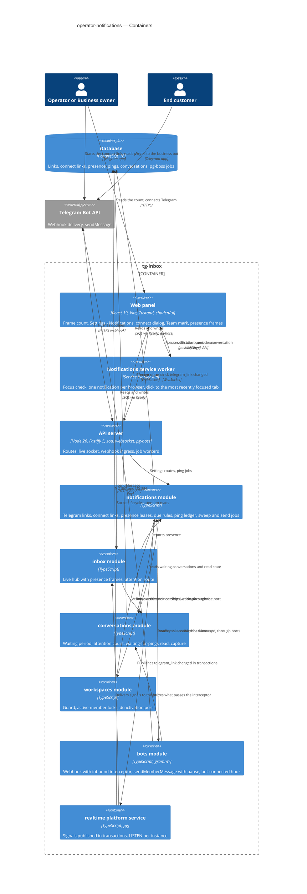

The module boxes are logical containers inside the one API process (shared-inbox §5 precedent). The service worker is drawn separately because its lifecycle differs from the page's: the browser starts and stops it, and it outlives any one tab. It is part of the `web-frontend` surface, not a new surface. The `bots → notif` and `ws → notif` relations are runtime calls through ports that those modules declare and the composition root fills. They are not imports.

## 6. Runtime view

These are the seeded critical flows. The `sequences` stage extends this section until every spec §5 AC maps to a flow or a branch. Participants are the §5 containers.

**Critical flow 1: A sweep sends one combined ping, re-checked at send time (US-04, US-05 — AC-07, AC-08, AC-09, AC-10)**

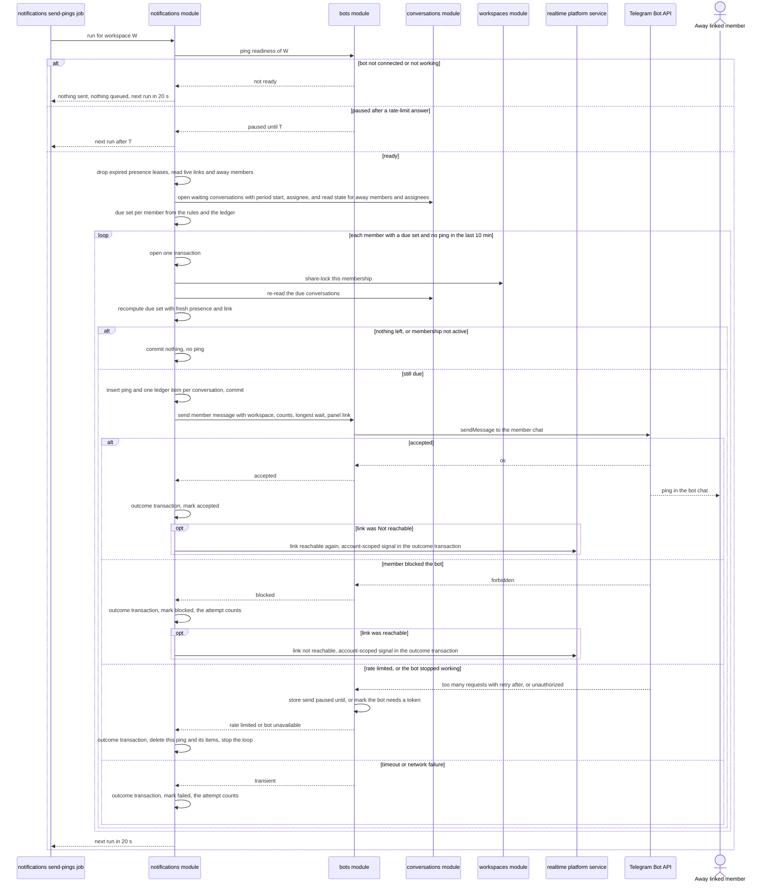

**Critical flow 2: A connect-link start is redeemed and never captured (US-03, US-06 — AC-04, AC-05, AC-06, AC-11, AC-12)**

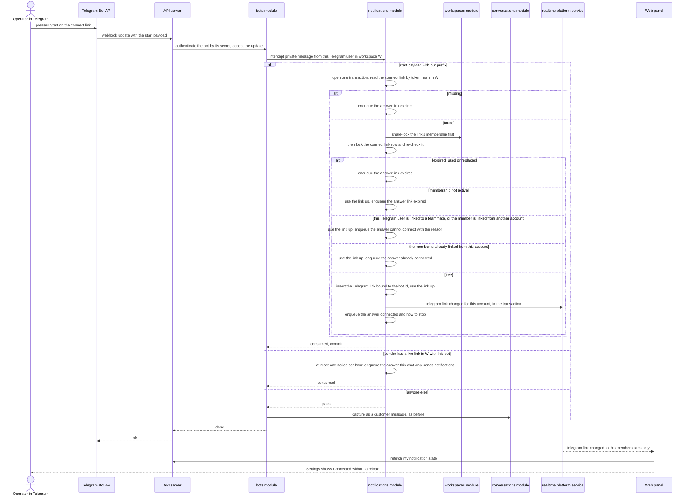

**Critical flow 3: Presence and a desktop notification for a new customer message (US-01, US-02 — AC-01, AC-02, and the presence rows of spec §6)**

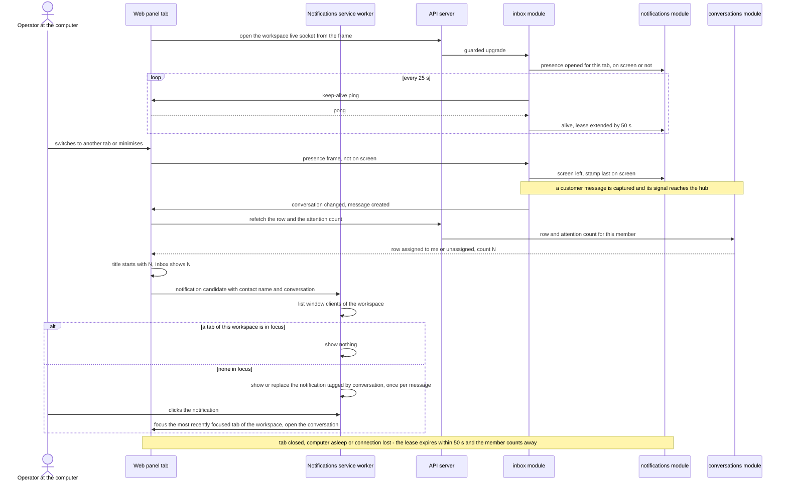

Flows 4–18 below were added by the `sequences` stage. They use the generic runtime vocabulary: `<user>` (an operator or business owner, or the person in Telegram), `<ui>` (a tab of the web panel, or its notifications worker), `<service>` (tg-inbox's backend), `<data-store>`, `<message-bus>` (the live-signal fan-out and the job queues) and `<external-system>` (the Telegram Bot API, or the browser and operating system where a flow says so). `SCR-NN`, `OS-NN` and `TG-NN` ids refer to [`ux-flows.md`](ux-flows.md). Every persist or read note is a hint for `data-model`. The seeded flows 1–3 above are unchanged.

**Assumptions (autonomous run 2026-10-19, `sequences`)**, each can be vetoed at review:

- Depth = medium, size M (`.size`), route `standard` (`.route`). The pipeline confirmed every flow itself against spec §5, `ux-flows.md` and ADR-0001…0010. Each flow's prose account is the paragraph under it.
- The same session guard (signed out, another workspace, deactivated) fronts every panel route and the live socket. It is drawn in full in flows 4, 8 and 14 and referred to elsewhere.
- Settings — Notifications also offers "Turn off" for desktop notifications. It clears this workspace's per-browser flag and unregisters the worker only when no workspace in this browser still has the flag on (the §11 kill switch).
- A permission prompt that the member dismisses counts as refused for that click. The next click asks again, because the browser's permission is still "not asked".
- When the attention-count request fails, the tab keeps the last count it showed and asks again on the next frame or resync.
- Deactivation sends the former member no bot answer. The spec asks for none, and the chat is a channel for members only.
- The owner's "Telegram pings on / off" mark on Settings — Team is read when Team opens. It is not pushed live, because `telegram_link.changed` is account-scoped (ADR-0010).
- Disconnect on a link that is already gone is a success that changes nothing, so a double click or a second tab shows "Not connected".
- A bot answer job that times out may be retried and so reach the chat twice. Answers carry no state, so this is accepted.

### Flow 4: The attention count follows the member across the workspace (US-01 — AC-01, AC-12)

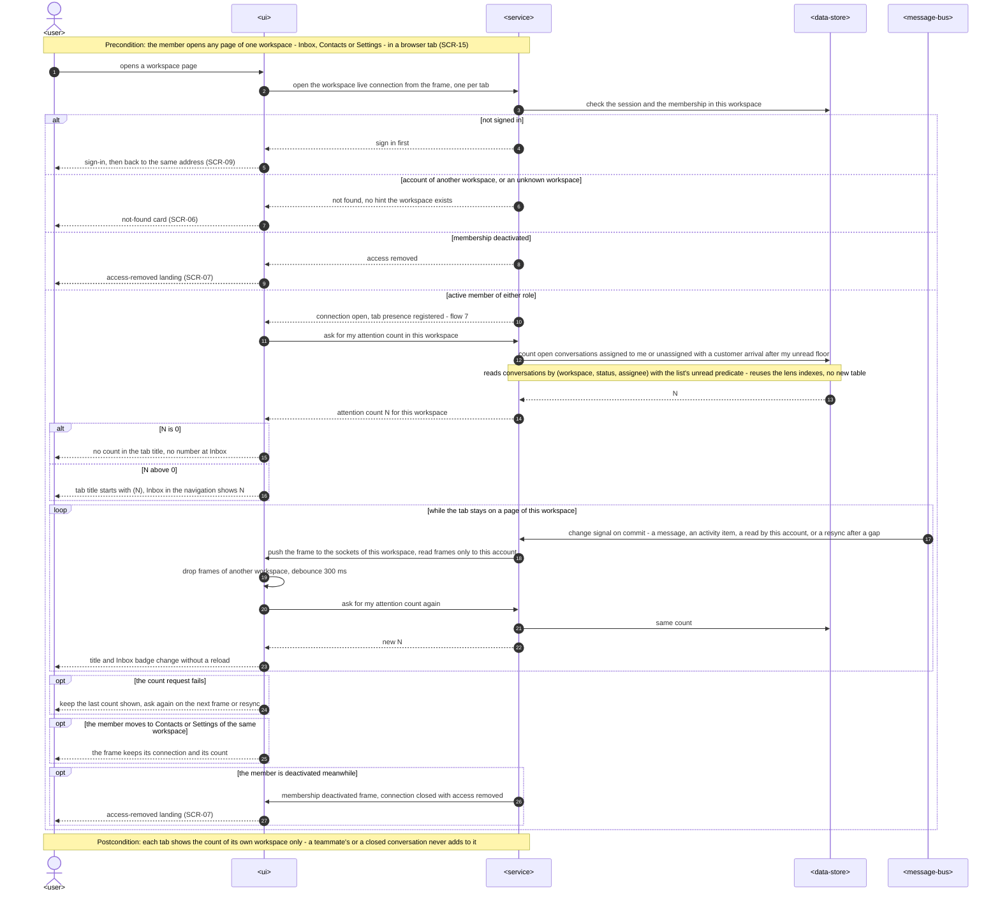

Opening any page of a workspace makes the frame open the tab's one live connection. The usual guard sends a signed-out visitor to sign in, gives another workspace's account the not-found card and gives a deactivated member the access-removed landing. For an active member of either role, the server counts open conversations that are the member's or unassigned and hold a customer arrival after the member's unread floor. It reuses the list's unread predicate and lens indexes (ADR-0008). At 0 the title and the Inbox item show nothing. Otherwise the title starts with "(N)" and Inbox shows N. Every message, activity, own-read or resync frame of this workspace triggers a refetch, debounced by 300 ms, so the count follows arrivals, reads, assignments, closes and reopens without a reload (AC-01). A failed refetch keeps the last count until the next frame. Moving to Contacts or Settings keeps the same connection and count. A deactivation closes the socket and shows the access-removed landing.

### Flow 5: Turn on desktop notifications in this browser (US-02 — AC-03)

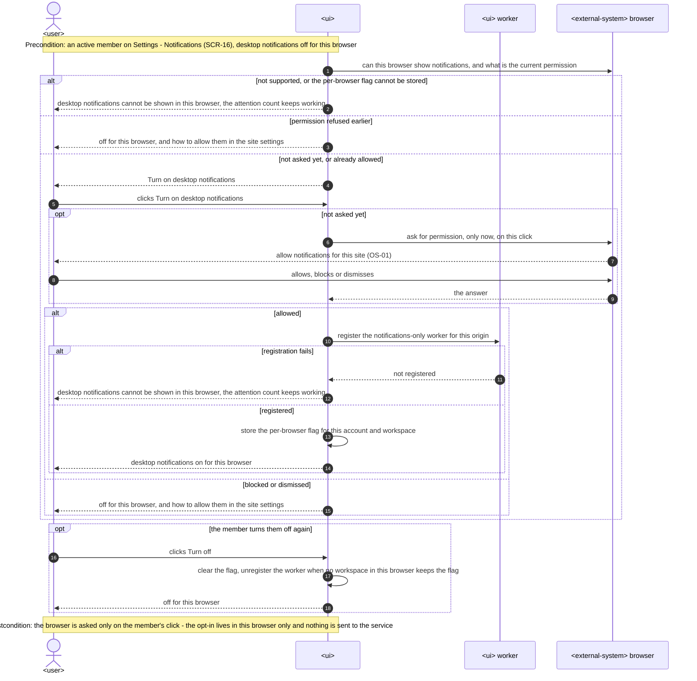

On Settings — Notifications the panel first asks the browser whether it can show notifications and what the permission is. A browser that cannot show them, or where the per-browser flag cannot be stored, gets "cannot be shown here", and the attention count keeps working. A permission refused earlier gets "off for this browser" with how to allow it in the site settings (AC-03). Otherwise the member sees "Turn on desktop notifications". Only that click makes the browser ask (OS-01). On "allow" the panel registers the notifications-only worker (ADR-0009) and stores the per-browser flag. A failed registration falls back to "cannot be shown here". A block or a dismissal gives "off" and how to allow it. Turning them off clears the flag and unregisters the worker once no workspace in this browser needs it.

### Flow 6: One desktop notification per browser for a new customer message (US-02 — AC-02)

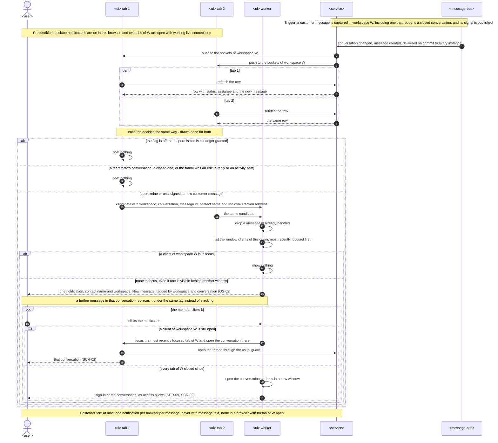

A captured customer message, including one that reopens a closed conversation, reaches every tab of the workspace. Each tab refetches the row, as it already does. A tab posts a candidate to the worker only when the opt-in and permission are on and the conversation is open and the member's or unassigned. The frame must also be a new customer message, not an edit, a reply or an activity entry. The worker drops a message id it has already handled, so two tabs give one notification. It then lists the browser's windows. If a tab of this workspace is in focus, it shows nothing. A tab that is visible but not in focus does not hold it back. Otherwise it shows `<contact name> · Acme Flowers: New message` with no text, tagged per conversation, so a further message replaces it (AC-02, ADR-0009). A click focuses the workspace tab that was most recently in focus and opens the conversation there. If every tab has closed since, the click opens the address, through sign-in if needed. A browser with no tab of the workspace gets no candidate at all.

### Flow 7: A tab's presence lease from open to away (US-04 — spec §1 D1 and the §6 presence rows, feeding AC-07, AC-09)

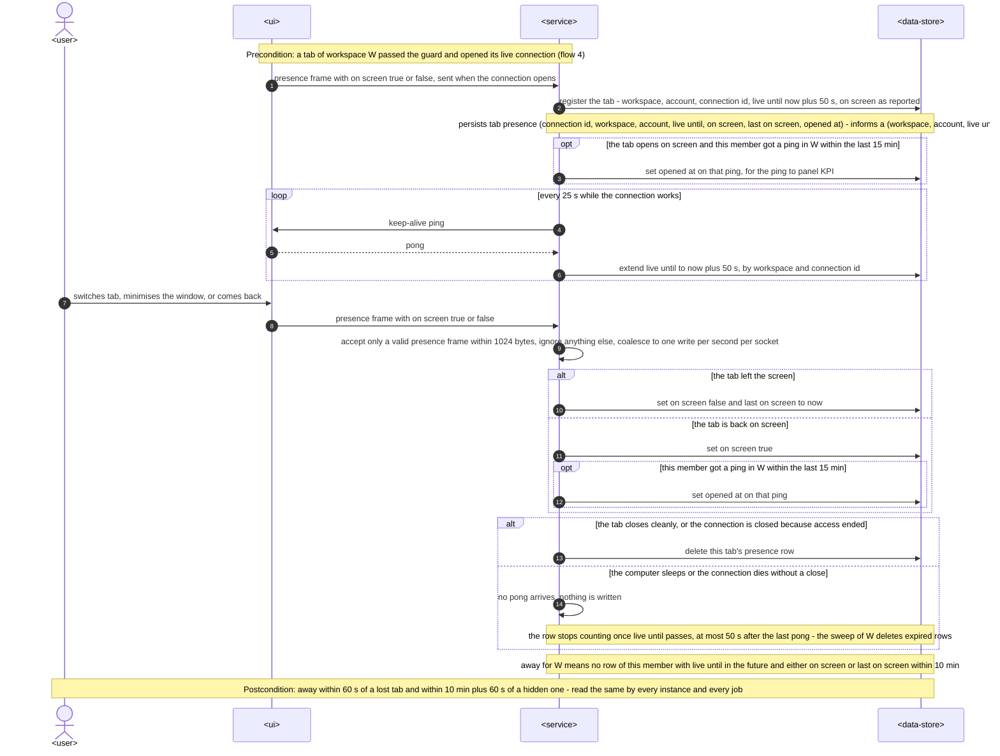

When a tab's live connection opens, the hub registers a presence row for it, scoped by the workspace, with a lease of 50 s and the on-screen state the tab reports (ADR-0002). Every pong extends the lease. A tab that leaves the screen sends one presence frame, and the server stamps when it left. A tab that comes back clears that. Coming back, or opening on screen, within 15 minutes of a ping marks that ping opened for the §7 KPI. The server reads only well-formed presence frames, within the existing 1024-byte cap; a socket's first frame is written at once and later ones at most once per second. Leaving the screen stamps the time only when the tab was on screen, so a tab that opens or reconnects hidden counts away at once. A clean close, including the close when access ends, deletes the row; a server restart (`1001`) leaves it to lapse while the tab reconnects elsewhere. A sleeping computer or a dead connection stops answering, and the lease lapses at most 50 s after the last pong. The member is away for the workspace once no row has a live lease and is on screen or was within 10 minutes. That gives the spec's 60 s and 10 min + 60 s freshness on every instance.

### Flow 8: Open Settings — Notifications and get a connect link (US-03 — AC-04, AC-06, AC-12, AC-13)

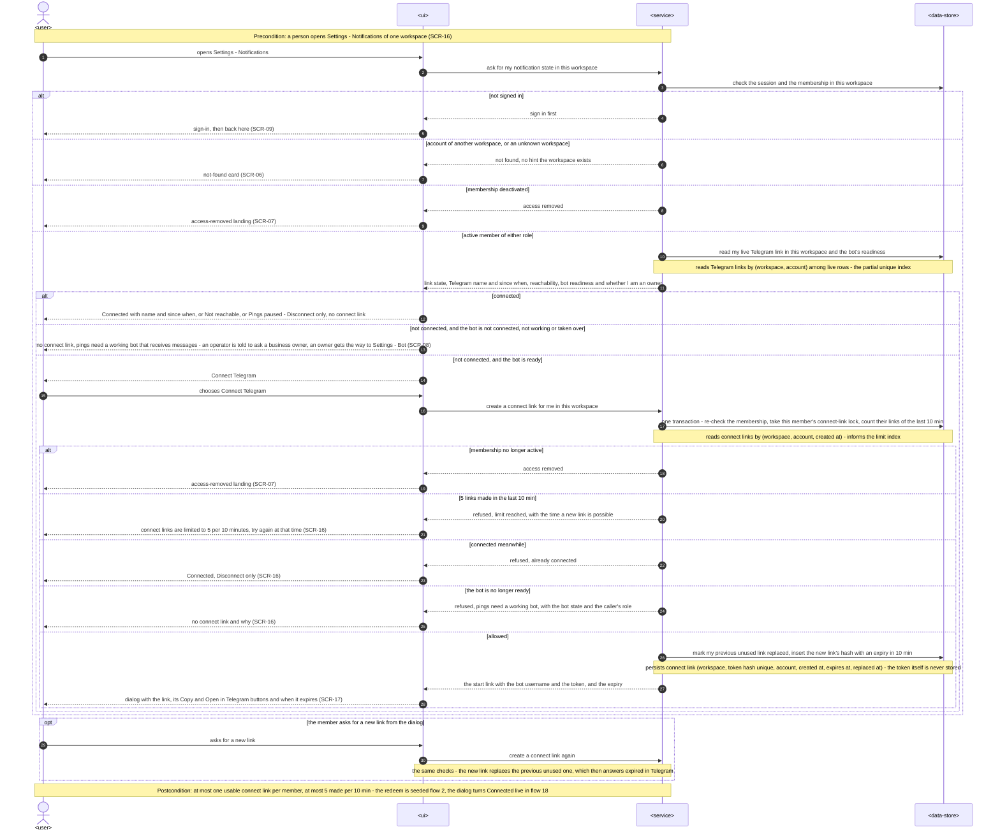

Settings — Notifications sits behind the usual guard (AC-12). For an active member, it reads only the caller's own live link and the bot's readiness. A connected member sees "Connected" with the Telegram name and since when, or "Not reachable" or "Pings paused". The only action is Disconnect, never a connect link (AC-06). A member who is not connected is offered no link while the bot is not connected, not working or taken over. An operator is told to ask a business owner, and an owner gets the way to Settings — Bot (AC-13). "Connect Telegram" re-checks everything in one transaction under the member's connect-link lock: the membership, the 5-per-10-minutes limit with the retry time, a link made meanwhile and the bot's readiness. Then it marks the previous unused link replaced and stores only the new token's hash, with a 10-minute expiry (ADR-0004). The dialog shows the link with Copy and Open in Telegram buttons and the expiry. Asking again replaces the previous link.

### Flow 9: Disconnect my Telegram (US-03 — AC-04, AC-12)

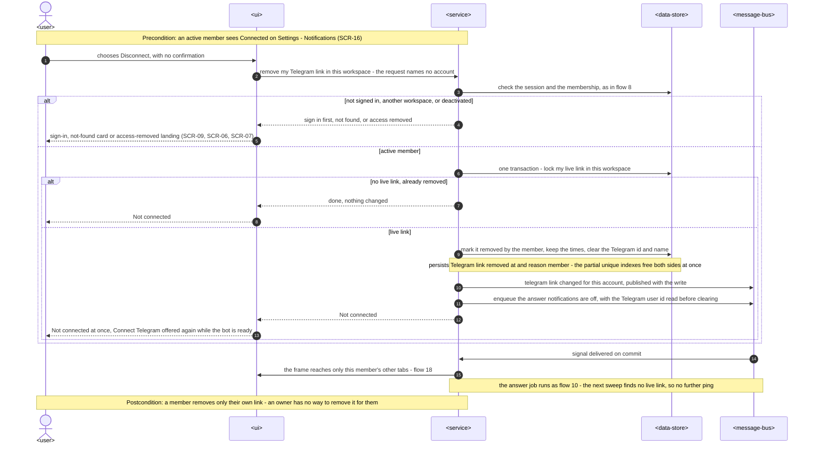

Disconnect takes effect on the click. The route takes no account id, so a member can remove only their own link (AC-12). In one transaction the service marks the link removed by the member and clears the Telegram id and name, keeping the times for the §7 KPIs. It publishes the account-scoped `telegram_link.changed` and enqueues the "notifications are off" answer. The answer's payload carries the Telegram user id, read before it is cleared. The panel shows "Not connected" at once, and the member's other tabs follow (AC-04). With no live link left, the next sweep sends nothing to this member. A second Disconnect is a success that changes nothing.

### Flow 10: The bot answers in the member's chat (US-03, US-06 — AC-04, AC-05, AC-06, AC-11)

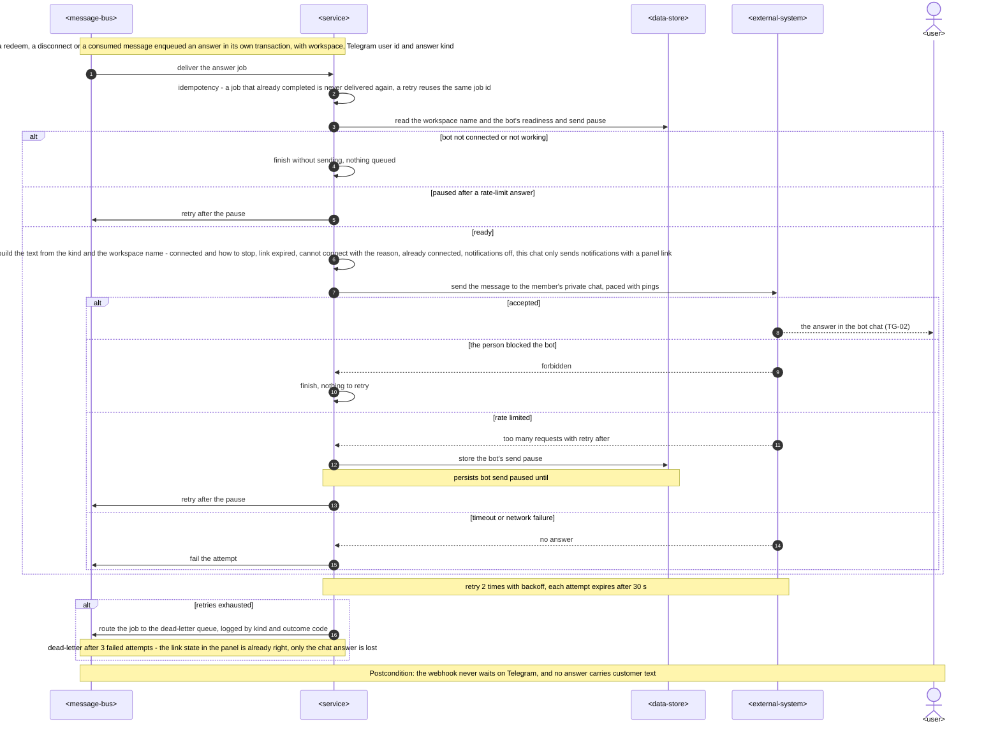

Every answer the bot gives in a member's chat is a job, enqueued in the transaction that decided it. The webhook therefore always answers at once. A redelivered job reuses its id, and a completed one never runs again. A bot that does not work drops the answer. A send pause postpones it. Otherwise the text is built from the kind and the workspace name and sent through `sendMemberMessage`, paced with pings and behind the same pause (ADR-0006). A person who blocked the bot ends the job. A rate-limit answer stores the pause and retries after it. A timeout fails the attempt. After two retries the job goes to the dead-letter queue. Nothing in the panel depends on the answer, so only the chat message is lost.

### Flow 11: A linked member writes to the bot (US-06 — AC-11)

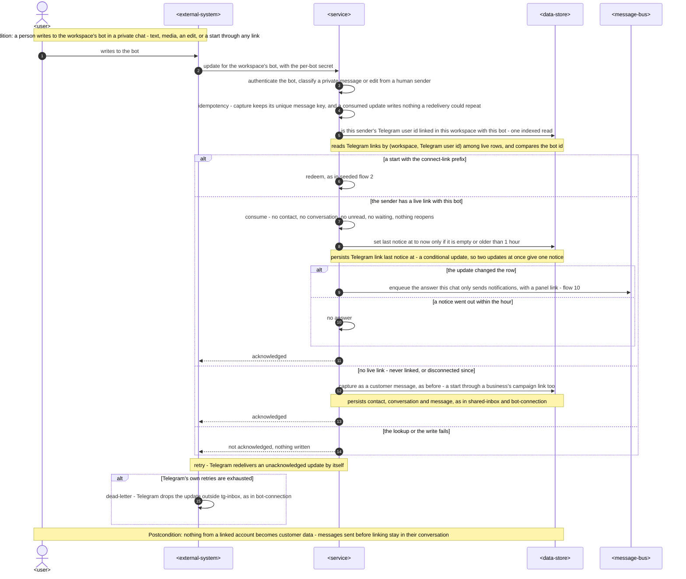

Every private update passes the inbound interceptor before capture (ADR-0003). One indexed read finds whether the sender holds a live link in this workspace, made with this bot. A connect-link start is redeemed as in seeded flow 2. Anything else from a linked sender is consumed: text, media, an edit or a start through any link, a campaign link included. It creates no contact or conversation and changes no unread count, waiting marker or status. A conditional update of the link's notice time lets at most one "this chat only sends notifications" answer, with its panel link, go out per hour, even when two updates arrive at once (AC-11). A sender without a live link, including one who disconnected, is captured exactly as before, campaign starts included. A failure is not acknowledged, so Telegram redelivers. The consumed path writes nothing but the notice time, so a redelivery is safe. Earlier messages from the same person stay in their conversation.

### Flow 12: Conversations record when a waiting period begins and ends (US-04, US-05 — AC-07, AC-08)

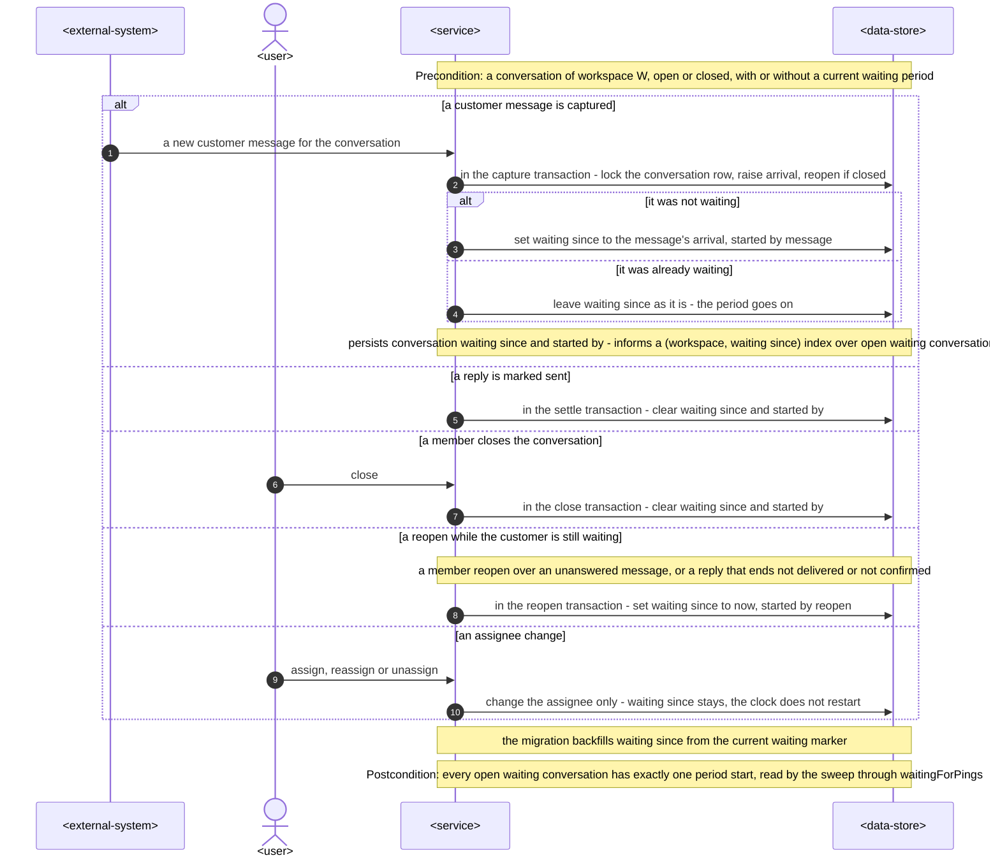

`conversations` keeps the period start in the transactions that already change the conversation (ADR-0007). Capture starts a period at the message's arrival when the conversation was not waiting, including a message that reopens a closed conversation. A message in an ongoing period leaves the start as it is. A reply marked sent and a close end the period. When a customer message arrived after the reply's sent time (a reply racing a newer message), the customer is still waiting, but on a new period: it starts at the earliest arrival after the sent time, marked as started by a message, so the new wait is pinged on its own and the team's 30 minutes count from it. A reopen while the customer is still waiting starts a new period at the reopen, marked as started by a reopen. This happens on a member reopen over an unanswered message, or a reply that ends not delivered (AC-08). An assignment change never touches the start, so a reassignment keeps the clock. Waiting is measured from arrival in tg-inbox, so a recovering bot's backlog starts fresh clocks.

### Flow 13: The sweep decides each member's due set and the ping's wording (US-04, US-05 — AC-07, AC-08, AC-09)

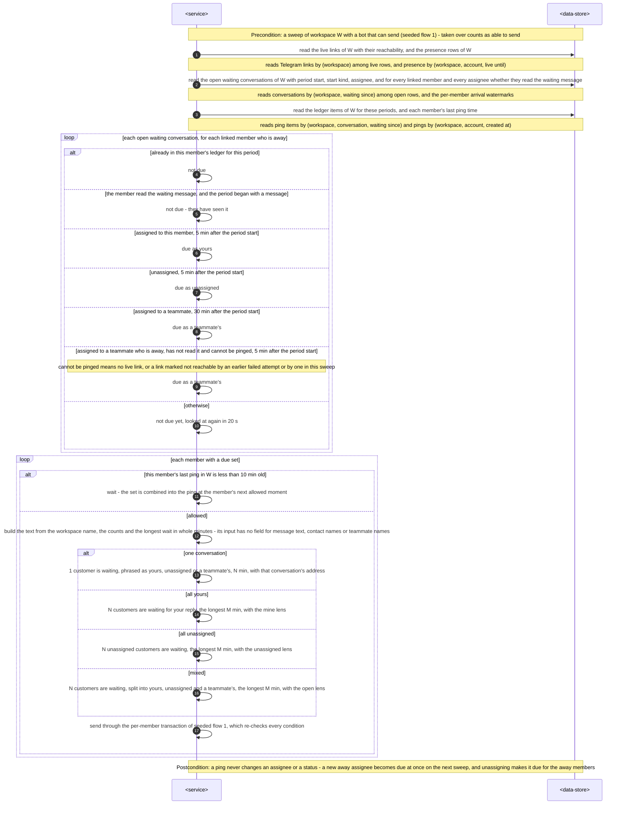

The sweep reads the workspace's live links and their reachability, its presence rows, its open waiting conversations with period start, start kind, assignee and read state, and its ledger (ADR-0005). It reads read state for every linked member and every assignee, linked or not. Only away members with a live link are considered. A conversation is never due for a member who already has it in the ledger for this period. It is not due for a member who has read the waiting message either, unless the period began with a reopen (AC-07). It becomes due at 5 minutes for the assignee and for everyone on an unassigned conversation. For the rest of the team it becomes due at 30 minutes, or at 5 minutes when the assignee is away, has not read the message and cannot be pinged (AC-09). Because the sweep runs every 20 s, a member who becomes away later, a reassignment to an away member, an unassignment, a link that just turned unreachable and a recovered bot are all caught on the next run (AC-07, AC-08). A member pinged less than 10 minutes ago waits, and the set is combined into the next ping. The text is built from counts only. One conversation links to itself. An all-yours set links to the mine lens, an all-unassigned set to the unassigned lens, and a mixed set, split by kind, to the open lens (AC-08). The send itself is seeded flow 1, which re-checks every condition.

### Flow 14: Follow a ping's link into the panel (US-04, US-05 — AC-07, AC-08, AC-12)

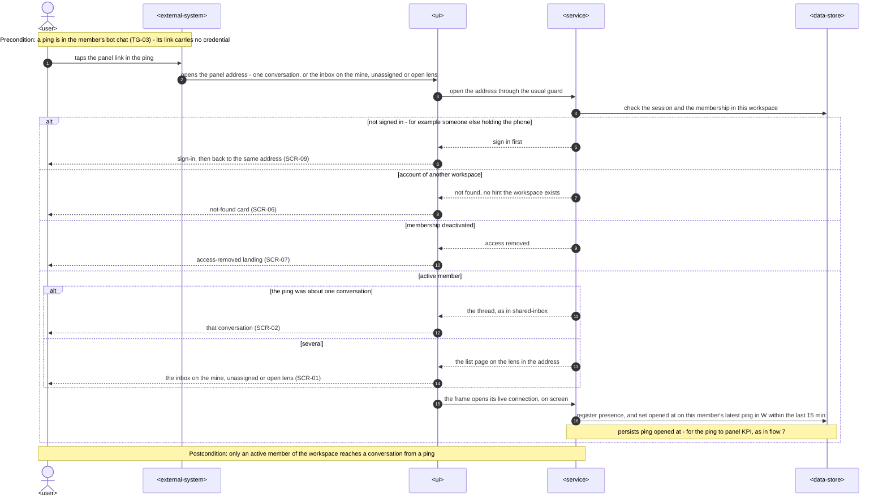

A ping's link is a plain panel address with no credential. It points to one conversation, or to the inbox on the mine, unassigned or open lens. Opening it runs the usual guard. Someone not signed in, for example a person holding another's phone, is asked to sign in and comes back to the same address. Another workspace's account gets the not-found card with no hint, and a deactivated member gets the access-removed landing (AC-12). An active member lands on the conversation (SCR-02) or the lens (SCR-01) (AC-07, AC-08). The frame's live connection registers presence on screen, which also marks the member's latest ping as opened for the §7 KPI.

### Flow 15: The owner sees who has pings on, and deactivation removes the link (US-05, US-03 — AC-10, AC-12, AC-05)

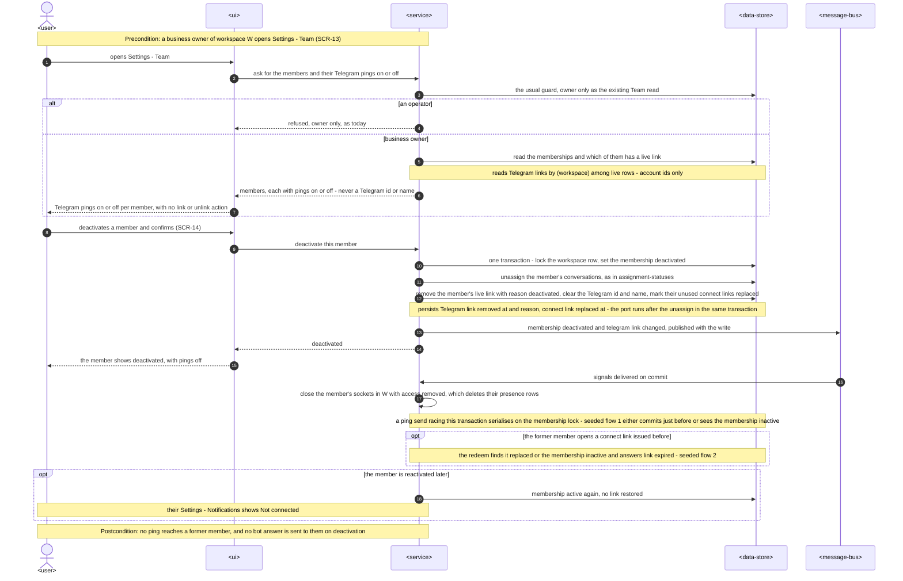

On Settings — Team, a business owner sees "Telegram pings on / off" per member, read from live links as account ids and booleans only. There is never a Telegram account and never a link or unlink action (AC-12). Deactivating a member keeps the existing transaction and now runs the composed deactivation port. It unassigns the member's conversations first. Then it removes their live link as "deactivated", clears the Telegram id and name, and marks their unused connect links replaced. The deactivation and link-change signals go out with the write, and the member's sockets close, which removes their presence (AC-10). A ping send that races the deactivation serialises on the membership lock, as seeded flow 1 shows. A connect link issued before the deactivation answers "link expired" (AC-05). Reactivation does not restore the link, so the member sees "Not connected".

### Flow 16: Rotating, replacing, losing or recovering the bot (US-04, US-03 — AC-10, AC-13)

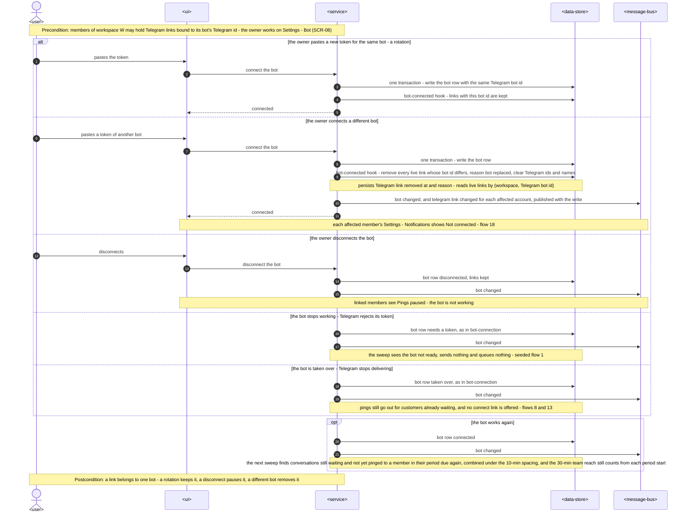

A link is bound to the bot's Telegram id, not to the bot row (ADR-0004). A token rotation keeps the same id, so the bot-connected hook keeps every link. Connecting a different bot removes every live link made with another bot id, in the same transaction, as "bot replaced". Each affected member's tabs then show "Not connected" (AC-10). A disconnected bot, or one that needs a new token, keeps the links. Linked members see "Pings paused", and the sweep sends nothing and queues nothing. A taken-over bot can still send, so pings for customers who are already waiting continue. It offers no connect link, because it would never receive the Start (AC-13). Once the bot works again, the next sweep finds what is still waiting and not yet pinged in its period and sends it combined. The 30-minute team reach still counts from each period start.

### Flow 17: Replies go first at the bot's sending limit (US-04 — AC-10, spec §6 reply delivery)

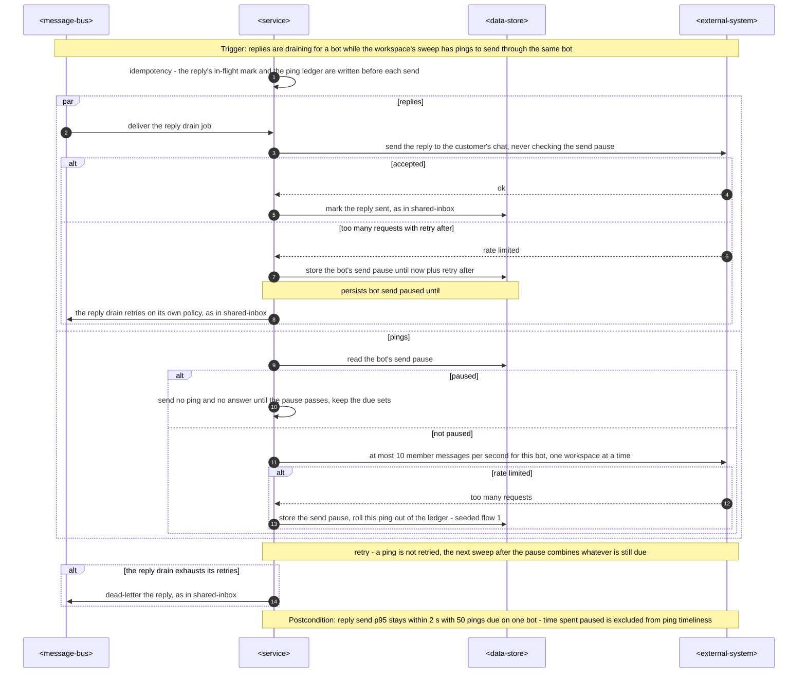

Replies and pings share the bot's Telegram budget, so pings take a share and yield to replies (ADR-0006). Each send is written down before it goes out: replies through their in-flight mark and pings through the ledger. Replies go out as today and never look at the send pause. Pings and bot answers go through `sendMemberMessage`. It is paced at 10 per second per bot, a third of Telegram's limit, and refuses while a pause is stored. Any rate-limit answer stores the pause, whether a reply or a ping caused it. A rate-limited reply retries on its own policy and dead-letters as in shared-inbox. A rate-limited ping is rolled out of the ledger and its conversations stay due. The next sweep after the pause combines them. This keeps reply send p95 within 2 s while 50 pings are due on one bot, and the paused time is excluded from ping timeliness (spec §6).

### Cross-cutting: Flow 18 — link and bot state reach the member's own tabs live (US-03, US-04 — AC-04, AC-06, AC-10)

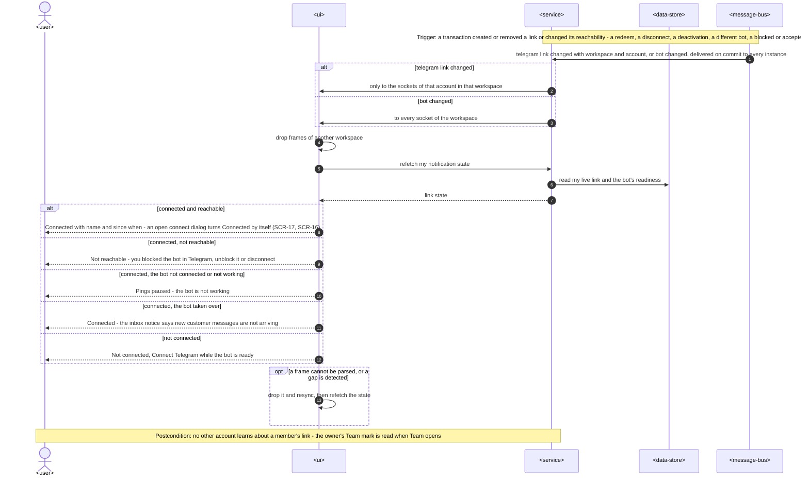

Every transaction that creates or removes a link, or changes its reachability, publishes `telegram_link.changed` with the workspace and account. The hub delivers it only to that account's sockets in that workspace (ADR-0010). A bot state change uses the existing `bot.changed`, sent to every socket of the workspace. Settings — Notifications and an open connect dialog refetch the member's own state. The dialog turns "Connected" by itself after the Start (AC-04). The state can also show "Not reachable" with what to do, or "Pings paused" while the bot does not work (AC-10). After a disconnect or a bot replacement it shows "Not connected". A connected member still sees no connect link (AC-06). A frame that cannot be parsed, or a gap, triggers a resync. No other account learns of a member's link, and the owner's Team mark is read when Team opens.

**Coverage — every spec §4 user story and §5 acceptance criterion → where §6 shows it:**

| Spec item | Shown by |
|---|---|
| US-01 | Flow 4, plus seeded flow 3 (the count after a captured message) |
| US-02 | Flow 5, flow 6, seeded flow 3 |
| US-03 | Flow 8, flow 9, flow 10, flow 18, seeded flow 2 |
| US-04 | Flow 7, flow 12, flow 13, flow 14, flow 16, flow 17, seeded flow 1 |
| US-05 | Flow 13 (team at 30 min, or at 5 min for an unpingable assignee), flow 14, flow 15, seeded flow 1 |
| US-06 | Flow 11, flow 10 (the notice), seeded flow 2 (linked sender and anyone else). The end customer has no screen of their own: these are the effects on the team's inbox, as in `ux-flows.md` |
| AC-01 | Flow 4: mine-or-unassigned open unread count, title "(N)" and Inbox badge, nothing at 0, refetch on message, activity, read and resync frames, the same connection on Contacts and Settings, one workspace per tab, either role. Seeded flow 3: the count after a captured message |
| AC-02 | Flow 6: opt-in and permission check, mine or unassigned and open, new message only (no edit, reply or activity), a reopening message counts, one per browser through the dedupe, tag replace, focus holds back but a visible unfocused tab does not, click to the most recently focused tab, no tab means no candidate. Seeded flow 3 |
| AC-03 | Flow 5: permission asked only on the click, refused now or earlier, unsupported, flag not storable, registration failure, the attention count keeps working |
| AC-04 | Seeded flow 2: redeem, no contact or conversation, account-scoped signal. Flow 10: the "connected and how to stop" and "notifications off" answers. Flow 18: "Connected" without a reload. Flow 9: Disconnect at once and no further ping |
| AC-05 | Seeded flow 2: missing, expired, used, replaced, deactivated member, link expired answer, no capture. Flow 8: a newer link replaces the older. Flow 15: deactivation marks unused links replaced. Flow 10: the answer |
| AC-06 | Seeded flow 2: teammate's account, other account, already connected from this account (the link is used up). Flow 8: a connected member is offered Disconnect only, and "connected meanwhile" is refused. Flow 18: the state stays Connected |
| AC-07 | Flow 13: 5 min for the assignee, unassigned to every away linked member, read holds back unless the period began with a reopen, a member who becomes away later is due on the next sweep. Flow 12: the period start at arrival or reopen. Flow 7: who counts as away. Flow 14: the single-conversation link. Seeded flow 1: the send-time re-check and the text with no customer text or contact name |
| AC-08 | Flow 13: once per conversation per period through the ledger, 10-min spacing, combining, wording and lens per set shape, reassignment keeps the clock, an away new assignee and unassigning make it due at once. Flow 12: a period ends on a sent reply or a close and restarts on a reopen while waiting. Seeded flow 1: a member who read meanwhile drops out at send time |
| AC-09 | Flow 13: team at 30 min, team at 5 min when the assignee is away, has not read it and has no link or an unreachable one, found earlier or in this sweep. The assignee and the status never change. Seeded flow 1: the blocked outcome that marks the link not reachable |
| AC-10 | Seeded flow 1: closed, sent, inactive membership, bot not ready (nothing queued), blocked counts and marks Not reachable, rolled out on a rate-limit or bot-unavailable answer, reachable again on acceptance. Flow 15: deactivation removes the link before any further ping and reactivation does not restore it. Flow 16: rotation keeps, disconnect pauses, a different bot removes, taken over still sends, recovery makes due again with the 30-min reach intact. Flow 17: replies before pings at the sending limit. Flow 18: "Pings paused", "Not reachable", "Not connected" in the panel |
| AC-11 | Flow 11: every kind of update from a linked sender is consumed, the notice at most once per hour, unlinked and disconnected senders and campaign starts without a link captured as before. Flow 10: the notice answer with its panel link. Seeded flow 2 |
| AC-12 | Flows 4, 8 and 14: guard branches (sign in, not found with no hint, access removed). Flow 8: the state read returns only the caller's own link. Flow 9: Disconnect names no account, so only one's own link can be removed. Flow 15: Team shows on or off only, owner only, with no action. Seeded flow 2: a connect link works only for its membership, once, for 10 minutes. Flow 14: a ping opened by someone else goes through sign-in |
| AC-13 | Flow 8: 5 links per 10 minutes with the retry time, a newer link replaces the previous, no connect link while the bot is not connected, not working or taken over, the operator is told to ask an owner, an owner is sent to Settings - Bot. Flow 16: why a taken-over bot offers no link |

**Flagged by `sequences` (for `design` / `data-model` / `api` to reconcile, no ADR written):**

- **No new participants.** Every flow stays within §5's containers. `<ui>` worker is the notifications service worker. `<external-system>` is the Telegram Bot API, and in flows 5 and 6 it is the browser and operating system, the second external system of §3. `<message-bus>` is `platform/realtime` (signals) and the pg-boss queues (`notifications.send-pings`, `notifications.send-bot-message`, the reply drain).
- **A Disconnect racing a send (flow 9 vs seeded flow 1).** The send transaction re-checks "link still live" but locks only the membership. A Disconnect that commits after the send's commit and before its Telegram call can be followed by one ping, at most milliseconds later. This is the same window §8 accepts for deactivation. For a tighter AC-04 ("no further pings"), `tasks` could let the send share-lock the link row, so that a Disconnect waits for the commit. That narrows the window but cannot close the post-commit Telegram call. No ADR needed: it is a lock-order detail inside one module.
- **The "notifications off" answer needs the Telegram user id after the link clears it (flow 9).** The job payload carries it, so a Telegram user id sits in the pg-boss job table until the job is archived. `data-model` / security review should confirm that this is acceptable under the "cleared at removal" retention of §2, or the payload could carry the link id and read the id before clearing.
- **Bot answer retries can repeat an answer (flow 10).** After a timeout, the retry policy (limit 2) may send the same answer twice. This is accepted in the assumptions above, and it differs from the at-most-once ping send on purpose.
- **Team mark is not live (flow 15).** `telegram_link.changed` is account-scoped (ADR-0010), so an owner's open Team page does not follow a member's connect or disconnect until it reloads. `screens` should not promise a live mark.
- **Indexes for `data-model`** (from the persist and read notes):
  - `telegram_links` by `(workspace_id, account_id)` and `(workspace_id, telegram_user_id)` among live rows (the partial unique indexes), plus by `(workspace_id, telegram_bot_id)` for the bot-connected hook and by `(workspace_id)` for the sweep and Team;
  - `connect_links` by `(workspace_id, token_hash)` unique and `(workspace_id, account_id, created_at)` for the limit and the replacement;
  - `tab_presences` by `(workspace_id, account_id, live_until)` and by `(workspace_id, live_until)` for the sweep's expiry delete;
  - `conversations` by `(workspace_id, waiting_since)` over open rows that are waiting;
  - `ping_items` unique `(workspace_id, account_id, conversation_id, waiting_since)`, and `pings` by `(workspace_id, account_id, created_at)` for the 10-min spacing and the opened-at update.
- **The sweep reads read state for unlinked assignees (flow 13).** The 5-minute team reach needs the assignee's presence and watermark whether or not they are linked, as §4 choice 5 says. `waitingForPings` must take the assignees' account ids as well as the linked members'.

## 7. Deployment view

Nothing changes in the topology. The feature runs in the one Node 26 process (Fastify API, the built web panel and its new static `notifications-sw.js`, webhook ingress, the live socket and the pg-boss workers) against one PostgreSQL 16 database. Added: the queues `notifications.schedule-pings` (cron every minute), `notifications.send-pings` (policy `stately`, `singletonKey` = workspace id, because `exclusive` refuses the chain's own next link while the sweep is active; no retry: a failed run is replaced by the next chain link or by the cron) and `notifications.send-bot-message` (retry limit 2, expire 30 s). They are created and registered by `buildApp()` and added to the architecture map's queue table. A second replica needs no change. Presence, the ledger and the per-workspace singleton live in Postgres. Signals fan out through `LISTEN/NOTIFY`, and every instance's hub reports its own sockets.

**Configuration added:** none. The constants live in `notifications/domain`: 5 / 30 / 10 minutes, the 10-minute presence window, the 50 s lease, the 20 s sweep, 10 pings per second, 5 connect links per 10 minutes, the 10-minute link expiry and the one-hour notice spacing. The ping's panel links use `PUBLIC_WEB_URL`. The service worker must be served from the origin root with `Content-Type: text/javascript` and `Cache-Control: no-cache`, so that updates take effect.

**Monitoring:**
- Metrics (from structured logs):
  - ping timeliness: due moment (or the member's next allowed moment) to accepted, per ping, with the time spent paused logged separately so it can be excluded (spec §6);
  - sweep duration per workspace, members evaluated, pings sent, dropped at send time (with reason) and rolled back after `429`;
  - capture-to-push latency for message signals (existing), now also to the attention refetch;
  - presence: open leases, lease expiries without a clean close, presence frames per minute;
  - interceptions: connect-link starts by outcome, linked-member messages consumed, notices sent;
  - `sendMemberMessage` outcomes per bot, and `send_paused_until` events with their duration;
  - reply send p95 (existing), watched alongside ping volume.
- Alerts:
  - the existing `/health` uptime check;
  - ping timeliness p95 above 60 s over 15 minutes, excluding paused time;
  - any integrity query below returning a row;
  - the spec §7 fatigue signal: ping → panel within 15 min falling 3 weeks in a row.
- Integrity checks (run-book queries, also asserted in the integration suite):
  - pings whose recipient's membership was not active at `created_at`;
  - more than one ledger item per member, conversation and waiting period (the unique index makes this impossible; the query guards against a dropped index);
  - two pings to one member and workspace less than 10 minutes apart;
  - contacts whose Telegram id equals a live link's Telegram user id in the same workspace (spec §6 "Captured link messages"; an ops join across modules, not a repository read);
  - live links whose Telegram bot id differs from the workspace's current bot.
- KPIs (spec §7) are computed by run-book queries:
  - answered within 15 minutes: waiting periods ended by a sent reply within 15 min, which needs the period start that ADR-0007 now stores;
  - members with a live link;
  - pings with `opened_at` within 15 min;
  - links removed by the member, or turned `blocked`, within 30 days of `linked_at`.
- Tracing: the Fastify request id is in every request log line, and job logs carry the workspace id, the member's account id, the ping id and the outcome code. Nothing logs a token, a Telegram display name, ping text or message text. The Telegram user id is logged only as part of the redeem outcome, at debug level.

**Scaling thresholds:**
- Presence writes: one `UPDATE` per open tab per 25 s. At pilot scale (5–10 workspaces, tens of tabs) that is under 5 writes per second. Above about 2 000 concurrent tabs, batch the lease extension per instance into one statement per tick.
- The sweep reads one workspace's waiting conversations (indexed by `waiting_since`) and its live links every 20 s. That is comfortable up to thousands of waiting conversations per workspace. Beyond that, narrow the read to conversations whose period start crossed a threshold since the last run.
- `ping_items` grows by one row per pinged member per waiting period, comfortable in one table for years at pilot scale.

## 8. Crosscutting concepts

| Concept | Convention | Where defined |
|---|---|---|
| Logging | pino via `platform/logger.ts`. Logs carry ids, kinds and outcome codes. Never logged: tokens, the connect token or its hash, Telegram display names, ping text, message text. Telegram failures are logged by code only (`TelegramUnavailableError` precedent). | `CLAUDE.md` + here |
| Authentication | The session cookie is resolved by `auth` on every route and the socket, unchanged. Ping links carry no credential and go through sign-in (AC-12). | workspace-operators ADR-0002 |
| Authorization | Every notifications route sits under `/api/workspaces/:workspaceId/…` behind the `workspaces` guard, with both roles allowed: another workspace's account gets not found with no hint, a deactivated member gets `ACCESS_REMOVED`, and a signed-out visitor is sent to sign in. A member reads and removes **only their own** link; the routes take no account id. The Team on/off read is `ownerOnly` and returns account ids with a boolean, never a Telegram id or name. A connect link redeems only for the membership it was issued to, re-checked as active under a share lock. Every send share-locks the recipient's membership (0 pings to non-members). | workspace-operators ADR-0003, [ADR-0004](adr/0004-issue-connect-links-as-random-single-use-tokens-stored-as-hashes-and-redeemed-through-the-start-payload.md), [ADR-0005](adr/0005-decide-pings-in-a-per-workspace-sweep-every-20-s-with-a-per-period-ledger-written-before-the-send.md) |
| Tenancy | Every new table carries `workspace_id`, and every repository method takes it. The interceptor and the redeem look up by `(workspace_id, …)`, with the workspace id coming from the authenticated webhook's bot. **New controlled exception (the sixth):** *workspaces with a live Telegram link*, read only by the `notifications.schedule-pings` cron backstop, like *bots due for a health check*. It returns workspace ids only, and every later read in the job is scoped by that id. CLAUDE.md and the architecture map list it after this feature. | `CLAUDE.md`, [ADR-0005](adr/0005-decide-pings-in-a-per-workspace-sweep-every-20-s-with-a-per-period-ledger-written-before-the-send.md) |
| Secrets | Connect tokens: 32 bytes from `crypto.randomBytes`, base64url, shown once, only the SHA-256 hash stored and compared. Bot tokens never leave `bots`. `sendMemberMessage` takes a workspace id, a Telegram user id and text. | [ADR-0004](adr/0004-issue-connect-links-as-random-single-use-tokens-stored-as-hashes-and-redeemed-through-the-start-payload.md), bot-connection ADR-0006 |
| Concurrency | Lock order per path:<br>• **Redeem:** a plain read of the connect link by hash (to learn its membership) → the membership (`FOR SHARE`) → the connect-link row (`FOR UPDATE`, re-checked) → the link insert, with the partial unique indexes as backstop.<br>• **Send:** the membership (`FOR SHARE`) → the `pings:<ws>:<account>` advisory lock → the link (`FOR SHARE`) → fresh reads on the same connection → the ledger inserts (unique) → commit → Telegram → a short outcome transaction (ping row, the pinged link's reachability, signal).<br>• **Deactivation:** the workspace row `FOR NO KEY UPDATE` → the membership `UPDATE` → the conversations unassign → the link removal and the connect-link replacement. The link removal locks only notifications rows, so it adds no cycle.<br>• **Connect-link issue:** `connect-links:<ws>:<account>` advisory lock → count → mark previous replaced → insert.<br>• **Bot connected:** the bots row write → the link removal, in the paste-token transaction.<br>A send racing a deactivation serialises on the membership lock: either the send commits first and its Telegram call may still follow (accepted, at most milliseconds before the deactivation), or it sees the membership inactive. **Why this is deadlock-free:** every path that touches a membership locks it before any notifications row (redeem, send and deactivation alike), and no path locks a notifications row and then a membership or a conversation row. The outcome transaction locks only notifications rows. | here |
| Error handling | `AppError` subclasses with codes in `packages/shared/src/errors.ts`:<br>• connect-link limit: `TooManyRequestsError`, with the retry time (AC-13);<br>• no working bot: `ConflictError`, with the bot state and whether the caller is an owner (AC-13);<br>• already linked when asking for a link: `ConflictError` (AC-06).<br>Refusals in Telegram are bot answers, not HTTP errors. The webhook always answers 200 after an interception, so Telegram does not redeliver. | `CLAUDE.md` + here |
| ID strategy | UUIDv7 from `newId()` for links, connect links, pings and presence rows. The presence id is generated by the hub per socket. Telegram user and bot ids are `bigint`. | `CLAUDE.md` |
| Time | Server clock (UTC) for every threshold. Waiting is measured from arrival in tg-inbox (`waiting_since`), not from Telegram send time, so a recovering bot's backlog starts fresh clocks instead of instant pings (spec §1 "ping storms"). | [ADR-0007](adr/0007-record-the-waiting-period-start-on-the-conversation-in-the-writing-transactions.md) |
| Events | New `telegram_link.changed { workspace_id, account_id }`, account-scoped in the hub. New client-to-server frame `presence { onScreen }`, the only frame the server reads, parsed with zod and discarded if invalid. `conversation.changed`, `bot.changed` and `membership.deactivated` are unchanged and are now also consumed by the attention store and the desktop notifier. | [ADR-0002](adr/0002-track-presence-as-per-tab-leases-in-postgres-refreshed-by-the-workspace-live-socket.md), [ADR-0010](adr/0010-signal-telegram-link-changes-on-an-account-scoped-frame-delivered-only-to-that-members-sockets.md) |
| Jobs | `notifications.<job>`, zod payloads with ids and kinds only. Each is enqueued in the deciding transaction through `jobDb(tx)`. At-most-once sends: the ledger row is committed before the Telegram call, as with the reply drain's in-flight mark. | shared-inbox ADR-0004, here |
| Rate limiting | Connect links: 5 per 10 minutes per member. Pings: one per 10 minutes per member and workspace, one per conversation per period. Notices: one per hour per link. Sends: 10 per second per bot plus the `429` pause. | §4 |
| Untrusted content | Contact names and message text never reach a ping (by type). Contact names in desktop notifications are passed as the notification title string, which the operating system renders as plain text. Telegram display names are rendered as plain text in SCR-16. Presence frames are untrusted and affect only their own member. | spec §6.1 |
| Internationalisation | UI, pings and bot answers in English, as the rest of the product. Answers are composed from a kind at send time, so a later language choice is one place. | — |
| Observability | See §7. | §7 |

## 9. Architecture decisions

| # | Title | Status | Section |
|---|---|---|---|
| [0001](adr/0001-add-a-notifications-module-that-owns-telegram-links-presence-and-pings-and-is-reached-through-ports.md) | Add a notifications module that owns Telegram links, presence and pings and is reached through ports | Accepted | §4, §5 |
| [0002](adr/0002-track-presence-as-per-tab-leases-in-postgres-refreshed-by-the-workspace-live-socket.md) | Track presence as per-tab leases in Postgres refreshed by the workspace live socket | Accepted | §4, §8 |
| [0003](adr/0003-intercept-connect-link-starts-and-linked-members-messages-in-bots-before-capture-through-a-port.md) | Intercept connect-link starts and linked members' messages in bots before capture through a port | Accepted | §4, §5 |
| [0004](adr/0004-issue-connect-links-as-random-single-use-tokens-stored-as-hashes-and-redeemed-through-the-start-payload.md) | Issue connect links as random single-use tokens stored as hashes and redeemed through the start payload | Accepted | §4, §8 |
| [0005](adr/0005-decide-pings-in-a-per-workspace-sweep-every-20-s-with-a-per-period-ledger-written-before-the-send.md) | Decide pings in a per-workspace sweep every 20 s with a per-period ledger written before the send | Accepted | §4, §8 |
| [0006](adr/0006-pace-pings-below-a-per-bot-share-of-the-telegram-limit-and-pause-them-on-any-rate-limit-answer.md) | Pace pings below a per-bot share of the Telegram limit and pause them on any rate-limit answer | Accepted | §4 |
| [0007](adr/0007-record-the-waiting-period-start-on-the-conversation-in-the-writing-transactions.md) | Record the waiting period start on the conversation in the writing transactions | Accepted | §4, §5 |
| [0008](adr/0008-serve-the-attention-count-from-a-conversations-query-refetched-on-change-signals.md) | Serve the attention count from a conversations query refetched on change signals | Accepted | §4 |
| [0009](adr/0009-show-desktop-notifications-through-a-notifications-only-service-worker-that-checks-focus-and-picks-the-tab.md) | Show desktop notifications through a notifications-only service worker that checks focus and picks the tab | Accepted | §4 |
| [0010](adr/0010-signal-telegram-link-changes-on-an-account-scoped-frame-delivered-only-to-that-members-sockets.md) | Signal Telegram link changes on an account-scoped frame delivered only to that member's sockets | Accepted | §4, §8 |

ADR files live under `docs/features/operator-notifications/adr/NNNN-<title>.md`. Decisions this design builds on:
- repo [`docs/adr/`](../../adr/) 0001, 0002, 0004;
- workspace-operators ADR-0002, 0003;
- bot-connection ADR-0003, 0005, 0006, 0007, 0008;
- shared-inbox ADR-0002, 0003, 0004, 0005, 0007;
- assignment-statuses ADR-0004, 0005.

## 10. Quality requirements

Each top-3 goal from §1 is expanded into a scenario below. Every number is quoted from spec §6.

**QG-1. Timely, never flooding**
- **When:**
  - a customer of a linked, away member's own conversation waits 5 minutes;
  - several conversations become due for one member within 10 minutes;
  - the member becomes away later, or becomes the assignee later;
  - the bot stops working and recovers;
  - two API instances run the jobs.
- **Then:**
  - ping timeliness, due moment (or the member's next allowed moment) to accepted, p95, excluding time at the sending limit: "≤ 60 s";
  - ping volume: "≤ 1 ping per 10 min per member per workspace; ≤ 1 per conversation per waiting period";
  - reply delivery under ping load: "reply send p95 ≤ 2 s, the shared-inbox target, with 50 pings due at once on one bot".
- **How verify:**
  - integration tests against a real Postgres and the fake Bot API, with a controllable clock:
    - (a) due at 5 min: accepted within one sweep;
    - (b) three conversations due within 10 min: one ping, then one combined ping at the next allowed moment, with the counts and the lens link;
    - (c) a member becomes away at 12 min: pinged at the next sweep;
    - (d) reassign at 7 min to an away linked member: due at once; unassign: due for the away members;
    - (e) bot `needs_token` for 20 min, then `connected`: nothing sent while broken, then one combined ping;
    - (f) two workers running `send-pings` for the same workspace concurrently: the ledger holds one item per period;
  - the job timing log feeds the §7 timeliness metric;
  - a load test against the fake Bot API: 50 pings due on one bot while replies are drained, with reply send p95 measured. The fake answers `429` once, and the test asserts that pings pause and replies are not delayed;
  - the daily reconciliation queries from §7 in the run book.

**QG-2. No leak, no capture**
- **When:**
  - a member is deactivated while a ping to them is due;
  - a connect link is replayed, expired, replaced, used by a teammate's Telegram account, or issued to a since-deactivated member;
  - a linked member writes "ok", sends media, edits, or starts the bot through a campaign link;
  - an account of another workspace probes the notifications routes.
- **Then:**
  - pings to non-members: "0 pings reach a Telegram account whose membership is not active at send time";
  - ping content: "0 pings containing customer message text or a contact name";
  - captured link messages: "0 contacts or conversations created from connect-link starts or linked members' messages";
  - connect link: "single use, expires in 10 min, ≤ 5 requests per 10 min per member".
- **How verify:**
  - integration test "deactivate during a due ping → no send", in both lock orders;
  - unit tests on the ping text builder over every set shape (mine, unassigned, mixed, one conversation). The builder's input type has no text or name field, and a review of the template;
  - webhook integration tests that POST recorded update bodies (the fake has no injection helper, so the tests build them), covering every interception case and the redeem outcomes of AC-05 / AC-06, then assert that `contacts` and `conversations` are unchanged;
  - integration tests for link expiry, single use, replacement and the 6th request in 10 minutes (AC-05, AC-13);
  - a cross-workspace isolation test for every new repository method, and route tests with another workspace's account (not found, no hint);
  - the run-book query for contacts that equal a linked member.

**QG-3. Truthful presence and a live panel**
- **When:** a member's last eligible tab closes, its computer sleeps, it loses its connection or it leaves the screen; a customer message is captured while the member has a tab open; the API process restarts.
- **Then:**
  - presence freshness, last eligible tab closes, sleeps or loses its connection → counted away: "≤ 60 s";
  - presence freshness, last eligible tab stays connected but leaves the screen → counted away: "≤ 10 min + 60 s after it left the screen";
  - in-web latency, customer message captured → attention count / desktop notification updated in an open tab, p95: "≤ 3 s (shared-inbox live-update target)";
  - availability: "99.5 % monthly (as shared-inbox §6)".
- **How verify:**
  - integration test with a test socket that stops answering keep-alive pings (simulated dead connection): away within 60 s on the presence predicate. A closed socket: away at once;
  - integration test with a presence frame `onScreen: false`: present at 10 min, away at 10 min + one sweep;
  - server-side timing from capture to push, logged per event, and a CI integration test that asserts the message frame reaches a connected socket and that the attention route returns the new count;
  - web tests (Testing Library): the title and badge update on a frame. The notifier posts a candidate only for mine or unassigned new messages. Service-worker unit tests with mocked `clients` check the focus skip, the tag replacement, the dedupe across two tabs and the click to the first client;
  - the uptime check on the health endpoint.

## 11. Risks and technical debt

| Risk / debt | Severity | Mitigation | Owner |
|---|---|---|---|
| Members keep pings on only if they help. Too many pings, or pings for customers someone else is already handling, lead to unlinks and blocks (spec §7 fatigue KPI). This is a product risk. | Medium | Combining, the per-period ledger and "read holds back" are by design. The §7 KPIs and the fatigue alert. Spec §8 revisits thresholds and quiet hours after 30 days. | Dmytro Hopko |
| A tab that reports itself on screen while nobody looks at it (a covered window, or a modified client) keeps its member "present", so they miss pings. | Low | This is the spec's accepted safe direction. It affects only the member's own pings, and they still get the count and desktop notifications. | Dmytro Hopko |
| Browsers can freeze or discard hidden tabs. A frozen tab's socket may stay up without visibility frames. | Low | A hidden tab counts away 10 minutes after it left the screen regardless of the socket. A discarded tab closes its socket, and the lease expires. | Tech Lead |
| A Telegram call that times out after the ledger committed counts as sent (`failed`), so the member may miss that ping (at-most-once). | Low | Same trade-off as the reply drain's "not confirmed". Logged and counted in the §7 metrics. The 30-minute team reach still applies to the conversation. | Tech Lead |
| A business's own campaign start payload that happens to begin with `tgi_` would be treated as a connect-link start and not captured. | Low | The prefix is distinctive. Document it in the bot settings help. A redeem with an unknown token answers "link expired", so the sender sees why. | Tech Lead |
| The live socket moves from the inbox store to the workspace frame, so every workspace page now holds a socket, and the inbox's live behaviour must not regress. | Medium | One shared connection with subscribers. The inbox store's existing live tests run against the frame-owned connection. Covered in `tasks`. | Tech Lead |
| The socket starts reading client frames for the first time. A malformed or flooding client could load the hub. | Low | Only `presence` is accepted. It is zod-parsed and limited by the existing 1024-byte cap, and at most one write per frame is coalesced per 1 s per socket. Anything else is ignored. | Tech Lead |
| A service worker is new to the repo. A broken worker could keep showing stale notifications, or block a future caching worker on the same scope. | Low | Notifications only, no `fetch` handler, served with `no-cache`, versioned file name in the registration. A kill switch: unregister when the opt-in is off. | Tech Lead |
| `bots/app/accept-update.ts` captures `/start <payload>` as a customer message today. Until this feature ships, connect links must not be issued. | Low | The interceptor and connect routes ship together in one release (task ordering). | Tech Lead |
| `telegram-gateway` does not yet map `403` "blocked by the user" or store a `429` pause. | Low | New mappings in `bots/infra`, with fake Bot API scripts for both. | Tech Lead |
| `onMembershipDeactivated` is a single function today, filled with the unassign. It becomes a composition built in `buildDeps()`. | Low | Composition in `deps.ts`, ordered unassign then link removal. Covered by the deactivation integration test. | Tech Lead |
| The sixth controlled tenancy exception (workspaces with a live link) must be listed in CLAUDE.md and the architecture map. The map's `reflects_commit` and its "greenfield-bootstrap" mode are stale. | Low | Update both in this feature's tasks, including the new queues. | Tech Lead |
| Ping records, removed-link rows (without Telegram id or name) and presence rows are personal data kept by default. | Low | Presence rows are deleted with the connection. Pings are kept like messages. Removal is by hand. Belongs to a later privacy and retention step (shared-inbox §11). | Dmytro Hopko |
| Spec §8: opt-in to the message preview or the contact name in pings? Default now: neither. | Open question | Resolve after 30 days of pilot use (ping → panel KPI). It would be a new input to the text builder, which is typed to exclude them today. | Dmytro Hopko |
| Spec §8: quiet hours or a per-workspace schedule? Default now: none, unlinking is the off switch. | Open question | Resolve after 30 days of pilot use (unlink / block KPI, pings 22:00–08:00). It would be one more condition in the due rules. | Dmytro Hopko |
| Spec §8: are 5 and 30 minutes right, and should owners change them? Default now: fixed. | Open question | Resolve after 30 days of pilot use. The constants are in `notifications/domain`, and a per-workspace setting would replace them. | Dmytro Hopko |

**Accepted debt (acceptable in v1, plan to fix later):**
- At-most-once ping sends: a timeout after commit loses that ping.
- Presence trusts the browser's Page Visibility state, with no activity heartbeat (mouse or keyboard).
- KPIs and integrity checks are run-book queries, not scheduled jobs.
- Desktop notifications need a tab of the workspace open in that browser (spec §3). There is no Web Push.

## 12. Glossary

Terms marked † are not yet in [CONTEXT.md](../../../CONTEXT.md) and are candidates for `/sdd:glossary`.

| Term | Meaning |
|---|---|
| Attention count | Open conversations of a workspace assigned to the member or unassigned, with customer messages unread by that member. Shown in the tab title and next to Inbox. Computed by the server. |
| Away from the web | No tab of the member, on any device, has the workspace open with a live lease and on screen within the last 10 minutes. Only an away member can be pinged. |
| On screen / In focus | On screen: the selected tab of a window that is not minimised (presence). In focus: the selected tab of the window the member works in (desktop notifications only). |
| Telegram link | One membership's opt-in connection to the member's personal Telegram account through the workspace's bot, bound to that bot's Telegram id. Nothing a linked account sends to that bot is captured. |
| Connect link | Single-use, 10-minute link bound to one membership, opened in Telegram as `/start tgi_<token>`. Only its hash is stored. |
| Ping | A short bot message to an away member's Telegram link about waiting customers, combined, capped, with no customer text or contact name. |
| Waiting period | From the message that makes a conversation waiting (or a reopen while waiting) until a reply is marked sent or the conversation is closed. Now stored as `waiting_since` + start kind. |
| Desktop notification | A system notification shown through the panel's service worker, once per browser, for a new customer message in a conversation that is the member's or unassigned, while no tab of the workspace in that browser is in focus. |
| Change signal | A small live notice with ids only. Here also `telegram_link.changed`, delivered only to the member's own sockets. |
| Presence lease † | A per-tab row whose `live_until` the live socket's keep-alive extends by 50 s, with the tab's on-screen state. A member is present while any of their leases counts. |
| Due set † | The conversations a member should be pinged about right now: past their 5- or 30-minute mark for that member, unread unless the period began with a reopen, and not yet in the member's ledger for the current period. |
| Ping ledger † | The `pings` and `ping_items` rows that record which member was pinged about which conversation in which waiting period. Written before the send, and the source of "at most once". |
| Inbound interceptor † | The port `bots` calls for every private update before capture. `notifications` answers `consumed` for connect-link starts and linked members, and `pass` otherwise. |
| Send pause † | `send_paused_until` on the bot row, set by any Telegram rate-limit answer. Pings and bot answers wait for it, and replies never do. |
| Operator / Business owner | Identical rights for notifications. Only business owners see the Team on/off mark and deactivate members. |
| End customer | Writes to the business bot and is captured as before, unless they hold a live Telegram link to that workspace's bot. |
