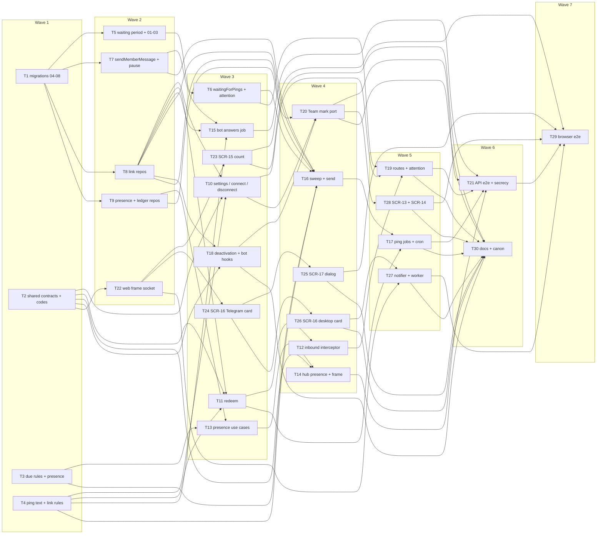

# Epic — operator-notifications

> **Spec:** [spec.md](../spec.md) · **Design:** [sad.md](../sad.md) · **Data model:** [data-model.md](../data-model.md) · **API:** [openapi.yaml](../contracts/openapi.yaml) · [events.md](../contracts/events.md) · [api-sync-report.md](../contracts/api-sync-report.md) · **Screens:** [screens.md](../screens.md) · **UX flows:** [ux-flows.md](../ux-flows.md) · **ADRs:** [adr/](../adr/)

## Goal

This epic makes sure a customer who writes while the team is not looking is noticed within minutes (spec §2 Goals). On the web, every workspace page shows the member's attention count in the tab title and next to Inbox, and a browser where the member opted in shows one desktop notification for a new customer message that is theirs or unassigned. Away from the web, the workspace's own bot pings the member's linked Telegram after a 5-minute wait, reaches the team at 30 minutes (or at 5 when the assignee cannot be pinged), combines and caps pings, re-checks everything at send time, and never carries customer text or a contact name. Nothing a linked member or a connect-link start sends becomes a customer conversation, and replies to customers always go first.

## Scope

- **In:** both declared surfaces (`sad.md` `target_surfaces: [backend-service, web-frontend]`). Backend: eight staged migrations (`04`–`08` with the module in T1, `01`–`03` with the waiting-period code in T5); the shared contracts and three error codes; the new `notifications` module — domain (due rules, presence predicate, ping and answer texts, connect-link rules), repositories with isolation tests and the sixth controlled tenancy exception, use cases (settings, connect, disconnect, redeem, intercept, presence, answers, sweep and send, deactivation and bot-connected hooks), routes and jobs (`notifications.schedule-pings`, `notifications.send-pings`, `notifications.send-bot-message` + DLQ); `conversations`' waiting period, `waitingForPings` and `attentionCount`; `bots`' `sendMemberMessage`, `pingReadiness`, the send pause and the two ports; `inbox`'s presence frames, account-scoped `telegram_link.changed` and the attention route; `workspaces`' composed deactivation port and the Team mark; API e2e, load and secrecy tests. Web: the frame-owned live connection with presence frames, SCR-15's count, SCR-16 (both cards), SCR-17, the notifier and service worker (OS-02), SCR-13 / SCR-14 copy, browser flows. Docs: `CLAUDE.md`, the architecture map, the design-system canon, `CONTEXT.md`.
- **Out (spec §3):** customer text or contact names in pings; replying, assigning or closing from Telegram; email, SMS or a mobile app; quiet hours, schedules and «do not disturb»; notifying about other workspaces inside the panel; alerting about a broken bot through Telegram; per-conversation or per-event settings; Web Push (sad.md §11 accepted debt); a scannable QR code for the connect link (deferred — would need a new dependency; screens.md Decision 6).

**Size note:** 30 tasks, above the usual 8–20 for an M feature (as the assignment-statuses precedent's 24 and shared-inbox's 29). The feature adds a whole module, touches four existing ones and declares two surfaces (the `ui` layer adds six tasks plus a browser-flow task); the at-most-once ping path (rules, ledger, send, jobs) and the connect path (issue, redeem, interceptor) are split so each task stays within one day and one reviewable PR.

## Task map

Waves (what can run in parallel once its upstream is done):

- **Wave 1:** T1, T2, T3, T4
- **Wave 2:** T5, T7, T8, T9, T22
- **Wave 3:** T6, T10, T11, T13, T15, T18, T23, T24
- **Wave 4:** T12, T14, T16, T20, T25, T26
- **Wave 5:** T17, T19, T27, T28
- **Wave 6:** T21, T30
- **Wave 7:** T29

## Tasks

See [tracker.md](./tracker.md) for status. Machine contract: [tasks.json](../tasks.json).

| # | Task | Layer | Blocked by | DoD (short) |
|---|---|---|---|---|
| T1 | Promote migrations 04–08 (the bot send pause and the five notifications tables), regenerate DB types and add the test fixtures | migration | — | Migrations 04–08 are promoted to live apps/api/migrations/, apply and revert cleanly on a fresh Postgres 16 |
| T2 | Add the notifications zod contracts, the three error codes, the presence client frame and the telegram_link.changed frame and signal | ports | — | packages/shared and platform unit tests pass for every new schema and the contract examples |
| T3 | Add the notifications domain due rules: the 5 / 30-minute marks, the unpingable assignee, read-holds-back unless reopen, the ledger and 10-minute spacing, and the presence predicate | domain | — | Domain unit tests cover every due branch of flow 13 (ledger, read-holds-back with the reopen exception |
| T4 | Add the ping text builder (TG-03), the bot answer texts (TG-02) and the connect-link rules: token and start payload, usable, 5 per 10 minutes and its retry time | domain | — | Unit tests pass for every TG-03 set shape (one mine / unassigned / teammate's |
| T5 | Record the waiting period in conversations — set by capture, cleared by a sent reply and a close, restarted by a reopen while waiting — and promote migrations 01–03 | app | T1 | Unit and integration tests prove capture starts a message period only when not waiting |
| T6 | Add the conversations reads waitingForPings (period start, start kind, assignee, per-member read state) and attentionCount | infra | T5 | Integration tests prove waitingForPings returns only open waiting conversations of the workspace with start |
| T7 | Give bots sendMemberMessage (paced, behind the send pause, with a blocked outcome) and pingReadiness, and store the send pause on any 429 | app | T1 | Unit and integration tests against the fake Bot API prove sendMemberMessage maps accepted |
| T8 | Build the telegram-link and connect-link repositories with cross-workspace isolation tests, including the sixth-exception read of workspaces with a live link | infra | T1 | Integration tests prove every telegram-link and connect-link repository method against Postgres |
| T9 | Build the presence-lease and ping-ledger repositories with cross-workspace isolation tests | infra | T1 | Integration tests prove the presence and ping repositories against Postgres — lease open |
| T10 | Add the notifications use cases for my settings, creating a connect link (limit, already linked, bot readiness, replace) and disconnecting | app | T2, T4, T8 | Unit tests prove mySettings derives pings and can_connect for every link and bot state |
| T11 | Redeem a connect-link start: share-lock the membership, lock and re-check the link, enforce both uniqueness rules, link, signal and enqueue the answer | app | T2, T4, T8 | Unit and integration tests prove every redeem outcome (missing, expired |
| T12 | Intercept every private update in bots before capture through a port: redeem connect-link starts, consume linked members' messages with the hourly notice, pass everyone else | app | T11 | Webhook integration tests prove a connect-link start is redeemed and never captured |
| T13 | Add the presence use cases opened / alive / screen / closed, with the member's expired-lease cleanup and the ping opened-at mark | app | T3, T9 | Unit tests prove opened registers a 50 s lease and deletes the member's expired rows |
| T14 | Teach the inbox hub to read presence frames and report socket lifecycle to notifications, and deliver telegram_link.changed only to that account's sockets | ports | T2, T13 | Live-socket integration tests prove a lease is registered on open, extended by pongs and deleted on a clean close |
| T15 | Add the notifications.send-bot-message worker: readiness and pause, the answer text from the kind, outcomes, retries and the dead letter, and clearing a removed link's Telegram id | app | T4, T7, T8 | Unit and integration tests prove every answer kind is sent with its TG-02 text through sendMemberMessage |
| T16 | Add the send-pings use case: the per-workspace sweep, the per-member send transaction that re-checks and writes the ledger before the call, and the outcome transaction | app | T3, T4, T6, T7, T8, T9 | Unit and integration tests prove the sweep skips a bot that does not work and waits out a pause |
| T17 | Wire the ping jobs: the notifications.send-pings chain per workspace, the notifications.schedule-pings cron over the sixth tenancy exception, and the QG-1 scenario tests | wiring | T11, T16 | Integration tests with a controllable clock pass QG-1 scenarios (a)–(f): one ping within a sweep at 5 minutes |
| T18 | Remove links on deactivation through the composed onMembershipDeactivated port and on a different bot through the bot-connected hook, both in the existing transactions | app | T2, T8 | Integration tests prove deactivation removes the member's live link as deactivated with Telegram id and name cleared and marks their unused connect links replaced in the deactivation transaction after the unassign |
| T19 | Serve the notifications routes (settings, connect link, disconnect) and GET inbox/attention behind the workspace guard, and register the notifications module | ports | T6, T10, T12 | Route integration tests pass for getAttentionCount, getNotificationSettings |
| T20 | Add telegram_pings to Membership on the Team reads and the deactivate / reactivate answers through a notifications port that team takes | ports | T8, T10, T18 | Team route tests prove listMemberships, deactivateMembership and reactivateMembership return telegram_pings per member from live links of this workspace only |
| T21 | Add the API end-to-end notification stories, the integrity checks, the reply-under-ping-load test, and the secrecy assertions for pings, answers, logs and frames | tests | T14, T15, T17, T19, T20 | The e2e stories pass against Postgres and the fake Bot API (connect and answers |
| T22 | Move the live socket to the workspace frame as one per-tab connection with subscribers, send presence frames on open and on visibilitychange, and let the inbox store subscribe | ui | T2 | Web tests prove one live connection per tab per workspace owned by the frame |
| T23 | Build the attention store and SCR-15's count: the (N) title prefix, the Inbox SidebarMenuBadge, the phone header badge, the collapsed tooltip and Settings for operators | ui | T22 | Testing Library tests cover every SCR-15 state this feature adds in screens.md (count above 0 and 0 |
| T24 | Build Settings — Notifications (SCR-16) with the TelegramPingsCard, the notifications store, the role-filtered SettingsLayout and the route | ui | T22 | Testing Library tests cover every Telegram-pings-card state of SCR-16 in screens.md (loading |
| T25 | Build SCR-17, the ConnectTelegramDialog: the link with Copy and Open in Telegram, its expiry, waiting for Start, the live turn to Connected, new-link refusals and the bot-stopped state | ui | T24 | Testing Library tests cover every SCR-17 state in screens.md (waiting for Start with Copy and Open in Telegram |
| T26 | Build the DesktopNotificationsCard on SCR-16: capability and permission checks, the click-only permission request (OS-01), worker registration and the per-browser flag | ui | T24 | Testing Library tests cover every desktop-card state of SCR-16 in screens.md (off |
| T27 | Add the desktop notifier and the notifications-only service worker: candidates from the tabs, focus check, tag replace, dedupe and the click to the most recently focused tab (OS-02) | ui | T22, T26 | Unit tests prove the notifier posts only for new customer messages in open conversations that are the member's or unassigned with the flag and permission on |
| T28 | Add the «Telegram pings» column to Settings — Team (SCR-13) and the pings sentence to the deactivate confirmation (SCR-14) | ui | T20 | Testing Library tests prove the Team members table shows «Telegram pings» On / Off per member (and on the phone line) |
| T29 | Add browser end-to-end notification flows against the real API and the fake Bot API | tests | T21, T23, T25, T27, T28 | The browser flows pass locally and in CI with pnpm test:e2e: the live attention count across pages |
| T30 | Update CLAUDE.md, the architecture map, the design-system canon and CONTEXT.md for the notifications module, the sixth tenancy exception, the new queues, the ports and the new components | docs | T17, T18, T19, T20, T23, T25, T26, T27, T28 | CLAUDE.md and the architecture map name the notifications module, its ports |

## Risks / Hard rules

- **Tenancy (CLAUDE.md, sad.md §8):** every new repository method takes `workspaceId` and has a cross-workspace isolation test over `twoWorkspacesWithLinks` (T8, T9). **One new controlled exception, the sixth:** *workspaces with a live Telegram link*, read only by the `notifications.schedule-pings` cron, returning workspace ids only (T8, T17); CLAUDE.md and the architecture map list it (T30). Presence writes, the interceptor and the redeem are scoped by the socket's or the webhook bot's workspace id — no further exception.
- **Module direction (ADR-0001):** static `inbox → {conversations, contacts, bots, workspaces, notifications}`, `notifications → {conversations, workspaces, bots}`, `bots → conversations → contacts`. `bots` and `workspaces` reach `notifications` only through ports filled in `buildDeps()` (interceptor and bot-connected hook T12 / T18, composed `onMembershipDeactivated` T18, Team's linked-accounts port T20). Construction order: contacts → conversations → bots core → notifications → bots ports → team.
- **Ship together (sad.md §11):** `accept-update` captures `/start <payload>` today, so the connect routes (T19) depend on the interceptor (T12); all promote in one release.
- **Expand → backfill, no contract:** `01`–`03` are promoted only with the code that maintains the period (T5), because `conversations_waiting_open_check` refuses today's close on a backfilled waiting row (audit «Ordering with code»); `04`–`08` are neutral and go first (T1). Ordinal order is kept inside each group.
- **At most once (ADR-0005, ADR-0006):** the ledger row commits before the Telegram call; `429` and `bot_unavailable` roll the ping out; `blocked`, `transient` and a lasting `sending` count. Replies never read the send pause; pings and answers are paced at ≤ 10 per second per bot (T7, T16).
- **Lock order (sad.md §8):** every path locks the membership before any notifications row — redeem (connect link read → membership `FOR SHARE` → connect link `FOR UPDATE`), send (membership `FOR SHARE` → link `FOR SHARE` → ledger), deactivation (workspace → membership → conversations → links). No path locks a notifications row and then a membership or a conversation.
- **Secrets and logs (spec §6.1, sad.md §7, api-sync-report F-3):** no bot token, connect token or hash, ping text, Telegram display name, contact name or message text in any body, frame, job payload or log line; the Telegram user id appears only in the `link_expired` / `cannot_connect` answer payloads (and their DLQ) and the redeem debug line, and a member-removed link's id is cleared by its `notifications_off` job — pending the security review (T15, T21).
- **No capture of link traffic (ADR-0003):** nothing from a sender with a live link made with this bot, and no `/start tgi_…`, reaches `conversations` (T12, T21).
- **Untrusted text:** Telegram display names, contact names and workspace names render as plain text in the panel and Telegram texts use no parse mode (T4, T24, T27, T28).
- **Latency targets (spec §6):** ping due → accepted ≤ 60 s p95 excluding paused time (T17), capture → count / notification ≤ 3 s (T23, T29), away ≤ 60 s / ≤ 10 min + 60 s (T14), reply p95 ≤ 2 s with 50 pings due (T21).
- **Spec wording carried in:** AC-04 says «open the link it shows»; v1 shows no code (screens.md Decision 6), so the parenthesis is unreachable — align the spec wording at review.

## Assumptions (autonomous run 2026-10-19)

- Depth = medium, size M, route `standard` (`.size` / `.route`); owner Dmytro Hopko on every task; estimates S = ½ day, M = 1 day.
- **No QR code in v1** (orchestrator amendment): SCR-17 shows the link with Copy and Open in Telegram; no new npm dependency. `screens.md` Decision 6, `ux-flows.md`, `sad.md` §4 / §5 / flow 8 and the contract descriptions were aligned; ADR-0004's consequence line («visible in the panel, the QR code and the browser history») is left as recorded history.
- **The send transaction share-locks the link row** after the membership (closes the sad.md §6 «Disconnect racing a send» flag): a Disconnect then waits for the send's commit; only the post-commit Telegram call can still follow it (T16).
- **F-1** is wired as the Team port (`listMemberships` gains `telegram_pings`, T20); **F-2**'s three codes land in T2; **F-3** stays pending the security review and is asserted by the secrecy suite (T21).
- The presence lease is registered on socket open with `on_screen = false` and set by the first `presence` frame (events.md assumption 6, T13 / T14); the member's expired leases are deleted on their next open (data-model assumption 10).
- A new link starts its workspace's ping chain at once (enqueued in the redeem transaction, T17) instead of waiting up to a minute for the cron.
- `send-bot-message` lives in `notifications/app/deliver-answer.ts`; the pure answer texts in `notifications/domain/answers.ts`.
- Browser e2e does not assert OS notifications (headless browsers do not show them); the worker and notifier are covered by unit tests with mocked `clients` (T27).
- No task writes a run book: the integrity queries live in the integration suite (T21) and are recorded in the architecture map (T30), as in the precedent.
- Tracker export: no issue-tracker MCP is connected; the task files are the copy-paste-ready bodies.
