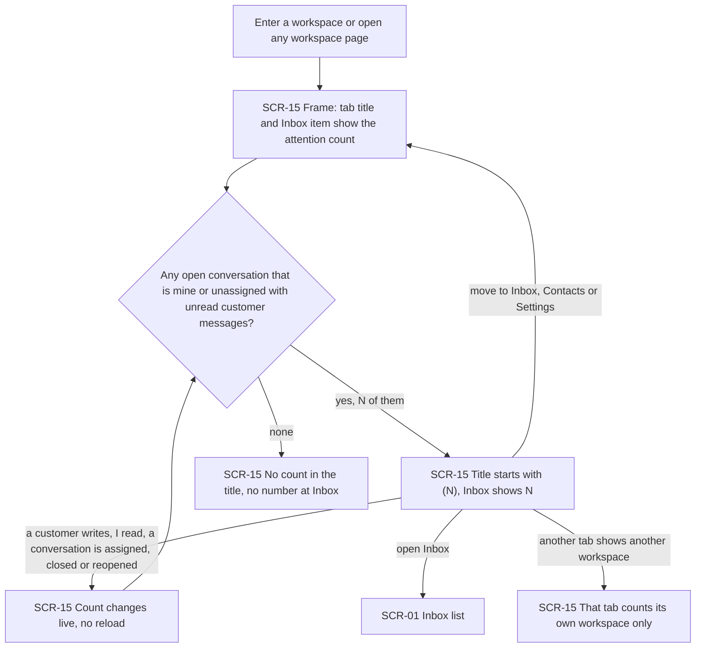
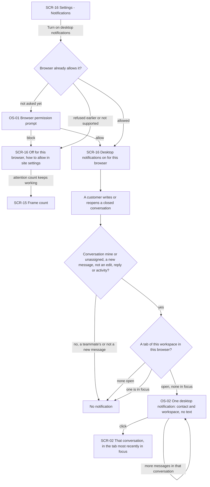
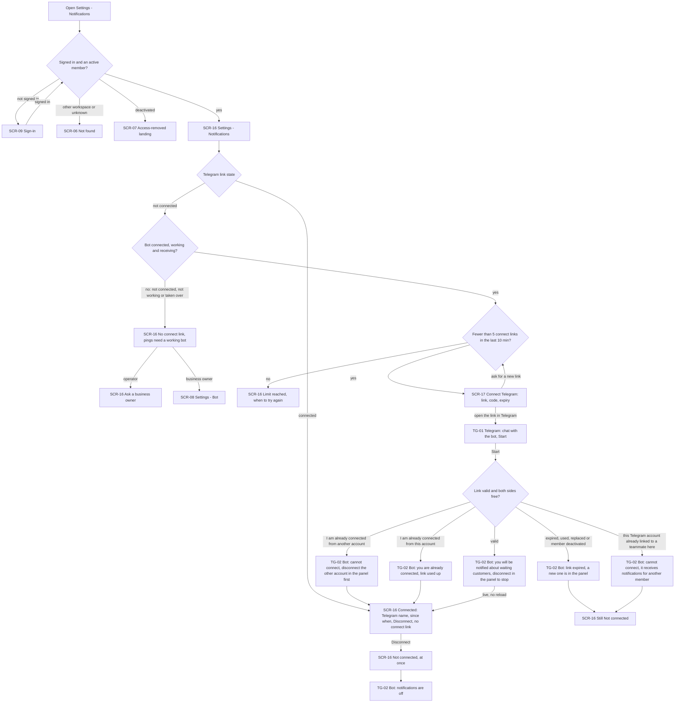
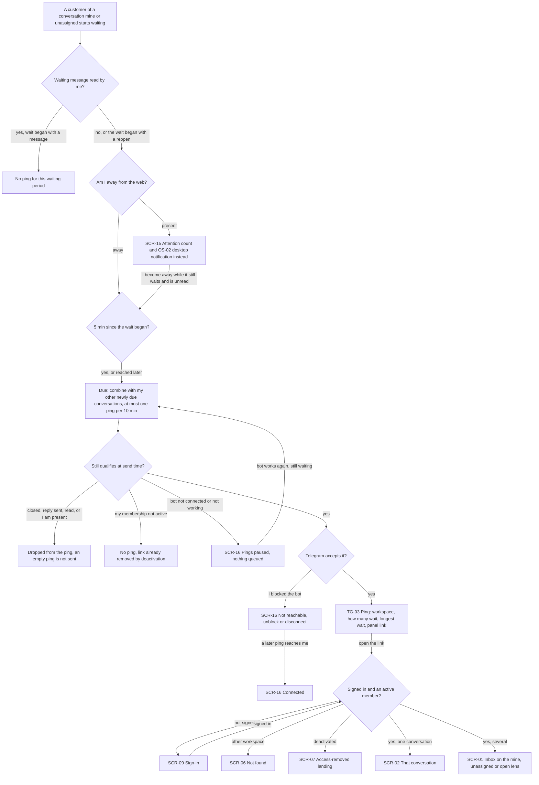
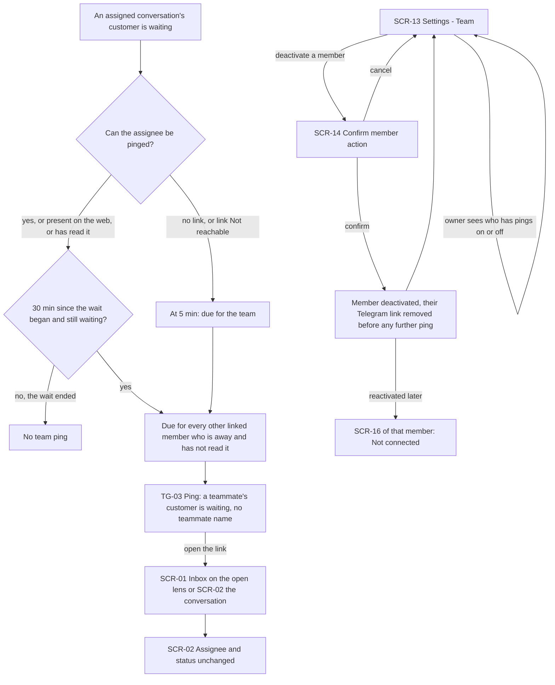
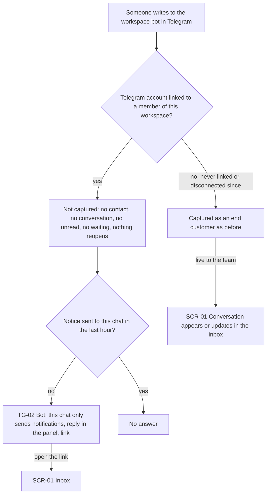

# UX flows — operator-notifications

> User flows for every UI-touching §4 user story, produced by `ux-flows` (after `clarify`, before
> `design`) and read by `design` (evidence for the target-surface + UI-architecture decisions),
> `sequences` (UI-driven flows align on SCR ids), `screens` (details every inventory row) and
> `plan-tests` (the e2e-through-UI paths). **Always markdown + mermaid `flowchart`**, whatever the
> design tool — this artifact is flow-altitude, not visual design.

## Platform decisions

- **Posture:** desktop-first — per `docs/design-system.md` §Platform posture; every panel flow must also work at phone width (≥360px). The connect step is designed for the usual case of a desktop panel plus a phone: the panel shows the link with Copy and Open in Telegram buttons (no scannable code in v1 — deferred, would need a new dependency), the member finishes in Telegram. On a phone-width panel the same link opens Telegram on that device.
- **Builds on the shipped inbox:** SCR-01, SCR-02, SCR-06, SCR-07, SCR-08 and SCR-09 keep their shared-inbox ids and meaning; SCR-13 / SCR-14 keep their assignment-statuses ids (Settings — Team and its member-action confirmation). New ids start at SCR-15, after the SCR-01…SCR-14 used by the inbox lineage. Shared-inbox SCR-03, SCR-04, SCR-05 and assignment-statuses SCR-10, SCR-11, SCR-12 are unchanged and not visited here.
- **Two surfaces outside the panel are part of the flows:** the member's Telegram (the chat with the workspace's business bot, where the connect link is started, pings arrive and the bot answers) and the browser / operating system (the permission prompt and the desktop notification). They are not panel screens and get no SCR id; they appear as `TG-NN` / `OS-NN` nodes, listed in their own table below, so `screens` does not draw them and `plan-tests` still sees them as steps.
- **One personal place for notifications:** a new Settings section, Settings — Notifications (SCR-16), open to every active member of either role, holds both opt-ins for this workspace: desktop notifications for this browser and the Telegram link with its state (Not connected / Connected / Pings paused / Not reachable). It is the member's own settings; Settings — Bot and Team stay owner-only as before.
- **Connect is a dialog, not a page:** "Connect Telegram" opens a dialog over SCR-16 (SCR-17) with the link (Copy, Open in Telegram) and when it expires; it turns into "Connected" by itself when the member presses Start in Telegram (AC-04), with no reload and no "I've done it" button.
- **The attention count lives in the frame:** the tab title and the Inbox item of the side navigation belong to the workspace frame (SCR-15), so the count follows the member onto every workspace page — Inbox, Contacts, Settings (AC-01).
- **Ping links land on existing inbox addresses:** a single-conversation ping opens that conversation (SCR-02); a combined ping opens SCR-01 on the "mine", "unassigned" or open lens (AC-07, AC-08). They go through the usual sign-in and membership checks (SCR-09, SCR-06, SCR-07 — AC-12).
- **Live, not refreshed:** the attention count, the link state on SCR-16 / SCR-17 and "Pings paused" arrive into whatever screen is open, as in shared-inbox. How is a `design` decision.
- **Out of scope as a separate drawing:** none — all six stories touch a human-facing surface. US-06 (End customer) has no screen of its own for the customer; it is drawn from the linked member's Telegram chat and its effect on the team's inbox.
- **Design input, not decided here:**
  - The presence signal behind "away from the web" (tab on screen within 10 minutes plus a working live connection, counted away within 60 s of a lost connection) and the stricter "in focus" test for desktop notifications both need tab-side signals the shipped live channel does not send yet.
  - "One notification per browser even with several tabs" and "a click brings forward the tab most recently in focus" need the tabs of one browser to coordinate.
  - The due / combine / send-time re-check schedule for pings, and pings yielding to replies at the bot's sending limit (AC-10), are background work with no screen.

### Assumptions (autonomous run 2026-10-19)

- Depth = medium, posture = desktop-first per the design canon (no deviation). Per-flow confirmations were made by the pipeline itself; each flow below is its prose account and can be vetoed at review.
- Both opt-ins live in one new section, Settings — Notifications (SCR-16), rather than in the inbox. `screens` may add a shortcut to it (for example from the inbox) without changing these flows.
- "Disconnect" takes effect on the click, with no confirmation dialog: AC-04 says it removes the link "at once", and reconnecting is cheap.
- The connect dialog (SCR-17) can be closed at any time; the link stays valid for its 10 minutes and SCR-16 still turns "Connected" if the member presses Start after closing it. Asking for a new link from SCR-16 replaces the previous one (AC-13).
- "Pings paused" and "Not reachable" are shown on SCR-16. Whether they also appear elsewhere in the panel is a `screens` choice.
- The business owner's view of who is connected ("Telegram pings on / off") is a per-member mark on the existing Settings — Team screen (SCR-13); it adds no new screen and no action (AC-12).

## Screen inventory

| ID | Screen | Purpose | Entry | Exit |
|---|---|---|---|---|
| SCR-01 | Inbox — conversation list | (reused, shared-inbox SCR-01) The workspace's conversations through the status and assignee lenses; now also the landing of a combined ping (mine / unassigned / open lens) and of the bot's "reply in the panel" link | entering a workspace; Inbox in the navigation; a combined ping's link; the bot's panel link | SCR-02; SCR-15 pages via the navigation |
| SCR-02 | Inbox — conversation thread | (reused, shared-inbox SCR-02) One conversation; now also the landing of a desktop-notification click and of a single-conversation ping | a conversation in SCR-01; a desktop notification click; a single-conversation ping's link | SCR-01; SCR-06 / SCR-07 / SCR-09 per access |
| SCR-06 | Not found (in frame) | (reused) Not-found card for a conversation or workspace address the account may not see — no hint it exists | a ping link or a Notifications address of another workspace | SCR-01 of the account's own workspace |
| SCR-07 | Access-removed landing | (reused) Workspace picker / no-access with the access-removed notice | a ping link, a Notifications visit or an action after the member was deactivated | another workspace's SCR-01; sign out |
| SCR-08 | Settings — Bot | (reused, shared-inbox SCR-08 = ui-redesign SCR-11) Owner-only bot settings — the business owner's way to fix a bot that blocks connecting | the owner's link on SCR-16 when the bot is not connected, not working or taken over | SCR-16 via the Settings menu |
| SCR-09 | Sign-in | (reused) Sign-in; a signed-out visit to a ping link or a Notifications address lands here and returns afterwards | a ping link or a panel address while signed out | the requested SCR-01 / SCR-02 / SCR-16 |
| SCR-13 | Settings — Team | (reused, assignment-statuses SCR-13) Members and invitations — now with a "Telegram pings on / off" mark per member, never the Telegram account; the owner deactivates a member here | Settings in the navigation (business owner) | SCR-14 |
| SCR-14 | Confirm member action | (reused, assignment-statuses SCR-14) The existing confirmation before deactivating a member — deactivation now also removes the member's Telegram link | "deactivate" on a member row in SCR-13 | SCR-13 |
| SCR-15 | Workspace frame | (reused, ui-redesign SCR-07) Side navigation, breadcrumb and browser tab title around every workspace page — now carrying the attention count in the tab title and next to Inbox | entering any workspace page | any workspace page |
| SCR-16 | Settings — Notifications | New — the member's own notification settings for this workspace: desktop notifications for this browser (turn on, or why they are off and how to allow them) and the Telegram link (Not connected / Connected with Telegram name and since when / Pings paused / Not reachable; Connect or Disconnect; why connecting is unavailable, the link limit) | Settings in the navigation (either role) | SCR-17; SCR-08 (owner, bot needs fixing); other workspace pages via SCR-15 |
| SCR-17 | Connect Telegram | New — dialog over SCR-16 with the single-use connect link (Copy, Open in Telegram) and when it expires; turns into "Connected" by itself once the member presses Start | "Connect Telegram" on SCR-16 | SCR-16 (connected, closed, or a new link asked for) |

### Outside the panel

| ID | Surface | What the member sees | Entry | Exit |
|---|---|---|---|---|
| OS-01 | Browser permission prompt | The browser's own "allow notifications for this site?" question | "Turn on desktop notifications" on SCR-16 — only on the member's click | SCR-16 (on, or off with how to allow) |
| OS-02 | Desktop notification | "<contact name> · Acme Flowers: New message", no message text; one per browser, replaced by further messages of that conversation | a new customer message in a conversation that is mine or unassigned while no tab of that workspace in this browser is in focus | SCR-02 of that conversation (click); dismissed |
| TG-01 | Telegram — start the bot | Telegram opened on the connect link: the chat with the workspace's bot and its Start button | the link or code from SCR-17 | TG-02 |
| TG-02 | Telegram — bot chat answers | The bot's messages in the member's private chat with it: connected (and how to stop), link expired, cannot connect and why, already connected, notifications off, "this chat only sends notifications — reply in the panel" with a link | Start on TG-01; Disconnect on SCR-16; anything the linked member writes to the bot | SCR-01 (the panel link); stays in Telegram |
| TG-03 | Telegram — ping | A ping in the same chat (and on the phone's lock screen): workspace, how many customers wait and whose, the longest wait, a panel link — never message text or a contact name | a due ping while the member is away | SCR-02 (one conversation) or SCR-01 on the mine / unassigned / open lens |

## Flows

### Flow: US-01 — See what needs me at a glance

When a member opens any page of a workspace, the frame around it (SCR-15) shows the attention count: the browser tab title starts with "(N)" and the Inbox item in the side navigation shows N, where N counts only open conversations that are theirs or unassigned and hold customer messages they have not read — a teammate's conversation or a closed one never adds to it (AC-01). At 0 the title has no count and Inbox shows no number. The count follows them onto Contacts and Settings and changes live as customers write, as they read, and as conversations are assigned, closed or reopened. Each tab counts only its own workspace. A business owner sees the same.

### Flow: US-02 — Get a desktop notification

From Settings — Notifications (SCR-16) the member clicks "Turn on desktop notifications"; only that click ever makes the browser ask (AC-03). If the browser has not been asked yet, its own prompt appears (OS-01): allowing turns notifications on for this browser; blocking — or a refusal made earlier, or a browser that cannot show notifications — leaves SCR-16 saying they are off for this browser and how to allow them in the site settings, while the attention count keeps working. Once on, a new customer message — including one that reopens a closed conversation — in a conversation that is the member's or unassigned produces one desktop notification "<contact name> · Acme Flowers: New message" (OS-02), with no message text, once for this browser however many tabs are open; further messages in that conversation replace it (AC-02). Nothing is shown for a teammate's conversation, for an edit, a reply or an activity entry, while a tab of this workspace in this browser is in focus, or when this browser has no tab of this workspace open; a visible tab that is not in focus does not hold it back. Clicking the notification brings forward the workspace tab most recently in focus, with that conversation open (SCR-02).

### Flow: US-03 — Connect my Telegram for pings

A member opens Settings — Notifications; someone signed out is sent to sign-in and back, an account of another workspace gets the not-found card with no hint the workspace exists, and a deactivated member gets the access-removed landing (AC-12). A connected member sees "Connected" with their Telegram name and since when, and only "Disconnect" — never a connect link (AC-06). A member who is not connected is offered no connect link when the bot is not connected, not working or taken over: the screen explains that pings need a working bot that receives messages, tells an operator to ask a business owner and gives a business owner the way to Settings — Bot (AC-13). After 5 connect links in 10 minutes the screen says the limit and when to try again. Otherwise "Connect Telegram" opens the dialog with the link (Copy, Open in Telegram) and its expiry (SCR-17); asking again replaces the previous link. On the phone the member opens the link and presses Start in the chat with the workspace's bot (TG-01). A valid link links the account: the bot confirms in the chat and how to stop, and the panel turns "Connected" by itself (AC-04). A link that is older than 10 minutes, already used, replaced or issued to a member since deactivated links nothing: the bot says it expired and a new one is in the panel, and the panel stays "Not connected" (AC-05). A Telegram account already linked to a teammate, or a member already linked from another account, is refused with the reason; the same member from the same account is told "you are already connected" and the link is used up — an existing link is never replaced (AC-06). None of these starts creates a contact or a conversation or shows anything in the inbox. "Disconnect" removes the link at once and the bot says notifications are off.

### Flow: US-04 — Get pinged when away

When a customer of a conversation that is the member's own or unassigned starts waiting for a reply, nothing happens for a member who has already read the waiting message — unless the wait began with a reopen, where reading the earlier messages does not hold the ping back (AC-07). A member who is present on the web gets the attention count and the desktop notification instead (AC-01, AC-02); if they become away while the customer still waits and the message is still unread, the ping becomes due then. Once 5 minutes have passed since the wait began and the member is away, the conversation is due; due conversations are combined, at most one ping per member per workspace per 10 minutes and one per conversation per waiting period (AC-08). At the moment of sending, everything is checked again: a conversation that was closed, got a sent reply or was read, or a member who came back, drops out, and an empty ping is not sent; a member whose membership ended gets nothing — their link went with the deactivation (AC-10). While the bot does not work, nothing is sent or queued and SCR-16 shows "Pings paused — the bot is not working"; when it works again, conversations still waiting become due again, combined. If the member has blocked the bot, the attempt fails, counts as that conversation's ping for the period and SCR-16 shows "Not reachable" until a ping reaches them again. A ping that arrives (TG-03) names the workspace, how many customers wait and whose, and the longest wait — never message text or a contact name — and its link opens that conversation (SCR-02) or, for several, the inbox on the "mine", "unassigned" or open lens (SCR-01), after sign-in if needed; someone who is not an active member gets the not-found card or the access-removed landing instead (AC-12).

### Flow: US-05 — A waiting customer reaches the team

For a conversation assigned to someone, the rest of the team is reached in one of two ways (AC-09). If the assignee cannot be pinged — they have no Telegram link, or their link is "Not reachable" — the conversation becomes due for the team at 5 minutes. If the assignee can be reached — linked and reachable, present on the web, or having read the message — the team is reached only when the customer is still waiting at 30 minutes; a wait that ended before then pings no one. Then every other linked member who is away and has not read the waiting message gets the ping, saying a teammate's customer is waiting without naming the teammate, combined and limited as in US-04. Opening it leads to the inbox's open lens or the conversation; the assignee and status stay as they were. A business owner sees on Settings — Team which members have "Telegram pings on / off", but never their Telegram accounts and cannot link or unlink for them (AC-12). Deactivating a member through the existing confirmation also removes their Telegram link before any further ping, and reactivating them later does not restore it — their Notifications screen shows "Not connected" (AC-10).

### Flow: US-06 — The bot chat stays a notification channel

When a linked member writes anything to the workspace's bot — text, media, an edit, "ok" in answer to a ping, or a start through any link, a business's own campaign link included — it is not captured: no contact, no conversation, no unread count, no waiting marker, nothing reopens, and the team's inbox shows nothing (AC-11). The bot answers in that chat (TG-02) that it only sends notifications and that replies to customers are written in the panel, with a link to the inbox, and sends that answer at most once an hour. Someone who never linked, or who disconnected, is captured as an end customer as before, and their conversation reaches the team's inbox live; messages the same person sent before linking stay in their conversation.

## AC coverage

| AC | Shown by | Notes |
|---|---|---|
| AC-01 | Flow US-01 → `F`, `Z` → `N` / `E`, `U`, `O` | business owner = operator (prose); live-update target is an NFR |
| AC-02 | Flow US-02 → `M` → `W` → `T` → `D` / `X`, `D` → `C` | reopen counts as new (`M`); one per browser and replace (prose, design input) |
| AC-03 | Flow US-02 → `P` → `B` → `OFF`, `P` → `OFF`, `OFF` → `F` | the browser is asked only on the member's click |
| AC-04 | Flow US-03 → `DLG` → `TG1` → `L` → `OK` → `CD`; `CD` → `DIS` → `OFFTG` | no contact or conversation from the start (prose) |
| AC-05 | Flow US-03 → `L` → `EX` → `NC` | |
| AC-06 | Flow US-03 → `K` → `CD`; `L` → `TK` / `OA` / `AC` | an existing link is never replaced |
| AC-07 | Flow US-04 → `R`, `P` → `IN` → `D`, `D` → `Q` → `T3` → `TH` | reopen clock (prose and `R` branch) |
| AC-08 | Flow US-04 → `Q`, `C` → `DROP`, `T3` → `LS` | ping wording per mine / unassigned / mixed set is ping content, detailed by `screens` / tests; reassign / unassign make due (prose) |
| AC-09 | Flow US-05 → `A` → `F5` / `F30` → `TEAM` → `T3` → `L` → `SAME` | |
| AC-10 | Flow US-04 → `C` → `NM` / `PA`, `SEND` → `NR` → `OKS`; Flow US-05 → `D` → `RM` → `NC` | different bot connected removes links → SCR-16 Not connected (prose); taken-over bot still sends; replies before pings at the sending limit has no UI step |
| AC-11 | Flow US-06 → `L` → `NC` → `H` → `TG2` / `SIL`, `L` → `CAP` → `IN2` | |
| AC-12 | Flow US-03 → `V` → `SI` / `NF` / `AR`; Flow US-04 → `AU` → `SI` / `NF` / `AR`; Flow US-05 → `O` | Team shows on / off only, never the account; a connect link works only for its membership (`L` → `EX`) |
| AC-13 | Flow US-03 → `R` → `RL`, `BS` → `NB` → `AO` / `BOT`, `DLG` → `R` | a newer link replaces the previous one |
