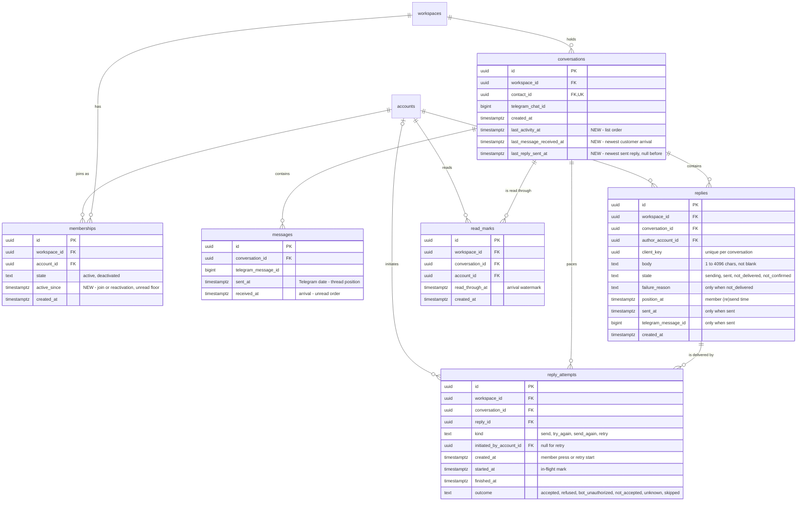

# Data model — shared-inbox

This is a brownfield delta, all inside the `conversations` and `workspaces` modules ([ADR-0007](adr/0007-add-an-inbox-module-that-orchestrates-conversations-contacts-bots-and-workspaces.md): `inbox` owns no tables).

- Three new tenant-owned tables, owned by `conversations`:
  - `replies` ([ADR-0008](adr/0008-store-replies-in-their-own-table-and-page-the-thread-by-position-time.md))
  - `reply_attempts` ([ADR-0004](adr/0004-send-replies-at-most-once-through-a-per-conversation-delivery-queue-with-an-in-flight-mark.md))
  - `read_marks` ([ADR-0005](adr/0005-track-read-state-as-a-per-member-arrival-watermark-per-conversation.md))
- Three list columns on `conversations` and one column on `memberships`. Each is a new NOT NULL column on an existing table, so each ships as expand → backfill → contract.
- Two read indexes on `messages`.

`bots` and `contacts` get no schema change. Contact search scans one workspace's contacts (SAD §4, §7). `platform/realtime` signals and the `inbox.deliver-replies` queue need no table of ours: NOTIFY carries no storage, and pg-boss manages its own schema.

**Conventions applied.** They come from the bot-connection and workspace-operators precedents ([bot-connection data-model](../bot-connection/data-model.md)), repo [ADR-0004](../../adr/0004-use-postgres-with-kysely-reversible-migrations-and-workspace-scoped-tenancy.md), `CLAUDE.md` and SAD §2/§8:

- Tables are `snake_case` and plural. Constraints are named `<table>_<cols>_{pkey,key,fkey,check,idx}`.
- PK is `id uuid`, a UUIDv7 from `newId()`, never a DB default. Telegram ids are `bigint`, never PKs. The client reply key is a client-generated `uuid` stored beside the id; it is never the PK.
- The application supplies every timestamp from the clock port. There is no `DEFAULT now()` and no generic `updated_at`.
- States, reasons and kinds are `text` + `CHECK (… IN (…))`, with no `ENUM`. State-dependent columns are tied together by `CHECK ((state = …) = (col IS NULL))`.
- There are no triggers. Derived columns are written by the application in the same statement as their sources, and a `CHECK` guards the result.
- A cross-module FK is a constraint only: `replies.author_account_id`, `reply_attempts.initiated_by_account_id` and `read_marks.account_id` reference `accounts(id)`, following the `memberships.account_id` precedent. Display names come through the `workspaces` app layer.
- Every FK has an index whose leading column is that FK.
- Delete strategy: none. Replies, attempts and read marks are kept indefinitely (SAD §11). Removing them is a manual operation, as for captured messages.

## ER diagram

`workspaces ||--o{ …` edges for `messages`, `replies`, `reply_attempts` and `read_marks` (every tenant-owned table) are omitted for readability; every one of them has a non-null `workspace_id → workspaces(id)`.

## Entities

### Aggregate `conversation` (module `conversations`, tenant-owned)

The conversation is the aggregate root. Its messages (bot-connection), and now its replies, their attempts and the members' read marks, are written only through the `conversations` app layer, always with the conversation's `workspace_id`.

#### `conversations` — changed

| Column | Type | Constraints | Notes |
|---|---|---|---|
| `last_activity_at` | timestamptz | NOT NULL (after contract), `CHECK = GREATEST(last_message_received_at, last_reply_sent_at)` | List order, newest first (AC-01). It moves when a customer message is captured (by arrival) or a reply is marked "sent". Edits, sending replies and failed replies never move it |
| `last_message_received_at` | timestamptz | NOT NULL (after contract) | Arrival (`messages.received_at`) of the newest captured customer message. The conversation row is inserted with the arriving message's `received_at`, and capture raises it with `GREATEST`. A late redelivery arrives now, so it moves it |
| `last_reply_sent_at` | timestamptz | NULL | Our clock when the newest reply was marked "sent". Null until the first one. Raised with `GREATEST` |

**Waiting for a reply** (AC-01, AC-06, AC-10) is derived, not stored: `last_reply_sent_at IS NULL OR last_message_received_at > last_reply_sent_at`. Both times come from the server clock.

**Last item shown in the row** (AC-01) is derived, not stored. It is the later of two reads:
- the newest message by arrival — a backward scan of `messages_conversation_id_received_at_idx`, limit 1;
- the newest "sent" reply — a backward scan of `replies_conversation_id_position_at_idx` with `state = 'sent'`.

Per-conversation sends are sequential in position order, so the newest sent reply by position is also the newest by `sent_at`.

**Access patterns:**
- List page by `(workspace_id, last_activity_at DESC, id DESC)` keyset → `conversations_workspace_id_last_activity_at_idx`.
- Search-filtered page: same index plus `contact_id = ANY(…)`.
- Summary by `(workspace_id, id)` → PK.

#### `messages` — new indexes only

No column changes. `received_at` is the arrival used for unread counts. `sent_at` (Telegram's date) plus `telegram_message_id` give the thread position (ADR-0008). An edit changes neither.

**Access patterns:**
- Unread count per list row: `conversation_id = ? AND received_at > GREATEST(watermark, active_since)` → `messages_conversation_id_received_at_idx`.
- Thread page: `(sent_at, telegram_message_id)` keyset → `messages_conversation_id_sent_at_idx`.
- Media reference and single thread item: `(workspace_id, conversation_id, id)` → PK.

#### `replies` — new

| Column | Type | Constraints | Notes |
|---|---|---|---|
| `id` | uuid | PK | UUIDv7 |
| `workspace_id` | uuid | NOT NULL, FK → `workspaces(id)` | Tenancy |
| `conversation_id` | uuid | NOT NULL, FK → `conversations(id)` | A reply goes only to its conversation's chat, through its own workspace's bot (AC-18) |
| `author_account_id` | uuid | NOT NULL, FK → `accounts(id)` | The member who wrote it (AC-03, AC-06). Cross-module FK, constraint only |
| `client_key` | uuid | NOT NULL, UNIQUE (`conversation_id`, `client_key`) | Generated by the browser per draft. A double press finds the same reply (AC-11) |
| `body` | text | NOT NULL, `CHECK (char_length(body) BETWEEN 1 AND 4096 AND body ~ '\S')` | AC-07. The domain checks first, in UTF-16 units (Telegram's measure). The DB counts code points, which is never stricter. Sent as plain text, no `parse_mode` |
| `state` | text | NOT NULL, `CHECK IN ('sending','sent','not_delivered','not_confirmed')` | Delivery state (ADR-0004). Allowed transitions live in `conversations/domain` |
| `failure_reason` | text | NULL, `CHECK IN (…)`, non-null ⇔ `state = 'not_delivered'` | `customer_blocked`, `customer_account_gone`, `chat_not_found` (AC-10); `bot_not_working` (AC-13); `author_access_removed` (AC-09); `telegram_not_accepted` (AC-12); `delivery_interrupted` (dead-lettered drain, never attempted — SAD flow 9) |
| `position_at` | timestamptz | NOT NULL | Thread position. Set when a member sends, and reset on "Try again" / "send again", so the reply moves to the end (AC-12, ADR-0008). Also the start of its 5-minute retry window |
| `sent_at` | timestamptz | NULL, non-null ⇔ `state = 'sent'` | Our clock when Telegram accepted it. It is comparable with `received_at` for the "waiting" marker |
| `telegram_message_id` | bigint | NULL, non-null ⇔ `state = 'sent'` | Telegram's id of the sent message |
| `created_at` | timestamptz | NOT NULL | First submit |

**Aggregate root:** `conversations`.

**Access patterns:**
- Idempotent create: `INSERT … ON CONFLICT (conversation_id, client_key) DO NOTHING`, then read back.
- Thread page `(position_at, id)` keyset → `replies_conversation_id_position_at_idx`.
- Teammate check: another author's reply after the one the composer saw (AC-16) → same index, forward range from that reply's `(position_at, id)`.
- Pending replies oldest first (the drain) → `replies_pending_idx`.
- KPI and sent replies per workspace → `replies_workspace_id_sent_at_idx`.

#### `reply_attempts` — new

| Column | Type | Constraints | Notes |
|---|---|---|---|
| `id` | uuid | PK | UUIDv7 |
| `workspace_id` | uuid | NOT NULL, FK → `workspaces(id)` | Tenancy. Scope of the per-member limit (AC-12b) |
| `conversation_id` | uuid | NOT NULL, FK → `conversations(id)` | Per-chat pacing and the stale in-flight check read attempts by conversation (flow 9) |
| `reply_id` | uuid | NOT NULL, FK → `replies(id)` | |
| `kind` | text | NOT NULL, `CHECK IN ('send','try_again','send_again','retry')` | Who or what caused it. `send_again` is the member-confirmed duplicate risk, which the spec §6 reconciliation excludes |
| `initiated_by_account_id` | uuid | NULL, FK → `accounts(id)`; null ⇔ `kind = 'retry'` | The member whose press counts toward the 30/60 s limit. Automatic retries never count (AC-12b) |
| `created_at` | timestamptz | NOT NULL | A member attempt: the press, inserted in the request's transaction together with the reply / re-queue and the drain job. A retry: when the drain starts it. This is the limit window's clock |
| `started_at` | timestamptz | NULL | The "in flight" mark, committed before calling Telegram |
| `finished_at` | timestamptz | NULL, non-null ⇔ `outcome` non-null | |
| `outcome` | text | NULL, `CHECK IN ('accepted','refused','bot_unauthorized','not_accepted','unknown','skipped')`; `skipped` ⇔ finished without `started_at` | `unknown` = timeout, broken connection, or a stale in-flight attempt (→ reply "not confirmed"). `skipped` = a pre-check (author removed, bot not working) or the dead-letter handler ended it without a call |

**Aggregate root:** `conversations`, through `replies`.

**Access patterns:**
- Limit count `(workspace_id, initiated_by_account_id, created_at > now − 60 s)`, under the (workspace, member) advisory lock → `reply_attempts_workspace_id_initiator_created_at_idx`.
- Newest started attempt of a conversation, for pacing (≥ 1 s since) and the stale in-flight check (unfinished and older than 10 s) → `reply_attempts_conversation_id_started_at_idx`. The drain is sequential per conversation, so the in-flight attempt is always the newest started one.
- The reply's unstarted member attempt, and accepted attempts per reply (reconciliation) → `reply_attempts_reply_id_idx`.

#### `read_marks` — new

| Column | Type | Constraints | Notes |
|---|---|---|---|
| `id` | uuid | PK | UUIDv7 |
| `workspace_id` | uuid | NOT NULL, FK → `workspaces(id)` | Tenancy |
| `conversation_id` | uuid | NOT NULL, FK → `conversations(id)` | |
| `account_id` | uuid | NOT NULL, FK → `accounts(id)`; UNIQUE (`conversation_id`, `account_id`) | The member. Cross-module FK, constraint only |
| `read_through_at` | timestamptz | NOT NULL | The arrival watermark: the `received_at` of the newest message the client displayed, as issued by the server (ADR-0005). Upserted with `GREATEST`, so it never moves back |
| `created_at` | timestamptz | NOT NULL | First mark |

**Rule:** unread = customer messages with `received_at > GREATEST(read_through_at, memberships.active_since)`. A member with no mark uses `active_since` alone. Replies never count.

**Aggregate root:** `conversations`.

**Access patterns:**
- Mark read: `INSERT … ON CONFLICT (conversation_id, account_id) DO UPDATE SET read_through_at = GREATEST(…)`.
- This member's watermark per list row → the unique constraint's index.

### Aggregate `workspace` (module `workspaces`, tenant-owned)

#### `memberships` — changed

| Column | Type | Constraints | Notes |
|---|---|---|---|
| `active_since` | timestamptz | NOT NULL (after contract) | Set at join and on reactivation, and kept on deactivation. The unread floor (AC-01: messages that arrived before the member joined or was reactivated count as read). Returned with the guard result. Backfilled from `created_at` |

## Indexes

| Index | Columns | Query it serves |
|---|---|---|
| `conversations_workspace_id_last_activity_at_idx` | `conversations (workspace_id, last_activity_at DESC, id DESC)` | Inbox list page, newest activity first, keyset (flow 4, AC-01; spec §6 list p95 ≤ 500 ms). Verified: index-only scan |
| `messages_conversation_id_received_at_idx` | `messages (conversation_id, received_at)` | Unread count per row by arrival (flows 4, 10, ADR-0005); the row's last message by arrival (flow 4) |
| `messages_conversation_id_sent_at_idx` | `messages (conversation_id, sent_at, telegram_message_id)` | Thread page before/after a cursor, the message half of the union (flow 5, ADR-0008; spec §6 thread p95 ≤ 500 ms). Verified: backward index scan on 5 000 messages |
| `replies_conversation_id_client_key_key` (unique) | `replies (conversation_id, client_key)` | Idempotent create on a double press (flows 1, 6, AC-11). FK index for `conversation_id` |
| `replies_conversation_id_position_at_idx` | `replies (conversation_id, position_at, id)` | Thread page, the reply half (flow 5); the teammate check (flows 1, 6, AC-16); the row's newest sent reply (flow 4) |
| `replies_pending_idx` (partial, `state = 'sending'`) | `replies (conversation_id, position_at, id)` | The drain's pending replies, oldest first (flow 9, ADR-0004) |
| `replies_workspace_id_sent_at_idx` | `replies (workspace_id, sent_at)` | KPI queries: sent replies per workspace per day, time to first reply (SAD §7). FK index for `workspace_id` |
| `replies_author_account_id_idx` | `replies (author_account_id)` | FK index for `author_account_id` |
| `reply_attempts_workspace_id_initiator_created_at_idx` | `reply_attempts (workspace_id, initiated_by_account_id, created_at)` | Per-member limit count over 60 s (flows 1, 7, AC-12b). FK index for `workspace_id`. Verified: index-only scan |
| `reply_attempts_conversation_id_started_at_idx` | `reply_attempts (conversation_id, started_at)` | Per-chat pacing and the stale in-flight check (flow 9). FK index for `conversation_id` |
| `reply_attempts_reply_id_idx` | `reply_attempts (reply_id)` | The drain picks up the reply's member attempt; the duplicate reconciliation (spec §6). FK index for `reply_id` |
| `reply_attempts_initiated_by_account_id_idx` (partial, not null) | `reply_attempts (initiated_by_account_id)` | FK index for `initiated_by_account_id` |
| `read_marks_conversation_id_account_id_key` (unique) | `read_marks (conversation_id, account_id)` | Mark-read upsert (flows 2, 5); the member's watermark per list row (flow 4). FK index for `conversation_id` |
| `read_marks_workspace_id_idx` | `read_marks (workspace_id)` | FK index for `workspace_id` |
| `read_marks_account_id_idx` | `read_marks (account_id)` | FK index for `account_id` |

The following existing indexes are reused, so no new index is needed for them:
- `memberships_workspace_id_account_id_key` — socket re-validation, active members among accounts.
- `contacts_workspace_id_telegram_user_id_key` — its leading `workspace_id` bounds the contact-search scan.
- `conversations_contact_id_key` — the search filter by contact ids.

## Test fixtures

These are additions to the existing builders in `apps/api/src/test/fixtures/` (not in `migrations/`). They use synthetic ids, `Test User` and `@example.test` only.

- `insertMembership(db, workspaceId, { …, activeSince? })` — defaults to `T0`. This must change in the same task that promotes `09`, because the contract makes the column NOT NULL.
- `insertConversation(db, { …, lastActivityAt?, lastMessageReceivedAt?, lastReplySentAt? })` — defaults to `T` / `T` / `null`. This must change in the same task that promotes `10`.
- `insertReply(db, { workspaceId, conversationId, authorAccountId, body?, state?, failureReason?, positionAt?, sentAt?, telegramMessageId?, clientKey? })` — default: a "sending" reply `"Hello"` at `T`. A `sent` state fills `sentAt` / `telegramMessageId`, and `not_delivered` requires a reason.
- `insertReplyAttempt(db, { workspaceId, conversationId, replyId, kind?, initiatedByAccountId?, createdAt?, startedAt?, finishedAt?, outcome? })` — default: an unstarted `send` attempt by the given member.
- `insertReadMark(db, { workspaceId, conversationId, accountId, readThroughAt })`.
- `twoWorkspacesWithInbox(db)` — two workspaces with one shared Telegram user, a conversation, messages and a reply each. It is the base for the cross-workspace isolation test of every new repository method (AC-18).
