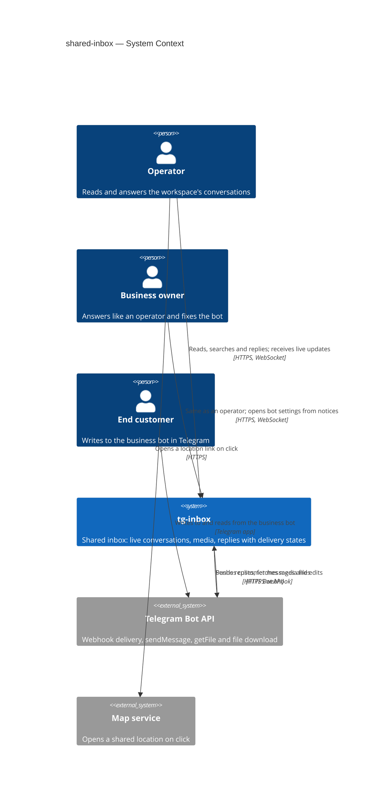
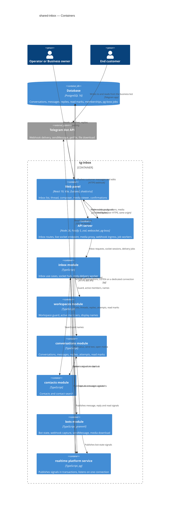

# Software Architecture Document — shared-inbox

<!-- 12 Arc42 sections. Empty section → <!-- N/A: <one-line reason> -->. -->
<!-- C4 Context (L1) lives inline in §3. C4 Container (L2) lives inline in §5. -->
<!-- Numbers in §10 come VERBATIM from spec.md §6 NFR — no inventing, no rounding. -->

## 1. Introduction and goals

**Intent.** shared-inbox turns the inbox preview into the real, shared inbox of a workspace. Every member — operators and business owners alike — sees the workspace's captured conversations live, newest activity first, with their own unread counts and a shared "waiting for a reply" marker; searches them by the contact's name or username; reads the whole history, including the customer's media opened through the panel; and writes text replies that the business bot sends to the end customer in Telegram. Each reply carries a visible delivery state with a plain-language reason when it fails; the inbox never sends a reply twice without a member choosing so and never sends one silently into a broken bot. This is the first step that lets a pilot team drop its forwarder bot; assignment and statuses (step 5), notifications (step 6) and AI drafts (step 9) build on it.

**Top-3 quality goals (1-liners; full scenarios in §10):**

1. **Reply integrity** — a reply reaches the end customer at most once, in the order it was written within its conversation, and its shown state ("sending", "sent", "not delivered", "not confirmed") always tells the truth about what Telegram accepted.
2. **Tenant, access and secret isolation** — no member sees another workspace's conversations or media, a deactivated or switched-away member's live stream stops within 5 s, and the bot token never reaches the browser or the logs, including on the media path.
3. **Live, responsive inbox** — customer messages and teammates' replies appear in every open inbox within the live-update target, and the list, thread, reply and media paths stay within the spec's latency targets at pilot scale.

**Stakeholders.**

| Role | Interest | Sign-off owner? |
|---|---|---|
| Operator | Reads every conversation of the workspace, replies, sees delivery states and teammates' replies live | No |
| Business owner | Does everything an operator does in the inbox; is pointed to the bot settings when the bot cannot carry replies | No |
| End customer | Receives the team's replies as messages from the business bot in their Telegram chat; never sees tg-inbox | No |
| Tech Lead | SAD approval | Yes |
| Security Lead | Security review of reply texts (new personal data), the new outbound action through the business bot, the media proxy next to the bot token and the live stream's access checks (spec §6.1: review required) | Yes |

## 2. Constraints

**Technical.**
- TypeScript ~6.0 (strict) on Node.js 26 (`.nvmrc`), pnpm workspaces monorepo — repo [ADR-0001](../../adr/0001-use-a-typescript-pnpm-monorepo-on-node-26.md)
- Backend: Fastify 5 with `fastify-type-provider-zod` and zod 4; `@fastify/websocket` 11 already registered in `buildApp()` with no route yet; grammY for Bot API calls, always through `telegramApi(token, { apiRoot })` in `apps/api/src/platform/telegram.ts`, wrapped by the `bots` gateway (today: `getMe`, `getWebhookInfo`, `setWebhook`, `deleteWebhook` only)
- Background jobs: pg-boss 12 on the main database, started in `buildApp()`, queues named `<module>.<job>`; the `exclusive` policy with a `singletonKey` is the existing per-entity serialisation precedent (`bots.check-health`)
- Frontend: React 19 + Vite SPA, Tailwind CSS + shadcn/ui, Zustand, React Router; the inbox route `/w/:workspaceId/inbox/:conversationId?` and its screens exist as a preview whose only data seam is `apps/web/src/features/inbox/sample-source.ts` — ui-redesign [ADR-0002](../ui-redesign/adr/0002-serve-preview-screens-from-a-swappable-per-feature-sample-data-source.md)
- Datastore: PostgreSQL 16 via Kysely 0.29, reversible migrations through kysely-ctl, table types generated by kysely-codegen — repo [ADR-0004](../../adr/0004-use-postgres-with-kysely-reversible-migrations-and-workspace-scoped-tenancy.md); the `pg` driver is available for a dedicated listening connection
- Architecture: modular monolith, `domain → app → infra → http`, one process serving every workspace — repo [ADR-0002](../../adr/0002-organize-the-backend-as-a-modular-monolith-with-layered-modules.md); module dependencies today are one-way `bots → conversations → contacts` and `bots → contacts` — bot-connection [ADR-0005](../bot-connection/adr/0005-split-the-feature-into-bots-conversations-and-contacts-modules.md)
- Workspace access: routes under `/api/workspaces/:workspaceId/…` behind the `workspaces` guard (non-member → not found, deactivated → `ACCESS_REMOVED`), cookie sessions — workspace-operators [ADR-0002](../workspace-operators/adr/0002-use-opaque-cookie-sessions-stored-in-postgres.md), [ADR-0003](../workspace-operators/adr/0003-carry-the-active-workspace-in-the-url-and-check-membership-on-every-request.md), one origin — [ADR-0004](../workspace-operators/adr/0004-serve-the-spa-and-the-api-from-one-origin-under-api.md)
- Telegram Bot API behaviour this design relies on: `sendMessage` returns the sent message (its id) or an error with a code — 403 when the user blocked the bot or the account is deactivated, 400 "chat not found", 429 with `retry_after`, 5xx; `getFile` returns a `file_path` valid for at least one hour and refuses files over 20 MB; file bytes are downloaded from a URL that contains the bot token; a bot may send about one message per second per chat in bursts and about 30 per second overall

**Organisational.**
- Effort budget: size M — a separate epic of 5–15 PRs over 1–2 sprints (`.size`); route `standard`
- Deadline: none set in the spec; this step gates roadmap steps 5, 6 and 9 and the pilots' first real use
- Team composition: not stated; the pipeline assumes one backend + frontend implementer working through `tasks.json`

**Conventions.**
- [`CLAUDE.md`](../../../CLAUDE.md) and [`docs/architecture-map.md`](../../architecture-map.md) §Conventions are binding: `register<Module>(app, deps)` from `modules/<m>/http/routes.ts`, dependencies built only in `buildDeps()`, modules registered only in `buildApp()`, inward-only imports, cross-module calls only through the other module's app layer, no other module's tables
- IDs are UUIDv7 from `newId()`; Telegram ids are `bigint` columns, never primary keys
- Errors are `AppError` subclasses from `apps/api/src/platform/errors.ts` with codes in `packages/shared/src/errors.ts`; `TooManyRequestsError` already exists (sign-in lockout)
- Request/response bodies are zod schemas in `packages/shared`, parsed by the web client too
- Env vars only in `apps/api/src/platform/config.ts`, documented in `.env.example`
- Every tenant-owned table carries a non-null `workspace_id`; every repository method takes `workspaceId`; every repository gets a cross-workspace isolation test; the five controlled exceptions stay five — this design adds none
- UI composes shadcn/ui primitives from `apps/web/src/shared/ui`, Tailwind only; screens follow `docs/design-system.md`

**Regulatory / external.**
- Data classification: confidential (spec §6.1) — private business ↔ customer correspondence and its media
- Personal data added: reply texts tied to their author's account, per-member read state; customer media passes through tg-inbox on its way to the browser but is not stored (spec §3)
- Telegram's Bot API terms apply to every reply the business bot sends
- No compliance regime is named by the spec; security review is required before release (spec §6.1)

## 3. Context and scope

tg-inbox is a shared Telegram inbox for small businesses. bot-connection made each workspace's business bot push every private message into tg-inbox; this feature lets the workspace's team read those conversations in the web panel and answer them, with tg-inbox sending each reply through the same business bot. End customers still see only their Telegram chat with the bot. Two trust boundaries matter: the browser (everything sent to it — pages, data, live events, media bytes — is scoped to one active membership and never carries the bot token) and Telegram (every outbound call carries the token, so it stays inside the `bots` infra layer, including the file download used to proxy media).

<!-- brownfield: bot-connection + ui-redesign shipped (HEAD 222fe3b) — modules auth, workspaces, bots, conversations (app + infra only: capture, edits), contacts (app + infra only); @fastify/websocket registered with no route; no LISTEN/NOTIFY, no rate limiter beyond the sign-in lockout; the bots gateway has no sendMessage/getFile; conversations has no last-activity column, no read state; memberships have no active-since time; the web inbox is a preview fed by features/inbox/sample-source.ts; architecture-map.md reflects f172cee + later module rows, re-checked against the code for this design -->

**External systems (in / out):**

| Actor or system | Type | Interaction |
|---|---|---|
| Operator | Person | Opens the inbox, searches, reads conversations and media, replies, sees delivery states and teammates' activity live |
| Business owner | Person | Everything an operator does in the inbox; follows the inbox's notices to the bot settings when the bot cannot carry replies or messages |
| End customer | Person | Writes to the business bot and receives the team's replies in Telegram; never uses tg-inbox directly |
| Telegram Bot API | System (external) | In: pushes customer messages and edits to each bot's webhook (bot-connection, unchanged). Out: `sendMessage` for replies; `getFile` + the file download for media opened in the panel |
| Map service | System (external) | Receives a customer's location only when a member clicks the location's map link (AC-04); tg-inbox never calls it |

**C4 Context (L1):**



## 4. Solution strategy

**Target surfaces:** `backend-service` (new inbox routes, the live WebSocket endpoint, the media proxy and the in-process reply-delivery worker in the existing API process) and `web-frontend` (the existing SPA inbox screens switched from sample data to the API, plus the two new confirmations) — [ADR-0001](adr/0001-build-the-inbox-as-api-routes-a-live-socket-and-in-process-delivery-jobs-behind-the-existing-spa.md). End customers act only in Telegram (AC-17 has no screen, per `ux-flows.md`); reply delivery runs as pg-boss jobs inside the API process, not as a separate worker container.

**UI architecture (web-frontend):** client-side SPA, already fixed by repo [ADR-0001](../../adr/0001-use-a-typescript-pnpm-monorepo-on-node-26.md); the inbox keeps its layout route and addresses (`/w/:workspaceId/inbox/:conversationId?`, ui-redesign [ADR-0001](../ui-redesign/adr/0001-render-workspace-screens-inside-one-layout-route-with-nested-settings-sections.md)) — no new UI ADR. The preview's data seam (`features/inbox/sample-source.ts`, ui-redesign [ADR-0002](../ui-redesign/adr/0002-serve-preview-screens-from-a-swappable-per-feature-sample-data-source.md)) is replaced by an API source; the "Sample data" label and the "nothing is sent" note go. State lives in a `features/inbox/store.ts` Zustand store **keyed by workspace id**: entering another workspace in a tab resets the store and closes that tab's live socket before anything renders, and any response or live event tagged with another workspace id is dropped, so no conversation of one workspace is ever drawn inside another (AC-09, AC-18). Live events arrive through one client in `shared/api/realtime.ts` (the place the architecture map reserved for it) and only trigger refetches through the typed API client. The reply composer keeps a per-conversation draft, its client reply key (§4 choice 3) and the newest teammate reply it had seen when typing began (for the AC-16 check). The two confirmations (SCR-04, SCR-05) are shadcn `Dialog`s over the thread.

**Top strategic choices (the seeds for ADRs):**

1. **Live updates as change signals over a per-tab, workspace-bound WebSocket; the browser refetches through the REST reads** — each open inbox tab holds one socket opened for one workspace and authorised by the same session cookie + membership guard as every route; the server pushes only "this conversation / this item / the bot changed" signals carrying ids, and the client re-reads the changed list row or thread item through the normal guarded reads. Per-member unread counts, authorship names and authorisation therefore have exactly one implementation — the reads — and a socket never carries message text. A deactivation closes the member's sockets at once, and every open socket is re-validated (session + active membership) every 5 s as the guarantee. Serves goals 2 and 3, AC-09, AC-15 — [ADR-0002](adr/0002-push-change-signals-over-a-per-tab-workspace-bound-websocket-and-refetch-through-the-reads.md).
2. **Fan-out through Postgres `LISTEN/NOTIFY`, published inside the writing transaction** — the module that commits a change (capture, edit, reply state, bot state, deactivation) emits a small `pg_notify` in the same transaction, so a signal exists exactly when the change committed; every API instance listens on one dedicated connection and forwards signals to its sockets of that workspace. No new infrastructure, correct with a second replica, and payloads hold only ids. After a reconnect the client resynchronises by refetching, so a lost signal costs a refetch, not data. Serves goal 3 — [ADR-0003](adr/0003-fan-out-live-signals-through-postgres-listen-notify-published-in-the-writing-transaction.md).
3. **At-most-once reply delivery through a per-conversation delivery queue with an in-flight mark** — sending stores the reply as "sending" under a client-generated reply key (a double press finds the same reply) and enqueues a per-conversation drain job; the drain sends that conversation's replies oldest first, one at a time, marking each attempt "in flight" before calling Telegram. A definite refusal is classified (blocked / account gone / bot not working / Telegram unavailable or slow-down); only "Telegram did not accept it" is retried automatically, for up to 5 minutes, with later replies of the same conversation waiting; any attempt whose answer never came back — timeout, broken connection, or a crash that leaves "in flight" behind — becomes "not confirmed" and is never retried on its own. Serves goal 1, AC-06, AC-10…AC-13, AC-09 — [ADR-0004](adr/0004-send-replies-at-most-once-through-a-per-conversation-delivery-queue-with-an-in-flight-mark.md).
4. **Per-member read state as an arrival watermark per conversation** — each member has, per conversation, the arrival point up to which they have read; unread = customer messages that arrived in tg-inbox after the later of that watermark and the moment the membership became active. Edits never move arrival, late redeliveries arrive late and so count as unread wherever they sit in the history, and teammates' replies are never counted. Serves AC-01, AC-03, AC-15 — [ADR-0005](adr/0005-track-read-state-as-a-per-member-arrival-watermark-per-conversation.md).
5. **Customer media streamed through a guarded API route, addressed by message** — the browser asks for the media of a message it may see; the API checks membership, resolves the Telegram file reference from the captured message, and `bots` streams the bytes from Telegram's file download through the API with forced safe headers. Nothing is stored, no Telegram URL or redirect reaches the browser, and the plain-language "content unavailable" reasons of AC-05 come from the bot state and Telegram's answer. Serves goal 2, AC-04, AC-05 — [ADR-0006](adr/0006-stream-customer-media-through-a-guarded-api-route-addressed-by-message.md).

**Supporting choices (inline, below the ADR gate):**

- **Module shape:** a new `inbox` module orchestrates the inbox use cases over `conversations`, `contacts`, `bots` and `workspaces`; replies, delivery attempts and read state are stored by `conversations` next to the messages they interleave with — §5, [ADR-0007](adr/0007-add-an-inbox-module-that-orchestrates-conversations-contacts-bots-and-workspaces.md), [ADR-0008](adr/0008-store-replies-in-their-own-table-and-page-the-thread-by-position-time.md).
- **List sort and markers are stored on the conversation:** last activity time (a captured customer message by arrival, or a reply marked "sent"; edits and unsent replies never move it), last customer message time, last "sent" reply time and the last item shown in the row are columns maintained in the transaction that writes the message or marks the reply sent. "Waiting for a reply" = last customer message after last "sent" reply. The list pages by (last activity, id), newest first.
- **Search through `contacts`:** `contacts` matches the query (trimmed, a leading "@" dropped, case-insensitive in any alphabet) anywhere in "first name + space + last name" or the username and returns contact ids; the list then filters by those ids. At pilot scale (≤ 1 000 contacts per workspace, spec §6) this is one scan of one workspace's contacts.
- **Stateless teammate-collision check (AC-16):** a send carries the newest teammate reply the composer had seen when typing began; if another member's reply was added to the conversation after it, the API refuses with a "teammate replied" conflict naming who and when, and the client asks; "send anyway" repeats the send with an explicit confirmation flag. The server check covers a teammate's reply whose live signal has not arrived yet.
- **"Send again" needs an explicit confirmation flag (AC-11):** a not-confirmed reply is resent only on a request that carries the duplicate-risk confirmation; "Try again" on a not-delivered reply needs none.
- **Per-member reply limit (AC-12b):** every member-initiated send (new reply, "Try again", "send again"; automatic retries excluded) is a row in the reply attempts log; a send first counts that member's initiated attempts in this workspace over the last 60 s under a transaction-level advisory lock on (workspace, member), so the 31st is refused even under concurrent requests, and the refusal says when the oldest of the 30 leaves the window.
- **Pacing toward Telegram:** per-conversation delivery is strictly sequential, and a 429 answer pauses that conversation's drain for Telegram's `retry_after`; no proactive per-chat spacing in v1 (the per-member limit and sequential drain keep a chat well below Telegram's burst limit at pilot scale) — §11.
- **Bot state for every member:** `bots` exposes a read-only "can the bot carry replies / is it receiving" view to any member (closes bot-connection §8 "should operators see the bot's state"); the bot settings stay owner-only. State changes are pushed as signals (choice 2), so a fixed bot re-enables replying without reload (AC-13).
- **Persistence:** the single PostgreSQL 16 store; no cache, no file storage, no new datastore.

Each tactical decision in later sections traces to one of these choices; contradictions are surfaced in §11.

## 5. Building block view

The backend keeps the repo's modular-monolith layering (`domain → app → infra → http`) and adds one module, `inbox`, on top of the existing ones ([ADR-0007](adr/0007-add-an-inbox-module-that-orchestrates-conversations-contacts-bots-and-workspaces.md)). `inbox` owns the inbox's HTTP routes, the live socket hub, the reply-delivery worker and the inbox use cases (list, search, thread, mark read, send / try again / send again, media), and calls the app layers of `conversations`, `contacts`, `bots` and `workspaces`. It owns no tables: replies, their delivery attempts and read state are stored by `conversations`, beside the messages they interleave with, so the thread and the list stay single-module queries ([ADR-0008](adr/0008-store-replies-in-their-own-table-and-page-the-thread-by-position-time.md)). The dependency graph stays acyclic: `inbox → {conversations, contacts, bots, workspaces}`, `bots → conversations → contacts`, `bots → contacts`; nothing depends on `inbox`. Modules that commit a change the inbox must show publish a signal through `platform/realtime` inside their transaction ([ADR-0003](adr/0003-fan-out-live-signals-through-postgres-listen-notify-published-in-the-writing-transaction.md)) — a platform service, not a module dependency.

**Table ownership** (names indicative; `data-model` fixes them):

| Module | Tables (new or changed) | Tenancy |
|---|---|---|
| `conversations` | conversations **+** last activity time, last customer message time, last "sent" reply time, last shown item (§4); messages **+** index on (conversation, arrival); **replies** — author account, text, client reply key, delivery state and reason, position time, sent time, Telegram message id; **reply attempts** — reply, initiated by (member / automatic), started, outcome; **read marks** — (member account, conversation) → arrival watermark | Tenant-owned, non-null `workspace_id`; replies unique on (conversation, client reply key) |
| `workspaces` | memberships **+** active-since time (set at join and on reactivation) | Tenant-owned (unchanged) |
| `contacts` | contacts **+** search support over name and username within a workspace | Tenant-owned (unchanged) |
| `bots`, `inbox` | none | — |

No new controlled tenancy exception: the delivery job carries its workspace id; the socket re-validation reads memberships by (workspace id, account ids); every new repository method takes `workspaceId`.

**Cross-module app-layer calls (new):**

- `inbox` → `workspaces`: the existing workspace guard (now also returning the membership's role and active-since time) on every route and on the socket upgrade; *active members among accounts* (socket re-validation, delivery pre-check); *member display names* (reply authorship).
- `inbox` → `conversations`: *list page* (keyset, optional contact-id filter, with this member's unread counts and the "waiting" marker), *conversation summary*, *thread page* (before / after a position cursor), *thread item*, *mark read through*, *create reply* (idempotent on the client key, with the collision and rate checks inside its transaction), *re-queue reply* (try again / send again), *pending replies of a conversation*, *record attempt start / outcome*, *media reference of a message*.
- `inbox` → `contacts`: *search contact ids*, *contacts by ids* (names and usernames for list rows and thread headers).
- `inbox` → `bots`: *inbox bot status* (can carry replies, is receiving — readable by any member), *send text* (workspace id, chat id, text → classified outcome), *open media stream* (workspace id, Telegram file reference, optional byte range → stream or typed unavailability).
- `bots` and `workspaces` publish bot-state and membership-deactivation signals; `conversations` publishes message, edit, reply and read-mark signals.

**Internal decomposition:**

```
apps/api/src/
├── platform/realtime.ts   publisher (pg_notify inside the caller's transaction) + listener
│                          (dedicated pg connection, reconnect with backoff, resync on gap)
├── modules/inbox/
│   ├── domain/       reply text rule (trimmed non-empty, ≤ 4096), delivery outcome → state + reason,
│   │                 retry window, per-member limit window, signal types
│   ├── app/          list / search / summary / thread / item, mark read, send reply, try again,
│   │                 send again, deliver conversation (the drain), open media; socket session rules;
│   │                 ports: conversations, contacts, bots, workspaces, realtime hub, job queue, clock
│   ├── infra/        jobs.ts — inbox.deliver-replies worker (stately, singleton key = conversation id);
│   │                 hub.ts — sockets by workspace, 5 s re-validation, signal dispatch
│   └── http/         routes.ts → registerInbox(app, deps): reads, reply actions and media under
│                     /api/workspaces/:workspaceId/…, and the live socket endpoint
├── modules/conversations/
│   ├── domain/       + reply delivery states and allowed transitions, thread position order,
│   │                 arrival watermark rule
│   ├── app/          + list, summary, thread, item, mark read, replies + attempts use cases;
│   │                 capture/edit now also update list columns and publish signals
│   └── infra/        + reply, reply-attempt and read-mark repositories; list/thread queries
├── modules/contacts/  + search ids, by ids
├── modules/bots/      + inbox bot status; gateway sendMessage, getFile, file download stream;
│                        state transitions publish a signal
├── modules/workspaces/ + active-since on memberships, active members among accounts, display names;
│                         deactivation publishes a signal
└── deps.ts / app.ts   wiring of inbox, the realtime listener and the delivery worker
apps/web/src/
├── features/inbox/    api-source.ts (replaces sample-source.ts), store.ts (keyed by workspace),
│                      list / thread / composer / delivery-state / media components, the two dialogs
├── shared/api/realtime.ts   one socket per tab for the current workspace; reconnect + resync
└── pages/InboxPage.tsx      real data; not-found and access-removed handling as today
packages/shared/src/  inbox.ts — list, thread, reply, media-unavailable and signal schemas;
                      new error codes in errors.ts (e.g. teammate replied, reply limit, bot cannot reply)
```

**C4 Container (L2):**



## 6. Runtime view

<!-- 🎯 Why: the RUNTIME FLOW of 1–2 critical scenarios — who talks to whom, when, in what order.
     Without §6, §5 is just boxes with no life.
     📋 Write: a Mermaid sequenceDiagram. Participants are names from §5 (don't invent new ones).
     Messages are semantic («saves a draft»), NO HTTP verbs / paths / status codes — endpoint-level
     sequences arrive at the `api` stage.
     📌 e.g. «author → web: composes draft → web → content API: save». Seed the primary flow(s) here;
     the `sequences` stage then covers every §5 AC (no cap). Never N/A for M+; XS/S keeps ≥1 happy-path flow. -->

**Critical flow 1: <flow name>**

```mermaid
sequenceDiagram
    actor Actor
    participant Web
    participant Service
    participant Store
    Actor->>Web: <action>
    Web->>Service: <call>
    Service->>Store: <write>
    Store-->>Service: ok
    Service-->>Web: result
    Web-->>Actor: confirmation
```

**Critical flow 2: <e.g. async event propagation>** — <if applicable, otherwise N/A>.

## 7. Deployment view

<!-- 🎯 Why: the TOPOLOGY DevOps must know without reading the deploy charts — how many replicas,
     where the background worker lives, AT WHAT NUMBERS we scale.
     📋 Write: 2–3 sentences on topology + monitoring + concrete threshold numbers.
     📌 e.g. «500 authors → partition by quarter» (not «we'll think about scale later»).
     🎯 N/A allowed for XS/S that reuses an existing deployment unit with no change.
     Deployment-diagram scaffold → templates/deployment.md. -->

<Topology in 2–3 sentences. Where it runs, replicas, scaling thresholds.>

**Monitoring:**
- <Metrics — e.g. `<metric_name>`>
- <Alerts — e.g. «worker lag > 10 min → page on-call»>
- <Tracing — e.g. spans on the request boundary>

**Scaling thresholds:**
- <e.g. comfortable in one table up to N rows/year>
- <e.g. partition by quarter above N rows/year>

<!-- For XS/S with no deployment change: <!-- N/A: reuses existing deployment unit, no infra change --> -->

## 8. Crosscutting concepts

<!-- 🎯 Why: CROSS-CUTTING PATTERNS spanning several modules: logging, errors, authorization, ID
     strategy, events, caching. ⭐ The second-densest section. A pattern inside one module is NOT
     here; a project-wide convention belongs in the convention file.
     📋 Write: a table — concept / convention / where defined. One row per concept.
     📌 e.g. «sortable time-based IDs generated in the app layer» as a default from the convention file. -->

| Concept | Convention | Where defined |
|---|---|---|
| Logging | <e.g. structured, fields `module=<name>`> | <convention file §X or here> |
| Authentication | <e.g. token-based via middleware> | <convention file §X> |
| Error handling | <e.g. domain sentinel → ports error mapping → JSON> | <convention file §X> |
| ID strategy | <e.g. sortable time-based ID in the app layer> | <convention file §X> |
| Internationalisation | <e.g. N/A, single language> | — |
| Observability | <e.g. tracing on the request boundary> | — |
| Events | <module-specific patterns, if any> | <here> |

## 9. Architecture decisions

<!-- 🎯 Why: the REVERSE INDEX onto the adr/ folder. `ls adr/` gives the files; §9 gives the
     semantics — why they exist, which SAD section they attach to, what status.
     📋 Write: a 4-column table, one row per ADR. Mixed status is fine.
     📌 e.g. «0001 | Store content as a table of typed blocks | Accepted | §4». -->

| # | Title | Status | Section |
|---|---|---|---|
| <NNNN> | <imperative — e.g. "Use a sliding-window counter for rate limiting"> | Accepted | §<N> |
| <NNNN> | <imperative — e.g. "Co-locate the worker in the API process"> | Accepted | §<N> |

ADR files live under `docs/features/<slug>/adr/NNNN-<title>.md`.

## 10. Quality requirements

<!-- 🎯 Why: the QUALITY TREE — take a goal from §1 and break it into concrete leaves: tests,
     metrics, configs, drills. ⭐ Without §10, §1 is a manifesto. With §10 each declaration maps
     to something PROVABLE.
     📋 Write: per §1 goal — When / Then / How-verify. Numbers from spec §6 NFR VERBATIM (don't
     round ≤250ms to ≤300ms — that's a critic F6 hit).
     📌 e.g. «p95 ≤ 500 ms on a block update, verified by a 100 req/s load test». -->

Each top-3 goal from §1 expanded into a full scenario:

**QG-1. <quality attribute>**
- **When:** <trigger condition>
- **Then:** <expected behaviour with numbers from spec §6 NFR>
- **How verify:** <test / chaos drill / load test / metric>

**QG-2. <quality attribute>**
- **When:** <trigger>
- **Then:** <expected>
- **How verify:** <how>

**QG-3. <quality attribute>**
- **When:** <trigger>
- **Then:** <expected>
- **How verify:** <how>

## 11. Risks and technical debt

<!-- 🎯 Why: ⭐ collects EVERYTHING that can break — not only the technical. Without §11 risks get
     discussed at standups and lost; debt lives only in the head of whoever accepted it.
     📋 Write: a risk/debt table — severity — mitigation — owner. Accepted debt in its own block.
     📌 The first risk is often a product risk, not a technical one. That's normal. -->

<!-- Severity literals: Low / Medium / High for regular risks; "Open question" for rows created by
     a Save-as-OQ resolution during the Socratic walk (see references/socratic.md). -->

| Risk / debt | Severity | Mitigation | Owner |
|---|---|---|---|
| <e.g. Worker lag may reach hours during a downstream outage> | Medium | <alert >10 min, on-call playbook, retry backoff> | <DevOps> |
| <e.g. No event-schema versioning in v1> | Medium | <ADR-NNNN planned for v2, tolerate unknown fields> | <Backend> |
| Open architectural decision: <decision-headline> | Open question | Resolve before <stage trigger or YYYY-MM-DD>; <inline rationale from the Save-as-OQ> | <owner> |

**Accepted debt (acceptable in v1, plan to fix later):**
- <e.g. the entity is immutable / unversioned — OK for v1, may need audit versioning in v2>

## 12. Glossary

<!-- 🎯 Why: ⭐ the DOMAIN GLOSSARY that ends arguments a year later («checkpoint — weekly or
     biweekly? quarter — calendar or fiscal?»).
     📋 Write: a term / meaning table. Business + technical terms mixed.
     📌 e.g. «Lesson | a unit inside a course made of blocks (text, video)». -->

| Term | Meaning |
|---|---|
| <e.g. domain object A> | <its meaning in this domain> |
| <e.g. domain object B> | <its meaning> |
| <e.g. domain invariant name> | <the rule, in plain language> |
