# Software Architecture Document — shared-inbox

## 1. Introduction and goals

**Intent.** shared-inbox turns the inbox preview into the real, shared inbox of a workspace. Every member — operators and business owners alike — sees the workspace's captured conversations live, newest activity first, with their own unread counts and a shared "waiting for a reply" marker; searches them by the contact's name or username; reads the whole history, including the customer's media opened through the panel; and writes text replies that the business bot sends to the end customer in Telegram. Each reply carries a visible delivery state with a plain-language reason when it fails; the inbox never sends a reply twice without a member choosing so and never sends one silently into a broken bot. This is the first step that lets a pilot team drop its forwarder bot; assignment and statuses (step 5), notifications (step 6) and AI drafts (step 9) build on it.

**Top-3 quality goals (1-liners; full scenarios in §10):**

1. **Reply integrity** — a reply reaches the end customer at most once, in the order it was written within its conversation, and its shown state ("sending", "sent", "not delivered", "not confirmed") always tells the truth about what Telegram accepted.
2. **Tenant, access and secret isolation** — no member sees another workspace's conversations or media, a deactivated or switched-away member's live stream stops within 5 s, and the bot token never reaches the browser or the logs, including on the media path.
3. **Live, responsive inbox** — customer messages and teammates' replies appear in every open inbox within the live-update target, and the list, thread, reply and media paths stay within the spec's latency targets at pilot scale.

**Stakeholders.**

| Role | Interest | Sign-off owner? |
|---|---|---|
| Operator | Reads every conversation of the workspace, replies, sees delivery states and teammates' replies live | No |
| Business owner | Does everything an operator does in the inbox; is pointed to the bot settings when the bot cannot carry replies | No |
| End customer | Receives the team's replies as messages from the business bot in their Telegram chat; never sees tg-inbox | No |
| Tech Lead | SAD approval | Yes |
| Security Lead | Security review of reply texts (new personal data), the new outbound action through the business bot, the media proxy next to the bot token and the live stream's access checks (spec §6.1: review required) | Yes |

## 2. Constraints

**Technical.**
- TypeScript ~6.0 (strict) on Node.js 26 (`.nvmrc`), pnpm workspaces monorepo — repo [ADR-0001](../../adr/0001-use-a-typescript-pnpm-monorepo-on-node-26.md)
- Backend: Fastify 5 with `fastify-type-provider-zod` and zod 4; `@fastify/websocket` 11 already registered in `buildApp()` with no route yet; grammY for Bot API calls, always through `telegramApi(token, { apiRoot })` in `apps/api/src/platform/telegram.ts`, wrapped by the `bots` gateway (today: `getMe`, `getWebhookInfo`, `setWebhook`, `deleteWebhook` only)
- Background jobs: pg-boss 12 on the main database, started in `buildApp()`, queues named `<module>.<job>`; the `exclusive` policy with a `singletonKey` is the existing per-entity serialisation precedent (`bots.check-health`)
- Frontend: React 19 + Vite SPA, Tailwind CSS + shadcn/ui, Zustand, React Router; the inbox route `/w/:workspaceId/inbox/:conversationId?` and its screens exist as a preview whose only data seam is `apps/web/src/features/inbox/sample-source.ts` — ui-redesign [ADR-0002](../ui-redesign/adr/0002-serve-preview-screens-from-a-swappable-per-feature-sample-data-source.md)
- Datastore: PostgreSQL 16 via Kysely 0.29, reversible migrations through kysely-ctl, table types generated by kysely-codegen — repo [ADR-0004](../../adr/0004-use-postgres-with-kysely-reversible-migrations-and-workspace-scoped-tenancy.md); the `pg` driver is available for a dedicated listening connection
- Architecture: modular monolith, `domain → app → infra → http`, one process serving every workspace — repo [ADR-0002](../../adr/0002-organize-the-backend-as-a-modular-monolith-with-layered-modules.md); module dependencies today are one-way `bots → conversations → contacts` and `bots → contacts` — bot-connection [ADR-0005](../bot-connection/adr/0005-split-the-feature-into-bots-conversations-and-contacts-modules.md)
- Workspace access: routes under `/api/workspaces/:workspaceId/…` behind the `workspaces` guard (non-member → not found, deactivated → `ACCESS_REMOVED`), cookie sessions — workspace-operators [ADR-0002](../workspace-operators/adr/0002-use-opaque-cookie-sessions-stored-in-postgres.md), [ADR-0003](../workspace-operators/adr/0003-carry-the-active-workspace-in-the-url-and-check-membership-on-every-request.md), one origin — [ADR-0004](../workspace-operators/adr/0004-serve-the-spa-and-the-api-from-one-origin-under-api.md)
- Telegram Bot API behaviour this design relies on: `sendMessage` returns the sent message (its id) or an error with a code — 403 when the user blocked the bot or the account is deactivated, 400 "chat not found", 429 with `retry_after`, 5xx; `getFile` returns a `file_path` valid for at least one hour and refuses files over 20 MB; file bytes are downloaded from a URL that contains the bot token; a bot may send about one message per second per chat in bursts and about 30 per second overall

**Organisational.**
- Effort budget: size M — a separate epic of 5–15 PRs over 1–2 sprints (`.size`); route `standard`
- Deadline: none set in the spec; this step gates roadmap steps 5, 6 and 9 and the pilots' first real use
- Team composition: not stated; the pipeline assumes one backend + frontend implementer working through `tasks.json`

**Conventions.**
- [`CLAUDE.md`](../../../CLAUDE.md) and [`docs/architecture-map.md`](../../architecture-map.md) §Conventions are binding: `register<Module>(app, deps)` from `modules/<m>/http/routes.ts`, dependencies built only in `buildDeps()`, modules registered only in `buildApp()`, inward-only imports, cross-module calls only through the other module's app layer, no other module's tables
- IDs are UUIDv7 from `newId()`; Telegram ids are `bigint` columns, never primary keys
- Errors are `AppError` subclasses from `apps/api/src/platform/errors.ts` with codes in `packages/shared/src/errors.ts`; `TooManyRequestsError` already exists (sign-in lockout)
- Request/response bodies are zod schemas in `packages/shared`, parsed by the web client too
- Env vars only in `apps/api/src/platform/config.ts`, documented in `.env.example`
- Every tenant-owned table carries a non-null `workspace_id`; every repository method takes `workspaceId`; every repository gets a cross-workspace isolation test; the five controlled exceptions stay five — this design adds none
- UI composes shadcn/ui primitives from `apps/web/src/shared/ui`, Tailwind only; screens follow `docs/design-system.md`

**Regulatory / external.**
- Data classification: confidential (spec §6.1) — private business ↔ customer correspondence and its media
- Personal data added: reply texts tied to their author's account, per-member read state; customer media passes through tg-inbox on its way to the browser but is not stored (spec §3)
- Telegram's Bot API terms apply to every reply the business bot sends
- No compliance regime is named by the spec; security review is required before release (spec §6.1)

## 3. Context and scope

tg-inbox is a shared Telegram inbox for small businesses. bot-connection made each workspace's business bot push every private message into tg-inbox; this feature lets the workspace's team read those conversations in the web panel and answer them, with tg-inbox sending each reply through the same business bot. End customers still see only their Telegram chat with the bot. Two trust boundaries matter: the browser (everything sent to it — pages, data, live events, media bytes — is scoped to one active membership and never carries the bot token) and Telegram (every outbound call carries the token, so it stays inside the `bots` infra layer, including the file download used to proxy media).

<!-- brownfield: bot-connection + ui-redesign shipped (HEAD 222fe3b) — modules auth, workspaces, bots, conversations (app + infra only: capture, edits), contacts (app + infra only); @fastify/websocket registered with no route; no LISTEN/NOTIFY, no rate limiter beyond the sign-in lockout; the bots gateway has no sendMessage/getFile; conversations has no last-activity column, no read state; memberships have no active-since time; the web inbox is a preview fed by features/inbox/sample-source.ts; architecture-map.md reflects f172cee + later module rows, re-checked against the code for this design -->

**External systems (in / out):**

| Actor or system | Type | Interaction |
|---|---|---|
| Operator | Person | Opens the inbox, searches, reads conversations and media, replies, sees delivery states and teammates' activity live |
| Business owner | Person | Everything an operator does in the inbox; follows the inbox's notices to the bot settings when the bot cannot carry replies or messages |
| End customer | Person | Writes to the business bot and receives the team's replies in Telegram; never uses tg-inbox directly |
| Telegram Bot API | System (external) | In: pushes customer messages and edits to each bot's webhook (bot-connection, unchanged). Out: `sendMessage` for replies; `getFile` + the file download for media opened in the panel |
| Map service | System (external) | Receives a customer's location only when a member clicks the location's map link (AC-04); tg-inbox never calls it |

**C4 Context (L1):**

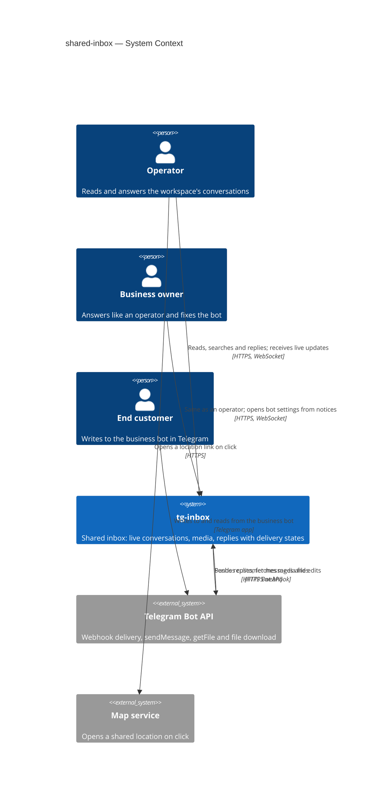

## 4. Solution strategy

**Target surfaces:** `backend-service` (new inbox routes, the live WebSocket endpoint, the media proxy and the in-process reply-delivery worker in the existing API process) and `web-frontend` (the existing SPA inbox screens switched from sample data to the API, plus the two new confirmations) — [ADR-0001](adr/0001-build-the-inbox-as-api-routes-a-live-socket-and-in-process-delivery-jobs-behind-the-existing-spa.md). End customers act only in Telegram (AC-17 has no screen, per `ux-flows.md`); reply delivery runs as pg-boss jobs inside the API process, not as a separate worker container.

**UI architecture (web-frontend):** client-side SPA, already fixed by repo [ADR-0001](../../adr/0001-use-a-typescript-pnpm-monorepo-on-node-26.md); the inbox keeps its layout route and addresses (`/w/:workspaceId/inbox/:conversationId?`, ui-redesign [ADR-0001](../ui-redesign/adr/0001-render-workspace-screens-inside-one-layout-route-with-nested-settings-sections.md)) — no new UI ADR. The preview's data seam (`features/inbox/sample-source.ts`, ui-redesign [ADR-0002](../ui-redesign/adr/0002-serve-preview-screens-from-a-swappable-per-feature-sample-data-source.md)) is replaced by an API source; the "Sample data" label and the "nothing is sent" note go. State lives in a `features/inbox/store.ts` Zustand store **keyed by workspace id**: entering another workspace in a tab resets the store and closes that tab's live socket before anything renders, and any response or live event tagged with another workspace id is dropped, so no conversation of one workspace is ever drawn inside another (AC-09, AC-18). Live events arrive through one client in `shared/api/realtime.ts` (the place the architecture map reserved for it) and only trigger refetches through the typed API client. The reply composer keeps a per-conversation draft, its client reply key (§4 choice 3) and the newest teammate reply it had seen when typing began (for the AC-16 check). The two confirmations (SCR-04, SCR-05) are shadcn `Dialog`s over the thread.

**Top strategic choices (the seeds for ADRs):**

1. **Live updates as change signals over a per-tab, workspace-bound WebSocket; the browser refetches through the REST reads** — each open inbox tab holds one socket opened for one workspace and authorised by the same session cookie + membership guard as every route; the server pushes only "this conversation / this item / the bot changed" signals carrying ids, and the client re-reads the changed list row or thread item through the normal guarded reads. Per-member unread counts, authorship names and authorisation therefore have exactly one implementation — the reads — and a socket never carries message text. A deactivation closes the member's sockets at once, and every open socket is re-validated (session + active membership) every 5 s as the guarantee. Serves goals 2 and 3, AC-09, AC-15 — [ADR-0002](adr/0002-push-change-signals-over-a-per-tab-workspace-bound-websocket-and-refetch-through-the-reads.md).
2. **Fan-out through Postgres `LISTEN/NOTIFY`, published inside the writing transaction** — the module that commits a change (capture, edit, reply state, bot state, deactivation) emits a small `pg_notify` in the same transaction, so a signal exists exactly when the change committed; every API instance listens on one dedicated connection and forwards signals to its sockets of that workspace. No new infrastructure, correct with a second replica, and payloads hold only ids. After a reconnect the client resynchronises by refetching, so a lost signal costs a refetch, not data. Serves goal 3 — [ADR-0003](adr/0003-fan-out-live-signals-through-postgres-listen-notify-published-in-the-writing-transaction.md).
3. **At-most-once reply delivery through a per-conversation delivery queue with an in-flight mark** — sending stores the reply as "sending" under a client-generated reply key (a double press finds the same reply), together with its member-initiated attempt row, and enqueues a per-conversation drain job — all in one transaction, so a committed reply always has a job; the drain sends that conversation's replies oldest first, one at a time, marking each attempt "in flight" before calling Telegram. A definite refusal is classified (blocked / account gone / bot not working / Telegram unavailable or slow-down); only "Telegram did not accept it" is retried automatically, for up to 5 minutes, with later replies of the same conversation waiting; any attempt whose answer never came back — timeout, broken connection, or a crash that leaves "in flight" behind — becomes "not confirmed" and is never retried on its own. Serves goal 1, AC-06, AC-10…AC-13, AC-09 — [ADR-0004](adr/0004-send-replies-at-most-once-through-a-per-conversation-delivery-queue-with-an-in-flight-mark.md).
4. **Per-member read state as an arrival watermark per conversation** — each member has, per conversation, the arrival point up to which they have read; unread = customer messages that arrived in tg-inbox after the later of that watermark and the moment the membership became active. Edits never move arrival, late redeliveries arrive late and so count as unread wherever they sit in the history, and teammates' replies are never counted. Serves AC-01, AC-03, AC-15 — [ADR-0005](adr/0005-track-read-state-as-a-per-member-arrival-watermark-per-conversation.md).
5. **Customer media streamed through a guarded API route, addressed by message** — the browser asks for the media of a message it may see; the API checks membership, resolves the Telegram file reference from the captured message, and `bots` streams the bytes from Telegram's file download through the API with forced safe headers. Nothing is stored, no Telegram URL or redirect reaches the browser, and the plain-language "content unavailable" reasons of AC-05 come from the bot state and Telegram's answer. Serves goal 2, AC-04, AC-05 — [ADR-0006](adr/0006-stream-customer-media-through-a-guarded-api-route-addressed-by-message.md).

**Supporting choices (inline, below the ADR gate):**

- **Module shape:** a new `inbox` module orchestrates the inbox use cases over `conversations`, `contacts`, `bots` and `workspaces`; replies, delivery attempts and read state are stored by `conversations` next to the messages they interleave with — §5, [ADR-0007](adr/0007-add-an-inbox-module-that-orchestrates-conversations-contacts-bots-and-workspaces.md), [ADR-0008](adr/0008-store-replies-in-their-own-table-and-page-the-thread-by-position-time.md).
- **List sort and markers are stored on the conversation:** last activity time (a captured customer message by arrival, or a reply marked "sent"; edits and unsent replies never move it), last customer message time, last "sent" reply time and the last item shown in the row are columns maintained in the transaction that writes the message or marks the reply sent. "Waiting for a reply" = last customer message after last "sent" reply. The list pages by (last activity, id), newest first.
- **Search through `contacts`:** `contacts` matches the query (trimmed, a leading "@" dropped, case-insensitive in any alphabet) anywhere in "first name + space + last name" or the username and returns contact ids; the list then filters by those ids. At pilot scale (≤ 1 000 contacts per workspace, spec §6) this is one scan of one workspace's contacts.
- **Stateless teammate-collision check (AC-16):** a send carries the newest teammate reply the composer had seen when typing began; if another member's reply was added to the conversation after it, the API refuses with a "teammate replied" conflict naming who and when, and the client asks; "send anyway" repeats the send with an explicit confirmation flag. The server check covers a teammate's reply whose live signal has not arrived yet.
- **"Send again" needs an explicit confirmation flag (AC-11):** a not-confirmed reply is resent only on a request that carries the duplicate-risk confirmation; "Try again" on a not-delivered reply needs none.
- **Per-member reply limit (AC-12b):** every member-initiated send (new reply, "Try again", "send again"; automatic retries excluded) inserts its attempt row in the request's own transaction (the drain later fills in its start and outcome; automatic retries add their own rows marked automatic); a send first counts that member's initiated attempts in this workspace over the last 60 s under a transaction-level advisory lock on (workspace, member), so the 31st is refused even under concurrent requests, and the refusal says when the oldest of the 30 leaves the window.
- **Pacing toward Telegram (spec §6.1):** per-conversation delivery is strictly sequential, the drain keeps at least 1 s between two sends to the same chat (Telegram's per-chat pace), and a 429 answer pauses that conversation's drain for Telegram's `retry_after`; the bot-wide limit (~30 messages/s) is far above pilot reply volume and is handled by the same 429 back-off — §11.
- **Bot state for every member:** `bots` exposes a read-only "can the bot carry replies / is it receiving" view to any member (closes bot-connection §8 "should operators see the bot's state"); the bot settings stay owner-only. State changes are pushed as signals (choice 2), so a fixed bot re-enables replying without reload (AC-13).
- **Persistence:** the single PostgreSQL 16 store; no cache, no file storage, no new datastore.

Each tactical decision in later sections traces to one of these choices; contradictions are surfaced in §11.

## 5. Building block view

The backend keeps the repo's modular-monolith layering (`domain → app → infra → http`) and adds one module, `inbox`, on top of the existing ones ([ADR-0007](adr/0007-add-an-inbox-module-that-orchestrates-conversations-contacts-bots-and-workspaces.md)). `inbox` owns the inbox's HTTP routes, the live socket hub, the reply-delivery worker and the inbox use cases (list, search, thread, mark read, send / try again / send again, media), and calls the app layers of `conversations`, `contacts`, `bots` and `workspaces`. It owns no tables: replies, their delivery attempts and read state are stored by `conversations`, beside the messages they interleave with, so the thread and the list stay single-module queries ([ADR-0008](adr/0008-store-replies-in-their-own-table-and-page-the-thread-by-position-time.md)). The dependency graph stays acyclic: `inbox → {conversations, contacts, bots, workspaces}`, `bots → conversations → contacts`, `bots → contacts`; nothing depends on `inbox`. Modules that commit a change the inbox must show publish a signal through `platform/realtime` inside their transaction ([ADR-0003](adr/0003-fan-out-live-signals-through-postgres-listen-notify-published-in-the-writing-transaction.md)) — a platform service, not a module dependency.

**Table ownership** (names indicative; `data-model` fixes them):

| Module | Tables (new or changed) | Tenancy |
|---|---|---|
| `conversations` | conversations **+** last activity time, last customer message time, last "sent" reply time, last shown item (§4); messages **+** index on (conversation, arrival); **replies** — author account, text, client reply key, delivery state and reason, position time, sent time, Telegram message id; **reply attempts** — reply, initiated by (member / automatic), started, outcome; **read marks** — (member account, conversation) → arrival watermark | Tenant-owned, non-null `workspace_id`; replies unique on (conversation, client reply key) |
| `workspaces` | memberships **+** active-since time (set at join and on reactivation) | Tenant-owned (unchanged) |
| `contacts` | contacts **+** search support over name and username within a workspace | Tenant-owned (unchanged) |
| `bots`, `inbox` | none | — |

No new controlled tenancy exception: the delivery job carries its workspace id; the socket re-validation reads memberships by (workspace id, account ids); every new repository method takes `workspaceId`.

**Cross-module app-layer calls (new):**

- `inbox` → `workspaces`: the existing workspace guard (now also returning the membership's role and active-since time) on every route and on the socket upgrade; *active members among accounts* (socket re-validation, delivery pre-check); *member display names* (reply authorship).
- `inbox` → `conversations`: *list page* (keyset, optional contact-id filter, with this member's unread counts and the "waiting" marker), *conversation summary*, *thread page* (before / after a position cursor), *thread item*, *mark read through*, *create reply* (idempotent on the client key, with the collision and rate checks inside its transaction), *re-queue reply* (try again / send again), *pending replies of a conversation*, *record attempt start / outcome*, *media reference of a message*.
- `inbox` → `contacts`: *search contact ids*, *contacts by ids* (names and usernames for list rows and thread headers).
- `inbox` → `bots`: *inbox bot status* (can carry replies, is receiving — readable by any member), *send text* (workspace id, chat id, text → classified outcome), *open media stream* (workspace id, Telegram file reference, optional byte range → stream or typed unavailability).
- `bots` and `workspaces` publish bot-state and membership-deactivation signals; `conversations` publishes message, edit, reply and read-mark signals.

**Internal decomposition:**

```
apps/api/src/
├── platform/realtime.ts   publisher (pg_notify inside the caller's transaction) + listener
│                          (dedicated pg connection, reconnect with backoff, resync on gap)
├── modules/inbox/
│   ├── domain/       reply text rule (trimmed non-empty, ≤ 4096), delivery outcome → state + reason,
│   │                 retry window, per-member limit window, signal types
│   ├── app/          list / search / summary / thread / item, mark read, send reply, try again,
│   │                 send again, deliver conversation (the drain), open media; socket session rules;
│   │                 ports: conversations, contacts, bots, workspaces, realtime hub, job queue, clock
│   ├── infra/        jobs.ts — inbox.deliver-replies worker (stately, singleton key = conversation id);
│   │                 hub.ts — sockets by workspace, 5 s re-validation, signal dispatch
│   └── http/         routes.ts → registerInbox(app, deps): reads, reply actions and media under
│                     /api/workspaces/:workspaceId/…, and the live socket endpoint
├── modules/conversations/
│   ├── domain/       + reply delivery states and allowed transitions, thread position order,
│   │                 arrival watermark rule
│   ├── app/          + list, summary, thread, item, mark read, replies + attempts use cases;
│   │                 capture/edit now also update list columns and publish signals
│   └── infra/        + reply, reply-attempt and read-mark repositories; list/thread queries
├── modules/contacts/  + search ids, by ids
├── modules/bots/      + inbox bot status; gateway sendMessage, getFile, file download stream;
│                        state transitions publish a signal
├── modules/workspaces/ + active-since on memberships, active members among accounts, display names;
│                         deactivation publishes a signal
└── deps.ts / app.ts   wiring of inbox, the realtime listener and the delivery worker
apps/web/src/
├── features/inbox/    api-source.ts (replaces sample-source.ts), store.ts (keyed by workspace),
│                      list / thread / composer / delivery-state / media components, the two dialogs
├── shared/api/realtime.ts   one socket per tab for the current workspace; reconnect + resync
└── pages/InboxPage.tsx      real data; not-found and access-removed handling as today
packages/shared/src/  inbox.ts — list, thread, reply, media-unavailable and signal schemas;
                      new error codes in errors.ts (e.g. teammate replied, reply limit, bot cannot reply)
```

**C4 Container (L2):**

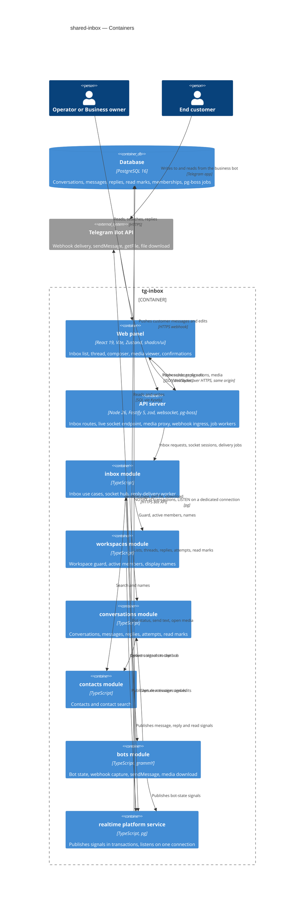

## 6. Runtime view

Seeded critical flows; the `sequences` stage extends this section until every spec §5 acceptance criterion maps to a flow or a branch. Participants are the §5 containers.

**Critical flow 1: Send a reply and deliver it at most once (US-03, US-04, US-05 — AC-06, AC-07, AC-10, AC-11, AC-12, AC-12b, AC-13, AC-16, AC-17)**

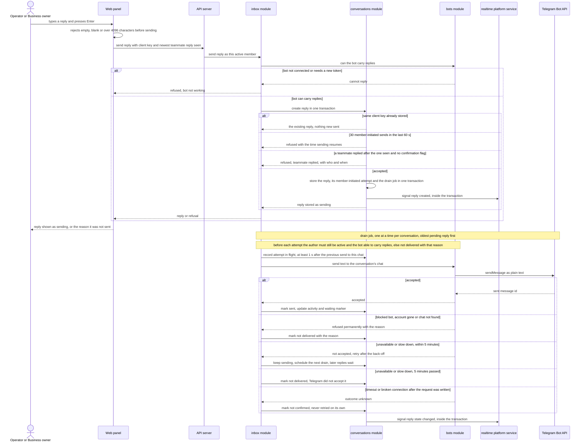

**Critical flow 2: A live change reaches every open inbox, and access ends within 5 s (US-06 — AC-09, AC-15, AC-01)**

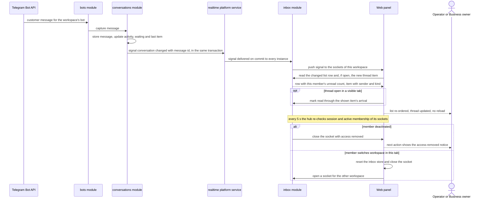

**Critical flow 3: Open a customer's media through the panel (US-02 — AC-04, AC-05, AC-08)**

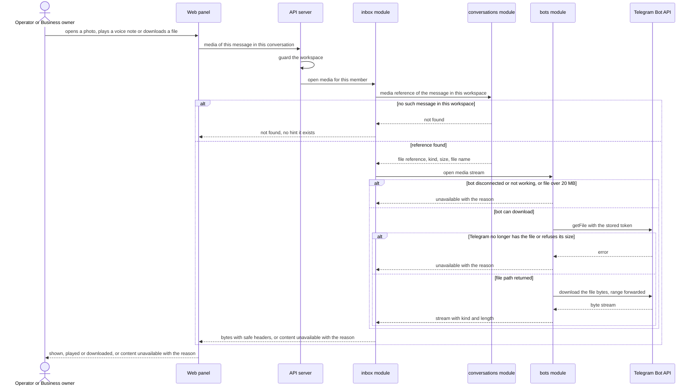

Flows 4–10 below were added by the `sequences` stage. They use the generic runtime vocabulary — `<user>` (an operator or business owner), `<ui>` (the web panel), `<service>` (tg-inbox's backend), `<data-store>`, `<message-bus>` (the live-signal fan-out and the job queue) and `<external-system>` (the Telegram Bot API); `SCR-NN` ids refer to [`ux-flows.md`](ux-flows.md). Every persist / read note is a hint for `data-model`.

### Flow 4: Open the inbox list and search it (US-01 — AC-01, AC-02, AC-08, AC-18)

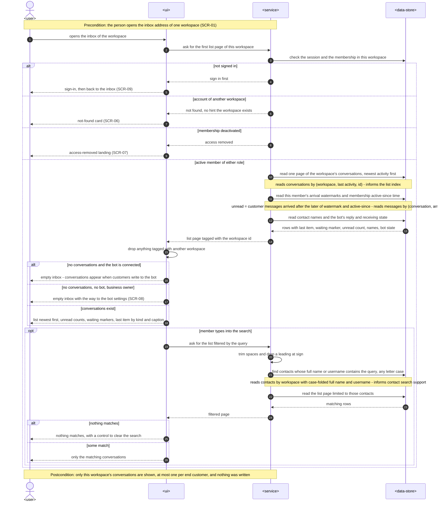

### Flow 5: Open a conversation and read its history (US-02 — AC-03, AC-08)

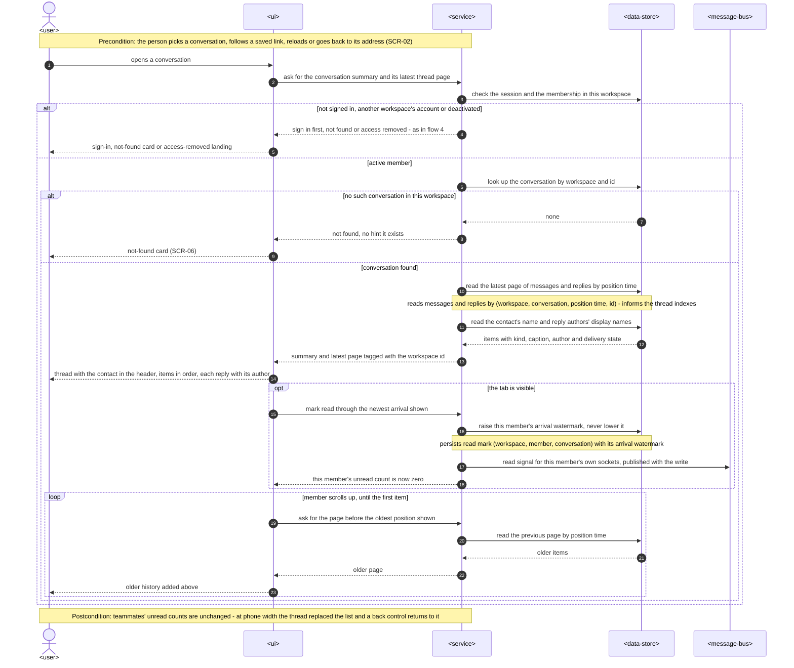

### Flow 6: Confirm a send after a teammate's reply (US-06 — AC-16)

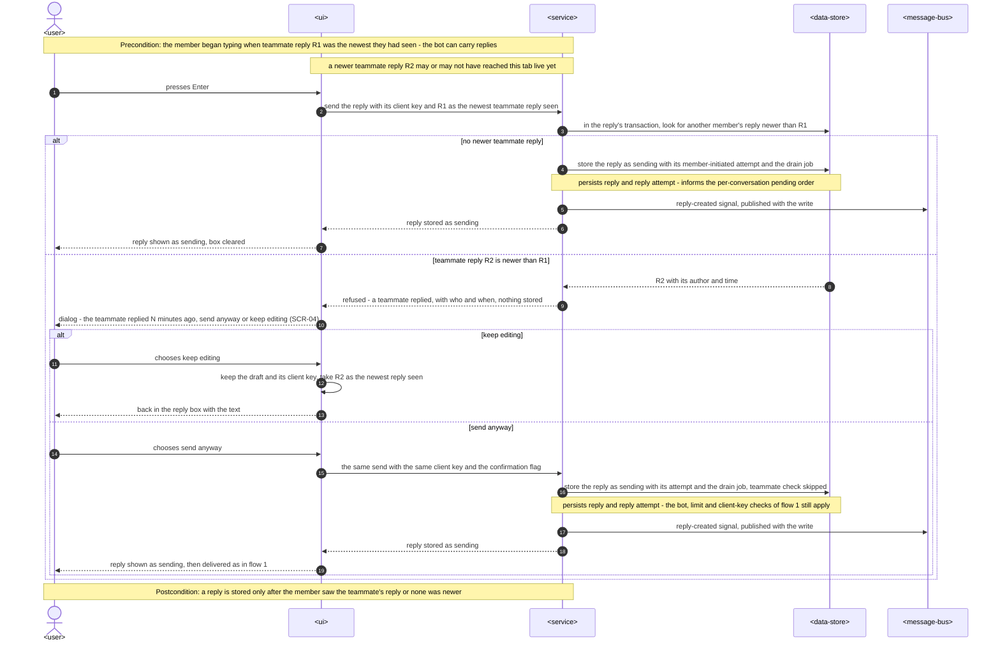

### Flow 7: Try again and send again (US-05 — AC-11, AC-12, AC-12b)

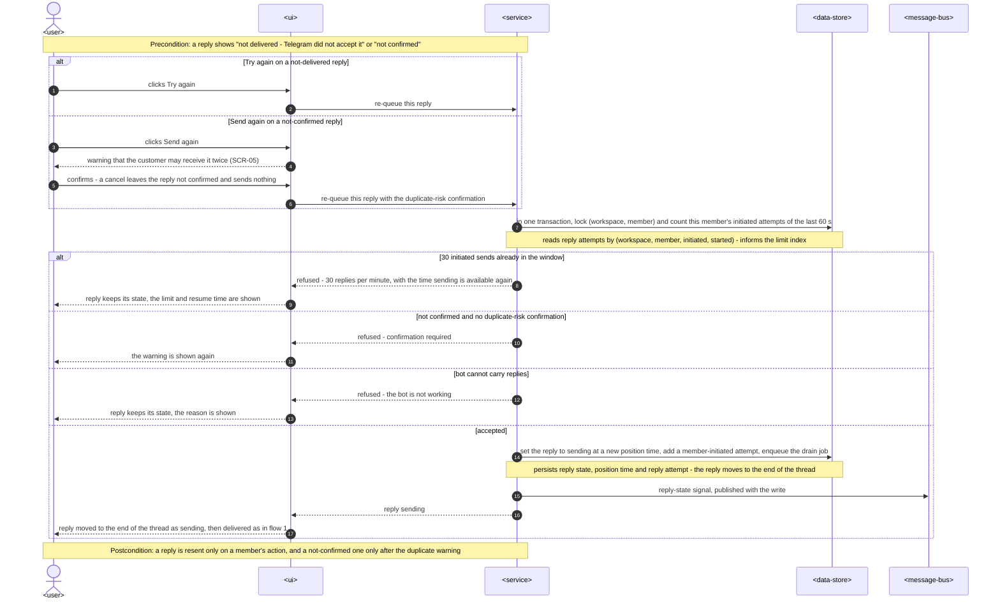

### Flow 8: The bot cannot carry replies or stops receiving, and is fixed (US-07 — AC-13, AC-14)

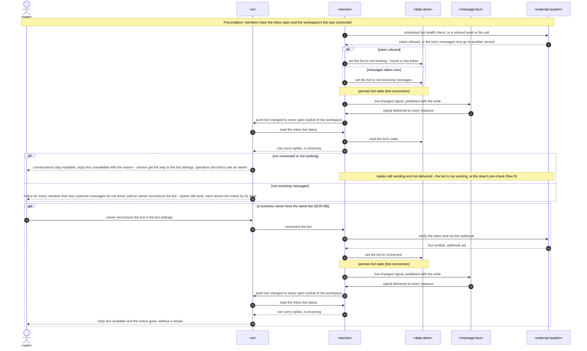

### Cross-cutting: Flow 9 — the delivery drain, its pre-checks and its recovery (US-05 — AC-09, AC-11, AC-12, AC-13)

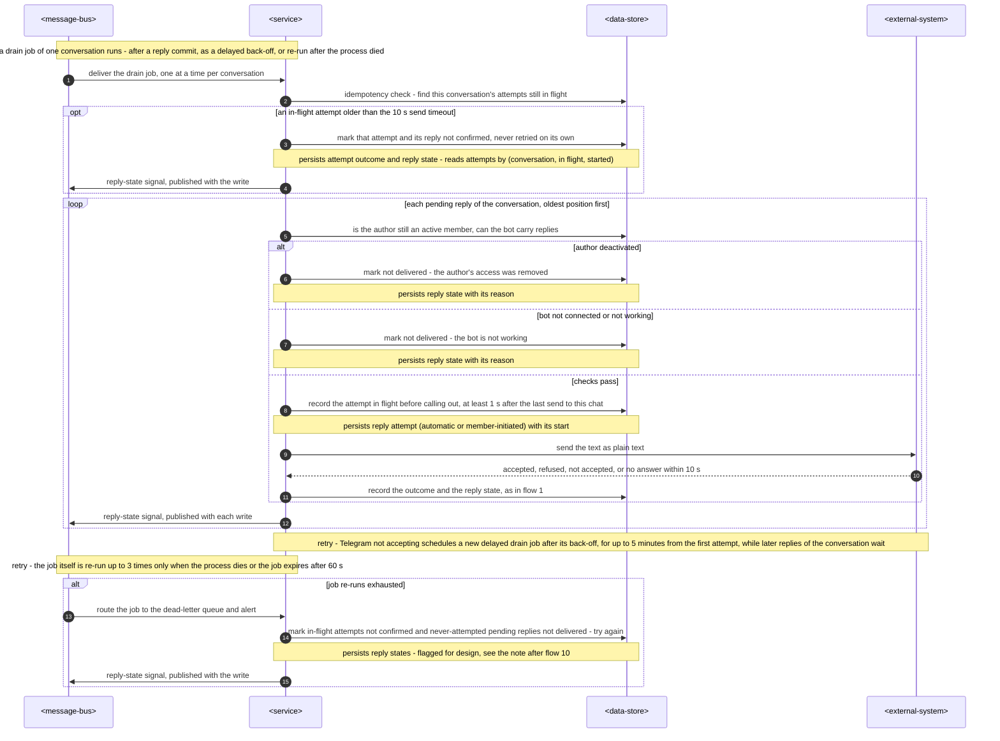

### Flow 10: A customer edits a message, or a late redelivery arrives (US-06 — AC-15)

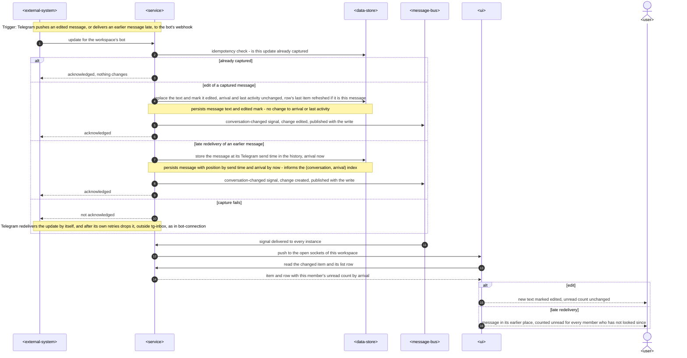

**Coverage — every spec §4 user story and §5 acceptance criterion → where §6 shows it:**

| Spec item | Shown by |
|---|---|
| US-01 | Flow 4; flow 2 (live re-ordering) |
| US-02 | Flow 5; flow 3 (media) |
| US-03 | Flow 1; flow 6 |
| US-04 | Flow 1 (sent by the workspace's own bot); flow 2 (the customer's answer continues the conversation) |
| US-05 | Flow 1 (delivery outcomes); flow 7; flow 9 |
| US-06 | Flow 2; flow 6; flow 10 |
| US-07 | Flow 8; flow 1 (bot-cannot-reply refusal) |
| AC-01 | Flow 4 (list, unread by arrival and active-since, waiting marker, empty states); flow 2 (activity re-orders the list) |
| AC-02 | Flow 4 — search `opt`, "nothing matches" and empty-workspace branches |
| AC-03 | Flow 5 — latest page, older pages `loop`, mark read for this member only, not-found branch; reload / back / saved link as its precondition, phone width as its postcondition |
| AC-04 | Flow 3 — happy path; plain-text rendering of locations, contacts and polls is a UI rule (§8 *Untrusted content*), not a runtime step |
| AC-05 | Flow 3 — "unavailable with the reason" branches |
| AC-06 | Flow 1 — accepted path |
| AC-07 | Flow 1 — the panel's text check before sending |
| AC-08 | Flow 4 and flow 5 — guard branches; flow 3 — not-found branch; the same guard fronts every inbox route and the socket upgrade (§8 *Authorization*) |
| AC-09 | Flow 2 — deactivation and workspace-switch branches; flow 9 — the author-deactivated pre-check |
| AC-10 | Flow 1 — permanent refusal branch |
| AC-11 | Flow 1 — client-key and unknown-outcome branches; flow 7 — send again with the duplicate warning; flow 9 — stale in-flight attempt |
| AC-12 | Flow 1 — not-accepted branches; flow 7 — Try again; flow 9 — the retry rules |
| AC-12b | Flow 1 and flow 7 — limit branches |
| AC-13 | Flow 1 — bot refusal; flow 8 — not-working branch and the fix; flow 9 — bot pre-check |
| AC-14 | Flow 8 — not-receiving branch |
| AC-15 | Flow 2 — new message and read-when-visible; flow 10 — edit and late redelivery |
| AC-16 | Flow 1 — teammate-replied refusal; flow 6 — the confirmation |
| AC-17 | Flow 1 — plain-text `sendMessage` through the workspace's bot; flow 2 — the customer's answer is captured into the same conversation. "No operator name" is a content rule, not a runtime step |
| AC-18 | Flow 4 — workspace-tagged pages and its postcondition; flow 1 — a reply goes only through its own workspace's bot |

**Flagged by `sequences` (for `design` to reconcile — no ADR written):**

- **Dead-lettered drain job (flow 9).** §8 *Jobs* gives `inbox.deliver-replies` `retryLimit` 3 but does not say what happens to a conversation's replies when the job exhausts its re-runs: today they would stay "sending" with no job to move them, which breaks QG-1 ("its shown state always tells the truth"). Flow 9 draws a dead-letter handler that ends in-flight attempts "not confirmed" and never-attempted replies "not delivered — try again" (safe: never sent) and alerts. This amends ADR-0004 → confirm it in `design` or record it with `/sdd:decide-adr shared-inbox`.
- **"Send again" / "Try again" as a state transition (flow 7).** Re-queueing is allowed only from "not delivered" or "not confirmed"; the reply moves to a new position time. ADR-0008 already defines position time as "when a member (re)sent it" — no new decision, listed so `data-model` keeps position time mutable.
- **No new participants:** all flows stay within §5's containers — `<message-bus>` is `platform/realtime` (signals) and the pg-boss queue (drain jobs).

## 7. Deployment view

No production target is chosen yet (architecture map: deferred until the first pilot goes live). The feature stays inside the one Node 26 process — Fastify API, built web panel, Telegram webhook ingress, the live socket endpoint and pg-boss workers — talking to one PostgreSQL 16 database ([ADR-0001](adr/0001-build-the-inbox-as-api-routes-a-live-socket-and-in-process-delivery-jobs-behind-the-existing-spa.md)). New for the runtime: long-lived WebSocket connections on the same origin (any proxy in front must pass `Upgrade` and keep idle sockets open — the server pings every 25 s so idle timeouts above 30 s suffice), one extra database connection per instance for `LISTEN` (outside the Kysely pool and pg-boss's own pool), and the `inbox.deliver-replies` queue (policy `stately`, singleton key = conversation id, polling interval 0.5 s). A second replica needs no code change and no sticky sessions: signals reach every instance through Postgres ([ADR-0003](adr/0003-fan-out-live-signals-through-postgres-listen-notify-published-in-the-writing-transaction.md)), the drain is serialised per conversation by pg-boss, and the per-member limit is counted in the database.

**Configuration added:** none. The rule constants (4096 characters, 30 replies per 60 s, 5-minute retry window, 5 s socket re-validation, 10 s send timeout) are fixed by the spec or this SAD and live in `inbox/domain`; the Telegram file download base follows `TELEGRAM_API_ROOT` like every Bot API call; the socket's allowed origin is `PUBLIC_WEB_URL`.

**Monitoring:**
- Metrics (from structured logs): reply latency from send to "sent"; live-push latency from commit to socket write; list, thread and media request durations; delivery outcomes by state and reason; attempts per reply; drain queue wait time; open sockets per instance; socket closes by reason (access removed, session ended, client); realtime listener reconnects and gap resyncs; per-member limit refusals
- Alerts: uptime check on `GET /health` (availability); any reply ending "not confirmed" or "not delivered — Telegram did not accept it" (spec §7: 0 caused by tg-inbox); the daily duplicate reconciliation (replies with more than one accepted attempt and no member-confirmed resend) above 0; drain queue wait above 30 s; the realtime listener down for more than 10 s
- KPIs (spec §7): computed by a periodic query over the stored columns — workspaces with ≥ 1 "sent" reply per day, time from a conversation's first unanswered customer message to the next "sent" reply, share of conversations "waiting for a reply" 24 h after the last customer message, and "not delivered" / "not confirmed" replies by reason (separating blocked bots, revoked tokens and Telegram outages from tg-inbox faults); results logged daily for the pilot review
- Tracing: Fastify per-request id in every log line; delivery logs carry workspace id, conversation id, reply id and attempt id — never reply text, message text, the token or a Telegram file URL

**Scaling thresholds:**
- Pilot scale is 5–10 workspaces with a few members each: tens of open sockets, one re-validation query per workspace with open sockets every 5 s; past ~1 000 open sockets per instance, move re-validation to deactivation and session-end signals plus a slower sweep
- `DATABASE_POOL_MAX` (default 10) is shared by HTTP reads, webhook capture (`TELEGRAM_WEBHOOK_MAX_CONNECTIONS` below it) and the delivery worker; run the worker with a local concurrency of 2 and raise the pool before raising either
- Lists and threads are paged by keyset; the spec's seeded sizes (1 000 conversations, 5 000-message thread) fit plain B-tree indexes; contact search scans one workspace's contacts — add a trigram index when a workspace passes ~10 000 contacts

## 8. Crosscutting concepts

| Concept | Convention | Where defined |
|---|---|---|
| Logging | pino via `platform/logger.ts`; existing redactions kept; reply text, message text and captions, file names, Telegram file paths and download URLs, the token and NOTIFY payloads are never logged — delivery and media logs carry ids, kinds, states and durations only; gateway errors are mapped to typed outcomes without copying Telegram's text | `CLAUDE.md` + here |
| Authentication | Every inbox route and the socket upgrade use the session cookie resolved by `auth`; the socket also requires `Origin` = the panel's origin (no cross-site socket hijacking); automatic live refetches send the background-request marker so they do not extend the idle session | workspace-operators ADR-0002 |
| Authorization | Everything under `/api/workspaces/:workspaceId/…` behind the `workspaces` guard — another workspace's account → not found with no hint, deactivated → `ACCESS_REMOVED`, signed out → sign in (AC-08); both roles have the same inbox rights; open sockets re-validated every 5 s and closed at once on a deactivation signal (AC-09); the delivery worker re-checks the author's active membership before every attempt | workspace-operators ADR-0003, [ADR-0002](adr/0002-push-change-signals-over-a-per-tab-workspace-bound-websocket-and-refetch-through-the-reads.md) |
| Tenancy | Every new repository method takes `workspaceId`; conversation, message and reply ids from the URL are always looked up together with the workspace id, so a foreign id is "not found"; signals carry the workspace id and the hub dispatches only to that workspace's sockets; no new controlled exception | `CLAUDE.md`, §5 |
| Secrets | The bot token is decrypted only in `bots` infra for `sendMessage`, `getFile` and the file download; the download URL never leaves the gateway; media responses are bytes from our origin, never a redirect | bot-connection ADR-0006, [ADR-0006](adr/0006-stream-customer-media-through-a-guarded-api-route-addressed-by-message.md) |
| Untrusted content | Customer text, captions, names, file names, poll and venue text and reply texts are rendered as plain text (React escaping, no HTML rendering, links only as plain-text map links built by us from coordinates); replies go to Telegram without `parse_mode`; media served with an allow-listed content type, `nosniff`, a sandboxing CSP and `attachment` for documents | spec §6.1, ADR-0006 |
| Error handling | `AppError` subclasses with codes in `packages/shared/src/errors.ts`; new refusals: reply invalid (`ValidationError`), teammate replied (`ConflictError` with who / when), duplicate-risk confirmation required (`ConflictError`), reply limit (`TooManyRequestsError` with the time sending resumes), bot cannot carry replies (`ConflictError`); delivery outcomes are reply states, not HTTP errors; media unavailability is a typed answer the thread renders | `CLAUDE.md` + here |
| ID strategy | UUIDv7 from `newId()` for replies, attempts and read marks; the client reply key is a client-generated UUID stored beside the id (unique per conversation), never used as the primary key; Telegram message ids of sent replies stored as `bigint` | `CLAUDE.md` |
| Time and order | Server clock (UTC) for arrival, reply position, sent and attempt times; customer messages keep Telegram's send time for their place in the thread; unread counts by arrival, the thread by position ([ADR-0005](adr/0005-track-read-state-as-a-per-member-arrival-watermark-per-conversation.md), [ADR-0008](adr/0008-store-replies-in-their-own-table-and-page-the-thread-by-position-time.md)) | here |
| Telegram calls | Every call through `telegramApi(token)` behind the `bots` gateway; `sendMessage` timeout 10 s, `getFile` 5 s, download streamed with a 30 s idle timeout; outcomes: accepted / refused permanently (blocked, account gone, chat not found) / bot unauthorised / not accepted (429 with `retry_after`, 5xx, connection refused) / unknown (timeout or broken connection after the request was written) | `CLAUDE.md` + [ADR-0004](adr/0004-send-replies-at-most-once-through-a-per-conversation-delivery-queue-with-an-in-flight-mark.md) |
| Jobs | `inbox.deliver-replies` (pg-boss, `stately`, singleton key = conversation id, `retryLimit` 3, job expiry 60 s): sent through pg-boss inside the reply's own transaction (pg-boss `send` with the caller's database executor), so a committed reply always has a job; the drain schedules its own Telegram back-off as a new delayed job and completes; if the process dies mid-drain, pg-boss re-runs the expired job (retries are for crashes only) and the re-run resolves any "in flight" attempt older than the 10 s send timeout as "not confirmed"; every drain run also performs that check first | `CLAUDE.md` + ADR-0004 |
| Events | `platform/realtime`: one NOTIFY channel; signals `conversation.changed` (conversation id, item kind + id, change: created / edited / state / read — read only to the member's own sockets), `bot.changed`, `membership.deactivated`; published inside the writing transaction; payload ids only | [ADR-0003](adr/0003-fan-out-live-signals-through-postgres-listen-notify-published-in-the-writing-transaction.md) |
| Rate limiting | Per-member 30 initiated sends per rolling 60 s per workspace, counted from the reply attempts log under an advisory lock on (workspace, member); automatic retries excluded | §4 |
| Internationalisation | The panel's UI language is unchanged (English); search folds case with Postgres' Unicode-aware lower-casing, so Cyrillic and Latin names match case-insensitively; texts are stored and sent as received | — |
| Observability | See §7 metrics; per-reply attempt rows double as the delivery log the spec's duplicate reconciliation reads | §7 |

## 9. Architecture decisions

| # | Title | Status | Section |
|---|---|---|---|
| [0001](adr/0001-build-the-inbox-as-api-routes-a-live-socket-and-in-process-delivery-jobs-behind-the-existing-spa.md) | Build the inbox as API routes, a live socket and in-process delivery jobs behind the existing SPA | Accepted | §4 |
| [0002](adr/0002-push-change-signals-over-a-per-tab-workspace-bound-websocket-and-refetch-through-the-reads.md) | Push change signals over a per-tab, workspace-bound WebSocket and refetch through the reads | Accepted | §4 |
| [0003](adr/0003-fan-out-live-signals-through-postgres-listen-notify-published-in-the-writing-transaction.md) | Fan out live signals through Postgres LISTEN/NOTIFY, published in the writing transaction | Accepted | §4 |
| [0004](adr/0004-send-replies-at-most-once-through-a-per-conversation-delivery-queue-with-an-in-flight-mark.md) | Send replies at most once through a per-conversation delivery queue with an in-flight mark | Accepted | §4 |
| [0005](adr/0005-track-read-state-as-a-per-member-arrival-watermark-per-conversation.md) | Track read state as a per-member arrival watermark per conversation | Accepted | §4 |
| [0006](adr/0006-stream-customer-media-through-a-guarded-api-route-addressed-by-message.md) | Stream customer media through a guarded API route, addressed by message | Accepted | §4 |
| [0007](adr/0007-add-an-inbox-module-that-orchestrates-conversations-contacts-bots-and-workspaces.md) | Add an inbox module that orchestrates conversations, contacts, bots and workspaces | Accepted | §5 |
| [0008](adr/0008-store-replies-in-their-own-table-and-page-the-thread-by-position-time.md) | Store replies in their own table and page the thread by position time | Accepted | §5 |

ADR files live under `docs/features/shared-inbox/adr/NNNN-<title>.md`. Repo-wide decisions this design builds on: [`docs/adr/`](../../adr/) 0001, 0002, 0004; workspace-operators ADR-0002…0004; bot-connection ADR-0004…0008; ui-redesign ADR-0001…0002.

## 10. Quality requirements

Each top-3 goal from §1 expanded into scenarios; every number is quoted from spec §6.

**QG-1. Reply integrity**
- **When:** an operator double-presses send, loses the connection right after sending, Telegram times out mid-send, the process dies with an attempt in flight, or Telegram answers 429/5xx for a while
- **Then:** duplicate replies: "0 replies delivered twice without a member's explicit 'send again'"; a double press creates one reply; an unknown outcome ends "not confirmed" and is never retried on its own; refusals are retried for up to 5 minutes with later replies of the same conversation waiting and other conversations not held up; with Telegram healthy, reply latency p95 — operator presses send → marked "sent" — is "≤ 2 s"
- **How verify:** integration tests against the fake Bot API in `src/test/fake-telegram.ts` (extended with `sendMessage`): double submit with one client key → one `sendMessage`; a fake that hangs past the 10 s timeout → "not confirmed" and no second call; a job killed between "in flight" and the answer → re-run resolves "not confirmed"; scripted 429 then success → order kept per conversation while a second conversation delivers; the spec's delivery-log reconciliation over the reply attempts log in CI and as a daily production check; reply latency from the per-reply timing log, plus a seeded test asserting p95 ≤ 2 s with the queue's 0.5 s polling

**QG-2. Tenant, access and secret isolation**
- **When:** an account of another workspace, a deactivated member or a signed-out visitor requests a list, thread, item, media or reply action of "Acme Flowers"; a business owner deactivates an operator whose inbox is open; the operator switches workspace in one tab; any member opens customer media
- **Then:** refused with no data and no hint of existence for other workspaces (AC-08); access revocation: "live stream of a deactivated or switched-away member stops ≤ 5 s"; bot token exposure: "0 occurrences of a bot token in anything the web panel receives (pages, data, media addresses, redirects) or in logs"; reply rate per member: "≤ 30 replies per rolling 60 s per member per workspace (AC-12b)"
- **How verify:** a cross-workspace isolation test per new repository method and per route (including the media route and the socket upgrade); integration test: deactivate → no further signals for that member within 5 s even with the deactivation signal suppressed (the 5 s re-validation alone must close it); the bot-connection secrecy test extended to inbox responses, media responses, socket frames and captured logs; integration test: "the 31st reply within a minute is refused", including 31 concurrent sends

**QG-3. Live, responsive inbox**
- **When:** a customer message is captured or a teammate's reply is sent while other members have the inbox open; a member opens the list of a workspace with 1 000 conversations, the latest page of a 5 000-message conversation, or a ≤ 5 MB file with the bot connected
- **Then:** live update p95 "≤ 3 s"; inbox list p95 "≤ 500 ms server time"; thread open p95 "≤ 500 ms server time"; media open p95 "≤ 3 s"; availability "99.5 % monthly (as bot-connection §6)"
- **How verify:** server-side timing from commit to socket write logged per signal, and a CI integration test that asserts the push reaches a connected test socket; request timing logs on the list, thread and media paths; seeded integration tests with 1 000 conversations and a 5 000-message conversation asserting the server time; a media test streaming a 5 MB file from the fake Bot API; uptime check on the health endpoint

## 11. Risks and technical debt

| Risk / debt | Severity | Mitigation | Owner |
|---|---|---|---|
| Pilots keep their forwarder bot because a reply ends "not confirmed" or "not delivered" too often during Telegram hiccups, eroding trust in the inbox (product risk behind spec §7 KPIs) | Medium | Plain-language states with one-click "Try again" / "send again"; alert on every such reply (§7); review the counts with pilots weekly in the first 30 days | Dmytro Hopko |
| Job pickup and the drain add latency to every send; with the default polling the p95 ≤ 2 s target would be at risk | Medium | `inbox.deliver-replies` polls every 0.5 s; seeded latency test in §10; if p95 drifts, trigger the drain in-process right after the reply commits | Tech Lead |
| A slow Telegram answer (up to the 10 s timeout) holds the later replies of that conversation, and timeouts turn into "not confirmed" replies that may have arrived | Medium | Timeout chosen well above Telegram's normal latency; "not confirmed" count alerted; the member decides with the duplicate warning (AC-11) | Tech Lead |
| Signals emitted while an instance's `LISTEN` connection is reconnecting are lost; clients would show stale data until the next change | Low | Listener reconnects with backoff and tells every socket to resynchronise after a gap; clients also resync on socket reconnect (ADR-0003) | Tech Lead |
| The 5 s socket re-validation and per-change refetches grow with open tabs | Low | Fine at pilot scale; thresholds in §7 | Tech Lead |
| Video seeking and long audio rely on Telegram's file server honouring byte-range requests; without it Safari may refuse to play video | Medium | Forward `Range` and verify against the real Bot API before the first pilot; fall back to a full download for video if ranges are not honoured | Tech Lead |
| Animated and video stickers (`.tgs`, `.webm`) and video notes may not display natively in every browser | Low | Show the sticker's static thumbnail when the animated form cannot play; decided per kind at `screens` | Tech Lead |
| Serving customer-supplied files from the panel's origin could execute script if a type slipped through | Medium | Allow-listed content types, `nosniff`, sandboxing CSP and `attachment` for documents (ADR-0006); covered by the security review | Security Lead |
| Per-chat pacing of 1 s between sends delays bursts (several members answering one chat at once) by up to a second per queued reply | Low | Acceptable against the 2 s reply-latency target for the common single reply; 429 back-off honouring `retry_after` covers Telegram's bot-wide limit | Tech Lead |
| Same-second ordering between a customer message (Telegram's whole-second time) and a reply (our clock) is decided by rule, not truth | Low | Message-before-reply tie rule (ADR-0008); acceptable for support threads | Tech Lead |
| Read state, reply texts and attempts are kept indefinitely; removal only by hand on request | Low | Accepted for pilots, like captured messages (bot-connection §11); belongs with a later privacy / retention step | Dmytro Hopko |
| `CLAUDE.md`, the architecture map and the module list do not yet show the `inbox` module, `platform/realtime`, the new dependency line and the delivery queue | Low | Update both in this feature's tasks | Tech Lead |
| Spec §8: should members be able to edit or delete a reply after it is sent? Default now: no | Open question | Resolve after 30 days of pilot use; editing would add a Telegram `editMessageText` path and an "edited" state on replies, no change to delivery | Dmytro Hopko |
| Spec §8: should a member be able to mute or hide a conversation flooded by one sender? Default now: no | Open question | Resolve before roadmap step 5 (assignment & statuses) is specified; would be a per-conversation flag read by the list query | Dmytro Hopko |

**Accepted debt (acceptable in v1, plan to fix later):**
- No stored copies of media: every open re-downloads from Telegram, and media of a disconnected bot stays unavailable (spec §3).
- No full-text search in message text; contact search is a scan per workspace without a dedicated index until §7's threshold.
- Socket access is guaranteed by a 5 s periodic re-validation rather than by session-end signals.
- The delivery worker runs in the API process; split out when broadcast or webhook load interferes (architecture map).

## 12. Glossary

Terms marked † are not yet in [CONTEXT.md](../../../CONTEXT.md) — candidates for `/sdd:glossary`.

| Term | Meaning |
|---|---|
| Inbox | The web-panel screen where a workspace's operators and business owners see all of the workspace's conversations, read them and reply; shared by the whole team. NOT Conversation. |
| Conversation | The one continuous thread between a workspace and one contact, holding the contact's messages and the team's replies. NOT a support ticket. |
| Message | One thing an end customer sent to the business bot, captured into their conversation; an edit replaces its text. NOT Reply. |
| Reply | A text a member writes in a conversation, which the business bot sends to that conversation's end customer; the team sees its author, the customer only the bot. NOT Message, NOT a broadcast. |
| Operator / Business owner | Workspace members; in the inbox both roles have the same rights; only business owners manage the bot. |
| End customer / Contact | The person writing to the business bot / that person's record inside one workspace. |
| Business bot | The workspace's own Telegram bot; sends every reply and is the only source of customer media. |
| Delivery state † | What a reply shows: sending, sent, not delivered (with its reason), not confirmed. |
| Not confirmed † | A reply whose send to Telegram got no answer, so it may or may not have reached the customer; never resent without a member's confirmation. |
| Waiting for a reply † | A conversation whose customer wrote after the last reply marked "sent"; the one shared marker before statuses exist. |
| Unread † | Customer messages that arrived in tg-inbox after a member last read the conversation (and after their membership became active); counted per member, by arrival. |
| Arrival watermark † | The per-member, per-conversation point in arrival order up to which the member has read. |
| Client reply key † | The id the browser gives a reply before sending it, so a repeated submit finds the same reply instead of creating a second one. |
| Change signal † | A small live notice ("this conversation, item or bot changed") pushed to open inboxes; the browser then re-reads the change. Carries ids only. |
| Drain † | The per-conversation delivery job that sends that conversation's pending replies one at a time, oldest first. |
| Position time † | Where an item sits in the thread: a message by its Telegram send time, a reply by when a member (re)sent it. |
