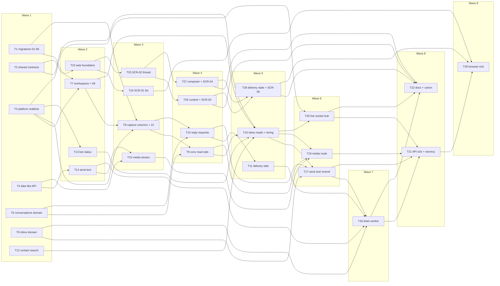

# Epic — shared-inbox

> **Spec:** [spec.md](../spec.md) · **Design:** [sad.md](../sad.md) · **Data model:** [data-model.md](../data-model.md) · **API:** [openapi.yaml](../contracts/openapi.yaml) · [events.md](../contracts/events.md) · **Screens:** [screens.md](../screens.md) · **UX flows:** [ux-flows.md](../ux-flows.md) · **ADRs:** [adr/](../adr/)

## Goal

This epic turns the inbox preview into the real, shared inbox of a workspace: every member sees the workspace's conversations live with their own unread counts and the shared "waiting for a reply" marker, reads the whole history including the customer's media opened through the panel, and answers with text replies the business bot sends to the customer (spec §2 Goals). Every reply carries a truthful delivery state; none is lost, doubled or sent silently into a broken bot, so a pilot team can drop its forwarder bot.

## Scope

- **In:** both declared surfaces (`sad.md` `target_surfaces: [backend-service, web-frontend]`). Backend: ten staged migrations (expand → backfill → contract); the six new error codes and the shared inbox / live-frame schemas; `platform/realtime` (in-transaction `pg_notify` + listener); the fake Bot API's `sendMessage` / `getFile` / download; domain rules in `conversations` and the new `inbox` module; read, reply and delivery sides of `conversations`; contact search; the bot status and `bot.changed`; the gateway's send text and media stream; the `inbox` module's reads, send / resend, media route, live socket hub and the `inbox.deliver-replies` drain with its dead letter; API e2e stories and the extended token-secrecy suite. Web: the API source, the workspace-keyed store and `shared/api/realtime.ts`; SCR-01, SCR-02 (reading, content kinds, composer, delivery states), SCR-03, SCR-04, SCR-05; five browser flows. Docs: `CLAUDE.md`, the architecture map, the design-system canon, `CONTEXT.md`.
- **Out (spec §3):** assignment and statuses (step 5); notifications outside the open inbox (step 6); contact profiles and the real contact list (step 7); editing or deleting a sent reply; sending media and quoting a message; searching message text; keeping copies of customer media; typing indicators.

**Size note:** 29 tasks, above the usual 8–20 for an M feature (same as the bot-connection precedent's 27). The feature declares two surfaces (the `ui` layer adds six tasks plus a browser-flow task), adds a module and a platform service, and its delivery path (request side, delivery side, gateway, drain) is split so each task stays within one day and one reviewable PR.

## Task map

Waves (what can run in parallel once its upstream is done):

- **Wave 1:** T1, T2, T3, T4, T5, T6, T12
- **Wave 2:** T7, T13, T14, T23
- **Wave 3:** T8, T15, T24, T25
- **Wave 4:** T9, T10, T26, T27
- **Wave 5:** T11, T16, T28
- **Wave 6:** T17, T19, T20
- **Wave 7:** T18
- **Wave 8:** T21, T22
- **Wave 9:** T29

## Tasks

See [tracker.md](./tracker.md) for status. Machine contract: [tasks.json](../tasks.json).

| # | Task | Layer | Blocked by | DoD (short) |
|---|---|---|---|---|
| T1 | Promote the expand, backfill and new-table migrations 01–08, regenerate DB types and add the inbox test fixtures | migration | — | migrations 01–08 are promoted to live `apps/api/migrations/`, then apply and revert cleanly on a fresh Postgres 16 |
| T2 | Define the inbox zod contracts, the live-frame schemas and the six new error codes | ports | — | `packages/shared` unit tests pass, including every contract example and the rejections above |
| T3 | Build platform/realtime: an in-transaction pg_notify publisher and a dedicated-connection listener with reconnect and gap resync | infra | — | integration test proves commit-only delivery, rollback suppression, reconnect + gap event and invalid-payload drop |
| T4 | Extend the fake Bot API with sendMessage, getFile and the file download, scriptable per call | tests | — | fake self-tests pass for every scripted `sendMessage` answer, `getFile` outcome and ranged download |
| T5 | Add the conversations domain rules: reply states and transitions, thread position order and cursors, the arrival-watermark rule | domain | — | domain unit tests cover every transition, the same-second tie rule, cursor round-trips and malformed cursors, watermark raise/clamp |
| T6 | Add the inbox domain rules: reply text check, delivery outcome to reply state, retry window, per-member limit window | domain | — | inbox domain unit tests cover every outcome-table row, the 5-minute boundary, UTF-16 counting and the limit `retry_at` |
| T7 | Give workspaces an active-since time, a richer guard result, active-member and display-name lookups and a deactivation signal; promote migration 09 | app | T1, T3 | unit + integration tests: active-since on join / reactivation / CLI, guard result, both lookups isolated by workspace, deactivation signal on commit only |
| T8 | Maintain the conversation list columns on capture and edit, publish conversation.changed, and promote migration 10 | app | T1, T3, T7 | integration tests prove the column values after capture, late redelivery and edit, and signals only on commit |
| T9 | Build the conversations read side: list page with unread counts, summary, thread page, single items, media reference and mark read | infra | T5, T8 | integration tests prove unread by arrival and active-since, waiting marker, last item, thread order and paging, read-mark raise/clamp and the read signal |
| T10 | Build reply creation and re-queueing in conversations: idempotent client key, per-member limit under an advisory lock, teammate check, attempt row and drain job in one transaction | infra | T5, T8 | integration tests prove idempotent create, the 30/60 s limit under 31 concurrent requests with `retry_at`, the teammate check, re-queue rules, and that reply + attempt + job commit together |
| T11 | Build the delivery side in conversations: pending replies, in-flight mark, outcome recording, mark sent, stale in-flight and dead-letter resolution | infra | T10 | integration tests prove every outcome transition, the conversation columns on `sent`, stale in-flight resolution and the idempotent dead-letter resolution, each with its `state` signal |
| T12 | Add contact search ids and contacts by ids to the contacts module | infra | — | integration tests prove trimming, `@` dropping, Unicode case folding, full-name matching, wildcard escaping and workspace isolation |
| T13 | Expose the inbox bot status to every member and publish bot.changed on every bot state transition | app | T3 | unit tests prove the four-state mapping; integration tests prove each bot state transition publishes `bot.changed` exactly once on commit |
| T14 | Add sendMessage to the bots gateway as send text, classifying every answer into a typed outcome | infra | T4 | integration tests prove every outcome class against the fake Bot API, plain-text sending with line breaks, and the 10 s timeout as `unknown` |
| T15 | Add the media stream to the bots gateway: getFile, size check and a ranged byte stream with typed unavailability | infra | T4, T14 | integration tests prove a 5 MB stream, a ranged 206 read and every unavailable reason against the fake Bot API |
| T16 | Create the inbox module with its read use cases and routes (list, search, conversation, thread, items, mark read, bot status) and wire it into buildDeps and buildApp | ports | T2, T7, T9, T12, T13 | route integration tests pass for the seven read operations, the guard trio, foreign ids and the AC-18 two-workspace case |
| T17 | Add the sendReply and resendReply use cases and routes with the flow-1 check order and the drain-job hook | ports | T6, T10, T16 | unit tests prove the check order of both use cases; route tests prove every status and error body in the contract |
| T18 | Build the inbox.deliver-replies drain worker with pre-checks, pacing, outcome handling, back-off jobs and the dead-letter handler | app | T6, T11, T14, T17 | unit tests cover every branch; integration tests prove order per conversation, isolation between conversations, at-most-once on timeout and crash, pre-checks, the 5-minute window and the dead-letter handler |
| T19 | Add the openMessageMedia route that streams a customer's media with forced safe headers and typed unavailability | ports | T9, T15, T16 | route tests prove the forced headers per kind, ranged reads, every unavailable reason, 404 / 403 guarding and the absence of the token and any Telegram URL |
| T20 | Add the live socket endpoint and hub: guarded upgrade with origin check, per-workspace dispatch, deactivation close, 5 s re-validation, ping and resync | ports | T3, T16 | integration tests prove the guarded upgrade, origin refusal, per-workspace dispatch, read-only-to-self, `4403` on deactivation, ≤ 5 s close with the signal suppressed, `4401` on session end and `resync` after a listener gap |
| T21 | Add the API end-to-end inbox stories and extend the token-secrecy suite to inbox responses, media, socket frames and logs | tests | T17, T18, T19, T20 | the e2e stories pass against Postgres + the fake Bot API |
| T22 | Update CLAUDE.md, the architecture map and the design-system canon for the inbox module, platform/realtime, the delivery queue and the new components | docs | T18, T20, T26, T27, T28 | CLAUDE.md and the architecture map name the inbox module, platform/realtime, the queue and the dependency line exactly as built |
| T23 | Replace the inbox sample source with the API source, a workspace-keyed store and the realtime client | ui | T2 | store and realtime tests prove workspace isolation on switch, foreign-frame dropping, resync re-reads, reconnect rules per close code |
| T24 | Build SCR-01, the conversation list, on real data: rows, search, empty states, the not-receiving notice and live updates | ui | T23 | Testing Library tests cover every SCR-01 state in `screens.md` (except `validation`, N/A) including the owner/operator split |
| T25 | Build SCR-02's reading side: thread header, paged history, mark read when visible, live items, edits, late redeliveries and phone layout | ui | T23 | Testing Library tests cover every SCR-02 reading state listed above, incl. mark-read only when visible and late-redelivery placement |
| T26 | Build MessageContent for every message kind with media fetched through the API client, and SCR-03, the media viewer | ui | T25 | Testing Library tests cover every content row of SCR-02 and every SCR-03 state |
| T27 | Build the real reply composer and SCR-04: client key and drafts, sending lock, validation, rate limit, bot-unavailable states and the teammate confirmation | ui | T25 | Testing Library tests cover every composer state of SCR-02 and every SCR-04 state |
| T28 | Build ReplyDeliveryState with Try again and Send again, and SCR-05, the duplicate-risk confirmation | ui | T26, T27 | Testing Library tests cover every reply row of SCR-02 and every SCR-05 state, incl. which reasons offer Try again |
| T29 | Add browser end-to-end inbox flows against the real API and the fake Bot API | tests | T21, T24, T28 | the five browser flows pass locally and in CI with `pnpm test:e2e` |

## Risks / Hard rules

- **Tenancy (CLAUDE.md):** every new repository method takes `workspaceId` and has a cross-workspace isolation test; no new controlled exception (sad.md §5). Conversation, message and reply ids are always looked up with the workspace id — a foreign id is 404.
- **Module direction (ADR-0007):** `inbox → {conversations, contacts, bots, workspaces}`; nothing imports `inbox`. `conversations` gets the drain-job hook as a parameter (T10), never an import.
- **Signals (ADR-0003):** published only inside the writing transaction through `platform/realtime`; payloads carry ids only.
- **At-most-once (ADR-0004):** no code path re-sends an attempt whose outcome is unknown; a committed reply always has its attempt row and drain job (T10, T17, T18).
- **Secrets (spec §6, ADR-0006):** the bot token and Telegram file URLs never reach the browser or the logs — proven by T21's extended secrecy suite.
- **Expand → contract:** migrations `09` / `10` are promoted only with the code that writes their columns (T7, T8), never in T1.
- **Open question carried in:** `contracts/api-sync-report.md` OQ-2 (the dead-letter handler and `failure_reason = delivery_interrupted`) is still unconfirmed by `design`. This breakdown assumes it as written in `events.md` and `screens.md` Decision 1 (T1 promotes `05` with the value; T11 / T18 implement the handler; T28 offers Try again for it). If `design` decides otherwise before T1 runs, drop the value from `05`, the contract and T28 together.
- **Latency targets (spec §6):** list / thread ≤ 500 ms server time (T9), reply → sent ≤ 2 s p95 (T18), live push ≤ 3 s (T20), media ≤ 3 s (T19), access revocation ≤ 5 s (T20).
