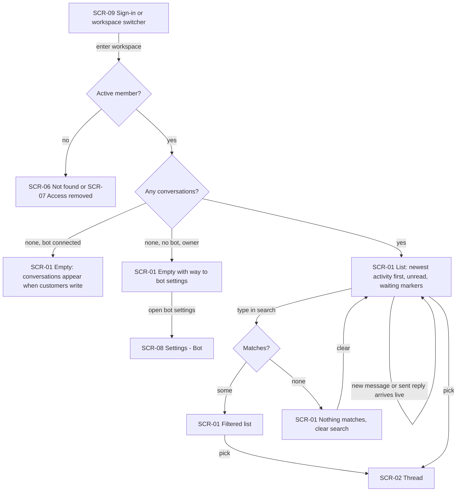
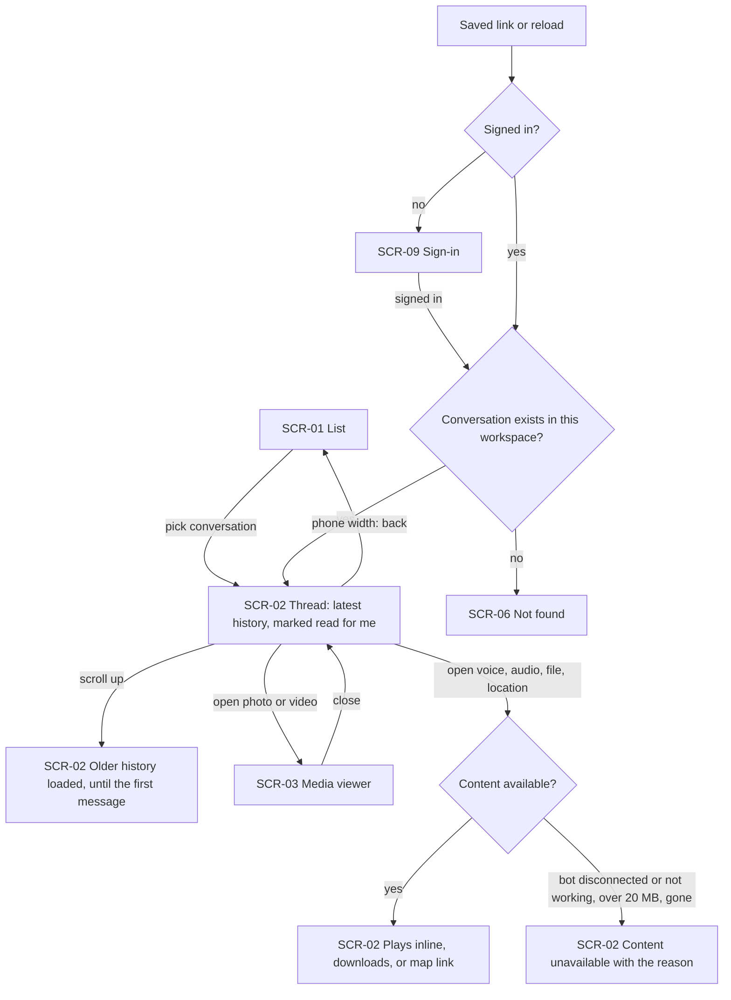
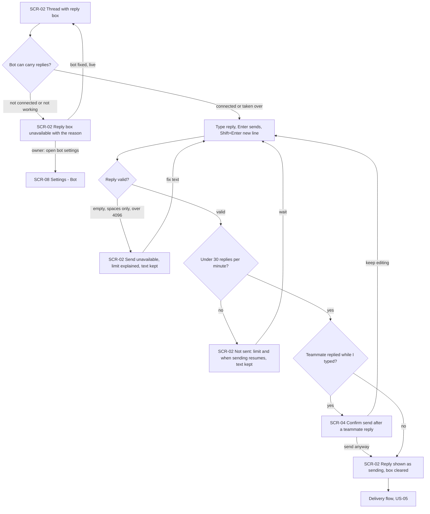
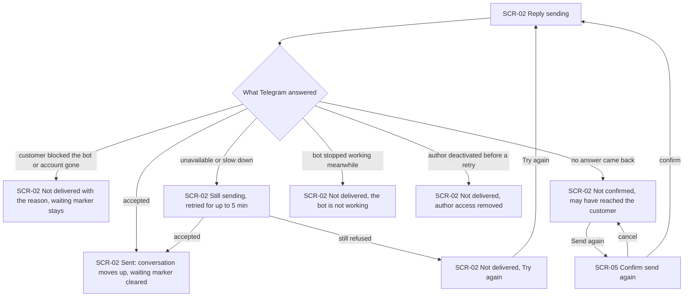
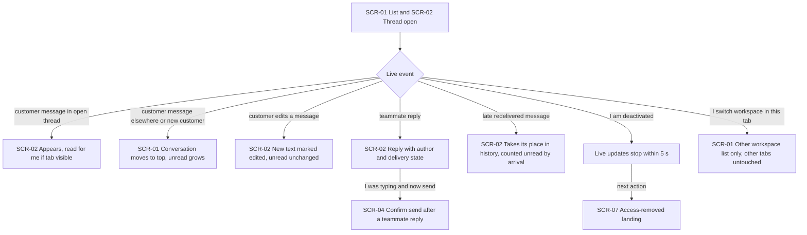
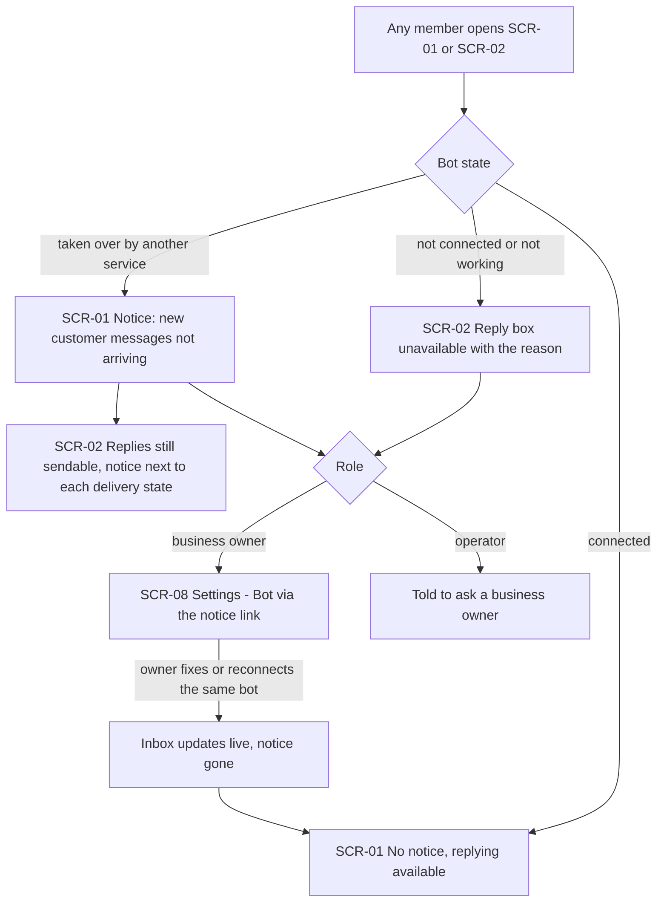

# UX flows — shared-inbox

> User flows for every UI-touching §4 user story, produced by `ux-flows` (after `clarify`, before
> `design`) and read by `design` (evidence for the target-surface + UI-architecture decisions),
> `sequences` (UI-driven flows align on SCR ids), `screens` (details every inventory row) and
> `plan-tests` (the e2e-through-UI paths). **Always markdown + mermaid `flowchart`**, whatever the
> design tool — this artifact is flow-altitude, not visual design.

## Platform decisions

- **Posture:** desktop-first — per `docs/design-system.md` §Platform posture; every flow must also work at phone width (≥360px).
- **Navigation shape:** the inbox lives in the existing workspace frame (ui-redesign SCR-07) and stays the screen a workspace opens on. On desktop the conversation list and the open thread sit side by side; at phone width they are separate steps — list → thread → back (spec AC-03, carried over from ui-redesign AC-12b).
- **Addressable selections:** each conversation has its own address — reload, back and saved links reopen it; an unknown or foreign one shows the not-found card inside the frame (AC-03, AC-08).
- **Live, not refreshed:** nothing in these flows has a "refresh" step — new messages, edits, teammates' replies, delivery states and the bot's state arrive into whatever screen is open (AC-15, AC-13, AC-14). How that happens is a `design` decision.
- **Modality:** two new confirmations are dialogs over the thread — "a teammate just replied — send anyway?" (AC-16) and "send again — the customer may receive it twice" (AC-11). Everything else stays on the inbox screen: delivery states and their "Try again" sit on the reply in the thread; the bot-state notices sit above the list and in the reply area.
- **Media opens in place:** photos, stickers and video show in the thread; a photo or video can be opened full-size in a viewer over the thread; voice and audio play inline; a file downloads; a location's map link leaves tg-inbox only on click (AC-04).
- **Leaving the workspace:** deactivation sends the member, on their next action, to the existing access-removed landing (ui-redesign SCR-05 / SCR-06); a workspace switch in one tab reloads only that tab's inbox (AC-09).
- **Out of scope as a flow:** US-04 (End customer gets the answer in the bot) has no web screen — the customer only sees their Telegram chat with the bot; AC-17 is verified below the UI (see AC coverage).

## Screen inventory

| ID | Screen | Purpose | Entry | Exit |
|---|---|---|---|---|
| SCR-01 | Inbox — conversation list | The workspace's conversations, newest activity first, with unread counts, "waiting for a reply" markers, search, empty states and the bot-state notice | entering a workspace; Inbox in the navigation; back from SCR-02 at phone width | SCR-02 (pick a conversation); SCR-08 (owner: way to the bot settings) |
| SCR-02 | Inbox — conversation thread | One conversation's history (messages, replies with author and delivery state, media), older history on scroll, the reply box or the reason it is unavailable | a conversation in SCR-01; a conversation's address | SCR-01 (another conversation / back at phone width); SCR-03, SCR-04, SCR-05; SCR-06 (unknown address); SCR-07 (access removed); SCR-08 (owner: bot settings) |
| SCR-03 | Media viewer | A customer's photo or video opened full-size over the thread | a photo or video in SCR-02 | SCR-02 (close) |
| SCR-04 | Confirm send after a teammate's reply | Shows that a teammate replied and how long ago; send anyway or keep editing | sending in SCR-02 after a teammate's reply appeared while typing | SCR-02 (reply sent, or back to editing) |
| SCR-05 | Confirm send again | Warns that the customer may receive a "not confirmed" reply twice | "Send again" on a not-confirmed reply in SCR-02 | SCR-02 (reply resent, or cancelled) |
| SCR-06 | Not found (in frame) | Existing not-found card for an unknown conversation address or one the member may not see | an unknown or foreign conversation address | SCR-01 (back to the inbox) |
| SCR-07 | Access-removed landing | Existing workspace picker / no-access screen with the access-removed notice | the next action after the member was deactivated | another workspace's SCR-01; sign out |
| SCR-08 | Settings — Bot | Existing owner-only bot settings (ui-redesign SCR-11) — the way to fix a broken or taken-over bot | the owner's link from SCR-01 / SCR-02 notices or the empty inbox | SCR-01 via the navigation |
| SCR-09 | Sign-in | Existing sign-in; any signed-out visit to an inbox address lands here and returns afterwards | a conversation address while signed out | SCR-01 / SCR-02 of the requested address (when the account is an active member) |

## Flows

### Flow: US-01 — See the workspace's conversations

A member enters the workspace (after sign-in or from the workspace switcher). Someone without an active membership never reaches the list: an outsider gets the not-found card, a deactivated member the access-removed landing (AC-08). A member sees the list of the workspace's conversations, newest activity first, each with the contact's name, last message, time, their own unread count and the shared "waiting for a reply" marker (AC-01); the list re-orders itself live as customers write and replies are sent. With no conversations yet, the list explains that conversations appear when customers write — and a business owner whose workspace has no connected bot gets the way to the bot settings (AC-02). Typing in the search narrows the list to matching contacts; when nothing matches, the list says so and offers to clear the search (AC-02). Picking a conversation opens its thread. Switching to another workspace in the switcher shows only that workspace's list, in that tab (AC-18, AC-09).

### Flow: US-02 — Read a conversation's history

From the list, or from a saved link or a reload (signed-out visitors sign in first and return; an unknown or foreign conversation shows the not-found card — AC-03, AC-08), the member sees the thread: the latest part of the history with the contact's name on top, customer messages and the team's replies in order, each reply with its author's name; opening it marks the arrived messages read for this member only (AC-03). Scrolling up loads older history until the first message. Photos, stickers and video show in the thread and a photo or video opens full-size in the media viewer; voice notes and audio play inline, files download, a location shows its coordinates with a map link that leaves tg-inbox only on click, and an unrecognised kind shows "unsupported message" (AC-04). When content cannot be fetched — the bot is disconnected or not working, the file is over 20 MB, or Telegram no longer has it — the message shows "content unavailable" with the reason and the rest of the thread stays readable (AC-05). At phone width, back returns to the list.

### Flow: US-03 — Reply to a customer

In an open thread the member types a reply; Enter sends and Shift+Enter starts a new line (AC-06). If the bot is not connected or not working, the reply box is unavailable and says why — an owner gets the way to the bot settings, an operator is told to ask an owner — and it becomes usable again live once the bot is fixed (AC-13). An empty, spaces-only or over-4096-character reply cannot be sent; an over-long one keeps its text with the limit explained (AC-07). A member who already sent 30 replies in this workspace in the last minute is told the limit and when sending resumes, with the text kept (AC-12b). If a teammate's reply to the same customer appeared while the member was typing, a confirmation shows who replied and how long ago and asks to send anyway or keep editing (AC-16). Otherwise — or after "send anyway" — the reply appears at the end of the thread as "sending" with the member's name, the box clears, and delivery continues in the US-05 flow.

### Flow: US-05 — Know whether a reply arrived

A sending reply ends in one of the states the member sees on the reply itself. Accepted by Telegram → "sent": the conversation moves to the top for the whole team and the "waiting for a reply" marker clears (AC-06). The customer blocked the bot or deleted their account → "not delivered" with that reason; the marker stays and the reply box stays usable (AC-10). Telegram unavailable or asking to slow down → the reply stays "sending" while tg-inbox retries for up to 5 minutes, then either becomes "sent" or "not delivered" with "Try again", which sends it once more at the end of the thread (AC-12). No answer came back → "not confirmed"; it is never resent on its own, and "Send again" first asks for confirmation that the customer may get it twice (AC-11). A double press sends one reply (AC-11). A reply still sending when the bot stops working ends "not delivered — the bot is not working" (AC-13); a deactivated author's waiting retries end "not delivered — the author's access was removed" (AC-09).

### Flow: US-06 — Work alongside teammates

While a member has the inbox open, events arrive without reloading (AC-15, within 3 s at p95). A customer message in the open thread appears there and counts as read only if the tab is visible; a message in another conversation, or a first message from a new customer, moves that conversation to the top and raises its unread count. A customer's edit replaces the text, marked as edited, without making it unread. A teammate's reply shows with their name and delivery state — and if the member was typing in that conversation, sending first asks for confirmation (AC-16). A late redelivered message takes its earlier place in the history but still counts as unread by its arrival (AC-15). When the member is deactivated, live updates stop within 5 seconds and the next action leads to the access-removed landing; switching workspace in one tab shows only the other workspace there, and other tabs keep working (AC-09).

### Flow: US-07 — Know when the bot cannot carry replies

Every member sees the bot's state where it matters, without opening the bot settings. With the bot not connected or "not working — needs a new token", every conversation stays readable but the reply box is unavailable and explains why (AC-13). With the bot "taken over by another service", a notice above the list says new customer messages are not arriving; replies can still be sent and each shows the same notice next to its delivery state (AC-14). A business owner gets a link from the notice to the bot settings; an operator is told to ask a business owner. Once an owner fixes or reconnects the same bot, the inbox updates live — the notice disappears and replying works again without reloading (AC-13).

## AC coverage

| AC | Shown by | Notes |
|---|---|---|
| AC-01 | Flow US-01 → `D` (list) | live re-ordering on the `D` self-loop; owner = operator in the inbox |
| AC-02 | Flow US-01 → `F` / `G` / `H`, empty states `E1` / `E2` | |
| AC-03 | Flow US-02 → `B`, `O`, saved link `L` → `K`; phone-width back | |
| AC-04 | Flow US-02 → `MV`, `P` | map link leaves only on click; unsupported kind shown in `B` |
| AC-05 | Flow US-02 → `U` | |
| AC-06 | Flow US-03 → `C` → `G`; Flow US-05 → `S` | |
| AC-07 | Flow US-03 → `E` | |
| AC-08 | Flow US-01 → `N`; Flow US-02 → `NF`, `SI` | outsider: not found; deactivated: access-removed landing |
| AC-09 | Flow US-06 → `H` → `AR`, `SW`; Flow US-05 → `AR` | |
| AC-10 | Flow US-05 → `BL` | |
| AC-11 | Flow US-05 → `NC` → `SA` | double press: one reply (no separate node) |
| AC-12 | Flow US-05 → `RT` → `ND` → Try again | |
| AC-12b | Flow US-03 → `RL` | |
| AC-13 | Flow US-03 → `X`; Flow US-05 → `BW`; Flow US-07 → `X` → `S` → `L` | |
| AC-14 | Flow US-07 → `T`, `T2` | |
| AC-15 | Flow US-06 → `C`, `D`, `E`, `F`, `G` | |
| AC-16 | Flow US-03 → `T` → `W`; Flow US-06 → `W` | |
| AC-17 | N/A: no web screen — the End customer sees only their Telegram chat with the bot | verified below the UI (integration through the fake Bot API) |
| AC-18 | Flow US-01 → workspace switcher → `D` per workspace | |
