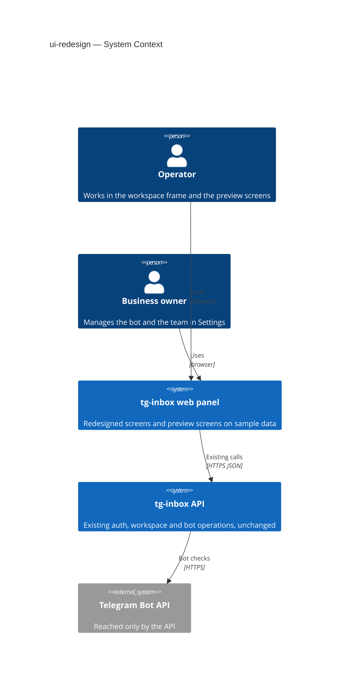
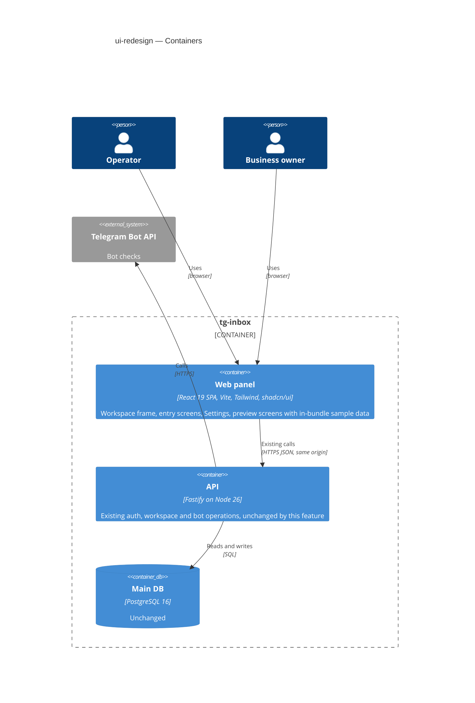
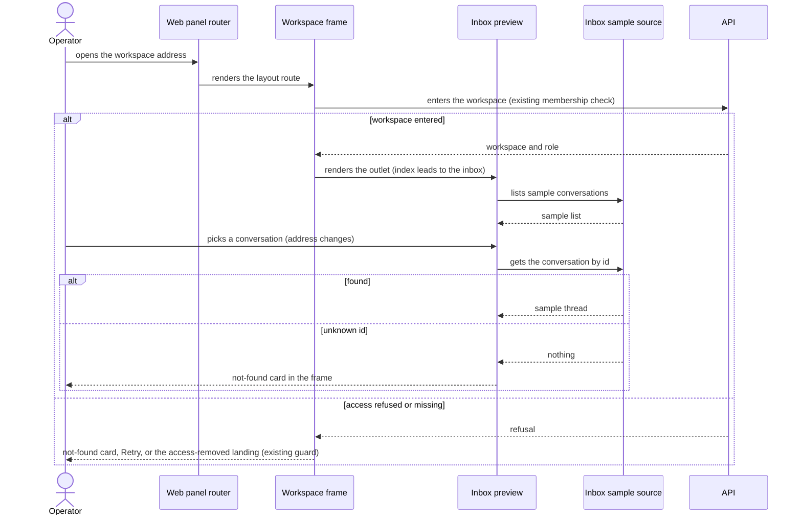
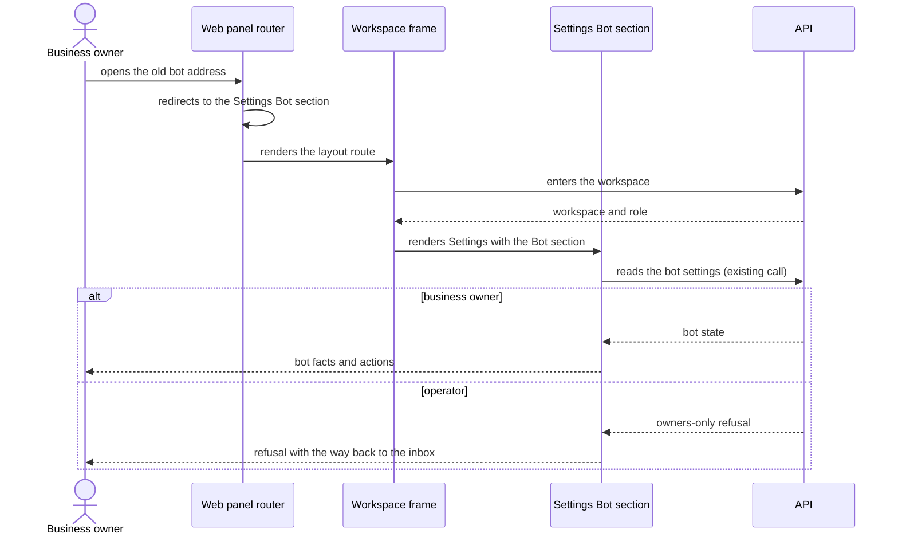

# Software Architecture Document — ui-redesign

## 1. Introduction and goals

**Intent.** Move every shipped screen of the operator web panel onto the design canon (`docs/design-system.md`) — centred entry screens, one workspace frame with a side navigation, an owner-only Settings screen holding the Bot and Team sections — and add three preview screens (shared inbox, contact list, contact profile) on labelled sample data, without changing any behaviour, server or contract. Operators and business owners of the pilot workspaces are the users; the next roadmap steps (4 shared inbox, 7 contacts) are the main consumers of the structure this feature leaves behind.

**Top-3 quality goals (1-liners; full scenarios in §10):**

1. Behaviour preservation — every existing action, message and safeguard works exactly as before.
2. Usability at phone width — no screen scrolls sideways at 360px.
3. Extensibility — steps 4 and 7 replace the preview screens' sample data instead of building new screens, at a bounded download-size cost.

**Stakeholders.**

| Role | Interest | Sign-off owner? |
|---|---|---|
| Operator | Works in the frame, previews inbox and contacts | No |
| Business owner | Manages bot and team in Settings | No |
| Tech Lead | SAD approval; the route/frame structure every next UI feature builds into | Yes |

**Decisions taken at easy depth (assumptions ledger — the user delegated the stage questions for this pipeline run):** web-frontend is the only surface; the SPA stays an SPA; one layout route renders the frame (ADR-0001); preview screens read sample data through a per-feature read-only source that later steps swap for the API (ADR-0002); a "sent" preview reply lives in the InboxPreview component's state (shared by its list and thread), resets when the conversation changes and is never kept in a store; primitives come from the shadcn/ui catalogue per the canon; Team filtering runs on loaded rows in the browser; deployment unchanged.

## 2. Constraints

**Technical.**
- TypeScript (strict) on Node 26; pnpm workspaces (`apps/web`, `apps/api`, `packages/shared`).
- Web: React 19, Vite 8, React Router 8 (`createBrowserRouter`, routes in `apps/web/src/app/routes.tsx`), Zustand 5 stores per feature, Tailwind CSS 4 (`@tailwindcss/vite`), shadcn/ui `new-york` style on the unified `radix-ui` package, `lucide-react` icons.
- The SPA is served by the API from the same origin (`WEB_DIST_DIR`); `/api/*` stays the API.
- **No server change:** no new endpoint, no migration, no change in `packages/shared` contracts — the redesign consumes the existing `auth`, `workspaces` and `bots` contracts as they are.

**Organisational.**
- Size S (~1 week, a few PRs); one developer + agents.
- Reference markup in `docs/design-refs/` is local and gitignored; it is deleted when the screens are done.

**Conventions.**
- `CLAUDE.md` § UI: compose shadcn/ui primitives from `apps/web/src/shared/ui` (add with `pnpm dlx shadcn@latest add <name>` inside `apps/web`, then fix the import to `@/shared/lib/utils`); Tailwind only — no CSS modules, no CSS-in-JS.
- `docs/design-system.md` — the Visual direction, Component inventory (new components registered back) and Interaction & writing conventions (errors as destructive `Alert`, empty states as one sentence + action, `Skeleton` loading, validation on submit with `aria-invalid`).
- Tests: `*.test.tsx` with Testing Library next to the code; Playwright e2e in `apps/web/e2e`.

**Regulatory / external.**
- N/A — no new personal data; sample data is invented and names no real person.

## 3. Context and scope

The web panel is the only place operators and business owners work; it talks to tg-inbox's own API, which talks to Telegram. This feature changes only the panel's presentation and navigation; the trust boundary (the API and its session + membership checks) stays where it is, and preview screens never leave the browser.

<!-- brownfield: docs/architecture-map.md reflects f172cee (174 commits behind HEAD); the web panel was scanned directly — 10 pages under apps/web/src/pages, each workspace page wraps its body in AppShell (apps/web/src/shared/ui/app-shell.tsx), feature folders under apps/web/src/features/{auth,workspaces,bot}, 12 shadcn primitives (plus app-shell / app-shell-context) in apps/web/src/shared/ui, 17 *.test.tsx files, Playwright e2e in apps/web/e2e locating the account menu inside the page banner. -->

**External systems (in / out):**

| Actor or system | Type | Interaction |
|---|---|---|
| Operator | Person | Signs in, works in the frame, opens the inbox and contacts previews |
| Business owner | Person | Everything an operator does + manages the bot and team in Settings |
| tg-inbox API | System (internal) | Existing auth, workspace and bot operations — unchanged |
| Telegram | System (external) | Reached only by the API (bot checks); preview screens never reach it |

**C4 Context (L1):**



Operators and business owners use the panel in a browser; the panel keeps calling the existing API for sign-in, workspaces, team and bot, and the API alone talks to Telegram. The preview screens add no outbound interaction.

## 4. Solution strategy

**Top strategic choices (the seeds for ADRs):**

1. **Target surface: `web-frontend` only** — spec §3 excludes any change to what the system allows, refuses or says, and §6.1 states no server change; `ux-flows.md` lists 17 screens and no backend-only story. The API container is context, not a surface of this feature. Inline (single surface, nothing irreversible).
2. **UI architecture: stay a client-rendered SPA** — the existing decision (`workspace-operators` ADR-0001, ADR-0004) holds; the redesign adds no server rendering need. Inline.
3. **One layout route renders the workspace frame; Settings is a nested route with section children; old Team/Bot addresses redirect** — today each workspace page wraps itself in `AppShell`; a layout route with an outlet keeps the sidebar, the workspace entry and the guard mounted once while sections change, gives the breadcrumb one source (route metadata) and makes addressable preview selections (`ux-flows` platform decisions) natural. → [ADR-0001](adr/0001-render-workspace-screens-inside-one-layout-route-with-nested-settings-sections.md).
4. **Preview screens read sample data through a per-feature read-only source** — `features/inbox` and `features/contacts` each expose a typed source (list, get by id) backed by static fixtures; screens and their small stores depend on the source, never on the fixtures; steps 4 and 7 replace the source with API calls and drop the label. → [ADR-0002](adr/0002-serve-preview-screens-from-a-swappable-per-feature-sample-data-source.md).
5. **Compose the canon's shadcn/ui blocks, rewritten onto `apps/web/src/shared/ui`** — the login block and the inset sidebar block are taken nearly 1:1 (minus social sign-in, sign-up, Support/Feedback); the chat, contact-profile, users-list and settings references are pictures rebuilt from primitives. Each added primitive and reusable screen part is registered in `docs/design-system.md`. Inline (canon already decided the kit).

## 5. Building block view

Feature-sliced SPA (as today): `app/` holds the router, `pages/` are thin route elements, `features/<f>/` own UI + store + API calls, `shared/ui` holds primitives and app-wide parts. The redesign adds two preview features and one layout; nothing crosses into the API.

**Internal decomposition:**

```
apps/web/src/
├── app/routes.tsx                 layout route for /w/:workspaceId (frame + outlet), settings nested routes, redirects for old team/bot, preview routes with :conversationId / :contactId
├── shared/ui/
│   ├── app-shell.tsx              the frame: SidebarProvider + inset sidebar (switcher, nav, account menu) + header (trigger, breadcrumb) + entry/guard states + <Outlet/>
│   ├── auth-layout.tsx            centred entry-screen column (product mark, heading, description, slot)
│   ├── sample-data-badge.tsx      the "Sample data" label
│   └── sidebar.tsx, sheet.tsx, breadcrumb.tsx, avatar.tsx, scroll-area.tsx, textarea.tsx, tabs.tsx, separator.tsx, tooltip.tsx, select.tsx, popover.tsx, checkbox.tsx, collapsible.tsx, field.tsx, …  (shadcn primitives, added on demand)
├── features/
│   ├── auth/…                     forms re-laid on auth-layout + field; logic untouched
│   ├── workspaces/…               picker / no-access on auth-layout; team → settings Team section with toolbar filters (client-side over loaded rows)
│   ├── bot/…                      bot settings → settings Bot section; dialogs untouched
│   ├── settings/                  SettingsLayout (title, section menu, outlet)
│   ├── inbox/                     sample source + fixtures, InboxPreview (list + thread + composer; sent replies held in its component state, reset on conversation change), phone list→thread
│   └── contacts/                  sample source + fixtures, ContactsPreview (table + toolbar), ContactProfilePreview (header card + tabs)
└── pages/                         thin route elements; TeamPage/BotSettingsPage/WorkspaceHomePage no longer wrap AppShell
```

**C4 Container (L2):**



One surface changes — the web panel; it keeps its existing calls to the API, which keeps its database and Telegram traffic. The preview screens' sample data ships inside the web panel's bundle and never travels to the API.

## 6. Runtime view

**Critical flow 1: an operator enters a workspace and opens a sample conversation**



**Critical flow 2: a business owner opens Settings from an old Bot address**



## 7. Deployment view

<!-- N/A: reuses the existing deployment unit — the API process serves the rebuilt SPA from WEB_DIST_DIR; no infra, config or environment change. -->

## 8. Crosscutting concepts

| Concept | Convention | Where defined |
|---|---|---|
| Layout & navigation | One layout route renders the frame; screens render into its outlet; breadcrumb labels come from route metadata; Settings sections are child routes | ADR-0001, here |
| Role-dependent navigation | Settings link shown only when the current membership's role is owner; the server's owners-only refusal stays the real guard | spec §6.1, `workspace-operators` ADR-0003 |
| Guard / error handling | Unchanged shared guard (`useGuard` / `useShellGuard`), destructive `Alert` for page/form errors, not-found card in the frame | `docs/design-system.md` § Interaction & writing conventions |
| Loading | `Skeleton` shaped like the content for screens loading workspace data; preview and entry screens render at once | spec §6, design-system |
| Sample data | Per-feature read-only source + fixtures; every preview screen shows the sample-data badge; a sent preview reply lives only in InboxPreview component state (never a store), so leaving, switching workspace or reloading drops it; nothing persists, nothing is sent | ADR-0002 |
| Workspace isolation in the UI | Outlet content is keyed on the workspace id and the frame renders no body until the workspace is entered, so nothing of the previous workspace stays on screen after a switch | ADR-0001, spec §6.1 |
| Safe rendering | User-typed text (preview replies, search boxes) is rendered as plain React text, never as HTML | spec §6.1 |
| Responsive | Desktop-first; `md` collapses the sidebar into a sheet; tables may scroll inside their card, the page never scrolls sideways | design-system § Platform posture, spec AC-02 |
| Accessibility | Every control has an accessible name; tests locate by role + name; keyboard reachable | spec §6 |
| Styling | Tailwind semantic tokens only (`bg-background`, `text-muted-foreground`, …); no raw colours | design-system § Token source |
| Internationalisation | N/A — single language (English) | spec §3 |
| ID strategy | Sample ids are opaque strings inside fixtures; real ids keep UUIDv7 from the API | ADR-0002 |

## 9. Architecture decisions

| # | Title | Status | Section |
|---|---|---|---|
| 0001 | Render workspace screens inside one layout route with nested Settings sections | Accepted | §4 |
| 0002 | Serve preview screens from a swappable per-feature sample-data source | Accepted | §4 |

ADR files live under `docs/features/ui-redesign/adr/NNNN-<title>.md`.

## 10. Quality requirements

**QG-1. Behaviour preservation**
- **When:** the redesign is complete on the feature branch.
- **Then:** "100% of the existing web-panel tests pass, changed only where they locate elements on the page, never in what they assert happens" (spec §6).
- **How verify:** CI test run (`pnpm test`, web e2e); review of every test diff for changed assertions.

**QG-2. Phone-width usability**
- **When:** any screen is opened at 360px and at 1280px width.
- **Then:** "0 screens with sideways page scroll at 360px width; every screen also checked at 1280px" (spec §6).
- **How verify:** "manual walk through every screen at both widths before ship, recorded in the ship notes" (spec §6).

**QG-3. Extensibility at bounded cost**
- **When:** a signed-in operator opens the panel and arrives at a workspace's first screen.
- **Then:** "≤ +120 KB gzipped, over the `main` baseline" of everything downloaded on that path (spec §6), and the inbox / contacts screens depend only on their sample source (ADR-0002).
- **How verify:** build output of the files that path loads, compared against `main` in the review; review check that no preview component imports fixtures directly.

**QG-4. Accessibility**
- **When:** any screen is used by keyboard or located by tests.
- **Then:** "100% of navigation items and actions reachable and operable by keyboard; every control has an accessible name" (spec §6).
- **How verify:** "screen tests query controls by role and name; manual keyboard pass over every screen before ship" (spec §6).

**QG-5. Loading feedback**
- **When:** the frame enters a workspace or the Bot / Team section loads its data.
- **Then:** "100% of screens that load workspace data … render a content-shaped placeholder before the data arrives; 0 full-page spinners; preview and entry screens render at once with no simulated loading" (spec §6).
- **How verify:** "screen tests holding the data request pending and asserting the placeholder" (spec §6).

**QG-6. Reference clean-up and canon registration**
- **When:** the feature ships.
- **Then:** "0 reference files in the repository's reference folder and 0 mentions of it in the design canon at ship; 100% of library primitives and reusable screen parts added by this feature listed in the canon's component inventory" (spec §6).
- **How verify:** "repository check before ship" (spec §6).

## 11. Risks and technical debt

| Risk / debt | Severity | Mitigation | Owner |
|---|---|---|---|
| Pilots read sample conversations as a leak of another business's customers | Medium | Sample-data badge on every preview screen, invented names, identical data in every workspace (spec AC-12, AC-17) | Dmytro Hopko |
| Moving `AppShell` into a layout route breaks many screen and e2e tests at once (they locate the account menu in the page banner) | Medium | Migrate locators in the same task as the frame; review that assertions are unchanged (QG-1) | Dmytro Hopko |
| shadcn sidebar + new primitives push the first-load bundle over budget | Low | Measure against `main` in review (QG-3); if over, lazy-load the contacts and Settings routes (not on the measured path) and trim unused primitives | Dmytro Hopko |
| Open architectural decision: operators see the Team section read-only (spec §8) | Open question | Resolve before roadmap step 5 (assignment) is specified; would add an operator branch to the Settings route and nav | Dmytro Hopko |
| Open architectural decision: Settings entries for operators (spec §8) | Open question | Resolve before roadmap step 6 (notifications) is specified; would make Settings visible to operators with role-filtered sections | Dmytro Hopko |
| Copying reference markup verbatim leaks reference-only names or social sign-in | Low | Rewrite onto `shared/ui`; checklist in review; references deleted at the end | Dmytro Hopko |

**Accepted debt (acceptable in v1, plan to fix later):**
- Preview screens carry fixture data in the bundle until steps 4 and 7 replace the sources.
- Team search/filters work only over rows loaded so far (spec AC-08/AC-09); a server-side search is not part of this feature.

## 12. Glossary

| Term | Meaning |
|---|---|
| Workspace frame | The layout around every workspace screen: inset side navigation (workspace switcher, Inbox, Contacts, owner-only Settings, account menu), a header row with the sidebar trigger and the breadcrumb, and the entry/guard states |
| Preview screen | A screen for a not-yet-built capability filled with labelled sample data, never saved (feature CONTEXT) |
| Sample data | Invented conversations, messages and contacts shipped inside the panel (feature CONTEXT) |
| Sample-data source | The per-feature read-only module a preview screen reads from; later replaced by API calls (ADR-0002) |
| Settings section | A child screen of Settings (Bot, Team) picked from the section menu |
