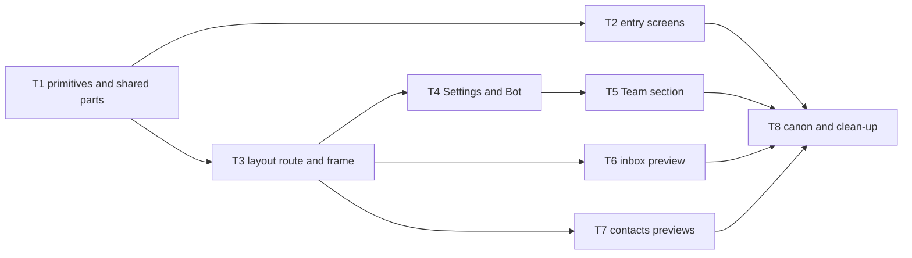

# Epic — ui-redesign

> **Spec:** [spec.md](../spec.md) · **Design:** [sad.md](../sad.md) · **Flows:** [ux-flows.md](../ux-flows.md) · **Screens:** [screens.md](../screens.md) · **ADRs:** [adr/](../adr/) · Data model / API: none (no schema or contract change)

## Goal

Every shipped screen of the web panel moves onto the design canon inside one sidebar frame, the business owner's Bot and Team pages become sections of one Settings screen, and the shared inbox, contact list and contact profile appear as labelled preview screens on sample data — with no change to any existing behaviour (spec §2).

## Scope

- **In:** `apps/web` only — shared primitives, entry screens, the workspace layout route and frame, Settings (Bot, Team), inbox and contacts previews; `docs/design-system.md` inventory; removal of the local reference markup.
- **Out:** real inbox/contacts data, broadcasts and posts screens, theme switch and translations, any server or contract change, operator settings, social sign-in (spec §3).

## Task map

## Tasks

See [tracker.md](./tracker.md) for status. Machine contract: [tasks.json](../tasks.json).

| # | Task | Layer | Blocked by | DoD (short) |
|---|---|---|---|---|
| T1 | [Add the canon's shadcn primitives and the shared preview/list parts](t1-add-shadcn-primitives-and-shared-parts.md) | ui | — | primitives + SampleDataBadge / DataTableToolbar / EmptyFilterState with tests |
| T2 | [Move the entry screens onto the centred auth layout](t2-move-entry-screens-onto-the-centred-auth-layout.md) | ui | T1 | six entry screens on AuthLayout, existing tests unchanged in assertions |
| T3 | [Render workspace screens inside one layout route with the sidebar frame](t3-render-workspace-screens-in-one-layout-route-with-the-sidebar-frame.md) | ui | T1 | frame + route tree + redirects; component and e2e suites green |
| T4 | [Build the Settings layout and move bot settings into its Bot section](t4-build-the-settings-layout-and-the-bot-section.md) | ui | T3 | Settings + Bot section, owners-only refusal to inbox |
| T5 | [Move the team page into the Settings Team section with search and filters](t5-move-the-team-page-into-settings-with-search-and-filters.md) | ui | T4 | filters over loaded rows, Show more kept, team actions unchanged |
| T6 | [Build the inbox preview on a swappable sample-data source](t6-build-the-inbox-preview-on-a-sample-data-source.md) | ui | T3 | list, thread, reply rules, phone flow, no API calls |
| T7 | [Build the contacts and contact-profile previews on a sample-data source](t7-build-the-contacts-and-contact-profile-previews.md) | ui | T3 | table filters, profile by address, no API calls |
| T8 | [Register the new components in the canon and remove the reference markup](t8-register-components-in-the-canon-and-remove-the-reference-markup.md) | docs | T2, T5, T6, T7 | inventory complete, refs gone, size delta ≤ +120 KB |

## Risks / Hard rules

- "100% of the existing web-panel tests pass, changed only where they locate elements on the page, never in what they assert happens" — spec §6.
- No server, schema or `packages/shared` contract change — sad §2.
- Preview screens read only their sample source, never the API client — ADR-0002.
- First load ≤ +120 KB gzipped over `main` — spec §6.
