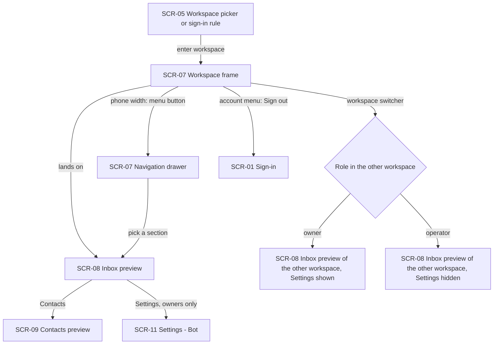
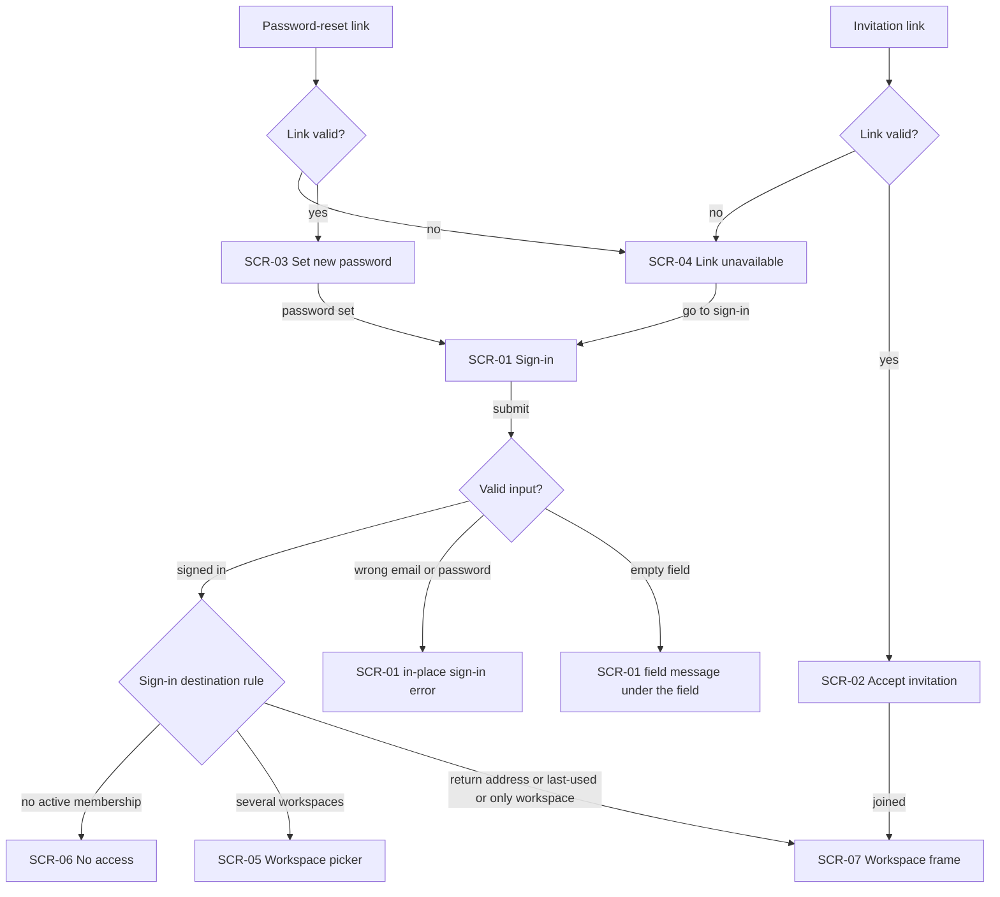
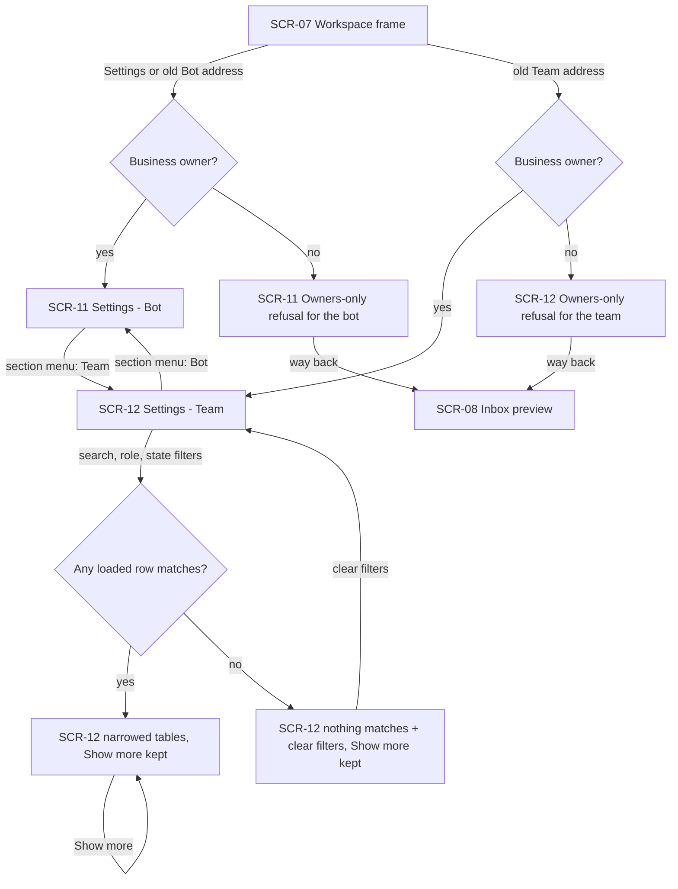
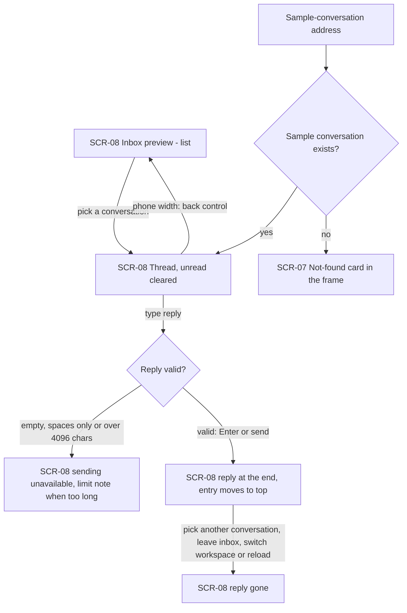
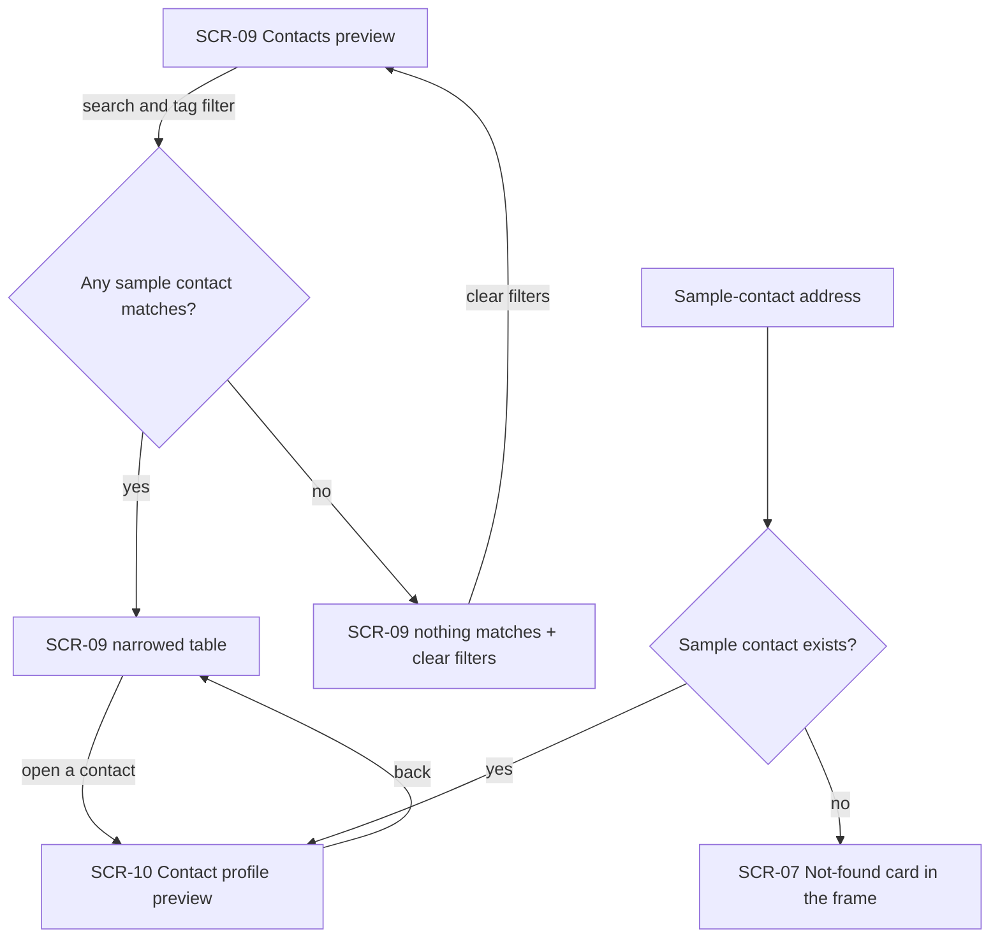
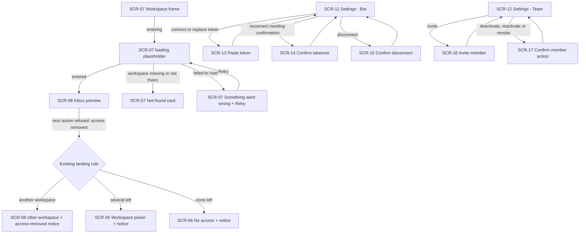

# UX flows — ui-redesign

> User flows for every UI-touching §4 user story, produced by `ux-flows` (after `clarify`, before
> `design`) and read by `design` (evidence for the target-surface + UI-architecture decisions),
> `sequences` (UI-driven flows align on SCR ids), `screens` (details every inventory row) and
> `plan-tests` (the e2e-through-UI paths). **Always markdown + mermaid `flowchart`**, whatever the
> design tool — this artifact is flow-altitude, not visual design.

## Platform decisions

- **Posture:** desktop-first — per `docs/design-system.md` §Platform posture; every flow must also work at phone width (≥360px).
- **Navigation shape:** every workspace screen lives in one frame with a side navigation (workspace switcher, Inbox, Contacts, owner-only Settings, account menu); at phone width the navigation opens as a drawer and closes after a pick.
- **Entry screens** (sign-in, accept invitation, set new password, link unavailable, workspace picker, no access) stand outside the frame.
- **Settings** is one screen with two sections (Bot, Team) picked from a section menu; it opens on Bot. Old Team / Bot addresses lead to the matching section.
- **Addressable selections:** a sample conversation and a sample contact each have their own address — reload, back and saved links reopen them; an unknown one shows the not-found card in the frame.
- **Modality:** the existing dialogs stay dialogs (paste token, confirm takeover, confirm disconnect, invite member, confirm deactivate / revoke); nothing new becomes a dialog.
- **Phone-width inbox:** list and thread are separate steps (list → thread → back), not side-by-side panes.
- **Assumptions ledger (easy depth, decided by the author's delegate):** each flow below was written and summarised without a per-flow question; the user delegated these calls for this pipeline run.

## Screen inventory

| ID | Screen | Purpose | Entry | Exit |
|---|---|---|---|---|
| SCR-01 | Sign-in | Sign in with email + password (centred layout) | panel opened signed-out; any signed-out access to a workspace | the sign-in destination rule → SCR-07 / SCR-05 / SCR-06 |
| SCR-02 | Accept invitation | Join a workspace through an invitation link | invitation link | SCR-07 of the joined workspace; SCR-04 when the link is not valid |
| SCR-03 | Set new password | Set a password through a reset link | password-reset link | SCR-01; SCR-04 when the link is not valid |
| SCR-04 | Link unavailable | Explain that an invitation / reset link is no longer valid | SCR-02 / SCR-03 with a dead link | SCR-01 |
| SCR-05 | Workspace picker | Choose one of several workspaces; shows the access-removed notice when sent here | sign-in rule; access removed | SCR-07 |
| SCR-06 | No access | Signed in but no active membership; shows the access-removed notice when sent here | sign-in rule; access removed | sign out → SCR-01 |
| SCR-07 | Workspace frame | Side navigation + breadcrumb around every workspace screen; drawer at phone width; not-found / error-with-retry / loading states | entering any workspace address | SCR-08 / SCR-09 / SCR-11 / SCR-12 via the navigation; SCR-05 / SCR-06 on access removed; SCR-01 on sign out |
| SCR-08 | Inbox preview | Sample conversation list + thread with reply box, "Sample data" label; list → thread at phone width | entering a workspace; Inbox in the navigation; a sample-conversation address; the owners-only refusal's way back | SCR-09 / SCR-11 via the navigation |
| SCR-09 | Contacts preview | Sample contact table with search + tag filter, "Sample data" label | Contacts in the navigation | SCR-10 |
| SCR-10 | Contact profile preview | Sample contact header + Overview / Conversation history, "Sample data" label | a row of SCR-09; a sample-contact address | SCR-09 (back / navigation) |
| SCR-11 | Settings — Bot | Bot state + every bot action; owners-only refusal for operators | Settings in the navigation; old Bot address; Settings address | SCR-12 via the section menu; SCR-13 / SCR-14 / SCR-15 dialogs |
| SCR-12 | Settings — Team | Members + pending invitations with search, role and state filters, Show more; owners-only refusal for operators | section menu; old Team address | SCR-11 via the section menu; SCR-16 / SCR-17 dialogs |
| SCR-13 | Paste token | Connect a bot or replace its token (existing dialog) | SCR-11 | SCR-11 |
| SCR-14 | Confirm takeover | Confirm taking the bot over from another service (existing dialog) | SCR-11 reconnect / paste | SCR-11 |
| SCR-15 | Confirm disconnect | Confirm disconnecting the bot (existing dialog) | SCR-11 | SCR-11 |
| SCR-16 | Invite member | Invite an email with a role, show the link once (existing dialog) | SCR-12 | SCR-12 |
| SCR-17 | Confirm member action | Confirm deactivating a member or revoking an invitation (existing confirmations) | SCR-12 row actions | SCR-12 |

## Flows

### Flow: US-01 — Work inside one navigation frame

Entering a workspace (from the picker or straight from the sign-in rule) opens the frame and lands on the inbox preview; from there the navigation reaches Contacts and — only for a business owner — Settings. At phone width the navigation hides behind a menu button, opens as a drawer and closes once a section is picked. The workspace switcher moves to the other workspace's inbox preview, showing or hiding Settings by the person's role there and leaving nothing of the previous workspace on screen. Sign out from the account menu returns to sign-in.

### Flow: US-02 — Enter the panel through clean entry screens

Sign-in validates on submit: an empty field gets its message right below it, a wrong email or password shows the existing in-place error without saying which one was wrong. A successful sign-in follows the existing destination rule — the return address, the last-used workspace or the only workspace opens in the frame; several workspaces lead to the picker; no active membership leads to no access. An invitation link opens accept-invitation (or link unavailable when dead) and joining lands in the frame; a reset link opens set-new-password (or link unavailable) and then sign-in. All of these screens share the centred layout and keep their existing rules and messages.

### Flow: US-03 — Manage the bot and the team in Settings

Settings — from the navigation, from its own address or from the old Bot address — opens on the Bot section for a business owner; the old Team address opens the Team section. An operator never sees Settings in the navigation; a saved link shows the existing owners-only refusal (the team refusal for the Team section, the bot refusal otherwise) with no details, and its way back leads to the inbox preview. In Team, search and the role filter narrow both the members and the pending-invitations tables, the state filter narrows members only; when nothing loaded matches, a sentence with a clear-filters button replaces that table, and Show more stays available while more rows exist, loading rows that are filtered the same way.

### Flow: US-04 — Preview the shared inbox

The list shows the sample conversations with the "Sample data" label; picking one opens its thread and clears its unread count for this visit (at phone width the thread replaces the list and a back control returns). An empty, spaces-only or over-long reply cannot be sent (an over-long one says the 4096-character limit); Enter sends a valid reply, which appears at the end of the thread while that conversation's entry shows it and moves to the top — with an always-visible note that previews send nothing to customers. The reply disappears once another conversation is picked, the inbox is left, the workspace is switched or the page reloads. A sample conversation has its own address: reload, back and saved links reopen it; an unknown one shows the not-found card in the frame.

### Flow: US-05 — Preview contacts and a contact's profile

The contacts preview narrows its sample table by search and tag; with no match it shows a sentence and a clear-filters button. Opening a contact shows its profile preview (header card, Overview and Conversation history) with the "Sample data" label; back returns to the list. A sample contact has its own address — reload, back and saved links reopen it, an unknown one shows the not-found card. Real contacts and conversations of any workspace never appear in these previews.

### Flow: US-06 — Keep every existing action working

Entering a workspace shows a loading placeholder and no workspace data until the workspace is entered; a missing or foreign workspace shows the not-found card, a failure shows "Something went wrong" with Retry. When an action is refused because the person's access was removed, they land where the existing rule sends them — another workspace in the frame, the picker or no access in the centred layout — with the same dismissible notice. Every existing bot action (connect, replace token, reconnect with takeover confirmation, disconnect) and team action (invite and copy the link, deactivate, reactivate, revoke) goes through the same dialogs and confirmations with the same messages and outcomes as before.

## AC coverage

| AC | Shown by | Notes |
|---|---|---|
| AC-01 | Flow US-01 → enter workspace → SCR-07 → SCR-08 | navigation content + breadcrumb are screen content (screens) |
| AC-02 | Flow US-01 → menu button → drawer → pick a section | no page-level sideways scroll is a layout rule (screens / NFR) |
| AC-03 | Flow US-01 → workspace switcher → role branch | |
| AC-04 | Flow US-02 → submit → sign-in destination rule | |
| AC-05 | Flow US-02 → empty field / wrong email or password branches | |
| AC-06 | Flow US-02 → invitation link and reset link branches | |
| AC-07 | Flow US-03 → owner → SCR-11 | |
| AC-08 | Flow US-03 → filters → narrowed tables, Show more | |
| AC-09 | Flow US-03 → filters → nothing matches + clear filters | |
| AC-10 | Flow US-03 → not an owner → owners-only refusals → way back to SCR-08 | |
| AC-11 | Flow US-03 → old Bot / old Team address branches | |
| AC-12 | Flow US-04 → pick a conversation; sample-conversation address branch | |
| AC-12b | Flow US-04 → phone width back control | |
| AC-13 | Flow US-04 → reply invalid branch | |
| AC-14 | Flow US-04 → valid reply → reply gone | |
| AC-15 | Flow US-05 → filters → open a contact; sample-contact address branch | |
| AC-16 | Flow US-05 → nothing matches + clear filters | |
| AC-17 | Flow US-05 prose + Flow US-04 → previews show sample data only | a data rule rather than a movement; asserted on SCR-08/09/10 |
| AC-18 | Flow US-06 → access removed → existing landing rule | |
| AC-19 | Flow US-06 → bot and team dialogs | |
| AC-20 | Flow US-06 → loading / not found / Retry | |
