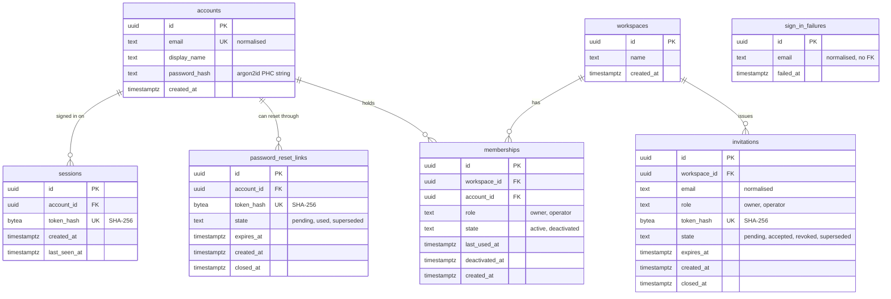

# Data model — workspace-operators

Seven new tables in two modules ([ADR-0005](adr/0005-split-identity-into-an-auth-module-and-a-workspaces-module.md)): `auth` owns the platform-level identity tables (`accounts`, `sessions`, `sign_in_failures`, `password_reset_links`), `workspaces` owns the tenant tables (`workspaces`, `memberships`, `invitations`). Greenfield: the only existing migration is the UTC baseline, so there are no existing tables to change and no drift to report.

**Conventions applied** (repo [ADR-0004](../../adr/0004-use-postgres-with-kysely-reversible-migrations-and-workspace-scoped-tenancy.md), `docs/architecture-map.md` §Conventions, and the choices confirmed with the owner on 2026-10-11):

- `snake_case`, plural table names; PK `id uuid`, UUIDv7 from `newId()` — never a DB default.
- **Timestamps are supplied by the application** through a clock port — no `DEFAULT now()`; every time comparison in SQL takes the app's `now` as a parameter. This keeps the "controllable clock" tests of SAD QG-2a/2b possible (SAD §8 updated accordingly).
- `created_at` on every table; no generic `updated_at` — domain timestamps only where a rule reads them (`last_seen_at`, `last_used_at`, `deactivated_at`, `closed_at`).
- Roles and states are `text` with a `CHECK (… IN (…))`; strings are `text` with length `CHECK`s; no Postgres `ENUM` types, no triggers.
- Hard delete only where a rule says "ends" (sessions, cleared sign-in failures); everything else changes state.
- Tenant tables carry a non-null `workspace_id`; `auth` tables are platform-level (SAD §5).
- The one cross-module FK, `memberships.account_id → accounts(id)`, is kept as a constraint only — `workspaces` still never queries `accounts` and goes through `auth`'s app layer.
- Emails are stored normalised (trimmed, lower-cased; spec §6.1) and a `CHECK` rejects a non-normalised value.
- Link and session tokens are never stored — only their SHA-256 hash as a 32-byte `bytea`.

## ER diagram

## Entities

### Aggregate `account` (module `auth`, platform-level)

#### `accounts`

| Column | Type | Constraints | Notes |
|---|---|---|---|
| `id` | uuid | PK | UUIDv7 from `newId()` |
| `email` | text | NOT NULL, UNIQUE, CHECK normalised (`email = lower(btrim(email))`), CHECK 3–254 chars | the sign-in identifier; one account per email (spec §6.1) |
| `display_name` | text | NOT NULL, CHECK 1–200 chars after trim | entered when accepting the first invitation (AC-03); upper bound <!-- TBD: spec sets none — api fixes the limit, the CHECK follows --> |
| `password_hash` | text | NOT NULL | argon2id PHC string (parameters inside, SAD §8); never returned or logged |
| `created_at` | timestamptz | NOT NULL | |

**Aggregate root:** root.
**Access patterns:** find by normalised email (sign-in flow 1, invitation lookup flow 2, invite flow 8, reset issue flow 11) → `accounts_email_key`; read by id (session resolution, team list flow 10) → PK.
**Constraints:** UNIQUE `email` also settles two simultaneous account creations (SAD §4 concurrency).

#### `sessions`

| Column | Type | Constraints | Notes |
|---|---|---|---|
| `id` | uuid | PK | |
| `account_id` | uuid | NOT NULL, FK → `accounts(id)` ON DELETE CASCADE | |
| `token_hash` | bytea | NOT NULL, UNIQUE, CHECK 32 bytes | SHA-256 of the cookie token ([feature ADR-0002](adr/0002-use-opaque-cookie-sessions-stored-in-postgres.md)) |
| `created_at` | timestamptz | NOT NULL | |
| `last_seen_at` | timestamptz | NOT NULL, CHECK ≥ `created_at` | refreshed by user-triggered requests at most once a minute; idle > 30 days → row deleted on next lookup |

**Aggregate root:** `accounts`.
**Access patterns:** resolve on every authenticated request + sign-out delete (flows 3, 6) → `sessions_token_hash_key`; delete every session of an account on password reset (flow 12) → `sessions_account_id_idx`.

#### `password_reset_links`

| Column | Type | Constraints | Notes |
|---|---|---|---|
| `id` | uuid | PK | |
| `account_id` | uuid | NOT NULL, FK → `accounts(id)` ON DELETE CASCADE | |
| `token_hash` | bytea | NOT NULL, UNIQUE, CHECK 32 bytes | SHA-256 of the link token |
| `state` | text | NOT NULL, CHECK IN (`pending`, `used`, `superseded`) | an expired link stays `pending`; expiry is read from `expires_at` |
| `expires_at` | timestamptz | NOT NULL, CHECK > `created_at` | `created_at` + 24 h (AC-22) |
| `created_at` | timestamptz | NOT NULL | |
| `closed_at` | timestamptz | NULL, CHECK `(state = 'pending') = (closed_at IS NULL)` | when it was used or superseded |

**Aggregate root:** `accounts`.
**Access patterns:** look up + conditional consume by token hash (flow 12: `UPDATE … SET state='used' WHERE token_hash=$1 AND state='pending' AND expires_at > $now`) → `password_reset_links_token_hash_key`; supersede the account's pending links on a new issue (flow 11) → `password_reset_links_account_id_idx`.

### Standalone `sign_in_failures` (module `auth`, platform-level)

| Column | Type | Constraints | Notes |
|---|---|---|---|
| `id` | uuid | PK | |
| `email` | text | NOT NULL, CHECK normalised | **no FK** — failures for unknown emails are recorded identically (AC-09, no account enumeration) |
| `failed_at` | timestamptz | NOT NULL | |

**Aggregate root:** root (an append-only log keyed by normalised email, not by account).
**Access patterns:** read the latest failures of an email within the last 30 minutes to decide the lockout — 10 failures within 15 min lock for 15 min from the 10th (flows 1, 2) — and delete all failures of an email on successful sign-in or password reset (flows 1, 12) → `sign_in_failures_email_failed_at_idx`.
**Retention:** rows are never purged in v1 (SAD §11 accepted debt).

### Aggregate `workspace` (module `workspaces`, tenant-owned)

#### `workspaces`

| Column | Type | Constraints | Notes |
|---|---|---|---|
| `id` | uuid | PK | the tenancy key every other tenant row carries as `workspace_id` |
| `name` | text | NOT NULL, CHECK 1–200 chars after trim | AC-02 (empty name refused); upper bound <!-- TBD: spec sets none — api fixes the limit, the CHECK follows --> |
| `created_at` | timestamptz | NOT NULL | |

**Aggregate root:** root. No status column: "awaiting its first business owner" = no memberships yet; no workspace suspension in v1 (SAD §5).
**Access patterns:** read + `SELECT … FOR UPDATE` by id to serialise team changes (flows 2, 5, 8, 9; AC-18) → PK.

#### `memberships`

| Column | Type | Constraints | Notes |
|---|---|---|---|
| `id` | uuid | PK | |
| `workspace_id` | uuid | NOT NULL, FK → `workspaces(id)` | tenancy key |
| `account_id` | uuid | NOT NULL, FK → `accounts(id)` | cross-module FK — constraint only (see conventions) |
| `role` | text | NOT NULL, CHECK IN (`owner`, `operator`) | `owner` = business owner; unchanged by deactivate / reactivate (AC-19) |
| `state` | text | NOT NULL, CHECK IN (`active`, `deactivated`) | |
| `last_used_at` | timestamptz | NULL | set by the "enter workspace" request (flow 7); the next sign-in opens the most recent active one (AC-07, AC-12) |
| `deactivated_at` | timestamptz | NULL, CHECK `(state = 'deactivated') = (deactivated_at IS NOT NULL)` | cleared on reactivation |
| `created_at` | timestamptz | NOT NULL | when the person joined |

**Aggregate root:** `workspaces`.
**Access patterns:** the guard's lookup by (workspace, account) on every workspace-scoped request (flow 3) and the already-a-member check (flow 8) → `memberships_workspace_id_account_id_key`; the team list and the active-owner count under the workspace lock (flows 9, 10; AC-18), and "does the workspace have any member yet" (flows 5, AC-01) → the same index by its leading `workspace_id`; active memberships of an account with their workspace names, ordered by `last_used_at` (flows 1, 7) → `memberships_account_id_idx`.
**Constraints:** UNIQUE (`workspace_id`, `account_id`) — one membership per person per workspace (AC-16). The "at least one active owner" rule (AC-18) is **not** a DB constraint: it is checked in the app layer under the workspace row lock (no triggers, SAD §4).

#### `invitations`

| Column | Type | Constraints | Notes |
|---|---|---|---|
| `id` | uuid | PK | |
| `workspace_id` | uuid | NOT NULL, FK → `workspaces(id)` | tenancy key |
| `email` | text | NOT NULL, CHECK normalised, CHECK 3–254 chars | the only email that may accept it (AC-04b) |
| `role` | text | NOT NULL, CHECK IN (`owner`, `operator`) | role the membership is created with |
| `token_hash` | bytea | NOT NULL, UNIQUE, CHECK 32 bytes | SHA-256 of the link token; the link is never stored |
| `state` | text | NOT NULL, CHECK IN (`pending`, `accepted`, `revoked`, `superseded`) | an expired invitation stays `pending`; expiry is read from `expires_at` |
| `expires_at` | timestamptz | NOT NULL, CHECK > `created_at` | `created_at` + 7 days (AC-06, AC-14) |
| `created_at` | timestamptz | NOT NULL | |
| `closed_at` | timestamptz | NULL, CHECK `(state = 'pending') = (closed_at IS NULL)` | when it was accepted, revoked or superseded — feeds the acceptance-rate KPI (spec §7) |

**Aggregate root:** `workspaces`.
**Access patterns:** look up + conditional consume by token hash (flow 2: `UPDATE … SET state='accepted' WHERE token_hash=$1 AND state='pending' AND expires_at > $now`) → `invitations_token_hash_key`; supersede the pending invitation for an email and list pending invitations of the workspace (flows 8, 10) → `invitations_workspace_id_email_pending_key`; read the workspace's latest invitation to re-issue it for the same email, any state (flow 5) → `invitations_workspace_id_idx`; revoke by (id, workspace) (flow 10) → PK.
**Constraints:** at most one `pending` invitation per (workspace, email) — partial UNIQUE index; issuing a new one supersedes the earlier one in the same transaction (AC-01b, AC-14).
**First-owner invitation:** not a column — an invitation is "the first business owner's" while its workspace has no memberships; AC-06's "ask the tg-inbox team" hint and flow 5's refusal both derive it from that.

## Indexes

| Index | Columns | Query it serves |
|---|---|---|
| `accounts_email_key` (UNIQUE) | `accounts(email)` | flow 1 sign-in, flow 2 "does an account exist for the invited email", flow 8 find account by email, flow 11 issue reset for an email; also enforces one account per email |
| `sessions_token_hash_key` (UNIQUE) | `sessions(token_hash)` | flow 3 resolve the session on every authenticated request; flow 6 delete by token hash |
| `sessions_account_id_idx` | `sessions(account_id)` | flow 12 delete every session of the account on password reset; FK index |
| `sign_in_failures_email_failed_at_idx` | `sign_in_failures(email, failed_at)` | flows 1, 2 lockout check (latest failures of an email in a time window); flows 1, 12 clear an email's failures |
| `password_reset_links_token_hash_key` (UNIQUE) | `password_reset_links(token_hash)` | flow 12 look up and conditionally consume a reset link |
| `password_reset_links_account_id_idx` | `password_reset_links(account_id)` | flow 11 supersede the account's pending reset links; FK index |
| `memberships_workspace_id_account_id_key` (UNIQUE) | `memberships(workspace_id, account_id)` | flow 3 guard lookup; flow 8 already-a-member check; flows 9, 10 team list + active-owner count by `workspace_id`; flow 5 "workspace has members"; FK index for `workspace_id` |
| `memberships_account_id_idx` | `memberships(account_id)` | flows 1, 7 active memberships of the signed-in account; FK index for `account_id` |
| `invitations_token_hash_key` (UNIQUE) | `invitations(token_hash)` | flow 2 look up and conditionally consume an invitation |
| `invitations_workspace_id_email_pending_key` (UNIQUE, partial `WHERE state = 'pending'`) | `invitations(workspace_id, email)` | flow 8 supersede the pending invitation for an email; flow 10 pending invitations of the workspace; enforces one pending invitation per email |
| `invitations_workspace_id_idx` | `invitations(workspace_id)` | flow 5 latest invitation of the workspace in any state (to re-issue for the same email); FK index (the partial index covers only pending rows) |

No other indexes: `workspaces` is read only by PK, and no query filters `sessions.last_seen_at` or `*.expires_at` on their own (expired rows are judged one at a time after a token-hash lookup; purging is deferred, SAD §11).

## Migrations (staged)

Staged under [`migrations/`](migrations/) — **not** in `apps/api/migrations/` yet; `implement` promotes them in ordinal order (FK dependencies follow the order).

| Ordinal | Files | Creates |
|---|---|---|
| 01 | `01_create_accounts.{up,down}.sql` | `accounts` |
| 02 | `02_create_sessions.{up,down}.sql` | `sessions` |
| 03 | `03_create_sign_in_failures.{up,down}.sql` | `sign_in_failures` |
| 04 | `04_create_password_reset_links.{up,down}.sql` | `password_reset_links` |
| 05 | `05_create_workspaces.{up,down}.sql` | `workspaces` |
| 06 | `06_create_memberships.{up,down}.sql` | `memberships` (needs 01, 05) |
| 07 | `07_create_invitations.{up,down}.sql` | `invitations` |

**Seeds:** none. There is no bootstrap row (the first workspace is created through the admin CLI, flow 4) and no lookup table (roles and states are `CHECK` values).

## Test fixtures

Not in migrations. The repo has no fixture helper yet; the first one lives at `apps/api/src/test/fixtures.ts` as plain builder functions that insert through Kysely with `newId()` and an explicit `now` (matching the app-supplied clock):

- `insertAccount(db, { email?, displayName?, password? })` — `email` defaults to `user-<uuid>@example.test`, `displayName` to `Test User`; hashes the password with the real hasher (low-cost test parameters).
- `insertWorkspace(db, { name? })` — `name` defaults to `Test Workspace <n>`.
- `insertMembership(db, { workspaceId, accountId, role?, state?, lastUsedAt? })` — defaults `operator` / `active`.
- `insertInvitation(db, { workspaceId, email?, role?, state?, createdAt?, expiresAt? })` — returns the raw token too, so a test can open the link.
- `insertSession(db, { accountId, lastSeenAt? })` / `insertResetLink(db, { accountId, state?, createdAt? })` — return the raw token for cookie / link tests.
- `insertSignInFailures(db, { email, count, at })` — backfills a lockout window.
- `twoWorkspaces(db)` — two workspaces with one owner each: the base of every cross-workspace isolation test (QG-1a).

PII guard: every fixture email is `@example.test`, every name is `Test User` / `Test Workspace <n>`.
