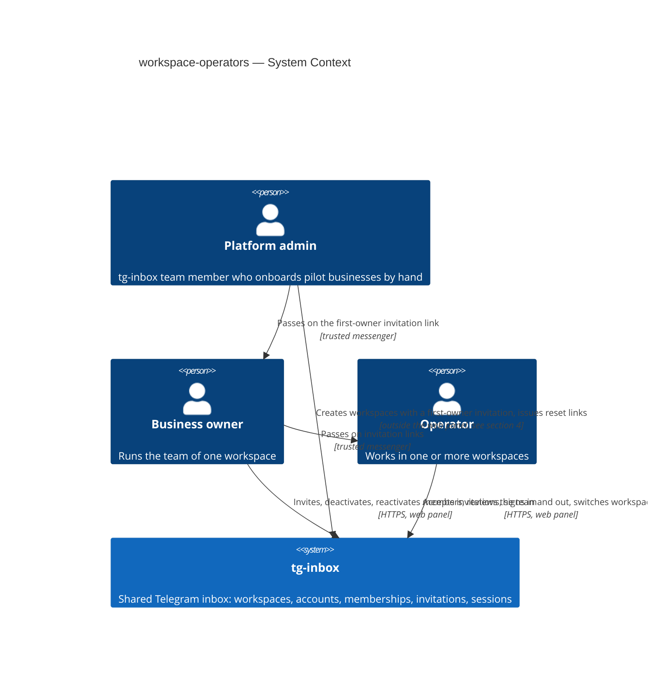
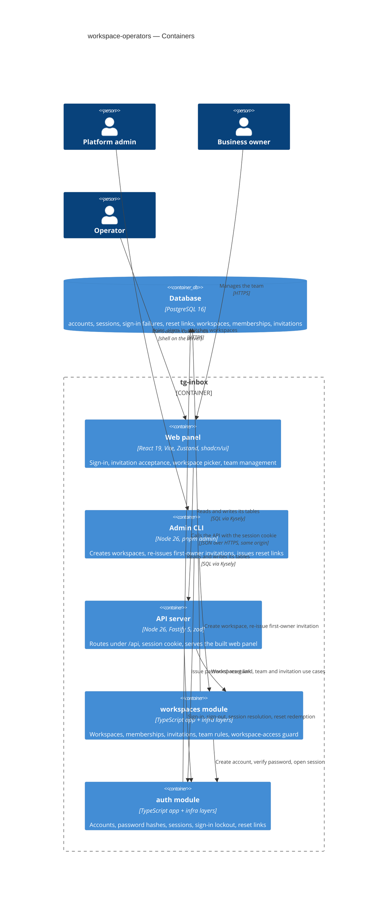
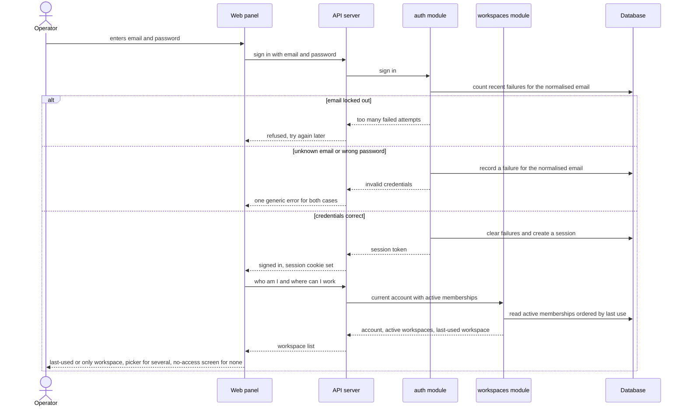
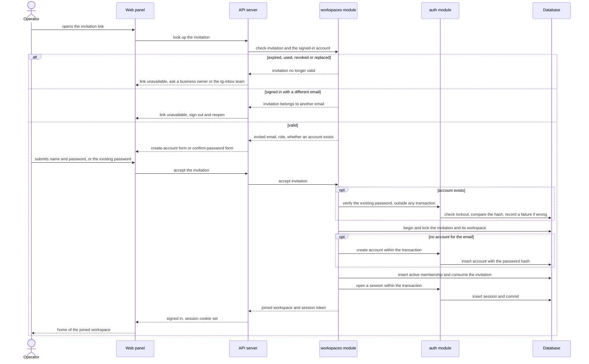
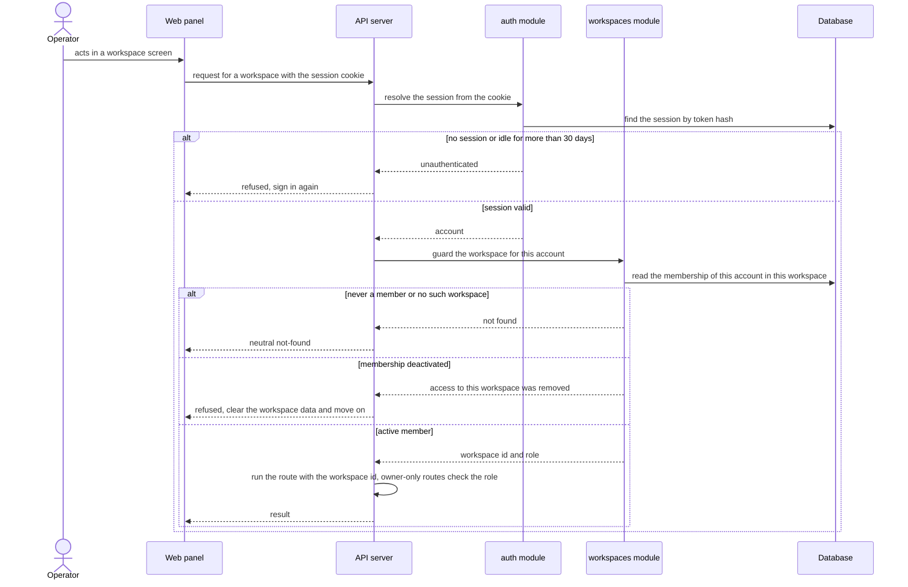

# Software Architecture Document — workspace-operators

## 1. Introduction and goals

**Intent.** workspace-operators gives tg-inbox its tenancy and identity foundation. A platform admin creates a workspace for a pilot business together with a single-use invitation for its first business owner; from then on business owners run their own team in the web panel — inviting people by copyable, expiring links, deactivating and reactivating members, reviewing who has or is about to get access. People sign in with email and password, keep one account across every workspace they belong to, and switch between workspaces while seeing only one business's data at a time. Every later roadmap capability (bot connection, inbox, contacts) attaches to a workspace and relies on the access guard this feature introduces.

**Top-3 quality goals (1-liners; full scenarios in §10):**

1. **Cross-workspace isolation** — zero data reads or writes across workspaces, and a deactivated member loses access to that workspace within 5 s.
2. **Credential and session security** — brute-force lockout, no account enumeration, sessions that end at once on sign-out or password reset.
3. **Responsiveness of everyday actions** — sign-in, team, switch and invite actions stay within the spec §6 latency targets.

**Stakeholders.**

| Role | Interest | Sign-off owner? |
|---|---|---|
| Platform admin | Creates workspaces with the first business owner invitation, re-issues it, issues password-reset links | No |
| Business owner | Runs the workspace's team: invites, deactivates, reactivates, reviews members and invitations | No |
| Operator | Joins by invitation, signs in and out, switches between workspaces | No |
| Tech Lead | SAD approval | Yes |
| Security Lead | Security review of the new authentication and tenancy boundary (spec §6.1: review required) | Yes |

## 2. Constraints

**Technical.**
- TypeScript ~6.0 (strict) on Node.js 26 (`.nvmrc`), pnpm workspaces monorepo — repo [ADR-0001](../../adr/0001-use-a-typescript-pnpm-monorepo-on-node-26.md)
- Backend: Fastify 5.12 with `fastify-type-provider-zod` 7 and zod 4.6; `@fastify/websocket` 11 already registered (not used by this feature)
- Frontend: React 19.3 + Vite 8 SPA, Tailwind CSS 4.3 + shadcn/ui, Zustand 5, React Router 8
- Datastore: PostgreSQL 16 via Kysely 0.29 (`pg` 8.23), reversible migrations through kysely-ctl 0.21, table types generated by kysely-codegen — repo [ADR-0004](../../adr/0004-use-postgres-with-kysely-reversible-migrations-and-workspace-scoped-tenancy.md); pg-boss 12 is available in the same database but this feature needs no background jobs
- Architecture: modular monolith, one module per capability with `domain → app → infra → http` layers, one process serving every workspace — repo [ADR-0002](../../adr/0002-organize-the-backend-as-a-modular-monolith-with-layered-modules.md)

**Organisational.**
- Effort budget: size M — a separate epic of 5–15 PRs over 1–2 sprints (`.size`)
- Deadline: TBD by PM — the spec sets no date; this step gates roadmap step 3 (bot connection) and the onboarding of the first pilot (see §11)
- Team composition: not stated in the spec; the pipeline assumes one backend + frontend implementer working through `tasks.json`

**Conventions.**
- [`CLAUDE.md`](../../../CLAUDE.md) and [`docs/architecture-map.md`](../../architecture-map.md) §Conventions are binding: module wiring through `register<Module>(app, deps)` in the composition root `buildApp()`, inward-only imports, cross-module calls only through the other module's app layer
- IDs are UUIDv7 from `newId()` (`apps/api/src/platform/ids.ts`), never DB defaults
- Errors are `AppError` subclasses from `apps/api/src/platform/errors.ts`, returned as `{ "error": { "code", "message", "details"? } }`; codes live in `packages/shared/src/errors.ts`
- Request/response bodies are zod schemas in `packages/shared`, also used by the web client (`apps/web/src/shared/api/client.ts`)
- Env vars are parsed only in `apps/api/src/platform/config.ts` and documented in `.env.example`
- Every tenant-owned table carries a non-null `workspace_id`; every repository method takes `workspaceId` and filters by it; every repository has an integration test proving cross-workspace isolation
- UI composes shadcn/ui primitives from `apps/web/src/shared/ui`, Tailwind only
- **Override — deliberate extensions of these conventions** (recorded in §11, `CLAUDE.md` and the architecture map are updated with this feature): a shared dependency builder used by `buildApp()` and the admin CLI ([ADR-0001](adr/0001-build-an-api-a-spa-and-a-server-side-admin-cli.md)); `UnauthenticatedError` (401) and `TooManyRequestsError` (429) next to the four existing error classes (§8); the `/api` route prefix and same-origin serving ([ADR-0004](adr/0004-serve-the-spa-and-the-api-from-one-origin-under-api.md)); three listed exceptions to the `workspaceId` repository rule (§5)

**Regulatory / external.**
- Data classification: confidential (spec §6.1) — account credentials and the membership graph control access to every business's customer data
- Personal data: account email (identifier), display name, password (stored only as a one-way hash, never logged or shown back)
- No compliance regime is named by the spec; v1 offers no account deletion or data export (accepted debt, §11)
- Security review is required before release (spec §6.1)

## 3. Context and scope

tg-inbox is a shared Telegram inbox for small businesses; this feature introduces the business itself (the workspace), the people who work in it (accounts holding memberships with a role) and the way they get in (invitations, sign-in, password-reset links). Platform admins on the tg-inbox team onboard each pilot business by hand; business owners and operators use the web panel. Links are not mailed — whoever issues one copies it and passes it on through a channel they trust.

<!-- brownfield: freshly scaffolded skeleton (commit afd2bbb) — `platform/` + `modules/health` only, a baseline migration that pins UTC and no tables yet, a web app shell; docs/architecture-map.md (greenfield-bootstrap) still describes it accurately -->

**External systems (in / out):**

| Actor or system | Type | Interaction |
|---|---|---|
| Platform admin | Person | Creates a workspace with its first business owner invitation, re-issues that invitation, issues password-reset links — outside the web panel (channel decided in §4) |
| Business owner | Person | Invites, deactivates and reactivates members, reviews the team and revokes invitations in the web panel |
| Operator | Person | Joins by invitation, signs in and out, switches between workspaces in the web panel |
| Trusted messenger | Out-of-band channel (not integrated) | Carries invitation and reset links from whoever issued them to the person they are for |
| External systems | — | None, deliberately: no mail delivery in v1 (spec §3), and the Telegram Bot API is not touched by this feature (roadmap step 3) |

**C4 Context (L1):**



## 4. Solution strategy

**Target surfaces:** `backend-service` (the API owning the HTTP contract), `web-frontend` (the operator web panel) and `cli` (the platform-admin commands) — [ADR-0001](adr/0001-build-an-api-a-spa-and-a-server-side-admin-cli.md). This also closes the spec §8 open question on the platform-admin channel: a command run on the server, with server access as the authority and an audit log line per action.

**Top strategic choices (the seeds for ADRs):**

1. **Platform admins act through a server-side CLI, never over HTTP** — creating workspaces and issuing reset links reach every workspace, so they stay off the internet entirely; the CLI calls the same app-layer use cases as the API and prints each link exactly once. Serves quality goal 2 (security) and spec §6.1's "outside the web panel" — [ADR-0001](adr/0001-build-an-api-a-spa-and-a-server-side-admin-cli.md).
2. **Opaque cookie sessions stored in Postgres** — a random token in an `HttpOnly` cookie points at a session row holding only the token's hash; sign-out and password reset delete rows, the 30-day idle rule reads `last_seen_at`, and only user-triggered requests refresh it. Revocation is immediate (quality goal 2) without any new datastore (§2) — [ADR-0002](adr/0002-use-opaque-cookie-sessions-stored-in-postgres.md).
3. **The workspace is part of every address, and membership is checked on every request** — SPA paths `/w/<workspaceId>/…`, API paths `/api/workspaces/:workspaceId/…`, and one shared guard that turns "never a member" into not-found, "deactivated" into an access-removed refusal and "active" into `{ workspaceId, role }` for the repositories. This is the tenancy boundary every later module plugs into (quality goal 1); with no cache, a deactivation is effective on the next request — [ADR-0003](adr/0003-carry-the-active-workspace-in-the-url-and-check-membership-on-every-request.md).
4. **One origin for the SPA and the API, API under `/api`** — the API serves the built SPA in production and Vite proxies `/api` in development, so the session cookie is first-party everywhere and `SameSite=Lax` blocks cross-site request forgery without extra tokens. Settles the route-prefix, static-serving and dev-CORS questions the architecture map left to this feature — [ADR-0004](adr/0004-serve-the-spa-and-the-api-from-one-origin-under-api.md).

**Supporting choices (inline, below the ADR gate):**

- **UI architecture (web-frontend):** a client-side SPA — already fixed for the repo by repo [ADR-0001](../../adr/0001-use-a-typescript-pnpm-monorepo-on-node-26.md) (React + Vite, Zustand, React Router, shadcn/ui); no new ADR. Public routes (sign-in, accept invitation, set new password) live outside `/w/<workspaceId>/…`; workspace screens live inside it. The UI reuses the shadcn/ui foundation in `apps/web/src/shared/ui`.
- **Persistence:** the single PostgreSQL 16 store; no cache tier — every check reads the database, which the latency targets of spec §6 allow.
- **Module integration:** synchronous in-process calls to another module's app layer; this feature needs no pg-boss jobs or events.
- **Concurrency:** commands that change a workspace's team (deactivate, reactivate, accept the first owner invitation) lock that workspace's row for the length of the transaction, which serialises the "at least one active business owner" check of AC-18; single-use links are consumed with a conditional update that only succeeds while the link is still pending and unexpired; a unique index on the normalised email settles two simultaneous account creations.

Each tactical decision in later sections traces to one of these choices; a contradiction is surfaced in §11.

## 5. Building block view

The backend follows the repo's modular-monolith convention unchanged: each module has `domain` (pure rules — password policy, invitation validity, the "at least one active business owner" rule) → `app` (use cases and the ports they need) → `infra` (Kysely repositories) → `http` (routes and zod schemas from `packages/shared`). The feature adds two modules with a one-way dependency — `workspaces` calls `auth`'s app layer, never the reverse ([ADR-0005](adr/0005-split-identity-into-an-auth-module-and-a-workspaces-module.md)) — plus a server-side admin CLI that drives the same app layer ([ADR-0001](adr/0001-build-an-api-a-spa-and-a-server-side-admin-cli.md)). A shared dependency builder in the composition root constructs both modules once and is used by `buildApp()` and by the CLI alike.

**Table ownership** (names indicative; `data-model` fixes them):

| Module | Tables | Tenancy |
|---|---|---|
| `auth` | accounts, sessions, sign-in failures, password-reset links | Platform-level — no `workspace_id`; repositories are scoped by account or by normalised email |
| `workspaces` | workspaces, memberships, invitations | Tenant-owned — non-null `workspace_id` on memberships and invitations; every repository method takes `workspaceId`; each repository gets a cross-workspace isolation test |

**Controlled exceptions to the tenancy rule.** Three `workspaces` repository reads cannot take a `workspaceId` because they are what *produce* it; they are the only ones allowed, each scoped by something the caller already proves, each with its own isolation test:

- *memberships of an account* — scoped by the signed-in account id; returns only that account's memberships and the names of their workspaces (sign-in resolution AC-07, the picker and switcher);
- *invitation by token hash* — scoped by possession of the secret link; returns one invitation and its workspace's name (AC-03–AC-06);
- *membership for the guard* — scoped by (account id, workspace id from the URL); this is the lookup that grants a `workspaceId` to everything else (ADR-0003).

Every other method in `workspaces` takes `workspaceId`; a new exception needs a change to this SAD. `auth` tables are platform-level and scoped by account or normalised email (above).

A workspace has no status column in v1: "awaiting its first business owner" means it has no memberships yet, and a whole workspace cannot be suspended — members are deactivated instead (spec §8 default, closed here). The last-used workspace for the next sign-in is a `last_used_at` time on the membership.

**Internal decomposition:**

```
apps/api/src/
├── modules/auth/
│   ├── domain/       password policy, normalised email, lockout window rule
│   ├── app/          sign in / sign out, resolve session, create account, verify password,
│   │                 issue + redeem password-reset link (accept an optional transaction)
│   ├── infra/        account, session, sign-in-failure, reset-link repositories; password hasher
│   └── http/         routes.ts → registerAuth(app, deps): sign-in, sign-out, reset-link redemption
├── modules/workspaces/
│   ├── domain/       membership roles + states, invitation validity, last-active-owner rule
│   ├── app/          create workspace with first-owner invitation, re-issue it, invite, revoke,
│   │                 accept invitation, deactivate / reactivate, list team, current account + workspaces
│   ├── infra/        workspace, membership, invitation repositories
│   └── http/         routes.ts → registerWorkspaces(app, deps); the workspace-access guard (ADR-0003)
├── cli/admin.ts      pnpm admin <command> — platform-admin commands over the same app layer
└── app.ts            buildApp() + the shared dependency builder used by the CLI
apps/web/src/
├── features/auth/        sign-in, accept invitation, set new password; session store
├── features/workspaces/  workspace picker + switcher, team, invite member, no-access, not-found
└── pages/ + app/routes.tsx  public routes and /w/<workspaceId>/… routes
packages/shared/src/  auth.ts, workspaces.ts — request/response zod schemas + new error codes
```

**C4 Container (L2):**



## 6. Runtime view

Seeded critical flows; the `sequences` stage extends this section until every spec §5 acceptance criterion maps to a flow or a branch. Participants are the §5 containers.

**Critical flow 1: Sign in and resolve the workspace (US-03 — AC-07, AC-08, AC-09, AC-10)**



**Critical flow 2: Accept an invitation (US-02 — AC-03, AC-04, AC-04b, AC-05, AC-06)**



For an existing account the password is verified by `auth` before the acceptance transaction opens, exactly as at sign-in — a wrong password is recorded as a failure and committed on its own, so it counts toward the AC-09 lockout, and a locked-out email is refused with the generic credentials error; nothing else changes. A password shorter than 10 characters is rejected before anything is written (AC-05). If the invitation is revoked or consumed between the password check and the transaction, the conditional consume fails and the person gets the «no longer valid» answer (AC-06).

**Critical flow 3: A workspace-scoped request passes the access guard (AC-13, AC-15, AC-17)**



## 7. Deployment view

No production target is chosen yet (architecture map: deferred until the first pilot goes live); this feature changes the deployable unit, not the hosting. One Node 26 process runs the Fastify API, serves the built web panel from the same origin ([ADR-0004](adr/0004-serve-the-spa-and-the-api-from-one-origin-under-api.md)) and talks to one PostgreSQL 16 database; the admin CLI is run on demand on the same host (or from a trusted machine with a tunnel to the database) with the same configuration ([ADR-0001](adr/0001-build-an-api-a-spa-and-a-server-side-admin-cli.md)). One replica is enough for 5–10 pilots; nothing in this feature keeps state in process memory, so a second replica behind the same origin needs no code change.

**Configuration added** (parsed in `apps/api/src/platform/config.ts`, documented in `.env.example`):
- `PUBLIC_WEB_URL` — the panel's public base URL, used to build invitation and password-reset links in the API and the CLI
- `WEB_DIST_DIR` — optional path to the built web panel; when unset (local development) the API serves no static files and Vite's dev server proxies `/api`
- The session cookie's `Secure` flag follows `NODE_ENV` (off only in development); `VITE_API_URL` defaults to empty so the web client calls relative `/api` paths

**Monitoring:**
- Metrics: per-route request duration from the Fastify request logs — weekly p95 for sign-in and for team / switch / invite routes (spec §6 measurement); count of sign-in refusals by reason (invalid credentials, locked out)
- Alerts: the uptime check on `GET /health` (spec §6 availability); a sudden rise in lockouts across many emails (credential stuffing)
- Audit: one structured log line per admin CLI action (`event: "admin.<action>"`, operating-system user, target ids — never the link or its token)
- Tracing: none in v1 beyond Fastify's per-request id in every log line

**Scaling thresholds:**
- Password hashing is the CPU-heavy step: when sign-in p95 approaches the 500 ms target under real load, move hashing off the event loop to worker threads before adding replicas
- Session, failure and link tables stay small at pilot scale (tens of accounts); purge expired rows with a scheduled job once any of them passes ~100k rows (§11)

## 8. Crosscutting concepts

| Concept | Convention | Where defined |
|---|---|---|
| Logging | pino through `platform/logger.ts`; request logs redact the `cookie` and `set-cookie` headers; passwords, session tokens and link tokens are never logged; admin CLI actions write one audit line each | `CLAUDE.md` + here |
| Authentication | Opaque session token in an `HttpOnly`, `SameSite=Lax` cookie, hashed session rows in Postgres, 30-day idle expiry refreshed only by user-triggered requests (the web client marks automatic requests with a header); `auth` exposes the session resolver that every authenticated route uses; public routes (sign-in, invitation lookup and acceptance, reset-link redemption) are explicit | [ADR-0002](adr/0002-use-opaque-cookie-sessions-stored-in-postgres.md) |
| Authorization | Workspace-scoped routes live under `/api/workspaces/:workspaceId/…` behind the `workspaces` guard: never a member → not found, deactivated → access-removed refusal, active → `{ workspaceId, role }`; owner-only routes add a role check (`ForbiddenError`); platform-admin actions exist only in the CLI | [ADR-0003](adr/0003-carry-the-active-workspace-in-the-url-and-check-membership-on-every-request.md), [ADR-0001](adr/0001-build-an-api-a-spa-and-a-server-side-admin-cli.md) |
| Password storage | argon2id in the self-describing PHC string format (parameters stored with the hash, so they can be raised later by re-hashing at the next sign-in); built-in `node:crypto` argon2, or `@node-rs/argon2` if the built-in is still experimental on Node 26; a sign-in for an unknown email still runs one hash verification so response time does not reveal whether an account exists; passwords are 10–1024 characters | here |
| Email identity | Emails are trimmed and lower-cased before every comparison and stored in that normalised form with a unique index on accounts | spec §6.1 + here |
| Brute-force lockout | A failure log per normalised email in Postgres; 10 failures within 15 minutes lock the email for 15 minutes from the 10th failure; it counts sign-in attempts and existing-password confirmations during invitation acceptance alike, behaves identically for emails without an account, and is cleared by a successful sign-in or a password reset | spec AC-09 + here |
| Invitation and reset links | Each link carries 32 random bytes; only their SHA-256 hash is stored; the link is shown exactly once (in the API response to the business owner right after creation, or on the admin CLI's stdout); single use through a conditional update that succeeds only while the link is pending and unexpired; invitations last 7 days, reset links 24 hours; issuing a new one for the same email in the workspace (or for the same account) supersedes the earlier one; expiry is compared against the database clock | here |
| Concurrency | Team-changing commands lock the workspace row for the transaction (last active business owner, AC-18); account creation relies on the unique normalised email; invitation acceptance runs in one transaction across `workspaces` and `auth` | §4, [ADR-0005](adr/0005-split-identity-into-an-auth-module-and-a-workspaces-module.md) |
| Error handling | The existing envelope `{ "error": { "code", "message", "details"? } }`; the platform gains `UnauthenticatedError` (401) and `TooManyRequestsError` (429), and `AppError` subclasses may carry a more specific code (e.g. invalid credentials, link no longer valid, already a member, last active owner, access removed); the exact list is fixed at the `api` stage in `packages/shared/src/errors.ts` | `CLAUDE.md` + here |
| ID strategy | UUIDv7 from `newId()` for every row; link and session tokens are random secrets, never identifiers | `CLAUDE.md` |
| CSRF | Same origin plus `SameSite=Lax` cookies, and mutating routes accept only `application/json` bodies | [ADR-0004](adr/0004-serve-the-spa-and-the-api-from-one-origin-under-api.md) |
| Configuration | `PUBLIC_WEB_URL` and `WEB_DIST_DIR` added to `platform/config.ts` and `.env.example` | §7 |
| Internationalisation | N/A in v1 — one UI language | — |
| Observability | Fastify per-request id and duration in every log line; p95 by route from the logs | §7 |
| Events / jobs | None — this feature emits no events and schedules no pg-boss jobs | — |
| Rate limiting | Only the per-email lockout; no per-IP limit in v1 (§11) | here |

## 9. Architecture decisions

| # | Title | Status | Section |
|---|---|---|---|
| [0001](adr/0001-build-an-api-a-spa-and-a-server-side-admin-cli.md) | Build an API, a SPA and a server-side admin CLI | Accepted | §4 |
| [0002](adr/0002-use-opaque-cookie-sessions-stored-in-postgres.md) | Use opaque cookie sessions stored in Postgres | Accepted | §4 |
| [0003](adr/0003-carry-the-active-workspace-in-the-url-and-check-membership-on-every-request.md) | Carry the active workspace in the URL and check membership on every request | Accepted | §4 |
| [0004](adr/0004-serve-the-spa-and-the-api-from-one-origin-under-api.md) | Serve the SPA and the API from one origin under /api | Accepted | §4 |
| [0005](adr/0005-split-identity-into-an-auth-module-and-a-workspaces-module.md) | Split identity into an auth module and a workspaces module | Accepted | §5 |

ADR files live under `docs/features/workspace-operators/adr/NNNN-<title>.md`. Repo-wide foundations (stack, modular monolith, Postgres + Kysely + tenancy) are repo ADRs [0001](../../adr/0001-use-a-typescript-pnpm-monorepo-on-node-26.md), [0002](../../adr/0002-organize-the-backend-as-a-modular-monolith-with-layered-modules.md) and [0004](../../adr/0004-use-postgres-with-kysely-reversible-migrations-and-workspace-scoped-tenancy.md).

## 10. Quality requirements

Each §1 quality goal expanded into testable scenarios; targets are quoted from spec §6.

**QG-1a. Cross-workspace isolation**
- **When:** an account that is not an active member of a workspace reads or writes anything through a workspace-scoped route or repository of that workspace — by link, by guessed identifier, or by a crafted request.
- **Then:** "0 data reads or writes across workspaces"; a person who was never a member gets a neutral not-found that reveals neither the workspace nor the item (AC-13).
- **How verify:** "an isolation test for every data-access path, run in CI" — every `workspaces` repository method gets a Testcontainers test with two workspaces proving it never returns or changes the other workspace's rows, and every route under `/api/workspaces/:workspaceId/…` gets an `app.inject()` test calling it with a session that belongs to the other workspace.

**QG-1b. Deactivation takes effect**
- **When:** a business owner deactivates a member who has the workspace open on one or more devices.
- **Then:** "≤ 5 s from deactivation until every action or data load of the member in that workspace is refused, on every open session (no proactive push to idle screens in v1)"; the member's other memberships stay intact (AC-17).
- **How verify:** "integration test + manual check per release" — an integration test opens two sessions for the member, deactivates the membership and asserts the next request from each session is refused with the access-removed code while a request to the member's other workspace still succeeds; the release checklist repeats it by hand in two browsers.

**QG-2a. Brute-force protection**
- **When:** someone submits wrong passwords for one email, whether or not that email has an account.
- **Then:** "≤ 10 failed sign-in attempts per email per 15 min, then a 15-min lockout"; the locked-out response is identical for emails with and without an account, and a correct password is refused while locked (AC-09).
- **How verify:** "integration test" — with a controllable clock, 10 failures lock the email, an 11th attempt with the correct password is refused, the lock lifts 15 minutes after the 10th failure, and the same sequence on an unknown email produces byte-identical responses; a further test shows that a password reset clears the count.

**QG-2b. Session lifetime and revocation**
- **When:** a session goes unused, its owner signs out, or a platform admin's reset link is redeemed for the account.
- **Then:** the session "ends after 30 days without activity (activity = an authenticated request triggered by a user action; automatic background checks do not extend the session); ends at once on sign-out (that device) or password reset (all devices)".
- **How verify:** "integration test" — with a controllable clock, a session refreshed only by requests marked as background expires after 30 days while one with a user action on day 29 survives; sign-out ends only that session; redeeming a reset link ends every other session of the account and signs in the redeeming device.

**QG-3. Responsiveness**
- **When:** operators and business owners use the panel in normal pilot load.
- **Then:** "Latency p95 sign-in ≤ 500 ms (deliberately slow password check included)"; "Latency p95 team / switch / invite actions ≤ 300 ms".
- **How verify:** "server request-duration logs, weekly p95" per route; before each release a benchmark of one argon2id verification with the production parameters on the target host must leave headroom within the 500 ms sign-in budget.

**QG-4. Availability**
- **When:** the service runs through a calendar month.
- **Then:** "99.5% monthly".
- **How verify:** "uptime check on the health endpoint, monthly window" — `GET /health`, which pings the database.

## 11. Risks and technical debt

| Risk / debt | Severity | Mitigation | Owner |
|---|---|---|---|
| Tenancy is enforced by convention: a later module that skips the workspace guard or a `workspace_id` filter leaks another business's data | High | Every workspace-scoped route sits under `/api/workspaces/:workspaceId/…` behind the guard of ADR-0003; isolation tests per repository and per route in CI (QG-1a); the only reads without `workspaceId` are the three listed in §5, each with its own isolation test; review checks all of this for every new module | Tech Lead |
| Nobody proves they own the invited email — whoever holds an invitation link becomes that email's account (accepted risk, spec §6.1) | Medium | Links passed over a trusted channel, shown once, single use, 7-day expiry, revocable; the business owner sees who joined; revisit together with automatic emails | Dmytro Hopko |
| Targeted lockout: anyone who knows an email — or holds an invitation link for it — can keep that email locked out by repeating wrong passwords | Medium | The lock lasts only 15 minutes; a platform admin's reset link clears it; alert on lockout spikes (§7); add a per-IP limit if abuse is seen | Tech Lead |
| No per-IP rate limit — credential stuffing spread across many emails is only slowed per email | Low | Lockout-spike alert; add a per-IP limit in the API or at a reverse proxy once a deployment target exists | Tech Lead |
| The inbox's live channel (roadmap step 4) could keep pushing a deactivated member's workspace data past the 5 s budget | Medium | Constraint for step 4's spec and design: every pushed message passes the same membership check, or open connections re-check at least every 5 s | Tech Lead |
| The admin CLI needs a shell on the server or a tunnel to the database, but no deployment target is chosen | Medium | Choose a target that allows one of the two before onboarding pilot #1; until then the CLI runs against the database from a trusted machine | Dmytro Hopko |
| The built-in `node:crypto` argon2 may still be experimental on Node 26 | Low | Use `@node-rs/argon2` with the same PHC string format; switching later needs no data migration | Tech Lead |
| `CLAUDE.md` and `docs/architecture-map.md` still say only `buildApp()` builds dependencies and leave the route prefix, static serving and dev CORS open | Low | Update both as part of this feature's tasks (shared dependency builder, `/api` prefix, same origin, `auth` + `workspaces` modules, new error classes, the three tenancy-rule exceptions of §5) | Tech Lead |
| No delivery date — TBD by PM | Low | Set a target before roadmap step 3 is scheduled | Dmytro Hopko |

**Accepted debt (acceptable in v1, plan to fix later):**
- Expired sessions, sign-in failures and used or expired links are not purged — rows are ignored once expired; add a scheduled pg-boss purge job when any table passes ~100k rows (§7).
- No account deletion or data export (spec §3 non-goals cover self-service profile changes).
- Admin audit lines live only in the process logs; their retention depends on the deployment target chosen later.
- A whole workspace cannot be suspended; ending a pilot means deactivating its members (spec §8 default).

## 12. Glossary

Terms marked † are not yet in [CONTEXT.md](../../../CONTEXT.md) — candidates for `/sdd:glossary`.

| Term | Meaning |
|---|---|
| Account | A person's single sign-in identity on the platform (email + password), shared across every workspace they belong to. NOT Operator. |
| Business owner | A workspace member with the owner role: manages the workspace's team and can do everything an operator can. NOT Platform admin. |
| Invitation | A single-use, expiring link for one email and one role through which that person joins a workspace. NOT Membership. |
| Membership | The link between an account and a workspace, carrying a role (owner / operator) and a state (active / deactivated). NOT Account. |
| Operator | A workspace member who answers end customers from the shared web inbox. NOT Business owner. |
| Platform admin | A tg-inbox team member who creates workspaces with their first business owner invitation and issues password-reset links — through the admin CLI. NOT Business owner. |
| Workspace | One business on the platform and the boundary of all its data. NOT Account. |
| Session † | One signed-in device of an account: a server-side record pointed at by the session cookie; ends on sign-out, on a password reset, or after 30 days without user activity. |
| Workspace-access guard † | The shared check every workspace-scoped request passes: never a member → not found, deactivated → access removed, active → the request runs with the workspace id and role. |
| Password-reset link † | A single-use link issued by a platform admin for one account, valid 24 hours, through which the person sets a new password. |
| Lockout † | The 15-minute refusal of every sign-in for an email after 10 failed attempts within 15 minutes. |
| Normalised email † | An email trimmed of surrounding spaces and lower-cased — the form used in every comparison. |
| Last-used workspace † | The workspace an account most recently opened, recorded on its membership and opened at the next sign-in when still active. |
| Admin CLI † | The server-side commands through which platform admins act; there is no admin HTTP surface. |
