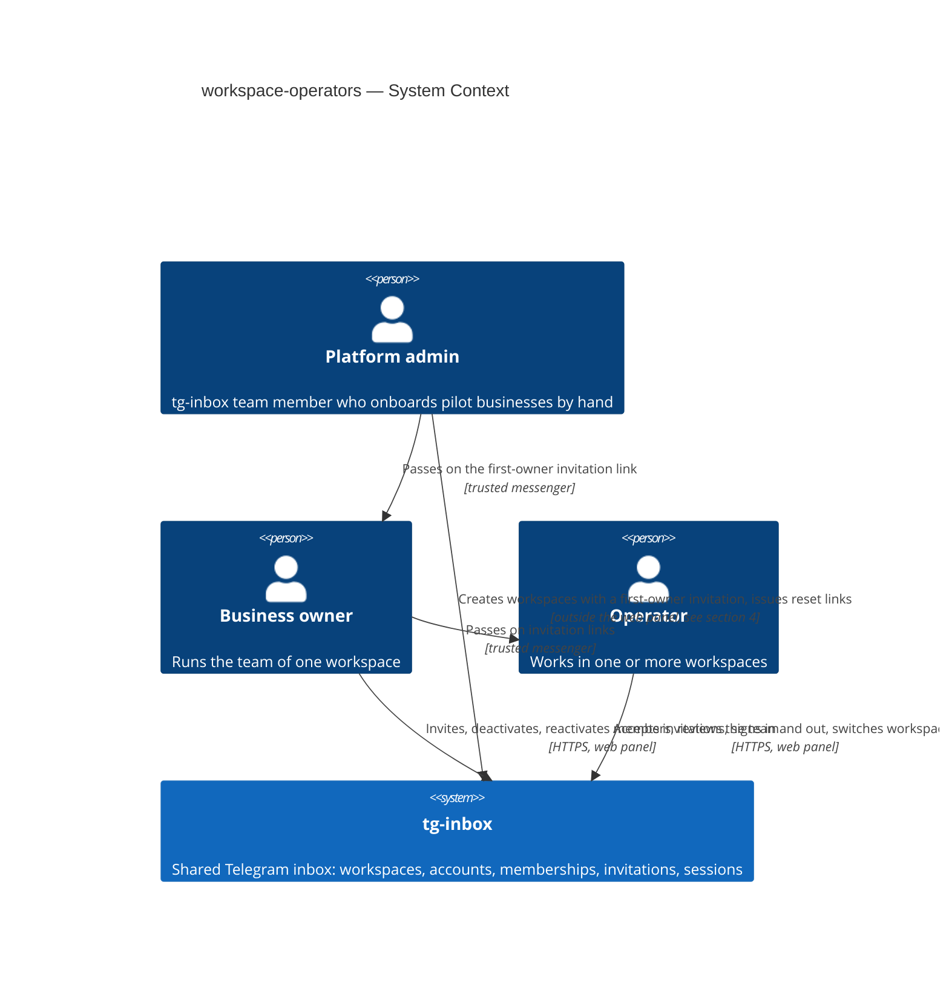
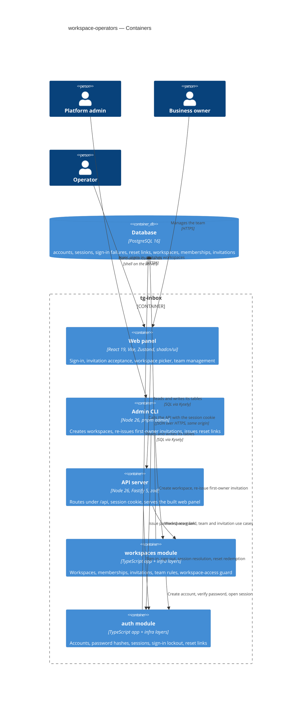
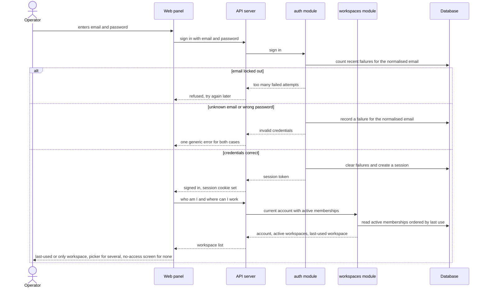
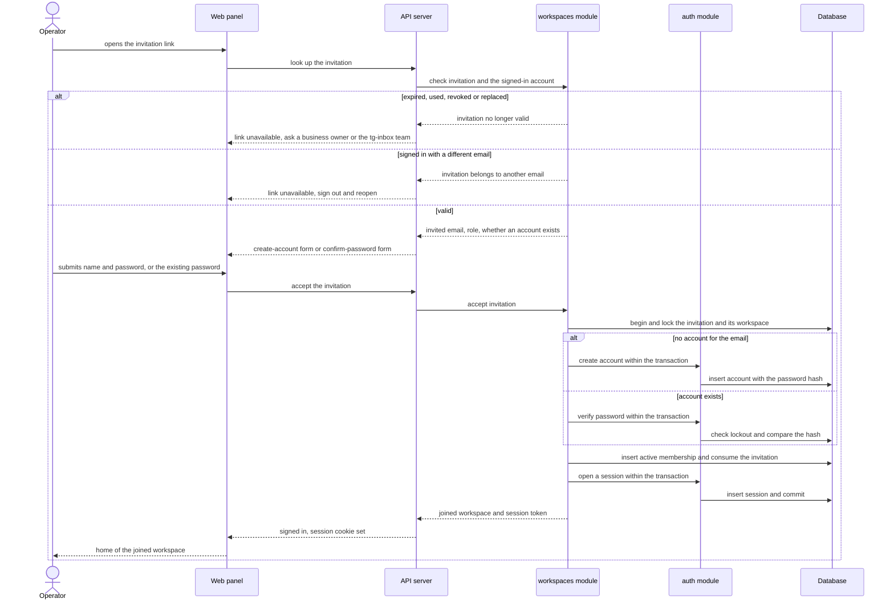
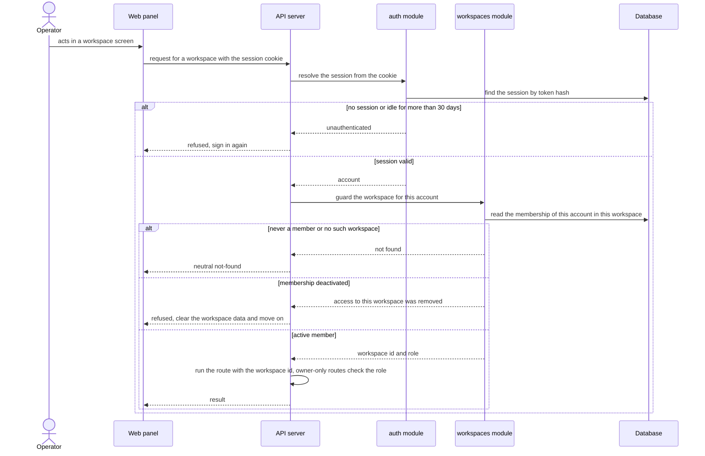

# Software Architecture Document — workspace-operators

## 1. Introduction and goals

**Intent.** workspace-operators gives tg-inbox its tenancy and identity foundation. A platform admin creates a workspace for a pilot business together with a single-use invitation for its first business owner; from then on business owners run their own team in the web panel — inviting people by copyable, expiring links, deactivating and reactivating members, reviewing who has or is about to get access. People sign in with email and password, keep one account across every workspace they belong to, and switch between workspaces while seeing only one business's data at a time. Every later roadmap capability (bot connection, inbox, contacts) attaches to a workspace and relies on the access guard this feature introduces.

**Top-3 quality goals (1-liners; full scenarios in §10):**

1. **Cross-workspace isolation** — zero data reads or writes across workspaces, and a deactivated member loses access to that workspace within 5 s.
2. **Credential and session security** — brute-force lockout, no account enumeration, sessions that end at once on sign-out or password reset.
3. **Responsiveness of everyday actions** — sign-in, team, switch and invite actions stay within the spec §6 latency targets.

**Stakeholders.**

| Role | Interest | Sign-off owner? |
|---|---|---|
| Platform admin | Creates workspaces with the first business owner invitation, re-issues it, issues password-reset links | No |
| Business owner | Runs the workspace's team: invites, deactivates, reactivates, reviews members and invitations | No |
| Operator | Joins by invitation, signs in and out, switches between workspaces | No |
| Tech Lead | SAD approval | Yes |
| Security Lead | Security review of the new authentication and tenancy boundary (spec §6.1: review required) | Yes |

## 2. Constraints

**Technical.**
- TypeScript ~6.0 (strict) on Node.js 26 (`.nvmrc`), pnpm workspaces monorepo — repo [ADR-0001](../../adr/0001-use-a-typescript-pnpm-monorepo-on-node-26.md)
- Backend: Fastify 5.12 with `fastify-type-provider-zod` 7 and zod 4.6; `@fastify/websocket` 11 already registered (not used by this feature)
- Frontend: React 19.3 + Vite 8 SPA, Tailwind CSS 4.3 + shadcn/ui, Zustand 5, React Router 8
- Datastore: PostgreSQL 16 via Kysely 0.29 (`pg` 8.23), reversible migrations through kysely-ctl 0.21, table types generated by kysely-codegen — repo [ADR-0004](../../adr/0004-use-postgres-with-kysely-reversible-migrations-and-workspace-scoped-tenancy.md); pg-boss 12 is available in the same database but this feature needs no background jobs
- Architecture: modular monolith, one module per capability with `domain → app → infra → http` layers, one process serving every workspace — repo [ADR-0002](../../adr/0002-organize-the-backend-as-a-modular-monolith-with-layered-modules.md)

**Organisational.**
- Effort budget: size M — a separate epic of 5–15 PRs over 1–2 sprints (`.size`)
- Deadline: TBD by PM — the spec sets no date; this step gates roadmap step 3 (bot connection) and the onboarding of the first pilot (see §11)
- Team composition: not stated in the spec; the pipeline assumes one backend + frontend implementer working through `tasks.json`

**Conventions.**
- [`CLAUDE.md`](../../../CLAUDE.md) and [`docs/architecture-map.md`](../../architecture-map.md) §Conventions are binding: module wiring through `register<Module>(app, deps)` in the composition root `buildApp()`, inward-only imports, cross-module calls only through the other module's app layer
- IDs are UUIDv7 from `newId()` (`apps/api/src/platform/ids.ts`), never DB defaults
- Errors are `AppError` subclasses from `apps/api/src/platform/errors.ts`, returned as `{ "error": { "code", "message", "details"? } }`; codes live in `packages/shared/src/errors.ts`
- Request/response bodies are zod schemas in `packages/shared`, also used by the web client (`apps/web/src/shared/api/client.ts`)
- Env vars are parsed only in `apps/api/src/platform/config.ts` and documented in `.env.example`
- Every tenant-owned table carries a non-null `workspace_id`; every repository method takes `workspaceId` and filters by it; every repository has an integration test proving cross-workspace isolation
- UI composes shadcn/ui primitives from `apps/web/src/shared/ui`, Tailwind only

**Regulatory / external.**
- Data classification: confidential (spec §6.1) — account credentials and the membership graph control access to every business's customer data
- Personal data: account email (identifier), display name, password (stored only as a one-way hash, never logged or shown back)
- No compliance regime is named by the spec; v1 offers no account deletion or data export (accepted debt, §11)
- Security review is required before release (spec §6.1)

## 3. Context and scope

tg-inbox is a shared Telegram inbox for small businesses; this feature introduces the business itself (the workspace), the people who work in it (accounts holding memberships with a role) and the way they get in (invitations, sign-in, password-reset links). Platform admins on the tg-inbox team onboard each pilot business by hand; business owners and operators use the web panel. Links are not mailed — whoever issues one copies it and passes it on through a channel they trust.

<!-- brownfield: freshly scaffolded skeleton (commit afd2bbb) — `platform/` + `modules/health` only, a baseline migration that pins UTC and no tables yet, a web app shell; docs/architecture-map.md (greenfield-bootstrap) still describes it accurately -->

**External systems (in / out):**

| Actor or system | Type | Interaction |
|---|---|---|
| Platform admin | Person | Creates a workspace with its first business owner invitation, re-issues that invitation, issues password-reset links — outside the web panel (channel decided in §4) |
| Business owner | Person | Invites, deactivates and reactivates members, reviews the team and revokes invitations in the web panel |
| Operator | Person | Joins by invitation, signs in and out, switches between workspaces in the web panel |
| Trusted messenger | Out-of-band channel (not integrated) | Carries invitation and reset links from whoever issued them to the person they are for |
| External systems | — | None, deliberately: no mail delivery in v1 (spec §3), and the Telegram Bot API is not touched by this feature (roadmap step 3) |

**C4 Context (L1):**



## 4. Solution strategy

**Target surfaces:** `backend-service` (the API owning the HTTP contract), `web-frontend` (the operator web panel) and `cli` (the platform-admin commands) — [ADR-0001](adr/0001-build-an-api-a-spa-and-a-server-side-admin-cli.md). This also closes the spec §8 open question on the platform-admin channel: a command run on the server, with server access as the authority and an audit log line per action.

**Top strategic choices (the seeds for ADRs):**

1. **Platform admins act through a server-side CLI, never over HTTP** — creating workspaces and issuing reset links reach every workspace, so they stay off the internet entirely; the CLI calls the same app-layer use cases as the API and prints each link exactly once. Serves quality goal 2 (security) and spec §6.1's "outside the web panel" — [ADR-0001](adr/0001-build-an-api-a-spa-and-a-server-side-admin-cli.md).
2. **Opaque cookie sessions stored in Postgres** — a random token in an `HttpOnly` cookie points at a session row holding only the token's hash; sign-out and password reset delete rows, the 30-day idle rule reads `last_seen_at`, and only user-triggered requests refresh it. Revocation is immediate (quality goal 2) without any new datastore (§2) — [ADR-0002](adr/0002-use-opaque-cookie-sessions-stored-in-postgres.md).
3. **The workspace is part of every address, and membership is checked on every request** — SPA paths `/w/<workspaceId>/…`, API paths `/api/workspaces/:workspaceId/…`, and one shared guard that turns "never a member" into not-found, "deactivated" into an access-removed refusal and "active" into `{ workspaceId, role }` for the repositories. This is the tenancy boundary every later module plugs into (quality goal 1); with no cache, a deactivation is effective on the next request — [ADR-0003](adr/0003-carry-the-active-workspace-in-the-url-and-check-membership-on-every-request.md).
4. **One origin for the SPA and the API, API under `/api`** — the API serves the built SPA in production and Vite proxies `/api` in development, so the session cookie is first-party everywhere and `SameSite=Lax` blocks cross-site request forgery without extra tokens. Settles the route-prefix, static-serving and dev-CORS questions the architecture map left to this feature — [ADR-0004](adr/0004-serve-the-spa-and-the-api-from-one-origin-under-api.md).

**Supporting choices (inline, below the ADR gate):**

- **UI architecture (web-frontend):** a client-side SPA — already fixed for the repo by repo [ADR-0001](../../adr/0001-use-a-typescript-pnpm-monorepo-on-node-26.md) (React + Vite, Zustand, React Router, shadcn/ui); no new ADR. Public routes (sign-in, accept invitation, set new password) live outside `/w/<workspaceId>/…`; workspace screens live inside it. The UI reuses the shadcn/ui foundation in `apps/web/src/shared/ui`.
- **Persistence:** the single PostgreSQL 16 store; no cache tier — every check reads the database, which the latency targets of spec §6 allow.
- **Module integration:** synchronous in-process calls to another module's app layer; this feature needs no pg-boss jobs or events.
- **Concurrency:** commands that change a workspace's team (deactivate, reactivate, accept the first owner invitation) lock that workspace's row for the length of the transaction, which serialises the "at least one active business owner" check of AC-18; single-use links are consumed with a conditional update that only succeeds while the link is still pending and unexpired; a unique index on the normalised email settles two simultaneous account creations.

Each tactical decision in later sections traces to one of these choices; a contradiction is surfaced in §11.

## 5. Building block view

The backend follows the repo's modular-monolith convention unchanged: each module has `domain` (pure rules — password policy, invitation validity, the "at least one active business owner" rule) → `app` (use cases and the ports they need) → `infra` (Kysely repositories) → `http` (routes and zod schemas from `packages/shared`). The feature adds two modules with a one-way dependency — `workspaces` calls `auth`'s app layer, never the reverse ([ADR-0005](adr/0005-split-identity-into-an-auth-module-and-a-workspaces-module.md)) — plus a server-side admin CLI that drives the same app layer ([ADR-0001](adr/0001-build-an-api-a-spa-and-a-server-side-admin-cli.md)). A shared dependency builder in the composition root constructs both modules once and is used by `buildApp()` and by the CLI alike.

**Table ownership** (names indicative; `data-model` fixes them):

| Module | Tables | Tenancy |
|---|---|---|
| `auth` | accounts, sessions, sign-in failures, password-reset links | Platform-level — no `workspace_id`; repositories are scoped by account or by normalised email |
| `workspaces` | workspaces, memberships, invitations | Tenant-owned — non-null `workspace_id` on memberships and invitations; every repository method takes `workspaceId`; each repository gets a cross-workspace isolation test |

A workspace has no status column in v1: "awaiting its first business owner" means it has no memberships yet, and a whole workspace cannot be suspended — members are deactivated instead (spec §8 default, closed here). The last-used workspace for the next sign-in is a `last_used_at` time on the membership.

**Internal decomposition:**

```
apps/api/src/
├── modules/auth/
│   ├── domain/       password policy, normalised email, lockout window rule
│   ├── app/          sign in / sign out, resolve session, create account, verify password,
│   │                 issue + redeem password-reset link (accept an optional transaction)
│   ├── infra/        account, session, sign-in-failure, reset-link repositories; password hasher
│   └── http/         routes.ts → registerAuth(app, deps): sign-in, sign-out, reset-link redemption
├── modules/workspaces/
│   ├── domain/       membership roles + states, invitation validity, last-active-owner rule
│   ├── app/          create workspace with first-owner invitation, re-issue it, invite, revoke,
│   │                 accept invitation, deactivate / reactivate, list team, current account + workspaces
│   ├── infra/        workspace, membership, invitation repositories
│   └── http/         routes.ts → registerWorkspaces(app, deps); the workspace-access guard (ADR-0003)
├── cli/admin.ts      pnpm admin <command> — platform-admin commands over the same app layer
└── app.ts            buildApp() + the shared dependency builder used by the CLI
apps/web/src/
├── features/auth/        sign-in, accept invitation, set new password; session store
├── features/workspaces/  workspace picker + switcher, team, invite member, no-access, not-found
└── pages/ + app/routes.tsx  public routes and /w/<workspaceId>/… routes
packages/shared/src/  auth.ts, workspaces.ts — request/response zod schemas + new error codes
```

**C4 Container (L2):**



## 6. Runtime view

Seeded critical flows; the `sequences` stage extends this section until every spec §5 acceptance criterion maps to a flow or a branch. Participants are the §5 containers.

**Critical flow 1: Sign in and resolve the workspace (US-03 — AC-07, AC-08, AC-09, AC-10)**



**Critical flow 2: Accept an invitation (US-02 — AC-03, AC-04, AC-04b, AC-05, AC-06)**



A password shorter than 10 characters, a wrong existing password or a locked-out email ends the transaction without changes and returns the form with its error (AC-05; the generic credentials error for the existing-account path).

**Critical flow 3: A workspace-scoped request passes the access guard (AC-13, AC-15, AC-17)**



## 7. Deployment view

<!-- 🎯 Why: the TOPOLOGY DevOps must know without reading the deploy charts — how many replicas,
     where the background worker lives, AT WHAT NUMBERS we scale.
     📋 Write: 2–3 sentences on topology + monitoring + concrete threshold numbers.
     📌 e.g. «500 authors → partition by quarter» (not «we'll think about scale later»).
     🎯 N/A allowed for XS/S that reuses an existing deployment unit with no change.
     Deployment-diagram scaffold → templates/deployment.md. -->

<Topology in 2–3 sentences. Where it runs, replicas, scaling thresholds.>

**Monitoring:**
- <Metrics — e.g. `<metric_name>`>
- <Alerts — e.g. «worker lag > 10 min → page on-call»>
- <Tracing — e.g. spans on the request boundary>

**Scaling thresholds:**
- <e.g. comfortable in one table up to N rows/year>
- <e.g. partition by quarter above N rows/year>

<!-- For XS/S with no deployment change: <!-- N/A: reuses existing deployment unit, no infra change --> -->

## 8. Crosscutting concepts

<!-- 🎯 Why: CROSS-CUTTING PATTERNS spanning several modules: logging, errors, authorization, ID
     strategy, events, caching. ⭐ The second-densest section. A pattern inside one module is NOT
     here; a project-wide convention belongs in the convention file.
     📋 Write: a table — concept / convention / where defined. One row per concept.
     📌 e.g. «sortable time-based IDs generated in the app layer» as a default from the convention file. -->

| Concept | Convention | Where defined |
|---|---|---|
| Logging | <e.g. structured, fields `module=<name>`> | <convention file §X or here> |
| Authentication | <e.g. token-based via middleware> | <convention file §X> |
| Error handling | <e.g. domain sentinel → ports error mapping → JSON> | <convention file §X> |
| ID strategy | <e.g. sortable time-based ID in the app layer> | <convention file §X> |
| Internationalisation | <e.g. N/A, single language> | — |
| Observability | <e.g. tracing on the request boundary> | — |
| Events | <module-specific patterns, if any> | <here> |

## 9. Architecture decisions

<!-- 🎯 Why: the REVERSE INDEX onto the adr/ folder. `ls adr/` gives the files; §9 gives the
     semantics — why they exist, which SAD section they attach to, what status.
     📋 Write: a 4-column table, one row per ADR. Mixed status is fine.
     📌 e.g. «0001 | Store content as a table of typed blocks | Accepted | §4». -->

| # | Title | Status | Section |
|---|---|---|---|
| <NNNN> | <imperative — e.g. "Use a sliding-window counter for rate limiting"> | Accepted | §<N> |
| <NNNN> | <imperative — e.g. "Co-locate the worker in the API process"> | Accepted | §<N> |

ADR files live under `docs/features/<slug>/adr/NNNN-<title>.md`.

## 10. Quality requirements

<!-- 🎯 Why: the QUALITY TREE — take a goal from §1 and break it into concrete leaves: tests,
     metrics, configs, drills. ⭐ Without §10, §1 is a manifesto. With §10 each declaration maps
     to something PROVABLE.
     📋 Write: per §1 goal — When / Then / How-verify. Numbers from spec §6 NFR VERBATIM (don't
     round ≤250ms to ≤300ms — that's a critic F6 hit).
     📌 e.g. «p95 ≤ 500 ms on a block update, verified by a 100 req/s load test». -->

Each top-3 goal from §1 expanded into a full scenario:

**QG-1. <quality attribute>**
- **When:** <trigger condition>
- **Then:** <expected behaviour with numbers from spec §6 NFR>
- **How verify:** <test / chaos drill / load test / metric>

**QG-2. <quality attribute>**
- **When:** <trigger>
- **Then:** <expected>
- **How verify:** <how>

**QG-3. <quality attribute>**
- **When:** <trigger>
- **Then:** <expected>
- **How verify:** <how>

## 11. Risks and technical debt

<!-- 🎯 Why: ⭐ collects EVERYTHING that can break — not only the technical. Without §11 risks get
     discussed at standups and lost; debt lives only in the head of whoever accepted it.
     📋 Write: a risk/debt table — severity — mitigation — owner. Accepted debt in its own block.
     📌 The first risk is often a product risk, not a technical one. That's normal. -->

<!-- Severity literals: Low / Medium / High for regular risks; "Open question" for rows created by
     a Save-as-OQ resolution during the Socratic walk (see references/socratic.md). -->

| Risk / debt | Severity | Mitigation | Owner |
|---|---|---|---|
| <e.g. Worker lag may reach hours during a downstream outage> | Medium | <alert >10 min, on-call playbook, retry backoff> | <DevOps> |
| <e.g. No event-schema versioning in v1> | Medium | <ADR-NNNN planned for v2, tolerate unknown fields> | <Backend> |
| Open architectural decision: <decision-headline> | Open question | Resolve before <stage trigger or YYYY-MM-DD>; <inline rationale from the Save-as-OQ> | <owner> |

**Accepted debt (acceptable in v1, plan to fix later):**
- <e.g. the entity is immutable / unversioned — OK for v1, may need audit versioning in v2>

## 12. Glossary

<!-- 🎯 Why: ⭐ the DOMAIN GLOSSARY that ends arguments a year later («checkpoint — weekly or
     biweekly? quarter — calendar or fiscal?»).
     📋 Write: a term / meaning table. Business + technical terms mixed.
     📌 e.g. «Lesson | a unit inside a course made of blocks (text, video)». -->

| Term | Meaning |
|---|---|
| <e.g. domain object A> | <its meaning in this domain> |
| <e.g. domain object B> | <its meaning> |
| <e.g. domain invariant name> | <the rule, in plain language> |
