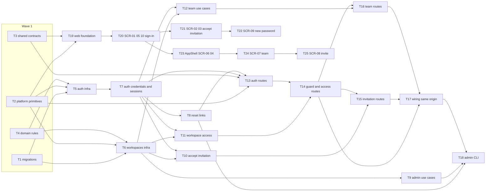

# Epic — workspace-operators

> **Spec:** [spec.md](../spec.md) · **Design:** [sad.md](../sad.md) · **Data model:** [data-model.md](../data-model.md) · **API:** [openapi.yaml](../contracts/openapi.yaml) · [cli.md](../contracts/cli.md) · **Screens:** [screens.md](../screens.md) · **ADRs:** [adr/](../adr/)

## Goal

This epic gives tg-inbox its tenancy and identity foundation. A pilot business gets an isolated workspace, created by a platform admin through the server-side CLI, and its business owner runs the team from the web panel without the tg-inbox team. Operators keep one account across workspaces and switch between them, and no business can ever see or change another business's data (spec §2 Goals). Every later roadmap step (bot connection, inbox, contacts) plugs into the workspace guard built here.

## Scope

- **In:** three surfaces from `sad.md` `target_surfaces: [backend-service, web-frontend, cli]`. That means seven migrations; platform primitives (error classes, clock, link tokens, config); shared zod contracts; the `auth` and `workspaces` modules through every layer (domain → infra → app → http); the shared dependency builder and same-origin SPA serving; the admin CLI (`workspace:create`, `workspace:reissue-owner-invitation`, `account:issue-reset-link`); and ten screens (SCR-01–SCR-10) plus the new AppShell component in the web panel. It also updates `CLAUDE.md` and `docs/architecture-map.md` for the conventions this feature extends.
- **Out:** self-serve signup; Telegram sign-in, SSO and 2FA; automatic emails for invitations and resets; changing an existing member's role and fine-grained permissions; connecting the business bot (roadmap step 3); self-service profile changes (spec §3). Also out: purging expired rows, a per-IP rate limit, and workspace suspension (sad §11 accepted debt).

**Size note:** there are 25 tasks, above the usual 8–20 for an M feature. The feature declares three surfaces, and each one adds its own layer (`ui` for the web panel, a CLI for the admin). Breaking the work down further keeps every task within one day and one reviewable PR (`_shared/size-matrix.md` §Surface count).

## Task map

**Waves** (topological phases; tasks in one wave can run in parallel unless they share a lane):

| Wave | Tasks |
|---|---|
| 1 | T1, T2, T3, T4 |
| 2 | T5, T6, T19 |
| 3 | T7, T9, T20 |
| 4 | T8, T10, T11, T12, T21, T23 |
| 5 | T13, T22, T24 |
| 6 | T14, T25 |
| 7 | T15, T16 |
| 8 | T17 |
| 9 | T18 |

**Serialized lanes** (overlapping `files_hint`): `apps/api/src/test/fixtures.ts` T5 ↔ T6 · `apps/api/package.json` T5, T13, T17, T18 · `apps/api/src/app.ts` T13 → T14 → T17 · `modules/workspaces/http/routes.ts` T14 → T15 / T16 · `apps/web/src/pages/TeamPage.tsx` T24 → T25 · `layer: migration` T1 is always serialized. T20 writes the full route table in `apps/web/src/app/routes.tsx` with stub pages, so T21–T25 never touch it and the UI branch stays parallel.

## Tasks

See [tracker.md](./tracker.md) for status. Machine contract: [tasks.json](../tasks.json).

| # | Task | Layer | Blocked by | DoD (short) |
|---|---|---|---|---|
| T1 | [Promote the seven staged migrations and regenerate DB types](./t01-promote-migrations.md) | migration | — | The seven Kysely migrations apply and revert cleanly on a fresh Postgres 16 and the regenerated db.types.gen.ts compiles. |
| T2 | [Add platform primitives: error classes and codes, clock port, link tokens, config keys](./t02-platform-primitives.md) | infra | — | Unit tests prove every new error class maps to its code and HTTP status in the envelope, link tokens are 43-char base64url with a 32-byte SHA-256 hash, and config parses PUBLIC_WEB_URL and WEB_DIST_DIR. |
| T3 | [Define the auth and workspaces zod contracts in packages/shared](./t03-shared-contracts.md) | ports | — | Unit tests show the shared schemas accept the openapi.yaml examples and reject an empty name, a non-email, and a password under 10 characters, and that no response schema has a token or link field except IssuedInvitation.link. |
| T4 | [Implement the auth and workspaces domain rules](./t04-domain-rules.md) | domain | — | Unit tests cover email normalisation, the 10–1024 password policy, the 10-in-15-minutes lockout window, invitation validity, and the last-active-owner rule, with no I/O. |
| T5 | [Build the auth repositories and the argon2id password hasher](./t05-auth-infra.md) | infra | T1, T2, T4 | Integration tests against Testcontainers Postgres pass for every auth repository method (scoped by account or normalised email), including the conditional reset-link consume, and the hasher round-trips argon2id PHC strings. |
| T6 | [Build the workspaces repositories with cross-workspace isolation tests](./t06-workspaces-infra.md) | infra | T1, T2, T4 | Every workspaces repository method has a Testcontainers test on twoWorkspaces() proving it never reads or changes the other workspace's rows, including the three controlled exceptions. |
| T7 | [Implement the auth credential and session use cases](./t07-auth-credentials-sessions.md) | app | T5 | Unit tests with port fakes and a controllable clock show the same error for an unknown email and a wrong password, the lockout after 10 failures, sign-out ending only that session, and 30-day idle expiry that background requests do not extend. |
| T8 | [Implement the password-reset link use cases](./t08-auth-reset-links.md) | app | T7 | Tests show issuing a link supersedes the earlier one, and redeeming it once ends every other session, clears the failure count, and signs the device in, while expired, used or superseded links are refused. |
| T9 | [Implement create-workspace and re-issue-owner-invitation use cases](./t09-workspaces-admin-use-cases.md) | app | T6 | Unit tests show creating a workspace issues a 7-day owner invitation and returns its link once, invalid input creates nothing and names the field, and re-issuing supersedes the earlier invitation or refuses once members exist. |
| T10 | [Implement invitation lookup and acceptance](./t10-accept-invitation.md) | app | T6, T7 | Tests cover the new-account path, the existing-password path, the wrong-email refusal, the 10-character refusal, the no-longer-valid refusal with the right whom-to-ask hint, and the lost race against a concurrent consume. |
| T11 | [Implement workspace access: guard check, my workspaces, enter](./t11-workspace-access.md) | app | T6, T7 | Unit tests show the guard returns { workspaceId, role } for an active member, NotFoundError when the account was never a member, and AccessRemovedError when the membership is deactivated, and that enter sets last_used_at, which getMe reports. |
| T12 | [Implement the team use cases: invite, revoke, list, deactivate, reactivate](./t12-team-use-cases.md) | app | T6, T7 | Tests cover invite (with supersede), already-a-member, revoke, the team list without links, reactivation keeping the role, and two concurrent deactivations against Postgres where at most one leaves an active owner. |
| T13 | [Expose the auth routes with the session cookie and resolver](./t13-auth-routes.md) | ports | T2, T3, T7, T8 | app.inject() integration tests show sign-in, sign-out, and reset lookup/redeem returning the openapi.yaml statuses and codes, byte-identical lockout responses for known and unknown emails, and session lifetime driven by a controllable clock. |
| T14 | [Expose the workspace guard and the me / workspaces / enter routes](./t14-guard-and-access-routes.md) | ports | T11, T13 | app.inject() tests show getMe, listMyWorkspaces and enterWorkspace return the contract shapes, a foreign workspace answers 404 NOT_FOUND, and after a deactivation two open sessions both get 403 ACCESS_REMOVED while the member's other workspace still answers 200. |
| T15 | [Expose the invitation lookup and acceptance routes](./t15-invitation-routes.md) | ports | T10, T14 | app.inject() tests show lookUpInvitation and acceptInvitation answering 200/400/401/403/404 per openapi.yaml, with acceptance setting the session cookie. |
| T16 | [Expose the owner-only team routes](./t16-team-routes.md) | ports | T12, T14 | app.inject() tests show every team route returning its contract status, 403 OWNER_ONLY for an operator, and 404 for a session from another workspace. |
| T17 | [Extract the shared dependency builder, serve the SPA from one origin, update the conventions docs](./t17-wiring-same-origin.md) | wiring | T14, T15, T16 | buildApp() builds its modules through buildDeps(), the smoke test stays green, an inject test shows /w/<id>/team serving index.html when WEB_DIST_DIR is set, cookies are redacted in logs, and CLAUDE.md plus the architecture map describe the new conventions. |
| T18 | [Build the admin CLI with its three commands](./t18-admin-cli.md) | ports | T8, T9, T17 | Integration tests run each pnpm admin command against Testcontainers Postgres and assert the contracts/cli.md stdout, stderr, exit code, and audit line, with the link never logged. |
| T19 | [Lay the web foundation: shadcn primitives, API client, shared guard handling, stores](./t19-web-foundation.md) | ui | T2, T3 | The ten shadcn primitives are installed with @/shared/lib/utils imports, and Testing Library tests show the guard handler reacting to 401, 403 ACCESS_REMOVED and 404 as the screens.md Shared guard states table says. |
| T20 | [Build SCR-01 sign-in, the workspace resolution, SCR-05 no access and SCR-10 not found](./t20-sign-in-and-resolution.md) | ui | T19 | Testing Library tests render every declared state of SCR-01, SCR-05 and SCR-10 and show the AC-07 resolution choosing the return address, then the last-used workspace, the only workspace, the picker, or no access. |
| T21 | [Build SCR-02 accept invitation and SCR-03 link unavailable](./t21-accept-invitation-screens.md) | ui | T20 | Testing Library tests render every declared state of SCR-02 and the invitation variants of SCR-03 against mocked lookUpInvitation and acceptInvitation responses. |
| T22 | [Build SCR-09 set new password](./t22-set-new-password-screen.md) | ui | T21 | Testing Library tests render every declared state of SCR-09 and the reset-link variant of SCR-03 against mocked lookup and redeem responses. |
| T23 | [Build the AppShell, SCR-06 workspace home and SCR-04 picker / switcher](./t23-app-shell-home-picker.md) | ui | T20 | Testing Library tests render every declared state of SCR-04 and SCR-06, show that operators get no Team link, and show switching calls enterWorkspace and drops the previous workspace's data. |
| T24 | [Build SCR-07 team screen](./t24-team-screen.md) | ui | T23 | Testing Library tests render every declared state of SCR-07, including the confirm dialogs, last-active-owner, stale-row and owners-only states, and show that no invitation link is ever rendered. |
| T25 | [Build SCR-08 invite member dialog](./t25-invite-dialog.md) | ui | T24 | Testing Library tests render every declared state of SCR-08, including the one-time link with Copy and its disappearance after Done once the pending list is refetched. |

## Risks / Hard rules

- **Tenancy (sad §11, High):** every tenant-owned table has a non-null `workspace_id`, and every `workspaces` repository method takes `workspaceId`. The only three exceptions are those listed in sad §5 (memberships of an account, invitation by token hash, membership for the guard), and each has its own isolation test. Every route under `/api/workspaces/:workspaceId/…` sits behind the ADR-0003 guard and gets an `app.inject()` test that calls it with another workspace's session (QG-1a).
- **Module boundary (ADR-0005):** `workspaces` calls `auth`'s app layer and never the reverse. `memberships.account_id → accounts(id)` is a constraint only; `workspaces` never queries `accounts`.
- **Secrets (spec §6.1, sad §8):** passwords, session tokens and link tokens are never logged or returned. Only SHA-256 hashes and argon2id PHC strings are stored. A link is shown exactly once: in the `createInvitation` 201 response, or on the CLI's stdout.
- **Deactivation ≤ 5 s (spec §6):** the guard reads membership without a cache on every request. Nothing may add a membership cache.
- **Clock:** every timestamp comes from the application clock port and is passed into SQL as `now`. Migrations use no `DEFAULT now()` (data-model conventions).
- **No account enumeration (AC-08, AC-09):** an unknown email and a wrong password get one response, the lockout behaves the same for both, and an unknown email still runs one hash verification.
- **IDs / errors / config / UI (CLAUDE.md §Rules):** IDs are UUIDv7 from `newId()`. Errors are `AppError` subclasses using the one envelope. Env vars are read only in `platform/config.ts`. The UI uses shadcn/ui primitives with Tailwind only. AppShell is the only new component.
- **Open debt carried, not built:** the purge job, the per-IP limit, and the inbox live channel re-checking membership (sad §11). The last one is a constraint on roadmap step 4.
