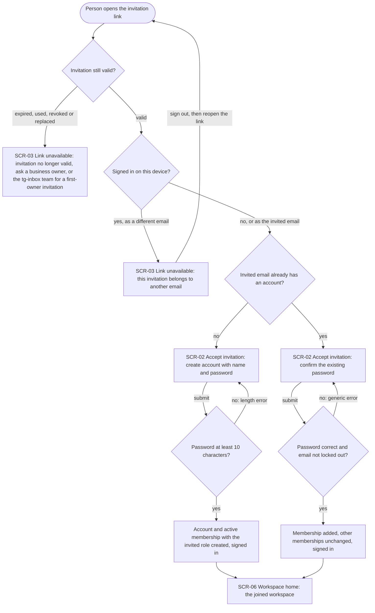
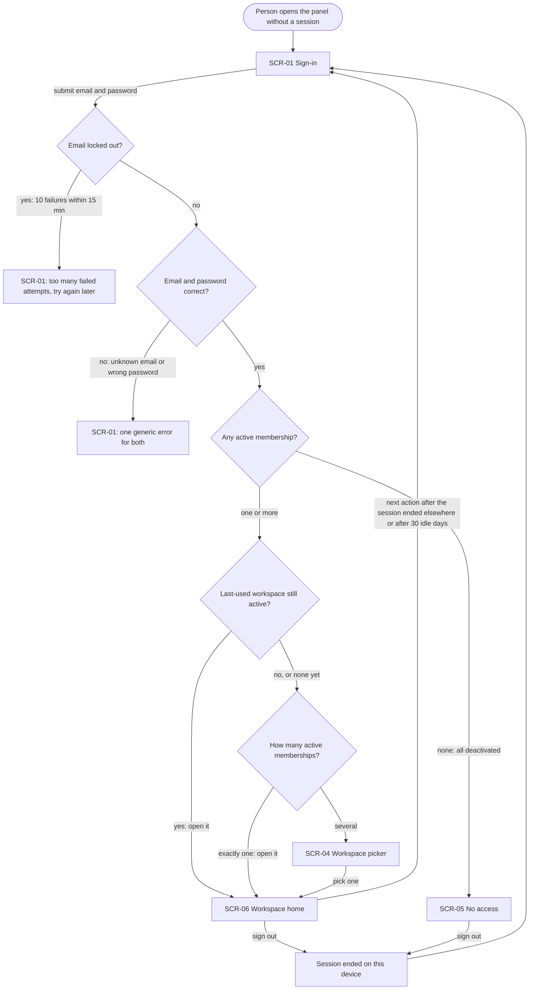
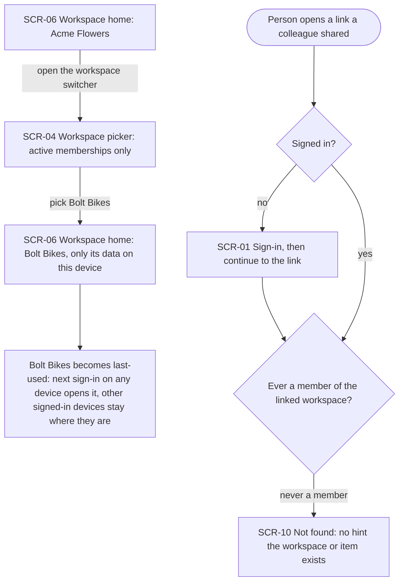
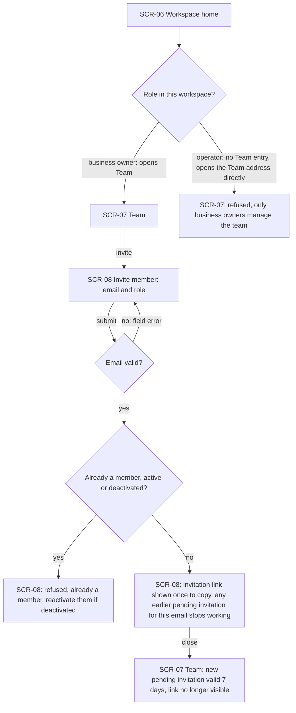
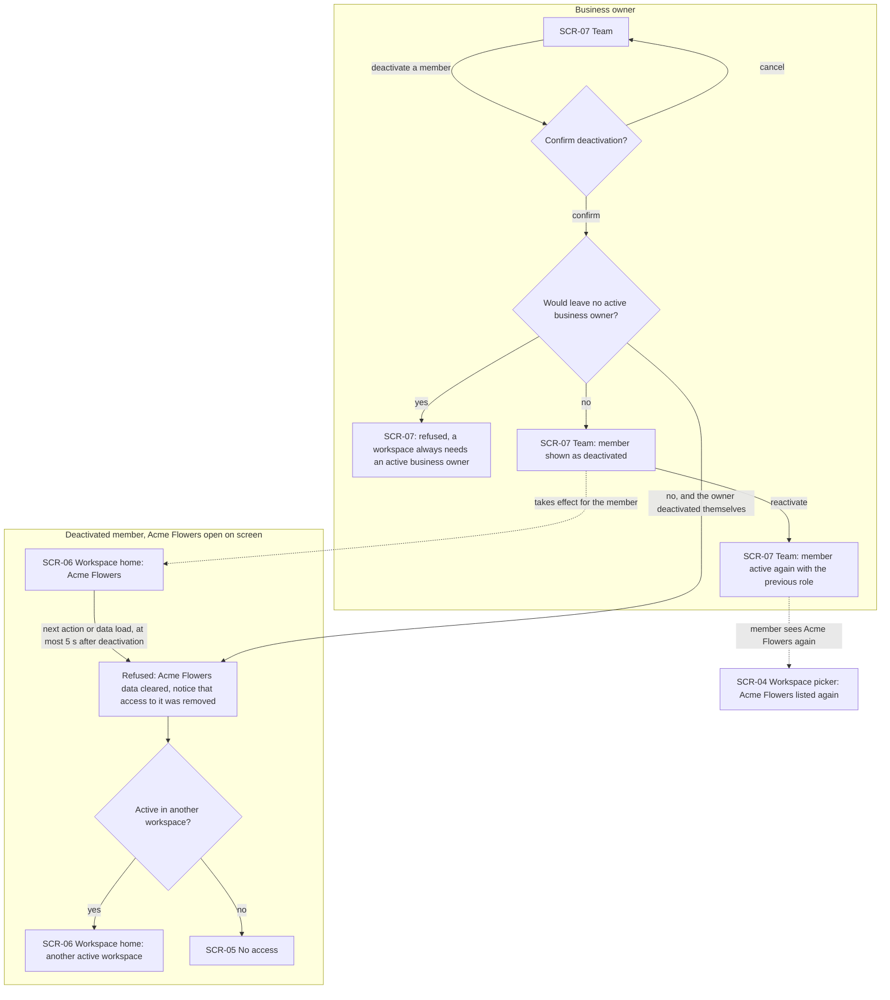
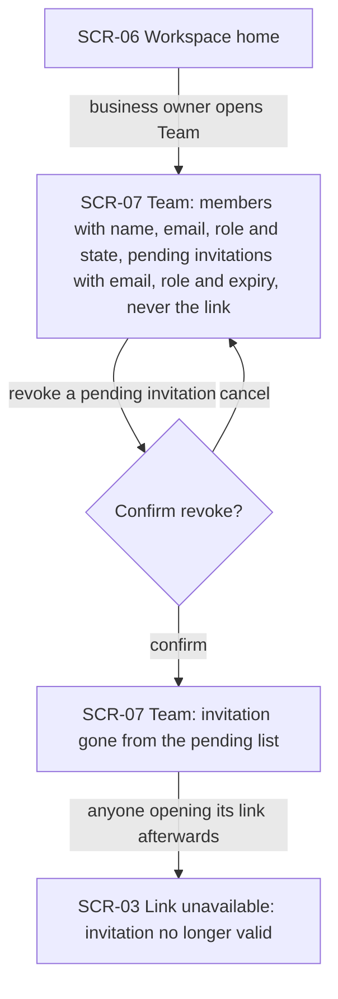
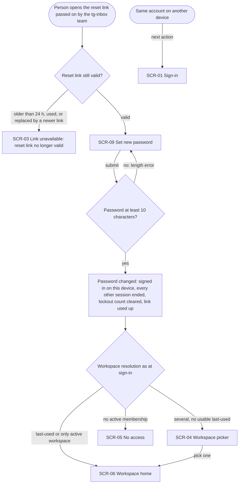

# UX flows — workspace-operators

> User flows for every UI-touching §4 user story of [spec.md](spec.md), produced by `ux-flows` and
> read by `design`, `sequences`, `screens` and `plan-tests`. Flow altitude only — no layout, no
> components. Roles follow the [glossary](../../../CONTEXT.md).

## Platform decisions

- **Posture:** responsive-both — chosen at this stage, since `docs/design-system.md` does not exist
  yet. Why: invitation and password-reset links are passed on by hand through messengers and are
  mostly opened on a phone, and small-business operators and owners switch between a desk and a
  phone during the day. Every screen in the inventory must be fully usable at both phone and
  desktop width; `screens` details both.
- **Three areas:** a **public area** reached without a session, usually from a link (SCR-01, SCR-02,
  SCR-03, SCR-09); a **signed-in area without an active workspace** (SCR-04 right after sign-in,
  SCR-05); and the **workspace area** where every screen belongs to one active workspace (SCR-06,
  SCR-07, SCR-08, SCR-10).
- **Workspace switcher:** reachable from every workspace-area screen; it lists the same active
  memberships as the post-sign-in picker, so both use SCR-04.
- **Team entry is owner-only:** business owners see a way to SCR-07 from the workspace area;
  operators do not. An operator who reaches SCR-07 by its address gets the owners-only refusal.
- **Modality:** inviting is a step layered over SCR-07 (SCR-08), not a separate journey; its last
  step reveals the invitation link once and closing it returns to SCR-07. Deactivating a member and
  revoking an invitation ask for confirmation first; reactivating does not.
- **Links are copied by hand:** no email is sent — business owners copy invitation links, platform
  admins copy first-owner invitation and reset links, and pass them on themselves.
- **Return after sign-in:** a person who opens a panel link while signed out signs in on SCR-01 and
  then continues to that link (subject to access); a plain sign-in follows the AC-07 workspace
  resolution.
- **Losing access is noticed on the next action:** a deactivated member or a session ended elsewhere
  is not pushed off an idle screen; the next action or data load is refused and the flow moves on
  from there (spec §6, no proactive push in v1).
- **Design inputs (flagged, not decided here):**
  - whether the active workspace is part of the page address — touches AC-12 (switch is
    per-device) and AC-13 (shared links into a workspace);
  - a wrong existing password on SCR-02 (AC-04) — these flows assume it shows the same generic
    error as sign-in and counts toward the AC-09 lockout, because it is a password check reachable
    by anyone holding the link;
  - the platform-admin channel for US-01 and the admin half of US-08 (spec §8 open question) —
    if `design` gives it a web surface, this file needs an admin flow.

## Screen inventory

| ID | Screen | Purpose | Entry | Exit |
|---|---|---|---|---|
| SCR-01 | Sign-in | Email + password sign-in; shows the generic credentials error and the lockout message | Opening the panel without a session; sign-out; next action after a session ended; resuming a link opened while signed out | SCR-06, SCR-04 or SCR-05 per the AC-07 resolution, or the link the person opened |
| SCR-02 | Accept invitation | Join a workspace from an invitation link — create an account (name + password) or confirm the existing account's password | A valid invitation link | SCR-06 of the joined workspace |
| SCR-03 | Link unavailable | Explain why an invitation or reset link cannot be used and what to do next | An invalid invitation or reset link; an invitation for another email than the signed-in account | Dead end; sign out and reopen the link (wrong-email case) |
| SCR-04 | Workspace picker | Choose one of the account's active workspaces | Sign-in or password reset with several active workspaces and no usable last-used one; the workspace switcher | SCR-06 of the picked workspace |
| SCR-05 | No access | Tell the person they no longer have access to any workspace; no workspace data | Sign-in, password reset or deactivation leaving no active membership | Sign out to SCR-01 |
| SCR-06 | Workspace home | Landing screen of the active workspace and the entry point to the workspace area (inbox arrives in roadmap step 4) | After sign-in, invitation acceptance, password reset or switching | SCR-04 (switcher), SCR-07 (owners), SCR-01 (sign-out) |
| SCR-07 | Team | Members (name, email, role, state) and pending invitations (email, role, expiry — never the link); deactivate, reactivate, revoke | Business owner from the workspace area | SCR-08 (invite), SCR-06 |
| SCR-08 | Invite member | Enter an email and a role; on success show the invitation link once to copy | Invite action on SCR-07 | SCR-07 |
| SCR-09 | Set new password | Set a new password through a reset link | A valid reset link | SCR-06, SCR-04 or SCR-05 per the AC-07 resolution |
| SCR-10 | Not found | Neutral not-found for anything outside the person's workspaces — no hint that the workspace or item exists | A link into a workspace the person was never a member of | SCR-06 of their own workspace |

## Flows

Out of scope (no web-panel UI): **US-01** create a workspace by hand, and the **admin half of
US-08** (issuing a reset link) — both are platform-admin actions outside the web panel, through
the channel `design` picks (spec §8). What they hand out — an invitation link, a reset link — is
consumed in Flow US-02 and Flow US-08 below.

### Flow: US-02 — Join a workspace by invitation

The person opens the link they were sent. If the invitation has expired, was already used, or was
revoked or replaced, they land on SCR-03, which says it is no longer valid and whom to ask: a
business owner of the workspace, or the tg-inbox team when it was the first business owner's
invitation. If the link is valid but the device is signed in with a different email, SCR-03 says
the invitation belongs to another email; they sign out and reopen the link. Otherwise the form on
SCR-02 depends on whether the invited email already has an account: a new person enters a name and
a password — shorter than 10 characters keeps them on the form with a length error — and gets an
account plus an active membership; an existing account (even one already signed in here) confirms
its existing password — a wrong password or a locked-out email keeps them on the form with the
generic error — and gains the membership while its other memberships stay as they were. Both
paths end signed in on SCR-06 of the workspace just joined.

### Flow: US-03 — Sign in and sign out

Without a session the panel opens SCR-01. While the email is locked out — 10 failed attempts in
the last 15 minutes, counted from the 10th failure — even a correct password is refused with
«too many failed attempts», and the same happens for an email with no account. A wrong password
and an unknown email get one identical error. On success the panel picks the workspace: the
last-used one if it is still active; otherwise the only active one; otherwise SCR-04 lets the
person pick among several. If every membership is deactivated they land on SCR-05 with no
workspace data. Signing out from SCR-06 or SCR-05 ends the session on this device only and
returns to SCR-01; a session ended by a password reset elsewhere or by 30 idle days sends the
person back to SCR-01 on their next action.

### Flow: US-04 — Switch between workspaces

From any workspace screen the operator opens the switcher, which lists only their active
workspaces, and picks Bolt Bikes; from then on this device shows only Bolt Bikes data, other
signed-in devices keep their workspace, and Bolt Bikes becomes the last-used workspace that the
next sign-in opens on any device. Separately, when someone opens a link into a workspace — signing
in first if needed, then continuing to the link — and they have never been a member of it, they get
SCR-10, a neutral not-found that reveals neither the workspace nor the item. A deactivated former
member is handled in Flow US-06; what an active member's shared link opens belongs to the feature
that owns the item.

### Flow: US-05 — Invite a teammate

A business owner goes from the workspace home to SCR-07 and starts an invitation on SCR-08 with an
email and a role (operator or business owner). An invalid email keeps them on the form with a
field error. If that person is already a member — active or deactivated — the invitation is
refused with a hint to reactivate a deactivated member instead. Otherwise the invitation link is
shown once to copy, and any earlier pending invitation for the same email stops working (this is
also how a lost link is replaced: invite the same email again). Closing returns to SCR-07, where
the new invitation is pending for 7 days with no way to see its link again. An operator has no
Team entry; opening the Team address directly shows only the owners-only refusal.

### Flow: US-06 — Deactivate and reactivate a member

On SCR-07 the business owner deactivates a member and confirms. If that would leave the workspace
without an active business owner — including deactivating themselves as the last one, or two
owners deactivating at the same moment — it is refused with that explanation. Otherwise the member
shows as deactivated, and reactivating restores them with their previous role, so Acme Flowers is
back in their workspace picker and at sign-in. On the member's side nothing changes on an idle
screen; their next action or data load in Acme Flowers, from at most 5 seconds after the
deactivation, is refused: the Acme Flowers data disappears, a notice says their access was
removed, and they move to another workspace where they are active, or to SCR-05 when there is
none. Their account and other memberships stay intact. An owner who deactivates themselves while
another active owner remains goes through the same member-side path right away.

### Flow: US-07 — Review the team

The business owner opens SCR-07 and sees every member with name, email, role and state, and every
pending invitation with email, role and expiry date — never its link. Revoking a pending
invitation asks for confirmation; on confirm it leaves the pending list, and anyone who later
opens its link lands on SCR-03 (the same «no longer valid» branch as Flow US-02). An invitation
that expires or is accepted also leaves the pending list — it no longer offers access; accepted
ones appear as members.

### Flow: US-08 — Restore access after a forgotten password

The person opens the reset link the tg-inbox team passed on. A link older than 24 hours, already
used, or replaced by a newer reset link for the same account lands on SCR-03 with «reset link no
longer valid». A valid link opens SCR-09; a password shorter than 10 characters keeps them there
with a length error. On success the password is changed, this device is signed in, every other
session of the account ends, the lockout count is cleared and the link is used up; the panel then
resolves the workspace exactly as after sign-in (SCR-06, SCR-04 or SCR-05). Any other device of
the account is sent to SCR-01 on its next action. Issuing the link is the platform admin's action
and is out of scope here.

## AC coverage

| AC | Shown by | Notes |
|---|---|---|
| AC-01 | N/A: platform-admin action outside the web panel | Channel decided in `design` (spec §8); the issued link is consumed in Flow US-02 |
| AC-01b | N/A: platform-admin action outside the web panel | Re-issued link consumed in Flow US-02; the replaced one hits the «expired, used, revoked or replaced» branch |
| AC-02 | N/A: platform-admin action outside the web panel | Field errors belong to the admin channel |
| AC-03 | Flow US-02 → «no account» branch → SCR-02 create account → SCR-06 | |
| AC-04 | Flow US-02 → «account exists» branch → SCR-02 confirm password → SCR-06 | Includes «already signed in as the invited email»; wrong password = generic error (design input on lockout) |
| AC-04b | Flow US-02 → «signed in as a different email» → SCR-03 | Sign out and reopen loops back to the start |
| AC-05 | Flow US-02 → «password at least 10 characters? no» → back to SCR-02 | |
| AC-06 | Flow US-02 → «expired, used, revoked or replaced» → SCR-03 | Message names whom to ask (business owner vs tg-inbox team) |
| AC-07 | Flow US-03 → last-used / exactly one / several → SCR-04 → SCR-06 | Same resolution reused in Flow US-08 |
| AC-08 | Flow US-03 → «unknown email or wrong password» → SCR-01 generic error | |
| AC-09 | Flow US-03 → «email locked out» → SCR-01 too many attempts | Applies to emails without an account too; reset clears it (Flow US-08) |
| AC-10 | Flow US-03 → «none: all deactivated» → SCR-05 | |
| AC-11 | Flow US-03 → «sign out» → SCR-01 | This device only |
| AC-12 | Flow US-04 → switcher SCR-04 → SCR-06 Bolt Bikes → last-used note | Per-device; other devices unaffected |
| AC-13 | Flow US-04 → shared link → «never a member» → SCR-10 | Signed-out variant signs in first |
| AC-14 | Flow US-05 → SCR-08 link shown once → SCR-07 pending invitation | Re-inviting replaces the earlier pending invitation |
| AC-15 | Flow US-05 → «operator» → SCR-07 owners-only refusal | No Team entry for operators |
| AC-16 | Flow US-05 → «already a member» → SCR-08 refusal | |
| AC-17 | Flow US-06 → member side → refused → another SCR-06 or SCR-05 | Noticed on next action, no push |
| AC-18 | Flow US-06 → «would leave no active business owner» → SCR-07 refusal | Self-deactivation allowed while another owner remains |
| AC-19 | Flow US-06 → reactivate → SCR-07 active, SCR-04 lists the workspace again | |
| AC-20 | Flow US-07 → SCR-07 lists → revoke → confirm → gone; link → SCR-03 | |
| AC-21 | Flow US-08 → SCR-09 → password changed → workspace resolution; other devices → SCR-01 | Issuing the link (admin half) is out of scope |
| AC-22 | Flow US-08 → «older than 24 h, used, or replaced» → SCR-03 | |
