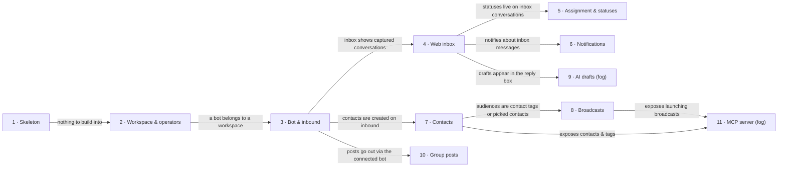

# Roadmap — tg-inbox

> **A decomposition, not a promise.** The overall idea broken into incremental steps: what each
> step is, where it comes from, how big it is — or that nobody has looked at it yet — and in which
> order, and parallel lanes, we walk them. **No dates** (except shipped history), **no scores** —
> order is the prioritization. The *solution* for any step lives in its `docs/features/<slug>/`
> spec, not here.

## Destination

Businesses that run multi-operator support in Telegram answer customers from a shared web inbox, grow a tagged contact base from every conversation, and reach it through broadcasts, group posts, AI reply drafts and an MCP server their own AI assistant can drive.

## Steps

| # | Step | Source | Size | Status |
|---|---|---|:---:|---|
| 1 | Project skeleton — the empty repo becomes a buildable, testable project | idea-brief.md §1 Raw idea | S | shipped → [`features/_scaffold`](features/_scaffold/tasks.json) |
| 2 | Workspace & operator accounts — a business is created by hand and its operators sign in to the web panel | idea-brief.md §3 Users | M | shipped → [`features/workspace-operators`](features/workspace-operators/spec.md) |
| 3 | Bot connection & inbound capture — a business pastes its bot token; every incoming message becomes a conversation and auto-creates a contact from the Telegram profile | idea-brief.md §7 Recommendation | M | shipped → [`features/bot-connection`](features/bot-connection/spec.md) |
| 4 | Shared web inbox — operators see conversations and reply; the customer receives the reply in the bot | idea-brief.md §2 Problem | M | shipped → [`features/shared-inbox`](features/shared-inbox/spec.md) |
| 5 | Assignment & statuses — conversations are open/closed and assigned to an operator | idea-brief.md §2 Problem | M | shipped → [`features/assignment-statuses`](features/assignment-statuses/spec.md) |
| 6 | Operator notifications — in-web notifications, plus a Telegram ping from the bot when the operator is inactive on the web | idea-brief.md §6 Risks | M | shipped → [`features/operator-notifications`](features/operator-notifications/spec.md) |
| 7 | Contacts — profile, operator tags and conversation history per contact | idea-brief.md §7 Recommendation | M | shipped → [`features/contacts`](features/contacts/spec.md) |
| 8 | Broadcasts — a member drafts a message for an audience picked by contact tags or for a hand-picked broadcast group of contacts (added and removed while it is a draft) and a business owner launches it; once launched its recipients are frozen and it is read-only apart from a delivery report; throttled per bot, tracking who blocked the bot | idea-brief.md §7 Recommendation · roadmap.md § Decisions so far | L | building → [`features/broadcasts`](features/broadcasts/spec.md) |
| 9 | AI reply drafts → see [Not yet specified](#not-yet-specified) | idea-brief.md §7 Recommendation | fog | idea |
| 10 | Group / channel posts — compose in the web and publish now or on a schedule to the business's group or channel | idea-brief.md §7 Recommendation | M | idea |
| 11 | Platform MCP server → see [Not yet specified](#not-yet-specified) | idea-brief.md §7 Recommendation | fog | idea |
| 12 | UI redesign — every shipped screen moves onto the design canon (side-navigation frame, owner Settings with Bot + Team), plus inbox / contacts / contact-profile preview screens on labelled sample data | [design-system.md](design-system.md) § Visual direction | S | shipped → [`features/ui-redesign`](features/ui-redesign/spec.md) |

## Not yet specified

| Area | What we'd have to learn | Blocks | How it gets sharpened |
|---|---|:---:|---|
| AI reply drafts | Where the AI gets business knowledge (past conversations, owner-supplied docs), where drafts appear in the inbox, what quality bar makes operators use them, cost per tenant | 9 | Recon pass once the inbox holds real pilot conversations; a throwaway prototype on those transcripts |
| Platform MCP server | Which actions to expose (read conversations/contacts, launch broadcasts), how an external AI authenticates on behalf of a workspace, read-only vs write | 11 | Recon pass after broadcasts ship; a conversation with 2–3 pilot owners about what they'd ask their AI |

## Out of scope

- Self-serve signup and onboarding — pilots are connected by hand; effort goes into support, not onboarding.
- Billing / payments — v1 success is daily usage, not revenue.
- Collecting phone / email from customers — contact = Telegram profile + tags + history; extra fields add friction and consent questions.
- Operators replying inside Telegram — the bot serves the end customer only; all operator work is on the web.
- Paid high-throughput broadcasts — Telegram gates them behind 100k monthly active users, out of reach for pilot bots.

## Open decisions

| # | Question | Type | Owner | Blocks |
|---|---|:---:|:---:|:---:|
| D2 | Where do the first 5–10 pilot businesses come from, and do they have 3+ operators? | grilling | human | — |
| D3 | Is the positioning "Telegram CRM" or "support tool" through v1? | grilling | human | — |
| D4 | When does pricing start, and what does a pilot get for using an unpaid v1? | grilling | human | — |

## Decisions so far

- Each business connects its own BotFather bot (own brand, own contact base) → [`docs/idea-brief.md` §3 Users](idea-brief.md)
- Operators work only in the web panel; the bot is for end customers → [`docs/idea-brief.md` §5 Out of scope](idea-brief.md)
- A contact is Telegram profile + operator tags + conversation history → [`docs/idea-brief.md` §5 Out of scope](idea-brief.md)
- AI comes as reply drafts for operators, not autonomous answers → [`docs/idea-brief.md` §5 Out of scope](idea-brief.md)
- MCP means a platform server for the owner's external AI assistant → [`docs/idea-brief.md` §5 Out of scope](idea-brief.md)
- Broadcasts must throttle to ~30 msgs/s per bot; blocked users surface via the my_chat_member update → [Telegram Bot FAQ](https://core.telegram.org/bots/faq)
- Broadcasts ship both audience kinds in one step (size M → L): contact tags, or a hand-picked broadcast group built from contact search / filter (add one, add all matching the filter, remove); a broadcast is an editable draft until launch, then its recipients freeze and it goes sending → sent and becomes read-only except its delivery report (delivered / failed / blocked the bot); reusing a group means duplicating a broadcast into a new draft — no standalone saved group → owner decision in the step 8 roadmap revision (this file's `updated_at`)
- An operator is "inactive on the web" (away from the web) for a workspace when none of their tabs, on any device, has that workspace's panel open with a working live connection and on screen within the last 10 minutes; the bot pings only members who linked their own Telegram from the panel, after a customer has waited 5 minutes (assignee first; unassigned, an assignee who cannot be pinged, or a 30-minute wait → the team), at most once per conversation per waiting period, with no customer text (closes D1) → [`features/operator-notifications/spec.md` §1](features/operator-notifications/spec.md)
- Channel posting needs the bot as admin with can_post_messages; scheduling is ours to build (no native scheduling) → [Telegram Bot API](https://core.telegram.org/bots/api#chatadministratorrights)

## Dependency graph

## Execution path

| Wave | Steps | Zone per step (why parallel-safe) | Unlocks |
|:---:|---|---|---|
| 1 | 1 | repo skeleton (new) | 2 |
| 2 | 2 | workspace & auth (new) | 3 |
| 3 | 3 | bot ingress (new) | 4, 7, 10 |
| 4 | 4 ∥ 7 | 4: inbox (new) · 7: contacts (new) (disjoint UI zones and data) | 5, 6, 8, 9 |
| 5 | 5 ∥ 6 | 5: inbox conversation state (new) · 6: notifications (new) (disjoint) | — |
| 6 | 8 | broadcasts (new) | 11 |
| 7 | 10 | posts & scheduler (new) — graph allows wave 4; placed here to keep the brief's version order | — |

## Shipped

| Step | Shipped | Link |
|---|---|---|
| 2 · Workspace & operator accounts | 2026-10-11 | [changelog](features/workspace-operators/_ship/changelog.md) · [PR #1](https://github.com/GopkoDev/tg-inbox/pull/1) |
| 3 · Bot connection & inbound capture | 2026-10-12 | [changelog](features/bot-connection/_ship/changelog.md) · [PR #2](https://github.com/GopkoDev/tg-inbox/pull/2) |
| 12 · UI redesign | 2026-10-18 | [changelog](features/ui-redesign/_ship/changelog.md) · [PR #3](https://github.com/GopkoDev/tg-inbox/pull/3) |
| 4 · Shared web inbox | 2026-10-18 | [changelog](features/shared-inbox/_ship/changelog.md) · [PR #4](https://github.com/GopkoDev/tg-inbox/pull/4) |
| 5 · Assignment & statuses | 2026-10-19 | [changelog](features/assignment-statuses/_ship/changelog.md) · PR pending |
| 6 · Operator notifications | 2026-10-19 | [changelog](features/operator-notifications/_ship/changelog.md) · PR pending |
| 7 · Contacts | 2026-10-19 | [changelog](features/contacts/_ship/changelog.md) · PR pending |
